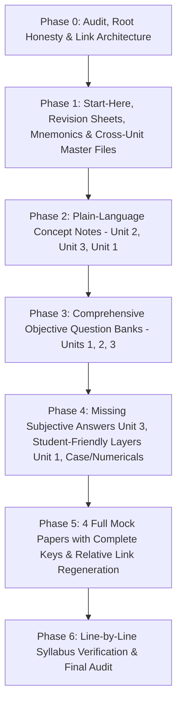

# AUDIT: Repository Baseline & Gap Analysis for MGN902

**Course:** MGN902: Export Import Procedure and Documentation (Units I, II, III)  
**Audit Date:** October 31, 2026  
**Auditor:** Senior International-Trade Professor & Lead Repo Engineer  
**Status:** Baseline Completed — Migration & Content Remediation Plan Active

---

## 1. Existing Repository Inventory & Word Count

Below is the verified inventory of all 27 existing markdown files in the repository prior to restructuring. Word and character counts were computed directly via whitespace and character parsing:

| # | Existing File Path | Lines | Characters | Words | Baseline Content Assessment |
|---|---|---:|---:|---:|---|
| 1 | `README.md` (root) | 1 | 7 | 2 | **Empty stub** (`# mgn_2\n`). Completely deficient. |
| 2 | `Subjective-Answers/README.md` | 122 | 11,568 | 1,659 | **False checkboxes**: Claims full 2M/5M/10M/15M/Diff/Notes/Case completion for all units including absent files. |
| 3 | `Subjective-Answers/Answer-Writing-Playbook.md` | 180 | 15,462 | 2,170 | High quality answer writing strategy; needs relocation to `00-Start-Here/Exam-Answer-Writing-Guide.md`. |
| 4 | `Subjective-Answers/VERIFY-BEFORE-EXAM.md` | 105 | 10,364 | 1,578 | Good baseline of statutory flags; needs root promotion and expansion of FTP 2023, FEMA, IES, RoDTEP. |
| 5 | `Subjective-Answers/Cross-Unit/Diagrams-You-Must-Draw.md` | 277 | 13,733 | 1,831 | Contains 8 core diagrams in ASCII/Mermaid; needs relocation to `Cross-Unit/Diagrams.md`. |
| 6 | `Subjective-Answers/Cross-Unit/Differentiate-Between-Master-List.md` | 317 | 38,581 | 5,892 | 24 tabular distinctions; high yield; needs relocation and expansion to `Cross-Unit/Comparison-Tables.md`. |
| 7 | `Subjective-Answers/Cross-Unit/Keywords-Examiners-Look-For.md` | 141 | 16,902 | 2,244 | High yield terminology triggers; keep in `Cross-Unit/`. |
| 8 | `Subjective-Answers/Cross-Unit/Short-Notes-Master-List.md` | 228 | 25,342 | 3,479 | 20 high-frequency short notes; keep in `Cross-Unit/`. |
| 9 | `Subjective-Answers/Unit-1/01-WTO.md` | 689 | 72,675 | 10,005 | Comprehensive subjective answers; overly dense legal tone; needs plain-language layer. |
| 10 | `Subjective-Answers/Unit-1/02-Agencies.md` | 733 | 75,407 | 10,086 | Comprehensive subjective answers; heavy formal tone; needs plain-language layer. |
| 11 | `Subjective-Answers/Unit-1/03-Steps-for-Exporting.md` | 826 | 80,855 | 11,367 | Comprehensive subjective answers; heavy formal tone; needs student-friendly layer. |
| 12 | `Subjective-Answers/Unit-1/04-Documentation.md` | 800 | 78,859 | 11,357 | Comprehensive subjective answers; lacks specific sample layouts and auxiliary certificates. |
| 13 | `Subjective-Answers/Unit-1/Probable-Questions-Ranked.md` | 41 | 9,789 | 1,127 | 30 questions; **all 30 links are broken absolute paths (`file:///d:/Temp/...`)** without target anchors. |
| 14 | `Subjective-Answers/Unit-2/01-Regulatory-Framework.md` | 792 | 83,748 | 11,809 | Comprehensive subjective answers on FTDR/FTP/Customs/FEMA/SCOMET. |
| 15 | `Subjective-Answers/Unit-2/02-Sales-Contract.md` | 734 | 70,072 | 9,741 | Comprehensive subjective answers on CISG, contract formation, clauses. |
| 16 | `Subjective-Answers/Unit-2/03-Payment-Methods.md` | 863 | 85,650 | 12,256 | Comprehensive subjective answers on payment hierarchy, LC, UCP 600. |
| 17 | `Subjective-Answers/Unit-2/04-Incoterms.md` | 748 | 68,260 | 10,154 | Comprehensive subjective answers on Incoterms 2020 rules. |
| 18 | `Subjective-Answers/Unit-2/05-Shipment-and-Customs.md` | 689 | 64,165 | 9,299 | Comprehensive subjective answers on export/import shipment and customs. |
| 19 | `Subjective-Answers/Unit-2/06-Central-Excise.md` | 452 | 47,702 | 6,946 | Comprehensive subjective answers on excise/rebate and GST transition. |
| 20 | `Subjective-Answers/Unit-2/07-EDI.md` | 511 | 49,256 | 6,340 | Comprehensive subjective answers on ICES, ICEGATE, RMS, Single Window. |
| 21 | `Subjective-Answers/Unit-2/Probable-Questions-Ranked.md` | 39 | 9,412 | 1,071 | 30 questions; **all 30 links are broken absolute paths (`file:///d:/Temp/...`)**. |
| 22 | `Subjective-Answers/Unit-3/01-Pre-Shipment-Finance.md` | 773 | 67,257 | 9,495 | Comprehensive subjective answers on packing credit, PCFC, eligibility. |
| 23 | `Subjective-Answers/Unit-3/02-Role-of-Banks.md` | 804 | 70,285 | 10,021 | Comprehensive subjective answers on AD banks, EDPMS/IDPMS, hedging. |
| 24 | `Subjective-Answers/Unit-3/03-Factoring.md` | 790 | 71,549 | 10,041 | Comprehensive subjective answers on factoring vs forfaiting, 2-factor system. |
| 25 | `Subjective-Answers/Unit-3/04-Insurance.md` | 888 | 79,235 | 11,264 | Comprehensive subjective answers on marine cargo, ICC (A, B, C), ECGC. |
| 26 | `Subjective-Answers/Unit-3/05-Types-of-Risks.md` | 858 | 74,578 | 10,200 | Comprehensive subjective answers on commercial, political, transit, legal risks. |
| 27 | `Subjective-Answers/Unit-3/Probable-Questions-Ranked.md` | 39 | 9,564 | 1,066 | 30 questions; **all 30 links are broken absolute paths (`file:///d:/Temp/...`)**; points to missing files 06, 07, 08! |
| **TOTAL** | **27 Files** | **12,968** | **1,254,496** | **176,969** | **Total words in baseline** |

---

## 2. Gap Analysis Against Target Structure

| Required Target File / Folder | Status | Gap Details & Action Required |
|---|---|---|
| **Root Level** | | |
| `README.md` | Incomplete (7 bytes) | Needs complete rewrite: orientation, 1-day study guide, repo map, honest coverage matrix. |
| `AUDIT.md` | Missing | Created now (this document). |
| `VERIFY-BEFORE-EXAM.md` | Located in subfolder | Relocate to root, extend with FTP 2023, IES, FEMA consolidation, RoDTEP, ECGC, HS 2022. |
| **`00-Start-Here/`** | **Folder Missing** | |
| `00-Start-Here/1-Day-Study-Plan.md` | Missing | Create hour-by-hour emergency revision plan with MUST/SHOULD/IF-TIME tags. |
| `00-Start-Here/Syllabus-Coverage-Matrix.md` | Missing | Create 100% syllabus map linking every syllabus line to concept notes, MCQs, subjective answers, glossary. |
| `00-Start-Here/Exam-Answer-Writing-Guide.md` | Missing | Relocate and merge `Subjective-Answers/Answer-Writing-Playbook.md`. |
| **`Unit-1-Institutional-Framework/`** | **Folder Missing** | (Only subjective answers exist under `Subjective-Answers/Unit-1`) |
| `01-WTO.md` (Concept Notes) | Missing | Create standalone concept note (11-section template). |
| `02-Agencies.md` (Concept Notes) | Missing | Create standalone concept note (11-section template). |
| `03-Steps-for-Exporting.md` (Concept Notes) | Missing | Create standalone concept note (11-section template). |
| `04-Documentation.md` (Concept Notes) | Missing | Create standalone concept note with document field layouts. |
| `MCQ-Bank.md` | Missing | Create 80 unique MCQs with full rationales (right and wrong options). |
| `Other-Objective-Questions.md` | Missing | Create 25 T/F, 20 Fill-in-blanks, 15 Match, 10 Assertion-Reason, 10 Scenarios. |
| `Quick-Revision.md` | Missing | Create 2-page ultra-condensed "last 2 hours" revision sheet. |
| `Mnemonics-and-Traps.md` | Missing | Create content-tied mnemonics, Top 20 Traps, Top 50 Quick Facts. |
| `Subjective/` | Needs Relocation | Relocate existing `Subjective-Answers/Unit-1/` files here, add student-friendly layers, fix links. |
| **`Unit-2-International-Trade-Operations/`** | **Folder Missing** | (Only subjective answers exist under `Subjective-Answers/Unit-2`) |
| `01-Regulatory-Framework.md` to `07-EDI.md` (Concept Notes) | Missing | Create 7 comprehensive concept notes (11-section template). |
| `MCQ-Bank.md` | Missing | Create 80 unique MCQs with full rationales. |
| `Other-Objective-Questions.md` | Missing | Create 25 T/F, 20 Fill-in-blanks, 15 Match, 10 Assertion-Reason, 10 Scenarios. |
| `Quick-Revision.md` | Missing | Create 2-page ultra-condensed "last 2 hours" revision sheet. |
| `Mnemonics-and-Traps.md` | Missing | Create content-tied mnemonics, Top 20 Traps, Top 50 Quick Facts. |
| `Subjective/` | Needs Relocation | Relocate existing `Subjective-Answers/Unit-2/` files here, fix links. |
| **`Unit-3-Export-Finance-and-Risk/`** | **Folder Missing** | (Only subjective answers 01-05 exist under `Subjective-Answers/Unit-3`) |
| `01-Pre-Shipment-Finance.md` to `08-Harmonized-System.md` (Concept Notes) | Missing | Create 8 comprehensive concept notes (11-section template). |
| `MCQ-Bank.md` | Missing | Create 80 unique MCQs with full rationales. |
| `Other-Objective-Questions.md` | Missing | Create 25 T/F, 20 Fill-in-blanks, 15 Match, 10 Assertion-Reason, 10 Scenarios. |
| `Quick-Revision.md` | Missing | Create 2-page ultra-condensed "last 2 hours" revision sheet. |
| `Mnemonics-and-Traps.md` | Missing | Create content-tied mnemonics, Top 20 Traps, Top 50 Quick Facts. |
| `Subjective/01` to `05` | Needs Relocation | Relocate existing `Subjective-Answers/Unit-3/` files here, fix links. |
| `Subjective/06-Quality-and-Inspection.md` | **Missing** | Write complete model subjective answers (2M, 5M, 10M, 15M, diff, short notes). |
| `Subjective/07-Clearance-of-Cargo.md` | **Missing** | Write complete model subjective answers (2M, 5M, 10M, 15M, diff, short notes). |
| `Subjective/08-Harmonized-System.md` | **Missing** | Write complete model subjective answers (2M, 5M, 10M, 15M, diff, short notes). |
| **`Cross-Unit/`** | Incomplete | Relocate from `Subjective-Answers/Cross-Unit/` to root and expand. |
| `Master-Glossary.md` | Missing | Create 200+ terms alphabetical master glossary with plain definitions and topic tags. |
| `Abbreviations-and-Full-Forms.md` | Missing | Create comprehensive master list of all EXIM acronyms. |
| `Comparison-Tables.md` | Incomplete | Expand `Differentiate-Between-Master-List.md` with missing pairs (B/L vs AWB, LC vs DP vs DA, etc.). |
| `Formulas-and-Calculations.md` | Missing | Create CIF/FOB, Drawback, Packing Credit interest, Factoring charge, Marine claims formula sheet. |
| `Diagrams.md` | Incomplete | Standardize all visual diagrams in Mermaid with 2-minute sketch guides. |
| `Case-and-Numerical-Questions.md` | Missing | Create full worked numerical problems and practical trade case studies. |
| **`Final-Mock-Exam/`** | **Folder Missing** | |
| `Mock-Objective-Paper-1.md` + Key | Missing | Create 50 balanced MCQs simulation + detailed explanations. |
| `Mock-Objective-Paper-2.md` + Key | Missing | Create 50 tricky/scenario MCQs simulation + detailed explanations. |
| `Mock-Subjective-Paper-1.md` + Key | Missing | Create 100-mark university pattern paper + marking key. |
| `Mock-Subjective-Paper-2.md` + Key | Missing | Create 100-mark university pattern paper + marking key. |

---

## 3. Broken Links & Structural Defects Analysis

### A. Absolute Path Hardcoding in All Ranked Question Files
Every single link in the three `Probable-Questions-Ranked.md` files (90 links total: 30 in Unit-1, 30 in Unit-2, 30 in Unit-3) uses an invalid hardcoded local Windows file URI:
- *Example from Unit-1:* `[`01-WTO.md#q-wto-15m-1`] -> file:///d:/Temp/mgn_2/Subjective-Answers/Unit-1/01-WTO.md`
- *Defect 1:* The anchor `#q-wto-15m-1` is inside the link text brackets, but omitted from the URL itself!
- *Defect 2:* In GitHub rendering or on any other machine/OS, `file:///d:/Temp/...` is a dead link.
- *Defect 3:* Unit-3 links point to non-existent files:
  - `file:///d:/Temp/mgn_2/Subjective-Answers/Unit-3/06-Quality-and-Inspection.md`
  - `file:///d:/Temp/mgn_2/Subjective-Answers/Unit-3/07-Cargo-Clearance.md`
  - `file:///d:/Temp/mgn_2/Subjective-Answers/Unit-3/08-Harmonized-System.md`

### B. False Checkbox Claims in `Subjective-Answers/README.md`
In `Subjective-Answers/README.md` (lines 78–121), the syllabus coverage table has 19 rows where every cell contains `[x]`, asserting 100% completion for:
- Unit-3 Quality and Inspection (`06-Quality-and-Inspection.md`) — **File did not exist!**
- Unit-3 Cargo Clearance (`07-Cargo-Clearance.md`) — **File did not exist!**
- Unit-3 Harmonized System (`08-Harmonized-System.md`) — **File did not exist!**
- Cross-Unit Case and Numerical Questions (`Case-and-Numerical-Questions.md`) — **File did not exist!**
- Mock Subjective Papers 1 & 2 and their Answer Keys — **Files did not exist!**

**Remediation:** In `Subjective-Answers/README.md` and the new root `README.md`, replace false ticks with honest statuses: `[x]` only for files verified to exist and be complete; `[ ]` for pending items until completed.

---

## 4. Topic-Level Content Deficiencies

### A. Thin or Absent Unit-1 Topics
1. **Auxiliary and Specialized Certificates:** Fumigation certificates (methyl bromide / phosphine treatments for timber/agricultural exports), Phytosanitary certificates (issued by Directorate of Plant Protection, Quarantine & Storage under IPPC), and Health/Veterinary sanitary certificates are missing dedicated procedural treatment.
2. **Marine Insurance Policy vs Certificate:** Marine insurance documentation distinctions under ADS need clear layout and operational context.
3. **Packing List Detail:** Lacks breakdown of net weight vs gross weight, volumetric weight calculation, package numbering, container stuffing list.
4. **Certificate of Origin (Preferential vs Non-Preferential):** Missing detailed operational rules for GSP (Generalized System of Preferences), Self-Certification under FTAs, digital issuance via DGFT Common Digital Platform (`coo.dgft.gov.in`).
5. **WTO Governance Walk-Through:** Ministerial Conference (highest decision-making, meets biennially) -> General Council (acting as Dispute Settlement Body and Trade Policy Review Body) -> Specialized Councils (Goods/GATT, Services/GATS, TRIPS) -> Committees -> Secretariat (Director-General, Geneva).
6. **Sample Document Layouts:** Students need visual field-lists for Commercial Invoice, Packing List, Bill of Lading, Certificate of Origin, Shipping Bill.

### B. Tone and Pedagogy Deficiencies in Existing Unit-1 Answers
- The existing answers in `Subjective-Answers/Unit-1/` use dense, overly formal jurisprudence terminology ("immutable core principles", "exhaustive analytical blueprint", hyper-dense statutory citations).
- While technically accurate and scoring well with strict law professors, they create severe cognitive overload for a student revising 24 hours before the exam.
- **Remediation:** Keep all existing high-scoring legal and procedural rigor intact, but prepend/append an accessible **"Student-Friendly Version"** with intuitive analogies, bullet points, memory hooks, and hand-drawable diagrams.

### C. Critical Dated Facts Requiring Verification & [VERIFY] Tags
The following statutory provisions and empirical data points must be tagged and updated in `VERIFY-BEFORE-EXAM.md`:
1. **Realization of Export Proceeds:** Standard FEMA period is 9 months from date of shipment (extended to 15 months for warehousing abroad / SEZ units). Status holders have certain write-off flexibilities.
2. **Interest Equalisation Scheme (IES):** Originally 5% / 3%, revised to 3% for MSME manufacturer exporters and 2% for non-MSME manufacturer exporters in 410 tariff lines. Scheme extensions have been granted in short tranches by DGFT/RBI. Students must state both the base scheme rules and recent extension context.
3. **Foreign Trade Policy (FTP 2023):** Launched on March 31, 2023 (effective April 1, 2023). It replaced FTP 2015-2020. Crucially, FTP 2023 has **no fixed 5-year end date** (it is dynamic and open-ended). Core pillars: Incentive to Remission, Export promotion through collaboration (Districts as Export Hubs), Ease of doing business, Emerging areas (E-commerce exports, SCOMET, Rupee invoicing).
4. **Export Remission Schemes:** Transition from MEIS (Merchandise Exports from India Scheme - ruled WTO-inconsistent under SCM) to **RoDTEP** (Remission of Duties and Taxes on Exported Products) and **RoSCTL** (for textiles/apparel). Duty Drawback under Sections 74 and 75 of Customs Act.
5. **RBI FEMA Regulations:** FEMA (Export of Goods and Services) Regulations, 2015 and FED Master Direction No. 16/2015-16. EDPMS (Export Data Processing and Monitoring System) and IDPMS (Import Data Processing and Monitoring System).
6. **ECGC Schemes:** SCR (Standard Policy / Shipments Comprehensive Risks Policy), Small Exporter's Policy, Specific Shipment Policy, Buyer's Exposure Policy, Financial Guarantees to Banks (Packing Credit Guarantee, Post-shipment Guarantee).
7. **Harmonized System (HS Edition):** WCO HS 2022 edition (7th edition) effective globally since Jan 1, 2022. Indian ITC(HS) 8-digit alignment.

---

## 5. Execution Roadmap

This audit serves as the baseline contract. As each phase is completed, the repository will transition from partial subjective coverage to an all-inclusive, self-contained, student-ready master repository.
