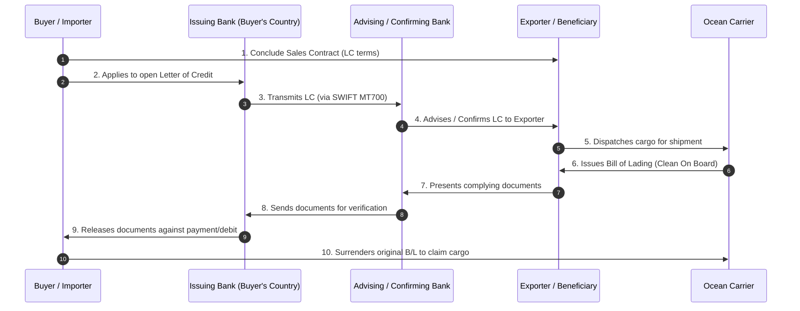
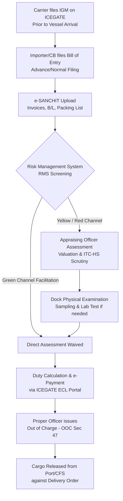
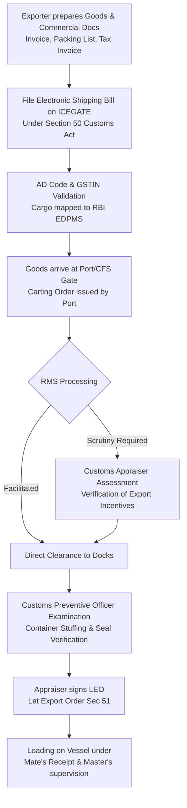
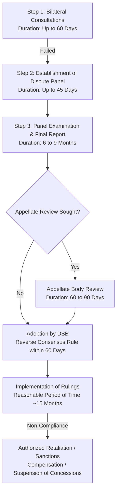
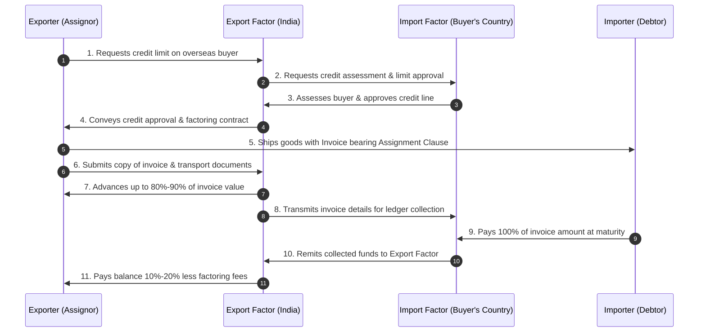
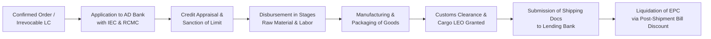

# Diagrams You Must Draw: Exam-Hall Visual Scoring Blueprints
## Mermaid Flowcharts with 2-Minute Hand-Drawn Exam Sketching Guides

In international trade law and procedural examinations, a candidate who accompanies their answer with a clean, well-labeled structural diagram automatically stands out. This document compiles the **10 mandatory diagrams** across Units I, II, and III.

---

### Diagram 1: The 10-Step Letter of Credit (LC) Transaction Cycle (Unit II)

#### Mermaid Flowchart


#### How to Draw This in the Exam Hall in Under 2 Minutes
* Draw 4 boxes in a horizontal rectangle across the page:
  `[Exporter]` $\longleftrightarrow$ `[Advising Bank]` $\longleftrightarrow$ `[Issuing Bank]` $\longleftrightarrow$ `[Importer]`.
* Draw numbered directional arrows between the boxes:
  1. Top dashed arrow from Importer to Exporter: *Sales Contract*.
  2. Arrow Importer $\rightarrow$ Issuing Bank: *LC Application*.
  3. Arrow Issuing Bank $\rightarrow$ Advising Bank: *LC Issued via SWIFT MT700*.
  4. Arrow Advising Bank $\rightarrow$ Exporter: *LC Advised*.
  5. Arrow Exporter $\rightarrow$ Advising Bank: *Complying Documents Presented*.
  6. Arrow Advising Bank $\rightarrow$ Issuing Bank: *Documents Sent*.
  7. Arrow Issuing Bank $\rightarrow$ Importer: *Documents Released & Account Debited*.
  8. Two bottom arrows showing *Cargo Dispatch* and *Cargo Release*.

---

### Diagram 2: Customs Clearance of Import Cargo in India (Bill of Entry to OOC) (Unit II & III)

#### Mermaid Flowchart


#### How to Draw This in the Exam Hall in Under 2 Minutes
* Draw a clean vertical ladder of 6 rectangular boxes down the center of the page:
  1. `[Carrier Files IGM]`
  2. `[Importer Files Bill of Entry on ICEGATE]`
  3. `[RMS Automated Screening (Green vs Red Channel)]`
  4. `[Assessment & Physical Examination]`
  5. `[Payment of Customs Duty & IGST]`
  6. `[Issuance of Out of Charge (OOC) under Sec 47]`
* Connect with downward arrows and label step 6 in double-borders.

---

### Diagram 3: Customs Clearance of Export Cargo (Shipping Bill to LEO) (Unit II & III)

#### Mermaid Flowchart


#### How to Draw This in the Exam Hall in Under 2 Minutes
* Draw a 5-box vertical sequence:
  1. `[Generate Shipping Bill on ICEGATE]`
  2. `[Cargo Entry at Docks (Carting Order)]`
  3. `[Customs Verification / Examination]`
  4. `[Let Export Order (LEO) under Section 51]`
  5. `[Cargo Loaded on Board Vessel]`
* Emphasize the **LEO under Section 51** with an asterisk and underline.

---

### Diagram 4: WTO Dispute Settlement Mechanism (DSU) Stages & Timelines (Unit I)

#### Mermaid Flowchart


#### How to Draw This in the Exam Hall in Under 2 Minutes
* Draw a 5-step horizontal or vertical chain:
  `[Consultations: 60 Days]` $\longrightarrow$ `[Panel Setup & Hearing: 6-9 Mos]` $\longrightarrow$ `[Appellate Body: 60-90 Days]` $\longrightarrow$ `[Adoption by DSB: Reverse Consensus]` $\longrightarrow$ `[Implementation or Retaliation]`.
* Write the exact days/months under each box; this demonstrates command of the DSU framework.

---

### Diagram 5: Two-Factor International Factoring Mechanism (FCI) (Unit III)

#### Mermaid Flowchart


#### How to Draw This in the Exam Hall in Under 2 Minutes
* Draw a four-corner diamond/box layout:
  * Top-Left: `[Exporter]` | Top-Right: `[Importer]`
  * Bottom-Left: `[Export Factor]` | Bottom-Right: `[Import Factor]`
* Connect them with labeled arrows:
  * Exporter $\longrightarrow$ Importer: *Goods + Factoring Assignment Notice*
  * Exporter $\longrightarrow$ Export Factor: *Invoices Handed Over*
  * Export Factor $\longrightarrow$ Exporter: *80–90% Cash Advance*
  * Importer $\longrightarrow$ Import Factor: *100% Payment at Maturity*
  * Import Factor $\longrightarrow$ Export Factor: *Full Remittance*
  * Export Factor $\longrightarrow$ Exporter: *Remaining 10–20% Reserve Balance Released*.

---

### Diagram 6: Pre-Shipment Packing Credit Lifecycle (Unit III)

#### Mermaid Flowchart


#### How to Draw This in the Exam Hall in Under 2 Minutes
* Draw 4 horizontal boxes:
  `[Export Order/LC]` $\longrightarrow$ `[AD Bank Sanctions EPC]` $\longrightarrow$ `[Disbursement for Manufacturing]` $\longrightarrow$ `[Liquidation via Export Bill Discounting]`.
* Write in bold below the last box: *Liquidation within 180 days out of export proceeds*.

---

### Diagram 7: Incoterms 2020 Risk Allocation Spectrum (Unit II)

#### Structural Matrix Diagram
```
EXW -------------------> FCA --------------------> FOB/CFR/CIF -------------------> DPU/DAP ------------------> DDP
(Minimum Seller                                                                                              (Maximum Seller
 Obligation)                                                                                                  Obligation)
 
 [Seller Premises]       [First Carrier]          [Vessel Loaded on Board]   [Destination Place]      [Destination Duty Paid]
 * Buyer arranges all    * Seller clears export   * Risk passes on board     * Seller pays carriage    * Seller pays import duty,
   carriage, export &      and hands to carrier     named sea port             to destination place      taxes & clears customs
   import clearance.       at named point.          (Maritime Only).           (Multimodal).             (Multimodal).
```

#### How to Draw This in the Exam Hall in Under 2 Minutes
* Draw a single horizontal arrow from left to right spanning the entire page width.
* Mark 5 vertical tick marks along the line:
  1. Far Left: **EXW** *(Minimum Seller Obligation)*
  2. Quarter: **FCA** *(Handoff to First Carrier)*
  3. Center: **FOB / CIF** *(Loaded on Board Sea Vessel)*
  4. Three-Quarter: **DAP / DPU** *(Delivered at Destination)*
  5. Far Right: **DDP** *(Maximum Seller Obligation - Taxes & Duties Paid)*.

---

### Diagram 8: Harmonized System (HS) Classification Hierarchy (Unit III)

#### Structural Breakdown
```
[CHAPTER: 2 Digits]       --> Example: Chapter 61 (Articles of apparel, knitted or crocheted)
        │
        ▼
[HEADING: 4 Digits]       --> Example: Heading 61.09 (T-shirts, singlets, and other vests, knitted)
        │
        ▼
[SUBHEADING: 6 Digits]    --> Example: Subheading 6109.10 (Of cotton)  <-- [WCO GLOBAL STANDARD LIMIT]
        │
        ▼
[REGIONAL / TARIFF ITEM: 8 Digits] --> Example: 6109.10.00 (Indian National Tariff Item in Customs Tariff Act)
```

#### How to Draw This in the Exam Hall in Under 2 Minutes
* Draw 4 stacked vertical blocks descending like steps or a pyramid:
  1. `[Chapter: First 2 Digits (Broad Product Class)]`
  2. `[Heading: First 4 Digits (Specific Category)]`
  3. `[Subheading: 6 Digits (Universal WCO International Standard)]`
  4. `[Tariff Item: 8 Digits (Indian National ITC-HS Specification)]`.

---

### Diagram 9: The 15 Sequential Steps for Executing an Export Order (Unit I)

#### Linear Process Chain
```
Phase 1: Setup & Compliance       [1. Firm Setup] -> [2. Bank A/c & AD Code] -> [3. IEC from DGFT] -> [4. RCMC from EPC]
                                                                                                            │
Phase 2: Marketing & Contract     [7. Contract Execution] <- [6. Proforma Invoice] <- [5. Market Research & Pricing]
                                            │
Phase 3: Production & Logistics   [8. Pre-Shipment Finance] -> [9. Production & QC] -> [10. Marine Insurance] -> [11. Booking Cargo]
                                                                                                                    │
Phase 4: Clearance & Realization  [15. Incentive Claims] <- [14. Realization & e-BRC] <- [13. Negotiation/LC] <- [12. Customs LEO]
```

#### How to Draw This in the Exam Hall in Under 2 Minutes
* Draw 4 horizontal swimlanes or rows, each containing 3 to 4 sequential boxes connected with arrows.
* Group them using brackets labeled: *1. Setup $\rightarrow$ 2. Contract $\rightarrow$ 3. Operations $\rightarrow$ 4. Payment & Realization*.

---

### Diagram 10: Documentary Collection Workflow under URC 522 (D/P vs D/A) (Unit II)

#### Mermaid Flowchart
```mermaid
flowchart LR
    A[Exporter / Principal] -->|1. Ships Cargo| B[Importer / Drawee]
    A -->|2. Submits Documents + Draft| C[Remitting Bank<br/>Exporter's Country]
    C -->|3. Dispatches Docs under URC 522| D[Collecting / Presenting Bank<br/>Importer's Country]
    D -->|4. Presents Draft & Notifies| B
    B -->|5a. Pays Cash At Sight (D/P)<br/>OR 5b. Accepts Usance Draft (D/A)| D
    D -->|6. Releases Original B/L & Docs| B
    D -->|7. Remits Funds to| C
    C -->|8. Credits Exporter's Account| A
```

#### How to Draw This in the Exam Hall in Under 2 Minutes
* Draw 4 boxes in a square or diamond configuration:
  * Top: `[Exporter]` and `[Importer]`
  * Bottom: `[Remitting Bank]` and `[Collecting Bank]`
* Draw arrow across top: *Cargo shipped directly*.
* Draw arrows across bottom: *Documents sent through banking chain under URC 522*.
* Add a decision callout at the Collecting Bank:
  * *If D/P: Cash paid $\rightarrow$ Documents released*.
  * *If D/A: Bill accepted $\rightarrow$ Documents released*.
