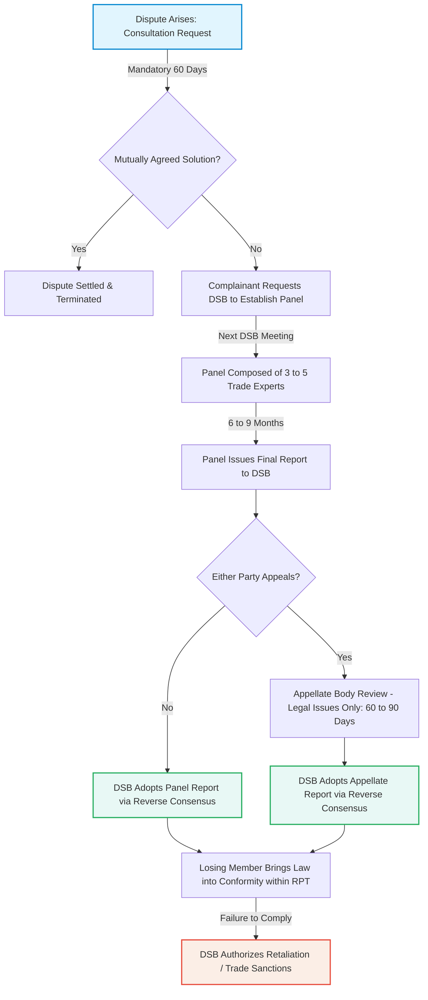
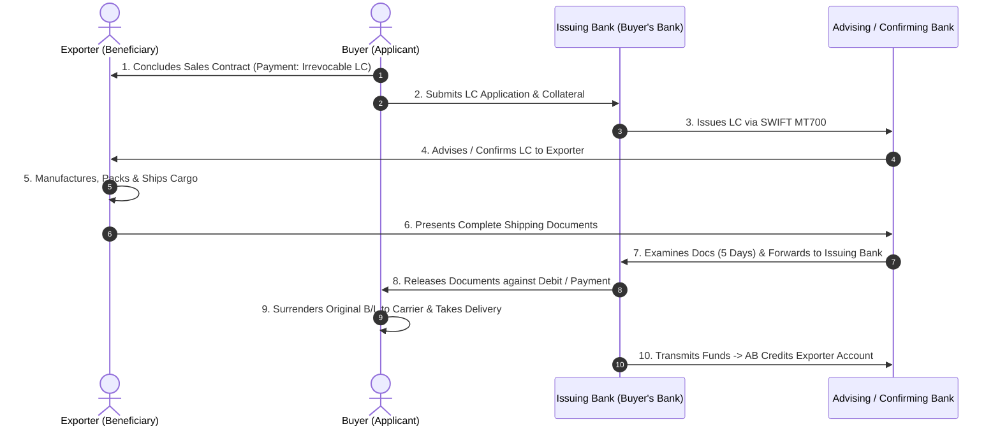
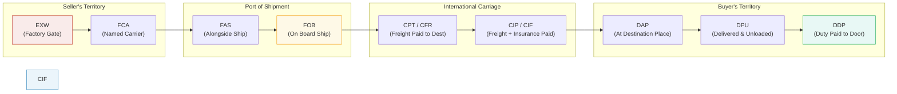
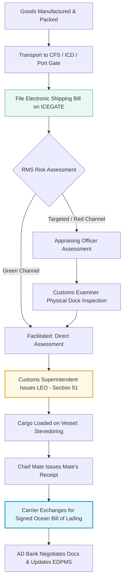
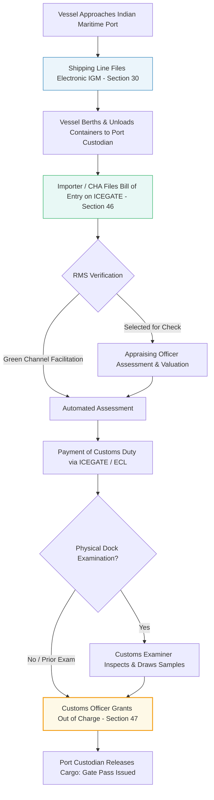
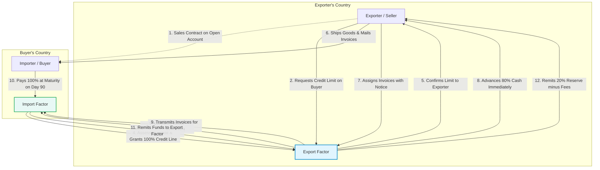
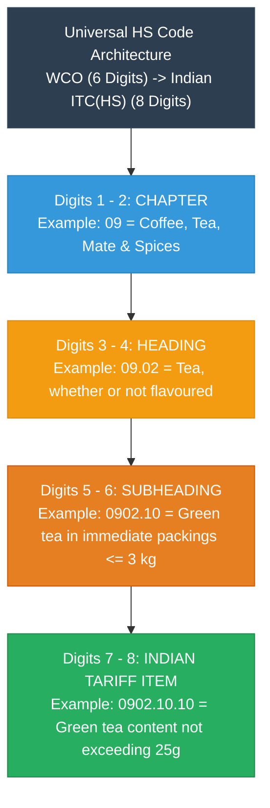

```mermaid
graph TD
    ADS[Aligned Documentation System - ADS<br>Based on UN Layout Key - ISO 6422] --> COMM[Commercial Documents<br>16 Documents]
    ADS --> REG[Regulatory Documents<br>4 Documents]
    
    COMM --> PRIN[Principal Commercial Documents<br>8 Documents]
    COMM --> AUX[Auxiliary Commercial Documents<br>8 Documents]
    
    PRIN --> CI[Commercial Invoice]
    PRIN --> PL[Packing List]
    PRIN --> BL[Ocean Bill of Lading / AWB]
    PRIN --> IC[Marine Insurance Certificate]
    PRIN --> COO[Certificate of Origin]
    PRIN --> BE[Bill of Exchange]
    PRIN --> CO[Certificate of Inspection]
    PRIN --> SLI[Shipper's Letter of Instruction]
    
    AUX --> PI[Proforma Invoice]
    AUX --> SO[Shipping Order]
    AUX --> MR[Mate's Receipt]
    AUX --> DL[Dock Receipt / Gate Pass]
    AUX --> FC[Fumigation Certificate]
    AUX --> PC[Phytosanitary Certificate]
    AUX --> HC[Health / Sanitary Certificate]
    AUX --> WH[Weight Certificate]
    
    REG --> SB[Shipping Bill - Customs]
    REG --> BOE[Bill of Entry - Customs]
    REG --> SDF[SDF / FEMA Declaration]
    REG --> BRC[e-BRC / Realization Certificate]

    style ADS fill:#2c3e50,stroke:#34495e,color:#fff
    style COMM fill:#2980b9,stroke:#1f618d,color:#fff
    style REG fill:#c0392b,stroke:#922b21,color:#fff
    style PRIN fill:#27ae60,stroke:#1e8449,color:#fff
    style AUX fill:#f39c12,stroke:#d68910,color:#fff
```

# Cross-Unit Master Diagrams: Mermaid Visuals & 2-Minute Exam Hall Sketch Guides

**Course:** MGN902: Export Import Procedure and Documentation  
**Scope:** Units I, II, and III  
**Pedagogical Goal:** Master the 8 core visual diagrams that earn maximum marks in Indian university exams. Each diagram includes a high-fidelity Mermaid flowchart and a **"2-Minute Exam-Hall Sketch Guide"** on how to draw it fast by hand with pen and paper.

---

## 1. WTO Dispute Settlement Understanding (DSU) Workflow

### Mermaid Diagram

### 2-Minute Exam-Hall Sketch Guide
1. **Draw a vertical ladder of 5 boxes** down the center of your answer sheet.
2. Box 1: *"Consultations (60 Days)"* -> Arrow down to Box 2.
3. Box 2: *"DSU Panel Examination (6–9 Months)"* -> Arrow down to Box 3.
4. Box 3: *"Appellate Body (60–90 Days)"* -> Arrow down to Box 4.
5. Box 4: *"DSB Adoption via REVERSE CONSENSUS" (Highlight this box in a double border)*.
6. Box 5: *"Compliance or Retaliation / Trade Sanctions"*.
7. *Tip:* Write the exact statutory timelines next to each arrow (60 days, 6-9 months, 60-90 days). Evaluators look specifically for these three numbers.

---

## 2. The 10-Step Letter of Credit (LC) Operational Cycle

### Mermaid Diagram

### 2-Minute Exam-Hall Sketch Guide
1. Draw **4 stick-figure/building icons in a square**:
   - Top-Left: **Buyer (Applicant)**
   - Top-Right: **Exporter (Beneficiary)**
   - Bottom-Left: **Issuing Bank**
   - Bottom-Right: **Advising/Confirming Bank**
2. Draw horizontal arrow 1 between Buyer and Exporter (*Sales Contract*).
3. Draw downward arrow 2 (*Application*) and diagonal arrow 3 (*SWIFT MT700*).
4. Draw upward arrow 4 (*Advise LC*).
5. Draw arrow 5 (*Ship Goods*).
6. Draw arrows 6 to 10 tracing the documents moving counter-clockwise and payment returning.
7. *Key Label:* Write *"UCP 600 - 5 Banking Days"* next to Issuing Bank.

---

## 3. Incoterms 2020 Master Risk & Cost Division Line

### Mermaid Diagram

### 2-Minute Exam-Hall Sketch Guide
1. Draw a **horizontal spectrum line** across the full width of the page.
2. Mark 4 distinct physical zones:
   - Factory -> Loading Port -> Ocean Transit -> Destination Warehouse.
3. Plot the 4 groups from left to right:
   - **E (EXW):** Mark at the extreme left (Factory). Note: *Minimum Seller Risk*.
   - **F (FCA, FAS, FOB):** Mark at origin loading port.
   - **C (CFR, CIF, CPT, CIP):** Mark across ocean transit. **Draw a dotted line at Port of Loading and write in bold:** *"CRITICAL: Risk transfers at loading port, but seller pays freight to destination!"*
   - **D (DAP, DPU, DDP):** Mark at destination warehouse. Note: *Maximum Seller Risk*.

---

## 4. Export Cargo Customs Clearance Pipeline (India)

### Mermaid Diagram

### 2-Minute Exam-Hall Sketch Guide
1. Draw a **downward vertical sequence of 7 neat rectangular boxes**:
   - Box 1: *CFS / ICD Gate-In & Checklist Generation*
   - Box 2: *File Shipping Bill online (ICEGATE)*
   - Box 3: *RMS Assessment (Green Channel vs Physical Inspection)*
   - Box 4: *Customs Examination & Seal Verification*
   - Box 5: *Let Export Order (LEO) - Section 51* (Highlight this box!)
   - Box 6: *Vessel Loading -> Mate's Receipt*
   - Box 7: *Issuance of Bill of Lading (B/L)*
2. Annotate Box 5 with: *"LEO = Official legal permission to load on vessel"*.

---

## 5. Import Cargo Customs Clearance Pipeline (India)

### Mermaid Diagram

### 2-Minute Exam-Hall Sketch Guide
1. Draw 6 rectangular steps from top to bottom:
   - Step 1: *IGM (Import General Manifest) filed under Section 30*
   - Step 2: *Bill of Entry (B/E) filed under Section 46 (White/Yellow/Green)*
   - Step 3: *Appraisal & HS Duty Assessment*
   - Step 4: *Duty Payment via ICEGATE Electronic Cash Ledger*
   - Step 5: *Out of Charge (OOC) under Section 47* (Highlight in bold!)
   - Step 6: *Port Gate-Out with Custodian Delivery Order*
2. Draw a small side box showing the 3 types of Bill of Entry:
   - White = Home Consumption | Yellow = Warehousing | Green = Ex-Bond.

---

## 6. Two-Factor International Factoring Mechanism (FCI)

### Mermaid Diagram

### 2-Minute Exam-Hall Sketch Guide
1. Divide your paper with a vertical dashed line down the middle:
   - Left side: *Exporter's Country* | Right side: *Buyer's Country*.
2. Draw **4 square boxes**:
   - Top-Left: **Exporter** | Top-Right: **Buyer**
   - Bottom-Left: **Export Factor** | Bottom-Right: **Import Factor**
3. Draw arrow between Factors: *"FCI Network Communication"*.
4. Number the 3 key money arrows:
   - Arrow A (from Export Factor to Exporter): *"80% Cash Advance"*.
   - Arrow B (from Buyer to Import Factor): *"100% Payment on Day 90"*.
   - Arrow C (from Export Factor to Exporter): *"20% Balance Reserve minus Fees"*.

---

## 7. Aligned Documentation System (ADS) Family Tree

### Mermaid Diagram

### 2-Minute Exam-Hall Sketch Guide
1. Draw a **tree hierarchy**: Top node = *"ADS (UN Layout Key - 20 Documents)"*.
2. Split into two main branches:
   - Left Branch: **Commercial Documents (16)**
   - Right Branch: **Regulatory Documents (4)**
3. Split the Left Branch into:
   - **8 Principal Documents:** *Invoice, Packing List, B/L, Insurance, COO, Bill of Exchange, Inspection, SLI*.
   - **8 Auxiliary Documents:** *Proforma Invoice, Shipping Order, Mate's Receipt, Dock Receipt, Fumigation, Phyto, Health, Weight Cert*.
4. List the 4 Regulatory Documents under the Right Branch:
   - *Shipping Bill, Bill of Entry, SDF (FEMA), e-BRC*.

---

## 8. Harmonized System (HS) 8-Digit Anatomy Tree

### Mermaid Diagram

### 2-Minute Exam-Hall Sketch Guide
1. Write the 8-digit code prominently at the top: **`0 9 0 2 . 1 0 . 1 0`**
2. Draw 4 brackets beneath the digits pointing downward:
   - Bracket under `09`: *"Digits 1–2 = Chapter (Broad Industry Group)"*
   - Bracket under `02`: *"Digits 3–4 = Heading (Specific Commodity Line)"*
   - Bracket under `10`: *"Digits 5–6 = Subheading (Universal WCO 6-digit Level)"*
   - Bracket under `10`: *"Digits 7–8 = Tariff Item (National Indian ITC-HS Level)"*
3. Draw a horizontal divider line between Digit 6 and Digit 7:
   - Mark Left (Digits 1–6): *"Universal across 200+ WCO Member Countries"*.
   - Mark Right (Digits 7–8): *"Unique to Indian Customs Tariff (Customs Tariff Act 1975)"*.
