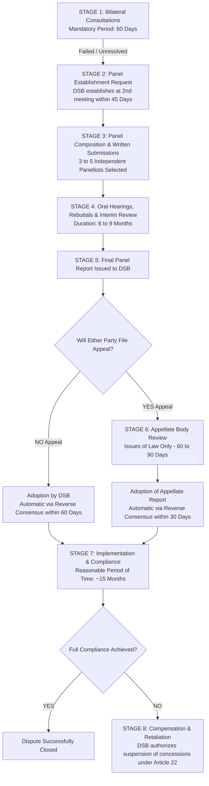

# Unit I: Topic 1 — World Trade Organization (WTO)
## Comprehensive Subjective Question Bank with Model Answers

---

### Section A: 2-Mark Questions (Short Definitions & Statutory Rules)

#### Q1. Define the Most-Favoured-Nation (MFN) principle under GATT Article I. (2 marks) | Likelihood: High | Type: Define
**Answer:**
The Most-Favoured-Nation (MFN) principle under Article I of the General Agreement on Tariffs and Trade (GATT 1994) mandates unconditional non-discrimination among trading partners. It requires that any trade advantage, tariff concession, privilege, or immunity granted by a WTO member to products originating in or destined for any other country must be accorded immediately and unconditionally to the like products of all other WTO members.
* **Keywords to include for full marks:** GATT Article I, unconditional non-discrimination, like products, immediate concession, multilateral parity.
* **Examiner trap:** Confusing MFN with National Treatment (MFN is border/external non-discrimination; National Treatment is internal/domestic non-discrimination).
* **Memory trick:** MFN = **M**ake **F**riends **N**eutral (treat all foreign nations equally).
* **Marking scheme guide:** 1 mark for GATT Art I and non-discrimination; 1 mark for "immediately and unconditionally to like products".

---

#### Q2. What is the National Treatment principle under GATT Article III? (2 marks) | Likelihood: High | Type: Define
**Answer:**
National Treatment under Article III of GATT prohibits WTO member countries from discriminating against imported goods once they have entered the domestic market and cleared customs. Foreign goods cannot be subjected to internal taxes (e.g., GST or excise) or domestic regulations, transport charges, or distribution laws that are higher or more burdensome than those applied to domestically produced like goods.
* **Keywords to include for full marks:** GATT Article III, post-customs clearance, internal taxation, domestic regulation, equal competitive conditions.
* **Examiner trap:** Thinking National Treatment prevents tariffs. Tariffs at the border are permitted; National Treatment applies only *after* border clearance.
* **Memory trick:** NT = **N**o **T**ax discrimination inside the border.
* **Marking scheme guide:** 1 mark for post-border/internal application; 1 mark for equal tax and regulatory parity with domestic like goods.

---

#### Q3. What is meant by "Tariff Binding" under GATT Article II? (2 marks) | Likelihood: Medium | Type: Define
**Answer:**
A Tariff Binding (or Bound Tariff Rate) represents a formal legal commitment made by a WTO member country in its Schedule of Concessions under GATT Article II, setting the maximum ceiling level of customs duty that can be levied on an imported commodity. A member cannot raise its applied tariff rate above this bound ceiling without formal renegotiations and offering trade compensation under GATT Article XXVIII.
* **Keywords to include for full marks:** Bound rate, GATT Article II, Schedule of Concessions, ceiling rate, GATT Article XXVIII compensation.
* **Examiner trap:** Confusing "applied rate" (the actual duty charged at customs) with "bound rate" (the legal maximum ceiling). Applied rates can be lower than bound rates.
* **Memory trick:** Binding = Legal handcuffs on tariff increases.
* **Marking scheme guide:** 1 mark for defining bound ceiling in Schedule of Concessions; 1 mark for obligation not to exceed without compensation.

---

#### Q4. Explain the concept of "Single Undertaking" in the WTO. (2 marks) | Likelihood: Medium | Type: Explain
**Answer:**
The principle of "Single Undertaking" signifies that virtually all multilateral agreements negotiated under the WTO umbrella must be accepted by every member country as an indivisible, integrated package ("nothing is agreed until everything is agreed"). A member cannot cherry-pick advantageous agreements (e.g., GATT market access) while opting out of onerous ones (such as TRIPS or TRIMS).
* **Keywords to include for full marks:** Single Undertaking, indivisible package, nothing is agreed until everything is agreed, elimination of plurilateral fragmentation.
* **Examiner trap:** Believing Plurilateral Agreements (e.g., Government Procurement) violate Single Undertaking. Plurilaterals are explicitly defined exceptions Annexed to the WTO Agreement.
* **Memory trick:** Single Undertaking = All-or-Nothing Buffet.
* **Marking scheme guide:** 1 mark for "indivisible package"; 1 mark for contrasting with the selective opt-out codes of the Tokyo Round.

---

#### Q5. What is the "Reverse Consensus" (or Negative Consensus) rule in WTO Dispute Settlement? (2 marks) | Likelihood: High | Type: Define
**Answer:**
Reverse Consensus is a unique procedural rule under the WTO Dispute Settlement Understanding (DSU Articles 6 and 16). Under this rule, a request for establishing a dispute panel or adopting a panel/Appellate Body report is deemed automatically approved by the Dispute Settlement Body (DSB) unless **every single member present formally votes against it**, making it virtually impossible for the losing defendant country to block an adverse ruling.
* **Keywords to include for full marks:** Reverse consensus, negative consensus, DSU Article 6/16, automatic adoption, blocking impossible.
* **Examiner trap:** Confusing with old GATT 1947 consensus where a single country (even the violator) could veto a panel report.
* **Memory trick:** Reverse Consensus = Automatic "YES" unless 100% say "NO".
* **Marking scheme guide:** 1 mark for explaining automatic adoption; 1 mark for contrasting with GATT single-veto system.

---

#### Q6. What is the "Peace Clause" under the WTO Agreement on Agriculture? (2 marks) | Likelihood: High | Type: Define
**Answer:**
The Peace Clause (formally Article 13 of the WTO Agreement on Agriculture, and revived at the 2013 Bali Ministerial Conference) protects developing countries, including India, from being legally challenged or taken to the WTO Dispute Settlement Body for exceeding domestic food security subsidy caps (the 10% *de minimis* Amber Box limit) when procuring food grains for public stockholding and poverty alleviation.
* **Keywords to include for full marks:** Article 13 AoA, Bali Ministerial 2013, public stockholding, 10% de minimis cap, protection against dispute challenge.
* **Examiner trap:** Assuming the Peace Clause allows unlimited commercial export subsidies; it strictly protects domestic public food distribution programs.
* **Memory trick:** Peace Clause = Truce on food security subsidies.
* **Marking scheme guide:** 1 mark for shield against dispute panel challenges; 1 mark for link to public stockholding/food security in developing countries.

---

### Section B: 5-Mark Questions (Structured Concepts & Analytical Notes)

#### Q7. Explain the three domestic support "Boxes" under the WTO Agreement on Agriculture (AoA). (5 marks) | Likelihood: High | Type: Explain
**Answer:**
The WTO Agreement on Agriculture (AoA) categorizes domestic agricultural subsidies into three colored "boxes" based on their degree of trade distortion:

```
[Green Box] ------------> Non-trade-distorting (R&D, infrastructure, direct income support) --> EXEMPT FROM REDUCTION
[Blue Box]  ------------> Production-limiting subsidies (direct payments linked to acreage) --> PERMITTED WITHOUT CAPS
[Amber Box] ------------> Trade-distorting price support & input subsidies (MSP, power)      --> CAPPED AT DE MINIMIS (10% for India)
```

1. **Green Box (Non-Distorting / Permitted):** Subsidies that have negligible or no trade-distorting impact. Examples include government funding for agricultural research, pest and disease control, rural infrastructure, environmental programs, and decoupled direct income support to farmers. These are fully permitted without any financial limitation.
2. **Blue Box (Production-Limiting Support):** Subsidies that are trade-distorting in principle but are linked to specific production-limiting programs (e.g., direct payments based on fixed areas and yields or fixed numbers of livestock). They are exempt from reduction commitments.
3. **Amber Box (Trade-Distorting / Actionable):** All domestic support measures that directly distort production and international trade prices, such as market price support (e.g., India's Minimum Support Price - MSP) and subsidized fertilizers, seeds, and irrigation. Amber Box support is measured by the Aggregate Measurement of Support (AMS) and is capped at a *de minimis* level (5% of agricultural production value for developed nations, 10% for developing nations like India).

* **Indian Example:** India's procurement of wheat and paddy at MSP falls under the Amber Box, which India protects under the WTO Bali Peace Clause.
* **Keywords to include for full marks:** Green box, Blue box, Amber box, Aggregate Measurement of Support (AMS), de minimis threshold, production-limiting, Minimum Support Price (MSP).
* **Examiner trap:** Confusing Blue Box with Amber Box. Blue box *must* have direct production-limiting requirements.
* **Memory trick:** Traffic Lights: Green = Go (unlimited); Amber = Slow down (capped/reduced); Blue = Farm plan detour.
* **Marking scheme guide:** 1.5 marks for Green Box; 1 mark for Blue Box; 1.5 marks for Amber Box; 1 mark for de minimis/Indian context.

---

#### Q8. Describe the objectives and institutional structure of the WTO. (5 marks) | Likelihood: High | Type: Describe
**Answer:**
### Core Objectives of the WTO
Established on January 1, 1995, pursuant to the Marrakesh Agreement, the World Trade Organization (WTO) is the sole multilateral body governing global trade rules. Its fundamental objectives include:
* Raising standards of living and ensuring full employment.
* Expanding the production of and trade in goods and services.
* Optimal utilization of global resources in accordance with sustainable development.
* Securing for developing and least-developed nations a share in international trade growth.

### Institutional Hierarchy
The WTO operates through a four-tiered decision-making structure based on consensus:
1. **Ministerial Conference:** The supreme decision-making body comprising trade ministers from all member countries, meeting at least once every two years to take major policy and treaty decisions.
2. **General Council:** The executive governing organ meeting regularly in Geneva, consisting of resident ambassadors. It functions in two specialized avatars:
   * As the **Dispute Settlement Body (DSB)** to administer dispute procedures.
   * As the **Trade Policy Review Body (TPRB)** to audit national trade policies.
3. **Sectoral Councils:** Subordinate councils overseeing specific agreements: Council for Trade in Goods (GATT), Council for Trade in Services (GATS), and Council for TRIPS.
4. **Secretariat:** Led by the Director-General, providing administrative and technical support.

* **Keywords to include for full marks:** Marrakesh Agreement 1995, Ministerial Conference, General Council, Dispute Settlement Body (DSB), TPRB, consensus rule.
* **Examiner trap:** Stating that the WTO has executive enforcement troops or police. WTO operates strictly through authorized commercial retaliatory sanctions.
* **Memory trick:** **M**inisters $\rightarrow$ **G**eneral Council $\rightarrow$ **S**ectoral Councils $\rightarrow$ **S**ecretariat (**MGSS**).
* **Marking scheme guide:** 2 marks for core objectives; 2 marks for 4-tier institutional structure; 1 mark for DSB/TPRB functions.

---

#### Q9. Explain the Special and Differential Treatment (S&DT) provisions for developing countries under the WTO. (5 marks) | Likelihood: Medium | Type: Explain
**Answer:**
### Concept and Legal Foundation
Special and Differential Treatment (S&DT) constitutes a foundational pillar of the WTO multilateral system recognizing that developing countries and Least Developed Countries (LDCs) suffer from structural industrial handicaps and cannot compete on equal terms with developed economies.

### Key Dimensions of S&DT Provisions
1. **Longer Timeframes for Implementation:** Developing nations are granted extended transition periods to comply with obligations (e.g., longer phase-ins under TRIPS and the Trade Facilitation Agreement).
2. **Higher Subsidy and Support Flexibility:** Developing countries are allowed higher *de minimis* thresholds (e.g., 10% under the Agreement on Agriculture compared to 5% for developed countries) and exemptions under Article 27 of the SCM Agreement.
3. **Preferential Market Access:** Developed nations grant non-reciprocal tariff preferences to developing nations under the Generalized System of Preferences (GSP) and Duty-Free Quota-Free (DFQF) schemes for LDCs, authorized under the 1979 Enabling Clause.
4. **Technical Assistance & Safeguards:** Mandates developed members and the WTO Secretariat to provide funded technical capacity-building and specialized legal advisory services during dispute settlement.

* **Relevance to India:** S&DT enables India to maintain public food distribution subsidies, protect small and marginal farmers, and implement calibrated industrial tariff regimes.
* **Keywords to include for full marks:** S&DT, Enabling Clause 1979, Generalized System of Preferences (GSP), transition periods, de minimis thresholds, non-reciprocity.
* **Examiner trap:** Believing S&DT is a permanent blanket exemption. S&DT provisions are legally calibrated exceptions and transition mechanisms.
* **Memory trick:** **L**onger time, **L**ess reciprocity, **L**arger subsidies, **L**egal aid (**4 Ls of S&DT**).
* **Marking scheme guide:** 1 mark for core definition/Enabling Clause; 3 marks for 4 dimensions of S&DT; 1 mark for Indian trade context.

---

#### Q10. Outline the provisions and significance of the WTO Agreement on Trade-Related Investment Measures (TRIMS). (5 marks) | Likelihood: Medium | Type: Explain
**Answer:**
### Concept & Purpose of TRIMS
The Agreement on Trade-Related Investment Measures (TRIMS) governs foreign investment policies that exert a direct, distorting effect on international trade in goods. It establishes that no WTO member may apply any investment policy that violates the core GATT principles of National Treatment (Article III) or General Elimination of Quantitative Restrictions (Article XI).

### Prohibited Measures (The Illustrative Negative List)
TRIMS identifies specific government-mandated investment conditionalities as unlawful:
1. **Local Content Requirements (LCRs):** Forcing foreign-invested companies to purchase or use a specific percentage of raw materials or components from domestic sources (violates National Treatment Article III:4).
2. **Trade Balancing Requirements:** Restricting an investor's import of capital goods or raw materials to a volume or value linked directly to the volume or value of goods exported by that enterprise.
3. **Foreign Exchange Balancing:** Limiting an enterprise’s foreign exchange access for imports to the amount of foreign exchange it generates through exports.
4. **Export Restrictions:** Mandating that an enterprise must export a specified percentage or quantity of its domestic production.

* **Indian Landmark Case:** In the *India – Automotive Sector* dispute (2002), WTO panels ruled that India’s indigenization (local content) and trade-balancing requirements imposed on foreign car manufacturers violated TRIMS.
* **Keywords to include for full marks:** TRIMS, GATT Article III, GATT Article XI, Local Content Requirements (LCR), trade balancing, foreign exchange balancing, Automotive dispute.
* **Examiner trap:** Thinking TRIMS protects cross-border investments against expropriation. TRIMS covers *trade-distorting conditionalities* on goods, not general foreign investment protection.
* **Memory trick:** **L**ocal content, **T**rade balance, **F**X balance, **E**xport quota (**LTFE** prohibited).
* **Marking scheme guide:** 1 mark for definition/GATT nexus; 3 marks for prohibited measures; 1 mark for Indian automotive case reference.

---

#### Q11. Explain the Sanitary and Phytosanitary (SPS) Agreement and Technical Barriers to Trade (TBT) Agreement. (5 marks) | Likelihood: High | Type: Explain
**Answer:**
Both the SPS and TBT agreements balance the legitimate right of sovereign governments to protect safety against the danger of using technical standards as disguised protectionist barriers.

### 1. Agreement on the Application of Sanitary and Phytosanitary Measures (SPS)
* **Scope:** Governs laws protecting human, animal, or plant life and health from pests, diseases, toxins, food additives, and contaminants.
* **Scientific Justification:** Measures must be based on scientific principles and sufficient scientific evidence. Members cannot maintain standards without an empirical risk assessment (Article 5).
* **Standard-Setting Bodies:** Relies on the "Three Sisters": Codex Alimentarius (food safety), WOAH/OIE (animal health), and IPPC (plant health).

### 2. Agreement on Technical Barriers to Trade (TBT)
* **Scope:** Governs all technical regulations, voluntary standards, and conformity assessment procedures (testing, packaging, labeling, marking) for all industrial and agricultural goods.
* **Principle of Proportionality:** Technical rules must not be more trade-restrictive than necessary to fulfill legitimate objectives (national security, prevention of deceptive practices, human health/safety).
* **Standard-Setting Bodies:** Encourages adoption of international benchmarks (e.g., ISO, IEC).

* **Indian Exporter Relevance:** Indian seafood and mango exporters frequently face SPS barriers in the European Union and USA over pesticide residue limits and fruit fly contamination.
* **Keywords to include for full marks:** SPS, TBT, scientific risk assessment, Codex Alimentarius, IPPC, WOAH/OIE, ISO, disguised protectionism.
* **Examiner trap:** Confusing SPS and TBT scopes. SPS applies *only* to biological pests/diseases/food toxins; TBT applies to industrial specifications, labeling, and engineering standards.
* **Memory trick:** SPS = **S**eed & **P**est **S**afety; TBT = **T**echnical **B**lueprint & **T**esting.
* **Marking scheme guide:** 2 marks for SPS principles and 3 sisters; 2 marks for TBT principles; 1 mark for Indian export impact.

---

#### Q12. Explain the Trade Facilitation Agreement (TFA) and how it benefits India. (5 marks) | Likelihood: Medium | Type: Explain
**Answer:**
### Origin and Core Objective
The WTO Trade Facilitation Agreement (TFA), which entered into force in February 2017 following the Bali Ministerial, aims to streamline, simplify, and standardize cross-border customs procedures to expedite the movement, release, and clearance of goods in transit.

### Structural Pillars of the TFA
1. **Transparency & Information (Articles 1–5):** Prompt electronic publication of customs laws, duty rates, and clearance fees; statutory provision for **Advance Rulings** on classification and valuation.
2. **Expedited Clearance Procedures (Articles 6–10):** Pre-arrival electronic processing of cargo declarations; institutionalization of Risk Management Systems (RMS) to clear low-risk shipments without physical examination; electronic payment of duties and fees.
3. **Single Window Clearance (Article 10.4):** Obligation to implement a single digital entry point for all regulatory declarations.
4. **Perishable Goods Handling:** Expedited release of perishable cargo under proper cold-chain conditions.

### Tangible Benefits to India
* **Turant Customs Initiative:** Spurred CBIC’s rollout of faceless, paperless, and contactless customs assessments.
* **Dwell Time Reduction:** Container dwell time at major ports like JNPT and Mundra fell dramatically.
* **Logistics Cost Savings:** Slashed transaction overheads, contributing to India’s jump in the World Bank’s Ease of Doing Business rankings.
* **Keywords to include for full marks:** Trade Facilitation Agreement (TFA), pre-arrival processing, Risk Management System (RMS), Single Window, Advance Rulings, Turant Customs.
* **Examiner trap:** Confusing TFA with market access tariff cuts. TFA contains zero tariff-reduction commitments; it addresses port logistics and paperwork.
* **Memory trick:** TFA = **T**ransparent rules, **F**ast clearance, **A**dvance electronic filing.
* **Marking scheme guide:** 1 mark for objective; 2 marks for procedural pillars; 2 marks for concrete Indian benefits.

---

### Section C: 10-Mark Questions (Detailed Analytical Answers)

#### Q13. Discuss the fundamental principles of the WTO multilateral trading system and their statutory exceptions. (10 marks) | Likelihood: High | Type: Discuss
**Answer:**
### 1. Introduction & Theoretical Foundations
The World Trade Organization (WTO), founded under the 1994 Marrakesh Agreement, oversees a rules-based multilateral trading system governing over 98% of international commerce. Its architecture is anchored upon five immutable core principles designed to foster predictability, non-discrimination, and open market access.

```
                         [ WTO CORE PRINCIPLES ]
         ┌───────────────────────────┼───────────────────────────┐
         ▼                           ▼                           ▼
[ Non-Discrimination ]       [ Tariff Binding ]         [ Fair Competition ]
  * MFN (GATT Art I)           (GATT Art II)              * Anti-dumping
  * National Treatment                                    * Subsidies (SCM)
    (GATT Art III)                   │                           │
                                     ▼                           ▼
                             [ Exceptions ]              [ Exceptions ]
                             * RTAs (Art XXIV)           * S&DT (Enabling Clause)
                             * Gen Excep (Art XX)        * BOP (Art XVIII:B)
                             * Security (Art XXI)
```

---

### 2. The Core Principles

#### A. The Principle of Non-Discrimination
Non-discrimination is the bedrock of the WTO, operating across two complementary legal doctrines:
1. **Most-Favoured-Nation (MFN) Treatment (GATT Art. I & GATS Art. II):** Prohibits discrimination *between trading partners*. Every member country must grant the same favorable treatment (lowest tariffs, simplified customs rules) unconditionally to like products from all WTO members.
2. **National Treatment Principle (GATT Art. III & GATS Art. XVII):** Prohibits discrimination *between foreign and domestic like goods*. Once imported goods cross the customs border and pay lawful customs tariffs, internal taxes (GST), environmental rules, and retail distribution regulations applied to them must not exceed those applied to domestic products.

#### B. Principle of Binding and Transparent Tariffs (GATT Art. II)
Market access commitments are recorded in national "Schedules of Concessions." Customs tariffs are "bound"—establishing a ceiling above which a member cannot arbitrarily raise duties without renegotiating under Article XXVIII and providing equivalent trade compensation. Transparent tariffs are mandated as the sole permissible form of protection, forbidding arbitrary quantitative quotas (GATT Art. XI).

#### C. Principle of Promoting Fair Competition
The WTO is not a free-trade charter, but a system of fair, undistorted competition. It provides legal mechanisms to neutralize unfair trade distortions:
* **Anti-Dumping Measures (GATT Art. VI / Anti-Dumping Agreement):** Imposing duties on goods exported below normal domestic value.
* **Subsidies and Countervailing Measures (SCM Agreement):** Disciplining government subsidies and authorizing countervailing duties (CVD).

#### D. Special and Differential Treatment (S&DT)
Recognizes developmental disparities by extending preferential terms, longer transition timelines, technical aid, and higher subsidy caps to developing countries and LDCs.

---

### 3. Statutory Exceptions to the Principles
The WTO recognizes that sovereign states require policy flexibility for national defense, economic integration, and emergencies:
1. **Regional Trade Agreements (RTAs) (GATT Art. XXIV):** Members may form Free Trade Agreements (FTAs) or Customs Unions (e.g., India-UAE CEPA, EU) that offer zero tariffs to signatories without extending them to the wider WTO membership, provided tariffs against third parties are not raised on whole.
2. **General Exceptions (GATT Art. XX):** Members may restrict imports to protect public morals, human/animal/plant life (health), gold/silver trade, or conserve exhaustible natural resources, provided such measures are not arbitrary discrimination or disguised protectionism.
3. **National Security Exceptions (GATT Art. XXI):** A member may suspend commitments to safeguard essential security interests during war, international emergency, or nuclear trade.
4. **Balance of Payments (BOP) Safeguards (GATT Art. XVIII:B):** Allows developing nations experiencing severe foreign exchange depletion to temporarily impose import restrictions.

### 4. Conclusion
The enduring strength of the WTO multilateral framework lies in this equilibrium: it establishes enforceable non-discriminatory trade rules while reserving sovereign emergency escape valves under GATT Articles XX, XXI, and XXIV.

* **Keywords to include for full marks:** MFN GATT Art I, National Treatment Art III, Tariff Binding Art II, Anti-Dumping Art VI, SCM Agreement, Art XXIV RTAs, Art XX General Exceptions, Art XXI Security Exceptions.
* **Examiner trap:** Forgetting to cite specific GATT article numbers. University examiners award top marks based directly on Article citations (I, II, III, VI, XX, XXI, XXIV).
* **Memory trick:** **M**-**N**-**B**-**F**-**S** (**M**FN, **N**ational Treatment, **B**ound Tariffs, **F**air Competition, **S**&DT).
* **Marking scheme guide:** 2 marks for intro/overview; 4 marks for four core principles; 3 marks for statutory exceptions; 1 mark for conclusion.

---

#### Q14. Critically evaluate the WTO Agreement on Agriculture (AoA) and its implications for India’s food security and farm policies. (10 marks) | Likelihood: High | Type: Critically Evaluate
**Answer:**
### 1. Introduction
The WTO Agreement on Agriculture (AoA), negotiated during the Uruguay Round and enacted in 1995, aimed to discipline massive agricultural protectionism and export subsidization predominantly practiced by Western economies. However, for developing nations like India, the AoA has proven to be a deeply contentious legal framework, creating conflicts between international trade obligations and domestic food security imperatives.

---

### 2. The Three Structural Pillars of the AoA

```
                                  [ THE THREE AOA PILLARS ]
                 ┌───────────────────────────┼───────────────────────────┐
                 ▼                           ▼                           ▼
        [ Market Access ]           [ Domestic Support ]        [ Export Subsidies ]
        * Tariffication             * Green Box (Exempt)        * Subsidies phased out
        * Bound duties              * Blue Box (Capped)           under 2015 Nairobi
        * No quantitative quotas    * Amber Box (AMS capped       Ministerial Decision
                                      at 10% de minimis)
```

1. **Market Access:** Mandated the elimination of non-tariff barriers ("tariffication") into bound customs duties and obligated minimum market access commitments. India converted its quantitative restrictions on farm imports into calibrated bound customs tariffs under Chapter 10 of its Customs Tariff Act.
2. **Domestic Support (The Subsidies Discipline):**
   * **Green Box:** General government services (agricultural research, irrigation infrastructure, pest management) that cause zero or minimal trade distortion. Fully exempt from reduction.
   * **Blue Box:** Direct income payments linked to production-limiting acreage controls.
   * **Amber Box:** Trade-distorting price and input subsidies (fertilizer, power, minimum support prices), aggregated as the **Aggregate Measurement of Support (AMS)** and capped at **10% of total agricultural production value** (*de minimis* limit) for developing countries.
3. **Export Subsidies:** Direct subsidies paid to encourage agricultural exports. Completely abolished under the historic 2015 Nairobi Ministerial Conference decision.

---

### 3. Critical Analytical Implications for India

#### A. The Minimum Support Price (MSP) and Public Stockholding Dilemma
India operates the world's largest food security safety net under the National Food Security Act (NFSA), 2013, procuring rice and wheat at MSP from smallholders and distributing subsidized grain to 800 million citizens through the Public Distribution System (PDS).
* **The Flawed External Reference Price (ERP) Formula:** Under AoA rules, the price support subsidy is calculated as the difference between the current MSP and the fixed historical ERP based on **1986–1988 international prices**. Because this benchmark ignores 35+ years of inflation, India’s calculated MSP support appears artificially inflated, threatening to breach the 10% *de minimis* limit.

#### B. The Bali Peace Clause (2013) & The Quest for a Permanent Solution
At the 2013 Bali Ministerial Conference, India successfully negotiated the **"Peace Clause"**, which shields developing nations from dispute challenges even if their public stockholding programs breach the 10% Amber Box cap, provided transparency criteria are satisfied. However, developed countries demand onerous notification conditions, and a permanent multilateral solution on Public Stockholding for Food Security Purposes (PSH) remains stalled.

#### C. Asymmetry in Subsidy Entitlements
Developed nations (USA, European Union) historically locked in massive, billion-dollar base-level AMS entitlements during the 1986-88 base period, or shifted vast farm payouts into decoupled "Green Box" direct payments. Developing nations like India, which had minimal historical subsidies, were frozen at the rigid 10% *de minimis* limit, creating a deeply inequitable structural playing field.

---

### 4. Conclusion & Strategic Way Forward
While the AoA successfully eliminated predatory export subsidies, its domestic support rules remain skewed in favor of industrialized nations. India must continue leading coalitions of developing nations (G-33, Africa Group) at WTO Ministerial Conferences to secure an unassailable, permanent amendment to AoA rules, ensuring that sovereign public stockholding for hunger eradication is permanently protected from trade litigation.

* **Keywords to include for full marks:** AoA, Market Access, Domestic Support, Green/Blue/Amber box, Aggregate Measurement of Support (AMS), 10% de minimis, External Reference Price (ERP) 1986-88, Bali Peace Clause, Public Stockholding (PSH), G-33.
* **Examiner trap:** Confusing food security procurement with commercial agricultural export dumping. India's PDS grain is distributed domestically, not exported onto global markets.
* **Memory trick:** **M**arket, **D**omestic, **E**xport (**MDE** Pillars) + **E**RP flaw = **B**ali Peace Clause.
* **Marking scheme guide:** 2 marks for intro and structure; 3 marks for three pillars; 4 marks for critical analysis of Indian MSP/ERP/Bali Peace Clause; 1 mark for conclusion.

---

#### Q15. Analyze the Agreement on Trade-Related Aspects of Intellectual Property Rights (TRIPS) and its flexibilities for public health with reference to the Indian pharmaceutical industry. (10 marks) | Likelihood: High | Type: Analyze
**Answer:**
### 1. Introduction
The Agreement on Trade-Related Aspects of Intellectual Property Rights (TRIPS), negotiated during the Uruguay Round, established universal, binding minimum standards for the protection and enforcement of intellectual property rights (IPRs) among WTO members. Prior to TRIPS, intellectual property was purely sovereign; TRIPS made IP protection enforceable through WTO trade sanctions.

```
                           [ TRIPS COVERAGE SPECTRUM ]
      ┌───────────────┬───────────────┼───────────────┬───────────────┐
      ▼               ▼               ▼               ▼               ▼
 [ Patents ]     [ Copyright ]  [ Trademarks ]   [ Geog. Ind. ]  [ Trade Secrets ]
   20 Years        Life + 50       Renewable       Appellation     Undisclosed Info
Product+Process     Years           7 Years         Protection      Confidentiality
```

---

### 2. Core Mandates of the TRIPS Agreement
1. **Universal Standards Across IP Categories:** Mandates minimum protection standards across seven fields: Patents, Copyrights, Trademarks, Geographical Indications (GIs), Industrial Designs, Integrated Circuit Layouts, and Undisclosed Information (Trade Secrets).
2. **Patents Discipline (Article 27):**
   * Patents must be available for any inventions—whether products or processes—in all fields of technology, provided they are new, involve an inventive step, and are capable of industrial application.
   * Mandates a uniform minimum patent term of **20 years** from filing.
   * Prohibits discrimination in patent grant based on place of invention or whether products are imported or domestically produced.
3. **Transition Obligations for India:** India historically recognized only *process patents* in pharmaceuticals and agrochemicals under the Indian Patents Act, 1970 (allowing Indian pharma to reverse-engineer molecules and supply cheap generic medicines). Under TRIPS, India was compelled to amend its Patents Act in 2005 to grant full **product patents**.

---

### 3. Public Health Flexibilities & The Doha Declaration (2001)
Developing nations successfully mobilized to prevent TRIPS from choking access to life-saving medicines. The landmark **2001 Doha Declaration on TRIPS and Public Health** affirmed that *"the TRIPS Agreement can and should be interpreted and implemented in a manner supportive of WTO members' right to protect public health and promote access to medicines for all."*

#### Key Statutory TRIPS Flexibilities:
1. **Compulsory Licensing (Article 31):** Sovereign governments may authorize a domestic manufacturer to produce and distribute a patented drug without the consent of the patent owner during national emergencies, public health crises, or for public non-commercial use.
   * *Indian Precedent:* In 2012, the Indian Patent Controller issued India’s first landmark compulsory license to Natco Pharma to produce a generic version of Bayer’s cancer drug *Nexavar* (sorafenib tosylate), slashing its monthly patient price from ₹2,80,000 to ₹8,800.
2. **Section 3(d) Anti-Evergreening Provision:** Under Section 3(d) of the amended Indian Patents Act, the mere discovery of a new form of a known substance without significant enhancement of therapeutic efficacy is non-patentable. This was decisively upheld by the Supreme Court of India in the landmark *Novartis Glivec* case (2013).
3. **Parallel Importation (Exhaustion of Rights - Art. 6):** Allows a country to import legitimate patented medicines from another country where the patent holder sells them at lower prices (international exhaustion doctrine).
4. **Bolar Exception (Regulatory Review Defense - Art. 30):** Allows generic drug manufacturers to conduct research, clinical trials, and file for regulatory marketing approval *before* the patent term expires, ensuring instantaneous generic launch the day the patent lapses.

---

### 4. Conclusion
While TRIPS curtailed India's historical process-patent advantage, strategic utilization of statutory TRIPS flexibilities (Compulsory Licenses, Section 3(d), Bolar exception) has allowed India to retain its status as the *"Pharmacy of the Developing World"*, providing affordable, life-saving generic pharmaceuticals to millions across the globe.

* **Keywords to include for full marks:** TRIPS, Product vs Process patents, 20-year term, Doha Declaration on Public Health 2001, Compulsory Licensing Article 31, Natco-Bayer Nexavar, Section 3(d), Novartis Glivec, Bolar Exception, Parallel Imports.
* **Examiner trap:** Believing TRIPS permanently bans generic manufacturing. Generic manufacturing is fully lawful once the 20-year patent expires, or under a Compulsory License.
* **Memory trick:** **P**atents, **P**ublic Health, **P**harmacy of the World (**3 Ps of TRIPS**).
* **Marking scheme guide:** 2 marks for intro/pre-2005 context; 3 marks for core TRIPS requirements; 4 marks for public health flexibilities (Compulsory license, Sec 3d, Bolar); 1 mark for conclusion.

---

#### Q16. Critically evaluate India’s experience in the WTO: Key benefits derived, major disputes faced, and core policy challenges. (10 marks) | Likelihood: High | Type: Critically Evaluate
**Answer:**
### 1. Introduction
India is a founding member of both GATT (1947) and the WTO (1995). India’s participation in the multilateral trading system reflects a complex balance: leveraging open global markets for its expanding goods, services, and IT exports, while staunchly safeguarding domestic agricultural livelihood, MSME manufacturing, and national food security from unfair external disruption.

---

### 2. Major Strategic Benefits Derived by India
1. **Rule-Based Multilateral Shield:** Protects India from unilateral coercive trade sanctions by economic superpowers (such as Section 301 actions by the United States).
2. **Exponential Export Expansion:** Access to MFN tariff treatment across 164 countries catalyzed India’s merchandise and services exports from under $40 billion in 1995 to over $770 billion in 2023.
3. **Abolition of Textile Quotas (MFA Phase-Out):** The phase-out of the discriminatory Multi-Fibre Arrangement (MFA) under the WTO Agreement on Textiles and Clothing in 2005 unlocked vast Western markets for Indian garment exporters.
4. **Services Trade Growth (GATS):** Provided a multilateral architecture under GATS Mode 1 (cross-border supply) and Mode 4 (movement of natural persons) underpinning the rise of India's multi-billion-dollar IT and business process outsourcing (BPO) sectors.
5. **Effective Dispute Redressal:** India has repeatedly used the WTO Dispute Settlement Body to dismantle unlawful trade barriers erected by developed economies.

---

### 3. Landmark WTO Disputes Involving India

| Dispute Reference | Core Subject Matter | Outcome & Strategic Impact |
|---|---|---|
| **India – Quantitative Restrictions (1999)** | US challenged India’s balance-of-payments import quotas on 1,400+ consumer items. | India lost; compelled to dismantle all remaining import quotas and shift purely to tariff barriers. |
| **US – Shrimp-Turtle Dispute (1998)** | US banned Indian shrimp exports over sea turtle conservation devices (TEDs). | Panel affirmed environmental exceptions under Art. XX, but ruled US implementation was discriminatory. |
| **India – Export Subsidies (2019)** | US challenged Indian export incentive programs (MEIS, EPCG, EOU, SEZ) under SCM Agreement. | Panel ruled India’s per capita GNI exceeded $1,000 threshold; compelled India to replace MEIS with **RoDTEP**. |
| **India – Solar Cells (2016)** | US challenged Domestic Content Requirements (DCR) in India's National Solar Mission under TRIMS. | India lost; forced to eliminate local component sourcing mandates for commercial solar projects. |

---

### 4. Key Ongoing Policy Challenges for India
1. **Agricultural Subsidies & Food Security:** Relentless pressure from Western food exporters against India’s MSP procurement and food stockholding programs under the Agreement on Agriculture.
2. **The Appellate Body Paralysis:** The unilateral US blockage of judicial appointments to the WTO Appellate Body since December 2019 has crippled dispute enforcement, enabling losing parties to appeal panel rulings "into the void".
3. **Plurilateral Push vs Multilateralism:** Rich nations are attempting to bypass multilateral consensus by launching Joint Statement Initiatives (JSIs) on E-Commerce, Investment Facilitation, and Gender/Trade, which India resists as non-mandated and disadvantageous to developing states.

### 5. Conclusion
Despite structural imbalances and recent appellate stagnation, the WTO remains indispensable to India’s economic destiny. As the leader of the Global South, India must continue building broad coalitions to reform the dispute settlement mechanism, secure a permanent food security settlement, and ensure trade rules reflect developmental equity.

* **Keywords to include for full marks:** Founding member, MFA phase-out, GATS Mode 1/4, India-QR dispute, US-Shrimp Turtle, SCM export subsidy dispute, RoDTEP transition, Solar Cells TRIMS, Appellate Body paralysis, Joint Statement Initiatives (JSIs).
* **Examiner trap:** Claiming India lost the MEIS dispute because of currency manipulation. India lost because its Gross National Income exceeded $1,000 per capita for three consecutive years under Annex VII of the SCM Agreement, terminating its export subsidy exemption.
* **Memory trick:** **B**enefits (MFA, IT, MFN), **D**isputes (QR, Shrimp, SCM/MEIS), **C**hallenges (Appellate paralysis, Food security) = **BDC framework**.
* **Marking scheme guide:** 2 marks for intro/overall stance; 3 marks for key benefits; 3 marks for dispute table/cases; 2 marks for challenges and conclusion.

---

### Section D: 15-Mark Comprehensive Questions (Master Analyses with Diagrams)

#### Q17. Provide an exhaustive analysis of the WTO Dispute Settlement Understanding (DSU). Detail the institutional stages, statutory timelines, the reverse consensus rule, and the appellate crisis. (15 marks) | Likelihood: High | Type: Comprehensive
**Answer:**

```
========================================================================================
    EXHAUSTIVE ANALYSIS: THE WTO DISPUTE SETTLEMENT UNDERSTANDING (DSU)
========================================================================================
```

### 1. Introduction & Statutory Foundation
The Dispute Settlement Understanding (Annex 2 of the WTO Agreement) is universally recognized as the central pillar of the multilateral trading system. Unlike the historical, toothless dispute mechanism of GATT 1947—where defending nations could unilaterally veto panel proceedings—the DSU establishes a binding, quasi-judicial international legal order. Administered by the **Dispute Settlement Body (DSB)**, it resolves cross-border trade conflicts governed strictly by the rule of international treaty law rather than bilateral geopolitical coercion.

---

### 2. Comprehensive Architectural Flowchart of the DSU Process



*Exam Hand-Drawing Guide (Under 2 Minutes):* Draw 6 simple connected boxes down the page: `[1. Consultations: 60d]` $\rightarrow$ `[2. Panel: 45d]` $\rightarrow$ `[3. Panel Hearings & Report: 6-9m]` $\rightarrow$ `[4. Appellate Review: 60-90d]` $\rightarrow$ `[5. DSB Adoption: Reverse Consensus]` $\rightarrow$ `[6. Implementation / Retaliation: Art 22]`.

---

### 3. Step-by-Step Procedural Breakdown and Statutory Timelines

#### Stage 1: Mandatory Bilateral Consultations (Article 4)
* **Duration:** Up to **60 days** (slashed to 20 days in urgent perishable cases).
* The complaining member formally requests consultations stating the measure challenged and legal basis. Consultations are confidential and allow parties to negotiate an amicable out-of-court settlement without public confrontation.

#### Stage 2: Establishment of the Dispute Panel (Articles 6 & 8)
* **Duration:** Up to **45 days**.
* If consultations fail after 60 days, the complainant requests the DSB to establish an ad-hoc dispute panel.
* **The Reverse Consensus Breakthrough:** At the first DSB meeting, the defendant may block panel creation. However, when the complainant tables the request at the **second consecutive DSB meeting**, the panel is **automatically established** unless there is a 100% unanimous consensus of all members present to reject it.
* Panels typically comprise 3 (or exceptionally 5) qualified independent trade experts/jurists serving in their personal capacities, not as government delegates.

#### Stage 3: Panel Proceedings, Submissions, and Interim Review (Article 12 & 15)
* **Duration:** Standard timeline of **6 to 9 months**.
* Both parties file detailed written legal submissions, followed by oral hearings in Geneva, cross-rebuttals, and third-party interventions.
* The Panel issues a confidential "Interim Report" to the parties for factual comments before releasing the Final Report to the entire WTO membership.

#### Stage 4: Appellate Review (Article 17)
* **Duration:** Strictly limited to **60 days**, extendable to a maximum of **90 days**.
* Appeals are heard by three members of the permanent seven-member **Appellate Body (AB)**.
* **Jurisdiction:** Strictly limited to **issues of law** and legal interpretations developed in the panel report; the AB cannot re-evaluate factual evidence or witnesses. The AB can uphold, modify, or reverse the panel's legal findings.

#### Stage 5: Formal Adoption by the Dispute Settlement Body (Articles 16 & 17.14)
* The panel report (or Appellate Body report) is formally placed before the DSB.
* Under the **Reverse Consensus Rule**, the report is **mandatorily adopted** within 60 days (or 30 days for appellate reports) unless the DSB decides by unanimous consensus not to adopt it.

#### Stage 6: Implementation of Rulings (Article 21)
* The losing member must notify its intention to comply within 30 days.
* If immediate compliance is impractical, the member is granted a **"Reasonable Period of Time" (RPT)** (typically 12 to 15 months), determined mutually or through binding arbitration (Art. 21.3c).
* If the parties dispute whether compliance measures are consistent with WTO law, a "Compliance Panel" is convened under Article 21.5.

#### Stage 7: Remedies, Compensation, and Authorized Retaliation (Article 22)
* If the infringing member fails to bring its laws into conformity within the RPT:
  1. *Voluntary Compensation:* Parties negotiate temporary financial or trade compensation (e.g., lower tariffs on other goods).
  2. *Authorized Retaliation (Suspension of Concessions):* If compensation fails, the DSB authorizes the complainant to suspend tariff concessions against the defendant (imposing punitive 100% retaliatory duties on the defendant's exports).
  3. *Cross-Retaliation:* If retaliation in the same sector is ineffective, the complainant can retaliate across sectors (e.g., suspending TRIPS patent obligations in response to a violation in agricultural goods).

---

### 4. Critical Crisis: The Paralysis of the Appellate Body
Since December 10, 2019, the WTO Appellate Body has been entirely paralyzed and unable to hear new appeals.
* **Root Cause:** The United States government (under successive administrations) systematically exercised its single-country veto to block the appointment and reappointment of Appellate Body judges, reducing the seven-member bench below the statutory 3-judge quorum required to hear any case.
* **US Grievances:** The US alleges "judicial overreach", arguing that the Appellate Body routinely exceeded its 90-day mandate, engaged in advisory opinions, and created new substantive legal obligations ("legislating from the bench") concerning trade remedies (zeroing methodologies) and public bodies.
* **The Systemic Danger ("Appealing into the Void"):** Any losing party in a panel proceeding can now file an appeal to the non-functioning Appellate Body. Because the appeal cannot be heard, the panel report cannot be adopted, effectively freezing the dispute indefinitely and neutralizing the binding enforceability of the entire WTO legal architecture.
* **Interim Solutions:** Several members (EU, China, Brazil, Canada) established the **Multi-Party Interim Appeal Arbitration Arrangement (MPIA)** under DSU Article 25 to arbitrate appeals among themselves, though major trading nations like the US and India have chosen not to join the MPIA.

---

### 5. Conclusion
The WTO Dispute Settlement Understanding remains one of the greatest achievements in public international law, having processed over 600 disputes since 1995. However, restoring a fully functioning, two-tiered independent dispute settlement system by resolving the Appellate Body appointment impasse is existential for the continued survival of a rules-based global trading order.

* **Keywords to include for full marks:** Dispute Settlement Understanding (DSU), Dispute Settlement Body (DSB), Reverse Consensus, 60-day consultations, Article 6 panel establishment, 6-9 months panel report, Article 17 Appellate Body, Reasonable Period of Time (RPT), Article 22 Retaliation, Cross-retaliation, Appealing into the void, MPIA Article 25.
* **Examiner trap:** Writing that the WTO can arrest ministers or fine sovereign treasuries directly. Remedies are strictly trade-based (authorized suspension of tariff concessions).
* **Memory trick:** **C**-**P**-**R**-**A**-**I**-**R** (**C**onsultation $\rightarrow$ **P**anel $\rightarrow$ **R**eport $\rightarrow$ **A**ppeal $\rightarrow$ **I**mplementation $\rightarrow$ **R**etaliation).
* **Marking scheme guide:** 2 marks for intro and legal foundation; 3 marks for visual flowchart and statutory timelines; 4 marks for detailed stage-by-step breakdown; 3 marks for reverse consensus and Article 22 remedies; 2 marks for Appellate Body paralysis analysis; 1 mark for conclusion.

---

#### Q18. Compare and contrast GATT 1947 with WTO 1995. How did the Uruguay Round transform the multilateral architecture? (15 marks) | Likelihood: High | Type: Comprehensive
**Answer:**

```
========================================================================================
     TRANSFORMATION OF GLOBAL TRADE: COMPARATIVE ESSAY ON GATT 1947 VS WTO 1995
========================================================================================
```

### 1. Introduction: Historical Genesis from Havana to Marrakesh
Following the catastrophic economic devastation of World War II and the disastrous protectionist beggar-thy-neighbor policies of the 1930s (e.g., the Smoot-Hawley Tariff Act), Allied nations convened the 1944 Bretton Woods Conference. The visionary architecture contemplated three institutional pillars: the International Monetary Fund (IMF) for monetary stability, the International Bank for Reconstruction and Development (World Bank) for reconstruction, and the **International Trade Organization (ITO)** to regulate global commerce.

When the 1948 Havana Charter for the ITO was rejected by the United States Congress, the provisional commercial chapter—the **General Agreement on Tariffs and Trade (GATT 1947)**—entered into force on a provisional basis via a "Protocol of Provisional Application". For 47 years, GATT governed world trade without a permanent corporate charter. The historic **Uruguay Round (1986–1994)** culminated in the signing of the **Marrakesh Agreement**, formally erecting the **World Trade Organization (WTO)** on January 1, 1995.

---

### 2. Comprehensive Comparative Matrix: GATT 1947 vs WTO 1995

| Parameter of Comparison | GATT 1947 | WTO 1995 |
|---|---|---|
| **1. Legal Nature & Personality** | A multilateral treaty applied on a provisional basis; possessed no recognized corporate legal personality or formal charter. | A permanent international intergovernmental organization with distinct legal personality, charter, headquarters, and privileges. |
| **2. Scope of Regulatory Coverage** | Strictly confined to **trade in physical/tangible merchandise goods**. | Encompasses **Goods (GATT 1994), Services (GATS), and Intellectual Property Rights (TRIPS)**. |
| **3. Dispute Settlement Architecture** | Consensus-based dispute mechanism; the defending party held a unilateral veto right to block panel formation and report adoption. | Quasi-judicial **Dispute Settlement Understanding (DSU)** featuring **Reverse Consensus**, strict statutory deadlines, and appellate review. |
| **4. Nature of Multilateral Obligations** | Plurilateral fragmentation; members could selectively sign or opt out of specific supplementary codes (e.g., Tokyo Round codes). | **Single Undertaking** doctrine; all multilateral trade agreements form an indivisible, integrated legal package. |
| **5. Participant Designation** | Signatories were formally designated as **"Contracting Parties"**. | Participating sovereign states are full **"Members"**. |
| **6. Institutional Machinery** | Operated through an ad-hoc secretariat, working parties, and periodic multi-year negotiating "Rounds". | Structured four-tier hierarchy: Ministerial Conference, General Council, Sectoral Councils, and permanent Secretariat. |
| **7. Policy Surveillance** | No formal, systemic audit mechanism for domestic trade policies existed. | Formal institutionalized **Trade Policy Review Mechanism (TPRM)** conducting cyclical audits of all member economies. |
| **8. Institutional Strength** | Fragile legal foundation ("grandfather rights" permitted prior domestic laws to override GATT rules). | Robust international treaty commitments; member domestic statutes must be brought into conformity with WTO law. |

---

### 3. Deep-Dive: How the Uruguay Round Transformed the Global Trading Architecture

```
                       [ URUGUAY ROUND SYSTEMIC SHIFT ]
         ┌───────────────────────────┼───────────────────────────┐
         ▼                           ▼                           ▼
[ Sectoral Expansion ]      [ Institutional Shift ]      [ Systemic Integrity ]
  * Agriculture (AoA)         * GATT Treaty               * End of "GATT à la carte"
  * Textiles (ATC)              to WTO Organization       * Single Undertaking
  * Services (GATS)           * Reverse Consensus DSU     * Elimination of unilateral
  * IP Rights (TRIPS)         * Universal TPRM audits       blocking
```

#### A. Sectoral Expansion into the Modern Economy
GATT 1947 largely sidelined two politically sensitive sectors: Agriculture (distorted by massive Western waivers) and Textiles (governed by the protectionist Multi-Fibre Arrangement quota system). The Uruguay Round brought both under multilateral disciplines:
* **Agreement on Agriculture (AoA):** Converted non-tariff quotas into tariffs and established binding disciplines on domestic support (Boxes) and export subsidies.
* **Agreement on Textiles and Clothing (ATC):** Orchestrated a 10-year phased eradication of import quotas by January 1, 2005.
* **GATS and TRIPS:** Integrated the dominant modern economic engines—services (banking, telecommunications, IT, software) and intellectual property (patents, copyrights, trademarks)—into enforceable international law.

#### B. The Transition from "GATT à la Carte" to the Single Undertaking
Under GATT rounds (notably the 1973–79 Tokyo Round), the multilateral system fragmented into "GATT à la carte." Developed nations negotiated plurilateral codes (Anti-Dumping, Subsidies, Technical Barriers) that bound only the signatories, while developing nations opted out.
* The Uruguay Round eliminated this fragmentation by introducing the **Single Undertaking**. Every WTO member is legally bound to every single multilateral agreement annexed to the Marrakesh Agreement.

#### C. Revolutionizing the Dispute Mechanism
The fatal defect of GATT dispute settlement was the **Positive Consensus Rule**. A panel report could only be adopted if all contracting parties approved it. Inevitably, the losing defendant country simply voted "NO", blocking the report and denying legal remedy to the victim.
* The Uruguay Round inverted this with the revolutionary **Reverse Consensus Rule**. Panel and Appellate Body reports are automatically adopted unless there is a 100% consensus of all members *against* adoption. This single legal innovation transformed dispute settlement from political horse-trading into enforceable international jurisprudence.

---

### 4. Conclusion
The journey from GATT 1947 to WTO 1995 represents the most profound institutional evolution in the history of international economic governance. By constructing a permanent organizational framework, extending coverage to services and intellectual property, enforcing a Single Undertaking, and establishing an automatic dispute mechanism, the Uruguay Round transformed international trade from an ad-hoc provisional agreement into an enduring, rules-based global economic order.

* **Keywords to include for full marks:** Bretton Woods, Havana Charter, Protocol of Provisional Application, Uruguay Round, Marrakesh Agreement 1995, Single Undertaking, GATT à la carte, Reverse Consensus, GATS, TRIPS, AoA, MFA phase-out, TPRM.
* **Examiner trap:** Stating that GATT disappeared entirely. GATT was not destroyed; it was updated, renamed **GATT 1994**, and incorporated as Annex 1A of the WTO Agreement governing trade in goods.
* **Memory trick:** **L**egal, **S**cope, **D**ispute, **O**bligation, **M**embers (**LSD-OM** framework for GATT vs WTO).
* **Marking scheme guide:** 2 marks for historical background (Havana/Bretton Woods); 5 marks for complete 8-parameter comparative table; 5 marks for detailed analysis of Uruguay Round transformations; 2 marks for GATT 1994 integration nuance; 1 mark for conclusion.

---

### Section E: Differentiate-Between Questions (Table Format — Minimum 6 Points)

#### Q19. Differentiate between Anti-Dumping Measures and Countervailing Measures (CVD) under the WTO. (5 marks) | Likelihood: High | Type: Differentiate
**Answer:**

| Parameter of Distinction | Anti-Dumping Measures (GATT Art. VI / ADA) | Countervailing Measures (GATT Art. VI & XVI / SCM Agreement) |
|---|---|---|
| **1. Primary Target / Cause** | Target **unfair commercial pricing practices of private exporting enterprises** selling below normal value. | Target **unfair financial assistance/subsidies granted by foreign governments** to their domestic industries. |
| **2. Triggering Condition** | Goods are exported at an export price lower than the "Normal Value" (domestic market price) in the exporting country. | The exporting government provides a financial contribution conferring a specific commercial benefit to an enterprise. |
| **3. Investigation Focus** | Investigates the enterprise's cost of production, domestic selling prices, and invoice export prices. | Investigates foreign government budgets, fiscal tax exemptions, subsidized land/loans, and state grants. |
| **4. Governing WTO Agreement** | WTO **Anti-Dumping Agreement (ADA)** (Agreement on Implementation of Article VI of GATT 1994). | WTO **Agreement on Subsidies and Countervailing Measures (ASCM)**. |
| **5. Determination of Margin** | Calculates **Margin of Dumping**: Difference between Normal Value and Export Price. | Calculates **Amount of Subsidy**: Value of benefit conferred by the state per unit of exported product. |
| **6. Nature of Remedy / Duty** | An **Anti-Dumping Duty (ADD)** equal to or lower than the margin of dumping (Lesser Duty Rule). | A **Countervailing Duty (CVD)** equal to the calculated net subsidy per unit. |
| **7. Common Ground / Prerequisite** | Requires proof of: (a) Dumping, (b) **Material Injury** to domestic industry, and (c) Causal link. | Requires proof of: (a) Specific Subsidy, (b) **Material Injury** to domestic industry, and (c) Causal link. |

* **Keywords to include for full marks:** Anti-Dumping Agreement, SCM Agreement, Normal Value, Export Price, Government financial contribution, Margin of Dumping, Subsidy amount, Material Injury, Causal link.
* **Examiner trap:** Believing anti-dumping duties punish governments. Anti-dumping targets *company* price-discrimination; countervailing duties target *government* subsidies.
* **Memory trick:** Anti-Dumping = Private Firm price cutting; Countervailing = Foreign Government cash handing.
* **Marking scheme guide:** 0.5 marks per row (min 6 rows = 3 marks); 1 mark for statutory citation; 1 mark for material injury common rule.

---

#### Q20. Differentiate between the General Agreement on Tariffs and Trade (GATT) and the General Agreement on Trade in Services (GATS). (5 marks) | Likelihood: Medium | Type: Differentiate
**Answer:**

| Parameter of Distinction | GATT (Trade in Goods) | GATS (Trade in Services) |
|---|---|---|
| **1. Nature of Traded Subject** | Regulates trade in **tangible, physical merchandise** (raw materials, industrial goods, crops). | Regulates trade in **intangible, non-storable economic services** (banking, software, tourism, legal). |
| **2. Border Customs Clearance** | Crosses physical geographical borders; subjected to port clearance, physical inspection, and customs duties. | Does not cross physical customs checkpoints; regulated via domestic regulations, licensing, and professional permits. |
| **3. Modes of Delivery** | Single delivery mechanism: Cross-border physical shipment via ocean, air, rail, or road carriers. | Delivered across **Four Standardized Modes**: Mode 1 (Cross-border), Mode 2 (Consumption abroad), Mode 3 (Commercial presence), Mode 4 (Movement of natural persons). |
| **4. National Treatment Obligation** | **General, universal, and unconditional obligation** under Article III across all goods once customs duty is paid. | **Conditional obligation** under Article XVII; applies *only* to sectors explicitly scheduled in national commitments. |
| **5. Primary Protective Barrier** | Regulates visible border tariffs, customs valuation, anti-dumping duties, and import quotas. | Regulates non-tariff regulatory restrictions: FDI equity caps, visa quotas, qualification recognition, license bans. |
| **6. Direct Economic Relevance to India** | Critical for merchandise exports: textiles, pharmaceuticals, petroleum products, engineering goods. | Vital engine of Indian services economy: IT software exports (TCS, Infosys) under Mode 1 and IT professionals under Mode 4. |

* **Keywords to include for full marks:** Tangible goods, intangible services, GATS 4 Modes, unconditional National Treatment, conditional scheduling, Mode 1 cross-border, Mode 4 natural persons.
* **Examiner trap:** Assuming National Treatment applies automatically to all services under GATS. National Treatment in GATS applies *only to sectors a country explicitly lists in its positive schedule*.
* **Memory trick:** GATT = Goods at Ports; GATS = Services across 4 Modes.
* **Marking scheme guide:** 0.5 marks per distinct parameter (minimum 6 parameters = 3 marks); 1 mark for explanation of 4 GATS modes; 1 mark for National Treatment conditionality contrast.

---

#### Q21. Differentiate between Bound Tariff Rates and Applied Tariff Rates. (5 marks) | Likelihood: High | Type: Differentiate
**Answer:**

| Parameter of Distinction | Bound Tariff Rate | Applied Tariff Rate |
|---|---|---|
| **1. Statutory Definition** | The legal maximum ceiling tariff rate committed by a WTO member in its official Schedule of Concessions (GATT Art. II). | The actual customs duty rate levied by customs authorities at the border on imported cargo on any given day. |
| **2. Legal Nature & Obligation** | A binding international treaty obligation registered with and governed by the WTO. | A sovereign domestic fiscal rate notified by the domestic government (e.g., CBIC in India via customs notifications). |
| **3. Flexibility & Volatility** | Rigid and fixed; cannot be increased beyond the bound ceiling without formal WTO renegotiations and compensation. | Highly flexible; can be changed overnight through domestic government notifications or the annual national budget. |
| **4. Relationship Between Rates** | Acts as the **absolute legal ceiling**. The applied rate can be equal to or lower than the bound rate, but **never higher**. | Can fluctuate freely between 0% and the bound ceiling level. |
| **5. "Tariff Binding Overhang" / Water** | The difference between the high Bound rate and the lower Applied rate is termed **"Tariff Water" / "Overhang"**. | Exporters look for narrow tariff water because high overhang creates policy unpredictability. |
| **6. Real Indian Trade Example** | India's bound tariff rate on crude palm oil under WTO commitments is **300%**, but its actual applied customs duty rate has hovered between **0% and 15%** depending on domestic inflation. | Enables India to raise import duties during domestic crop harvests to protect farmers without violating WTO commitments. |

* **Keywords to include for full marks:** Bound rate, Applied rate, GATT Article II, Schedule of Concessions, Tariff Overhang, Tariff Water, CBIC notification, Palm oil example.
* **Examiner trap:** Confusing tariff water with illegal tariffs. Tariff overhang is completely legal under WTO rules; it represents sovereign policy space.
* **Memory trick:** Bound = Ceiling roof; Applied = Floor height. You can walk anywhere beneath the ceiling.
* **Marking scheme guide:** 0.5 marks per row (min 6 rows = 3 marks); 1 mark for definition of "Tariff Water"; 1 mark for practical Indian palm oil / agricultural duty example.

---

### Section F: Application & Practical Scenario Questions

#### Q22. Scenario on SPS Measures and Market Access:
*An Indian marine processing enterprise in Kochi has contracted to export 50 metric tons of black tiger prawns to an importer in Hamburg, Germany. Upon arrival at the port of Hamburg, German border health authorities seize and reject the entire consignment, claiming detection of traces of antibiotic chloramphenicol exceeding European Union safety thresholds, which are ten times stricter than the international Codex Alimentarius standards. The Indian exporter complains to the Ministry of Commerce that the EU standard is discriminatory and disguised protectionism.*

**(a) Under which WTO agreement can this dispute be analyzed?**
**(b) Does the EU have the legal right under WTO law to set sanitary standards higher than international Codex benchmarks? What statutory tests must the EU fulfill?**
**(c) What procedural options and risk mitigation tools are available to the Indian exporter? (5 marks) | Likelihood: High | Type: Case**

**Answer:**
* **(a) Applicable WTO Framework:**
  This trade dispute falls squarely under the **WTO Agreement on the Application of Sanitary and Phytosanitary Measures (SPS Agreement)**.

* **(b) Legal Validity of Higher Standards & Statutory Tests:**
  * **Yes**, under Article 3.3 of the SPS Agreement, sovereign WTO members possess the sovereign right to establish standards higher than international benchmarks (such as Codex Alimentarius).
  * **However, the EU must satisfy three strict statutory tests:**
    1. *Scientific Justification:* The higher standard must be grounded in an empirical, scientific **risk assessment** (Article 5.1).
    2. *Non-Discrimination:* The EU must apply the same stringent chloramphenicol threshold uniformly to its domestic seafood producers and imports from all other trading partners (Article 2.3).
    3. *Proportionality / No Disguised Barrier:* The measure must not be more trade-restrictive than necessary to achieve the member’s appropriate level of sanitary protection, and must not operate as a disguised barrier to trade.

* **(c) Action Plan & Mitigation for Exporter:**
  1. *Immediate Operational Remedy:* Seek re-export of the consignment to an alternative overseas market whose regulatory standards match Codex benchmarks, minimizing demurrage and total loss.
  2. *Institutional Government Intervention:* Request the **Export Inspection Council (EIC)** and Marine Products Export Development Authority (**MPEDA**) to raise a "Specific Trade Concern" (STC) in the WTO SPS Committee in Geneva, demanding that the EU present its scientific risk assessment.
  3. *Quality Assurance Precaution:* Implement mandatory pre-shipment testing through an EIC-approved or NABL-accredited laboratory using Liquid Chromatography-Tandem Mass Spectrometry (LC-MS/MS) capable of detecting antibiotic residues at parts-per-billion (ppb) levels matching EU entry requirements before dispatch.

* **Keywords to include for full marks:** SPS Agreement, Article 3.3, Codex Alimentarius, scientific risk assessment, Article 5.1, MPEDA, EIC, Specific Trade Concern (STC), LC-MS/MS testing.
* **Examiner trap:** Stating that WTO members can *never* exceed Codex Alimentarius. They can, but only with documented scientific risk assessment.
* **Marking scheme guide:** 1 mark for SPS identification; 2 marks for Art 3.3/5.1 statutory risk assessment criteria; 2 marks for exporter practical mitigation/MPEDA role.

---

#### Q23. Scenario on Anti-Dumping Action:
*A domestic manufacturer of automotive radial tires in Pune observes that radial tires from a neighboring Asian country are flooding the Indian market at ₹2,200 per tire, whereas the identical tire is sold in that foreign country's domestic market at the equivalent of ₹3,500 per tire. The Indian manufacturer experiences a 35% decline in domestic sales volume, falling capacity utilization, and severe operational losses.*

**(a) Identify the unfair trade practice occurring in this scenario.**
**(b) Calculate the absolute Margin of Dumping.**
**(c) What statutory steps must the Indian domestic industry take under Indian trade law and WTO rules to obtain protective duties? (5 marks) | Likelihood: High | Type: Case / Numerical**

**Answer:**
* **(a) Identification of Unfair Practice:**
  The scenario represents **Dumping** as governed by Article VI of GATT 1994 and the WTO Anti-Dumping Agreement (implemented in India under Section 9A of the Customs Tariff Act, 1975). Dumping occurs because the foreign manufacturer is exporting products to India at an export price lower than its "Normal Value" in its home market.

* **(b) Calculation of Dumping Margin:**
  $$\text{Normal Value} = ₹3,500$$
  $$\text{Export Price to India} = ₹2,200$$
  $$\text{Margin of Dumping} = \text{Normal Value} - \text{Export Price} = ₹3,500 - ₹2,200 = ₹1,300 \text{ per tire}$$
  $$\text{Margin of Dumping (\%)} = \left(\frac{₹1,300}{₹2,200}\right) \times 100 = 59.09\% \text{ of Export Price}$$

* **(c) Statutory Procedure to Obtain Anti-Dumping Duty (ADD):**
  1. *Filing Petition before DGTR:* The domestic tire industry (representing at least 25% of total domestic production) must file a joint petition before the **Directorate General of Trade Remedies (DGTR)**, Department of Commerce.
  2. *Substantiating Three Statutory Pillars:* The petition must provide documented evidence of:
     * **Existence of Dumping:** Evidenced by price surveys showing Normal Value > Export Price.
     * **Material Injury to Domestic Industry:** Evidenced by declining sales, underutilized plant capacity, inventory pile-ups, and financial losses.
     * **Causal Link:** Demonstrating that the foreign dumping is the direct cause of the domestic material injury.
  3. *Investigation & Duty Imposition:* DGTR initiates a formal quasi-judicial investigation, issues preliminary findings, and recommends the imposition of **Anti-Dumping Duty (ADD)**, which is formally notified by the Ministry of Finance (CBIC) under the Lesser Duty Rule to eliminate domestic injury.

* **Keywords to include for full marks:** Dumping, Normal Value, Export Price, Margin of Dumping calculation, DGTR, Section 9A Customs Tariff Act, Material Injury, Causal Link, Lesser Duty Rule.
* **Examiner trap:** Forgetting that dumping margin can be expressed in currency value (₹1,300) or as a percentage of export price. Show both.
* **Marking scheme guide:** 1 mark for identifying dumping under GATT Art VI; 1.5 marks for correct mathematical calculation; 2.5 marks for DGTR petition procedure and the 3 mandatory proofs (dumping, injury, causal link).
