# Unit I: Topic 2 — Role of Government and Semi-Government Agencies in Export Promotion
## Comprehensive Subjective Question Bank with Model Answers

---

### Section A: 2-Mark Questions (Short Definitions & Statutory Bodies)

#### Q1. State the primary statutory role of the Directorate General of Foreign Trade (DGFT). (2 marks) | Likelihood: High | Type: Define
**Answer:**
The Directorate General of Foreign Trade (DGFT), an attached office of the Ministry of Commerce and Industry, is the principal statutory body responsible for formulating and administering India’s Foreign Trade Policy (FTP) under the Foreign Trade (Development and Regulation) Act, 1992. It is the sole authority issuing the 10-digit Importer-Exporter Code (IEC) and administering duty remission and authorization schemes (such as Advance Authorization and EPCG).
* **Keywords to include for full marks:** DGFT, Ministry of Commerce, Foreign Trade Policy, FT(D&R) Act 1992, IEC issuance, Advance Authorization.
* **Examiner trap:** Stating that DGFT collects customs duties. Customs duties are levied and collected by CBIC/Customs, not DGFT. DGFT sets policy and licenses.
* **Memory trick:** DGFT = **D**rives **G**lobal **F**oreign **T**rade rules.
* **Marking scheme guide:** 1 mark for FT(D&R) Act 1992 and FTP administration; 1 mark for IEC issuance and export licensing.

---

#### Q2. What is an Export Promotion Council (EPC) and which document does it issue to exporters? (2 marks) | Likelihood: High | Type: Define
**Answer:**
An Export Promotion Council (EPC) is an autonomous, non-profit industry body registered under the Companies Act or Societies Registration Act, sponsored by the Ministry of Commerce to promote sectoral merchandise or service exports. It issues the statutory **Registration-cum-Membership Certificate (RCMC)**, which is mandatory for exporters to access export benefits and authorizations under the Foreign Trade Policy.
* **Keywords to include for full marks:** Export Promotion Council, non-profit, sectoral export promotion, RCMC, Foreign Trade Policy benefits.
* **Examiner trap:** Confusing EPCs with statutory Commodity Boards. EPCs are non-profit corporate/society bodies; Commodity Boards are created by dedicated Acts of Parliament.
* **Memory trick:** EPC issues RCMC = Your Ticket to Trade Benefits.
* **Marking scheme guide:** 1 mark for defining autonomous non-profit promotion body; 1 mark for naming RCMC and its FTP significance.

---

#### Q3. What is the core mandate of the Federation of Indian Export Organisations (FIEO)? (2 marks) | Likelihood: High | Type: Define
**Answer:**
Established in 1965 jointly by the Ministry of Commerce and the exporting community, FIEO is the apex coordinating trade promotion body representing all export promotion councils, commodity boards, and individual exporters in India. It serves as the primary consultative bridge between the government and exporters, and acts as the registering authority issuing RCMC to multi-product exporters and service providers.
* **Keywords to include for full marks:** FIEO, apex coordinating body, Ministry of Commerce, multi-product RCMC, consultative bridge.
* **Examiner trap:** Assuming FIEO only handles agricultural goods. FIEO represents *all* export sectors across India at the national level.
* **Memory trick:** FIEO = **F**ederation **I**ntegrating **E**very **O**rganization.
* **Marking scheme guide:** 1 mark for apex coordinating status; 1 mark for consultative role and issuing RCMC to multi-product exporters.

---

#### Q4. What is the primary function of the Directorate General of Commercial Intelligence and Statistics (DGCIS)? (2 marks) | Likelihood: Medium | Type: Define
**Answer:**
DGCIS, headquartered in Kolkata under the Ministry of Commerce and Industry, is the official government organization entrusted with the collection, compilation, analysis, and dissemination of India’s foreign trade statistics, coastal freight shipping data, and inland trade figures. It provides the empirical statistical foundation for formulating national trade policies and bilateral trade agreements.
* **Keywords to include for full marks:** DGCIS, Kolkata, collection and compilation, foreign trade statistics, commercial intelligence, empirical trade data.
* **Examiner trap:** Thinking DGCIS is an intelligence agency like RAW. It deals purely in *commercial economic and statistical intelligence*.
* **Memory trick:** DGCIS = **D**ata & **G**overnment **C**ommercial **I**ntelligence **S**tatistics.
* **Marking scheme guide:** 1 mark for official agency for trade statistics compilation; 1 mark for role in trade policy formulation.

---

#### Q5. What is the fundamental mandate of the Indian Institute of Packaging (IIP)? (2 marks) | Likelihood: High | Type: Define
**Answer:**
The Indian Institute of Packaging (IIP), an autonomous body under the Ministry of Commerce and Industry, is dedicated to advancing packaging standards, research, and education. It is the sole recognized statutory agency in India authorized to test and issue the official **UN Certificate** for packages carrying dangerous and hazardous export goods via sea (IMDG Code) and air (ICAO-TI).
* **Keywords to include for full marks:** IIP, packaging standards, UN Certificate, dangerous goods, IMDG Code, testing and research.
* **Examiner trap:** Confusing general carton testing with statutory UN hazardous cargo packaging certification.
* **Memory trick:** IIP = Packaging testing + Mandatory UN Stamp.
* **Marking scheme guide:** 1 mark for packaging research and testing; 1 mark for exclusive UN certification for hazardous export cargo.

---

#### Q6. What role do Commercial Wings of Indian Embassies (Trade Missions) play in export promotion? (2 marks) | Likelihood: Medium | Type: Define
**Answer:**
The Commercial Wings of Indian Diplomatic Missions abroad, operating under the Ministry of External Affairs in coordination with the Department of Commerce, promote India's economic diplomacy. They provide Indian exporters with verified market intelligence, identify local importers, assist in resolving cross-border commercial trade disputes, organize buyer-seller meets, and monitor foreign non-tariff barriers.
* **Keywords to include for full marks:** Commercial wings, economic diplomacy, market intelligence, trade dispute mediation, buyer-seller facilitation.
* **Examiner trap:** Thinking embassies negotiate commercial sales contracts. They facilitate contacts and mediate; they do not enter contracts.
* **Memory trick:** Embassies = Government's overseas business eyes and ears.
* **Marking scheme guide:** 1 mark for market intelligence and buyer identification; 1 mark for trade dispute mediation and economic diplomacy.

---

### Section B: 5-Mark Questions (Institutional Roles & Mechanisms)

#### Q7. Explain the organizational role and functions of the Agricultural and Processed Food Products Export Development Authority (APEDA). (5 marks) | Likelihood: High | Type: Explain
**Answer:**
### Statutory Genesis & Mandate
APEDA was established by the Government of India under the Agricultural and Processed Food Products Export Development Authority Act, 1985. Operating under the Ministry of Commerce and Industry, it spearheads the promotion, development, and quality standardization of scheduled agricultural and processed food exports.

### Core Functions & Key Services
1. **Scheduled Product Portfolio:** Oversees 14 scheduled categories, including fresh fruits and vegetables, processed fruits/juices, meat and poultry products, dairy products, alcoholic and non-alcoholic beverages, and non-basmati/basmati rice.
2. **Quality Compliance & Traceability:** Formulates sanitary specifications and administers digital traceability systems (e.g., *GrapeNet*, *HortiNet*, *BasmatiNet*) to track consignments from farm to container, eliminating chemical residue rejections in stringent overseas markets like the EU.
3. **Financial Assistance Schemes:** Provides capital subsidies to exporters for establishing post-harvest cold storage infrastructure, blast freezers, insulated refrigerated transport vans, and modern packhouses.
4. **Market Development & Branding:** Organizes participation in premier international food exhibitions (e.g., Gulfood Dubai, SIAL Paris, Anuga Germany) and registers Geographical Indications (GI) for Indian agri-products (such as Basmati Rice).

* **Keywords to include for full marks:** APEDA Act 1985, scheduled products, GrapeNet/HortiNet traceability, cold chain infrastructure, residue monitoring, GI tag.
* **Examiner trap:** Confusing APEDA with MPEDA. APEDA handles agricultural and processed foods; MPEDA exclusively handles marine and seafood products.
* **Memory trick:** APEDA = **A**gri-**P**roducts **E**xport **D**evelopment **A**uthority.
* **Marking scheme guide:** 1 mark for statutory origin; 2 marks for core functions (traceability and quality); 1 mark for financial/cold-chain aid; 1 mark for market promotion.

---

#### Q8. Describe the role of Marine Products Export Development Authority (MPEDA) in seafood exports. (5 marks) | Likelihood: High | Type: Describe
**Answer:**
### Statutory Origin & Authority
MPEDA was established in 1972 under the Marine Products Export Development Authority Act, 1972, headquartered in Kochi, Kerala. It acts as the nodal agency for the comprehensive development of the Indian seafood industry and offshore/inland aquaculture exports.

### Key Operational Pillars
1. **Registration & Licensing:** Mandatorily registers all fishing vessels, mechanised trawlers, aquaculture farms, processing facilities, cold storages, pre-processing peeling sheds, and refrigerated container transport carriers.
2. **Quality Control & EU Compliance:** Operates advanced testing laboratories equipped with Elisa and LC-MS/MS testing equipment capable of detecting banned antibiotic residues (such as nitrofurans and chloramphenicol) at parts-per-billion levels to meet strict EU and US FDA safety mandates.
3. **Aquaculture Promotion & Disease Surveillance:** Through its subsidiary, the Rajiv Gandhi Centre for Aquaculture (RGCA), MPEDA promotes pathogen-free seed production, diversified aquaculture species (e.g., Vannamei shrimp, mud crabs, seabass), and bio-security protocols.
4. **Trade Intelligence & International Fairs:** Organizes the biennial India International Seafood Show (IISS) and campaigns globally to defend Indian seafood against countervailing duty and anti-dumping petitions in the United States.

* **Keywords to include for full marks:** MPEDA Act 1972, Kochi, mandatory registration, antibiotic residue testing, LC-MS/MS, RGCA, Vannamei shrimp, EU/US FDA compliance.
* **Examiner trap:** Assuming MPEDA catches and sells fish. MPEDA is a regulatory and trade-development body; it does not engage in commercial trading.
* **Memory trick:** MPEDA = Marine safety, Shrimp farming, and Clean Seafood exports.
* **Marking scheme guide:** 1 mark for statutory background and headquarters; 2 marks for registration and antibiotic residue testing; 1 mark for aquaculture (RGCA); 1 mark for trade defense.

---

#### Q9. Explain the functions of Commodity Boards in promoting traditional Indian plantation exports. (5 marks) | Likelihood: High | Type: Explain
**Answer:**
### Concept and Statutory Genesis
Commodity Boards in India are statutory bodies established under dedicated Acts of Parliament to oversee the development, production, and export promotion of traditional agricultural and plantation crops. Unlike Export Promotion Councils (which are non-profit companies), Commodity Boards have statutory jurisdiction over both domestic cultivation and international marketing.

### Primary Commodity Boards and Their Mandates
1. **Tea Board of India (Tea Act, 1953 - Kolkata):** Administers development subsidies for replantation, regulates the tea auction system, issues export licenses, and protects the global Geographical Indication (GI) and logo of "Darjeeling Tea".
2. **Coffee Board of India (Coffee Act, 1942 - Bengaluru):** Conducts agronomic research on Arabica and Robusta coffee, promotes shade-grown Indian coffee brands, and issues mandatory Coffees of India export permits.
3. **Spices Board of India (Spices Board Act, 1986 - Kochi):** Formed by merging the Cardamom Board and Spices Export Promotion Council. Enforces mandatory pre-shipment testing for aflatoxins and pesticide residues on 52 scheduled spices, and awards the "Spice House" quality certification.
4. **Rubber Board (Rubber Act, 1947 - Kottayam) & Tobacco Board (Tobacco Act, 1975 - Guntur):** Regulate cultivation acreage, administer domestic minimum prices, and facilitate export channels.

### Core Strategic Functions
* Conducting agricultural R&D to improve crop yields and pest resistance.
* Enforcing quality specifications and issuing mandatory export registration.
* Representing the Indian plantation sector in international commodity agreements.

* **Keywords to include for full marks:** Statutory Acts of Parliament, Tea Board, Coffee Board, Spices Board, Tobacco Board, Darjeeling GI, Spice House certification, agronomic R&D.
* **Examiner trap:** Classifying Commodity Boards as NGOs. They are statutory autonomous bodies established by Parliament with regulatory enforcement powers.
* **Memory trick:** **T**ea, **C**offee, **S**pices, **R**ubber, **T**obacco (**TCSRT** Boards).
* **Marking scheme guide:** 1 mark for statutory concept; 3 marks for describing specific boards (Tea, Coffee, Spices); 1 mark for core strategic functions.

---

#### Q10. Describe the functions of the Indian Institute of Foreign Trade (IIFT). (5 marks) | Likelihood: Medium | Type: Describe
**Answer:**
### Institutional Background
The Indian Institute of Foreign Trade (IIFT) was established in 1963 by the Government of India (Ministry of Commerce and Industry) as an autonomous academic think-tank to build professional competence in foreign trade management and conduct high-level policy research.

### Core Pillars of Operation
1. **Applied Policy Research for Government:** Acts as an intellectual advisor to the Department of Commerce, conducting quantitative trade research, gravity modeling, and data-driven analysis to assist the government in negotiating bilateral Free Trade Agreements (FTAs) and WTO dispute submissions.
2. **WTO Centre for Studies:** Houses the dedicated **Centre for WTO Studies (CWS)**, which provides specialized legal, economic, and technical inputs to Indian trade negotiators on complex multilateral issues (TRIPS, AoA, Fisheries Subsidies, E-commerce).
3. **Professional Capacity Building & Education:** Offers flagship academic programs (MBA in International Business) and executive development training for mid-level executives, export managers, and commercial diplomats (Indian Foreign Service and Indian Trade Service probationers).
4. **Pioneering Documentation Standards:** Historically developed the Indian framework for the **Aligned Documentation System (ADS)**, revolutionizing Indian export paperwork by aligning it with the United Nations Layout Key (UNLK).

* **Keywords to include for full marks:** IIFT 1963, Ministry of Commerce, policy think-tank, Centre for WTO Studies, FTA negotiations, MBA (IB), Aligned Documentation System (ADS).
* **Examiner trap:** Viewing IIFT as a conventional MBA college. Its primary national mandate is foreign trade policy research and WTO advisory.
* **Memory trick:** IIFT = **I**ntellect, **I**nternational trade research, **F**TA strategy, **T**raining.
* **Marking scheme guide:** 1 mark for genesis and ministry affiliation; 2 marks for policy research and WTO Centre; 1 mark for training and education; 1 mark for pioneering ADS documentation.

---

#### Q11. Explain the role and significance of State Trading Enterprises (STC and MMTC). (5 marks) | Likelihood: Medium | Type: Explain
**Answer:**
### Concept & Establishment of STEs
State Trading Enterprises (STEs) are government-owned commercial corporations established to undertake bulk import and export transactions, particularly in sensitive commodities, to protect national security, stabilize domestic consumer prices, and maintain strategic reserves. The primary STEs in India are the **State Trading Corporation (STC)** (established 1956) and the **Metals and Minerals Trading Corporation (MMTC)** (established 1963).

### Key Historical & Operational Functions
1. **Canalised Trade Operations:** Under the Foreign Trade Policy, the central government "canalises" specific essential commodities through STEs. Historically, imports of petroleum, fertilizers, edible oils, and food grains, as well as exports of iron ore and onions, could legally be transacted only through designated STCs/MMTCs.
2. **Price Stabilization & Market Intervention:** During severe domestic crop shortages, STEs are instructed by the government to import essential food grains or edible oils at short notice to curb hoarding and price spikes.
3. **Bulk Bargaining Power:** By consolidating India's national demand, STEs negotiate bulk purchase contracts for fertilizers (urea, potash) and minerals, securing volume discounts and favorable credit terms from global suppliers.
4. **Bullion & Precious Metals:** MMTC historically operated as India’s largest canalising agency for the import and distribution of gold, silver, and platinum to domestic jewelry manufacturers.

* **Current Status Note:** With economic liberalization and WTO disciplines on state trading under GATT Article XVII, most canalised monopolies have been dismantled, and STC/MMTC functions have shifted toward open commercial trading and strategic asset divestment.
* **Keywords to include for full marks:** State Trading Enterprises (STEs), STC 1956, MMTC 1963, Canalised trade, GATT Article XVII, Bulk bargaining, Price stabilization, Bullion trade.
* **Examiner trap:** Claiming STEs handle all Indian trade. STEs handle *only specific canalised commodities* designated by the government.
* **Memory trick:** STEs = Bulk Buying & Price Shielding for the Nation.
* **Marking scheme guide:** 1 mark for definition and establishment; 2 marks for canalisation and bulk bargaining; 1 mark for price stabilization/bullion; 1 mark for modern WTO liberalization context.

---

#### Q12. Explain the role of the Trade Promotion Council of India (TPCI) and Chambers of Commerce (CII, FICCI, ASSOCHAM). (5 marks) | Likelihood: Medium | Type: Explain
**Answer:**
### 1. Trade Promotion Council of India (TPCI)
TPCI is an apex trade and investment promotion organization supported by the Department of Commerce. It bridges the gap between Indian industry and global buyers by organizing mega international exhibitions (such as *IndusFood*—South Asia’s largest food and beverage trade fair), hosting global B2B buyer-seller meets, and formulating policy recommendations to expand India's value-added export basket.

### 2. National Chambers of Commerce (CII, FICCI, ASSOCHAM)
The Confederation of Indian Industry (CII), Federation of Indian Chambers of Commerce and Industry (FICCI), and Associated Chambers of Commerce and Industry of India (ASSOCHAM) are premier non-governmental industry advocacy bodies that support export promotion through:
* **Issuing Non-Preferential Certificates of Origin:** Officially authorized by the DGFT to issue legal Certificates of Origin certifying that manufactured goods originate in India.
* **ATA Carnet Administration:** FICCI is the sole national guaranteeing association in India authorized to issue and guarantee **ATA Carnets**—the international customs document allowing duty-free temporary export and import of commercial samples and exhibition cargo.
* **Bilateral Business Councils:** Operating joint business forums with overseas trade partners (e.g., US-India, India-EU business councils) to lobby against foreign trade barriers and facilitate joint ventures and technology transfers.

* **Keywords to include for full marks:** TPCI, IndusFood, CII, FICCI, ASSOCHAM, Non-Preferential Certificate of Origin, ATA Carnet, temporary duty-free import, trade advocacy.
* **Examiner trap:** Forgetting to mention FICCI's exclusive role in issuing ATA Carnets for exhibition cargo.
* **Memory trick:** Chambers = Policy Advocacy + Certificates of Origin + ATA Carnets.
* **Marking scheme guide:** 2 marks for TPCI role and IndusFood; 2 marks for Chambers of Commerce (Certificates of Origin & ATA Carnet); 1 mark for bilateral advocacy.

---

### Section C: 10-Mark Questions (Detailed Institutional & Policy Answers)

#### Q13. Discuss the institutional machinery for export promotion in India. Detail the structural roles of the Ministry of Commerce, DGFT, and Export Promotion Councils. (10 marks) | Likelihood: High | Type: Discuss
**Answer:**
### 1. Introduction
To compete effectively in global markets, India has constructed a multi-tiered institutional architecture. This machinery coordinates national policy formulation, statutory regulatory compliance, financial incentives, quality assurance, and overseas market penetration. At the apex sits the Department of Commerce, supported by operational agencies and industry bodies.

```
                           [ APEX TRADE MACHINERY ]
                    Ministry of Commerce and Industry
                          (Department of Commerce)
                                     │
         ┌───────────────────────────┼───────────────────────────┐
         ▼                           ▼                           ▼
  [ Policy & Rules ]        [ Promotion Councils ]      [ Statistical Body ]
        DGFT                        EPCs                       DGCIS
  * Formulates FTP           * Product-specific          * Compiles Trade Data
  * Issues IEC                 (EEPC, AEPC, CLE)         * Analyzes Trade Trends
  * Advance Auth/EPCG        * Issues RCMC
```

---

### 2. The Apex Body: Ministry of Commerce and Industry (Department of Commerce)
The Department of Commerce is the supreme architect of India’s external trade policy.
* **Responsibilities:**
  1. *Policy Formulation:* Formulating overall trade strategies, import-export commercial policies, and multilateral treaty negotiations (WTO, UNCTAD).
  2. *Bilateral Trade Agreements:* Negotiating Free Trade Agreements (FTAs), Comprehensive Economic Partnership Agreements (CEPAs), and Preferential Trade Agreements (PTAs).
  3. *Inter-Ministerial Coordination:* Harmonizing trade policy with the Ministry of Finance (CBIC for customs tariffs/drawback), Ministry of External Affairs (commercial diplomatic missions), and RBI (FEMA foreign exchange guidelines).
  4. *Administration of Specialized Agencies:* Overseeing DGFT, SEZ boards, Trade Remedy directorates (DGTR), and statutory Commodity Boards.

---

### 3. The Regulatory & Administrative Engine: DGFT
The Directorate General of Foreign Trade (DGFT), established under the Foreign Trade (Development and Regulation) Act, 1992, transformed its historical mandate from a rigid "Controller of Imports and Exports" to a trade **facilitator**.
* **Key Functions:**
  1. *Administration of the Foreign Trade Policy (FTP):* Formulates, updates, and implements the FTP provisions and the Handbook of Procedures (HBP).
  2. *Importer-Exporter Code (IEC) Issuance:* Operates the centralized digital portal issuing PAN-linked IECs, the mandatory prerequisite for cross-border trade.
  3. *Administering Export Promotion Schemes:* Scrutinizes and sanctions duty-exemption and remission schemes:
     * **Advance Authorization Scheme:** Allowing duty-free import of physical inputs incorporated into export products.
     * **EPCG Scheme (Export Promotion Capital Goods):** Facilitating import of modern capital machinery at zero customs duty against an export obligation.
     * **Duty Remission Programs:** Administering the RoDTEP and RoSCTL schedules.
  4. *Negative List & SCOMET Regulation:* Issues authorizations for items listed under the "Restricted" category and screens dual-use technologies under the SCOMET framework.

---

### 4. The Industry Interface: Export Promotion Councils (EPCs)
Export Promotion Councils (EPCs) represent the vital institutional link between industrial manufacturing clusters and international markets. Over 25 specialized EPCs operate across India (e.g., Engineering Export Promotion Council - EEPC, Apparel Export Promotion Council - AEPC, Council for Leather Exports - CLE).
* **Core Functions:**
  1. *Registration-cum-Membership Certificate (RCMC):* Serves as the statutory registering authority; an exporter must hold a valid RCMC from their designated sectoral EPC to claim benefits under the FTP.
  2. *Buyer-Seller Meets (BSMs) & Global Trade Delegations:* Organizes high-impact international trade delegations, sponsored pavilions at global expos (e.g., Heimtextil Frankfurt), and invites accredited foreign buyers to India.
  3. *Advisory Body to Government:* Conducts ground-level cost audits and presents pre-budget representations to the Ministry of Finance highlighting tariff inversions, logistics bottlenecks, and duty-drawback rate anomalies.
  4. *Market Intelligence & Dissemination:* Publishes trade newsletters, market feasibility surveys, and country-specific regulatory guides (e.g., REACH compliance in Europe or FDA labeling rules in the USA).

---

### 5. Conclusion
India's institutional export promotion machinery operates as a collaborative ecosystem. The Ministry of Commerce provides high-level policy vision, the DGFT delivers paperless, transparent regulatory execution, and the EPCs provide aggressive industry representation. This alignment is vital as India targets $2 Trillion in exports by 2030.

* **Keywords to include for full marks:** Department of Commerce, FT(D&R) Act 1992, DGFT, trade facilitator, IEC, Advance Authorization, EPCG, RoDTEP, SCOMET, EPCs, RCMC, EEPC, AEPC, buyer-seller meets.
* **Examiner trap:** Failing to distinguish between the Ministry (which creates policy) and the DGFT (which administers policy). Keep the jurisdictional boundary clear.
* **Memory trick:** **M**-**D**-**E** Hierarchy: **M**inistry plans, **D**GFT executes, **E**PCs promote.
* **Marking scheme guide:** 2 marks for intro and institutional hierarchy diagram; 3 marks for Ministry of Commerce; 3 marks for DGFT; 2 marks for EPCs and conclusion.

---

#### Q14. Examine the role and financial instruments of EXIM Bank of India in supporting project exports and cross-border trade. (10 marks) | Likelihood: High | Type: Examine
**Answer:**
### 1. Introduction & Statutory Genesis
The Export-Import Bank of India (EXIM Bank) was established on January 1, 1982, under the Export-Import Bank of India Act, 1981, as the apex specialized financial institution responsible for financing, facilitating, and promoting India’s international trade. It functions not merely as a commercial lender, but as the strategic investment arm of the Government of India, coordinating the activities of all commercial financial institutions engaged in international trade finance.

---

### 2. Comprehensive Financial Portfolio & Lending Instruments

```
                            [ EXIM BANK FINANCING MATRIX ]
            ┌─────────────────────────────┼─────────────────────────────┐
            ▼                             ▼                             ▼
   [ Buyer's Credit ]             [ Lines of Credit ]           [ Corporate / Project ]
   * Direct foreign loans         * Concessional loans to       * Pre/Post-shipment
   * Enables foreign buyers         developing governments        long-term loans
     to procure Indian goods      * Mandates 75% Indian goods   * Overseas joint ventures
```

#### A. Overseas Buyer’s Credit (National Export Insurance Account - NEIA)
Under this program, EXIM Bank extends long-term foreign currency credit directly to foreign sovereign governments, central banks, or overseas corporate buyers to enable them to purchase Indian engineering equipment, capital machinery, locomotives, and defense technologies. The Indian exporter receives payment upfront from EXIM Bank on a non-recourse basis upon shipment, transferring the credit repayment risk entirely to the overseas buyer and EXIM Bank/NEIA.

#### B. Lines of Credit (LoC)
The Line of Credit is EXIM Bank's most powerful instrument of economic diplomacy, extended on behalf of the Government of India to sovereign governments in Africa, Asia, Latin America, and CIS nations.
* **The 75% Indian Procurement Mandate:** A statutory prerequisite of these concessional sovereign credit lines is that **at least 75% of the total contract value must be procured from Indian manufacturing and service companies**. This creates guaranteed, captive export markets for Indian engineering, railway, and pharmaceutical enterprises.

#### C. Project Exports & Turnkey Construction Finance
High-value projects (civil construction, dams, power transmission grids, railway track construction) require deferred credit structures spanning 3 to 10 years.
* EXIM Bank leads the **Working Group Mechanism** (comprising EXIM Bank, ECGC, and the exporter’s commercial bank) that conducts single-window techno-economic appraisal and sanctions composite multi-million-dollar credit, performance guarantees, and bid bonds for mega international tenders.

#### D. Pre-Shipment and Post-Shipment Working Capital
EXIM Bank complements commercial banks by extending medium and long-term pre-shipment advances (beyond 180 days) for capital manufacturing cycles, as well as discounting long-term export bills.

#### E. Overseas Investment Finance (Outbound FDI)
Finances Indian corporations establishing manufacturing joint ventures (JVs) or wholly-owned subsidiaries (WOS) abroad, supporting Indian multinationals in acquiring foreign brands, mining concessions, and technological assets.

---

### 3. Non-Financial & Strategic Advisory Services
1. **Research and Analysis Group (RAG):** Publishes specialized macroeconomic working papers, sector studies, and global value chain (GVC) analyses identifying new trade corridors for Indian goods.
2. **Consultancy & Capacity Building:** Assists MSMEs in understanding international tender procedures and offers technical assistance programs to enhance export competitiveness.

---

### 4. Conclusion
EXIM Bank of India serves as an indispensable catalyst for India’s engineering and project exports. By deploying sovereign Lines of Credit, financing turnkey infrastructure projects, and insulating exporters through Buyer's Credit, EXIM Bank enables Indian industry to secure high-value global contracts that standard commercial banks cannot finance alone.

* **Keywords to include for full marks:** EXIM Bank Act 1981, apex financial institution, Buyer’s Credit, Lines of Credit (LoC), 75% Indian sourcing mandate, Project Exports, Working Group Mechanism, Outbound FDI, Economic diplomacy.
* **Examiner trap:** Treating EXIM Bank as a normal retail branch bank. Emphasize that it specializes in *long-term project finance, sovereign lines of credit, and overseas buyer credit*.
* **Memory trick:** EXIM Bank = **B**uyer's Credit + **L**ines of Credit + **P**roject Finance (**BLP** triad).
* **Marking scheme guide:** 2 marks for statutory origin and apex status; 5 marks for detailed breakdown of instruments (LoC, Buyer's Credit, Project Exports); 2 marks for Working Group and advisory role; 1 mark for conclusion.

---

#### Q15. Detail the statutory role and services of the Export Credit Guarantee Corporation (ECGC Ltd.) in mitigating credit risks. (10 marks) | Likelihood: High | Type: Detail
**Answer:**
### 1. Introduction
Cross-border trade carries inherent commercial and political payment risks arising from distance, unfamiliar foreign legal systems, and sovereign instabilities. Established in 1957, **ECGC Ltd.** (formerly Export Credit Guarantee Corporation of India), a premier central public sector enterprise wholly owned by the Ministry of Commerce and Industry, functions as India's premier Export Credit Agency (ECA). Its mission is to encourage Indian exports by providing credit insurance against cross-border payment defaults.

---

### 2. The Twin Operational Pillars of ECGC

```
                              [ ECGC CORE OPERATIONS ]
            ┌─────────────────────────────┴─────────────────────────────┐
            ▼                                                           ▼
  [ Credit Insurance to Exporters ]                           [ Guarantees to Banks ]
  * Standard Policy (Whole Turnover)                         * Packing Credit Guarantee
  * Specific Shipment Policy                                  * Post-Shipment Guarantee
  * Buyer Exposure Policy                                     * Export Production Finance
  * Protects against Commercial & Political Risks             * Protects bank against bad debts
```

---

### 3. Pillar I: Credit Insurance Policies Issued to Exporters
ECGC protects exporters against non-payment by overseas buyers, typically covering **80% to 90% of the insured loss**. The risks covered fall into two broad statutory classes:

#### A. Commercial Risks (Risks Inherent to the Buyer)
1. **Insolvency of the Buyer:** Foreign buyer is declared legally bankrupt or placed into liquidation.
2. **Protracted Default:** Foreign buyer fails to make payment for delivered goods within a specified period (typically 4 months from the due date).
3. **Repudiation / Non-Acceptance:** Buyer refuses to accept goods delivered in full accordance with the contract without valid legal cause (provided the exporter is not at fault).

#### B. Political Risks (Risks Arising from Sovereign Actions)
1. **Transfer Delay / Currency Freeze:** Overseas buyer deposits payment in their local bank, but local central bank regulations or foreign exchange shortages freeze repatriation to India.
2. **War, Revolution, or Civil Disturbance:** Outbreak of hostilities preventing delivery or payment.
3. **Cancellation of Import License:** Revocation of the buyer’s import license or imposition of sudden import bans.
4. **Diversion / Voyage Interruption:** Sudden maritime trade route closure resulting in extraordinary demurrage or rerouting costs that cannot be recovered from the buyer.

#### C. Primary Exporter Policies Offered
* **Shipments (Comprehensive Risks) Policy (SCR):** The classic "Whole Turnover" policy covering all shipments made by an exporter over a 12-month period to maintain a balanced risk portfolio.
* **Specific Shipment Policy:** Covers a single high-value one-off export transaction or contract.
* **Buyer Exposure Policy:** Tailored credit limits established against a single recurring large buyer.

---

### 4. Pillar II: Financial Guarantees Issued to Commercial Banks
Commercial banks face default risks when extending collateral-free working capital advances to exporters. ECGC issues guarantees directly to lending banks, typically covering **66.67% to 90% of the bank's loss**:
1. **Packing Credit Guarantee:** Indemnifies the bank if an exporter defaults on a pre-shipment advance or fails to manufacture/ship the ordered goods.
2. **Post-Shipment Guarantee:** Protects the bank against non-recovery of advances granted against export bills purchased, negotiated, or discounted.
3. **Export Performance Guarantee:** Protects banks issuing bid bonds, performance bonds, or retention money guarantees to overseas project authorities on behalf of Indian contractors.

---

### 5. Exclusions from ECGC Cover (Examiner Highlight)
ECGC does **NOT** cover:
* Losses resulting from disputes over product quality or specifications until resolved by a court decree.
* Loss or physical damage to goods during transit (which must be insured under **Marine Cargo Insurance**).
* Exchange rate fluctuations (which must be hedged via **Bank Forward Contracts**).
* Negligence or breach of contract by the exporter.

---

### 6. Conclusion
ECGC is the financial safety net of India’s export economy. By transforming high-risk cross-border receivables into insurable assets and underwriting commercial bank lending, ECGC empowers Indian exporters to aggressively enter volatile emerging markets and offer competitive credit terms.

* **Keywords to include for full marks:** ECGC 1957, Export Credit Agency, Commercial Risks, Political Risks, Insolvency, Protracted Default, Transfer delays, Shipments Comprehensive Risks (SCR) Policy, Packing Credit Guarantee, Post-Shipment Guarantee, Exclusions (quality disputes, marine transit).
* **Examiner trap:** Confusing ECGC credit insurance with Marine Insurance. ECGC covers *buyer credit default and political sovereign risk*; Marine Insurance covers *physical loss or damage to cargo in transit*.
* **Memory trick:** ECGC = **E**xporter **C**redit **G**uaranteed against **C**ollapse.
* **Marking scheme guide:** 2 marks for intro and mandate; 4 marks for exporter credit risks (commercial vs political); 2 marks for financial guarantees to banks; 1 mark for exclusions; 1 mark for conclusion.

---

#### Q16. Critically analyze the statutory role and operational mechanisms of the Export Inspection Council (EIC) under the Export (Quality Control and Inspection) Act, 1963. (10 marks) | Likelihood: High | Type: Critically Analyze
**Answer:**
### 1. Introduction & Statutory Authority
In international trade, a nation's export reputation depends on consistent merchandise quality. The Government of India enacted the **Export (Quality Control and Inspection) Act, 1963**, establishing the **Export Inspection Council (EIC)** under Section 3 as the apex statutory authority to mandate sound quality control and pre-shipment inspection for commodities leaving India.

---

### 2. Institutional Setup & Regulatory Reach
Headquartered in New Delhi, the Council operates five regional **Export Inspection Agencies (EIAs)** in Mumbai, Kolkata, Chennai, Kochi, and Delhi, supported by 30+ sub-offices and NABL-accredited analytical laboratories across India. The government periodically notifies products under Section 6 of the Act; once notified, **no customs officer can grant a Let Export Order (LEO) without an official EIC Certificate of Inspection**.

---

### 3. The Three Systems of Quality Inspection

```
                              [ EIC INSPECTION SYSTEMS ]
            ┌─────────────────────────────┼─────────────────────────────┐
            ▼                             ▼                             ▼
  [ Consignment Inspection ]          [ In-Process QC (IPQC) ]       [ Self-Certification ]
  * Lot-by-lot physical sampling      * Factory process audit        * Bestowed on elite units
  * Conducted at docks/warehouse      * Raw materials & testing      * Exporter issues own
  * High delay, per-shipment fee      * Batch checks during prod.      statutory certificate
```

#### A. Consignment-Wise Inspection (Lot-by-Lot Physical Inspection)
* **Modus Operandi:** The exporter applies to the local EIA prior to shipment. An EIA inspector visits the factory or port transit shed, draws random statistical samples according to Indian Standards (IS), seals the lot, and submits samples to an EIA lab.
* **Outcome:** If compliant, an official *Certificate of Inspection* is issued. If defective, an order of rejection is passed (appealable within 10 days).
* **Evaluation:** Highly transparent, but creates logistics bottlenecks, port dwell delays, and recurring per-shipment testing fees.

#### B. In-Process Quality Control (IPQC)
* **Modus Operandi:** Focuses on the production environment rather than end-product inspection alone. EIA inspects and approves the manufacturing facility across raw material procurement, processing hygiene, in-house laboratory testing equipment, and packaging lines.
* **Outcome:** Approved manufacturing units are authorized to clear routine production batches with minimal per-consignment dock interference, subject to periodic surveillance audits by EIA quality inspectors.

#### C. Self-Certification Scheme
* **Modus Operandi:** Conferred exclusively on elite manufacturing enterprises with a proven quality track record, modern R&D facilities, accredited in-house laboratories, and global certifications (e.g., ISO 9001, HACCP).
* **Outcome:** The enterprise is officially recognized as an "Approved Exporter" and legally authorized to issue its own statutory Certificate of Inspection on behalf of the government, bypassing EIA inspections entirely.

---

### 4. International Equivalence & Sanitary Recognition
The greatest strategic achievement of the EIC is negotiating **Bilateral Equivalence Agreements** with major global food safety authorities:
* **European Commission:** EIC is recognized as the sole competent authority to certify Indian seafood, dairy, and egg products for import into the European Union.
* **US FDA & Japanese Health Ministry:** EIC health certificates are accepted directly, bypassing port-of-entry quarantine detentions abroad.

---

### 5. Critical Policy Evaluation: Challenges & Reforms
* **MSME Friction:** The cost of lab testing and paperwork under consignment-wise inspection disproportionately burdens small cottage-industry exporters.
* **Laboratory Modernization:** Increasing global stringency on pesticide and heavy metal detection requires continuous capital investment in testing equipment (LC-MS/MS, GC-MS).
* **Shift toward Risk-Based Digital Verification:** EIC has automated its workflow through the *E-Cost* and online certificate portal, integrating certificates directly with ICEGATE to support paperless trade.

### 6. Conclusion
The Export Inspection Council has transformed from a bureaucratic dock-inspection body into a sophisticated technical quality assurance agency. By aligning Indian processing plants with global SPS and TBT benchmarks, EIC protects Indian brands and guarantees access to premium global markets.

* **Keywords to include for full marks:** Export (Quality Control & Inspection) Act 1963, EIC Section 3, regional EIAs, Consignment-wise inspection, In-Process Quality Control (IPQC), Self-Certification, Equivalence Agreements, EU approval, US FDA, E-Cost portal.
* **Examiner trap:** Assuming EIC checks every product. EIC inspects *only notified commodities* listed under Section 6 of the Act (heavily focused on food, fish, chemicals, and engineering goods).
* **Memory trick:** EIC = **C**onsignment, **I**n-Process, **S**elf-Certification (**CIS** quality triad).
* **Marking scheme guide:** 2 marks for statutory genesis and institutional setup; 4 marks for detailed explanation of the three inspection systems; 2 marks for international equivalence agreements; 2 marks for critical challenges and conclusion.

---

### Section D: 15-Mark Comprehensive Questions (Flagship Analyses)

#### Q17. Provide an exhaustive analytical blueprint of the institutional framework for export promotion in India. Classify all agencies into functional categories, detail their interconnections, and evaluate their efficacy in achieving India’s $2 Trillion export target. (15 marks) | Likelihood: High | Type: Comprehensive
**Answer:**

```
========================================================================================
     EXHAUSTIVE ANALYSIS: INSTITUTIONAL ARCHITECTURE FOR INDIAN EXPORT PROMOTION
========================================================================================
```

### 1. Introduction & Strategic Vision
International competitiveness in modern trade requires more than manufacturing capability; it demands an integrated national ecosystem providing regulatory ease, financial liquidity, credit insurance, technical standards, and overseas market access. Under the visionary **Foreign Trade Policy 2023**, the Government of India has set an ambitious target of achieving **$2 Trillion in aggregate exports ($1 Trillion in Merchandise and $1 Trillion in Services) by 2030**. To drive this transformation, India’s institutional framework coordinates national ministries, statutory boards, financial corporations, and export councils into an aligned export promotion machinery.

---

### 2. Comprehensive Master Architectural Diagram

```mermaid
flowchart TD
    MOC[MINISTRY OF COMMERCE AND INDUSTRY<br/>Department of Commerce - Apex Policy Architect] --> POL[Policy Formulation & Licensing]
    MOC --> PRO[Product & Sector Promotion]
    MOC --> FIN[Trade Finance & Credit Risk]
    MOC --> TEC[Quality, Packaging & Training]
    MOC --> FAC[Trade Facilitation & Logistics]

    POL --> DGFT[DGFT<br/>Administers FTP & IEC]
    POL --> DGCIS[DGCIS<br/>Trade Statistics & Trends]

    PRO --> EPC[Export Promotion Councils<br/>EEPC, AEPC, CLE - RCMC]
    PRO --> CB[Commodity Boards<br/>Tea, Coffee, Spices]
    PRO --> APEDA[APEDA & MPEDA<br/>Agri & Seafood Development]
    PRO --> FIEO[FIEO<br/>Apex Coordinating Body]

    FIN --> EXIM[EXIM Bank of India<br/>Project Finance & LoCs]
    FIN --> ECGC[ECGC Ltd.<br/>Credit Risk Insurance]
    FIN --> AD[Commercial Banks / RBI<br/>Packing Credit & FEMA]

    TEC --> EIC[Export Inspection Council<br/>Quality Assurance & Labs]
    TEC --> IIP[Indian Institute of Packaging<br/>UN Hazard Certifications]
    TEC --> IIFT[IIFT<br/>Policy Research & Training]

    FAC --> CBIC[CBIC / Customs<br/>ICEGATE & Cargo Clearance]
    FAC --> ITPO[ITPO & TPCI<br/>Global Trade Exhibitions]
    FAC --> DIP[Commercial Wings of Embassies<br/>Overseas Economic Diplomacy]
```



*Exam Hand-Drawing Guide (Under 2 Minutes):* Draw an apex oval `[Ministry of Commerce]`, radiating down into 5 functional boxes: `[1. Policy: DGFT/DGCIS]`, `[2. Promotion: EPCs/Commodity Boards/FIEO]`, `[3. Finance: EXIM Bank/ECGC/Banks]`, `[4. Standards: EIC/IIP/IIFT]`, and `[5. Port Facilitation: Customs/ICEGATE]`.

---

### 3. Exhaustive Classification & Functional Decomposition

#### Category 1: Policy Formulation, Administration & Statistics
1. **Department of Commerce:** Formulates national foreign trade strategies, negotiates bilateral Free Trade Agreements (FTAs), represents India at the WTO, and oversees trade remedy investigations via the Directorate General of Trade Remedies (DGTR).
2. **Directorate General of Foreign Trade (DGFT):** Administers the FT(D&R) Act, 1992, issues PAN-linked IECs, and sanctions duty-remission and duty-exemption schemes (Advance Authorization, EPCG, RoDTEP).
3. **DGCIS Kolkata:** Serves as the official repository compiling, analyzing, and publishing foreign merchandise and services trade data.

#### Category 2: Sectoral Product Promotion & Market Development
1. **Export Promotion Councils (EPCs):** Over 25 non-profit corporate bodies representing industrial sectors (e.g., EEPC for engineering, AEPC for apparel). They issue the statutory **Registration-cum-Membership Certificate (RCMC)**, lead overseas trade delegations, organize Buyer-Seller Meets (BSMs), and advise on tariff inversion.
2. **Statutory Commodity Boards:** Five statutory bodies established by dedicated Acts of Parliament—**Tea Board, Coffee Board, Spices Board, Rubber Board, and Tobacco Board**—overseeing agricultural cultivation, replantation subsidies, and global brand building (e.g., Darjeeling GI).
3. **Specialized Development Authorities (APEDA & MPEDA):** Focus on agricultural/processed foods and marine products. They enforce sanitary standards, build cold-chain logistics, and administer digital farm-to-port traceability networks (*GrapeNet*, *HortiNet*).
4. **Federation of Indian Export Organisations (FIEO):** Apex coordinating body of all trade promotion institutions; serves as the central consultative forum with government and issues RCMC to multi-product exporters.

#### Category 3: Trade Finance, Credit Insurance & Forex Regulation
1. **EXIM Bank of India:** Apex financial institution providing long-term Buyer's Credit, turnkey project export finance, outbound FDI funding, and sovereign **Lines of Credit (LoC)** mandating 75% Indian goods procurement.
2. **ECGC Ltd.:** India’s export credit agency; underwrites cross-border commercial risks (buyer insolvency, default) and political risks (currency transfer freezes, war), while issuing financial guarantees to commercial banks.
3. **RBI & Authorized Dealer Category-I Banks:** Regulate foreign exchange transactions under FEMA, 1999, disburse concessional Rupee and Foreign Currency Pre-Shipment Packing Credit (PCFC), and reconcile export realizations through the **EDPMS** database.

#### Category 4: Technical Quality Standards, Packaging & Academic Research
1. **Export Inspection Council (EIC / EIA):** Enforces mandatory quality control under the 1963 Act through Consignment Inspection, In-Process QC, and Self-Certification, holding equivalence agreements with the EU and US FDA.
2. **Indian Institute of Packaging (IIP):** Sole national authority issuing mandatory **UN Certificates** for packaging hazardous export cargo, preventing transit spoilage through package stress testing.
3. **Indian Institute of Foreign Trade (IIFT):** Apex academic think-tank conducting applied empirical research for FTA negotiations, housing the Centre for WTO Studies (CWS), and training civil servants.

#### Category 5: Logistics, Exhibition & Diplomatic Facilitation
1. **CBIC & Customs:** Manages physical and automated cargo clearance via **ICEGATE**, administering Risk Management Systems (RMS), duty drawbacks, and export Let Export Orders (LEO).
2. **ITPO & TPCI:** Manage physical trade infrastructure (Pragati Maidan), organizing domestic and international trade expos (IITF, *IndusFood*).
3. **Commercial Wings of Indian Missions Abroad:** Provide overseas economic diplomacy, vetted buyer directories, local market intelligence, and trade dispute resolution.

---

### 4. Critical Efficacy Evaluation: Road to the $2 Trillion Target

```
                       [ BOTTLENECKS VS MODERN REFORMS ]
        Ground Realities / Friction             Modern Digital Solutions
        ───────────────────────────             ────────────────────────
        * Multi-agency paperwork silos   ───>   Single Window SWIFT & e-SANCHIT
        * High MSME compliance costs     ───>   Rationalized Star House Thresholds
        * Non-Tariff Barriers (SPS/TBT)  ───>   Digital Traceability (GrapeNet/EIC)
        * Elevated inland logistics costs───>   National Logistics Policy & PM Gati Shakti
```

* **Inter-Agency Synergies:** The integration of ICEGATE with DGFT, GSTN, and RBI's EDPMS has eliminated physical paper trails, enabling automated issuance of electronic Bank Realization Certificates (e-BRC) and instantaneous customs duty drawbacks.
* **Persistent Friction Points:**
  1. *MSME Credit Gaps:* Despite ECGC guarantees, small exporters struggle with collateral requirements demanded by conservative commercial banks for pre-shipment packing credit.
  2. *Testing Laboratory Deficits:* In tier-2 and tier-3 manufacturing clusters, the absence of accredited testing labs forces exporters to send samples to major port cities, delaying shipments.
  3. *High Logistics Costs:* Inland transport freight in India accounts for 13–14% of GDP (compared to 8% in developed economies), which the National Logistics Policy (NLP) and PM GatiShakti initiative aim to resolve.

---

### 5. Conclusion
India’s export promotion architecture represents an integrated, multi-layered institutional system. Achieving the ambitious $2 Trillion export target requires continuing the shift from administrative policing to automated facilitation, expanding digital single-window architectures, lowering MSME borrowing costs, and using commercial diplomacy to expand market access across the Global South.

* **Keywords to include for full marks:** $2 Trillion target, Department of Commerce, DGFT, EPCs, Commodity Boards, APEDA, MPEDA, FIEO, EXIM Bank, Lines of Credit, ECGC, EIC, IIP UN certificate, IIFT, ICEGATE, EDPMS, Single Window SWIFT, National Logistics Policy.
* **Examiner trap:** Listing agencies randomly without a structural classification scheme. Categorizing them into the 5 functional pillars guarantees maximum marks.
* **Memory trick:** **P**-**P**-**F**-**T**-**L** Framework: **P**olicy, **P**romotion, **F**inance, **T**echnical/Standards, **L**ogistics.
* **Marking scheme guide:** 2 marks for intro and $2T vision; 3 marks for master structural diagram; 6 marks for functional classification and agency analysis; 3 marks for critical efficacy evaluation; 1 mark for conclusion.

---

#### Q18. Compare and contrast the institutional roles, governing statutes, and operating mechanisms of Export Promotion Councils (EPCs) and Commodity Boards. (15 marks) | Likelihood: High | Type: Comprehensive
**Answer:**

```
========================================================================================
     COMPREHENSIVE COMPARATIVE ESSAY: EPCS VS STATUTORY COMMODITY BOARDS
========================================================================================
```

### 1. Introduction: Institutional Context
In India’s institutional trade promotion framework, the government utilizes two specialized organizational vehicles to drive sectoral export expansion: **Export Promotion Councils (EPCs)** and **Commodity Boards**. While both operate under the administrative umbrella of the Ministry of Commerce and Industry and issue the mandatory Registration-cum-Membership Certificate (RCMC) to exporters, their legal charters, functional jurisdictions, funding models, and regulatory mandates diverge significantly.

---

### 2. Comprehensive Comparative Matrix

| Parameter of Comparison | Export Promotion Councils (EPCs) | Statutory Commodity Boards |
|---|---|---|
| **1. Statutory Genesis & Charter** | Incorporated as **non-profit companies** under Section 8 of the Companies Act, 2013, or registered under the Societies Registration Act, 1860. | Established as **statutory autonomous corporations** by dedicated, individual **Acts of the Indian Parliament**. |
| **2. Administering Acts** | Foreign Trade Policy (FTP) rules and the Companies Act. Governed by their own Articles of Association. | Specific Parliamentary Acts: Tea Act 1953, Coffee Act 1942, Spices Board Act 1986, Rubber Act 1947, Tobacco Act 1975. |
| **3. Sectoral Coverage** | Primarily **manufactured goods, industrial commodities, and services** (e.g., engineering goods, apparel, leather, pharmaceuticals, electronics). | Confined strictly to **traditional plantation and agricultural cash crops** (Tea, Coffee, Spices, Natural Rubber, Tobacco). |
| **4. Functional Scope & Mandate** | Focus strictly on **post-production marketing and export promotion**. They do not regulate domestic farming or production. | Comprehensive mandate covering **entire supply chain**: cultivation, land acreage, replantation, agronomic research, processing, domestic marketing, and exports. |
| **5. Agronomic R&D & Field Extension** | Do not operate agricultural farms, field extension stations, or botanical research institutes. | Operate world-class agronomic research stations, breeding nurseries, soil testing labs, and seed distribution centres. |
| **6. Regulatory & Licensing Powers** | Possess **no statutory regulatory or penal powers**. Cannot restrict production, fix domestic prices, or shut down factories. | Exercise **extensive statutory regulatory powers**: license plantation acreage, regulate tea auction centres, and inspect processing curing units. |
| **7. Domestic Market Intervention** | Zero role or intervention in the domestic marketing, distribution, or retail pricing of goods. | Direct domestic intervention: Rubber Board administers domestic buffer stocks, Tobacco Board runs electronic auction platforms. |
| **8. Issuance of RCMC** | Empowered under Chapter 2 of the FTP to issue RCMC for their specified manufactured or service product categories. | Empowered under Chapter 2 of the FTP to issue RCMC for their specific statutory agricultural/plantation commodities. |
| **9. Financing & Funding Model** | Funded primarily by **annual membership fees** paid by member exporters, exhibition booth sales, and partial Market Access Initiative (MAI) grants. | Funded via statutory **cesses levied on production/exports**, parliamentary budgetary grants-in-aid, and fee collections. |
| **10. Governance Structure** | Governed by an elected **Committee of Administration (CoA)** headed by an elected Chairman drawn from private industry exporters. | Governed by a **Government-appointed Board** including Members of Parliament, state representatives, growers, and trade nominees, headed by an IAS Chairman. |

---

### 3. Detailed Structural Analysis of Commodity Boards

```
                          [ STATUTORY COMMODITY BOARDS ]
         ┌───────────────────┬───────────────────┬───────────────────┐
         ▼                   ▼                   ▼                   ▼
     Tea Board          Coffee Board        Spices Board       Tobacco Board
     (Kolkata)          (Bengaluru)           (Kochi)            (Guntur)
     Tea Act 1953       Coffee Act 1942    Spices Act 1986    Tobacco Act 1975
     Darjeeling GI      Shade-grown R&D     Mandatory Testing  e-Auctions & Crop
     Auctions & Licenses Farm Extension     Spice House Cert.  Size Regulation
```

#### A. Comprehensive Supply-Chain Intervention
Unlike EPCs (which engage only after goods are manufactured and packaged for export), Commodity Boards intervene from the soil to the port:
* **The Tea Board of India (Kolkata):** Regulates tea cultivation acreage under the Tea Act 1953, oversees public electronic tea auction centers, provides financial subsidies for bush replantation, and protects the global intellectual property of the **Darjeeling Tea Geographical Indication (GI)** and logo.
* **The Spices Board of India (Kochi):** Formed in 1987 by merging the Cardamom Board and Spices Export Promotion Council. It operates NABL-accredited analytical laboratories testing export consignments for pesticide residues, aflatoxins, and Sudan dyes, issuing the prestigious "Spice House" quality endorsement.
* **The Tobacco Board (Guntur):** Annually determines the national crop size of Flue-Cured Virginia (FCV) tobacco to prevent market gluts and operates transparent electronic auction platforms guaranteeing minimum support to growers.

---

### 4. Detailed Structural Analysis of Export Promotion Councils (EPCs)
EPCs operate as specialized industry trade associations dedicated to global market penetration:
* **Engineering Export Promotion Council (EEPC India):** Represents India’s engineering exporters (castings, forgings, auto-components, heavy industrial machinery). It acts as the lead organizer of Indian national pavilions at major overseas trade fairs (e.g., Hannover Messe) and hosts the annual International Engineering Sourcing Show (IESS).
* **Apparel Export Promotion Council (AEPC):** Represents ready-made garment exporters. AEPC operates specialized Apparel Training & Design Centres (ATDCs) to train machine operators, conducts trend-forecasting seminars, and lobbies with government for duty drawbacks on specialized synthetic fabrics.
* **Council for Leather Exports (CLE):** Supports leather footwear, apparel, and goods manufacturers in complying with stringent international environmental and chemical norms (e.g., REACH regulations, chrome-free tanning).

---

### 5. Institutional Synergies & The RCMC Common Thread
Despite structural divergences, EPCs and Commodity Boards converge at the **Registration-cum-Membership Certificate (RCMC)** interface:
* Any commercial exporter wishing to claim benefits under the Foreign Trade Policy (e.g., duty exemptions under Advance Authorization, capital import relief under EPCG, or remission under RoDTEP) must present a valid RCMC.
* If an exporter trades in black tea or green cardamom, they must obtain their RCMC from the **Tea Board** or **Spices Board**. If they export steel pipes or leather shoes, their RCMC must be obtained from **EEPC** or **CLE**.

---

### 6. Conclusion
Both Export Promotion Councils and Commodity Boards are pillars of India’s export institutional machinery. Commodity Boards safeguard the agronomic survival, domestic economic welfare, and global brand reputation of India’s traditional agro-plantation sectors. Meanwhile, Export Promotion Councils provide agile, industry-led, market-driven trade advocacy that enables India’s modern industrial and service sectors to compete in global supply chains.

* **Keywords to include for full marks:** Companies Act Section 8, Parliamentary Acts, supply-chain coverage, agronomic R&D, RCMC Chapter 2 FTP, Tea Board 1953, Spices Board 1986, Tobacco Board auctions, EEPC, AEPC, CLE, Darjeeling GI, Spice House certification.
* **Examiner trap:** Claiming that EPCs are government departments. They are non-profit corporate bodies run by industry boards with government sponsorship.
* **Memory trick:** EPCs = Factory to Foreign Market; Commodity Boards = Soil to Foreign Market.
* **Marking scheme guide:** 2 marks for intro and institutional background; 6 marks for complete 10-parameter comparative table; 3 marks for deep-dive into Commodity Boards; 3 marks for deep-dive into EPCs; 1 mark for RCMC synergy and conclusion.

---

### Section E: Differentiate-Between Questions (Table Format — Minimum 6 Points)

#### Q19. Differentiate between APEDA and MPEDA. (5 marks) | Likelihood: High | Type: Differentiate
**Answer:**

| Parameter of Distinction | APEDA | MPEDA |
|---|---|---|
| **1. Statutory Act of Origin** | Established under the **APEDA Act, 1985**. | Established under the **MPEDA Act, 1972**. |
| **2. Sectoral Scope & Focus** | Focuses on **Agricultural and Processed Food Products** (crops, fruits, vegetables, livestock, poultry). | Focuses exclusively on **Marine Products, Seafood, and Aquaculture** (shrimp, fish, crabs, squid). |
| **3. Headquarters Location** | Headquartered in **New Delhi** (near primary agricultural hinterlands). | Headquartered in **Kochi, Kerala** (heart of the Indian maritime and fishing industry). |
| **4. Primary Flagship Products** | Basmati and non-basmati rice, fresh mangoes, grapes, buffalo meat, processed food/juices, dairy products. | Frozen Vannamei shrimp, black tiger prawns, frozen fish fillets, cephalopods, live mud crabs. |
| **5. Specialized Digital Traceability** | Operates dedicated crop traceability systems: ***GrapeNet*, *HortiNet*, *BasmatiNet*, *MeatNet***. | Operates aquaculture farm enrollment and traceability networks, including the ***Catch Certificate*** system. |
| **6. Specialized Subsidiary Organs** | Operates the **National Accreditation Board for Testing and Certification** for organic products (NPOP). | Operates the **Rajiv Gandhi Centre for Aquaculture (RGCA)** for breeding disease-free seed. |
| **7. Critical Safety / Lab Screening** | Monitors pesticide residues, heavy metals, and aflatoxins in grains and fresh fruits. | Conducts high-sensitivity screening for banned antibiotic residues (**Chloramphenicol, Nitrofurans**) via LC-MS/MS. |

* **Keywords to include for full marks:** APEDA Act 1985, MPEDA Act 1972, New Delhi vs Kochi, Agri-foods vs Seafood, GrapeNet/HortiNet, RGCA, Antibiotic residue testing, NPOP.
* **Examiner trap:** Writing that APEDA handles inland freshwater fish. *All* marine, brackish, and freshwater commercial seafood falls under MPEDA.
* **Memory trick:** APEDA = Crops & Cattle; MPEDA = Fish & Prawns.
* **Marking scheme guide:** 0.5 marks per row (min 6 rows = 3 marks); 1 mark for traceability/lab screening contrast; 1 mark for statutory act and headquarters.

---

#### Q20. Differentiate between EXIM Bank and Commercial Banks in export financing. (5 marks) | Likelihood: High | Type: Differentiate
**Answer:**

| Parameter of Distinction | EXIM Bank of India | Commercial Banks (AD Category-I Banks) |
|---|---|---|
| **1. Institutional Nature** | **Apex specialized development financial institution** established by a dedicated Act of Parliament. | **Retail/Commercial banking institutions** (e.g., SBI, HDFC, PNB) licensed by the RBI under the Banking Regulation Act. |
| **2. Primary Credit Horizon** | Focuses on **medium-to-long term financing** (1 to 10+ years) for capital projects and cross-border assets. | Focuses primarily on **short-term working capital** (up to 180–360 days) for operational cycles. |
| **3. Retail Banking Operations** | **No public retail banking:** Does not accept public savings/fixed deposits, maintain checking accounts, or run ATM networks. | **Full retail banking operations:** Accepts public savings/current deposits and runs extensive branch networks. |
| **4. Sovereign Credit Instruments** | Sole administrator of official **Government of India Lines of Credit (LoCs)** to overseas developing states. | Do not issue sovereign credit lines; restricted to corporate and commercial borrowing clients. |
| **5. Core Trade Facilities** | Overseas **Buyer’s Credit**, Turnkey Project Finance, Outbound Foreign Direct Investment (FDI) financing. | Pre-shipment Export Packing Credit (EPC), Post-shipment Bill Discounting, Letters of Credit, and Bank Guarantees. |
| **6. Day-to-Day Forex Operations** | Does not handle routine daily export remittance processing or physical customs port AD Code registrations. | Primary frontline interface: Registers AD codes at customs, handles inward remittances, and issues **e-BRC**. |

* **Keywords to include for full marks:** Apex developmental institution vs retail banks, Medium-long term vs short-term, Lines of Credit, Buyer's Credit, Pre-shipment packing credit, e-BRC generation, Public deposits.
* **Examiner trap:** Believing an exporter can walk into EXIM Bank to open a routine export current account. Routine banking must be done with an Authorized Dealer commercial bank.
* **Memory trick:** EXIM Bank = Long-term Project Architect; Commercial Bank = Daily Working Capital Cashier.
* **Marking scheme guide:** 0.5 marks per distinct parameter (minimum 6 parameters = 3 marks); 1 mark for Lines of Credit vs Packing Credit contrast; 1 mark for operational e-BRC interface.

---

#### Q21. Differentiate between ECGC Policies and Commercial Marine Cargo Insurance. (5 marks) | Likelihood: High | Type: Differentiate
**Answer:**

| Parameter of Distinction | ECGC Credit Insurance Policies | Marine Cargo Insurance |
|---|---|---|
| **1. Primary Insured Risk** | Protects against **financial, commercial, and political credit risks of non-payment by the overseas buyer**. | Protects against **physical loss, destruction, or damage to cargo in transit** caused by marine/transit perils. |
| **2. Typical Perils Covered** | Buyer insolvency, protracted payment default, cancellation of import license, war, currency transfer freezes. | Fire, vessel stranding, sinking, collision, capsizing, water ingress, rough weather, theft, handling damage. |
| **3. Governing Legal Statute** | Issued by **ECGC Ltd.** (wholly owned by Government of India) under its corporate underwriting guidelines. | Governed strictly by the **Marine Insurance Act, 1963** and the **Institute Cargo Clauses (ICC A, B, C)**. |
| **4. Typical Percentage of Cover** | Covers **80% to 90%** of the net sustained loss (exporter must retain 10–20% co-insurance risk). | Covers **100% of the CIF invoice value PLUS an agreed 10% imaginary profit margin (110% CIF)**. |
| **5. Claim Settlement Trigger** | Proven legal bankruptcy of buyer, or failure to pay within 4 months of maturity, or official central bank transfer ban. | Physical survey report by Lloyd’s/independent marine surveyor certifying transit casualty or physical damage to goods. |
| **6. Requirement in Sales Contract** | Optional risk mitigation tool for the exporter (often required by lending banks to sanction export credit). | Standard commercial obligation under international trade terms (mandatory for the seller under CIF and CIP Incoterms). |

* **Keywords to include for full marks:** Commercial/political credit risk vs physical cargo loss, Buyer insolvency vs marine casualty, ECGC Ltd. vs Marine Insurance Act 1963, 80-90% cover vs 110% CIF value, Marine surveyor report.
* **Examiner trap:** Confusing credit risk with transit damage. If goods sink at sea, ECGC pays nothing—that is a Marine Cargo Insurance claim. If goods arrive safely and the buyer goes bankrupt, Marine Insurance pays nothing—that is an ECGC claim.
* **Memory trick:** ECGC = Protects against Empty Pockets (Non-payment); Marine = Protects against Broken Boxes (Physical Damage).
* **Marking scheme guide:** 0.5 marks per row (min 6 rows = 3 marks); 1 mark for peril contrast (insolvency vs physical damage); 1 mark for percentage coverage contrast (80-90% vs 110% CIF).

---

### Section F: Application & Practical Scenario Questions

#### Q22. Scenario on Agency Selection & Export Authorization:
*A newly incorporated manufacturer based in Rajkot, Gujarat, has developed precision CNC-machined aerospace alloy brackets. A private aerospace contractor in Munich, Germany, offers a firm export purchase order valued at €450,000. However, the German buyer insists that the brackets must be certified for high-tensile fatigue strength, packed in humidity-controlled anti-corrosive containers compliant with international dangerous goods/vibration safety, and shipped on 90-day open-account credit terms.*

**(a) Which statutory agency must the Rajkot manufacturer register with first to obtain basic foreign trade eligibility?**
**(b) Which specialized Export Promotion Council must they join to obtain an RCMC?**
**(c) Which statutory institute must test and approve the packaging for overseas air/sea transit?**
**(d) Because the parts have potential dual-use aerospace applications, what special regulatory clearance might be required, and from which authority?**
**(e) How can the exporter insulate their business against the risk of non-payment under the 90-day open account term? (5 marks) | Likelihood: High | Type: Case / Application**

**Answer:**
* **(a) Basic Statutory Registration:**
  The exporter must apply online to the **Directorate General of Foreign Trade (DGFT)** to obtain a 10-digit **Importer-Exporter Code (IEC)**, and obtain an Authorized Dealer (AD) Code from their commercial bank to register at the customs port.
* **(b) Export Promotion Council & RCMC:**
  The firm must apply to the **Engineering Export Promotion Council (EEPC India)** to obtain its **Registration-cum-Membership Certificate (RCMC)**.
* **(c) Packaging Testing & Certification Authority:**
  The export packaging must be tested and certified by the **Indian Institute of Packaging (IIP)**, ensuring compliant anti-corrosive barrier design and obtaining the required **UN Certification** if any chemical anti-corrosive sprays or hazardous components are involved.
* **(d) Dual-Use SCOMET Authorization:**
  Because precision aerospace alloy brackets have potential military/aviation utility, the exporter must verify whether the product falls under **SCOMET (Special Chemicals, Organisms, Materials, Equipment and Technologies) Category 8**. If listed, they must apply for an export authorization from the **DGFT SCOMET Cell**, backed by an authenticated End-User Certificate (EUC) from the German defense contractor.
* **(e) Credit Risk Mitigation:**
  To mitigate the non-payment risk under the 90-day open-account term, the exporter must obtain an export credit insurance policy from **ECGC Ltd.** (e.g., *Specific Buyer Policy* or *Single Shipment Insurance*) covering commercial buyer insolvency and protracted default up to 90% of contract value, or arrange **Non-Recourse Export Factoring** through an authorized factor.

* **Keywords to include for full marks:** DGFT, IEC, EEPC India, RCMC, IIP, UN packaging certificate, SCOMET Category 8, End-User Certificate, ECGC credit insurance, Non-recourse factoring.
* **Examiner trap:** Missing the SCOMET dual-use trigger. Aerospace parts almost always require examination against SCOMET lists in export examinations.
* **Marking scheme guide:** 1 mark each for correctly identifying the 5 distinct agency roles (DGFT, EEPC, IIP, SCOMET/DGFT, ECGC).

---

#### Q23. Scenario on Food Export Rejection & Statutory Intervention:
*An export house in Nashik, Maharashtra, ships a consignment of 20 metric tons of fresh table grapes to the United Kingdom under an advance purchase contract. Upon arrival at London Gateway Port, UK health authorities issue a phytosanitary alert and reject the shipment, claiming residues of the fungicide chlormequat exceed the UK Maximum Residue Limit (MRL), threatening a complete ban on future shipments from that exporter.*

**(a) Which specialized Indian statutory authority is responsible for regulating the export and quality monitoring of fresh table grapes?**
**(b) What digital traceability mechanism does this authority operate to track export quality back to the farm gate?**
**(c) What institutional support can the authority provide to resolve this dispute and avoid systemic trade disruptions? (5 marks) | Likelihood: High | Type: Case / Application**

**Answer:**
* **(a) Primary Regulatory Authority:**
  The responsible nodal statutory authority is the **Agricultural and Processed Food Products Export Development Authority (APEDA)**, operating under the Ministry of Commerce and Industry.
* **(b) Digital Traceability Mechanism (*GrapeNet*):**
  APEDA operates **GrapeNet**—an integrated, web-based, farm-to-fork electronic traceability software system.
  * *How it Operates:* GrapeNet monitors and tracks every stage of the supply chain: farm registration of vineyards by state horticulture departments, monitoring of chemical agro-spray schedules, certified sampling by APEDA-accredited testing laboratories, and packhouse processing verification.
  * *Statutory Effect:* An electronic phytosanitary certificate and APEDA laboratory test report are generated automatically through GrapeNet. Indian Customs will not allow shipment without a valid GrapeNet clearance.
* **(c) Institutional Support & Trade Dispute Resolution:**
  1. *Investigative Audit:* APEDA immediately triggers a backward audit on GrapeNet using the consignment's barcode to identify the specific farm plot, spray dates, and testing laboratory, determining whether testing errors or unrecorded farm spraying caused the breach.
  2. *Official Government Interventions:* APEDA coordinates with the **Department of Commerce** and the **Commercial Wing of the High Commission of India in London** to engage directly with the UK Food Standards Agency (FSA), presenting empirical GrapeNet laboratory logs to prove this was an isolated anomaly rather than systemic negligence.
  3. *Corrective Action Plan:* If the UK MRL standard changed without statutory WTO notification, APEDA coordinates with the Indian delegation to raise the issue as a "Specific Trade Concern" (STC) under the WTO SPS Committee.

* **Keywords to include for full marks:** APEDA, GrapeNet, farm-to-fork traceability, residue monitoring, Maximum Residue Limit (MRL), Phytosanitary certificate, UK Food Standards Agency, WTO SPS Specific Trade Concern.
* **Examiner trap:** Suggesting the exporter should bribe foreign port inspectors. Answers must strictly detail formal institutional mechanisms (GrapeNet audit, diplomatic bilateral representation, WTO SPS channels).
* **Marking scheme guide:** 1 mark for APEDA; 2 marks for GrapeNet architecture and mechanics; 2 marks for institutional dispute resolution and diplomatic intervention.
