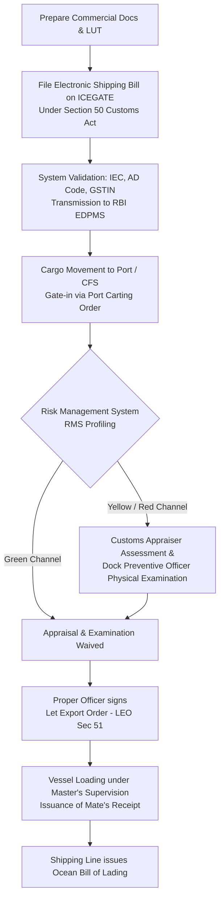

# Unit I: Topic 3 — Steps for Successful Exporting
## Comprehensive Subjective Question Bank with Model Answers

---

### Section A: 2-Mark Questions (Short Definitions & Statutory Deadlines)

#### Q1. What is an Importer-Exporter Code (IEC) and who issues it? (2 marks) | Likelihood: High | Type: Define
**Answer:**
The Importer-Exporter Code (IEC) is a mandatory 10-digit alphanumeric business identification number issued online by the Directorate General of Foreign Trade (DGFT), Ministry of Commerce and Industry, under Section 7 of the Foreign Trade (Development and Regulation) Act, 1992. In the modern digitized system, an entity's IEC is identical to its 10-digit Permanent Account Number (PAN). No commercial export or import can be undertaken without a valid IEC.
* **Keywords to include for full marks:** IEC, 10-digit, PAN-linked, DGFT, Section 7 FT(D&R) Act 1992, mandatory prerequisite.
* **Examiner trap:** Confusing IEC with the Authorized Dealer (AD) code. The IEC is issued by DGFT for business identity; the AD code is issued by commercial banks for forex routing.
* **Memory trick:** IEC = International Entry Card for Trade.
* **Marking scheme guide:** 1 mark for definition, 10 digits, and PAN linkage; 1 mark for issuing authority (DGFT) and governing act.

---

#### Q2. State the statutory time limit for realization of export proceeds under FEMA, 1999. (2 marks) | Likelihood: High | Type: Define
**Answer:**
Under the Foreign Exchange Management (Export of Goods and Services) Regulations, 2016, issued by the Reserve Bank of India (RBI) under FEMA 1999, the full value of exported goods and software must be realized and repatriated to India within **9 months** from the date of export. For shipments to overseas warehouses established with RBI approval, the realization period is extended up to **15 months**.
* **Keywords to include for full marks:** FEMA 1999, RBI Master Direction, 9 months realization window, repatriation, 15 months for overseas warehouse.
* **Examiner trap:** Quoting the temporary 15-month COVID-19 relief extension as permanent law. The standard statutory limit is 9 months.
* **Memory trick:** 9 Months to Deliver a Baby = 9 Months to Realize Export Dollars.
* **Marking scheme guide:** 1 mark for stating exactly 9 months from date of export; 1 mark for citing FEMA 1999 and RBI authority.

---

#### Q3. What is an Authorized Dealer (AD) Code and why must it be registered at customs ports? (2 marks) | Likelihood: High | Type: Define
**Answer:**
An AD Code is a unique 14-digit numerical identifier allotted by the Reserve Bank of India to a specific branch of an Authorized Dealer Category-I bank. An exporter must obtain an AD Code registration letter from their bank and register it with Indian Customs on the ICEGATE portal for every customs port (sea port, airport, or ICD) from which they intend to ship goods, enabling electronic transmission of export shipping bills directly into RBI's EDPMS database.
* **Keywords to include for full marks:** 14-digit AD Code, RBI, Authorized Dealer Category-I, ICEGATE registration, EDPMS linkage.
* **Examiner trap:** Thinking an AD Code is registered only once for the whole country. It must be registered at *each distinct customs location/port code*.
* **Memory trick:** AD Code = Bank's Digital Anchor at the Customs Gate.
* **Marking scheme guide:** 1 mark for defining 14-digit RBI branch code; 1 mark for customs port registration requirement on ICEGATE.

---

#### Q4. What is a Letter of Undertaking (LUT) under the GST regime for exports? (2 marks) | Likelihood: High | Type: Define
**Answer:**
A Letter of Undertaking (LUT) is an electronic declaration submitted annually on the GST portal (Form GST RFD-11) by an exporter under Section 16 of the Integrated Goods and Services Tax (IGST) Act, 2017. It allows registered taxpayers to export goods and services without upfront payment of IGST, subject to the legal commitment to realize foreign exchange within the statutory 9-month FEMA period.
* **Keywords to include for full marks:** Form GST RFD-11, Section 16 IGST Act, export without payment of IGST, zero-rated supply, annual online filing.
* **Examiner trap:** Believing an LUT requires a bank guarantee. An LUT requires no bank guarantee (unlike an export bond).
* **Memory trick:** LUT = **L**eave **U**npaid **T**axes on export.
* **Marking scheme guide:** 1 mark for online submission under Sec 16 IGST; 1 mark for exporting without tax payment and FEMA compliance condition.

---

#### Q5. What is an electronic Bank Realization Certificate (e-BRC)? (2 marks) | Likelihood: High | Type: Define
**Answer:**
An e-BRC is a digitally transmitted financial certificate issued by an Authorized Dealer Category-I bank certifying that the foreign exchange proceeds for a specific export consignment (identified by its Shipping Bill number) have been fully realized and credited to the exporter's account in India. The bank transmits e-BRC data electronically from its server directly to the DGFT portal to close export obligations and validate incentive claims.
* **Keywords to include for full marks:** e-BRC, Authorized Dealer Bank, digital transmission, DGFT server, Shipping Bill reconciliation, closure of export obligation.
* **Examiner trap:** Stating that exporters physically carry a paper BRC to DGFT offices. The process has been 100% electronic since 2012.
* **Memory trick:** e-BRC = Digital receipt proving foreign dollars landed in India.
* **Marking scheme guide:** 1 mark for bank certification of realized proceeds against Shipping Bill; 1 mark for electronic transmission to DGFT.

---

#### Q6. What is a Carting Order in export cargo shipping? (2 marks) | Likelihood: Medium | Type: Define
**Answer:**
A Carting Order is an official physical or electronic authorization issued by the Port Authority / Terminal Operator permitting an exporter or their customs broker to move export cargo into the port transit sheds or container yard ("carting into port") prior to customs examination and vessel loading. It is issued upon verification of the shipping bill and shipping line booking note.
* **Keywords to include for full marks:** Carting order, Port Authority, transit shed entry, container yard gate-in, pre-loading movement.
* **Examiner trap:** Confusing Carting Order with Let Export Order. The Carting Order allows goods *into the port*; the Let Export Order allows goods *onto the ship*.
* **Memory trick:** Carting = Moving the cart inside the dock gates.
* **Marking scheme guide:** 1 mark for port authority authorization for gate entry; 1 mark for prerequisite to dock storage and examination.

---

### Section B: 5-Mark Questions (Procedural Milestones & Setup)

#### Q7. Explain the statutory procedure for obtaining an Importer-Exporter Code (IEC) from DGFT. (5 marks) | Likelihood: High | Type: Procedure
**Answer:**
### Regulatory Foundation
Under Section 7 of the Foreign Trade (Development and Regulation) Act, 1992, read with Chapter 2 of the Foreign Trade Policy, no commercial export or import transaction can be initiated without obtaining an IEC from the Directorate General of Foreign Trade (DGFT).

### Step-by-Step Online Registration Workflow
1. **Online Application Submission:** The applicant accesses the official DGFT portal (`dgft.gov.in`) and creates a user profile using their commercial Permanent Account Number (PAN), mobile number, and email ID.
2. **Entity Profile & Banking Details:** The applicant completes electronic Form ANF-2A (Aayaat Niryaat Form), inputting details of the business constitution (sole proprietorship, partnership, private limited company, or LLP), nature of business, and active current bank account details.
3. **Mandatory Digital Attachments:**
   * Scanned copy of canceled business cheque showing pre-printed entity name and account number, or Bank Certificate (Form Appendix 2A(I)).
   * Proof of business address (registered sale deed, lease agreement, or utility bill).
4. **Digital Signature / Aadhaar e-Sign:** The application is authenticated using a Class-3 Digital Signature Certificate (DSC) or Aadhaar OTP-based electronic signature.
5. **Fee Payment & Automated Instant Issuance:** Upon online payment of the statutory fee (₹500), the DGFT automated server validates the PAN against the CBDT database and instantly generates the electronic **IEC Certificate in PDF format**, carrying a secure QR code.
6. **Annual Mandatory Profile Confirmation:** Every IEC holder must electronically confirm or update their details on the DGFT portal annually between **April and June**; failure to do so leads to automated deactivation of the IEC.

* **Keywords to include for full marks:** ANF-2A, PAN-linked, cancelled cheque, Class-3 DSC / Aadhaar e-sign, ₹500 fee, instant generation, annual April-June update.
* **Examiner trap:** Mentioning physical submission of paper forms at regional DGFT offices. The process is completely online and automated.
* **Memory trick:** **P**AN $\rightarrow$ **P**ortal $\rightarrow$ **P**ayment $\rightarrow$ **P**DF IEC instantly (**4 Ps of IEC**).
* **Marking scheme guide:** 1 mark for legal requirement under Sec 7 FT(D&R) Act; 2.5 marks for step-by-step documentation and portal workflow; 1.5 marks for fee, automated issuance, and annual April-June update rule.

---

#### Q8. Describe the procedure and importance of obtaining a Registration-cum-Membership Certificate (RCMC). (5 marks) | Likelihood: High | Type: Procedure
**Answer:**
### Meaning & Significance of RCMC
A Registration-cum-Membership Certificate (RCMC) is an official accreditation issued by an authorized Export Promotion Council (EPC), Commodity Board, or the Federation of Indian Export Organisations (FIEO) under Chapter 2 of the Foreign Trade Policy.

```
[IEC from DGFT] ───> [Apply to Sectoral EPC] ───> [RCMC Issued (5 Yrs)] ───> [Unlock FTP Benefits: Advance Auth, RoDTEP, EPCG]
```

### Strategic Importance
1. **Access to Policy Schemes:** It is a statutory prerequisite for claiming duty remissions and authorizations under the FTP (e.g., Advance Authorization, EPCG scheme, RoDTEP, RoSCTL).
2. **Access to Market Development Grants:** Enables exporters to receive travel subsidies and exhibition grants under the Market Access Initiative (MAI) scheme.
3. **Buyer Verification:** Demonstrates to overseas buyers that the exporter is an accredited, legitimate manufacturer or merchant.

### Procedural Steps to Obtain RCMC
1. **Determining the Competent Registering Body:** Exporters apply to the EPC or Commodity Board governing their primary line of business (e.g., Council for Leather Exports for footwear; EEPC for machinery). Multi-product exporters register directly with FIEO.
2. **Application via Common DGFT Portal:** Under the centralized digital system, exporters apply through the DGFT unified RCMC module.
3. **Documentation:** Submission of IEC, PAN, GST registration certificate, memorandum/articles of association or partnership deed, and manufacturing proof (Factory License / Udyam MSME Registration if applying as a Manufacturer-Exporter).
4. **Fee Payment & Validity:** Payment of annual membership subscription fee based on past export turnover. Once approved, the RCMC is issued digitally, valid for **5 financial years** (from April 1 of the issuing year to March 31 of the fifth year), subject to annual subscription renewals.

* **Keywords to include for full marks:** RCMC, Chapter 2 FTP, EPC, Commodity Board, FIEO, Advance Authorization, RoDTEP, MAI grant, common DGFT portal, 5-year validity.
* **Examiner trap:** Thinking an exporter can get an RCMC from any council they like. The council *must* correspond to the applicant's primary export product line.
* **Memory trick:** RCMC = **R**eceive **C**ustoms and **M**onetary **C**oncessions.
* **Marking scheme guide:** 1.5 marks for importance and FTP benefits; 2.5 marks for application procedure, documents, and portal steps; 1 mark for 5-year validity rules.

---

#### Q9. Outline the process of conducting international market research and selecting target export markets. (5 marks) | Likelihood: Medium | Type: Explain
**Answer:**
### Objective of Export Market Research
Venturing into international trade without rigorous market research exposes an enterprise to severe commercial, credit, and regulatory failures. Market research enables an exporter to identify countries with stable demand, favorable import tariffs, manageable logistics, and acceptable country-risk profiles.

### Systematic 4-Stage Research Framework
1. **Stage 1: Preliminary Screening via Trade Statistics (Desk Research):**
   * Analyze trade databases (ITC Trade Map, UN Comtrade, DGCIS Kolkata, Export Genius) to identify the top importing nations for the specific **ITC(HS) 6-digit commodity code**.
   * Evaluate historical growth rates, market size, and import volumes over the past 3 to 5 years.
2. **Stage 2: Evaluating Regulatory & Tariff Barriers:**
   * Scrutinize the target nation’s applied customs duties, preferential tariff rates under Indian Free Trade Agreements (e.g., India-UAE CEPA, India-Australia ECTA), and retaliatory duties.
   * Identify stringent Non-Tariff Barriers (NTBs): Mandatory standards (CE mark in Europe, US FDA approvals), labeling rules, and Sanitary and Phytosanitary (SPS) regulations.
3. **Stage 3: Assessing Commercial Feasibility & Logistics:**
   * Evaluate maritime and air freight transit times, shipping line connectivity, port congestion, and cold-chain/warehouse availability.
   * Evaluate payment practices (prevalence of confirmed LCs vs risky open accounts) and check country risk ratings published by ECGC.
4. **Stage 4: Primary Field Research & Buyer Identification:**
   * Participate in commercial trade delegations organized by EPCs and attend premier international trade expos (e.g., Canton Fair, Gulfood, Medica).
   * Request commercial directories of accredited importers from the Commercial Wings of Indian Embassies abroad.

* **Keywords to include for full marks:** ITC Trade Map, UN Comtrade, DGCIS, ITC(HS) 6-digit code, tariff barriers, FTAs, Non-Tariff Barriers, SPS/TBT, ECGC country rating, EPC delegations.
* **Examiner trap:** Confusing desk research with field research. Desk research uses existing published data; field research involves trade expos and direct buyer surveys.
* **Memory trick:** **D**ata $\rightarrow$ **D**uties $\rightarrow$ **D**elivery logistics $\rightarrow$ **D**iplomatic leads (**4 Ds of Market Research**).
* **Marking scheme guide:** 1 mark for objective; 3 marks for the 4-stage research methodology; 1 mark for databases and practical tools.

---

#### Q10. Explain the components of Export Costing and Pricing under FOB and CIF terms. (5 marks) | Likelihood: High | Type: Explain
**Answer:**
### Concept of Export Costing
Export pricing differs fundamentally from domestic pricing. It uses **marginal cost pricing** (excluding unrecoverable domestic fixed overheads) while factoring in transport logistics, customs compliance, marine insurance, and domestic export tax incentives.

### Structural Breakdown: Ex-Factory to CIF Price

```
[Ex-Factory Cost of Goods]
        │
        ▼  + Packaging for export, labeling, palletization
[Cost of Packed Cargo]
        │
        ▼  + Inland freight from factory to seaport/ICD, terminal handling, customs broker fees
[FOB Expenses at Port]
        │
        ▼  - Export incentives (RoDTEP, Duty Drawback, GST refund)
[Net FOB Price] ───> RISK PASSES TO BUYER ONCE LOADED ON BOARD
        │
        ▼  + Ocean/Air Freight to destination port
[CFR (Cost & Freight) Price]
        │
        ▼  + Marine Cargo Insurance premium (110% CIF value)
[CIF (Cost, Insurance & Freight) Price]
```

1. **Ex-Factory Base Cost:** Direct raw material costs, direct factory labor, plus minimum target profit margin (domestic fixed costs are often discounted).
2. **Export Packing & Palletization:** Heavy-duty seaworthy corrugated cartons, wooden pallets, shrink-wrapping, and statutory shipping marks.
3. **Inland Transportation & Port Charges (FOB Component):**
   * Trucking/rail freight from inland factory to gateway port/CFS.
   * Port entry tolls, carting charges, Terminal Handling Charges (THC) at port.
   * Customs Broker (CB) documentation and filing fees.
4. **Deduction of Government Incentives:** Subtraction of duty refunds (RoDTEP benefit, Duty Drawback rate) to arrive at a competitive **FOB Quotation**.
5. **International Maritime Freight (CFR Component):** Base ocean liner freight, bunker adjustment factor (BAF), currency adjustment factor (CAF), and terminal charges at discharge.
6. **Marine Insurance Premium (CIF Component):** Premium calculated on 110% of CIF value under Institute Cargo Clauses to secure the **CIF Quotation**.

* **Keywords to include for full marks:** Marginal costing, export packaging, inland freight, Terminal Handling Charges (THC), Customs Broker fees, RoDTEP deduction, FOB price, Ocean freight, Marine insurance, CIF price.
* **Examiner trap:** Forgetting to subtract export incentives (RoDTEP/Duty Drawback). If you don't deduct incentives, your export quotation will be too expensive and non-competitive.
* **Memory trick:** **E**x-factory + **P**acking + **P**ort fees - **I**ncentives + **F**reight + **I**nsurance = **CIF**.
* **Marking scheme guide:** 1 mark for costing logic; 2 marks for FOB components and incentive subtraction; 2 marks for CFR and CIF additions with formula.

---

#### Q11. Explain the procedure for booking shipping space and arranging container stuffing. (5 marks) | Likelihood: Medium | Type: Explain
**Answer:**
### 1. Booking Shipping Space (Shipping Line Contract)
Once the goods are in production and the target dispatch date is established, the exporter or their licensed Freight Forwarder approaches an ocean shipping line to reserve vessel space:
* **Submission of Shipping Booking Request:** Specifies port of loading, port of discharge, cargo description, HS code, gross weight, volume (CBM), target sailing date, and container equipment needed (e.g., 20ft standard, 40ft High Cube, or refrigerated reefer).
* **Issuance of Booking Note (Shipping Order):** The shipping line confirms space and issues a **Booking Note** indicating the vessel name, voyage number, Container Yard (CY) cut-off date, and container release order.

### 2. Container Stuffing Methods
Container loading is executed via one of two primary methods:

#### A. Factory Stuffing (Direct at Exporter’s Factory)
* The exporter picks up an empty shipping container from the line's inland container depot (ICD) on a trailer, transports it to their factory, loads the goods, and seals the container.
* *Self-Sealing Permission:* Under modern customs facilitation rules, accredited exporters obtain customs permission to seal containers using an electronic, tamper-proof **RFID e-Seal**, avoiding dock de-stuffing.

#### B. CFS Stuffing (At Port / Container Freight Station)
* Suitable for Less than Container Load (LCL) cargo or exporters lacking factory loading docks.
* The exporter sends loose packages by truck to an approved Container Freight Station (CFS) near the seaport. Under customs preventive supervision, goods are examined, consolidated, and stuffed into containers alongside goods from other shippers.

* **Keywords to include for full marks:** Booking Note, shipping order, CY cut-off date, 20ft/40ft container, Factory Stuffing, RFID e-Seal, CFS Stuffing, LCL consolidation.
* **Examiner trap:** Confusing Factory Stuffing with CFS Stuffing. Factory stuffing is done at the exporter's private plant; CFS stuffing is done at the port freight station.
* **Memory trick:** Booking Note reserves the seat $\rightarrow$ Stuffing packs the suitcase.
* **Marking scheme guide:** 2 marks for shipping space booking and Booking Note; 2 marks for Factory Stuffing vs CFS Stuffing; 1 mark for RFID e-sealing mechanism.

---

#### Q12. Explain the operational process of obtaining an electronic Bank Realization Certificate (e-BRC) and its integration with EDPMS. (5 marks) | Likelihood: High | Type: Explain
**Answer:**
### Background & Regulatory Need
Under the Foreign Exchange Management Act (FEMA), 1999, the Reserve Bank of India (RBI) tracks the realization of foreign exchange against every exported consignment. The physical paper Bank Realization Certificate (BRC) was replaced in 2012 by the digital **e-BRC system**, integrated directly with the RBI's **Export Data Processing and Monitoring System (EDPMS)**.

### Operational Sequence

```
[Customs LEO Granted] ───> [ICEGATE pushes Shipping Bill to RBI EDPMS]
                                      │
[Buyer remits FX]     ───> [AD Bank matches payment with SB in EDPMS]
                                      │
                                      ▼
             [AD Bank digitally generates & signs e-BRC]
                                      │
                                      ▼
             [XML Data pushed electronically to DGFT Server]
                                      │
                                      ▼
       [Exporter logs into DGFT Portal to claim RoDTEP / Drawback]
```

1. **Automatic Data Transmission from Customs:** When customs grants a Let Export Order (LEO), ICEGATE transmits the electronic Shipping Bill data (port code, SB number, FOB value, currency) directly to RBI's centralized EDPMS database.
2. **Inward Remittance Arrival:** The overseas buyer remits foreign exchange through banking channels (SWIFT MT103). The exporter submits the commercial invoice and Shipping Bill number to their Authorized Dealer (AD) Category-I bank.
3. **Reconciliation in EDPMS:** The AD bank matches the inward remittance against the pending Shipping Bill in the EDPMS portal, certifying full payment receipt and legal FEMA compliance.
4. **Digital Generation of e-BRC:** The bank digitally signs an electronic XML file containing the realization details (realized foreign currency amount, realized INR equivalent, bank reference) and pushes it electronically to the **DGFT Central Server**.
5. **Incentive Claim Closure:** The exporter logs into the DGFT portal; the system auto-validates the e-BRC data against the pending export file, enabling automatic processing of duty-remission claims (RoDTEP, RoSCTL, Advance Authorization closure) without physical paperwork.

* **Keywords to include for full marks:** e-BRC, EDPMS, FEMA 1999, ICEGATE, Shipping Bill, Inward remittance, SWIFT MT103, DGFT server, automated reconciliation, RoDTEP.
* **Examiner trap:** Thinking the exporter uploads the e-BRC. The *bank* uploads the e-BRC directly to DGFT; the exporter merely verifies it online.
* **Memory trick:** Customs reports export $\rightarrow$ Bank reports money $\rightarrow$ RBI matches both in EDPMS $\rightarrow$ e-BRC released.
* **Marking scheme guide:** 1 mark for regulatory need under FEMA; 3 marks for step-by-step electronic workflow (Customs $\rightarrow$ Bank $\rightarrow$ EDPMS $\rightarrow$ DGFT); 1 mark for automated incentive closure.

---

### Section C: 10-Mark Questions (End-to-End Procedural Answers)

#### Q13. Detail the statutory documentation and customs clearance procedures required to execute an export shipment from an Indian seaport. (10 marks) | Likelihood: High | Type: Procedure
**Answer:**
### 1. Introduction
Customs clearance of export cargo is governed by **Section 50 and Section 51 of the Customs Act, 1962**. Every commercial exporter must declare their goods to Indian Customs via the Indian Customs EDI System (ICES) on ICEGATE to verify compliance with the Foreign Trade Policy, evaluate applicable export duties or incentive claims, and secure statutory permission to load cargo on board an ocean vessel.

---

### 2. Mandatory Documentation Portfolio
Before initiating electronic filing, the exporter and their licensed Customs Broker (CB) assemble:
1. **Commercial Invoice & Packing List:** Detailing unit pricing, Incoterm, gross/net weights, container markings, and 8-digit ITC(HS) codes.
2. **GST Tax Invoice / LUT:** Documenting zero-rated export status under Section 16 of the IGST Act via annual Letter of Undertaking (Form GST RFD-11).
3. **Regulatory Certifications:** Inspection Certificate from the Export Inspection Agency (EIA), APEDA/MPEDA health certificates, or specialized dangerous goods certificates from IIP.
4. **Shipping Line Booking Note:** Documenting vessel nomination, container allocation, and port cut-off schedules.

---

### 3. Step-by-Step Customs Clearance Workflow



#### Step 1: Electronic Filing of the Shipping Bill (Section 50)
* The Customs Broker logs into ICEGATE and submits the cargo declaration data, creating the electronic **Shipping Bill (SB)**.
* Types of Shipping Bills selected:
  * *Duty Drawback Shipping Bill (Green)*
  * *Duty-Free Shipping Bill (White)*
  * *Dutiable Shipping Bill (Yellow)*
  * *Export under LUT / IGST Refund Shipping Bill*
* The ICEGATE engine automatically validates the exporter's PAN-linked IEC, registered port AD Code, and GSTIN.

#### Step 2: Cargo Gate-In (Carting Order)
* The loaded container (or truck carrying loose cargo) moves to the gateway seaport or Container Freight Station (CFS).
* The port authority verifies the generated Shipping Bill and issues an electronic **Carting Order**, permitting the vehicle to enter the port container terminal or transit shed.

#### Step 3: Risk Management System (RMS) Processing
* The automated RMS evaluates cargo risk against thousands of criteria (commodity risk, exporter compliance history, destination country, valuation).
* If cleared under the **Green Channel**, assessment and physical dock examination are completely waived, routing the file straight to loading permission.
* If flagged under the **Yellow or Red Channel**, the file is routed to the Customs Appraising Officer for valuation and document scrutiny, followed by physical dock inspection.

#### Step 4: Physical Examination at Docks
* Under the Red Channel, the Customs Preventive Officer at the dock opens a designated percentage of cartons (e.g., 5% to 10%), checks marks and numbers against the packing list, verifies country-of-origin markings, draws representative samples for laboratory chemical testing if necessary, and inspects the factory container seal.

#### Step 5: Grant of Let Export Order (LEO) (Section 51)
* Once the Appraising and Preventive Officers are satisfied that the shipment contains no prohibited goods and conforms to statutory export rules, the Appraiser signs the **Let Export Order (LEO)** on the electronic system.
* **Legal Effect:** The LEO is the official statutory customs clearance permitting the cargo to be loaded on board the export vessel.

#### Step 6: Loading on Board & Issuance of Bill of Lading
* The shipping line loads the container on board the vessel under the supervision of the ship's Chief Officer.
* The Chief Officer signs a temporary cargo receipt called the **Mate's Receipt**.
* The exporter or freight forwarder surrenders the Mate’s Receipt to the shipping line’s port office, pays ocean freight (under CFR/CIF terms), and receives the signed negotiable **Ocean Bill of Lading (B/L)**.

---

### 4. Conclusion
Indian customs clearance has transformed from an opaque, paper-heavy dock inspection system into a streamlined, automated, and paperless digital pipeline via ICEGATE. Achieving LEO with zero physical friction relies on strict document consistency between the commercial invoice, packing list, and electronic shipping bill.

* **Keywords to include for full marks:** Section 50 Customs Act, Section 51, Let Export Order (LEO), ICEGATE, Shipping Bill types, Carting Order, Risk Management System (RMS), Green Channel, Preventive Officer examination, Mate’s Receipt, Bill of Lading.
* **Examiner trap:** Saying that customs officers issue the Bill of Lading. Customs officers issue the **Let Export Order (LEO)**; the *ocean shipping line* issues the Bill of Lading.
* **Memory trick:** **S**hipping Bill $\rightarrow$ **C**arting $\rightarrow$ **R**MS $\rightarrow$ **E**xamination $\rightarrow$ **L**EO $\rightarrow$ **M**ate's Receipt $\rightarrow$ **B**ill of Lading (**SCREL-MB sequence**).
* **Marking scheme guide:** 2 marks for intro and document portfolio; 3 marks for workflow diagram and Section 50 filing; 3 marks for RMS, examination, and Section 51 LEO; 2 marks for Mate's Receipt, Bill of Lading, and conclusion.

---

#### Q14. Explain the strategic role of Export Pricing and compare Cost-Plus Pricing with Marginal Cost Pricing for an Indian exporter. (10 marks) | Likelihood: High | Type: Explain / Compare
**Answer:**
### 1. Introduction
Pricing is a critical determinant of international competitiveness. Setting export prices requires a balanced approach: an excessively high price repels foreign buyers in competitive markets, while an under-calculated price risks commercial losses, cash-flow insolvencies, or investigations under foreign anti-dumping laws. Exporters utilize two primary pricing methodologies: **Full Cost-Plus Pricing** and **Marginal Cost Pricing**.

---

### 2. Full Cost-Plus Pricing vs Marginal Cost Pricing

```
                         [ PRICING STRATEGIES COMPARED ]
        Full Cost-Plus Pricing                    Marginal Cost Pricing
        ──────────────────────                    ─────────────────────
        * Absorbs domestic fixed overheads        * Ignores domestic fixed overheads
        * Higher, often non-competitive price     * Slashes price to variable costs + profit
        * Rigid, cost-centric philosophy          * Highly competitive, volume-driven
```

#### A. Full Cost-Plus Pricing Methodology
* **Mechanism:** The firm aggregates all direct variable costs (raw materials, factory labor, export packaging) PLUS an allocated share of domestic fixed administrative, factory rent, and corporate management overheads, adding a predetermined profit margin.
* **Mathematical Formula:**
  $$\text{Full Cost-Plus Export Price} = \text{Direct Materials} + \text{Direct Labor} + \text{Allocated Domestic Fixed Overheads} + \text{Export Logistics} + \text{Profit Margin} - \text{Export Incentives}$$
* **Evaluation:** Safe and conservative, ensuring every product line absorbs corporate overheads. However, it often produces an uncompetitively high price in cost-sensitive global markets.

#### B. Marginal Cost Pricing (Differential Cost Pricing) Methodology
* **Theoretical Foundation:** Grounded in microeconomic theory, this strategy recognizes that **domestic sales have already absorbed the company’s fixed overhead costs** (factory rent, executive salaries, depreciation). Therefore, export sales can be priced purely on **direct incremental (variable) costs** incurred to produce the additional export volume.
* **Mathematical Formula:**
  $$\text{Marginal Export Price} = \text{Variable Materials} + \text{Variable Labor} + \text{Direct Export Packaging} + \text{Port Logistics} + \text{Marginal Target Profit} - \text{Export Incentives}$$
* **Evaluation:** Produces a lean, aggressive, and highly competitive export price, allowing the exporter to penetrate price-sensitive foreign markets and utilize idle plant capacity.
* **Legal Caveat (WTO Anti-Dumping Risk):** The exporter must ensure the export price is not set below the product's variable cost of production, and does not trigger anti-dumping investigations under GATT Article VI if it undercuts prices in the domestic market without objective justification.

---

### 3. Comprehensive Comparative Matrix

| Evaluation Parameter | Full Cost-Plus Pricing | Marginal Cost Pricing |
|---|---|---|
| **1. Absorption of Fixed Overheads** | Absorbs full proportionate share of domestic plant rent, administrative salaries, and overheads. | **Zero absorption** of domestic fixed overheads; assumes domestic sales cover overheads. |
| **2. Competitiveness in Global Market** | **Low to Moderate:** Price is inflated, making it difficult to win price-sensitive international bids. | **Extremely High:** Allows aggressive discounting to undercut international competitors. |
| **3. Treatment of Idle Plant Capacity** | Unfavorable; high prices deter new buyers, leaving surplus machinery underutilized. | Excellent; leverages surplus factory capacity to generate incremental contribution margin. |
| **4. Cash Flow Risk** | Minimal; guarantees all corporate expenses are covered if sales occur. | Higher risk; failure to hit sales volume targets can threaten liquidity if domestic sales decline. |
| **5. Vulnerability to Anti-Dumping Action** | Negligible; price easily covers full cost of production. | Higher vulnerability if export price falls substantially below normal domestic market price. |
| **6. Suitability in Product Lifecycle** | Ideal for proprietary, patented, unique, or high-brand-equity luxury products. | Ideal for standardized mass commodities, textiles, engineering castings, and entering new export markets. |

---

### 4. Practical Mathematical Demonstration for an Indian Exporter
* An export manufacturer of cotton shirts in Tirupur operates at 60% capacity:
  * Variable Cost per shirt: ₹250
  * Allocated Domestic Fixed Overhead per shirt: ₹150
  * Export Packaging & Inland Port Logistics: ₹40
  * Target Profit Margin: ₹60
  * Export Incentive (RoDTEP @ 3% + Duty Drawback @ 2% on FOB): ₹20

* **Full Cost-Plus Price Calculation:**
  $$\text{Price} = ₹250 (\text{Var}) + ₹150 (\text{Fixed}) + ₹40 (\text{Port}) + ₹60 (\text{Profit}) - ₹20 (\text{Incentive}) = \mathbf{₹480} \ (\approx \mathbf{\$5.78})$$

* **Marginal Cost Price Calculation:**
  $$\text{Price} = ₹250 (\text{Var}) + ₹0 (\text{Fixed}) + ₹40 (\text{Port}) + ₹60 (\text{Profit}) - ₹20 (\text{Incentive}) = \mathbf{₹330} \ (\approx \mathbf{\$3.97})$$

* **Strategic Impact:** Marginal costing allows the Tirupur exporter to quote **$3.97** instead of **$5.78**—a 31% price reduction that can win global retail tenders while generating ₹60 net cash contribution per unit toward company profitability.

---

### 5. Conclusion
While Cost-Plus pricing protects baseline solvency, Marginal Cost Pricing represents the standard competitive weapon for Indian manufacturing exporters targeting high-volume international markets, provided domestic sales cover baseline overheads and pricing remains above the anti-dumping threshold.

* **Keywords to include for full marks:** Cost-plus pricing, Marginal cost pricing, direct variable costs, fixed overhead absorption, idle plant capacity, contribution margin, RoDTEP deduction, Anti-dumping risk GATT Art VI, Tirupur numerical demonstration.
* **Examiner trap:** Forgetting to subtract export incentives (RoDTEP/Drawback) in the mathematical pricing formula.
* **Memory trick:** Marginal Cost = Squeeze the Fixed Costs Out, Win the Global Contract.
* **Marking scheme guide:** 2 marks for conceptual intro; 3 marks for detailed explanations of both models; 3 marks for comparative matrix; 2 marks for numerical calculation and conclusion.

---

#### Q15. Detail the statutory procedures and authorities involved in claiming post-export incentives (Duty Drawback, RoDTEP, and IGST Refund). (10 marks) | Likelihood: High | Type: Procedure
**Answer:**
### 1. Introduction & Theoretical Rationale
A foundational canon of international taxation and WTO rules is that **"taxes and duties must not be exported."** When domestic indirect taxes, energy cesses, or import duties remain embedded in the final price of an export commodity, the nation's industry is placed at an artificial competitive disadvantage. To neutralize these embedded fiscal burdens, the Government of India operates three primary post-export incentive mechanisms: **Duty Drawback, RoDTEP, and IGST Refund**.

---

### 2. Comprehensive Comparative Summary of Post-Export Schemes

```
                            [ EXPORT FISCAL INCENTIVES ]
            ┌─────────────────────────────┼─────────────────────────────┐
            ▼                             ▼                             ▼
   [ Duty Drawback ]                 [ RoDTEP ]                   [ IGST Refund ]
   * Sections 74/75 Customs Act      * Chapter 4 of FTP            * Section 16 IGST Act
   * Refunds Basic Customs Duty       * Remits embedded local       * Full refund of IGST
     paid on imported inputs           taxes (mandi tax, fuel, VAT)  paid on exported goods
```

---

### 3. Detailed Modus Operandi of the Three Schemes

#### A. Duty Drawback (DBK) (Sections 74 and 75 of Customs Act, 1962)
* **Objective:** Refunds customs duties paid on imported raw materials, components, and packaging materials consumed in the manufacture of export products.
* **Two Operating Routes:**
  1. *All Industry Rates (AIR) of Drawback (Section 75):* Notified annually by the Ministry of Finance across thousands of ITC(HS) lines, representing the national average customs duty incidence. Exporters simply endorse the Drawback Shipping Bill; no documentary proof of actual duties paid is required.
  2. *Brand Rate of Drawback:* Utilized by manufacturers whose actual customs duty incidence exceeds the AIR rate. Requires filing a cost application within 3 months of export with the Principal Commissioner of Customs.
* **Disbursement Process:** The electronic Drawback Shipping Bill serves as the refund application. Upon issuance of the Let Export Order (LEO) and filing of the export manifest, the customs ICES server automatically calculates the drawback amount and credits it directly into the exporter's core banking current account via automated EDI clearing.

#### B. RoDTEP (Remission of Duties and Taxes on Exported Products)
* **Objective & WTO Compliance:** Introduced on January 1, 2021, to replace the historical MEIS scheme (which was struck down by a WTO dispute panel for violating the Subsidies and Countervailing Measures Agreement). RoDTEP is fully WTO-compliant because it strictly reimburses **un-refunded state, central, and local embedded taxes** that are not subsumed under GST:
  * Central and State VAT/excise duties on transportation fuel (diesel/petrol) used in transporting goods.
  * Electricity duties levied on factory power consumption.
  * Local Mandi taxes, stamp duties on export contracts, and municipal property taxes.
* **Operational Mechanics:**
  1. *Claim on Shipping Bill:* Exporter must tick "YES" on the electronic Shipping Bill declaring their intent to claim RoDTEP under Scheme Code 19.
  2. *Issuance of Electronic Scrips:* The Directorate General of Systems (CBIC) processes the claim and credits an **electronic duty credit ledger** maintained on the ICEGATE portal.
  3. *Transferability:* The generated RoDTEP scrips are 100% transferable. An exporter can use them to pay basic customs duties on other imports or sell them on the open market at face value to third-party importers.

#### C. IGST Refund on Export of Goods (Section 16 of IGST Act, 2017)
* **Objective:** Exports are "Zero-Rated Supplies". Exporters who choose the "Export on Payment of IGST" route pay IGST via their monthly GSTR-3B return and receive an automated cash refund.
* **Automated Data Integration Workflow:**
  1. *The Shipping Bill is the Application:* Under Rule 96 of CGST Rules, the electronic Shipping Bill filed on ICEGATE is legally deemed to be the refund application.
  2. *Data Matching via GSTN-ICEGATE Link:* The ICEGATE engine automatically matches the export data from the Shipping Bill (Invoice number, port code, IGST paid) against Table 6A of the exporter's filed **GSTR-1** return and verifies payment in **GSTR-3B**.
  3. *Direct Account Credit:* Once reconciled without discrepancies, the Customs server generates a digital refund scroll, transmitting funds directly to the exporter's bank account via the Public Financial Management System (PFMS) without human interference.

---

### 4. Conclusion
India's post-export incentive architecture has transformed from a cumbersome, manual paperwork process into an automated, paperless, and transparent digital pipeline. By automating Duty Drawback, shifting to WTO-compliant RoDTEP credits, and linking GSTN with ICEGATE for automated tax refunds, the government neutralizes domestic tax incidence and bolsters Indian exporter liquidity.

* **Keywords to include for full marks:** Taxes must not be exported, Duty Drawback Sec 75 Customs Act, All Industry Rates (AIR), Brand Rate, RoDTEP Scheme Code 19, un-subsumed embedded taxes, transferable electronic scrips, Section 16 IGST Act, Rule 96 CGST, GSTR-1 Table 6A, GSTN-ICEGATE linkage.
* **Examiner trap:** Claiming that RoDTEP is an export subsidy. RoDTEP is an *indirect tax remission*, strictly compensating actual embedded taxes to maintain WTO compliance under the SCM Agreement.
* **Memory trick:** **D**rawback (Customs duty) + **R**oDTEP (Fuel/Electricity/Mandi tax) + **I**GST Refund (GST paid) = **DRI Tax Neutralization**.
* **Marking scheme guide:** 2 marks for introductory tax neutrality rationale; 3 marks for Duty Drawback (AIR vs Brand Rate); 3 marks for RoDTEP (WTO logic and scrip mechanics); 2 marks for IGST refund automation and conclusion.

---

#### Q16. Detail the regulatory framework governing Foreign Exchange realization under FEMA, 1999, and the operational working of the RBI Caution-List system. (10 marks) | Likelihood: High | Type: Explain / Analyze
**Answer:**
### 1. Statutory Genesis & FEMA Framework
The realization and repatriation of foreign exchange derived from exports is regulated under Section 7 and Section 8 of the **Foreign Exchange Management Act (FEMA), 1999**, read with the **Foreign Exchange Management (Export of Goods and Services) Regulations, 2016**, administered by the Reserve Bank of India (RBI). Under this statutory framework, an exporter who ships goods out of India is legally obligated to realize and repatriate the full foreign currency value of the goods to India through an Authorized Dealer Category-I bank.

---

### 2. Statutory Realization Timelines & Permissible Write-Offs

```
                      [ FEMA REALIZATION COMPLIANCE ]
        Shipment Date ──────────────────────────────────────> 9 Months Statutory Window
        (LEO issued)        (Realization & Repatriation        (Monitored via EDPMS)
                             via AD Category-I Bank)
                                       │
                    ┌──────────────────┴──────────────────┐
                    ▼                                     ▼
         [ Full Realization ]                  [ Unrealized Bill ]
         * AD Bank issues e-BRC                * Extension requested or
         * Export file closed                    Auto-flagged for Caution-Listing
```

1. **Statutory Timeframe:** The standard deadline for realization and repatriation of export proceeds is **9 months from the date of export** (or 15 months for goods dispatched to an overseas warehouse established with RBI approval).
2. **Authorized Extensions:** If payment is delayed due to buyer bankruptcy, protracted litigation, or sovereign transfer freezes abroad, the exporter's AD bank is authorized to grant extensions of up to **6 months at a time**, provided the exporter proves that delay is beyond their reasonable control.
3. **Self-Write-Off Facility:** To accommodate minor commercial disputes, quality rejections, or volume deductions, status-holder exporters and non-status exporters are permitted to self-write off unrealized export bills up to **5% to 10%** of their total annual export proceeds, subject to prescribed RBI compliance conditions.

---

### 3. The RBI Caution-List Architecture & EDPMS Integration
Historically, the RBI maintained a static, manually compiled "Caution List" circulated to commercial banks. Today, this process is governed by the automated **Export Data Processing and Monitoring System (EDPMS)**.

#### A. Automated Caution-Listing Trigger
* When customs grants a Let Export Order (LEO), ICEGATE pushes the Shipping Bill details to EDPMS.
* If an export bill remains unrealized and un-extended in EDPMS beyond **two years** (or the period sanctioned by the AD bank), the EDPMS automated system automatically flags the exporter's IEC on the **RBI Caution List**.

#### B. Severe Commercial Consequences of Being Caution-Listed
Once placed on the RBI Caution List:
1. **Loss of Credit Terms:** The exporter is legally barred from exporting goods on open-account, D/A, or collection terms.
2. **Mandatory 100% Advance Payment or Confirmed LC:** Indian Customs will not permit the exporter to file a Shipping Bill or clear goods for export unless the exporter presents an advance bank remittance certificate (FIRC) or an **Irrevocable Confirmed Letter of Credit** covering 100% of the shipment value.
3. **Freezing of Bank Facilities:** Commercial banks freeze new pre-shipment export packing credit facilities and suspend concessional interest subvention benefits.

#### C. De-Listing Procedure
To be removed from the Caution List, the exporter must:
* Realize the outstanding payments and have their AD bank generate the corresponding **e-BRC** in EDPMS; or
* Secure formal regularized write-off approval from the AD Bank / RBI for unrecoverable debts; or
* Present documentary evidence showing that legal proceedings have been initiated against the foreign buyer.

---

### 4. Conclusion
The FEMA foreign exchange realization regime bridges commercial trade with national macroeconomic stability. Monitored through the automated EDPMS engine, it allows flexibility through authorized extensions and write-offs, while deploying automated Caution-Listing to prevent capital flight and ensure foreign exchange earnings are repatriated to the national economy.

* **Keywords to include for full marks:** FEMA 1999, Section 7/8, FEM Export Regulations 2016, 9-month statutory window, 15 months overseas warehouse, AD Bank extensions, self-write-off facility, EDPMS, Caution-List, 100% advance payment mandate, e-BRC de-listing.
* **Examiner trap:** Claiming that exporters go to prison immediately if an overseas buyer defaults. The system provides generous extension and commercial write-off mechanisms before regulatory penalties or Caution-Listing apply.
* **Memory trick:** 9 Months to Realize $\rightarrow$ EDPMS tracks $\rightarrow$ 2 Years Unpaid = Caution Listed (Advance Cash Only).
* **Marking scheme guide:** 2 marks for FEMA statutory foundation; 3 marks for 9-month rule, extensions, and self-write-off; 3 marks for automated Caution-Listing triggers and consequences; 2 marks for de-listing procedure and conclusion.

---

### Section D: 15-Mark Comprehensive Questions (Flagship Workflow Analysis)

#### Q17. Provide an exhaustive chronological analysis of the 15 steps involved in executing an export transaction from India, from firm establishment to proceed realization and incentive claims. (15 marks) | Likelihood: Very High | Type: Comprehensive
**Answer:**

```
========================================================================================
     CHRONOLOGICAL MASTER BLUEPRINT: THE 15 STEPS FOR SUCCESSFUL EXPORTING
========================================================================================
```

### 1. Introduction
Executing a successful cross-border export transaction from India requires navigating a structured, legally governed continuum. It bridges domestic incorporation, multilateral compliance, commercial negotiation, manufacturing, quality assurance, multimodal logistics, statutory customs clearance, international banking, and foreign exchange repatriation. The entire process unfolds across **four distinct chronological phases comprising 15 sequential steps**.

---

### 2. Master Chronological Flowchart of the 15 Steps

```mermaid
flowchart TD
    subgraph PHASE 1: Statutory Setup & Compliance
        S1[Step 1: Establishing the Firm<br/>Proprietorship, Partnership, Pvt Ltd] --> S2[Step 2: Bank A/c & AD Code Letter<br/>Current A/c in Forex Authorized Bank]
        S2 --> S3[Step 3: Obtaining IEC from DGFT<br/>10-Digit PAN-Linked Code]
        S3 --> S4[Step 4: RCMC Registration<br/>From Relevant EPC / Commodity Board]
        S4 --> S5[Step 5: GST Registration & LUT<br/>Form GST RFD-11 for Zero-Rated Export]
    end

    subgraph PHASE 2: Marketing, Pricing & Contract
        S5 --> S6[Step 6: Market Research & Buyer Discovery<br/>Trade Map, Delegations, Embassies]
        S6 --> S7[Step 7: Costing, Pricing & Proforma Invoice<br/>Marginal Costing, FOB/CIF Quotation]
        S7 --> S8[Step 8: Contract Negotiation & Acceptance<br/>Incoterms 2020, Payment Terms, CISG]
    end

    subgraph PHASE 3: Finance, Operations & Cargo Handling
        S8 --> S9[Step 9: Pre-Shipment Packing Credit<br/>Concessional Working Capital from AD Bank]
        S9 --> S10[Step 10: Manufacturing, QC & Pre-Shipment Inspection<br/>EIC/EIA Sampling, Lab Certificate]
        S10 --> S11[Step 11: Marine Cargo Insurance Procurement<br/>Institute Cargo Clauses A/B/C]
        S11 --> S12[Step 12: Shipping Space & Port Carting<br/>Booking Note, Factory Stuffing, RFID Seal]
    end

    subgraph PHASE 4: Clearance, Negotiation & Closure
        S12 --> S13[Step 13: Customs Clearance & Let Export Order<br/>Filing Shipping Bill on ICEGATE -> LEO]
        S13 --> S14[Step 14: Document Negotiation under LC / Collection<br/>Presenting B/L, Invoice, Draft under UCP 600]
        S14 --> S15[Step 15: Proceed Realization & Incentive Claims<br/>FEMA 9-Month Window, EDPMS e-BRC, RoDTEP]
    end
```

*Exam Hand-Drawing Guide (Under 2 Minutes):* Draw 4 horizontal stacked blocks down the page: `[Phase 1: Setup (Steps 1-5)]` $\rightarrow$ `[Phase 2: Contract (Steps 6-8)]` $\rightarrow$ `[Phase 3: Operations (Steps 9-12)]` $\rightarrow$ `[Phase 4: Banking & Realization (Steps 13-15)]`. List the 3–4 key acronyms inside each block.

---

### 3. Detailed Chronological Breakdown of the 15 Steps

#### PHASE 1: STATUTORY SETUP & REGULATORY COMPLIANCE
* **Step 1: Establishing the Business Organization:** The promoter establishes a legal business vehicle—Sole Proprietorship, Partnership Firm, Limited Liability Partnership (LLP), or Private Limited Company—and obtains a commercial Permanent Account Number (PAN) from the Income Tax Department.
* **Step 2: Opening Bank Account & Obtaining AD Code:** The entity opens a current account with an Authorized Dealer (AD) Category-I bank licensed by the Reserve Bank of India to deal in foreign exchange, and secures an official **14-digit AD Code Letter** issued on bank letterhead.
* **Step 3: Obtaining the Importer-Exporter Code (IEC):** The exporter applies online at `dgft.gov.in` submitting Form ANF-2A, PAN, address proof, and canceled cheque to receive the PAN-linked 10-digit **IEC** from DGFT under Section 7 of the FT(D&R) Act, 1992.
* **Step 4: Obtaining the Registration-cum-Membership Certificate (RCMC):** The firm applies to its designated Export Promotion Council (e.g., EEPC for engineering, AEPC for apparel) or Commodity Board, securing an **RCMC** valid for 5 years to unlock Foreign Trade Policy incentives.
* **Step 5: GST Registration & Filing Letter of Undertaking (LUT):** Registered under the CGST/IGST Act, the exporter files an online annual **Letter of Undertaking (Form GST RFD-11)** on the GST portal to export goods as "Zero-Rated Supplies" without upfront payment of IGST.

#### PHASE 2: MARKET RESEARCH, PRICING & CONTRACT FORMATION
* **Step 6: International Market Research & Buyer Identification:** The exporter analyzes global trade data via ITC Trade Map and UN Comtrade for their 8-digit ITC(HS) code, identifies target countries, vets buyer creditworthiness via ECGC, and participates in EPC trade expos.
* **Step 7: Export Costing, Pricing & Proforma Invoice Quotation:** Applying marginal costing, the exporter calculates FOB, CFR, or CIF prices (factoring in export packaging, port fees, freight, and subtracting RoDTEP incentives), and issues a formal **Proforma Invoice** detailing quantity, technical specifications, currency, and validity date.
* **Step 8: Export Contract Negotiation & Formal Acceptance:** The buyer confirms the offer by issuing an official **Purchase Order (PO)**. Both parties conclude a legally binding Sales Contract under the Vienna Convention (CISG), finalizing governing Incoterms 2020 rules, payment mechanisms (e.g., Irrevocable Letter of Credit at sight), inspection agency, and an ICC arbitration clause.

#### PHASE 3: TRADE FINANCE, MANUFACTURING & CARGO LOGISTICS
* **Step 9: Securing Pre-Shipment Export Finance (Packing Credit):** The exporter submits the confirmed purchase order or Letter of Credit to their AD bank to secure concessional pre-shipment **Rupee Packing Credit (EPC)** or **Packing Credit in Foreign Currency (PCFC)** to purchase raw materials and finance manufacturing.
* **Step 10: Manufacturing, Packaging & Pre-Shipment Quality Inspection:** Goods are manufactured to international standards. The exporter obtains a Certificate of Inspection from the **Export Inspection Agency (EIA)** or an agreed third-party agency (SGS, Bureau Veritas), and ensures seaworthy packaging certified by the **Indian Institute of Packaging (IIP)**.
* **Step 11: Procuring Marine Cargo Insurance:** To protect against maritime and transit hazards, the exporter procures marine insurance under the **Institute Cargo Clauses (ICC A, B, or C)** for 110% of the CIF invoice value under the Marine Insurance Act, 1963.
* **Step 12: Booking Shipping Space, Port Carting & Stuffing:** The freight forwarder reserves container space with the ocean shipping line, receiving a **Booking Note**. Goods are stuffed into containers at the factory with tamper-proof RFID e-seals (or at a port CFS), and moved into the port container yard under a port **Carting Order**.

#### PHASE 4: CUSTOMS CLEARANCE, BANKING & INCENTIVE CLOSURE
* **Step 13: Customs Clearance & Securing the Let Export Order (LEO):** The Customs Broker files the electronic **Shipping Bill** on ICEGATE under Section 50 of the Customs Act. Following automated Risk Management System (RMS) scrutiny and physical dock examination, the Customs Appraiser signs the **Let Export Order (LEO)** under Section 51. The container is loaded on board, and the ocean carrier issues the clean **Ocean Bill of Lading (B/L)**.
* **Step 14: Document Assembly & Presentation to Bank:** Within 21 calendar days of shipment (as mandated by Article 14c of UCP 600), the exporter presents the complete document portfolio (Commercial Invoice, Packing List, Original 3/3 Bills of Lading, Certificate of Origin, Insurance Policy, Inspection Certificate, and Bill of Exchange) to their negotiating bank for payment or collection.
* **Step 15: Realization of Export Proceeds, e-BRC & Incentive Claims:**
  * Inward foreign exchange is realized through banking channels within the statutory **9-month FEMA deadline**.
  * The AD bank reconciles the payment in RBI’s **EDPMS** database and transmits the digital **e-BRC** to DGFT.
  * The exporter uses the generated e-BRC and electronic Shipping Bill to claim **RoDTEP/RoSCTL duty credits**, automated customs **Duty Drawback**, and input tax credit refunds.

---

### 4. Critical Operational Pitfalls & Mitigations

| Execution Stage | Critical Risk / Pitfall | Strategic Mitigation Tool |
|---|---|---|
| **Step 3 & 4 (Setup)** | Inactive IEC or expired RCMC deactivates trade benefits. | Complete annual DGFT profile confirmation every April–June. |
| **Step 8 (Contract)** | Unilateral order cancellation or insolvency of foreign buyer. | Demand an Irrevocable Confirmed LC, or secure an ECGC credit policy. |
| **Step 10 (Quality)** | Consignment rejection at destination port due to pesticide/toxin residue. | Mandate farm-to-fork digital traceability (e.g., APEDA GrapeNet) and NABL lab testing. |
| **Step 13 (Customs)** | Discrepancies between Invoice and Shipping Bill trigger dock detention. | Enforce Aligned Documentation System (ADS) master-data consistency. |
| **Step 15 (Forex)** | Exchange rate volatility erodes profit margins. | Lock in forward foreign exchange contracts with the AD bank upon order booking. |

---

### 5. Conclusion
Executing an export transaction is an integrated multidisciplinary procedure. Mastery of the 15 chronological steps—from establishing a legally compliant business entity to securing the final e-BRC—transforms cross-border trade risks into predictable, profitable commercial operations, enabling Indian exporters to compete globally.

* **Keywords to include for full marks:** 15 steps, IEC, AD Code, RCMC, LUT Form GST RFD-11, Market Research, Proforma Invoice, Incoterms 2020, Pre-shipment Packing Credit, EIC/EIA inspection, IIP, Marine Insurance ICC, Booking Note, Shipping Bill Sec 50, Let Export Order Sec 51, Mate's Receipt, Bill of Lading, UCP 600 presentation, FEMA 9-month window, EDPMS, e-BRC, RoDTEP.
* **Examiner trap:** Omitting post-shipment realization and incentive claims. An export transaction does *not* end when the ship sails; it ends only when foreign exchange is repatriated and e-BRC closes the regulatory loop.
* **Memory trick:** **S**etup $\rightarrow$ **C**ontract $\rightarrow$ **O**perations $\rightarrow$ **R**ealization (**SCOR Framework**).
* **Marking scheme guide:** 2 marks for intro and phase categorization; 3 marks for master flowchart diagram; 7 marks for detailed breakdown of all 15 steps (divided evenly across 4 phases); 2 marks for risk mitigation table; 1 mark for conclusion.

---

#### Q18. Critically analyze the challenges faced by Indian MSME exporters across the steps of exporting and outline institutional solutions. (15 marks) | Likelihood: High | Type: Comprehensive / Analytical
**Answer:**

```
========================================================================================
     CRITICAL ESSAY: OPERATIONAL HURDLES FACED BY INDIAN MSME EXPORTERS
========================================================================================
```

### 1. Introduction: The MSME Export Landscape
Micro, Small, and Medium Enterprises (MSMEs) represent the backbone of India’s industrial economy, contributing approximately **45% to total manufacturing output and nearly 40% to India's total merchandise exports**. Concentrated in labor-intensive clusters (such as textiles in Tirupur, leather in Agra/Ambur, gems and jewelry in Surat, and engineering goods in Rajkot), MSMEs are vital to employment and regional development. However, small exporters face structural handicaps throughout the export execution lifecycle.

---

### 2. Comprehensive Life-Cycle Challenge & Institutional Solution Matrix

```
                      [ MSME EXPORT LIFECYCLE VULNERABILITIES ]
      Pre-Shipment Phase              Operational Phase               Post-Shipment Phase
      ──────────────────              ─────────────────               ───────────────────
      * Lack of Collateral            * High Inland Logistics Costs   * Delayed Payment Default
      * High Cost of Rupee Credit     * Fragmented Testing Labs       * Onerous e-BRC Reconciliation
      * Information Asymmetry         * Inverted Duty Structures      * Lengthy GST Refund Audits
```

---

### 3. Deep-Dive: Stage-by-Stage Operational Bottlenecks

#### A. Phase 1: Setup & Information Deficits (Steps 1–6)
* **The Information Asymmetry Barrier:** Unlike large multinational corporations with dedicated compliance teams, MSME entrepreneurs struggle with complex, evolving customs classifications, export control lists (SCOMET), and foreign non-tariff barriers. Small exporters often lack market intelligence, leaving them dependent on unverified overseas middlemen.
* **Institutional Solutions:** DGFT's digital portal consolidation, FIEO export facilitation cells, and the Department of Commerce's **Trade Information Portal** providing free access to global tariff and SPS requirements.

#### B. Phase 2: Trade Financing Bottlenecks (Steps 7–9)
* **The Collateral Trap:** While the RBI classifies export credit under Priority Sector Lending (PSL), conservative commercial banks frequently demand 100% to 150% physical collateral (real estate) to sanction pre-shipment packing credit. MSMEs with viable international purchase orders are routinely denied working capital advances.
* **Elevated Cost of Borrowing:** Indian domestic rupee interest rates (8.5% to 11%) historically exceed lending rates in competitor nations like Vietnam or China (3% to 5%).
* **Institutional Solutions:**
  * **Interest Equalisation Scheme (IES):** RBI provides a 3% interest subsidy on rupee export credit to MSME manufacturer-exporters.
  * **ECGC Credit Guarantees:** ECGC’s Export Credit Guarantees indemnify banks against bad debt up to 90%, encouraging banks to lend without excessive collateral.
  * **TReDS Factoring:** Electronic discounting of trade bills on digital TReDS platforms under the amended Factoring Regulation Act, 2021.

#### C. Phase 3: Logistics & Testing Inadequacies (Steps 10–12)
* **The Hinterland Logistics Deficit:** India’s inland freight logistics cost accounts for roughly 13–14% of GDP, compared to 8% in developed economies. An engineering unit in Ludhiana or Rajkot incurs heavy transport costs trucking containers to coastal gateway ports like Mundra or JNPT.
* **Fragmented Testing Infrastructure:** Stringent sanitary and chemical testing mandates in Western markets (e.g., REACH certification, pesticide residue testing) require accredited laboratories. The absence of NABL-accredited labs in secondary industrial clusters forces MSMEs to send samples to major metropolitan ports, inflating costs and delaying shipments.
* **Institutional Solutions:** The **National Logistics Policy (NLP)**, PM GatiShakti multi-modal connectivity corridors, expansion of inland dry ports (ICDs) by CONCOR, and capital subsidies under the Market Access Initiative (MAI) for establishing testing facilities.

#### D. Phase 4: Compliance Delays & Proceed Realization (Steps 13–15)
* **Working Capital Trapped in Tax Refunds:** While the automated GSTN-ICEGATE refund pipeline functions effectively for standard shipments, minor mismatches between invoice values, shipping bill data, and GSTR-3B filings result in customs "Error Code SB005" freezes, locking up millions in working capital for months.
* **Buyer Default Vulnerability:** MSMEs often accept open-account payment terms to win international orders, leaving them exposed to non-payment or protracted defaults that can cause financial ruin.
* **Institutional Solutions:** Automated paperless duty scrips under **RoDTEP**, automated e-BRC transmission via EDPMS, and accessible micro-credit insurance policies offered by ECGC.

---

### 4. Analytical Evaluation: FTP 2023 Reforms for MSMEs
The Foreign Trade Policy 2023 introduced several interventions tailored for MSME exporters:
1. **Rationalization of Star Export House Thresholds:** Significantly lowered export performance thresholds for MSMEs, allowing smaller firms to achieve Star House status and access fast-track customs clearance and self-certification privileges.
2. **E-Commerce Export Hubs (ECEH):** Established simplified book-keeping, dedicated logistics hubs, and courier export clearance rules to enable small artisans and cottage industries to export via international e-commerce platforms.
3. **Amnesty Scheme:** Introduced a one-time settlement mechanism for historical defaults under Advance Authorization and EPCG schemes, enabling distressed MSMEs to regularize old disputes by paying basic customs duty plus capped interest.

---

### 5. Conclusion
Indian MSME exporters possess world-class manufacturing dynamism but operate in a high-friction domestic environment. Transforming India into a global export hub demands lowering the cost of export credit, democratizing testing and cold-chain infrastructure across tier-2 and tier-3 industrial districts, and building paperless digital trade workflows. Removing these systemic bottlenecks will unleash the entrepreneurial power of MSMEs to drive India's trade expansion toward the $2 Trillion target.

* **Keywords to include for full marks:** MSMEs 45% manufacturing, information asymmetry, collateral trap, Priority Sector Lending, Interest Equalisation Scheme 3%, ECGC credit guarantee, TReDS factoring, hinterland logistics 13-14% GDP, PM GatiShakti, NABL labs, Error Code SB005, FTP 2023 Star House rationalization, E-Commerce Export Hubs (ECEH), Amnesty scheme.
* **Examiner trap:** Writing purely about problems without detailing the specific government/RBI institutional solutions. Structure every challenge with its corresponding policy remedy.
* **Memory trick:** **F**inance + **I**nformation + **L**ogistics + **C**ompliance (**FILC bottlenecks**).
* **Marking scheme guide:** 2 marks for MSME export profile; 3 marks for structural challenge matrix; 6 marks for detailed analysis of the four operational bottlenecks and solutions; 2 marks for FTP 2023 MSME initiatives; 2 marks for synthesis and conclusion.

---

### Section E: Differentiate-Between Questions (Table Format — Minimum 6 Points)

#### Q19. Differentiate between an Export Order and an Export Sales Contract. (5 marks) | Likelihood: Medium | Type: Differentiate
**Answer:**

| Parameter of Distinction | Export Purchase Order (PO) | Export Sales Contract |
|---|---|---|
| **1. Nature & Origin** | A **commercial purchase request** issued unilaterally by the overseas buyer to the exporter. | A **bilateral legal agreement** negotiated, finalized, and formally signed by both buyer and seller. |
| **2. Legal Enforceability** | Represents an *offer to purchase*; becomes legally binding only once accepted by the exporter. | Fully binding legal contract upon execution, governed by the UN Sales Convention (CISG) or chosen law. |
| **3. Breadth of Clauses** | Typically brief; lists product description, quantities, agreed unit price, and requested delivery date. | Comprehensive document detailing payment mechanics, title transfer, warranties, force majeure, and arbitration. |
| **4. Dispute Resolution Mechanism** | Rarely specifies governing law, international arbitration rules, or legal jurisdiction in detail. | Explicitly specifies dispute resolution: governing law, jurisdiction, and arbitration venue (e.g., ICC Court of Arbitration). |
| **5. Unforeseen Disruptions** | Typically silent on statutory protocols for handling geopolitical disruptions or unforeseen emergencies. | Contains detailed **Force Majeure** and Hardship clauses defining excused performance and notice timelines. |
| **6. Banking & LC Utilization** | Often serves as the preliminary document presented to the issuing bank to open a Letter of Credit. | The overarching master agreement; the Letter of Credit operates as an independent financial mechanism under it. |

* **Keywords to include for full marks:** Purchase Order, bilateral contract, CISG, offer and acceptance, Force Majeure, dispute resolution, ICC Arbitration, Letter of Credit baseline.
* **Examiner trap:** Assuming a Purchase Order alone is a complete legal contract. A PO is merely an offer; the Sales Contract is the formal, legally enforceable bilateral instrument.
* **Memory trick:** Purchase Order = Buyer's Shopping List; Sales Contract = Bilateral Legal Armor.
* **Marking scheme guide:** 0.5 marks per distinct row (min 6 rows = 3 marks); 1 mark for legal enforceability contrast; 1 mark for dispute resolution and force majeure contrast.

---

#### Q20. Differentiate between Merchant Exporters and Manufacturer Exporters. (5 marks) | Likelihood: High | Type: Differentiate
**Answer:**

| Parameter of Distinction | Merchant Exporter | Manufacturer Exporter |
|---|---|---|
| **1. Manufacturing Facility** | Does **not own or operate a manufacturing plant**; procures finished goods from domestic suppliers for export. | **Owns and operates an industrial manufacturing plant** or processing facility producing the exported goods. |
| **2. Capital Investment in Assets** | Low capital exposure; investments are focused on trading working capital, marketing, and logistics. | High capital exposure; investments are locked in industrial land, plant machinery, utilities, and factory labor. |
| **3. Core Competency** | Specialized in **international marketing, overseas buyer discovery, trade finance, and logistics**. | Specialized in **production technology, technical product engineering, and internal quality control**. |
| **4. GST Procurement Mechanism** | Procures finished goods from domestic supporting manufacturers at a concessional **0.1% GST rate** under Notification 40/2017. | Procures raw materials paying standard GST rates, claiming input tax credit (ITC) or exporting under LUT. |
| **5. Pre-Shipment Finance (EPC)** | Obtains packing credit against backed export orders, but cannot claim factory processing advances. | Sanctioned full pre-shipment packing credit for purchasing raw materials, processing, manufacturing, and packing. |
| **6. FTP Scheme Applicability** | Eligible for post-export remissions (RoDTEP, Duty Drawback), but ineligible for factory capital schemes like EPCG. | Fully eligible for **EPCG Scheme** (zero-duty capital goods imports) and Advance Authorization schemes. |

* **Keywords to include for full marks:** Domestic procurement vs owned factory, 0.1% GST Notification 40/2017, EPCG scheme ineligibility, Pre-shipment packing credit, international marketing competency, Capital exposure.
* **Examiner trap:** Believing merchant exporters cannot claim RoDTEP. Merchant exporters *can* claim RoDTEP and Duty Drawback; they cannot utilize factory capital schemes like EPCG.
* **Memory trick:** Merchant = Trade Trader; Manufacturer = Factory Maker.
* **Marking scheme guide:** 0.5 marks per row (min 6 rows = 3 marks); 1 mark for 0.1% GST procurement mechanism; 1 mark for EPCG/Advance Authorization eligibility contrast.

---

#### Q21. Differentiate between Factory Stuffing and CFS Stuffing. (5 marks) | Likelihood: High | Type: Differentiate
**Answer:**

| Parameter of Distinction | Factory Stuffing | CFS (Container Freight Station) Stuffing |
|---|---|---|
| **1. Physical Loading Venue** | Executed directly at the **exporter’s private factory or warehouse premises** in the hinterland. | Executed at an authorized **Container Freight Station (CFS)** adjacent to the maritime seaport. |
| **2. Container Movement** | Empty container is trucked from an inland depot to the factory, loaded, sealed, and trucked to the port. | Loose cargo packages are trucked to the CFS; cargo is loaded into containers inside the freight station. |
| **3. Customs Sealing Mechanism** | The container is sealed directly at the factory using an approved tamper-proof **RFID electronic seal (e-Seal)**. | Sealed at the CFS under the physical supervision of the **Customs Preventive Officer** using a physical bottle seal. |
| **4. Cargo Consolidation Nature** | Typically restricted to **Full Container Load (FCL)** cargo belonging exclusively to that single exporter. | Ideal for **Less than Container Load (LCL)** cargo; multiple shippers' goods are consolidated into one container. |
| **5. Risk of Cargo Handling Damage** | **Extremely Low:** Goods are handled only once during initial factory loading until opening at destination. | **High:** Goods undergo multiple handlings (unloading at CFS, dock transit, restuffing), raising damage risk. |
| **6. Port Logistics Costs** | Eliminates CFS cargo unloading and ground-handling charges, significantly lowering total port logistics costs. | Incurs recurring CFS carting, ground storage, container stuffing, and terminal labor handling fees. |

* **Keywords to include for full marks:** Factory premises vs CFS, RFID e-Seal, Customs Preventive Officer supervision, FCL exclusive vs LCL consolidation, handling damage risk, CFS handling charges.
* **Examiner trap:** Believing factory-stuffed containers are opened and inspected again at the port docks. If the RFID e-seal is intact and RMS clears it, the factory-stuffed container bypasses dock opening.
* **Memory trick:** Factory Stuffing = Pack at Home, e-Seal it; CFS Stuffing = Pack at the Port Shed.
* **Marking scheme guide:** 0.5 marks per distinct row (min 6 rows = 3 marks); 1 mark for RFID e-seal vs customs officer seal; 1 mark for FCL vs LCL consolidation contrast.

---

### Section F: Application & Practical Scenario Questions

#### Q22. Scenario on Export Costing and Marginal Pricing:
*An exporter of stainless steel industrial valves located in Ahmedabad is bidding for a competitive international tender issued by a public water authority in Muscat, Oman. The exporter’s factory has a maximum production capacity of 50,000 valves annually, but current domestic sales absorb only 30,000 units. The Omani tender is for 10,000 valves. The cost accounting records reveal:*
* *Direct Raw Material Cost: ₹1,200 per valve*
* *Direct Manufacturing Labor: ₹400 per valve*
* *Allocated Domestic Fixed Factory Overheads: ₹500 per valve*
* *Special Export Seaworthy Packaging: ₹80 per valve*
* *Inland Freight from Ahmedabad to Mundra Port: ₹60 per valve*
* *Port Terminal Handling & Customs Clearance: ₹40 per valve*
* *Ocean Freight from Mundra Port to Muscat: ₹120 per valve*
* *Marine Cargo Insurance Premium: ₹20 per valve*
* *Target Profit Margin: ₹200 per valve*
* *Government Incentives: RoDTEP @ 2% of FOB and Duty Drawback @ 1.5% of FOB (Assume Net Incentive Benefit = ₹70 per valve).*

**(a) Calculate the Minimum FOB Price per valve under Marginal Costing.**
**(b) Calculate the CIF Muscat Price per valve under Marginal Costing.**
**(c) Calculate the CIF Price under Full Cost-Plus Pricing.**
**(d) Explain why Marginal Costing is commercially justifiable in this tender. (5 marks) | Likelihood: High | Type: Numerical / Strategy**

**Answer:**

* **(a) Calculation of FOB Price per valve under Marginal Costing:**
  $$\text{Direct Material} = ₹1,200$$
  $$\text{Direct Labor} = ₹400$$
  $$\text{Export Packaging} = ₹80$$
  $$\text{Inland Freight (Ahmedabad to Mundra)} = ₹60$$
  $$\text{Port Handling & Customs} = ₹40$$
  $$\text{Target Profit Margin} = ₹200$$
  $$\text{Gross Marginal Cost} = ₹1,200 + ₹400 + ₹80 + ₹60 + ₹40 + ₹200 = ₹1,980$$
  $$\text{Less: Government Export Incentives} = -₹70$$
  $$\mathbf{\text{Net FOB Price per valve}} = ₹1,980 - ₹70 = \mathbf{₹1,910}$$

* **(b) Calculation of CIF Muscat Price under Marginal Costing:**
  $$\text{Net FOB Price} = ₹1,910$$
  $$\text{Ocean Freight (Mundra to Muscat)} = ₹120$$
  $$\text{Marine Cargo Insurance} = ₹20$$
  $$\mathbf{\text{Marginal CIF Muscat Price per valve}} = ₹1,910 + ₹120 + ₹20 = \mathbf{₹2,050}$$

* **(c) Calculation of CIF Price under Full Cost-Plus Pricing:**
  $$\text{Full Cost-Plus includes Domestic Fixed Overheads} = ₹500$$
  $$\mathbf{\text{Full Cost-Plus CIF Price}} = \text{Marginal CIF Price} (₹2,050) + \text{Fixed Overhead} (₹500) = \mathbf{₹2,550}$$

* **(d) Strategic Commercial Justification for Marginal Costing:**
  1. *Idle Capacity Utilization:* The factory operates at only 60% capacity (30,000 out of 50,000 units). Producing the additional 10,000 valves utilizes idle capacity without increasing fixed costs (factory rent, administrative salaries are already fully absorbed by the 30,000 domestic units).
  2. *Competitive Tender Edge:* Marginal pricing enables the exporter to quote **₹2,050** instead of **₹2,550**—a price reduction of **₹500 per valve (19.6%)**, making the bid competitive against international manufacturers.
  3. *Contribution to Total Profits:* Even at ₹2,050, the transaction generates a net cash contribution of **₹200 per valve**, adding **₹20,00,000 (₹20 Lakhs)** directly to the company's annual net profitability.

* **Keywords to include for full marks:** Marginal costing, Full cost-plus pricing, FOB calculation, CIF calculation, idle plant capacity, fixed overhead absorption, net cash contribution.
* **Examiner trap:** Adding the fixed overhead (₹500) into the marginal cost calculation. Marginal costing *must strictly exclude* domestic fixed overheads.
* **Marking scheme guide:** 1 mark for correct Marginal FOB calculation (₹1,910); 1 mark for correct Marginal CIF calculation (₹2,050); 1 mark for correct Full Cost-Plus calculation (₹2,550); 2 marks for analytical justification of idle capacity and contribution margin.

---

#### Q23. Scenario on FEMA Non-Realization & Legal Exposure:
*An export partnership firm in Kanpur exports finished leather shoes valued at USD 120,000 to a retail distributor in Milan, Italy, under a 60-day D/A (Documents Against Acceptance) collection contract. Customs issues the Let Export Order (LEO) on January 15, 2024. The Italian buyer accepts the 60-day bill of exchange and takes delivery of the shoes. However, at maturity in March 2024, the buyer defaults, citing severe local financial losses, and ceases all commercial communications. By October 15, 2024 (9 months from export date), zero foreign exchange has been realized.*

**(a) What statutory violation has occurred under Indian foreign trade law?**
**(b) What automatic regulatory action will the RBI and EDPMS take against the Kanpur exporter if the bill remains unrealized?**
**(c) What immediate procedural steps must the exporter take with their Authorized Dealer Bank to protect their business from regulatory penalties? (5 marks) | Likelihood: High | Type: Case / Application**

**Answer:**
* **(a) Statutory Violation under FEMA, 1999:**
  Under the Foreign Exchange Management (Export of Goods and Services) Regulations, 2016, the exporter is legally required to realize and repatriate the full foreign exchange value within **9 months from the date of export** (i.e., by October 15, 2024). Failure to realize proceeds constitutes a breach of Section 8 of FEMA 1999.

* **(b) Automatic Regulatory Action (RBI Caution-Listing):**
  1. *EDPMS Alert Generation:* The RBI's Export Data Processing and Monitoring System (EDPMS) automatically tracks the unsettled Shipping Bill against the exporter's IEC and flags it as overdue.
  2. *Caution-Listing of the Exporter:* If the bill remains un-extended and unrealized, the automated EDPMS engine places the exporter on the **RBI Caution List**.
  3. *Severe Consequences:* The firm will be barred from exporting on credit terms (D/A, open account). Future shipments will be permitted by Customs only against **100% advance payment or confirmed irrevocable Letters of Credit**, and commercial banks will freeze packing credit facilities.

* **(c) Exporter's Immediate Action Plan with AD Bank:**
  1. *Apply for Formal Extension of Realization Window:* The exporter must apply immediately to their Authorized Dealer Category-I bank before the 9-month deadline expires, submitting documented correspondence proving the buyer's default and requesting an official **6-month extension of time (Form ETX)** under delegated bank powers.
  2. *Trigger ECGC Credit Claim:* If the exporter holds an ECGC *Shipments (Comprehensive Risks) Policy*, they must lodge a formal **Default Notice** with ECGC within 30 days of the due date, followed by an insurance claim for commercial default to recover 80–90% of the insured loss.
  3. *Initiate Legal Recovery or Self-Write-Off:* Instruct an Italian collection attorney or debt collection agency to issue legal notices. If the debt proves irrecoverable due to buyer bankruptcy, submit documented proof to the AD bank to process a **formal write-off** under RBI guidelines, reconciling the Shipping Bill in EDPMS to prevent Caution-Listing.

* **Keywords to include for full marks:** FEMA 1999 Section 8, 9-month realization deadline, EDPMS overdue flag, RBI Caution-Listing, 100% advance payment mandate, Form ETX extension, ECGC default claim, formal write-off.
* **Examiner trap:** Believing the exporter must go to prison on October 16. The AD bank has delegated powers to grant extensions if approached with documented justification.
* **Marking scheme guide:** 1 mark for identifying FEMA 9-month violation; 2 marks for EDPMS tracking and Caution-Listing consequences; 2 marks for action plan (extension request, ECGC claim, write-off procedure).
