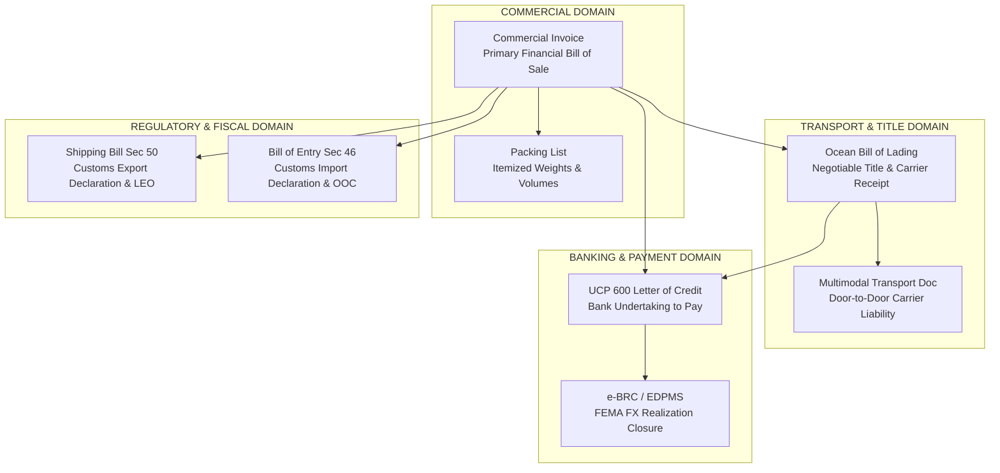
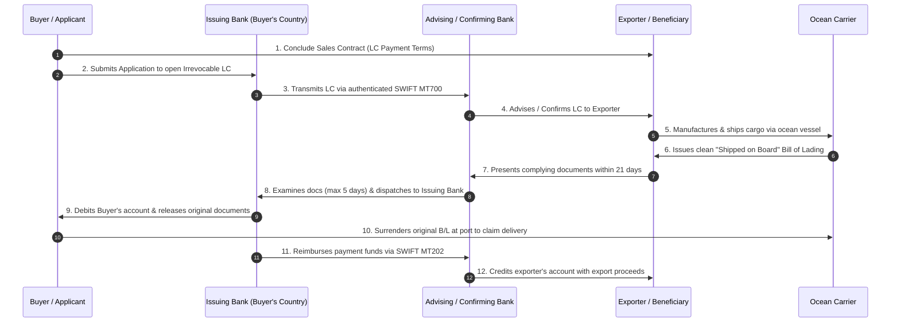

# Unit I: Topic 4 — Export-Import Documentation
## Comprehensive Subjective Question Bank with Model Answers

---

### Section A: 2-Mark Questions (Short Definitions & Core Document Functions)

#### Q1. What is the Aligned Documentation System (ADS)? (2 marks) | Likelihood: High | Type: Define
**Answer:**
The Aligned Documentation System (ADS) is a standardized export documentation methodology pioneered by the United Nations Economic Commission for Europe (UN/ECE) based on the United Nations Layout Key (UNLK). It standardizes all trade documents onto uniform A4-size master templates with identical spatial grid coordinates for recurring data (exporter, buyer, vessel, description), enabling all secondary commercial and regulatory forms to be produced automatically from a single master entry.
* **Keywords to include for full marks:** ADS, UN Layout Key (UNLK), A4 standard size, master document principle, common spatial fields, error elimination.
* **Examiner trap:** Believing ADS is a specific software program. ADS is a *standardized design and layout philosophy* upon which software and EDI forms are constructed.
* **Memory trick:** ADS = **A**ll **D**ocuments **S**hare identical layout grids.
* **Marking scheme guide:** 1 mark for UNLK origin and standardized A4 layout; 1 mark for single-master data duplication principle.

---

#### Q2. State the three-fold legal character of an Ocean Bill of Lading (B/L). (2 marks) | Likelihood: High | Type: Define
**Answer:**
Under international maritime law and the Indian Carriage of Goods by Sea Act, 1925, an Ocean Bill of Lading possesses a three-fold legal character:
1. It is a formal **receipt** issued by the ocean carrier acknowledging that goods have been loaded or received in apparent good order;
2. It is conclusive **evidence of the contract of carriage** between the shipper and the shipping line; and
3. It is a negotiable **document of title to the goods**, transferring ownership through endorsement and delivery.
* **Keywords to include for full marks:** Receipt of goods, evidence of contract of carriage, document of title, negotiable, endorsement.
* **Examiner trap:** Omitting "evidence of the contract of carriage" or confusing it with the contract itself (the booking note/charter party is the underlying contract).
* **Memory trick:** **R**eceipt + **C**ontract Evidence + **T**itle Document (**RCT character of B/L**).
* **Marking scheme guide:** 1 mark for receipt and contract evidence; 1 mark for negotiable document of title.

---

#### Q3. Why is an Air Waybill (AWB) NOT considered a document of title? (2 marks) | Likelihood: High | Type: Define
**Answer:**
An Air Waybill (AWB) is strictly a non-negotiable consignment note and receipt of goods issued by an airline under the Montreal Convention. It is **not a document of title** because it cannot be issued "to order" or transferred via endorsement; the airline releases cargo at the destination airport directly to the named consignee upon proof of identity without requiring physical surrender of the original AWB.
* **Keywords to include for full marks:** Non-negotiable, not a document of title, Montreal Convention, named consignee, no surrender of original needed.
* **Examiner trap:** Confusing AWB with Bill of Lading. A B/L represents title and must be surrendered; an AWB does not represent title.
* **Memory trick:** AWB = **A**ir **W**aybill **B**ypasses title surrender.
* **Marking scheme guide:** 1 mark for non-negotiable consignment receipt; 1 mark for release to named consignee without surrendering original.

---

#### Q4. What is a Bill of Entry and under which section of the Customs Act, 1962 is it filed? (2 marks) | Likelihood: High | Type: Define
**Answer:**
A Bill of Entry (BE) is the statutory customs declaration filed electronically on ICEGATE by an importer or their customs broker under **Section 46 of the Customs Act, 1962**. It provides details of imported cargo, classification under the Customs Tariff Act, valuation, and calculation of customs duties, serving as the legal vehicle to obtain the final customs clearance order (**Out of Charge - OOC**) under Section 47.
* **Keywords to include for full marks:** Section 46 Customs Act 1962, ICEGATE, customs declaration, valuation and duty assessment, Out of Charge (OOC).
* **Examiner trap:** Confusing Section 46 (Bill of Entry for imports) with Section 50 (Shipping Bill for exports).
* **Memory trick:** Section 46 = Entry (Inward); Section 50 = Shipping (Outward).
* **Marking scheme guide:** 1 mark for Section 46 Customs Act 1962; 1 mark for cargo declaration and duty assessment function.

---

#### Q5. What is a Clean Bill of Lading under Article 27 of UCP 600? (2 marks) | Likelihood: High | Type: Define
**Answer:**
Under Article 27 of the ICC Uniform Customs and Practice for Documentary Credits (UCP 600), a Clean Bill of Lading is a transport document that bears no clause or notation expressly declaring a defective condition of the goods or packaging. A standard clause stating that packaging may be reused or that goods were received in apparent good order does not invalidate its clean status.
* **Keywords to include for full marks:** Article 27 UCP 600, no superimposed clausing, apparent good order, no defective packaging notation.
* **Examiner trap:** Believing a Clean B/L must contain the specific word "Clean". It is deemed clean by the *absence of negative defect clauses*.
* **Memory trick:** Clean B/L = Free of carrier defect stamps.
* **Marking scheme guide:** 1 mark for Article 27 UCP 600 definition; 1 mark for absence of negative defect notations regarding goods or packaging.

---

#### Q6. What is the historical GR/SDF Form and what is its present-day status? (2 marks) | Likelihood: High | Type: Define
**Answer:**
Historically, the **GR (Guaranteed Realization) Form** and **SDF (Statutory Declaration Form)** were mandatory paper exchange-control declarations submitted to Customs and RBI to monitor export proceeds realization. Today, both physical GR and SDF forms are **completely abolished by the RBI**, replaced by the automated electronic transmission of Shipping Bill data from ICEGATE directly into RBI’s centralized **EDPMS (Export Data Processing and Monitoring System)**.
* **Keywords to include for full marks:** GR Form, SDF Form, FEMA exchange control, completely abolished, electronic EDPMS replacement.
* **Examiner trap:** Describing the filing of physical paper GR forms in present tense. Always clarify that physical forms are obsolete and replaced by EDPMS.
* **Memory trick:** GR Form is Dead; EDPMS is the Modern Thread.
* **Marking scheme guide:** 1 mark for historical definition as exchange control declaration; 1 mark for present-day electronic EDPMS replacement.

---

### Section B: 5-Mark Questions (Detailed Document Profiles)

#### Q7. Explain the concept, principles, and commercial benefits of the Aligned Documentation System (ADS). (5 marks) | Likelihood: High | Type: Explain
**Answer:**
### Origin and Core Concept
International trade transactions historically required an exporter to prepare over 30 distinct commercial, transport, and regulatory documents, creating severe paperwork errors and delays. To resolve this, the United Nations Economic Commission for Europe (UN/ECE) created the **United Nations Layout Key (UNLK)**. In India, this was adapted as the **Aligned Documentation System (ADS)** by the Indian Institute of Foreign Trade (IIFT).

```
[Master Document A] (Commercial Data)  ───> Generates Commercial Invoice, Packing List, B/L, Insurance
[Master Document B] (Regulatory Data)  ───> Generates Shipping Bill, Exchange Declarations, ARE-1
```

### The Architectural Principles of ADS
1. **Standardized Paper Geometry:** All trade documents are formatted to standard **ISO A4 size** (210 mm $\times$ 297 mm) with uniform margins.
2. **Identical Spatial Placement:** Common recurring trade parameters (Shipper name and address, Consignee, Ocean Vessel, Port of Loading, Port of Discharge, Marks and Numbers, Container details) are assigned **identical spatial grid coordinates** across every document in the series.
3. **The Single-Master Principle:** The exporter prepares two comprehensive Master Documents:
   * *Master Document I (Commercial):* Feeds commercial forms (Invoices, Packing List, Certificate of Origin, Mate's Receipt, Bill of Lading, Marine Insurance).
   * *Master Document II (Regulatory):* Feeds customs and regulatory forms (Shipping Bill, Export Application).

### Commercial Benefits to Exporters
* **Error Elimination:** Data entered once is duplicated without typographic mistakes.
* **Time and Administrative Cost Savings:** Slashes clerical drafting time by over 70%.
* **Foundation for Digital EDI:** The standardized spatial mapping of ADS provided the database field structures for modern electronic platforms like ICEGATE and digital single windows.

* **Keywords to include for full marks:** ADS, UN Layout Key (UNLK), IIFT, ISO A4 size, standardized spatial grid, Master Document I and II, error elimination, EDI foundation.
* **Examiner trap:** Thinking ADS replaces customs declarations. ADS standardizes the *layout* of documents, including the Shipping Bill.
* **Memory trick:** ADS = **A**lign fields $\rightarrow$ **D**uplicate data $\rightarrow$ **S**lash paperwork errors.
* **Marking scheme guide:** 1.5 marks for UNLK/IIFT origin and A4 standard; 2 marks for identical spatial grid and Master Document principles; 1.5 marks for commercial benefits and EDI linkage.

---

#### Q8. Describe the contents, functions, and types of Shipping Bills filed under Section 50 of the Customs Act, 1962. (5 marks) | Likelihood: High | Type: Describe
**Answer:**
### Statutory Mandate & Purpose
Under Section 50 of the Customs Act, 1962, the exporter or their licensed customs broker must present an electronic **Shipping Bill (SB)** to Indian Customs via ICEGATE. The Shipping Bill is the primary statutory export declaration used to assess export duties, verify prohibitions/restrictions, claim export fiscal incentives, and obtain the **Let Export Order (LEO)** under Section 51.

### Primary Types of Shipping Bills (By Export Incentive Category)
1. **Duty Drawback Shipping Bill (Historically Green):** Filed when an exporter claims customs duty refund on imported inputs under Section 75 of the Customs Act.
2. **Dutiable Shipping Bill (Historically Yellow):** Filed for export commodities subjected to statutory export duties/cesses (e.g., raw iron ore, semi-finished leather, certain steel products).
3. **Duty-Free Shipping Bill (Historically White):** Filed for shipments that attract neither export duty nor duty drawback claims.
4. **Advance Authorization / Export under Duty Exemption Scheme (Historically Blue):** Filed when exports fulfill statutory export obligations under an Advance Authorization or EPCG license.
5. **Export under LUT / IGST Refund Shipping Bill:** Modern electronic declaration under Section 16 of the IGST Act, declaring whether goods are shipped under Letter of Undertaking (without tax) or on payment of IGST (claiming electronic refund).

### Mandatory Contents of an Electronic Shipping Bill
* Exporter's 10-digit PAN-linked IEC, registered 14-digit port AD Code, and GSTIN.
* Consignee details, Country of Destination, Port of Loading, and Port of Discharge.
* 8-digit ITC(HS) code, detailed commercial goods description, quantity, and unit measure.
* FOB value, freight, insurance markup, and declared invoice currency.
* Container numbers and factory RFID e-seal details.

* **Keywords to include for full marks:** Section 50 Customs Act 1962, Section 51 LEO, Drawback SB, Dutiable SB, Duty-Free SB, Advance Authorization SB, LUT/IGST declaration, 8-digit ITC(HS), AD Code.
* **Examiner trap:** Forgetting to mention that historical paper color codes (Green, White, Yellow, Blue) have been subsumed into digital electronic scheme codes on ICEGATE.
* **Memory trick:** **D**rawback, **D**utiable, **D**uty-free, **A**dvance Auth, **L**UT (**3D-AL types of Shipping Bills**).
* **Marking scheme guide:** 1 mark for Section 50 statutory purpose; 2.5 marks for explaining the 5 types of Shipping Bills; 1.5 marks for core data contents.

---

#### Q9. Distinguish between Preferential and Non-Preferential Certificates of Origin. (5 marks) | Likelihood: High | Type: Differentiate
**Answer:**

| Parameter of Distinction | Preferential Certificate of Origin | Non-Preferential Certificate of Origin |
|---|---|---|
| **1. Primary Objective** | Enables the importer to claim **concessional or zero customs duties** under a trade agreement. | Certifies the country of manufacture without conferring any special tariff reduction. |
| **2. Legal Treaty Basis** | Governed by specific **Free Trade Agreements (FTAs), PTAs, or CEPA agreements** (e.g., SAFTA, ASEAN-India FTA). | Governed by general WTO MFN rules and domestic trade regulations of the importing nation. |
| **3. Issuing Authorities** | Issued strictly by **designated government-notified agencies** (e.g., EIC, EIA, DGFT, MPEDA, Textile Committee). | Issued by **authorized Chambers of Commerce** (e.g., CII, FICCI, ASSOCHAM, local chambers). |
| **4. Rules of Origin Compliance** | Subject to strict **Rules of Origin (RoO)**: Wholly Obtained criteria or specific Value Addition (VA 35–40%) + CTSH. | Standard commercial proof of origin; does not require complex value-addition cost audits. |
| **5. Application Workflow** | Applied for through the centralized **DGFT Common Digital Platform for CoO** (`coo.dgft.gov.in`). | Can be obtained through Chamber of Commerce portals or physically authenticated by authorized chambers. |
| **6. Commercial Impact on Importer** | Directly reduces landed cost in the destination country, giving the Indian exporter a price advantage. | Serves regulatory compliance: verifies anti-dumping origins, sanctions compliance, and import statistics. |

* **Keywords to include for full marks:** Preferential vs Non-Preferential, FTA/PTA tariff concessions, Rules of Origin (RoO), Value Addition criteria (CTSH), DGFT CoO platform, Chambers of Commerce (CII/FICCI), EIC/EIA.
* **Examiner trap:** Believing any Chamber of Commerce can issue a Preferential CoO. Preferential CoOs can be issued *only by government-authorized agencies* notified under that specific FTA.
* **Memory trick:** Preferential = Pays Less Duty; Non-Preferential = Pure Origin Proof.
* **Marking scheme guide:** 0.5 marks per distinct row (min 6 rows = 3 marks); 1 mark for Rules of Origin value addition contrast; 1 mark for authorized issuing bodies contrast.

---

#### Q10. Explain the components and legal function of a Bill of Exchange (Draft) under the Negotiable Instruments Act, 1881. (5 marks) | Likelihood: High | Type: Explain
**Answer:**
### Statutory Definition
Under Section 5 of the Indian Negotiable Instruments Act, 1881, a **Bill of Exchange** is an instrument in writing containing an unconditional order, signed by the maker, directing a certain person to pay a certain sum of money only to, or to the order of, a certain person or to the bearer of the instrument.

### The Three Legal Parties
1. **The Drawer (Exporter / Seller):** The party who draws (creates) the bill, commanding payment.
2. **The Drawee (Importer / Buyer or Issuing Bank):** The party to whom the payment order is directed.
3. **The Payee:** The party entitled to receive the funds (typically the exporter or their negotiating bank).

```
[DRAWER: Indian Exporter] ───(Draws Unconditional Order)───> [DRAWEE: Foreign Importer/Bank]
                                                                        │
                                   [PAYEE: Negotiating Bank] <──────────┘ (Pays at sight or accepts)
```

### Classification of Export Bills of Exchange
* **Sight Draft (Demand Draft - Used in D/P Terms):** The drawee is obligated to pay the full face value immediately upon presentation of the draft ("at sight") before documents are released.
* **Usance Draft (Time Draft - Used in D/A Terms):** Payable at a fixed or determinable future maturity date (e.g., "60 days after Bill of Lading date"). The drawee obtains title documents immediately upon writing their signature and "Accepted" across the face of the bill.

### Legal Function in Trade Finance
* Serves as an independent, legally enforceable debt instrument admissible in commercial courts.
* Can be endorsed, discounted, purchased, or transferred by commercial banks to provide post-shipment liquidity to the exporter.

* **Keywords to include for full marks:** Section 5 Negotiable Instruments Act 1881, unconditional order, Drawer, Drawee, Payee, Sight Draft, Usance Draft, D/P vs D/A, bill discounting.
* **Examiner trap:** Calling a Bill of Exchange a "request to pay". It is an **unconditional order**, not a polite request.
* **Memory trick:** **D**rawer orders $\rightarrow$ **D**rawee pays $\rightarrow$ **P**ayee receives (**DDP parties**).
* **Marking scheme guide:** 1 mark for Section 5 definition; 1.5 marks for the three parties; 1.5 marks for Sight vs Usance drafts; 1 mark for discounting/legal role.

---

#### Q11. Describe the purpose, types, and statutory clearance role of a Bill of Entry in Indian Customs. (5 marks) | Likelihood: High | Type: Describe
**Answer:**
### Statutory Role of the Bill of Entry
Governed by **Section 46 of the Customs Act, 1962**, the Bill of Entry (BE) is the primary legal document submitted electronically on ICEGATE by an importer or Customs Broker to declare goods arriving from foreign territories. It forms the legal basis for classification under the Customs Tariff Act, 1975, valuation under Section 14, and assessment of Basic Customs Duty (BCD), Social Welfare Surcharge (SWS), and Integrated GST (IGST).

### The Three Specialized Forms of Bill of Entry
1. **Bill of Entry for Home Consumption (Form I - Historically White):**
   * Filed when the importer intends to clear imported goods immediately into the domestic market for manufacturing or resale.
   * Customs duty and IGST must be paid upfront before the Proper Officer issues the statutory **Out of Charge (OOC)** order under Section 47.
2. **Bill of Entry for Warehousing / Into-Bond (Form II - Historically Yellow):**
   * Filed when the importer wishes to defer customs duty payment by storing goods in a public or private bonded customs warehouse under Section 59.
   * Goods are assessed for duty, and a triple-duty bond is executed, but **zero duty is paid upfront**.
3. **Bill of Entry for Ex-Bond Clearance (Form III - Historically Green):**
   * Filed when the importer removes stored goods from the bonded customs warehouse in partial lots for domestic consumption under Section 68.
   * Applicable duty is paid on that specific released quantity at the rate prevailing on the date of ex-bond filing.

* **Significance of Advance Filing:** Under current customs regulations, an importer must file the Bill of Entry before the end of the day preceding the day of vessel arrival to avoid statutory late-filing financial penalties.
* **Keywords to include for full marks:** Section 46 Customs Act 1962, Form I Home Consumption, Form II Warehousing/Into-Bond, Form III Ex-Bond, Section 47 Out of Charge, Bonded warehouse, Advance filing deadline.
* **Examiner trap:** Believing warehousing avoids customs duty permanently. It *defers* duty payment until goods are released via Form III Ex-Bond.
* **Memory trick:** Form I = Home (Immediate); Form II = Into Bond (Stored); Form III = Ex-Bond (Released).
* **Marking scheme guide:** 1 mark for Section 46 statutory purpose; 3 marks for detailed distinction of the 3 forms; 1 mark for advance filing rule and OOC Section 47.

---

#### Q12. Explain the purpose and contents of an Import General Manifest (IGM) and Delivery Order (DO). (5 marks) | Likelihood: High | Type: Explain
**Answer:**
### 1. Import General Manifest (IGM)
* **Statutory Authority:** Filed under **Section 30 of the Customs Act, 1962** by the person-in-charge of an ocean vessel or aircraft (or shipping line / airline).
* **Purpose:** It is the carrier’s statutory cargo declaration to Indian Customs, listing every container, package, description, mark, and consignee aboard the transport conveyance.
* **Filing Timeline:** For vessels, the IGM must be submitted electronically via ICEGATE **prior to the arrival of the vessel** at the Indian customs seaport.
* **Legal Significance:** Indian Customs will not permit cargo to be unloaded from the ship until the IGM is successfully processed and the vessel receives formal **Entry Inwards** permission under Section 31.

### 2. Delivery Order (DO)
* **Issuing Authority:** Issued by the **Shipping Line / Ocean Carrier** (or their local ship agent) to the importer or customs broker.
* **Purpose:** The Delivery Order is the carrier’s commercial instruction directed to the port authority, container terminal, or CFS custodian instructing them to release the physical cargo to the designated importer.
* **Prerequisites for Issuance:** The shipping line issues the DO only after:
  1. The importer surrenders a properly endorsed **Original Ocean Bill of Lading (3/3)**;
  2. All outstanding international ocean freight, terminal handling charges (THC), container washing fees, and container detention security deposits are fully settled.

* **Keywords to include for full marks:** Section 30 Customs Act, IGM, Entry Inwards Section 31, ICEGATE pre-arrival filing, Delivery Order, shipping line, terminal custodian release, surrender of original B/L.
* **Examiner trap:** Confusing Delivery Order with Out of Charge. The **Delivery Order** is the *shipping line's* commercial release; **Out of Charge (OOC)** is the *customs officer's* statutory release. Both are required to remove cargo from the port.
* **Memory trick:** IGM reports goods to Customs $\rightarrow$ DO releases goods from Shipping Line.
* **Marking scheme guide:** 2.5 marks for IGM (Section 30, pre-arrival filing, Entry Inwards); 2.5 marks for Delivery Order (prerequisites, freight settlement, custodian instruction).

---

### Section C: 10-Mark Questions (In-Depth Document Analyses)

#### Q13. Provide a detailed classification of International Trade Documentation. Explain Commercial, Regulatory, Transport, Financial, and Auxiliary documents with their functions. (10 marks) | Likelihood: High | Type: Explain / Classify
**Answer:**
### 1. Introduction
Cross-border trade requires an extensive documentary framework to bridge legal, physical, and financial jurisdictions. Documents are classified into five functional categories based on their operational roles:

```
                        [ INTERNATIONAL TRADE DOCUMENTS ]
         ┌──────────────┬──────────────┼──────────────┬──────────────┐
         ▼              ▼              ▼              ▼              ▼
   [ Commercial ] [ Regulatory ]  [ Transport ]   [ Financial ]  [ Auxiliary ]
   * Proforma     * Shipping Bill * Ocean B/L     * Bill of      * Mate's Receipt
   * Commercial   * Bill of Entry * Air Waybill     Exchange     * Carting Order
     Invoice      * GST LUT       * Multimodal    * Letter of    * Inspection &
   * Packing List * RCMC / IEC      Document        Credit         Insurance Cert.
```

---

### 2. Detailed Functional Classification

#### A. Commercial Documents
Commercial documents govern the contractual and financial terms between the exporter and importer:
1. **Proforma Invoice:** A formal quotation issued by the exporter before contract execution, stating estimated prices, specifications, and terms, enabling the buyer to apply for import licenses or open a Letter of Credit.
2. **Commercial Invoice:** The definitive financial bill and accounting document, detailing actual quantities, descriptions, unit prices, Incoterms, and total payable value. It is the primary document used for customs tariff valuation under Section 14.
3. **Packing List:** Provides detailed package-by-package breakdowns (carton numbers, net/gross weights, package dimensions), enabling warehouse workers and customs examiners to locate specific items without opening the entire consignment.

#### B. Regulatory Documents
Mandated by sovereign governments to ensure compliance with national laws, trade policies, and taxation:
1. **Shipping Bill (Section 50 Customs Act):** Filed electronically on ICEGATE by exporters to obtain customs assessment, export incentive clearance, and the statutory **Let Export Order (LEO)**.
2. **Bill of Entry (Section 46 Customs Act):** Filed by importers for customs clearance, tariff assessment, and obtaining the **Out of Charge (OOC)** order.
3. **GST Letter of Undertaking (Form GST RFD-11):** Enables zero-rated export supplies under Section 16 of the IGST Act without upfront tax payment.
4. **Registration Certificates:** Statutory trade credentials including the **Importer-Exporter Code (IEC)** from DGFT and the **Registration-cum-Membership Certificate (RCMC)** from EPCs.

#### C. Transport Documents
Issued by international freight carriers evidencing carriage across international borders:
1. **Ocean Bill of Lading (B/L):** The premier maritime transport document, functioning as a receipt of goods, evidence of carriage contract, and a **negotiable document of title**.
2. **Air Waybill (AWB):** A non-negotiable consignment note for air freight.
3. **Combined / Multimodal Transport Document (MTD):** Issued by a Multimodal Transport Operator (MTO) under the Multimodal Transportation of Goods Act, 1993, covering cargo carried by at least two different transport modes under a single legal liability.

#### D. Financial Documents
Financial instruments that facilitate payment settlement and credit:
1. **Bill of Exchange (Draft):** An unconditional written payment order drawn by the exporter directing the importer (or bank) to pay at sight or at a future date under the Negotiable Instruments Act, 1881.
2. **Letter of Credit (LC):** A documentary credit issued by an issuing bank under UCP 600 guaranteeing payment to the exporter against strictly complying documents.
3. **Electronic Bank Realization Certificate (e-BRC):** Digital certificate issued by an Authorized Dealer bank confirming foreign currency realization and updating RBI’s EDPMS database.

#### E. Auxiliary / Inspection & Insurance Documents
Certificates that validate quality, risk protection, or port processing:
1. **Certificate of Origin (CoO):** Documents country of manufacture (Preferential for FTA tariff cuts vs Non-Preferential).
2. **Marine Cargo Insurance Policy:** Protects against physical transit loss or damage under Institute Cargo Clauses (ICC A, B, or C).
3. **Pre-Shipment Inspection & Health Certificates:** Issued by the Export Inspection Agency (EIA) or private surveyors (SGS) certifying quality, phytosanitary standards, or non-toxicity.
4. **Port Handling Documents:** Operational gate-in and loading receipts including the port **Carting Order** and the ship Chief Officer’s **Mate's Receipt**.

---

### 3. Conclusion
International trade documentation operates as an integrated legal and logistical system. Commercial documents quantify the sale, regulatory documents authorize cross-border transit, transport documents move the goods, financial documents execute payment, and auxiliary documents guarantee quality and insurable risk mitigation.

* **Keywords to include for full marks:** Commercial, Regulatory, Transport, Financial, Auxiliary, Commercial Invoice, Packing List, Shipping Bill Sec 50, Bill of Entry Sec 46, Bill of Lading, Air Waybill, Bill of Exchange, UCP 600 Letter of Credit, e-BRC, Certificate of Origin, Mate's Receipt.
* **Examiner trap:** Listing documents haphazardly. Structuring your answer into the **5 standardized categories** is essential for high marks.
* **Memory trick:** **C**ommercial, **R**egulatory, **T**ransport, **F**inancial, **A**uxiliary (**CRT-FA classification**).
* **Marking scheme guide:** 1 mark for intro and taxonomy diagram; 2 marks each for Commercial, Regulatory, Transport, and Financial documents; 1 mark for Auxiliary documents and conclusion.

---

#### Q14. What is an Ocean Bill of Lading (B/L)? Analyze its legal characteristics and detail its primary commercial sub-types. (10 marks) | Likelihood: High | Type: Analyze / Detail
**Answer:**
### 1. Introduction & Statutory Framework
The Ocean Bill of Lading (B/L) is the most critical transport document in international maritime commerce. Governed in India by the **Indian Carriage of Goods by Sea Act, 1925**, and internationally by the Hague-Visby and Hamburg Rules, it establishes carrier accountability and enables cross-border title transfers while goods are in high-seas transit.

---

### 2. The Three-Fold Legal Character of a Bill of Lading

```
                          [ THREE-FOLD CHARACTER OF A B/L ]
         ┌───────────────────────────────┼───────────────────────────────┐
         ▼                               ▼                               ▼
 [ Receipt of Goods ]          [ Evidence of Contract ]        [ Document of Title ]
 Carrier confirms cargo         Evidences terms of              Negotiable instrument
 received in apparent          carriage between shipper        representing physical
 good order & condition        and ocean shipping line         ownership of goods
```

1. **Receipt of Cargo:** It acts as an authoritative, signed receipt by the master or agent of the vessel acknowledging that goods of specified quantity, weight, and condition have been taken into carrier custody.
2. **Evidence of the Contract of Carriage:** While the contract of carriage is entered into before loading (via booking note or freight agreement), the B/L serves as the definitive legal evidence of the terms, conditions, freight rates, and carrier liabilities governing maritime transport.
3. **Document of Title to the Goods:** This is the B/L's unique legal attribute. Possession of a validly endorsed original Bill of Lading equates to legal constructive possession of the goods. Physical ownership of the cargo can be transferred through endorsement and delivery while the vessel is at sea.

---

### 3. Detailed Analysis of Commercial B/L Sub-Types

#### A. Based on Condition of Packaging: Clean vs Claused B/L
* **Clean Bill of Lading (UCP 600 Art. 27):** Bears no superimposed notation declaring damaged, leaking, torn, or defective packaging. **Mandatory for negotiating payment under Letters of Credit**.
* **Claused / Foul / Dirty B/L:** Bears carrier endorsements noting defects (e.g., *"10 drums leaking"*, *"bags torn and re-stitched"*). Rejected by banks as discrepant.

#### B. Based on Stage of Transport: Shipped on Board vs Received for Shipment B/L
* **Shipped on Board B/L:** Confirms that the goods have been physically loaded on board the designated vessel. Under UCP 600 Article 20, banks will negotiate documents only if the B/L reflects an authentic "Shipped on Board" notation with vessel name and loading date.
* **Received for Shipment B/L:** Confirms only that the carrier has taken custody of the goods at the container yard; goods have not yet been loaded on the ship.

#### C. Based on Transferability: Straight vs Order B/L
* **Straight Bill of Lading:** Consigned directly to a named consignee without words "or to order". It is non-negotiable; cargo is delivered only to that named party.
* **Order (Negotiable) Bill of Lading:** Drawn "to order" or "to order of shipper/bank". It can be endorsed in blank (becoming a bearer document) or endorsed specially, transferring title freely across secondary commodity markets.

#### D. Based on Transport Routing: House B/L vs Master B/L
* **Master Bill of Lading (MBL):** Issued by the actual vessel-operating ocean carrier (e.g., Maersk, MSC) to a Freight Forwarder or NVOCC.
* **House Bill of Lading (HBL):** Issued by an NVOCC/Freight Forwarder to the individual cargo shipper consolidating LCL freight.

#### E. Multimodal / Combined Transport B/L
Covers international freight involving at least two different modes of transport (e.g., rail from an inland ICD in Delhi to port, followed by ocean carriage to Rotterdam), issued by a registered Multimodal Transport Operator (MTO).

---

### 4. Conclusion
The Ocean Bill of Lading is central to international maritime commerce. Its status as a negotiable document of title enables global trade financing, allowing banks to extend credit against cargo collateral while goods move across oceans.

* **Keywords to include for full marks:** Carriage of Goods by Sea Act 1925, Hague-Visby Rules, receipt of goods, evidence of carriage contract, document of title, Clean B/L, Claused B/L, Shipped on Board UCP 600 Art 20, Received for Shipment, Order B/L, House B/L, Multimodal B/L.
* **Examiner trap:** Claiming that a "Received for Shipment" B/L is automatically accepted under a Letter of Credit. Banks accept it *only if it bears an additional dated on-board endorsement*.
* **Memory trick:** **R**eceipt, **C**ontract, **T**itle (**RCT**) + **C**lean, **S**hipped, **O**rder (**CSO sub-types**).
* **Marking scheme guide:** 2 marks for statutory origin and intro; 3 marks for the three-fold legal character; 4 marks for detailed classification of B/L sub-types; 1 mark for conclusion.

---

#### Q15. Detail the operational workflow and document verification checklist under Article 14 of UCP 600 for Letters of Credit. (10 marks) | Likelihood: High | Type: Procedure / Checklist
**Answer:**
### 1. Statutory Context: Article 14 of UCP 600
Under the ICC Uniform Customs and Practice for Documentary Credits (UCP 600), international documentary credit operations are governed by the **Doctrine of Strict Compliance**. Article 14 establishes the international standard by which nominated, confirming, and issuing banks must examine documents presented by the beneficiary (exporter).

```
[Exporter Presents Docs] ───> [Bank has MAX 5 Banking Days] ───> [Complying: Honor Payment]
                               (Article 14b Review Period)   ───> [Discrepant: Issue MT734 Notice]
```

---

### 2. Core Legal Rules for Document Examination (UCP 600 Art. 14)
1. **The 5-Banking-Day Rule (Article 14b):** A nominated bank acting on its nomination, a confirming bank, and the issuing bank each have a **maximum of five banking days** following the day of presentation to examine the documents and determine compliance. This period is not extended by upcoming expiry dates.
2. **Data Consistency Principle (Article 14d):** Data in a document, when read in context with the credit, the document itself, and international standard banking practice, **need not be identical to, but must not conflict with**, data in that document, any other stipulated document, or the credit.
3. **Goods Description Rules (Article 14e & 18c):**
   * *In the Commercial Invoice (Art. 18c):* The description of goods, services, or performance **must correspond strictly** with that in the Letter of Credit.
   * *In All Other Documents (Art. 14e):* Goods may be described in general terms not inconsistent with the description in the credit.
4. **The 21-Day Presentation Window (Article 14c):** A transport document must be presented by or on behalf of the beneficiary not later than **21 calendar days** after the date of shipment, but in any event not later than the expiry date of the credit.

---

### 3. Comprehensive Document Verification Checklist for Exporters

```
┌───────────────────────────┬────────────────────────────────────────────────────────────────────────┐
│ Document Under Review     │ Mandatory Compliance Parameters Checked by Bank Examiners              │
├───────────────────────────┼────────────────────────────────────────────────────────────────────────┤
│ 1. Commercial Invoice     │ * Description matches the LC wording strictly.                         │
│                           │ * Issued in the name of the applicant (buyer) by beneficiary.          │
│                           │ * Currency matches LC; invoice value does not exceed LC amount.        │
│                           │ * Correct unit prices and Incoterm specified.                         │
├───────────────────────────┼────────────────────────────────────────────────────────────────────────┤
│ 2. Bill of Lading (B/L)   │ * Clean On Board notation with dated ship endorsement (Art. 20).       │
│                           │ * Ports of loading and discharge match LC stipulations exactly.        │
│                           │ * Consigned as required (e.g., "To Order of Issuing Bank").            │
│                           │ * Full set of original copies (3/3) presented.                         │
│                           │ * "Freight Prepaid" or "Freight Collect" notation matches Incoterm.    │
├───────────────────────────┼────────────────────────────────────────────────────────────────────────┤
│ 3. Insurance Policy       │ * Underwritten by insurance company or underwriter, signed & dated.    │
│                           │ * Currency matches LC currency (Art. 28a).                             │
│                           │ * Minimum cover equals 110% of CIF/CIP value (Art. 28f).               │
│                           │ * Cover effective from or prior to the date of shipment.               │
│                           │ * Specific Institute Cargo Clauses stipulated in LC are included.      │
├───────────────────────────┼────────────────────────────────────────────────────────────────────────┤
│ 4. Packing List           │ * Marks and numbers correspond to Bill of Lading.                      │
│                           │ * Breakdown of individual package contents, net and gross weights.     │
│                           │ * Does not conflict with quantities or descriptions in the invoice.    │
├───────────────────────────┼────────────────────────────────────────────────────────────────────────┤
│ 5. Certificate of Origin  │ * Issued and authenticated by authorized body (Chamber/EIC).           │
│                           │ * Certifies correct origin matching invoice declarations.             │
└───────────────────────────┴────────────────────────────────────────────────────────────────────────┘
```

---

### 4. Handling Discrepancies: The Article 16 Refusal Protocol
If the examining bank discovers document discrepancies:
* The bank must issue a single formal notice of refusal (via SWIFT MT734) to the presenter **before the close of the fifth banking day**.
* The notice must state: (a) That the bank is refusing to honor, (b) **Each individual discrepancy** upon which the bank bases its refusal, and (c) The custodial disposition of the documents (holding documents pending further instructions).
* Failure to follow this strict notice protocol precludes the bank under Article 16(f) from claiming that documents are non-compliant, forcing the bank to pay the exporter.

---

### 5. Conclusion
Mastery of the UCP 600 Article 14 examination standards is the ultimate safeguard for an exporter. By conducting rigorous pre-presentation audits against the document checklist, an exporter eliminates banking discrepancies, avoids discrepancy penalty fees, and ensures immediate payment realization.

* **Keywords to include for full marks:** UCP 600 Article 14, 5 banking days, Article 14b, strict compliance, Article 18c invoice description, 21 calendar days Article 14c, Full set 3/3 B/L, Clean On Board, 110% CIF insurance, SWIFT MT734 refusal, Article 16 preclusion.
* **Examiner trap:** Saying banks have 7 or 14 days to examine documents. Under older UCP 500, banks had 7 days; under **UCP 600, it is strictly 5 banking days**.
* **Memory trick:** 5 Days to Check, 21 Days to Present, 110% to Insure (**Rule of 5-21-110**).
* **Marking scheme guide:** 2 marks for intro and UCP 600 context; 3 marks for core examination rules (5 days, data conflict, 21 days); 3 marks for structured document checklist; 2 marks for Article 16 discrepancy protocol and conclusion.

---

#### Q16. Critically evaluate the transition in Indian export documentation from physical exchange control forms to automated EDI under ICEGATE and EDPMS. (10 marks) | Likelihood: High | Type: Critically Evaluate / Transition
**Answer:**
### 1. Introduction: The Pre-Reform Paper Burden
Prior to automated digital systems, Indian export documentation was characterized by heavy paperwork and physical procedural friction. Exporters were required to print and physically submit dozens of multi-part paper forms—including the **GR (Guaranteed Realization) Form, Statutory Declaration Form (SDF), ARE-1 Form, and physical Bank Realization Certificates (BRC)**—across fragmented offices of Customs, Central Excise, Authorized Dealer banks, and Regional DGFT Directorates. This manual pipeline created high transaction costs, port congestion, and delays in export incentive settlements.

---

### 2. Comprehensive Historical vs Modern Architecture Matrix

```
                      [ INDIAN EXPORT DOCUMENTATION EVOLUTION ]
        Traditional Paper-Based Regime             Modern Automated EDI Regime
        ──────────────────────────────             ───────────────────────────
        * Physical GR / SDF Forms at Customs ───>  Automated ICEGATE-to-EDPMS Data Push
        * Factory Excise Form ARE-1 in Quad  ───>  Online GST LUT & Shipping Bill
        * Physical Bank Stamp on Paper BRC   ───>  Digitally Signed XML e-BRC to DGFT
        * Manual Scrutiny by Customs Appraiser───> Risk Management System (RMS) Green Channel
```

---

### 3. Detailed Comparative Evolution Across Primary Regulatory Instruments

#### A. Foreign Exchange Monitoring: GR/SDF vs EDPMS
* **Traditional Mechanism:** Exporters completed the physical **GR Form** in duplicate. The original was submitted to Customs at the time of shipping bill processing, verified, stamped by the customs officer, and physically mailed to the Reserve Bank of India. When proceeds were realized, the bank issued an attested paper BRC. The exporter submitted the paper BRC back to RBI to close the open GR ledger.
* **Present Electronic Mechanism:** Physical GR and SDF forms are **completely abolished**. When an electronic Shipping Bill receives a Let Export Order (LEO), ICEGATE transmits the data directly to RBI’s **Export Data Processing and Monitoring System (EDPMS)**. When inward remittances arrive, the AD bank reconciles payments electronically against the pending Shipping Bill in EDPMS, generating an **e-BRC**.

#### B. Indirect Taxation: Central Excise ARE-1 vs GST Regime
* **Traditional Mechanism:** Governed by the Central Excise Act, 1944. Excisable goods left factories under **Form ARE-1** (Application for Removal of Excisable Goods for Export) in multiple colored copies. Physical verification and sealing were performed by the Central Excise Range Superintendent, and rebate claims required physical submission to the Maritime Commissioner.
* **Present Electronic Mechanism:** ARE-1 forms are **obsolete** (except for petroleum products). Exports are classified as "Zero-Rated Supplies" under Section 16 of the IGST Act. Exporters file an annual electronic **Letter of Undertaking (LUT)** on the GST portal without bond guarantees. Customs data from ICEGATE integrates with GSTN, processing IGST refunds automatically without paper claims.

#### C. Cargo Declarations: Physical Customs Processing vs ICEGATE SWIFT
* **Traditional Mechanism:** Customs Brokers manually carried typed Shipping Bills and physical invoices to the custom house, physically moving from appraising tables to examination sheds and cashier counters.
* **Present Electronic Mechanism:** Filing is conducted 24x7 via **ICEGATE**. Exporters upload invoices and test reports as digitally signed PDFs on **e-SANCHIT**. The **Risk Management System (RMS)** clears 70–80% of cargo automatically via the Green Channel straight to the Let Export Order (LEO).

---

### 4. Critical Analytical Assessment: Benefits vs Ground Realities

| Operational Dimension | Realized Systemic Reforms | Persistent Implementation Bottlenecks |
|---|---|---|
| **1. Processing Turnaround** | Port dwell times reduced from 4–7 days to hours for facilitated cargo. | Technical ICEGATE downtime, gateway server timeouts during month-ends. |
| **2. Transaction Cost** | Slashed clerical documentation costs, courier charges, and handling friction. | High terminal handling charges (THC) and customs broker professional costs remain. |
| **3. Administrative Transparency**| Eliminated routine physical human interaction; faceless assessment prevents corruption. | Discrepancies between GSTN and ICEGATE generate digital error codes (SB005) freezing refunds. |

---

### 5. Conclusion
The digitization of Indian foreign trade documentation represents a structural transformation. By replacing physical paper mechanisms (GR, ARE-1, paper BRCs) with integrated digital backbones (**ICEGATE, SWIFT, EDPMS, and e-BRC**), India has simplified export compliance, enhanced fiscal transparency, and established the paperless trade infrastructure required to support its $2 Trillion export target.

* **Keywords to include for full marks:** Traditional paper regime, GR Form, SDF Form, Form ARE-1 Central Excise, paper BRC, modern EDI regime, ICEGATE, e-SANCHIT, RMS Green Channel, EDPMS, e-BRC, GST LUT Form GST RFD-11, Zero-rated supplies, Error Code SB005.
* **Examiner trap:** Presenting the old system as active or describing the new system without acknowledging historical roots. University exams explicitly test this transition; provide both historical and modern positions.
* **Memory trick:** Out with **GR/ARE-1/Paper BRC**; In with **ICEGATE/EDPMS/e-BRC**.
* **Marking scheme guide:** 2 marks for intro and pre-reform paper burden; 3 marks for master comparative matrix; 3 marks for detailed functional evolution (EDPMS, GST LUT, ICEGATE); 2 marks for critical evaluation of bottlenecks and conclusion.

---

### Section D: 15-Mark Comprehensive Questions (Flagship Document Masteries)

#### Q17. Provide an exhaustive master analysis of the primary transport, commercial, and regulatory documents in international trade. Analyze their legal functions, procedural lifecycles, and risk profiles. (15 marks) | Likelihood: High | Type: Comprehensive
**Answer:**

```
========================================================================================
     EXHAUSTIVE ANALYSIS: MASTER ARCHITECTURE OF INTERNATIONAL TRADE DOCUMENTS
========================================================================================
```

### 1. Introduction & Statutory Context
International trade operates through documentary surrogates. Because physical merchandise cannot be inspected or handed over instantaneously across global distances, financial institutions, customs bodies, and commercial courts rely on legally authenticated documents. This master analysis deconstructs the three foundational documents that govern cross-border commerce: the **Commercial Invoice** (Commercial), the **Ocean Bill of Lading** (Transport/Title), and the **Shipping Bill / Bill of Entry** (Regulatory).

---

### 2. Comprehensive Master Document Architecture Flowchart



*Exam Hand-Drawing Guide (Under 2 Minutes):* Draw `[Commercial Invoice]` in the center of the page, with 4 radiating arrows pointing to: `[1. Packing List]`, `[2. Bill of Lading (Title)]`, `[3. Shipping Bill / Customs]`, and `[4. Letter of Credit / Bank]`. Annotate with key section and UCP rule numbers.

---

### 3. Exhaustive Analysis of the Big Three Documents

#### A. The Commercial Invoice (The Sovereign Accounting Document)
* **Legal Nature & Purpose:** The primary contract bill issued by the exporter commanding payment from the buyer. It represents the legal baseline for determining transaction value under Section 14 of the Indian Customs Act and Article VII of GATT.
* **Essential Statutory Contents:** Complete legal names/addresses of buyer and seller; unique invoice number and date; detailed goods description matching Letter of Credit stipulations (UCP 600 Art. 18c); unit prices, quantities, and total value; currency of settlement; agreed Incoterms 2020 rule (e.g., CIF Hamburg); 8-digit ITC(HS) codes; country of origin; and export contract reference.
* **Risk Profile & Common Pitfalls:** Minor typographic errors, description variations between the invoice and LC, or omission of Incoterm extensions trigger bank rejection under the Doctrine of Strict Compliance.

#### B. The Ocean Bill of Lading (The Title & Transport Document)
* **Three-Fold Character:** Acts as (a) A formal receipt of cargo by the ocean carrier, (b) Evidence of the contract of carriage, and (c) A **negotiable document of title**.
* **Procedural Lifecycle:**
  1. *Mate's Receipt Stage:* Container is loaded on board; ship's Chief Officer issues a temporary Mate's Receipt.
  2. *Issuance of Original B/L:* Exporter surrenders the Mate's Receipt and pays ocean freight to the shipping line, receiving a full set of signed originals (typically 3/3).
  3. *Banking Negotiation:* Exporter endorses the original B/L and presents it to the negotiating bank under a Letter of Credit.
  4. *Cargo Release:* The original endorsed B/L is forwarded to the buyer's bank, released to the buyer against payment, and surrendered by the buyer to the ocean carrier at destination to secure physical release.
* **Risk Profile & Claused Documents:** If the carrier superimposes notations indicating package damage, it becomes a **Claused/Foul B/L**, rendering it non-negotiable under UCP 600 Article 27.

#### C. The Shipping Bill & Bill of Entry (The Regulatory Customs Documents)
* **Shipping Bill (Export Clearance - Section 50 Customs Act):** Filed electronically on ICEGATE. Once verified by the Risk Management System (RMS) and dock examination, the Proper Officer signs the **Let Export Order (LEO)** under Section 51, legally permitting goods to be loaded. It automates export duty drawback and transmits data to RBI’s EDPMS.
* **Bill of Entry (Import Clearance - Section 46 Customs Act):** Filed by the importer across three specialized types: *Form I (Home Consumption)*, *Form II (Warehousing/Into-Bond)*, or *Form III (Ex-Bond)*. Clearance culminates in the issuance of **Out of Charge (OOC)** under Section 47.

---

### 4. Cross-Documentary Reconciliation Matrix

| Document Parameter | Commercial Invoice | Packing List | Bill of Lading | Shipping Bill |
|---|---|---|---|---|
| **1. Value Declaration** | Shows unit prices, total commercial value, currency, and Incoterm. | Zero financial values shown; strictly physical packing metrics. | Rarely shows cargo value (unless ad-valorem freight is paid). | Full FOB and CIF values declared for customs duty/incentive assessment. |
| **2. Description of Goods** | **Strict and identical match** to LC wording (UCP 600 Art. 18c). | General commercial description; focuses on contents per carton. | May use general commercial terms not inconsistent with LC (Art. 14e). | Detailed technical description mapped to national 8-digit ITC(HS) code. |
| **3. Weights & Quantities** | Total invoice quantities and billing metrics. | Detailed breakdown of gross weight, net weight, tare weight per unit. | Total gross weight and total volume (CBM) as declared by shipper. | Declared net and gross weights; verified against dock scale weighments. |
| **4. Marks and Numbers** | Summary container and seal numbers. | Detailed carton-by-carton numbering (e.g., Box 1 of 50 to 50 of 50). | Container number, vessel name, voyage number, seal numbers. | Container numbers, electronic RFID e-seal codes, port terminal codes. |

---

### 5. Critical Risk Management & Documentary Discrepancy Prevention
Documentary inconsistencies remain the leading cause of international trade disputes, demurrage penalties, and banking payment rejections:
1. **The Inverted Description Trap:** An invoice describing *"100% Combed Cotton Knitted T-Shirts"* against an LC calling for *"100% Cotton Knitted Shirts"* constitutes a fatal documentary discrepancy under UCP 600 Article 18c.
2. **Weight Discrepancy Detentions:** If the gross weight declared on the Packing List differs from the ocean Bill of Lading or the Verified Gross Mass (VGM) certificate under the SOLAS Convention, maritime port authorities will refuse container loading, incurring severe demurrage.
3. **Harmonized System Alignment:** The ITC(HS) code declared on the Commercial Invoice must match the electronic Shipping Bill filed on ICEGATE; discrepancies flag the shipment on the customs Risk Management System (RMS) Red Channel for punitive physical examination.

---

### 6. Conclusion
International trade documentation represents an interdependent legal and administrative system. Precision in commercial drafting, alignment with the United Nations Layout Key (ADS), and adherence to statutory customs and banking rules (Customs Act 1962, UCP 600, FEMA 1999) ensure rapid cargo movement, protect trade assets, and guarantee immediate payment realization.

* **Keywords to include for full marks:** Master Document Architecture, Commercial Invoice Section 14, Ocean Bill of Lading, RCT character, Shipping Bill Section 50, Bill of Entry Section 46, Let Export Order Section 51, Out of Charge Section 47, UCP 600 Article 18c, SOLAS VGM gross mass, Cross-documentary reconciliation, Discrepancy prevention.
* **Examiner trap:** Describing documents as isolated administrative forms. High-scoring answers demonstrate how they *interlock* (e.g., how the Commercial Invoice feeds the Shipping Bill, which feeds the Bill of Lading, which satisfies the Letter of Credit).
* **Memory trick:** **C**ommercial sells $\rightarrow$ **T**ransport moves $\rightarrow$ **C**ustoms clears $\rightarrow$ **B**ank pays (**CTCB document lifecycle**).
* **Marking scheme guide:** 2 marks for intro and structural taxonomy; 3 marks for master flowchart diagram; 5 marks for detailed analysis of the Big Three documents; 3 marks for cross-document reconciliation table; 2 marks for risk mitigation and conclusion.

---

#### Q18. Analyze the legal nature, operation, and types of Letters of Credit (LC) under UCP 600. Detail the step-by-step documentary lifecycle. (15 marks) | Likelihood: High | Type: Comprehensive
**Answer:**

```
========================================================================================
     COMPREHENSIVE MASTER ESSAY: LETTERS OF CREDIT (LC) UNDER UCP 600
========================================================================================
```

### 1. Introduction & The Core Banking Principle
A Letter of Credit (Documentary Credit) is an irrevocable written undertaking issued by a financial institution (the **Issuing Bank**) at the request of an applicant (the buyer/importer), promising to pay the beneficiary (the exporter/seller) a specified sum of money, provided the beneficiary presents strictly complying documents within the stipulated time limit.

Governed globally by the **Uniform Customs and Practice for Documentary Credits (UCP 600)** published by the International Chamber of Commerce (ICC), the Letter of Credit represents the primary payment vehicle in high-risk international trade. It bridges trust gaps by substituting the creditworthiness of a premier international bank for the creditworthiness of an unknown foreign buyer.

---

### 2. The Twin Doctrines of Documentary Credit Law

```
                         [ TWIN FOUNDATIONAL DOCTRINES ]
        The Doctrine of Independence               The Doctrine of Strict Compliance
        (UCP 600 Article 4)                       (UCP 600 Article 14 & 18)
        ──────────────────────────                 ─────────────────────────────────
        * LC is legally separate from the          * Documents must match the LC
          underlying sales contract.                 terms without material deviation.
        * Banks deal in documents, not             * Minor typographic deviations justify
          physical goods (Article 5).                immediate bank payment refusal.
```

1. **The Doctrine of Independence (UCP 600 Article 4):** A Letter of Credit is, by its very nature, a separate transaction from the underlying commercial sales contract on which it may be based. Banks are in no way concerned with or bound by such contracts, even if reference to them is included in the credit. Under **Article 5**, banks deal strictly with **documents, and not with goods, services, or performance** to which the documents may relate.
2. **The Doctrine of Strict Compliance (Article 14):** The beneficiary is entitled to payment if and only if the presented documents strictly conform to the terms of the credit. If the documents do not conform on their face, the bank is legally obligated to refuse payment, regardless of whether the physical goods delivered are flawless.

---

### 3. Comprehensive Master LC Transaction Flowchart



*Exam Hand-Drawing Guide (Under 2 Minutes):* Draw 4 boxes horizontally across the page: `[Exporter]` $\longleftrightarrow$ `[Advising Bank]` $\longleftrightarrow$ `[Issuing Bank]` $\longleftrightarrow$ `[Importer]`. Draw numbered arrows showing: 1. Sales contract, 2. LC application, 3. SWIFT transmission, 4. Goods dispatch, 5. Document presentation, 6. Bank review, 7. Payment remittance, and 8. Title surrender at port.

---

### 4. Detailed Taxonomy of Letter of Credit Sub-Types

#### A. Irrevocable vs Revocable LC
* **Irrevocable Credit (Default Rule):** Under **Article 3 of UCP 600**, an LC is deemed irrevocable even if it contains no statement to that effect. It cannot be amended or cancelled without the express agreement of the Issuing Bank, the Confirming Bank (if any), and the Beneficiary.
* **Revocable Credit:** Historically could be cancelled or modified by the issuing bank at any moment without notice. **Completely abolished by UCP 600**.

#### B. Confirmed vs Unconfirmed LC
* **Confirmed LC (Article 8):** A bank (typically in the exporter’s country) adds its own independent, binding payment undertaking to the LC upon authorization from the issuing bank. Protects the exporter against sovereign risk, war, and bankruptcy of the foreign issuing bank.
* **Unconfirmed LC (Article 7):** The issuing bank alone guarantees payment; the advising bank merely notifies the beneficiary without payment liability.

#### C. Sight vs Usance (Deferred Payment) LC
* **Sight LC:** Payment is released immediately upon presentation of complying documents within the 5-day examination window.
* **Usance / Acceptance LC:** Payable at a determinable future maturity date (e.g., 60, 90, or 120 days from Bill of Lading date). The issuing or confirming bank formally accepts the usance draft and guarantees payment at maturity.

#### D. Specialized Trade Financing LC Types
* **Transferable LC (Article 38):** Specifically designated as "transferable" by the issuing bank; allows the first beneficiary (a middleman or merchant exporter) to transfer all or part of the credit to one or more second beneficiaries (actual manufacturers).
* **Back-to-Back LC:** Used when the master LC is non-transferable. The merchant exporter uses the incoming master LC as collateral security to request their domestic bank to open a separate, independent second LC in favor of the local manufacturer.
* **Red Clause LC:** Contains a special clause (historically printed in red ink) authorizing the advising bank to grant an **unsecured pre-shipment cash advance** to the beneficiary to purchase raw materials prior to document presentation.
* **Green Clause LC:** An advance on the Red Clause; provides pre-shipment advances PLUS financing for bonded warehousing storage at the port of departure.
* **Revolving LC:** Automatically reinstates its face value upon drawdown or utilization without requiring separate amendments, ideal for regular recurring shipments.
* **Standby Letter of Credit (SBLC - ISP 98):** Functions as a performance guarantee or default insurance; drawn upon **only if the applicant defaults** on an open-account obligation.

---

### 5. Critical Documentary Pitfalls under UCP 600
Exporters frequently suffer payment delays due to common documentary discrepancies:
1. **Late Presentation (Art. 14c):** Documents presented after the 21-day window following the B/L date, or after the LC expiry date.
2. **Late Shipment:** B/L on-board date falls after the latest permissible shipment date stipulated in the credit.
3. **Conflicting Data (Art. 14d):** Packaging markings or carton counts on the Packing List do not match the Bill of Lading.
4. **Claused Transport Document (Art. 27):** Carrier endorses the B/L with comments noting leaking, stained, or broken packaging.
5. **Short Insurance Cover (Art. 28f):** Insurance policy issued for less than the mandatory 110% CIF/CIP value, or dated after the Bill of Lading shipment date.

---

### 6. Conclusion
The Letter of Credit under UCP 600 is the cornerstone of international trade finance. By substituting bank credit for commercial buyer credit, insulating transactions through the Doctrine of Independence, and enforcing the Doctrine of Strict Compliance, Letters of Credit provide the legal and financial predictability that enables global trade to flourish across diverse legal systems.

* **Keywords to include for full marks:** UCP 600, Issuing Bank, Beneficiary, Applicant, Doctrine of Independence Article 4, Documents vs Goods Article 5, Doctrine of Strict Compliance, SWIFT MT700, 5 banking days Article 14b, Confirmed LC Article 8, Transferable LC Article 38, Red Clause LC, Back-to-Back LC, Standby LC ISP 98, Late presentation Article 14c.
* **Examiner trap:** Thinking a bank can refuse to pay because the buyer inspects the delivered goods at port and finds them defective. Under the **Doctrine of Independence and Article 5**, the bank *must pay* if the paper documents are conforming, regardless of commercial disputes over the physical goods.
* **Memory trick:** LC = **L**egal **C**ommitment where Banks deal in Paper, not Cargo.
* **Marking scheme guide:** 2 marks for intro and definition; 3 marks for twin doctrines (Independence & Strict Compliance); 3 marks for master sequence flowchart diagram; 4 marks for comprehensive breakdown of LC sub-types; 2 marks for critical discrepancy analysis; 1 mark for conclusion.

---

### Section E: Differentiate-Between Questions (Table Format — Minimum 6 Points)

#### Q19. Differentiate between a Commercial Invoice and a Packing List. (5 marks) | Likelihood: High | Type: Differentiate
**Answer:**

| Parameter of Distinction | Commercial Invoice | Packing List |
|---|---|---|
| **1. Primary Functional Focus** | **Financial and legal bill of sale**; establishes commercial value and payment demand. | **Logistical and physical packing inventory**; details item packaging and containerization. |
| **2. Financial & Price Information** | **Detailed pricing:** Declares unit prices, total value, currency, discounts, and Incoterm. | **Zero pricing data:** Contains no unit prices, total values, or financial settlement terms. |
| **3. Physical Weight & Dimension Data** | Displays summary total gross and net weights; rarely provides detailed individual package metrics. | **Exhaustive physical breakdown:** Net weight, gross weight, tare weight, and dimensions (CBM) of each package. |
| **4. Customs Valuation Role** | Primary statutory document used by customs under Section 14 to calculate customs duties and IGST. | Used by customs dock examination officers to identify and locate specific cartons for physical sampling. |
| **5. Banking & LC Scrutiny (UCP 600)** | Subject to **Article 18c**: Description of goods must strictly correspond to the LC wording. | Subject to **Article 14e**: Goods may be described in general terms not inconsistent with the credit. |
| **6. Operational Recipient** | Handled by accounts departments, negotiating banks, customs valuation officers, and tax auditors. | Handled by warehouse workers, freight forwarders, dock stevedores, and cargo handling crews. |

* **Keywords to include for full marks:** Financial bill vs packing inventory, Unit prices vs zero pricing, Section 14 customs valuation vs dock examination sampling, UCP 600 Article 18c vs Article 14e, Tare/gross weight breakdown.
* **Examiner trap:** Putting prices on a packing list. A standard packing list *never* contains prices or monetary values.
* **Memory trick:** Invoice = How much money to pay; Packing List = How to pack and carry the boxes.
* **Marking scheme guide:** 0.5 marks per distinct row (min 6 rows = 3 marks); 1 mark for pricing contrast; 1 mark for UCP 600 scrutiny standard contrast (Art 18c vs 14e).

---

#### Q20. Differentiate between Shipped on Board B/L and Received for Shipment B/L. (5 marks) | Likelihood: High | Type: Differentiate
**Answer:**

| Parameter of Distinction | Shipped on Board Bill of Lading | Received for Shipment Bill of Lading |
|---|---|---|
| **1. Physical Status of Cargo** | Confirms cargo has been **physically loaded and secured on board** the designated ocean vessel. | Confirms only that cargo has been **taken into carrier custody** at the port yard or container depot. |
| **2. Carrier Statement / Wording** | Explicitly states: *"Shipped on board the vessel [Name] on [Date]"* signed by the master or agent. | States: *"Received for shipment in apparent good order"* without confirming physical ship loading. |
| **3. Acceptance under Letters of Credit** | **Universally acceptable** by banks for negotiation under UCP 600 Article 20. | **Rejected by banks** unless endorsed with a dated, signed on-board notation indicating vessel loading. |
| **4. Transfer of Maritime Transit Risk** | Confirms that risk has officially transferred to the ocean voyage under Incoterms 2020 rules (FOB/CIF). | Cargo remains at the port container yard; ocean transit risk has not yet commenced. |
| **5. Date of Legal Shipment** | The on-board date stamped on the B/L is legally recognized as the **definitive date of shipment**. | Date of receipt does not constitute the date of shipment; unacceptable for meeting LC latest shipment deadlines. |
| **6. Commercial Marketability** | High commercial marketability; commodity traders will accept and negotiate documents freely. | Low commercial value; buyers and underwriters treat it merely as a temporary warehouse/depot receipt. |

* **Keywords to include for full marks:** Shipped on board vs Received for shipment, physical loading on vessel, UCP 600 Article 20, On-board dated notation, Incoterms risk transfer, definitive shipment date.
* **Examiner trap:** Believing a Received for Shipment B/L can never be used under an LC. It can be used *only if the carrier later adds a signed and dated "Shipped on Board" endorsement*.
* **Memory trick:** Shipped on Board = Goods in the Ship's Belly; Received for Shipment = Goods on the Dock Floor.
* **Marking scheme guide:** 0.5 marks per row (min 6 rows = 3 marks); 1 mark for UCP 600 Article 20 LC acceptance rule; 1 mark for date of shipment legal status.

---

#### Q21. Differentiate between a Mate's Receipt and an Ocean Bill of Lading. (5 marks) | Likelihood: High | Type: Differentiate
**Answer:**

| Parameter of Distinction | Mate's Receipt | Ocean Bill of Lading (B/L) |
|---|---|---|
| **1. Issuing Authority** | Issued by the **Chief Officer (Mate)** of the ocean vessel directly at the ship's gangway or dockside. | Issued by the **Ocean Shipping Line / Carrier's authorized port office agent**. |
| **2. Document of Title Status** | **No**, it is purely an operational, temporary dock receipt; it is not a document of title. | **Yes**, it is a negotiable document of title representing physical ownership of cargo. |
| **3. Negotiability & Endorsement** | Strictly **non-negotiable**; cannot be transferred to third parties or drawn "to order". | Fully **negotiable** (if drawn to order); transferable through blank or special endorsement. |
| **4. Primary Operational Function** | Serves as the temporary physical receipt exchanged at the shipping line’s office to claim the Bill of Lading. | Primary legal document used to claim physical delivery of cargo at destination port from the carrier. |
| **5. Banking & LC Acceptance** | Never acceptable to banks for payment negotiation under Letters of Credit (UCP 600). | Mandatory primary transport document presented to banks to negotiate LC payment. |
| **6. Notation of Cargo Defects** | If the Mate notes defects (e.g., *"10 bags leaking"*), these remarks are transferred to create a **Claused B/L**. | The formal legal document reflecting clean or claused carriage status governing legal liability. |

* **Keywords to include for full marks:** Mate's Receipt, Chief Officer, temporary dock receipt, not a document of title, non-negotiable, Ocean Bill of Lading, shipping line office, surrendered for B/L, Claused B/L source.
* **Examiner trap:** Confusing Mate's Receipt with Bill of Lading. The Mate's Receipt is the *temporary intermediate receipt*; you must surrender it to get the final Bill of Lading.
* **Memory trick:** Mate's Receipt = Ship Officer's Token; Bill of Lading = The Real Title Gold.
* **Marking scheme guide:** 0.5 marks per distinct parameter (min 6 rows = 3 marks); 1 mark for document of title contrast; 1 mark for operational surrender workflow.

---

### Section F: Application & Practical Scenario Questions

#### Q22. Scenario on UCP 600 Document Scrutiny and Discrepancies:
*An exporter of hand-woven wool carpets in Bhadohi, Uttar Pradesh, ships a consignment valued at USD 85,000 to an importer in Chicago, USA, under an Irrevocable Letter of Credit issued by a US bank. The LC specifies:*
* *Beneficiary: Bhadohi Rugs & Textiles Ltd., India*
* *Description in LC: "Hand-Woven Pure Wool Carpets in Wooden Crates"*
* *Incoterm: CIF New York*
* *Latest Date of Shipment: March 31, 2024*
* *Documents required: Commercial Invoice in triplicate, Full Set (3/3) Clean on Board Ocean Bills of Lading, Marine Insurance Policy covering Institute Cargo Clauses (A).*

*On March 28, 2024, the cargo is loaded on board the vessel. The exporter submits documents to the negotiating bank in Varanasi on April 20, 2024 (23 days after shipment). The document scrutiny reveals:*
1. *The Commercial Invoice describes goods as: "Handcrafted Woolen Rugs and Floor Coverings in Wooden Boxes";*
2. *The Marine Insurance Policy is issued for USD 85,000 (100% of CIF value);*
3. *The documents are presented 23 days after the date stamped on the Bill of Lading.*

**Identify the three distinct documentary discrepancies under UCP 600 and explain the legal rights of the Issuing Bank. (5 marks) | Likelihood: High | Type: Case / Application**

**Answer:**
* **Identification of the Three Discrepancies under UCP 600:**
  1. **Discrepancy 1: Inconsistent Goods Description on Invoice (Article 18c):**
     Under UCP 600 Article 18c, the description of goods in the commercial invoice *must strictly correspond* with that in the credit. Describing goods as *"Handcrafted Woolen Rugs and Floor Coverings in Wooden Boxes"* instead of *"Hand-Woven Pure Wool Carpets in Wooden Crates"* violates the Doctrine of Strict Compliance.
  2. **Discrepancy 2: Under-Insured Policy Coverage (Article 28f):**
     Under UCP 600 Article 28f(ii), unless otherwise specified in the credit, the minimum amount of insurance coverage must be **110% of the CIF or CIP value**. The exporter insured the cargo for only USD 85,000 (100%), creating an under-insurance deficit of USD 8,500 (required cover: USD 93,500).
  3. **Discrepancy 3: Late Presentation of Documents (Article 14c):**
     Under UCP 600 Article 14c, transport documents must be presented *not later than 21 calendar days* after the date of shipment. Presenting documents on April 20 (23 days after the March 28 on-board date) constitutes a **Stale/Late Presentation**, making documents non-compliant.

* **Legal Rights of the Issuing Bank (Article 16):**
  * The Issuing Bank has the absolute legal right under Article 16 to **refuse to honor payment**.
  * The bank must give formal notice of refusal by authenticated SWIFT MT734 to the negotiating bank no later than the close of the **fifth banking day** following the day of presentation, listing all three specific discrepancies.
  * *Commercial Consequence:* Unless the buyer voluntarily waives all three discrepancies, the Letter of Credit security is lost, and the documents are converted to a collection basis, exposing the exporter to total payment default.

* **Keywords to include for full marks:** UCP 600 Article 18c description mismatch, Article 28f under-insurance 110%, Article 14c late presentation 21 days, Article 16 notice of refusal, SWIFT MT734, 5 banking days, waiver.
* **Examiner trap:** Claiming that 100% insurance is acceptable because the buyer suffered no loss. UCP 600 explicitly mandates 110% CIF cover unless the credit specifically states otherwise.
* **Marking scheme guide:** 1 mark for identifying invoice description discrepancy (Art 18c); 1 mark for insurance under-valuation discrepancy (Art 28f); 1 mark for late presentation discrepancy (Art 14c); 2 marks for explaining bank refusal rights under Article 16 and SWIFT MT734 protocol.

---

#### Q23. Scenario on Marine Insurance Claims Documentation:
*A Mumbai engineering exporter ships precision lathe machines valued at USD 150,000 under CIF Rotterdam terms to a buyer in the Netherlands. During transatlantic transit, the container vessel encounters a severe force-10 storm. Seawater breaches the cargo hold and enters the container, corroding and ruining the electronic control units. The Dutch buyer rejects the cargo upon arrival and notifies the exporter.*

**(a) Under the CIF Incoterm, whose responsibility was it to procure the marine insurance, and who holds insurable interest during the ocean voyage?**
**(b) Which specific document portfolio must the claimant assemble to lodge a successful marine cargo insurance claim with the underwriting insurance company? (5 marks) | Likelihood: High | Type: Case / Application**

**Answer:**
* **(a) Responsibility and Insurable Interest under CIF Terms:**
  * *Procurement Responsibility:* Under CIF (Incoterms 2020), the **Seller (Mumbai Exporter)** was legally obligated to procure marine cargo insurance at their own expense in a freely transferable currency.
  * *Insurable Interest Handover:* Under maritime law and Incoterms 2020, risk transferred to the **Buyer (Dutch Importer)** the moment the goods were safely loaded on board the vessel at Mumbai port. Because risk transferred at loading, the **Dutch Buyer holds insurable interest** during the ocean voyage. The exporter transfers the benefit of the insurance policy by endorsing the original policy and delivering it to the buyer alongside the Bill of Lading.

* **(b) Mandatory Document Portfolio for Marine Insurance Claim:**
  To substantiate the claim, the claimant must submit the following statutory document dossier to the insurance company’s average adjusting claims department:
  1. **Original Marine Insurance Policy or Certificate:** Duly endorsed, proving valid insurance coverage for 110% of CIF value.
  2. **Original Commercial Invoice & Detailed Packing List:** Proving actual value, quantity, and packaging specifications of the damaged lathe machines.
  3. **Full Set of Ocean Bills of Lading (Clean on Board):** Evidencing carriage contract, shipment date, and that goods were delivered to the carrier in apparent good order.
  4. **Independent Marine Surveyor’s Report:** The core evidence issued by a Lloyd's or independent marine surveyor at Rotterdam inspecting the damaged machinery, certifying that **seawater ingress during heavy weather** was the proximate cause of loss (*Causa Proxima*), and quantifying salvage and repair value.
  5. **Carrier Notice of Claim & Acknowledgment Copy:** Formal letter issued to the ocean shipping line holding them legally liable for cargo damage under the contract of carriage.
  6. **Letter of Subrogation:** Formally transferring the insured’s legal rights to the insurance company to sue the shipping line for recovery once the claim is indemnified.

* **Keywords to include for full marks:** CIF Incoterms 2020, Seller procures insurance, Buyer insurable interest, endorsement of policy, Original Marine Insurance Policy, Clean B/L, Marine Surveyor’s Report, Proximate Cause (Causa Proxima), Letter of Subrogation.
* **Examiner trap:** Saying the Indian exporter must file the insurance claim. Under CIF terms, the *buyer* holds the endorsed policy and insurable interest when damage occurs at sea, filing the claim at destination.
* **Marking scheme guide:** 2 marks for CIF responsibility and insurable interest analysis; 3 marks for comprehensive 6-document claims checklist (Survey Report, Policy, B/L, Subrogation).
