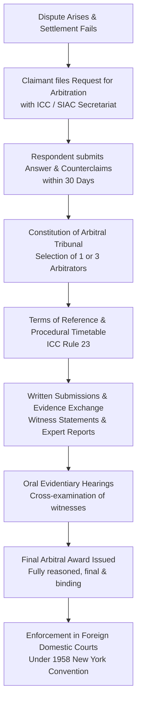
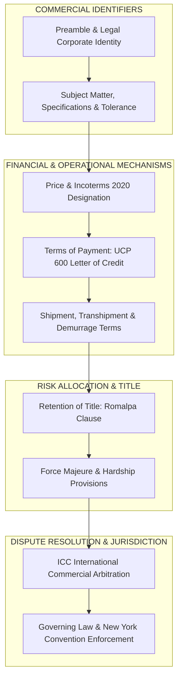

# Unit II: Topic 2 — Export Sales Contract
## Comprehensive Subjective Question Bank with Model Answers

---

### Section A: 2-Mark Questions (Short Definitions & Legal Doctrines)

#### Q1. Define an Export Sales Contract. (2 marks) | Likelihood: High | Type: Define
**Answer:**
An Export Sales Contract is a legally binding bilateral agreement entered into between an exporter (seller) in one sovereign country and an importer (buyer) in another, governing the transfer of ownership of specified merchandise for a designated monetary consideration. It establishes the rights, liabilities, risk allocations, Incoterms, payment mechanisms, and dispute resolution procedures binding both parties, governed internationally by the UN Convention on Contracts for the International Sale of Goods (CISG 1980) or applicable municipal law.
* **Keywords to include for full marks:** Bilateral legal agreement, cross-border ownership transfer, monetary consideration, Incoterms, CISG 1980, rights and liabilities.
* **Examiner trap:** Viewing an export contract as purely domestic. Emphasize that it spans *different legal jurisdictions*, requiring governing law and international dispute clauses.
* **Memory trick:** Export Contract = Cross-Border Promise with Legal Teeth.
* **Marking scheme guide:** 1 mark for cross-border bilateral agreement and ownership transfer; 1 mark for governing framework (Incoterms, CISG/municipal law).

---

#### Q2. What is the "Battle of the Forms" in international commercial law? (2 marks) | Likelihood: High | Type: Define
**Answer:**
The "Battle of the Forms" arises when the buyer and seller negotiate a contract using their own standard pre-printed terms (e.g., Seller sends a Quotation with standard seller-favorable terms on the back; Buyer sends a Purchase Order with standard buyer-favorable terms). If a dispute emerges, courts must determine which party’s standard terms govern the transaction, evaluated under the common-law "Last Shot Rule" or the CISG Article 19 / UNIDROIT "Knock-Out Rule".
* **Keywords to include for full marks:** Standard pre-printed terms, conflicting conditions, Last Shot Rule, Knock-Out Rule, CISG Article 19, conflicting buyer/seller forms.
* **Examiner trap:** Thinking the conflict voids the entire sale. The goods are usually delivered; the dispute is over *which standard terms apply to liability or warranties*.
* **Memory trick:** Battle of the Forms = War of the Fine Print.
* **Marking scheme guide:** 1 mark for defining conflict between pre-printed standard forms; 1 mark for mentioning Last Shot or Knock-Out rule under CISG Art 19.

---

#### Q3. State the difference between an Offer and an Invitation to Treat (Inquiry). (2 marks) | Likelihood: Medium | Type: Define
**Answer:**
An **Invitation to Treat** (such as a trade inquiry, product catalog, or price list) is merely an invitation to negotiate, lacking legal intent to be bound upon acceptance. An **Offer** (such as a formal Proforma Invoice or firm quotation) is a definite promise indicating legal intent to be bound, specifying clear terms (price, quantity, specifications), which ripens into an enforceable contract the moment it is accepted unconditionally.
* **Keywords to include for full marks:** Invitation to treat, definite offer, intention to be bound, firm quotation, unconditional acceptance, contractual liability.
* **Examiner trap:** Treating a product catalog or general price list as a binding offer. Catalogs are *invitations to treat*; an order placed against them is the offer.
* **Memory trick:** Invitation = "Let's Talk"; Offer = "I Promise if You Agree".
* **Marking scheme guide:** 1 mark for Invitation to Treat as request to negotiate; 1 mark for Offer as definite promise with intent to be legally bound.

---

#### Q4. What is the New York Convention of 1958 and why is it vital for international trade? (2 marks) | Likelihood: High | Type: Define
**Answer:**
The United Nations Convention on the Recognition and Enforcement of Foreign Arbitral Awards (New York Convention, 1958) is a multilateral treaty ratified by 170+ sovereign nations. It mandates that foreign arbitral awards (such as decisions by the ICC or SIAC arbitration tribunals) must be recognized and enforced by domestic courts in member states identically to domestic court judgments, preventing defaulting foreign buyers from escaping arbitral awards.
* **Keywords to include for full marks:** New York Convention 1958, enforcement of foreign arbitral awards, ICC/SIAC, reciprocity, cross-border judgment enforceability.
* **Examiner trap:** Confusing arbitration with litigation. The New York Convention enforces *arbitration awards*, not domestic court judgments.
* **Memory trick:** New York Convention = Global Passport for Arbitration Awards.
* **Marking scheme guide:** 1 mark for definition as UN treaty for foreign arbitral awards; 1 mark for enforceability in domestic courts of 170+ nations.

---

#### Q5. What is a Liquidated Damages clause in an export contract? (2 marks) | Likelihood: Medium | Type: Define
**Answer:**
A Liquidated Damages clause is an express provision in an export sales contract where both parties pre-agree on a reasonable, genuine pre-estimate of financial compensation payable by the defaulting party in the event of a specific breach (e.g., paying 0.5% of contract value per week of delayed shipment, capped at 5%). Unlike punitive damages, courts enforce liquidated damages if they represent a fair estimate of anticipated loss.
* **Keywords to include for full marks:** Liquidated damages, genuine pre-estimate of loss, delayed shipment penalty, capped percentage, pre-agreed compensation.
* **Examiner trap:** Confusing liquidated damages with punitive penalties. Penalty clauses intended solely to punish are unenforceable in common law courts; liquidated damages are enforceable.
* **Memory trick:** Liquidated = Pre-calculated Cash for Delays.
* **Marking scheme guide:** 1 mark for pre-agreed genuine estimate of sustained loss; 1 mark for commercial application (delay in shipment/delivery).

---

#### Q6. What does the CISG stand for, and what is its role in international sales? (2 marks) | Likelihood: High | Type: Define
**Answer:**
CISG stands for the **United Nations Convention on Contracts for the International Sale of Goods (Vienna Convention, 1980)**. Prepared by UNCITRAL, it provides a neutral, uniform international legal code governing the formation of commercial contracts for the cross-border sale of goods, establishing default statutory rules on offer, acceptance, seller warranties, buyer inspection duties, and breach remedies.
* **Keywords to include for full marks:** CISG, Vienna Convention 1980, UNCITRAL, uniform international sales law, cross-border commercial contracts, default legal code.
* **Examiner trap:** Believing India is a signatory to the CISG. India has *not* ratified the CISG; however, Indian exporters routinely contract under it when foreign buyers demand a neutral governing law.
* **Memory trick:** CISG = Universal Law Book for Cross-Border Sales.
* **Marking scheme guide:** 1 mark for full expansion and UNCITRAL/Vienna 1980 origin; 1 mark for role as uniform international commercial sales law.

---

### Section B: 5-Mark Questions (Contractual Mechanics & Clauses)

#### Q7. Explain the four chronological stages from Trade Enquiry to Contract Acceptance in export commerce. (5 marks) | Likelihood: High | Type: Explain / Procedure
**Answer:**
### The Contractual Evolution
An international sales contract rarely emerges instantaneously; it develops through four sequential commercial stages:

```
[1. Trade Enquiry] ───> [2. Proforma Invoice / Offer] ───> [3. Counter-Offer] ───> [4. Contract Acceptance]
(Buyer requests info)    (Seller sends firm quote)        (Buyer alters terms)     (Unconditional agreement)
```

1. **Stage 1: Trade Enquiry:**
   * Initiated by the prospective foreign importer expressing interest in the exporter's product line.
   * Can be general (requesting catalogs, price lists) or specific (requesting delivery timelines, sample availability, and packaging options for a specific quantity). Legally, it operates merely as an *Invitation to Treat*.
2. **Stage 2: Quotation / Proforma Invoice (The Offer):**
   * The exporter evaluates domestic costs, logistics, freight, and issues a formal **Proforma Invoice** or firm quotation.
   * To constitute a valid legal offer, it must be definite: specifying product description, ITC(HS) code, quantity, unit price, currency, agreed Incoterm (e.g., CIF Rotterdam), payment mechanism (e.g., Irrevocable LC), and a specific validity date (e.g., *"Valid until April 30"*).
3. **Stage 3: Counter-Offer & Negotiation:**
   * If the buyer seeks price discounts, extended payment terms (requesting 60-day D/A instead of LC), or a faster delivery date, they issue a **Counter-Offer**.
   * Under contract law, a counter-offer **legally extinguishes the original offer**. The exporter is no longer bound by the initial quote and must decide whether to accept, reject, or negotiate the revised terms.
4. **Stage 4: Acceptance & Contract Execution:**
   * The buyer accepts the exporter’s quotation unconditionally by issuing a formal **Purchase Order (PO)** or signing the returned Proforma Invoice.
   * *The Mirror Image Rule:* Acceptance must be absolute and unqualified, matching the terms of the offer. Once communicated, a legally binding contract is formed, creating enforceable mutual liabilities.

* **Keywords to include for full marks:** Trade Enquiry, Invitation to Treat, Proforma Invoice, Offer, Counter-Offer, extinguishment of original offer, Purchase Order, Acceptance, Mirror Image Rule, binding contract.
* **Examiner trap:** Believing a counter-offer leaves the original offer open. A counter-offer legally *destroys* the original offer; the seller is under no obligation to honor the initial price.
* **Memory trick:** **E**nquiry $\rightarrow$ **O**ffer $\rightarrow$ **C**ounter-Offer $\rightarrow$ **A**cceptance (**EOCA Contract Lifecycle**).
* **Marking scheme guide:** 1 mark for intro and conceptual roadmap; 1 mark each for the four stages with legal implications.

---

#### Q8. Describe the essential clauses that must be incorporated into an International Export Sales Contract. (5 marks) | Likelihood: High | Type: Describe
**Answer:**
### Core Architecture of an Export Contract
To prevent cross-border disputes and eliminate ambiguities between differing national legal systems, an export contract must contain comprehensive clauses:

```
┌────────────────────────────────┬──────────────────────────────────────────────────────────────────┐
│ Structural Contract Clause     │ Operational & Legal Scope Covered                                │
├────────────────────────────────┼──────────────────────────────────────────────────────────────────┤
│ 1. Preamble & Parties          │ Full legal corporate names, registered business addresses,        │
│                                │ corporate identity numbers, and legal capacity of buyer/seller.  │
├────────────────────────────────┼──────────────────────────────────────────────────────────────────┤
│ 2. Subject Matter & Quality    │ Precise technical specifications, model numbers, tolerance limits│
│                                │ (e.g., +/- 5% weight), and pre-shipment inspection authority.    │
├────────────────────────────────┼──────────────────────────────────────────────────────────────────┤
│ 3. Price & Incoterms 2020      │ Total contract value, unit prices, currency of settlement, and   │
│                                │ specific Incoterms 2020 rule (e.g., CIF Rotterdam, Incoterms® 2020).│
├────────────────────────────────┼──────────────────────────────────────────────────────────────────┤
│ 4. Terms of Payment            │ Exact payment method: Advance TT, Documentary Collection, or    │
│                                │ Irrevocable Confirmed Letter of Credit at sight under UCP 600.   │
├────────────────────────────────┼──────────────────────────────────────────────────────────────────┤
│ 5. Delivery & Shipment         │ Latest shipment date, port of loading/discharge, permissibility  │
│                                │ of partial shipments and transhipment.                           │
├────────────────────────────────┼──────────────────────────────────────────────────────────────────┤
│ 6. Retention of Title & Risk   │ Passing of risk (governed by Incoterms) vs Retention of Title     │
│                                │ (*Romalpa clause* - ownership remains with seller until paid).    │
├────────────────────────────────┼──────────────────────────────────────────────────────────────────┤
│ 7. Force Majeure & Hardship    │ Excuses non-performance due to unforeseeable events (war, flood);│
│                                │ defines required notice timelines and termination thresholds.    │
├────────────────────────────────┼──────────────────────────────────────────────────────────────────┤
│ 8. Governing Law & Arbitration │ Establishes applicable legal jurisdiction (e.g., English Law)    │
│                                │ and dispute venue (e.g., ICC Arbitration, seated in Singapore). │
└────────────────────────────────┴──────────────────────────────────────────────────────────────────┘
```

* **Keywords to include for full marks:** Preamble, technical specifications, Incoterms 2020, UCP 600 payment terms, Latest shipment date, Retention of Title Romalpa clause, Force Majeure, Governing law, ICC Arbitration.
* **Examiner trap:** Forgetting to separate the "Passing of Risk" from the "Transfer of Title". Incoterms govern the transfer of *risk and cost*; they do *not* govern the transfer of ownership/title, which requires a specific contract clause.
* **Memory trick:** **P**arties, **P**roduct, **P**rice, **P**ayment, **P**assage of title, **P**erils (Force Majeure) (**The 6 Ps of Contract Clauses**).
* **Marking scheme guide:** 1 mark for intro; 3.5 marks for explaining at least 7 essential clauses; 0.5 marks for passing of risk vs title distinction.

---

#### Q9. Explain the Force Majeure clause in international trade contracts, detailing its triggering conditions and legal effects. (5 marks) | Likelihood: High | Type: Explain
**Answer:**
### Concept and Theoretical Genesis
Originating in civil law, a **Force Majeure ("Superior Force")** clause is an express contractual provision that relieves a party from liability for failing to perform contractual obligations due to extraordinary, unforeseeable events beyond their reasonable control. Unlike domestic common law (which relies on the narrow doctrine of "Frustration of Contract"), international trade contracts require an explicit Force Majeure clause.

### The Three Statutory Legal Tests
To successfully invoke Force Majeure, the affected party must prove:
1. **Externality:** The event occurred entirely outside the defaulting party’s control (not caused by their own act, omission, or negligence).
2. **Unforeseeability:** The disruption could not have been reasonably foreseen or anticipated at the time of entering the sales contract.
3. **Irresistibility / Inevitability:** The consequences of the event could not have been avoided or overcome by any reasonable alternative mitigation measures.

### Typical Triggering Events
* *Acts of God / Natural Disasters:* Earthquakes, tsunamis, volcanic eruptions, catastrophic flooding.
* *Geopolitical Disruptions:* Outbreak of war, armed invasion, naval blockades, piracy, civil revolutions.
* *Sovereign Government Interventions:* Sudden export or import embargoes, maritime sanctions, sudden currency convertibility bans.

### Legal Effects and Procedural Workflow
* **Mandatory Written Notice:** The affected party must deliver formal written notice to the counterparty within a stipulated window (e.g., within 7–14 days of occurrence), substantiated by a certificate from an independent body (e.g., local Chamber of Commerce).
* **Suspension of Obligations:** Contractual obligations and shipment deadlines are suspended for the duration of the disruption without financial penalties.
* **Termination Right:** If the event persists beyond an agreed threshold (typically 90 to 180 continuous days), either party holds the legal right to terminate the contract without damages.

* **Keywords to include for full marks:** Force Majeure, beyond reasonable control, Externality, Unforeseeability, Irresistibility, Acts of God, Embargoes, written notice, Chamber of Commerce certificate, suspension of obligations, 90-day termination.
* **Examiner trap:** Claiming that a price hike or market crash qualifies as Force Majeure. Standard commercial price volatility is *never* Force Majeure; it is normal commercial risk.
* **Memory trick:** **E**xternal, **U**nforeseen, **I**nevitable (**EUI Triad for Force Majeure**).
* **Marking scheme guide:** 1 mark for definition and common law contrast; 2 marks for the 3 legal tests and triggering events; 2 marks for procedural notice and legal consequences (suspension vs termination).

---

#### Q10. Compare International Commercial Arbitration with Litigation in Foreign National Courts. (5 marks) | Likelihood: High | Type: Differentiate
**Answer:**

| Parameter of Distinction | International Commercial Arbitration | Litigation in National Courts |
|---|---|---|
| **1. Neutrality of Forum** | **Completely Neutral:** Proceedings are held in a chosen third-party seat (e.g., Singapore, London, Paris). | **Home-Court Advantage:** Case is heard in the domestic courts of either the buyer or seller. |
| **2. Enforceability of Award** | **Worldwide Enforceability:** Enforceable across 170+ sovereign states under the **1958 New York Convention**. | **Extremely Difficult:** Bilateral treaties for enforcing foreign court judgments are rare and complex. |
| **3. Confidentiality vs Publicity** | **Strictly Private and Confidential:** Hearings, evidence, and final awards are kept out of the public domain. | **Public Court Proceedings:** Transcripts, financial documents, and judicial rulings are accessible to public and media. |
| **4. Technical Expertise of Judges** | Parties select specialist arbitrators with deep domain expertise in maritime law and commodity trade. | Presided over by generalist municipal judges who may lack specialized knowledge of UCP 600 or Incoterms. |
| **5. Finality & Rights of Appeal** | **Final and Binding:** Virtually zero right of appeal on substantive merits, ensuring rapid finality. | **Prolonged Multi-Tier Appeals:** Subject to district, appellate, and supreme court appeals dragging on for decades. |
| **6. Procedure and Flexibility** | Flexible rules chosen by parties (e.g., ICC, SIAC, LCIA, UNCITRAL arbitration rules). | Rigid, formal domestic codes of civil procedure, with mandatory local legal representation. |

* **Keywords to include for full marks:** International Commercial Arbitration, National court litigation, 1958 New York Convention, neutral forum, SIAC/ICC, confidentiality, specialized technical expertise, finality, no substantive appeal.
* **Examiner trap:** Believing arbitration is always cheaper than court litigation. Arbitration fees (paying private arbitrators and institutional registry charges) can be high, but arbitration is chosen for **neutrality, confidentiality, and global enforceability under the New York Convention**.
* **Memory trick:** Arbitration = Private, Expert, Enforceable Everywhere; Litigation = Public, Slow, Trapped in Local Courts.
* **Marking scheme guide:** 0.5 marks per distinct parameter (min 6 parameters = 3 marks); 1 mark for New York Convention 1958 contrast; 1 mark for neutrality and specialized expertise contrast.

---

#### Q11. Explain the remedies available to the Buyer and Seller for Breach of Contract under the CISG. (5 marks) | Likelihood: Medium | Type: Explain
**Answer:**
### The CISG Remedial Framework
The United Nations Convention on Contracts for the International Sale of Goods (CISG 1980) establishes a balanced remedial system for cross-border commercial breaches, distinguishing between **Fundamental Breach (Article 25)**—which deprives a party of what they were entitled to expect—and minor non-performance:

```
[Contract Breach Occurs] ───> [Fundamental Breach (Art 25)] ───> Avoidance of Contract (Termination) + Full Damages
                         ───> [Non-Fundamental Breach]      ───> Price Reduction, Repair, Delivery of Substitute, Damages
```

### 1. Remedies Available to the Buyer (Articles 45–52)
* **Specific Performance (Article 46):** Require the seller to perform their obligations, deliver substitute goods (for fundamental defects), or repair defective goods.
* **Avoidance of Contract (Termination - Article 49):** Declare the contract avoided if the seller’s failure amounts to a fundamental breach, or if the seller fails to deliver within an additional reasonable period granted by the buyer (*Nachfrist* notice).
* **Price Reduction (Article 50):** If goods do not conform to the contract, the buyer may unilaterally reduce the purchase price in proportion to the diminished market value at delivery, regardless of whether price has been paid.
* **Damages (Article 74):** Recover financial compensation for all foreseeable losses, including lost profits (*lucrum cessans*).

### 2. Remedies Available to the Seller (Articles 61–65)
* **Action for Price & Acceptance (Article 62):** Require the buyer to pay the contract price, take delivery, and perform obligations.
* **Avoidance of Contract (Article 64):** Declare the contract avoided if the buyer commits a fundamental breach (e.g., refusing to open an agreed Letter of Credit or failing to pay).
* **Damages & Interest (Articles 74 & 78):** Claim compensatory damages and statutory interest on unpaid sums.

* **Keywords to include for full marks:** CISG, Fundamental Breach Article 25, Specific performance Article 46, Avoidance of contract Article 49/64, Price reduction Article 50, Damages Article 74, Nachfrist notice, Lost profits.
* **Examiner trap:** Believing any minor defect allows the buyer to cancel the entire contract. Under the CISG, contract cancellation (**Avoidance**) is permitted *only for a Fundamental Breach* or failure to comply with a *Nachfrist* notice.
* **Memory trick:** Fundamental Breach = Tear Up the Contract; Minor Breach = Squeeze the Price or Fix the Part.
* **Marking scheme guide:** 1 mark for Fundamental Breach Article 25 concept; 2 marks for Buyer remedies (Specific performance, Avoidance, Price reduction); 2 marks for Seller remedies (Action for price, Avoidance, Damages).

---

#### Q12. Explain the significance of the "Romalpa Clause" (Retention of Title) in export sales contracts. (5 marks) | Likelihood: Medium | Type: Explain
**Answer:**
### Legal Genesis & Definition
Originating in the English landmark case *Aluminium Industrie Vaassen B.V. v. Romalpa Aluminium Ltd. (1976)*, a **Romalpa Clause** is a specific **Retention of Title (RoT)** provision inserted into an export sales contract. It stipulates that legal ownership (title) of delivered merchandise remains vested in the seller until the buyer has paid the purchase price in full.

### Why It Is Critical in International Trade
1. **Protection Against Buyer Insolvency:** In cross-border sales under credit terms (Open Account, D/A), physical goods are delivered weeks before payment is made. If the foreign buyer goes bankrupt or enters liquidation before paying, standard contract law treats the unpaid exporter merely as an unsecured creditor, often recovering nothing.
2. **Right to Repossess Goods:** Under a valid Romalpa clause, because ownership was never transferred, the goods do not form part of the bankrupt buyer's estate. The exporter retains the absolute legal right to enter premises and repossess the unsold inventory.
3. **Traceability to Resale Proceeds (*Extended RoT*):** Modern Romalpa clauses incorporate an "extended title" clause, stipulating that if the buyer resells the goods to third parties, the buyer holds the resulting resale proceeds in a separate fiduciary account as trustee for the unpaid exporter.

* **Crucial Legal Nuance:** A Romalpa clause must be expressly agreed upon in writing *prior* to delivery; it cannot be inserted post-sale on an invoice.
* **Keywords to include for full marks:** Romalpa clause, Retention of Title (RoT), legal ownership vs physical possession, buyer insolvency, liquidation, repossession, fiduciary trust, unsecured creditor protection.
* **Examiner trap:** Assuming Incoterms govern retention of title. Incoterms cover *risk and delivery*; they **never transfer title**. Retention of title requires an express Romalpa clause in the contract.
* **Memory trick:** Romalpa = **R**etain **O**wnership **M**oney-comes **A**lways.
* **Marking scheme guide:** 1.5 marks for legal origin and definition; 2 marks for protection against buyer bankruptcy and repossession rights; 1.5 marks for extended proceeds clause and Incoterms distinction.

---

### Section C: 10-Mark Questions (Detailed Contractual Analyses)

#### Q13. Discuss the formation of an International Export Sales Contract under the United Nations Convention on Contracts for the International Sale of Goods (CISG 1980). (10 marks) | Likelihood: High | Type: Discuss
**Answer:**
### 1. Introduction & Statutory Scope
The United Nations Convention on Contracts for the International Sale of Goods (CISG 1980), concluded under the auspices of UNCITRAL, establishes a uniform international legal framework governing commercial sales contracts between parties whose places of business are located in different sovereign nations. Covering over 95 contracting states, it bridges common-law traditions and civil-law systems.

---

### 2. The Mechanics of Contract Formation under the CISG

```
                        [ CISG CONTRACT FORMATION TIMELINE ]
         [ OFFER: Art. 14 ] ──────────────────────────────────> [ ACCEPTANCE: Art. 18 ]
         * Definite proposal                                    * Statement or conduct
         * Minimum terms: Goods,                                * Assent to the offer
           Quantity, Price                                      * Effective upon REACH
         * Effective when it REACHES offeree                    * Mirror Image Rule (Art. 19)
```

#### A. The Offer (Articles 14 to 17)
* **Definition of a Valid Offer (Article 14):** A proposal for concluding a contract constitutes an offer if it is addressed to one or more specific persons, indicates the intention of the offeror to be bound in case of acceptance, and is **sufficiently definite**.
* *Test of Definiteness:* A proposal is sufficiently definite if it indicates the goods and expressly or implicitly fixes or makes provision for determining the **quantity and the price**.
* **Effectiveness & Revocation (Articles 15 & 16):**
  * An offer becomes effective only when it **reaches the offeree**.
  * Unlike common law (where an offer can generally be revoked before acceptance), an offer under the CISG **cannot be revoked** if it indicates that it is firm or irrevocable (e.g., by stating a fixed time for acceptance), or if it was reasonable for the offeree to rely on the offer as irrevocable and the offeree has acted in reliance on it.

#### B. The Acceptance (Articles 18 to 22)
* **Form of Acceptance (Article 18):** A statement made by or other conduct of the offeree indicating assent to an offer constitutes an acceptance. **Silence or inactivity does not in itself amount to acceptance.**
* **The "Receipt Rule" (Article 18.2):** An acceptance of an offer becomes effective at the moment the indication of assent **reaches the offeror**. (The CISG rejects the traditional Anglo-American "Postal Mailbox Rule", under which acceptance was effective upon dispatch).

#### C. The Battle of the Forms & Modifications (Article 19)
* **The Traditional Mirror-Image Rule (Article 19.1):** A reply to an offer which purports to be an acceptance but contains additions, limitations, or other modifications is a rejection of the offer and constitutes a **Counter-Offer**.
* **The Non-Material Modification Exception (Article 19.2):** If the reply contains additional or different terms which do **not materially alter** the terms of the offer, it constitutes an acceptance unless the offeror promptly objects orally or in writing.
* *Material Alterations Defined (Article 19.3):* Terms relating to **price, payment, quality and quantity of goods, place and time of delivery, extent of liability, or settlement of disputes** are statutorily deemed to alter the terms of the offer materially.

---

### 3. Key Differences between CISG and Domestic Indian Contract Act, 1872

| Legal Parameter | Indian Contract Act, 1872 | Vienna Convention (CISG 1980) |
|---|---|---|
| **1. Effective Point of Acceptance** | **Postal Mailbox Rule:** Complete against offeror the moment it is put into transmission/posted. | **Receipt Rule (Art. 18.2):** Effective only when the communication physically **reaches the offeror**. |
| **2. Revocability of Firm Offers** | An offer can always be revoked before acceptance, even if stated firm, unless separate consideration was paid. | A firm offer stating a fixed acceptance deadline is **irrevocable** without requiring separate consideration (Art. 16.2). |
| **3. Requirement of Written Form** | Recognizes oral and written contracts; specific real estate/bonds require writing. | **No Writing Requirement (Art. 11):** A contract of sale may be proven by any means, including witnesses. |
| **4. Open-Price Contracts** | An agreement with uncertain or undetermined price is void for vagueness under Section 29. | Permitted under Article 55; implies price generally charged for such goods at time of contract. |

---

### 4. Conclusion
The CISG provides predictability for international commerce by replacing conflicting national legal doctrines with uniform rules on offer and acceptance. Understanding the CISG framework—particularly the "Receipt Rule" and Article 19 material modification criteria—is essential for Indian exporters negotiating contracts across diverse international jurisdictions.

* **Keywords to include for full marks:** CISG 1980, UNCITRAL, Article 14 definite offer, intention to be bound, Article 16 irrevocability, Article 18 acceptance, Receipt Rule vs Postal Rule, Article 19 counter-offer, material modifications Article 19.3, Indian Contract Act 1872 contrast, Article 11 freedom of form.
* **Examiner trap:** Saying India is bound by the CISG. India is *not* a contracting state, but CISG applies if the foreign buyer’s country is a signatory and the contract specifies CISG as the governing law.
* **Memory trick:** Offer reaches $\rightarrow$ Acceptance reaches $\rightarrow$ Material change = Counter-Offer (**The 3 Steps of CISG**).
* **Marking scheme guide:** 2 marks for intro and statutory scope; 4 marks for CISG offer, acceptance, and Article 19 counter-offer rules; 3 marks for comparative table with Indian Contract Act; 1 mark for conclusion.

---

#### Q14. Detail the legal mechanisms, model clauses, and procedural stages of International Commercial Arbitration under ICC and UNCITRAL rules. (10 marks) | Likelihood: High | Type: Detail / Procedure
**Answer:**
### 1. Introduction: Why Arbitration Dominates Global Trade
In cross-border trade disputes, litigating in the national courts of either party creates inherent risks: foreign bias, unfamiliar judicial procedures, language barriers, and protracted appeals. International Commercial Arbitration provides a **neutral, private, binding, and internationally enforceable dispute resolution mechanism**, anchored by the **New York Convention of 1958**.

---

### 2. The Foundation: The Standard Arbitration Agreement
Arbitration exists only if both parties agree to it in writing. The International Chamber of Commerce (ICC) recommends the following standard model clause in export contracts:
> *"All disputes arising out of or in connection with the present contract shall be finally settled under the Rules of Arbitration of the International Chamber of Commerce by one or more arbitrators appointed in accordance with the said Rules."*

#### Critical Tactical Elements to Specify in the Clause:
1. **The Arbitral Seat (Legal Place of Arbitration):** Determines the procedural law governing the arbitration (e.g., Singapore, London, or Paris).
2. **The Administering Institution & Rules:** ICC, SIAC (Singapore), LCIA (London), or ad-hoc **UNCITRAL Arbitration Rules**.
3. **Number of Arbitrators:** Sole arbitrator (for disputes under $1–2 Million to minimize costs) or a panel of three arbitrators.
4. **Language of Proceedings:** Typically English.
5. **Substantive Governing Law:** The contract law governing merits (e.g., English Law or Indian Law).

---

### 3. Step-by-Step Procedural Lifecycle of an International Arbitration



* **Step 1: Request for Arbitration:** The claimant submits a formal request detailing the dispute, contract clauses, and damages to the ICC Secretariat, paying the initial filing fee.
* **Step 2: Answer and Counterclaims:** The respondent has 30 days to submit their defense and raise any counterclaims.
* **Step 3: Constitution of the Arbitral Tribunal:** Each party nominates one independent arbitrator; the two party-appointed arbitrators (or the ICC Court) select the presiding Chairman.
* **Step 4: Terms of Reference (ICC Rule 23):** The tribunal and parties establish the "Terms of Reference" and procedural timetable, defining the precise issues in dispute.
* **Step 5: Written Pleadings & Hearings:** Parties exchange detailed legal statements, witness declarations, and expert witness reports, followed by oral hearings held at the designated arbitral seat.
* **Step 6: The Final Arbitral Award:** The tribunal renders a written, legally binding award determining liability, interest, and allocation of legal costs. Substantive appeals to national courts are barred.

---

### 4. Enforcement under the 1958 New York Convention
The primary advantage of international arbitration over litigation is universal enforceability:
* Under the **New York Convention on the Recognition and Enforcement of Foreign Arbitral Awards (1958)**, ratified by **170+ nations**, an arbitral award rendered in one member state must be enforced by courts in any other member state as if it were a domestic judgment.
* **Narrow Refusal Grounds (Article V):** Domestic courts cannot re-examine the substantive merits of the dispute. Recognition can be refused only on narrow procedural grounds: (a) Incapacity of parties, (b) Invalid arbitration agreement, (c) Lack of proper notice or due process, (d) Tribunal exceeded its authority, or (e) Enforcement violates the domestic **public policy** of the enforcing state.

---

### 5. Conclusion
International Commercial Arbitration is the standard dispute resolution mechanism in international trade contracts. By drafting clear arbitration clauses specifying institutional rules (ICC/SIAC), seat, and language, and leveraging the enforcement power of the New York Convention, Indian exporters insulate cross-border transactions from foreign court biases.

* **Keywords to include for full marks:** International Commercial Arbitration, ICC Rules, UNCITRAL, Standard Model Clause, Arbitral Seat, Institutional vs Ad-hoc, Terms of Reference ICC Rule 23, Final and Binding, 1958 New York Convention, 170+ nations, Article V refusal grounds, Public policy.
* **Examiner trap:** Omitting the "Seat" of arbitration. The legal Seat (*lex arbitri*) is crucial because it determines which national courts have supervisory jurisdiction over the arbitration.
* **Memory trick:** **C**lause $\rightarrow$ **C**onstitution of Tribunal $\rightarrow$ **C**onduct of Hearings $\rightarrow$ **A**ward $\rightarrow$ **N**ew York Convention Enforcement (**CCAN workflow**).
* **Marking scheme guide:** 2 marks for intro and commercial rationale; 2 marks for standard model clause and key components; 3 marks for procedural lifecycle flowchart and stages; 3 marks for New York Convention 1958 enforcement and conclusion.

---

#### Q15. Analyze the critical clauses required in an Export Sales Contract to manage currency and commercial non-payment risks. (10 marks) | Likelihood: High | Type: Analyze
**Answer:**
### 1. Introduction: Risk Management via Contract Drafting
In cross-border trade, an exporter faces two interconnected commercial vulnerabilities: **Currency (Foreign Exchange) Risk** (eroding margins due to exchange rate swings) and **Commercial Non-Payment Risk** (buyer insolvency, protracted default, or repudiation). Comprehensive contractual drafting provides the first line of defense before relying on banks or insurance underwriters.

---

### 2. Contractual Clauses to Mitigate Currency (FX) Risks

```
                          [ CURRENCY RISK CLAUSES ]
         ┌───────────────────────────┼───────────────────────────┐
         ▼                           ▼                           ▼
[ Currency of Invoice ]      [ Currency Variation ]      [ Gold / SDR Basket ]
* Invoicing in stable        * "Price adjustment clause" * Pegged to multi-currency
  convertible currency         sharing exchange rate       basket or SDRs for
  or exporter's home INR       swings beyond +/- 5%        multi-year contracts
```

#### A. Currency Invoicing Clause
* **Mechanism:** The contract explicitly specifies that the contract price, invoices, and banking settlements are denominated strictly in a specified hard, freely convertible currency (USD, EUR, GBP) or in **Indian Rupees (INR)** under the modern Vostro mechanism.
* *Exporter Advantage:* Invoicing in INR completely eliminates currency conversion risk for the Indian exporter, transferring all foreign exchange volatility to the foreign buyer.

#### B. Currency Fluctuation / Variation Clause ("Exchange Risk Sharing Clause")
* **Mechanism:** In long-term capital contracts spanning 6 to 24 months, the contract includes a price-escalation clause:
  > *"The contract prices are based on the exchange rate of 1 USD = 83.00 INR on the date of contract signing. If the exchange rate fluctuates by more than +/- 5% on the date of actual payment, the invoice price shall be adjusted proportionately to reflect the revised exchange parity."*
* *Evaluation:* Fairly distributes currency depreciation risk between both trading partners.

---

### 3. Contractual Clauses to Mitigate Commercial Non-Payment Risks

#### A. Structured Payment Terms Clause (UCP 600 Alignment)
* The contract mandates that payment must be secured through an **Irrevocable, Confirmed Letter of Credit at Sight**, governed by **UCP 600**:
  * Stipulating that the LC must be issued by a top-tier global bank and confirmed by an Authorized Dealer bank in India at the buyer’s expense.
  * Explicitly establishing that bank charges outside the exporter’s country are for the buyer’s account.

#### B. Retention of Title (Romalpa Clause)
* Formally retains legal title until full monetary satisfaction:
  > *"Legal and beneficial title to the goods shall not pass to the Buyer until the Seller has received full cash payment of the contract invoice price. Until such payment, Buyer holds the goods as fiduciary bailee for the Seller."*
* If the buyer enters bankruptcy or files for corporate restructuring before settling payment, the exporter retains legal ownership and can repossess the unsold inventory.

#### C. Passing of Risk vs Transfer of Property Clause
* Clarifies that while risk passes to the buyer at the point designated by the chosen **Incoterm 2020** rule (e.g., when goods are loaded on board under FOB or handed over to the first carrier under FCA), **ownership of the goods remains with the seller** until full payment is realized.

#### D. Interest on Delayed Payment Clause
* Mandates that if the buyer fails to settle payments at maturity, commercial interest shall automatically accrue at a specified rate (e.g., *Term SOFR + 4% per annum*) from the due date until full realization, without prejudice to the seller's right to declare default.

---

### 4. Operational Alignment with External Financial Safeguards
While contractual clauses establish clear legal rights, prudent exporters align their contracts with financial risk-transfer instruments:
1. **Hedging via Bank Forward Contracts:** Upon contract execution, the exporter locks in a forward contract with their AD bank matching the expected payment maturity, eliminating currency fluctuation risk.
2. **ECGC Credit Insurance:** The exporter obtains an ECGC *Buyer Exposure* or *Shipments Comprehensive Risks* policy, ensuring that if the buyer breaches contract clauses, 80% to 90% of the loss is indemnified.

---

### 5. Conclusion
A well-drafted export sales contract is an active risk management tool. By incorporating currency variation clauses, enforcing UCP 600 Irrevocable Confirmed Letters of Credit, establishing Romalpa title retention, and providing for late-payment interest, an exporter insulates cross-border cash flows from exchange volatility and buyer default.

* **Keywords to include for full marks:** Currency risk, Commercial non-payment risk, Invoicing currency, Currency fluctuation clause, Irrevocable Confirmed LC UCP 600, Retention of Title Romalpa clause, Passing of risk vs title, Late-payment interest clause, Bank forward cover, ECGC alignment.
* **Examiner trap:** Confusing passing of risk with transfer of title. An answer that explicitly clarifies that **Incoterms transfer risk, while contract clauses retain title** will earn top marks.
* **Memory trick:** **C**urrency lock $\rightarrow$ **C**onfirmed LC $\rightarrow$ **C**ontract title retention $\rightarrow$ **C**ompensatory late interest (**4 Cs of Risk Management Drafting**).
* **Marking scheme guide:** 2 marks for intro and risk identification; 3 marks for currency mitigation clauses (Invoicing, variation clause); 3 marks for non-payment mitigation clauses (Confirmed LC, Romalpa, interest); 2 marks for financial instrument alignment (Forward cover, ECGC) and conclusion.

---

#### Q16. Critically evaluate the Doctrine of Frustration under the Indian Contract Act versus Force Majeure and Hardship under international trade practice. (10 marks) | Likelihood: High | Type: Critically Evaluate / Compare
**Answer:**
### 1. Introduction: Commercial Impossibility in Cross-Border Trade
International commerce is routinely disrupted by external macroeconomic shocks: maritime canal closures (e.g., Suez or Panama Canal), regional military conflicts, sudden sovereign currency collapses, and global pandemics. When such events make contract performance impossible or ruinously expensive, commercial law must balance two competing legal principles:
* **Pacta Sunt Servanda:** Contracts must be honored and performed; versus
* **Clausula Rebus Sic Stantibus:** Contracts remain binding only so long as fundamental circumstances remain unchanged.

---

### 2. The Narrow Common Law Doctrine: Section 56 of the Indian Contract Act, 1872
Under Section 56 of the Indian Contract Act, 1872, an agreement to do an act that becomes impossible or unlawful after the contract is made becomes void when the act becomes impossible—known as the **Doctrine of Frustration**.
* **The High Legal Bar of Frustration:**
  * Indian courts (anchored by the Supreme Court landmark ruling in *Satyabrata Ghose v. Mugneeram Bangur & Co., 1954*) interpret Section 56 very strictly.
  * Frustration requires **absolute physical or legal impossibility**.
  * **Commercial Impracticability is NOT Frustration:** A sudden rise in ocean freight rates (e.g., freight rates quadrupling due to Red Sea reroutings), raw material price spikes, or a market crash **does not frustrate a contract**. The exporter remains legally obligated to perform, even if doing so results in catastrophic financial loss.
* **Rigid Legal Outcome:** Frustration kills the contract automatically; the contract is declared void, terminating all future obligations, which can be an overly blunt remedy in ongoing business relationships.

---

### 3. The International Trade Solution: Contractual Force Majeure & Hardship

```
                          [ COMPARISON OF REMEDIAL REGIMES ]
        Frustration (Sec 56 ICA)       Force Majeure Clause            Hardship Clause (ICC)
        ────────────────────────       ────────────────────            ─────────────────────
        * Statutory Common Law         * Express Contractual Clause    * Express Contractual Clause
        * Absolute Impossibility       * Unforeseen Disruptions        * Extreme Economic Hardship
        * Contract automatically void  * Suspends performance          * Renegotiates contract price
        * Rigid, blunt outcome         * 90-day cure before exit       * Preserves the trade contract
```

#### A. Force Majeure Clauses (ICC Model Clause)
* Unlike statutory frustration, a Force Majeure clause is an **express, customized contractual mechanism**.
* It defines a negotiated list of qualifying events (acts of God, war, blockades, strikes, export bans).
* **Flexible Remedies:** It does not terminate the contract immediately; it **suspends performance** for the duration of the disruption, extending shipment deadlines and giving parties time to overcome the impediment before permitting termination after a defined threshold (e.g., 90–180 days).

#### B. The Modern Concept of Hardship (UNIDROIT Principles / ICC Hardship Clause)
* Standard contract law and Force Majeure do not excuse performance if goods can still physically be shipped, even if the exporter faces financial ruin.
* To address extreme economic shocks, modern international contracts incorporate the **ICC Hardship Clause**:
  * *Triggering Condition:* Applies when an unforeseen event fundamentally alters the equilibrium of the contract, placing an **excessive and ruinous economic burden** on one party (e.g., cost of performance increases by 200%).
  * *Mandatory Renegotiation:* The affected party is entitled to request the counterparty to **renegotiate contract terms** (e.g., adjusting prices or delivery schedules) to restore economic equilibrium.
  * *Judicial / Arbitral Revision:* If negotiations fail within a reasonable period, either party may request an arbitral tribunal to adapt the contract to restore fairness or terminate it on agreed terms.

---

### 4. Comparative Synthesis Matrix

| Dimension | Doctrine of Frustration (Sec 56 ICA) | Contractual Force Majeure | Modern Hardship Clause |
|---|---|---|---|
| **1. Source of Authority** | Statutory municipal law (Indian Contract Act). | Express contractual clause drafted by parties. | Express contractual clause / UNIDROIT principles. |
| **2. Required Threshold** | **Absolute physical/legal impossibility**. | **Impossibility beyond reasonable control**. | **Excessive, ruinous economic burden / disruption**. |
| **3. Commercial Hardship** | **Rejected:** Extreme loss does not excuse performance. | **Rejected:** Mere financial loss is not Force Majeure. | **Accepted:** Explicitly designed to address severe financial imbalance. |
| **4. Effect on Contract** | **Kills the contract:** Instantly voided. | **Suspends contract:** Terminated only after prolonged delay. | **Preserves the contract:** Mandates good-faith price renegotiation. |

---

### 5. Conclusion
Relying solely on common law doctrines like Section 56 Frustration leaves cross-border traders exposed to severe financial disruption. In cross-border trade, prudent exporters negotiate both a **Force Majeure clause** (to suspend performance during physical disruptions) and an **ICC Hardship clause** (to renegotiate prices during severe macroeconomic shocks), preserving commercial relationships while mitigating ruinous losses.

* **Keywords to include for full marks:** Doctrine of Frustration, Section 56 Indian Contract Act 1872, Satyabrata Ghose precedent, Pacta Sunt Servanda, absolute impossibility, commercial hardship rejected, Force Majeure clause, suspension of performance, ICC Hardship Clause, UNIDROIT principles, fundamental economic equilibrium, contract adaptation.
* **Examiner trap:** Claiming that Section 56 applies if freight rates rise sharply. Indian courts have repeatedly ruled that *commercial financial hardship is not frustration*.
* **Memory trick:** Frustration = Kills the Contract; Force Majeure = Puts Contract on Hold; Hardship = Rewrites the Price Tag.
* **Marking scheme guide:** 2 marks for intro and conflicting legal maxims; 3 marks for Section 56 Frustration and strict judicial tests; 3 marks for Force Majeure and Hardship mechanics; 2 marks for comparative synthesis table and conclusion.

---

### Section D: 15-Mark Comprehensive Questions (Master Drafting & Strategy Analyses)

#### Q17. Provide an exhaustive master guide to drafting an International Export Sales Contract. Formulate precise model language for five critical clauses and explain their commercial significance. (15 marks) | Likelihood: High | Type: Comprehensive / Drafting
**Answer:**

```
========================================================================================
     EXHAUSTIVE MASTER GUIDE: DRAFTING AN INTERNATIONAL EXPORT SALES CONTRACT
========================================================================================
```

### 1. Introduction: The Anatomy of Cross-Border Legal Drafting
An international sales contract is the foundational legal document of export-import commerce. While sales transactions begin with commercial quotations and proforma invoices, operating on informal documentation creates severe vulnerabilities when cross-border disruptions occur. Because international sales span sovereign jurisdictions, differing legal traditions (Civil Law vs Common Law), and diverse currencies, the contract must establish unambiguous rights, risk thresholds, and dispute protocols.

---

### 2. Comprehensive Master Contract Architecture Flowchart



*Exam Hand-Drawing Guide (Under 2 Minutes):* Draw 4 connected boxes down the center of the page: `[1. Commercial: Parties & Specs]` $\rightarrow$ `[2. Operational: Incoterms & Payment LC]` $\rightarrow$ `[3. Risk: Title Retention & Force Majeure]` $\rightarrow$ `[4. Legal: ICC Arbitration & Governing Law]`.

---

### 3. Detailed Drafting & Model Language for Five Critical Clauses

#### CLAUSE 1: PRICE AND INCOTERMS® 2020
* **Commercial Significance:** Establishes the exact point of risk transfer, cost division, carriage obligations, and export/import customs liabilities between seller and buyer.

```text
[MODEL DRAFTING LANGUAGE]
"Clause 4: Contract Price & Trade Term
4.1 The total Contract Price for the Goods delivered under this Agreement is USD 500,000 
    (United States Dollars Five Hundred Thousand Only), calculated at a firm unit price 
    of USD 50.00 per metric ton FOB Jawaharlal Nehru Port (JNPT), Navi Mumbai, India.
4.2 The trade term governing this Agreement shall be interpreted strictly in accordance 
    with the international rules published by the International Chamber of Commerce: 
    INCOTERMS® 2020.
4.3 The Contract Price is fixed and firm, not subject to escalation for labor, raw materials, 
    or domestic currency fluctuations, except as expressly provided under Clause 11 (Hardship)."
```

* *Legal Analysis:* Note the mandatory precision: stating the exact named port ("JNPT, Navi Mumbai"), the applicable Incoterm edition ("Incoterms® 2020"), and defining whether pricing is fixed or subject to escalation.

---

#### CLAUSE 2: TERMS OF PAYMENT (UCP 600 LETTER OF CREDIT)
* **Commercial Significance:** Insulates the exporter against commercial buyer default by substituting bank credit for buyer credit.

```text
[MODEL DRAFTING LANGUAGE]
"Clause 5: Terms of Payment
5.1 Payment for the total Contract Price shall be made through an Irrevocable, Confirmed 
    Letter of Credit (LC) payable at sight, established in favor of the Seller as Beneficiary.
5.2 The Buyer shall cause the Issuing Bank (an international bank acceptable to Seller) to 
    transmit the LC via authenticated SWIFT MT700 not later than 30 calendar days prior 
    to the agreed Latest Shipment Date.
5.3 The LC shall be confirmed by State Bank of India, Commercial Branch, Mumbai, with all 
    confirmation, advising, and negotiation charges outside the Buyer’s country borne 
    strictly by the Buyer.
5.4 The Letter of Credit shall be governed strictly by the Uniform Customs and Practice for 
    Documentary Credits (2007 Revision, ICC Publication No. 600 - UCP 600)."
```

* *Legal Analysis:* Specifically binds the credit to UCP 600, mandates confirmation by an Indian bank, and allocates all external bank charges to the buyer.

---

#### CLAUSE 3: RETENTION OF TITLE (ROMALPA CLAUSE)
* **Commercial Significance:** Protects the exporter if the buyer enters liquidation or bankruptcy before payment is fully satisfied, separating title from physical risk.

```text
[MODEL DRAFTING LANGUAGE]
"Clause 8: Retention of Title (Romalpa Provision)
8.1 Notwithstanding delivery of the Goods and the passing of risk in the Goods pursuant to 
    the designated Incoterm, legal and beneficial ownership (Title) of the Goods shall 
    remain vested entirely in the Seller until the Seller has received full cash settlement 
    of all sums due under this Agreement.
8.2 Until title passes, the Buyer shall hold the Goods as fiduciary bailee for the Seller, 
    shall store the Goods separately from other inventory, and shall keep them clearly 
    identified as the property of the Seller.
8.3 In the event of Buyer’s default, insolvency, administration, or bankruptcy prior to full 
    payment, Seller reserves the irrevocable legal right to enter Buyer’s premises and 
    repossess the Goods without judicial intervention."
```

* *Legal Analysis:* Creates a fiduciary relationship, requiring separate physical storage and providing explicit repossession rights that survive bankruptcy proceedings.

---

#### CLAUSE 4: FORCE MAJEURE AND RELIEF
* **Commercial Significance:** Provides a fair, structured mechanism to suspend performance during unforeseen catastrophes without incurring breach penalties.

```text
[MODEL DRAFTING LANGUAGE]
"Clause 12: Force Majeure
12.1 A party shall not be liable for any failure or delay in performing its contractual 
     obligations if such failure results from an impediment beyond its reasonable control, 
     which could not reasonably have been foreseen at the time of contract execution, and 
     the consequences of which could not have been avoided or overcome (Force Majeure).
12.2 Qualifying events shall include acts of God, earthquakes, tsunamis, armed warfare, 
     maritime naval blockades, pandemics, sovereign export/import embargoes, and port strikes.
12.3 The affected party shall notify the other party in writing within 10 calendar days of 
     occurrence, accompanied by an official certificate of confirmation issued by the local 
     Chamber of Commerce.
12.4 Contractual obligations shall be suspended for the duration of the Force Majeure event. 
     If the event continues for more than 90 consecutive days, either party may terminate 
     this Agreement without financial penalty upon 14 days' written notice."
```

* *Legal Analysis:* Establishes the 3 legal tests, requires third-party Chamber of Commerce certification, suspends performance, and provides a 90-day termination threshold.

---

#### CLAUSE 5: DISPUTE RESOLUTION AND ARBITRATION (ICC / NEW YORK CONVENTION)
* **Commercial Significance:** Eliminates local court bias, ensuring private, specialized, and globally enforceable dispute resolution.

```text
[MODEL DRAFTING LANGUAGE]
"Clause 16: Dispute Resolution & International Commercial Arbitration
16.1 All disputes, controversies, or claims arising out of, relating to, or in connection 
     with this Agreement, including its validity, breach, or termination, shall be finally 
     resolved through International Commercial Arbitration administered by the International 
     Chamber of Commerce (ICC) under its Rules of Arbitration.
16.2 The Arbitral Tribunal shall consist of a sole arbitrator appointed in accordance with 
     the said ICC Rules.
16.3 The legal seat of arbitration shall be Singapore. The language of the arbitral proceedings 
     shall be English.
16.4 The arbitral award shall be final, conclusive, and binding on both parties, enforceable 
     in any court of competent jurisdiction under the United Nations Convention on the 
     Recognition and Enforcement of Foreign Arbitral Awards (New York Convention, 1958).
16.5 This Agreement shall be governed by and construed in accordance with the substantive 
     laws of England and Wales."
```

* *Legal Analysis:* Specifies the arbitral seat (Singapore), institution (ICC), single arbitrator, English language, governing substantive law, and cites the 1958 New York Convention for global enforcement.

---

### 4. Conclusion
Drafting an international export sales contract is a strategic exercise in risk distribution. By articulating pricing and Incoterms rules, locking in payment through UCP 600 Letters of Credit, reserving title via Romalpa provisions, managing external perils through Force Majeure, and establishing ICC arbitration, an exporter converts cross-border uncertainties into enforceable commercial safeguards.

* **Keywords to include for full marks:** Export sales contract drafting, Model clauses, Incoterms 2020 precision, UCP 600 Irrevocable Confirmed LC, SWIFT MT700, Romalpa clause, Retention of title, Fiduciary bailee, Force Majeure 10-day notice, Chamber of Commerce certificate, 90-day exit, ICC Arbitration, Legal Seat (Singapore), 1958 New York Convention, Governing law.
* **Examiner trap:** Writing vague, generic clauses without actual legal drafting terminology. Examiners evaluate contract drafting questions on the precision of the contractual language presented.
* **Memory trick:** Price $\rightarrow$ Payment $\rightarrow$ Property (Title) $\rightarrow$ Perils $\rightarrow$ Policing (Arbitration) = **The 5 Ps of Contract Drafting**.
* **Marking scheme guide:** 2 marks for intro and architecture flowchart; 2.5 marks each for Clauses 1, 2, 3, 4, and 5 (including precise model drafting language and legal analysis); 0.5 marks for conclusion.

---

#### Q18. Provide an exhaustive comparative analysis of the United Nations Convention on Contracts for the International Sale of Goods (CISG 1980) versus the Indian Contract Act, 1872. (15 marks) | Likelihood: High | Type: Comprehensive
**Answer:**

```
========================================================================================
     EXHAUSTIVE COMPARATIVE ESSAY: CISG 1980 VS INDIAN CONTRACT ACT, 1872
========================================================================================
```

### 1. Introduction: Two Diverse Legal Paradigms
Commercial contracts across the world are governed by two distinct traditions: sovereign domestic contract legislation (heavily shaped by Anglo-Saxon common law) and multilateral uniform conventions designed specifically for cross-border trade.
* The **Indian Contract Act, 1872 (ICA)** is a 19th-century colonial codification of English common law, enacted primarily for domestic transactions within British India.
* The **United Nations Convention on Contracts for the International Sale of Goods (CISG 1980 / Vienna Convention)**, prepared by UNCITRAL, is a modern multilateral code governing cross-border commercial sales of goods, ratified by 95+ nations.

While India has not formally ratified the CISG, Indian exporters frequently deal with trading partners in the US, Europe, and Asia who contract under CISG rules. Understanding where the CISG diverges from the Indian Contract Act is essential for international trade compliance.

---

### 2. Comprehensive Master Comparative Matrix

| Parameter of Legal Comparison | Indian Contract Act, 1872 (ICA) | Vienna Sales Convention (CISG 1980) |
|---|---|---|
| **1. Primary Territorial Scope** | Domestic transactions within India; applies extraterritorially only if specified by private international law. | Cross-border commercial sales of merchandise goods between parties in different sovereign states. |
| **2. Requirement of Writing / Form** | Contracts may be oral or written, but specific commercial agreements (e.g., arbitration, guarantees) mandate writing. | **No Writing Requirement (Article 11):** Contract may be proved by any means, including electronic records or witnesses. |
| **3. The Offer: Firm / Irrevocable Offers**| Under Section 5, an offer can be revoked at any time before acceptance, even if stated firm, unless separate consideration was paid. | Under Article 16.2, an offer **cannot be revoked** if it states a fixed time for acceptance or indicates it is irrevocable. |
| **4. The Acceptance: Communication Rule**| **Postal Mailbox Rule (Section 4):** Acceptance is complete against the offeror the moment it is dispatched/posted. | **Receipt Rule (Article 18.2):** Acceptance is effective only when the assent communication **reaches the offeror**. |
| **5. Mirror Image Rule & Alterations** | Section 7 mandates absolute, unqualified acceptance; any minor deviation acts as a counter-offer. | Article 19 distinguishes **Material vs Non-Material modifications**; minor non-material changes form a binding contract unless objected to. |
| **6. Open-Price Contracts** | Section 29 renders agreements void for uncertainty if the price is neither fixed nor capable of being made certain. | Article 55 permits open-price contracts; implies the price generally charged for such goods at the time of contract. |
| **7. Concept of Fundamental Breach** | Does not recognize "Fundamental Breach"; distinguishes between Breach of Condition vs Warranty (Sale of Goods Act). | Centered on **"Fundamental Breach" (Article 25)**: Substantial deprivation of contractual expectations. |
| **8. Unilateral Contract Cancellation** | Requires filing a court suit for rescission of contract or establishing total failure of consideration. | **Unilateral Avoidance (Article 49 & 64):** Injured party declares contract avoided simply by delivering written notice. |
| **9. Remedy of Price Reduction** | Buyer must accept goods and sue for damages, or reject goods entirely for breach of warranty. | **Unilateral Price Reduction (Article 50):** Buyer can unilaterally reduce price paid in proportion to non-conformity. |
| **10. Grace Period (*Nachfrist* Mechanism)**| Section 55 governs time as the essence; parties cannot unilaterally grant binding cure periods with automatic termination. | Features the **Nachfrist Notice (Art. 47 & 63):** Party grants a reasonable additional period, establishing grounds for avoidance if missed. |
| **11. Commercial Frustration & Hardship** | Section 56 applies strict **Doctrine of Frustration**; requires absolute physical/legal impossibility. Economic loss rejected. | Article 79 governs **Impediment Beyond Control**; excuses performance while disruption persists without voiding the contract. |

---

### 3. Deep-Dive: Three Foundational Structural Divergences

```
                         [ THREE STRUCTURAL DIVERGENCES ]
         ┌───────────────────────────────┼───────────────────────────────┐
         ▼                               ▼                               ▼
  [ Formation: Mailbox vs Receipt ]   [ Battle of Forms: Art 19 ]    [ Remedies: Price Reduction ]
  * ICA: Dispatch binds offeror       * ICA: Zero deviation allowed   * ICA: Sue for damages in court
  * CISG: Arrival binds offeror       * CISG: Non-material terms pass * CISG: Unilateral deduction
```

#### A. Contract Formation: The Dispatch Rule vs The Receipt Rule
* **The Indian Position (Section 4 ICA):** Governed by the classic English case *Adams v. Lindsell*. Acceptance is complete and legally binding against the proposer (offeror) the moment the letter of acceptance is put into the post, even if the letter is delayed or lost in transit.
* **The CISG Position (Article 18.2):** The CISG rejects the dispatch rule, adopting the modern Civil Law **"Receipt Rule"**. An acceptance does not become effective until it physically or electronically **reaches the offeror**. The risk of transmission loss or communication delay rests with the offeree.

#### B. The Battle of the Forms: Absolute Mirror vs Qualified Flexibility (Article 19)
* **The Indian Position:** Under Section 7 of the ICA, acceptance must be absolute and unqualified. Any qualification—even an insignificant administrative request—converts the acceptance into a counter-offer.
* **The CISG Position:** Article 19.2 provides a pragmatic commercial compromise:
  * If the acceptance introduces minor, non-material changes (e.g., requesting packaging in 25kg bags instead of 50kg bags), **a binding contract is formed incorporating those non-material modifications**, unless the offeror promptly objects.
  * Only changes touching core economic terms (price, payment, quality, delivery date, liability limits, arbitration) under Article 19.3 constitute a material modification and trigger a counter-offer.

#### C. Remedial Flexibility: Unilateral Price Reduction (*Actio Quanti Minoris*)
* **The Indian Position:** Under the Indian Sale of Goods Act, 1930, if delivered goods are defective, the buyer must either reject the shipment entirely (if a condition is breached) or accept the goods and file a legal suit in court claiming damages for breach of warranty. The buyer has no statutory right to alter the invoice price unilaterally.
* **The CISG Position (Article 50):** Directly adopting the Roman law doctrine of *actio quanti minoris*, Article 50 empowers the buyer to **unilaterally reduce the purchase price** in proportion to the value that non-conforming goods had at the time of delivery compared to conforming goods. The buyer can simply deduct this amount from the remittance without seeking court intervention.

---

### 4. Critical Strategic Guidance for Indian Exporters
Because India is not a CISG signatory, Indian exporters face critical strategic choices:
1. **Governing Law Selection:** If an Indian exporter contracts with an American, German, or Chinese buyer, the default choice under private international law may invoke the CISG. If the exporter prefers the familiar English/Indian common-law framework, they must explicitly state:
   > *"This Contract shall be governed by the laws of India, to the complete exclusion of the United Nations Convention on Contracts for the International Sale of Goods (CISG)."*
2. **Embracing CISG Flexibilities:** For dynamic cross-border trade, contracting under the CISG is often advantageous: it provides an objective, internationally recognized code that eliminates foreign court bias and offers practical remedies (unilateral price reduction, *Nachfrist* notices, and firm offers without separate consideration).

---

### 5. Conclusion
The comparison between the Indian Contract Act, 1872, and the CISG 1980 highlights the evolution of commercial law over a century of global trade. The Indian Contract Act reflects 19th-century common-law principles prioritizing strict procedural form and judicial rescission. In contrast, the CISG is a modern, flexible international code engineered specifically to preserve commercial contracts through practical default rules, the Receipt Rule, and unilateral remedies.

* **Keywords to include for full marks:** CISG 1980, Indian Contract Act 1872, Mailbox Rule Section 4 vs Receipt Rule Article 18.2, Firm offer Section 5 vs Article 16.2, Mirror image Section 7 vs Article 19 non-material changes, Article 55 open-price contracts, Fundamental Breach Article 25, Unilateral Avoidance Article 49, Price reduction Article 50, Nachfrist notice Article 47, Section 56 Frustration vs Article 79 Impediment, Opting out of CISG.
* **Examiner trap:** Stating that the CISG applies automatically to Indian domestic trade. CISG applies *only to cross-border contracts between parties in different states*, and only when the governing law leads to its application.
* **Memory trick:** ICA = 1872 English Common Law (Mailbox Rule); CISG = 1980 Global Commercial Code (Receipt Rule & Price Reduction).
* **Marking scheme guide:** 2 marks for intro and comparative background; 6 marks for complete 11-parameter comparative table; 4 marks for deep-dive into the 3 foundational divergences (Receipt vs Mailbox, Art 19, Art 50); 3 marks for strategic Indian exporter guidance and conclusion.
