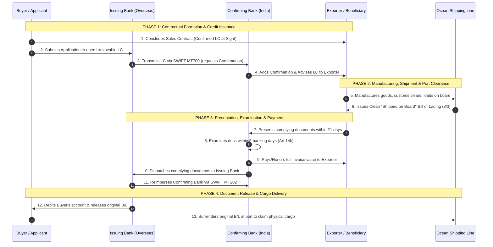

# Unit II: Topic 3 — Methods of Payment in International Trade
## Comprehensive Subjective Question Bank with Model Answers

---

### Section A: 2-Mark Questions (Short Definitions & Core Banking Rules)

#### Q1. Define the "Doctrine of Independence" under Article 4 of UCP 600. (2 marks) | Likelihood: High | Type: Define
**Answer:**
Under Article 4 of UCP 600, a Letter of Credit is, by its very nature, a separate transaction from the underlying commercial sales contract on which it may be based. Banks are in no way concerned with or bound by such contracts, even if reference to them is included in the credit. Under Article 5, **banks deal strictly in documents, and not in the physical goods, services, or performance** to which the documents may relate.
* **Keywords to include for full marks:** UCP 600 Article 4, Doctrine of Independence, separate transaction, Article 5, deal in documents not goods.
* **Examiner trap:** Believing a bank can withhold payment if the buyer proves the delivered goods are damaged. The bank *must pay* if the documents are compliant, regardless of commercial disputes over goods.
* **Memory trick:** Independence = The LC Lives in Its Own Paper World.
* **Marking scheme guide:** 1 mark for Article 4 definition (independent of underlying contract); 1 mark for Article 5 rule (banks deal in documents, not goods).

---

#### Q2. What is the "Doctrine of Strict Compliance" in documentary credit operations? (2 marks) | Likelihood: High | Type: Define
**Answer:**
The Doctrine of Strict Compliance holds that a beneficiary (exporter) is legally entitled to payment under a Letter of Credit if and only if the presented documents strictly adhere to the terms and conditions of the credit. Under Articles 14 and 18 of UCP 600, banks examine documents on their face; any material inconsistency, description variation, or omission justifies the issuing bank in rejecting the presentation and refusing payment.
* **Keywords to include for full marks:** Strict compliance, UCP 600 Article 14/18, examine on their face, zero material deviation, right of refusal.
* **Examiner trap:** Assuming substantial compliance is enough. In documentary credit law, *strict compliance* is enforced; minor description discrepancies justify rejection.
* **Memory trick:** Strict Compliance = Every comma, date, and description must match the LC.
* **Marking scheme guide:** 1 mark for defining entitlement to payment strictly against conforming documents; 1 mark for right of bank to refuse payment for discrepancies under Art 14.

---

#### Q3. What does URC 522 stand for and which transactions does it govern? (2 marks) | Likelihood: High | Type: Define
**Answer:**
URC 522 stands for the **Uniform Rules for Collections (1995 Revision, ICC Publication No. 522)**. It provides standard international rules published by the International Chamber of Commerce governing **Documentary Collections**—handling financial documents (bills of exchange) and commercial documents (invoices, bills of lading) by banks on instructions from an exporter to secure payment (D/P) or acceptance (D/A) from the buyer.
* **Keywords to include for full marks:** URC 522, Uniform Rules for Collections, ICC Publication No. 522, Documentary Collection, D/P and D/A.
* **Examiner trap:** Confusing URC 522 (which governs Collections where banks act as agents) with UCP 600 (which governs Letters of Credit where banks provide independent payment guarantees).
* **Memory trick:** URC = **U**niform **R**ules for **C**ollections; UCP = **U**niform **C**ustoms for **P**ayment Credits.
* **Marking scheme guide:** 1 mark for full expansion and ICC origin; 1 mark for governing Documentary Collections (D/P and D/A).

---

#### Q4. Explain the 5-Banking-Day Rule under Article 14(b) of UCP 600. (2 marks) | Likelihood: High | Type: Define
**Answer:**
Under Article 14(b) of UCP 600, a nominated bank acting on its nomination, a confirming bank, and the issuing bank each have a **maximum of five banking days following the day of presentation** to examine the presented documents and determine whether they constitute a complying presentation. This statutory examination period is not truncated or extended by the upcoming expiry date of the credit.
* **Keywords to include for full marks:** Article 14(b) UCP 600, maximum 5 banking days, following day of presentation, examine and determine compliance.
* **Examiner trap:** Quoting 7 banking days (which was the old rule under UCP 500). Under **UCP 600, the maximum review period is strictly 5 banking days**.
* **Memory trick:** High-Five Rule = Max 5 banking days to examine.
* **Marking scheme guide:** 1 mark for stating exactly 5 banking days following day of presentation; 1 mark for Article 14(b) citation.

---

#### Q5. What is a Standby Letter of Credit (SBLC) and which rules govern it? (2 marks) | Likelihood: Medium | Type: Define
**Answer:**
A Standby Letter of Credit (SBLC) is an irrevocable secondary banking undertaking that serves as a financial safety net or performance guarantee. Unlike a standard commercial LC (which is intended to be drawn upon as the primary payment vehicle), an SBLC is designed to be drawn upon **only in the event of default** by the applicant, triggered by presenting a formal certificate of non-performance. It is governed primarily by **ISP 98 (International Standby Practices)** or UCP 600.
* **Keywords to include for full marks:** Standby LC, secondary undertaking, drawn upon only in default, performance guarantee, ISP 98, UCP 600.
* **Examiner trap:** Treating SBLC as a standard trade payment method. It is a *contingent guarantee*, invoked only when the buyer fails to pay under open account or breaches a performance contract.
* **Memory trick:** Standby = Stands by quietly; triggered only if someone defaults.
* **Marking scheme guide:** 1 mark for secondary guarantee nature triggered only upon default; 1 mark for governing framework (ISP 98 or UCP 600).

---

#### Q6. What is the Preclusion Rule under Article 16(f) of UCP 600? (2 marks) | Likelihood: High | Type: Define
**Answer:**
The Preclusion Rule under Article 16(f) of UCP 600 provides that if an issuing or confirming bank fails to act in accordance with the strict refusal notice requirements laid down in Article 16 (failing to notify the presenter before the close of the fifth banking day, or failing to state all individual discrepancies), the bank is **precluded from claiming that the documents are non-compliant**. As a result, the bank is legally compelled to honor payment to the exporter.
* **Keywords to include for full marks:** Article 16(f) UCP 600, Preclusion Rule, failure to give proper notice, loss of right to claim discrepancy, mandatory payment.
* **Examiner trap:** Believing a bank can raise new discrepancies later in court. If a discrepancy was omitted from the initial Article 16 refusal notice, it is legally waived forever.
* **Memory trick:** Preclusion = Miss the 5-day notice window, pay the full invoice.
* **Marking scheme guide:** 1 mark for Article 16(f) citation and failure to give timely discrepancy notice; 1 mark for legal consequence (precluded from denying payment).

---

### Section B: 5-Mark Questions (Mechanisms & Comparative Profiles)

#### Q7. Explain the Risk Ladder of Payment Methods in International Trade from the perspectives of Buyer and Seller. (5 marks) | Likelihood: High | Type: Explain / Diagram
**Answer:**
### The Inverse Risk Spectrum
In cross-border trade, payment mechanisms represent a zero-sum trade-off between the commercial risk borne by the exporter and the commercial risk borne by the importer:

```
EXPORTER'S RISK SPECTRUM                                         IMPORTER'S RISK SPECTRUM
◄───────────────────────────────────────────────────────────────────────────────────────►
Lowest Risk                                                                  Lowest Risk
    │                                                                             │
[Cash in Advance] ──> [Letter of Credit] ──> [Doc. Collection] ──> [Open Account] ──> [Consignment]
    │                                                                             │
Highest Risk                                                                 Highest Risk
```

### Deconstruction of the Five Primary Payment Methods
1. **Cash in Advance:** The importer remits payment (via telegraphic transfer - TT) before goods are manufactured or shipped.
   * *Risk Allocation:* **Zero risk for exporter; 100% risk for importer** (who relies entirely on the seller's integrity to deliver conforming goods).
2. **Letter of Credit (LC - UCP 600):** An issuing bank provides an independent, irrevocable undertaking to pay the exporter against presentation of conforming documents.
   * *Risk Allocation:* **Balanced:** Exporter is protected against buyer default by bank credit; importer is protected because the bank pays only against authentic shipping documents (Bills of Lading).
3. **Documentary Collection (D/P & D/A - URC 522):** Banks act as processing intermediaries, releasing shipping documents against cash payment (**D/P**) or bill acceptance (**D/A**).
   * *Risk Allocation:* Moderate risk. Under D/P, seller retains cargo control until payment; under D/A, seller bears substantial risk because documents are released upon mere acceptance of a time draft.
4. **Open Account:** The exporter ships goods and delivers title documents directly to the buyer; payment is due at an agreed future date (e.g., 30, 60, or 90 days after invoice).
   * *Risk Allocation:* **100% risk on exporter; zero risk for importer**.
5. **Consignment Sale:** The exporter retains legal ownership of goods shipped to an overseas distributor, receiving payment only after the distributor resells the goods to end-consumers.
   * *Risk Allocation:* **Maximum risk on exporter** (bearing inventory holding, transit loss, price collapse, and foreign credit default risks).

* **Keywords to include for full marks:** Risk ladder, Cash in Advance, Letter of Credit, Documentary Collection (D/P and D/A), Open Account, Consignment, inverse risk relationship, UCP 600, URC 522.
* **Examiner trap:** Drawing the ladder without showing *both* the buyer's and seller's perspectives. Always illustrate the inverse spectrum.
* **Memory trick:** **C**ash $\rightarrow$ **C**redit (LC) $\rightarrow$ **C**ollection $\rightarrow$ **C**redit Account (Open) $\rightarrow$ **C**onsignment (**The 5 Cs of Trade Payment**).
* **Marking scheme guide:** 1 mark for inverse risk spectrum diagram; 3 marks for describing the 5 payment methods; 1 mark for risk allocation evaluation.

---

#### Q8. Describe the operational working of Documentary Collection under URC 522, detailing D/P and D/A mechanisms. (5 marks) | Likelihood: High | Type: Describe / Procedure
**Answer:**
### Concept and Statutory Authority
Governed globally by the ICC **Uniform Rules for Collections (URC 522)**, Documentary Collection is a method where an exporter entrusts the collection of payment to their domestic bank (**Remitting Bank**), which forwards commercial documents accompanied by a financial draft to the buyer's bank (**Collecting / Presenting Bank**) abroad.

```
[Exporter] ───(Ships Goods directly)───> [Importer]
    │                                       ▲
    │ (Presents Docs + Draft)               │ (Releases Docs against Cash or Acceptance)
    ▼                                       │
[Remitting Bank] ──(Sends via URC 522)──> [Collecting / Presenting Bank]
```

### The Two Primary Collection Mechanisms

#### A. Documents Against Payment (D/P - Sight Collection)
* Governed under **Article 7 of URC 522**.
* The exporter draws a **Sight Draft** (demand bill of exchange).
* *Operational Rule:* The Collecting Bank is legally instructed to release the original transport documents (Bill of Lading) to the importer **only after the importer pays the full invoice amount in cash/cleared funds**.
* *Exporter Protection:* High. If the buyer refuses to pay, the cargo remains stored in the carrier's custody at destination port; the exporter can recall or re-route the goods.

#### B. Documents Against Acceptance (D/A - Usance Collection)
* Governed under **Article 7 of URC 522**.
* The exporter draws a **Usance Draft** (time bill payable at 30, 60, or 90 days).
* *Operational Rule:* The Collecting Bank releases the original Bill of Lading to the importer **immediately upon the importer signing and accepting the bill of exchange**.
* *Exporter Protection:* Low. The buyer gains physical possession of the cargo weeks before paying. If the buyer defaults at maturity, the exporter holds only an accepted bill of exchange and must initiate legal action.

* **Keywords to include for full marks:** URC 522, Remitting Bank, Collecting Bank, Presenting Bank, Documents Against Payment (D/P), Sight Draft, Documents Against Acceptance (D/A), Usance Draft, title release rule.
* **Examiner trap:** Saying collecting banks guarantee payment. Under URC 522, banks are *purely administrative handling agents*; they provide **zero payment guarantee**.
* **Memory trick:** D/P = Documents for Paper Money (Cash First); D/A = Documents for a Signature (Promise First).
* **Marking scheme guide:** 1 mark for URC 522 definition and the 4 banking parties; 2 marks for D/P mechanism and risk profile; 2 marks for D/A mechanism and risk profile.

---

#### Q9. Explain the specialized varieties of Letters of Credit: Red Clause, Green Clause, and Revolving LC. (5 marks) | Likelihood: High | Type: Explain
**Answer:**
### 1. Red Clause Letter of Credit
* **Origin & Nature:** Historically printed in distinctive red ink to alert bank personnel, a Red Clause LC contains a special clause authorizing the advising or nominated bank to grant an **unsecured pre-shipment cash advance** to the beneficiary (exporter) prior to the presentation of shipping documents.
* **Commercial Purpose:** Provides immediate working capital to an exporter (often a small cottage manufacturer or seasonal crop aggregator) to purchase raw materials, process goods, and arrange transport.
* **Risk Allocation:** The **Buyer (Applicant) assumes 100% financial risk**. If the exporter takes the cash advance and absconds without shipping the goods, the issuing bank must recover the advance plus interest directly from the buyer.

### 2. Green Clause Letter of Credit
* **Advancement over Red Clause:** A Green Clause LC provides pre-shipment financing like a Red Clause, but with an added **bonded warehousing facility**.
* **Operating Mechanism:** The bank grants advances in stages: (a) An advance to procure materials, and (b) A further advance against proof that goods have been stored in an approved bonded warehouse at the port of departure under the bank's control.
* **Risk Profile:** Provides greater security to the buyer than a Red Clause, because cargo is stored in a designated warehouse under the bank’s constructive custody prior to loading.

### 3. Revolving Letter of Credit
* **Operational Purpose:** Designed for long-term commercial relationships involving continuous, recurring shipments of standardized commodities (e.g., supplying 500 tons of steel monthly over a year).
* **Revolving Mechanism:** Eliminates the administrative friction of opening 12 individual LCs. The credit automatically **reinstates its original face value** upon utilization or after a specified calendar period (e.g., $100,000 per month revolving for 12 months).
* **Types:** Can be *Cumulative* (unused monthly balances roll over into subsequent months) or *Non-Cumulative* (unused monthly balances lapse).

* **Keywords to include for full marks:** Red Clause, unsecured pre-shipment advance, buyer bears risk, Green Clause, bonded warehousing advances, Revolving LC, automatic reinstatement, Cumulative vs Non-Cumulative.
* **Examiner trap:** Assuming the bank takes the risk in a Red Clause LC. The *buyer (applicant)* assumes 100% risk if the exporter defaults on a Red Clause advance.
* **Memory trick:** Red Clause = Raw Material Advance; Green Clause = Warehousing Advance; Revolving = Recharges Automatically.
* **Marking scheme guide:** 2 marks for Red Clause (advances, origin, buyer risk); 1.5 marks for Green Clause (warehousing addition); 1.5 marks for Revolving LC (cumulative vs non-cumulative).

---

#### Q10. Explain the operational difference between a Transferable Letter of Credit and a Back-to-Back Letter of Credit. (5 marks) | Likelihood: High | Type: Differentiate / Explain
**Answer:**
### The Intermediary Trade Challenge
In international trade, a middleman (merchant exporter or trading house) contracts with an overseas buyer but sources the actual merchandise from a domestic manufacturer. To finance the purchase without deploying their own capital, the intermediary uses either a **Transferable LC** or a **Back-to-Back LC**:

```
                         [ INTERMEDIARY FINANCING COMPARISON ]
        Transferable Letter of Credit               Back-to-Back Letter of Credit
        ─────────────────────────────               ─────────────────────────────
        * Single Letter of Credit (Art. 38)         * Two Separate, Independent Letters of Credit
        * Must state "Transferable"                 * Master LC used as collateral for Second LC
        * Rights transferred to 2nd Beneficiary     * Second LC opened in favor of actual factory
        * Cheaper, simpler banking execution        * Higher cost, requires separate credit limit
```

### 1. Transferable Letter of Credit (UCP 600 Article 38)
* **Single Master Document:** Governed strictly by Article 38 of UCP 600. A credit can be transferred only if it is **expressly designated as "Transferable"** by the issuing bank.
* **Transfer Mechanism:** The first beneficiary (middleman) instructs the transferring bank to transfer all or part of the credit to one or more second beneficiaries (actual manufacturing factories).
* **Substitution of Invoices:** The manufacturer ships the goods and presents transport documents. The middleman exercises their legal right to **substitute their own commercial invoice and draft** for those of the manufacturer, claiming their profit margin while keeping the buyer's and manufacturer's identities confidential.

### 2. Back-to-Back Letter of Credit
* **Two Distinct, Independent Credits:** Used when the master credit is non-transferable, or when the parties refuse to use a transferable LC.
* **Mechanics:**
  1. The buyer issues an **Irrevocable Master LC** in favor of the middleman.
  2. The middleman pledges the Master LC as collateral security to their domestic bank, requesting the bank to issue a **completely separate, independent Second LC** in favor of the domestic manufacturing supplier.
* **Bank Credit Risk:** The bank issuing the second LC bears independent payment liability to the supplier, even if the foreign master LC fails due to documentary discrepancies.

* **Keywords to include for full marks:** Transferable LC, Article 38 UCP 600, First and Second Beneficiary, Substitution of invoices, Back-to-Back LC, Master LC as collateral, independent second credit, middleman financing.
* **Examiner trap:** Believing an LC can be transferred if it is silent. Under UCP 600 Article 38(b), an LC is transferable *only if it explicitly states the word "Transferable"*.
* **Memory trick:** Transferable = One LC Split in Two; Back-to-Back = Two Independent LCs Stacked.
* **Marking scheme guide:** 1 mark for intermediary trade context; 2 marks for Transferable LC and Article 38 substitution of invoices; 2 marks for Back-to-Back LC two-tier architecture and credit risks.

---

#### Q11. Explain the Article 16 Refusal Protocol under UCP 600 when banks encounter discrepant documents. (5 marks) | Likelihood: High | Type: Explain / Procedure
**Answer:**
### The High Standard of Bank Refusal
When an issuing bank, confirming bank, or nominated bank examines documents and determines they do not comply with the credit, the bank’s subsequent actions are governed by the strict procedural mandate of **Article 16 of UCP 600**.

### Step-by-Step Statutory Refusal Protocol
1. **Discretion to Approach Applicant for Waiver (Article 16b):** The issuing bank may, in its sole judgment, contact the applicant (buyer) to seek a waiver of the discrepancies. However, approaching the buyer does not extend the statutory **5-banking-day review period**.
2. **Issuance of the Formal Refusal Notice (Article 16c):** If the bank decides to refuse payment, it must issue a single, comprehensive notice of refusal by telecommunication (standard authenticated **SWIFT MT734**) or expeditious means to the presenter.
3. **Mandatory Elements of the SWIFT MT734 Notice:** The notice must explicitly state:
   * That the bank is refusing to honor or negotiate;
   * **Each individual discrepancy** upon which the bank bases its refusal (a bank cannot add new discrepancies later); and
   * The custodial disposition of the documents: declaring that the bank is holding the documents pending instructions, or returning them, or acting in accordance with previous instructions.
4. **The Strict Deadline (Article 16d):** The refusal notice must be dispatched **no later than the close of the fifth banking day** following the day of document presentation.

### The Severe Legal Consequence: Preclusion (Article 16f)
* If the issuing or confirming bank fails to dispatch the refusal notice strictly in accordance with Article 16 rules (e.g., sends notice on Day 6, or omits a discrepancy), the bank is **precluded from claiming that the documents are non-compliant**.
* **Result:** The bank is legally barred from claiming non-compliance and **must pay the beneficiary in full**, even if the documents contained genuine, glaring defects.

* **Keywords to include for full marks:** UCP 600 Article 16, SWIFT MT734, Notice of refusal, applicant waiver Article 16b, list each discrepancy, custodial disposition, close of fifth banking day, Preclusion Rule Article 16f.
* **Examiner trap:** Thinking a bank can send multiple refusal notices as it discovers more errors. The bank must state *all discrepancies in a single, timely notice*; piecemeal notices are invalid.
* **Memory trick:** 5 Days $\rightarrow$ Single SWIFT MT734 $\rightarrow$ List All Discrepancies $\rightarrow$ Or Pay under Preclusion.
* **Marking scheme guide:** 1 mark for intro and applicant waiver option; 2.5 marks for the three mandatory contents of the SWIFT MT734 refusal notice; 1.5 marks for Article 16(f) Preclusion Rule.

---

#### Q12. Explain the operational working and commercial application of an Avalised Bill of Exchange. (5 marks) | Likelihood: Medium | Type: Explain
**Answer:**
### Concept & Statutory Definition
An **Aval** (derived from French commercial law) is an irrevocable, unconditional guarantee written directly on the face of a financial bill of exchange or promissory note by a third-party financial institution (the **Avalising Bank**). Governed internationally by the **Geneva Uniform Law on Bills of Exchange**, it binds the avalising bank as a co-obligor alongside the primary drawee.

```
[Exporter] ───(Draws Usance Bill of Exchange)───> [Foreign Buyer / Drawee]
                                                           │
                                      (Buyer accepts bill, Bank stamps "POUR AVAL")
                                                           ▼
                             [Avalising Bank guarantees 100% unconditional payment]
```

### Operating Mechanism
1. **Contractual Agreement:** Exporter and foreign buyer agree to trade under D/A terms backed by a bank aval.
2. **Draft Endorsement:** The exporter ships goods and draws a time bill of exchange. The buyer accepts the bill.
3. **The Stamp of Aval:** The buyer’s bank endorses the physical draft with the statutory words: **"POUR AVAL"** (or *"Per Aval"*), signed by authorized bank officers.
4. **Legal Undertaking:** The bank guarantees that if the buyer fails to pay the bill at maturity, the avalising bank will pay the face value unconditionally upon demand.

### Commercial Applications in International Trade
* **Foundation of Forfaiting:** International forfaiters purchase medium-to-long term export receivables on a 100% non-recourse basis *only if* the bills of exchange bear a first-class bank Aval.
* **Alternative to Costly Letters of Credit:** Opening an LC incurs high amendment fees and ongoing administrative costs. An avalised bill provides comparable bank payment security with lower bank issuance fees.
* **Secondary Market Liquidity:** Avalised bills of exchange are freely tradable negotiable debt instruments on international money markets.

* **Keywords to include for full marks:** Aval, Pour Aval, Geneva Uniform Law, co-obligor, unconditional bank guarantee, Forfaiting foundation, non-recourse discounting, alternative to Letter of Credit.
* **Examiner trap:** Confusing an Aval with a normal bank endorsement. An ordinary endorsement transfers title; an **Aval adds a third-party bank guarantee** to the underlying debt.
* **Memory trick:** Aval = Bank's Stamp of Golden Guarantee on a Bill of Exchange.
* **Marking scheme guide:** 1.5 marks for definition and Geneva Law origin; 2 marks for operating mechanism and "Pour Aval" endorsement; 1.5 marks for commercial applications (Forfaiting, secondary trade).

---

### Section C: 10-Mark Questions (Detailed Payment Architecture Answers)

#### Q13. Discuss the four primary methods of payment in international trade. Provide an analytical comparative matrix evaluating risk, cost, and commercial suitability for buyer and seller. (10 marks) | Likelihood: High | Type: Discuss / Compare
**Answer:**
### 1. Introduction
Payment settlement in cross-border commerce balances risk against competitive market access. Cross-border trade spans sovereign legal jurisdictions, diverse currencies, and geographical distance, heightening the risk of default. Trading partners select from four foundational payment methods: **Cash in Advance, Letters of Credit, Documentary Collections, and Open Account**.

---

### 2. Analytical Decomposition of the Four Methods

```
                          [ PAYMENT RISK & TRUST MATRIX ]
      Cash in Advance                Letter of Credit            Doc. Collection               Open Account
      ───────────────                ────────────────            ───────────────               ────────────
      * Exporter: Zero Risk          * Bank Guarantee            * Bank Intermediary           * Exporter: High Risk
      * Importer: 100% Risk          * Balanced Protection       * Retains control (D/P)       * Importer: Zero Risk
      * Cash before dispatch         * Governed by UCP 600       * Governed by URC 522         * Goods received first
```

#### A. Cash in Advance (Telegraphic Transfer - Advance TT)
* **Mechanics:** The overseas buyer remits 100% of the contract purchase price via SWIFT wire transfer directly into the exporter's bank account *before* the goods are manufactured or dispatched.
* **Evaluation:** Ideal for the exporter (zero credit risk, working capital fully funded upfront). Unfavorable for the buyer (capital tied up, absolute reliance on the seller's integrity to deliver conforming goods). Used in custom engineering, high-risk political markets, or monopolistic supply situations.

#### B. Letter of Credit (LC / Documentary Credit - UCP 600)
* **Mechanics:** An issuing bank, acting on the buyer's application, issues an irrevocable undertaking promising to pay the exporter against presentation of strictly complying shipping documents.
* **Evaluation:** Provides balanced protection. The exporter relies on the creditworthiness of a premier global bank; the buyer is assured that payment will be released only against authentic, clean transport documents (Bills of Lading) proving on-board shipment. Governed by **UCP 600**.

#### C. Documentary Collection (D/P & D/A - URC 522)
* **Mechanics:** The exporter ships goods and channels commercial and financial documents through the banking network under **URC 522**. Under **Documents Against Payment (D/P)**, documents are released only against cash settlement at sight. Under **Documents Against Acceptance (D/A)**, documents are released against the buyer's formal acceptance of a time bill of exchange.
* **Evaluation:** Lower cost than an LC; banks act as fiduciary forwarding agents without payment guarantees. D/P provides moderate security (seller retains cargo control); D/A exposes the exporter to substantial credit risk once title documents are released upon acceptance.

#### D. Open Account
* **Mechanics:** The exporter manufactures, packs, customs-clears, and ships goods directly to the foreign buyer, mailing original title documents directly without banking intervention. Payment is due at an agreed future date (e.g., 30, 60, or 90 days after B/L date).
* **Evaluation:** Maximum risk for the exporter (exposed to buyer insolvency, protracted default, or arbitrary invoice deductions). Highly attractive for the buyer (receives and inspects goods before paying, generating inventory-funded liquidity). Common in intra-MNC corporate trade, established long-term partnerships, or competitive consumer goods markets.

---

### 3. Comprehensive Master Comparative Matrix

| Comparative Dimension | Cash in Advance | Letter of Credit (UCP 600) | Documentary Collection (URC 522) | Open Account |
|---|---|---|---|---|
| **1. Exporter's Risk** | **Zero Risk:** Payment received prior to shipment. | **Very Low:** Protected by irrevocable bank undertaking. | **Moderate (D/P) to High (D/A):** Relies on buyer solvency. | **Maximum Risk:** Relies entirely on buyer's willingness to pay. |
| **2. Importer's Risk** | **Maximum Risk:** Pays cash upfront; goods may never arrive. | **Low to Moderate:** Protected by document compliance rules. | **Moderate:** Can inspect documents before paying or accepting. | **Zero Risk:** Pays only after receiving and inspecting goods. |
| **3. Administrative Cost** | Very low; routine international bank wire transfer fees. | **High:** Issuing commissions, advising fees, amendment charges. | **Low:** Minimal bank handling and collection commissions. | Negligible; routine SWIFT wire transfer fees upon maturity. |
| **4. Cash Flow Impact** | Exporter financed 100%; buyer’s liquidity severely strained. | Buyer’s bank credit lines utilized; exporter can discount LC bills. | Buyer funds payment upon arrival (D/P) or enjoys credit (D/A). | Exporter finances the transaction; buyer enjoys free working capital. |
| **5. Governing Law/Rules** | Bilateral contract terms; national banking laws. | **UCP 600** (ICC Publication No. 600). | **URC 522** (ICC Publication No. 522). | Sales Contract; domestic contract law of designated state. |
| **6. Commercial Suitability**| New buyers, politically unstable nations, custom machinery. | High-value capital goods, volatile regions, unknown buyers. | Established trade relationships, stable economic markets. | Intra-group MNC trade, long-standing partners, mature markets. |

---

### 4. Conclusion
Selecting a payment term is a strategic trade-off. Demanding Cash in Advance repels buyers in competitive markets, while operating on Open Account exposes the exporter to balance-sheet ruin. The Letter of Credit under UCP 600 and Documentary Collections under URC 522 provide balanced compromises that reconcile the exporter's need for security with the buyer's need for liquidity.

* **Keywords to include for full marks:** Cash in Advance, Letter of Credit, Documentary Collection, Open Account, UCP 600, URC 522, D/P vs D/A, Exporter risk vs Importer risk, cash flow impact, bank commissions, intra-MNC trade.
* **Examiner trap:** Presenting payment terms in a random list. High-scoring answers present them in **order of the risk spectrum** (Advance $\rightarrow$ LC $\rightarrow$ Collection $\rightarrow$ Open Account).
* **Memory trick:** **A**dvance $\rightarrow$ **L**etter of Credit $\rightarrow$ **C**ollection $\rightarrow$ **O**pen Account (**ALCO Risk Ladder**).
* **Marking scheme guide:** 2 marks for intro and risk spectrum concept; 3 marks for detailed explanations of the four methods; 4 marks for complete comparative matrix; 1 mark for strategic conclusion.

---

#### Q14. Detail the taxonomy of Letters of Credit under UCP 600. Explain their operational mechanics, legal distinctions, and commercial utility. (10 marks) | Likelihood: High | Type: Detail / Classify
**Answer:**
### 1. Introduction: The Versatility of Documentary Credits
The Letter of Credit (LC) is not a rigid, uniform instrument; it is a flexible financing and payment architecture adapted to diverse commercial, geographical, and risk conditions. Governed internationally by the **ICC Uniform Customs and Practice for Documentary Credits (UCP 600)**, Letters of Credit are categorized based on their legal enforceability, bank undertakings, payment timing, and structural trade mechanics.

---

### 2. Comprehensive Taxonomy of Letters of Credit

```
                            [ TAXONOMY OF LETTERS OF CREDIT ]
         ┌───────────────────┬───────────────────┬───────────────────┐
         ▼                   ▼                   ▼                   ▼
  [ Legal Undertaking ]    [ Payment Timing ]    [ Trade Role ]      [ Special Facilities ]
  * Irrevocable (Art 3)   * Sight Credit        * Transferable      * Red Clause
  * Confirmed (Art 8)     * Usance / Acceptance   (Art 38)          * Green Clause
  * Unconfirmed (Art 7)   * Deferred Payment    * Back-to-Back      * Revolving LC
                          * Negotiation         * Standby (ISP 98)
```

---

### 3. Detailed Deconstruction by Operational Classification

#### Category I: Based on Legal Security & Bank Undertaking
1. **Irrevocable Letter of Credit (Default Rule):**
   * Under **Article 3 of UCP 600**, all credits are deemed irrevocable even if silent.
   * It forms an absolute, binding legal undertaking of the Issuing Bank that cannot be amended or cancelled without the formal, express agreement of the Issuing Bank, the Confirming Bank (if any), and the Beneficiary. (Revocable LCs are obsolete under UCP 600).
2. **Confirmed Letter of Credit (Article 8):**
   * In addition to the Issuing Bank’s undertaking, a bank in the exporter’s country (**Confirming Bank**) adds its own independent, irrevocable guarantee to pay the exporter against conforming documents.
   * *Commercial Utility:* Essential when exporting to politically unstable countries, financially distressed foreign banks, or nations facing foreign exchange illiquidity. The exporter is insulated against foreign sovereign default.
3. **Unconfirmed Letter of Credit (Article 7):**
   * The foreign Issuing Bank alone guarantees payment. The domestic bank merely advises the credit without assuming financial liability.

#### Category II: Based on Method & Timing of Payment
1. **Sight Credit:** The nominated or confirming bank honors payment immediately upon presentation of complying documents within the 5-banking-day review period.
2. **Usance / Acceptance Credit:** Payable at a fixed or determinable future date (e.g., 60 or 90 days from B/L date). The beneficiary presents a time draft, which is accepted by the bank, guaranteeing payment at maturity.
3. **Deferred Payment Credit:** Similar to a usance credit, but payable at maturity **without requiring a bill of exchange**, reducing stamp duty costs in certain jurisdictions.
4. **Negotiation Credit:** The nominated bank purchases complying drafts and documents, advancing cash to the beneficiary before reimbursement from the issuing bank.

#### Category III: Based on Intermediary & Structural Trade Facilitation
1. **Transferable Letter of Credit (Article 38):**
   * Specifically designated as "Transferable" by the issuing bank.
   * Allows the first beneficiary (middleman) to transfer all or part of the credit to one or more secondary beneficiaries (actual manufacturing factories). The middleman substitutes their own invoice to claim their profit margin.
2. **Back-to-Back Letter of Credit:**
   * Used when the original credit is non-transferable.
   * The middleman pledges the incoming master credit as collateral to their domestic bank, which issues an independent second credit in favor of the factory supplier.
3. **Standby Letter of Credit (SBLC - ISP 98):**
   * Operates as a performance bond or backup guarantee; drawn upon only if the applicant breaches an open-account payment or contract performance obligation.

#### Category IV: Based on Specialized Financing Facilities
1. **Red Clause Letter of Credit:** Authorizes the advising bank to grant an unsecured pre-shipment cash advance to the beneficiary to procure materials before shipping goods; buyer assumes 100% risk.
2. **Green Clause Letter of Credit:** Extends pre-shipment cash advances PLUS financing for bonded warehousing of cargo at the port of origin.
3. **Revolving Letter of Credit:** Automatically reinstates its face value upon drawdown, ideal for regular, recurring commodity shipments over an extended period.

---

### 4. Conclusion
The taxonomy of Letters of Credit provides a tailored solution for every cross-border trade scenario. Understanding these structures allows an exporter to match payment terms with country risk, buyer creditworthiness, and working capital needs, securing payment while maintaining competitive market access.

* **Keywords to include for full marks:** Taxonomy of LC, UCP 600, Irrevocable Article 3, Confirmed Article 8, Unconfirmed Article 7, Sight Credit, Usance Credit, Deferred Payment, Transferable Article 38, Back-to-Back, Standby LC ISP 98, Red Clause, Green Clause, Revolving LC.
* **Examiner trap:** Claiming that a Revocable LC is common. Revocable credits were **completely eliminated from UCP 600**; every modern LC is legally presumed irrevocable.
* **Memory trick:** **U**ndertaking (Confirmed) $\rightarrow$ **T**iming (Sight/Usance) $\rightarrow$ **I**ntermediary (Transferable/Back-to-Back) $\rightarrow$ **S**pecial (Red/Green/Revolving) (**UTIS Classification**).
* **Marking scheme guide:** 2 marks for intro and architecture diagram; 2.5 marks for Legal Security varieties (Irrevocable, Confirmed); 2.5 marks for Payment Timing varieties; 3 marks for Structural and Specialized varieties (Transferable, Red/Green Clause, SBLC).

---

#### Q15. Detail the step-by-step transaction workflow of an Irrevocable Confirmed Letter of Credit under UCP 600, supported by an end-to-end flowchart. (10 marks) | Likelihood: High | Type: Procedure / Flowchart
**Answer:**
### 1. Introduction: The Institutional Mechanism
An Irrevocable Confirmed Letter of Credit represents the highest standard of payment security in cross-border trade. It incorporates **two independent banking undertakings**: the foreign **Issuing Bank** (buyer's bank) PLUS the domestic **Confirming Bank** (exporter's bank). Governed by **UCP 600**, the transaction unfolds through four distinct operational phases across twelve chronological steps.

---

### 2. Comprehensive Master LC Transaction Flowchart



---

### 3. Chronological Operational Breakdown

#### Phase 1: Contractual Setup and Credit Issuance (Steps 1–4)
* **Step 1:** Exporter and Buyer finalize the sales contract stipulating payment by *Irrevocable Confirmed Letter of Credit payable at sight under UCP 600*.
* **Step 2:** The buyer submits a formal LC application and indemnity to their local bank (**Issuing Bank**), providing cash margin or utilizing collateral credit lines.
* **Step 3:** The Issuing Bank drafts the credit and transmits it via authenticated **SWIFT MT700** to the exporter’s domestic bank (**Confirming Bank**), formally authorizing the bank to add its confirmation.
* **Step 4:** The Confirming Bank reviews the issuing bank's credit risk, adds its independent irrevocable payment undertaking (Article 8), and advises the confirmed LC to the **Exporter (Beneficiary)**.

#### Phase 2: Production, Logistics & Title Generation (Steps 5–6)
* **Step 5:** The exporter verifies that the LC matches the proforma invoice, manufactures the goods, completes pre-shipment quality inspection, clears export customs via ICEGATE (securing LEO), and carts goods into the seaport.
* **Step 6:** The container is loaded on board the vessel. The ocean carrier issues a full set of original negotiable **Clean "Shipped on Board" Bills of Lading (3/3)**.

#### Phase 3: Presentation, Scrutiny & Settlement (Steps 7–11)
* **Step 7:** The exporter assembles the complete document dossier (Commercial Invoice, Packing List, Original B/L, Insurance Policy, Certificate of Origin) and presents it to the Confirming Bank within the statutory **21-day presentation window** (Article 14c).
* **Step 8:** The Confirming Bank examines the documents for strict compliance within the statutory **5-banking-day window** (Article 14b).
* **Step 9:** Finding the documents compliant on their face, the **Confirming Bank honors payment immediately**, crediting the exporter's account in India on a **non-recourse basis**.
* **Step 10:** The Confirming Bank couriers the complying documents to the overseas Issuing Bank.
* **Step 11:** The Issuing Bank verifies the documents and reimburses the Confirming Bank via interbank settlement channels (**SWIFT MT202**).

#### Phase 4: Document Release & Cargo Clearance (Steps 12–13)
* **Step 12:** The Issuing Bank debits the buyer’s commercial bank account and releases the original endorsed Bills of Lading to the buyer.
* **Step 13:** The buyer surrenders the original Bill of Lading to the shipping line’s local agent at the destination port, obtains the **Delivery Order (DO)**, clears import customs, and takes physical possession of the cargo.

---

### 4. Conclusion
The Irrevocable Confirmed Letter of Credit cycle is the gold standard of cross-border payment security. By distributing performance obligations into four distinct phases, enforcing strict document verification within 5 banking days, and layering two independent banking undertakings, it eliminates sovereign and commercial default risks for the exporter while ensuring the buyer pays only against authentic title documents.

* **Keywords to include for full marks:** Irrevocable Confirmed LC, UCP 600, Issuing Bank, Confirming Bank, Beneficiary, Applicant, SWIFT MT700, 5 banking days Article 14b, 21-day presentation Article 14c, Non-recourse payment, Clean On Board B/L, SWIFT MT202 reimbursement, Delivery Order.
* **Examiner trap:** Saying the confirming bank pays only after the issuing bank reimburses it. A Confirming Bank adds its *own independent undertaking*; it **must pay the exporter upon receiving complying documents**, bearing the reimbursement risk if the foreign issuing bank defaults.
* **Memory trick:** **I**ssuance $\rightarrow$ **S**hipment $\rightarrow$ **S**crutiny (5 Days) $\rightarrow$ **S**ettlement (**4 Ss of the LC Cycle**).
* **Marking scheme guide:** 2 marks for intro and double-guarantee concept; 3 marks for master sequence flowchart; 4 marks for detailed four-phase operational breakdown; 1 mark for conclusion.

---

#### Q16. Detail the common causes of Documentary Discrepancies under UCP 600 and formulate an institutional discrepancy prevention plan for an exporter. (10 marks) | Likelihood: High | Type: Detail / Strategy
**Answer:**
### 1. Introduction: The Discrepancy Epidemic
Documentary Credit operations are governed by the **Doctrine of Strict Compliance**. International banking statistics reveal that over **60% to 70% of document presentations are initially rejected by banks upon first presentation** due to documentary discrepancies.

When an LC presentation is discrepant:
* The bank’s independent payment undertaking is suspended;
* The bank levies punitive **discrepancy penalty fees** (typically $75 to $150 per set);
* Documents are converted to a standard collection basis, requiring applicant waiver; and
* The foreign buyer gains leverage to demand price discounts or delay payment.

---

### 2. Taxonomy of Common Documentary Discrepancies

```
                          [ COMMON LC DISCREPANCIES ]
         ┌───────────────────────────┼───────────────────────────┐
         ▼                           ▼                           ▼
  [ Invoice Discrepancies ]    [ Transport Discrepancies ]   [ Insurance Discrepancies ]
  * Description variation      * Late shipment past deadline * Value under 110% CIF
  * Value exceeds LC ceiling   * Stale presentation (>21d)   * Policy dated post-shipment
  * Missing Incoterms details  * Claused / Foul notation     * Currency mismatch
```

#### A. Commercial Invoice Inconsistencies (UCP 600 Article 18c)
* **Goods Description Mismatch:** The invoice uses general or modified terminology instead of strictly matching the credit text (e.g., LC states *"Indian Basmati Rice Grade A"*; invoice describes *"Premium Basmati Rice"*).
* **Value Overdraw:** Total invoice amount exceeds the credit value (unless the LC permits a +/- 5% tolerance under Article 30).
* **Omission of Trade Term Specifics:** Quoting *"CIF"* without naming the exact port (e.g., *"CIF Hamburg"*).

#### B. Transport Document Discrepancies (UCP 600 Articles 14, 20 & 27)
* **Late Shipment:** The "Shipped on Board" date stamped on the B/L falls after the latest permissible shipment date stipulated in Field 44C of the LC.
* **Stale / Late Presentation (Article 14c):** Documents are presented to the bank after the mandatory **21 calendar days** following the shipment date, or after the LC expiry date.
* **Claused / Foul Bill of Lading (Article 27):** Carrier endorses the B/L noting packaging defects (*"cartons torn"*, *"drums leaking"*).
* **Incomplete B/L Set:** Failing to present the full set of originals (presenting 2/3 instead of 3/3).
* **Unsanctioned Transhipment:** Transhipment occurs when the LC explicitly prohibits transhipment.

#### C. Insurance Document Defects (UCP 600 Article 28)
* **Short Insurance Coverage (Article 28f):** Policy issued for only 100% of CIF value, failing to meet the mandatory **110% CIF/CIP cover** requirement.
* **Insurance Effective Date (Article 28e):** Policy cover date is dated *after* the date of shipment stamped on the Bill of Lading.
* **Currency Mismatch (Article 28a):** Insurance policy issued in Indian Rupees (INR) when the LC is denominated in US Dollars (USD).

---

### 3. Institutional Discrepancy Prevention Plan for Exporters

```
                           [ PRE-PRESENTATION AUDIT PROTOCOL ]
         Step 1: Scrutinize LC upon Receipt (Request immediate amendments for unfeasible terms)
                                       │
         Step 2: Enforce ADS Master Data Alignment across Invoice, Packing List, and Shipping Bill
                                       │
         Step 3: Pre-Booking Shipping Line Audit (Ensure CY cut-off respects Latest Shipment Date)
                                       │
         Step 4: Four-Eye Internal Bank Audit (Scrutinize documents 48 hours prior to bank submission)
```

1. **Pre-Shipment LC Scrutiny & Amendment Protocol:**
   * The moment the SWIFT MT700 is advised, cross-verify all fields against the proforma invoice.
   * If spelling errors, unfeasible shipping deadlines, or ambiguous inspection clauses appear, **demand a formal bank amendment immediately** *before* commencing manufacturing. Never ship goods hoping the buyer will accept discrepancies later.
2. **Aligned Documentation System (ADS) Data Master:**
   * Use a single electronic master database to generate the Commercial Invoice, Packing List, Shipping Bill, and Certificate of Origin, ensuring product descriptions, marks and numbers, and container details are identical across all documents.
3. **Logistics Alignment with Latest Shipment Dates:**
   * Book ocean freight space with confirmed vessel departures scheduled at least 5 to 7 days *before* the latest shipment deadline to accommodate port weather delays.
4. **Enforcing the 110% Insurance Rule:**
   * Instruct marine insurance underwriters to automatically write policies for **110% of CIF invoice value in the currency of the credit**, dated on or before the on-board date.
5. **The 48-Hour Pre-Presentation Audit:**
   * Conduct a four-eye internal review by the finance and documentation teams 48 hours before bank presentation, checking documents line-by-line against UCP 600 Article 14 standards.

---

### 4. Conclusion
Documentary discrepancies are operational failures that undermine the financial security of Letters of Credit. By understanding common failure points—invoice description variations, late presentations, under-insurance—and implementing a pre-presentation audit protocol, an exporter eliminates discrepancies, avoids bank penalty fees, and guarantees immediate payment realization.

* **Keywords to include for full marks:** Documentary discrepancies, Doctrine of Strict Compliance, UCP 600 Article 18c invoice description, Article 14c late presentation 21 days, Article 27 Claused B/L, Article 28f 110% insurance rule, Article 28e policy date, SWIFT MT700 review, Pre-presentation audit protocol, Discrepancy prevention plan.
* **Examiner trap:** Listing discrepancies without providing the *institutional prevention plan*. The question asks for both causes and the exporter's operational prevention strategy.
* **Memory trick:** **I**nvoice match $\rightarrow$ **S**hipment before deadline $\rightarrow$ **P**resent within 21 days $\rightarrow$ **I**nsurance at 110% (**ISPI Audit Rules**).
* **Marking scheme guide:** 2 marks for intro and financial impact of discrepancies; 4 marks for detailed taxonomy of common discrepancies (Invoice, Transport, Insurance); 3 marks for institutional prevention plan; 1 mark for conclusion.

---

### Section D: 15-Mark Comprehensive Questions (Master Analyses with Legal Depth)

#### Q17. Provide an exhaustive analytical treatise on the Uniform Customs and Practice for Documentary Credits (UCP 600). Detail its historical evolution, legal status, foundational doctrines, critical articles, and discrepancy management framework. (15 marks) | Likelihood: High | Type: Comprehensive
**Answer:**

```
========================================================================================
     EXHAUSTIVE TREATISE: THE LAW AND PRACTICE OF UCP 600 IN TRADE FINANCE
========================================================================================
```

### 1. Introduction: Genesis and Legal Status of UCP 600
Cross-border trade relies on documentary credits to bridge distances, differing legal systems, and mutual lack of trust between buyers and sellers. To establish universal uniformity and eliminate conflicting interpretations across national courts, the **International Chamber of Commerce (ICC)** in Paris formulated the **Uniform Customs and Practice for Documentary Credits**.

First published in 1933, the rules underwent successive revisions (1951, 1962, 1974, 1983, 1993 - UCP 500) to keep pace with evolving maritime transport, containerization, and communication technologies. The current regime—**UCP 600**—entered into force on **July 1, 2007**.
* **Legal Nature:** UCP 600 is not a statutory international treaty enacted by sovereign parliaments; it is a set of **standardized contractual rules and commercial customs**. It derives binding legal force because trading parties explicitly incorporate it into their transactions (e.g., stating in Field 40E of SWIFT MT700: *"Applicable Rules: UCP LATEST VERSION"*). Once incorporated, national courts worldwide enforce UCP 600 provisions as binding contract law.

---

### 2. Comprehensive Master Architecture of UCP 600

```mermaid
flowchart TD
    UCP[UCP 600: 39 ARTICLES MASTER FRAMEWORK] --> DOCT[Foundational Legal Doctrines]
    UCP --> EXAM[Examination & Standard of Scrutiny]
    UCP --> TRANS[Transport Documents Architecture]
    UCP --> DISP[Discrepancy Refusal & Preclusion]

    DOCT --> ART4[Article 4: Independence of Credit<br/>Separate from underlying contract]
    DOCT --> ART5[Article 5: Documents vs Goods<br/>Banks deal in paper, not cargo]
    DOCT --> ART3[Article 3: Presumption of Irrevocability<br/>Revocable credits abolished]

    EXAM --> ART14A[Article 14(a): Examination on Face<br/>Strict compliance standard]
    EXAM --> ART14B[Article 14(b): The 5-Banking-Day Rule<br/>Maximum review timeline]
    EXAM --> ART14C[Article 14(c): 21-Day Presentation Rule<br/>Transport document presentation]
    EXAM --> ART18C[Article 18(c): Commercial Invoice<br/>Strict description correspondence]

    TRANS --> ART20[Article 20: Bill of Lading<br/>Clean on board dated notation]
    TRANS --> ART27[Article 27: Clean Transport Document<br/>Absence of defect clausing]
    TRANS --> ART28[Article 28: Insurance Coverage<br/>110% CIF/CIP mandatory minimum]

    DISP --> ART16[Article 16: Notice of Refusal<br/>Single SWIFT MT734 communication]
    DISP --> ART16F[Article 16(f): The Preclusion Rule<br/>Loss of right to deny payment]
```

*Exam Hand-Drawing Guide (Under 2 Minutes):* Draw 4 vertical columns: `[1. Doctrines: Art 3, 4, 5]` | `[2. Examination: Art 14, 18]` | `[3. Transport: Art 20, 27, 28]` | `[4. Refusal: Art 16]`. Under each box, write the article number and its core rule.

---

### 3. In-Depth Deconstruction of Foundational Doctrines

#### A. The Doctrine of Independence (Article 4)
* A credit by its nature is a **separate transaction from the sales or other contract** on which it may be based.
* Banks are in no way concerned with or bound by such contracts, even if reference to them is included in the credit.
* *Legal Effect:* The undertaking of an issuing bank to pay is not subject to claims or defenses by the applicant resulting from their relationships with the issuing bank or the beneficiary.
* *Case Law Precedent:* In the landmark English case *Hamzeh Malas & Sons v. British Imex Industries Ltd. (1958)*, the court affirmed that an issuing bank is legally bound to pay the beneficiary presenting complying documents, and the buyer cannot seek an injunction to stop bank payment by claiming the physical goods were defective.

#### B. Documents versus Goods, Services or Performance (Article 5)
* Banks deal strictly with **documents, and not with goods, services, or performance** to which the documents may relate.
* If the paper documents match the terms of the credit on their face, the bank is legally compelled to pay, even if the goods are lost at sea or found defective upon arrival.
* *The Sole Exception (Fraud Rule):* Originating in the American landmark case *Sztejn v. J. Henry Schroder Banking Corp. (1941)*, the court held that where intentional, egregious seller fraud is proven *before payment is released* (e.g., seller deliberately shipped worthless rubbish/cow dung instead of bristles), the court may grant an injunction restraining the bank from honoring the credit.

#### C. Presumption of Irrevocability (Article 3)
* UCP 600 eliminated the concept of revocable credits.
* Under Article 3, a credit is deemed **irrevocable** even if it contains no statement to that effect, preventing the issuing bank or buyer from cancelling or amending the credit without the express agreement of all parties.

---

### 4. Critical Operational Articles & Standards of Examination

#### A. The Standard of Document Examination (Article 14)
* **Article 14(a) - On Their Face:** Banks must examine a presentation to determine, on the basis of the documents alone, whether or not they appear on their face to constitute a complying presentation.
* **Article 14(b) - The 5-Banking-Day Rule:** The bank has a maximum of **five banking days** following the day of presentation to examine documents. This period is absolute; it cannot be shortened or extended by upcoming expiry dates.
* **Article 14(c) - The 21-Day Presentation Rule:** Transport documents must be presented within **21 calendar days** after the date of shipment stamped on the Bill of Lading, but in any event not later than the expiry date of the credit.
* **Article 14(d) - Data Consistency:** Data in a document need not be identical to, but **must not conflict with**, data in that document, any other stipulated document, or the credit.

#### B. Commercial Invoices (Article 18c) vs Other Documents (Article 14e)
* *In the Commercial Invoice (Art. 18c):* The description of goods, services, or performance **must correspond strictly** with that in the credit.
* *In All Other Documents (Art. 14e):* Goods may be described in general terms not inconsistent with the description in the credit.

#### C. Transport & Insurance Mandates (Articles 20, 27, 28)
* *Bill of Lading (Art. 20):* Must indicate the name of the vessel and carry a dated "Shipped on Board" notation.
* *Clean Transport Document (Art. 27):* Must bear no notation declaring defective condition of goods or packaging.
* *Insurance Document (Art. 28):* Must be issued and signed by an insurance company, dated on or before shipment date, in the credit currency, covering a **minimum of 110% of CIF/CIP value**.

---

### 5. Discrepancy Management, Refusal & The Preclusion Rule (Article 16)
When a bank discovers discrepancies, Article 16 governs the refusal protocol:
1. **Applicant Waiver Consultation (Art. 16b):** The bank may seek the applicant's waiver of discrepancies, but this does not extend the 5-banking-day examination limit.
2. **Mandatory Refusal Notice (Art. 16c & 16d):** The bank must dispatch a single telecommunication notice (authenticated **SWIFT MT734**) to the presenter before the close of the fifth banking day following presentation. The notice must state:
   * That the bank is refusing to honor;
   * **Every individual discrepancy** on which refusal is based; and
   * The custodial disposition of the documents (holding documents pending instructions, or returning them).
3. **The Strict Preclusion Rule (Art. 16f):** If the bank fails to act strictly in accordance with Article 16 provisions, **it shall be precluded from claiming that the documents are non-compliant**. The bank loses the legal right to reject the documents and is compelled to pay the beneficiary in full.

---

### 6. Critical Evaluation: UCP 600 in the Digital Age (The eUCP)
* **The Paper Limitation:** UCP 600 was engineered primarily for physical paper documents.
* **The eUCP Supplement:** To accommodate modern paperless trade, the ICC introduced the **eUCP (Version 2.0)**, an operational supplement to UCP 600 governing the presentation of electronic records and digital data messages, providing rules for electronic signatures, data corruption, and digital platform presentation.

---

### 7. Conclusion
UCP 600 is the cornerstone of modern international trade finance. By establishing the Doctrine of Independence, enforcing the Doctrine of Strict Compliance, providing definitive document examination rules, and maintaining the strict Article 16 Preclusion Rule, UCP 600 provides the legal certainty and operational predictability that enables trillions of dollars in global trade to move smoothly across international borders.

* **Keywords to include for full marks:** UCP 600, ICC Publication No. 600, Doctrine of Independence Article 4, Documents vs Goods Article 5, Hamzeh Malas precedent, Fraud exception Sztejn case, Presumption of Irrevocability Article 3, Article 14 standard of examination, 5 banking days Article 14b, 21-day presentation Article 14c, Commercial invoice Article 18c, Clean B/L Article 20/27, Insurance 110% Article 28f, SWIFT MT734, Preclusion Rule Article 16f, eUCP.
* **Examiner trap:** Failing to cite specific UCP 600 article numbers. University evaluators award top marks based directly on accurate Article citations (Art 3, 4, 5, 14, 16, 18, 20, 27, 28).
* **Memory trick:** **I**ndependence (4) $\rightarrow$ **D**ocuments (5) $\rightarrow$ **E**xamination (14) $\rightarrow$ **R**efusal (16) $\rightarrow$ **I**nvoice (18) $\rightarrow$ **B**/L (20) $\rightarrow$ **I**nsurance (28) (**The Core UCP Articles**).
* **Marking scheme guide:** 2 marks for historical evolution and legal status; 3 marks for master architecture flowchart; 4 marks for foundational doctrines (Independence, Documents vs Goods, Fraud exception); 4 marks for critical articles (Art 14, 18, 20, 28); 2 marks for Article 16 Refusal & Preclusion Rule plus conclusion.

---

#### Q18. Compare and contrast Letters of Credit (UCP 600) with Documentary Collections (URC 522). Evaluate their risk allocations, banking responsibilities, operational costs, and commercial suitability. (15 marks) | Likelihood: High | Type: Comprehensive / Comparative
**Answer:**

```
========================================================================================
     COMPREHENSIVE COMPARATIVE ESSAY: LETTERS OF CREDIT VS DOCUMENTARY COLLECTIONS
========================================================================================
```

### 1. Introduction: Two Intermediary Philosophies
In international trade, whenever trading partners seek to avoid the polar extremes of Cash in Advance (100% risk on buyer) and Open Account (100% risk on seller), they turn to commercial banking intermediaries. The international banking system offers two distinct institutional payment mechanisms:
* **Letters of Credit (Documentary Credits),** governed by **UCP 600**; and
* **Documentary Collections,** governed by **URC 522**.

While both methods utilize international banks and require shipping documents to move through banking channels, their underlying legal principles, bank liabilities, cost profiles, and risk allocations diverge fundamentally.

---

### 2. Comprehensive Master Comparative Matrix

| Comparative Parameter | Letter of Credit (UCP 600) | Documentary Collection (URC 522) |
|---|---|---|
| **1. Nature of Bank's Undertaking**| **Independent Payment Guarantee:** The Issuing Bank provides an irrevocable promise to pay the exporter. | **Fiduciary Processing Agent:** Banks act strictly as collection couriers with **zero payment undertaking**. |
| **2. Primary Source of Payment Security**| Creditworthiness, balance sheet strength, and solvency of the **Issuing / Confirming Bank**. | Creditworthiness and willingness to pay of the **Buyer / Importer alone**. |
| **3. Governing Legal Code** | ICC Uniform Customs and Practice for Documentary Credits (**UCP 600**). | ICC Uniform Rules for Collections (**URC 522**). |
| **4. Standard of Document Examination**| **Strict Examination:** Banks examine documents on their face for strict compliance within **5 banking days** (Art. 14). | **No Document Examination:** Banks verify only that documents received match the collection schedule; they do not audit for discrepancies. |
| **5. Buyer Default Protection** | **100% Insulated:** If buyer goes bankrupt or repudiates, the Issuing Bank must still pay conforming documents. | **Exposed to Default:** If buyer refuses to pay (D/P) or dishonors an accepted bill (D/A), the bank has no liability. |
| **6. Timing of Banking Commitment**| Bank commits **before shipment**: The LC is issued, confirmed, and advised before manufacturing/shipping begins. | Bank enters **after shipment**: The collection instruction is dispatched only after goods are loaded on board. |
| **7. Collateral for Pre-Shipment Finance**| Commercial banks readily sanction pre-shipment **Packing Credit** against an Irrevocable Confirmed LC. | Banks are reluctant to extend pre-shipment credit against collection orders without additional tangible collateral. |
| **8. Comparative Cost & Bank Fees** | **Significantly Higher:** Opening commissions, advising fees, confirmation fees, amendment fees, discrepancy fees. | **Substantially Lower:** Minimal collection and document handling commissions only. |
| **9. Impact on Buyer’s Credit Line** | **Ties up credit:** Issuing an LC blocks the buyer’s working capital lines or requires a cash margin deposit. | **Preserves credit:** Does not freeze the buyer’s bank credit lines; no collateral margin required. |
| **10. Operational Turnaround Time** | Slower; complex document preparation, technical scrutiny, and potential discrepancy negotiations. | Rapid; documents are processed quickly and forwarded to the presenting bank without technical document audits. |

---

### 3. Detailed Comparative Workflow Diagrams

```mermaid
flowchart TD
    subgraph LETTER OF CREDIT: UCP 600 (Bank Assumes Primary Payment Obligation)
        L1[1. Buyer applies to Issuing Bank] --> L2[2. Issuing Bank issues LC via SWIFT MT700]
        L2 --> L3[3. Exporter ships goods against Bank Guarantee]
        L3 --> L4[4. Exporter presents docs to Bank]
        L4 --> L5[5. Bank scrutinizes docs & PAYS Exporter independently]
    end

    subgraph DOCUMENTARY COLLECTION: URC 522 (Bank Acts Solely as Processing Agent)
        C1[1. Exporter ships goods first at own risk] --> C2[2. Exporter sends docs to Remitting Bank]
        C2 --> C3[3. Remitting Bank sends docs to Collecting Bank]
        C3 --> C4[4. Collecting Bank presents draft to Buyer]
        C4 --> C5[5. Buyer PAYS (D/P) or ACCEPTS (D/A) -> Bank remits funds]
    end
```

---

### 4. Deep-Dive: Key Structural Divergences

#### A. The Legal Character of the Bank's Role
* **Under UCP 600:** The bank is a **principal obligor**. Under Article 4 and 7, the issuing bank’s obligation to pay is direct, primary, and independent of the buyer’s solvency or consent. The bank cannot defend against non-payment by claiming the buyer went bankrupt or refused to accept the goods.
* **Under URC 522:** The bank is merely a **collection agent**. Under Article 1(a), banks act as fiduciary conduits to collect funds from the drawee. Under Article 9, banks are obligated to act in good faith and exercise reasonable care, but **assume no liability for non-payment, dishonor, or buyer default**.

#### B. Document Scrutiny vs Document Custody
* **Under UCP 600:** Document examination is a technical, quasi-judicial process. Bank examiners scrutinize every document under Article 14 for strict compliance, checking descriptions, dates, gross weights, container marks, and UCP provisions within 5 banking days.
* **Under URC 522:** Under Article 4, banks verify only that the physical documents received correspond in list and count to those listed in the collection order. Banks have **no duty to examine documents for internal discrepancies**, non-conforming goods descriptions, or mathematical calculation errors.

#### C. Commercial Decision Matrix for Exporters

```
┌──────────────────────────────────────┬─────────────────────────────────────────────────────────┐
│ Commercial Trade Circumstance       │ Recommended Payment Term Selection                      │
├──────────────────────────────────────┼─────────────────────────────────────────────────────────┤
│ New / untested foreign buyer         │ Irrevocable Letter of Credit (UCP 600)                  │
│ High country / sovereign risk        │ Confirmed Letter of Credit (UCP 600 Article 8)          │
│ Custom-built capital equipment       │ Letter of Credit with Red Clause pre-shipment advance   │
│ Long-standing, trusted buyer         │ Documentary Collection under D/P terms (URC 522)       │
│ Competitive, price-sensitive market  │ Documentary Collection under D/A terms (URC 522)       │
│ Intra-group multinational transfer   │ Open Account (or Documentary Collection)                │
└──────────────────────────────────────┴─────────────────────────────────────────────────────────┘
```

---

### 5. Conclusion
Letters of Credit and Documentary Collections serve distinct niches in international trade finance. The Letter of Credit under UCP 600 provides absolute payment security by substituting bank credit for buyer credit, making it indispensable for high-value machinery, volatile markets, and new relationships. In contrast, Documentary Collection under URC 522 provides an economical, agile mechanism that preserves cargo control (under D/P) with minimal bank fees, making it ideal for stable commodity flows between established trading partners.

* **Keywords to include for full marks:** Letter of Credit vs Documentary Collection, UCP 600 vs URC 522, Independent payment guarantee vs Fiduciary collection agent, Principal obligor, Source of security (Bank vs Buyer), 5 banking days scrutiny vs zero document audit, D/P vs D/A, Pre-shipment finance collateral, Buyer's credit line impact, Comparative cost profile, Commercial suitability matrix.
* **Examiner trap:** Describing Documentary Collection as a form of Letter of Credit. They are **two distinct legal mechanisms governed by completely separate ICC codes** (UCP 600 vs URC 522).
* **Memory trick:** LC = Bank Guarantees the Money; Collection = Bank Carries the Envelope.
* **Marking scheme guide:** 2 marks for intro and contrasting philosophies; 6 marks for complete 10-parameter comparative table; 3 marks for workflow comparison diagrams; 2 marks for deep-dive into legal divergences; 2 marks for commercial decision matrix and conclusion.

---

### Section E: Differentiate-Between Questions (Table Format — Minimum 6 Points)

#### Q19. Differentiate between Revocable and Irrevocable Letters of Credit. (5 marks) | Likelihood: High | Type: Differentiate
**Answer:**

| Parameter of Distinction | Revocable Letter of Credit | Irrevocable Letter of Credit |
|---|---|---|
| **1. Modification or Cancellation** | Can be amended or cancelled by the Issuing Bank at any time **without prior notice** to the beneficiary. | Cannot be amended or cancelled without the **express agreement** of the Issuing Bank, Confirming Bank, and Beneficiary. |
| **2. Beneficiary (Exporter) Security** | **Zero Security:** The buyer can instruct the bank to revoke the credit while goods are already at sea. | **Absolute Security:** The exporter is legally guaranteed payment provided conforming documents are presented. |
| **3. Governing UCP 600 Rule** | **Completely Abolished:** UCP 600 removed all provisions concerning revocable credits. | **Statutory Presumption (Art. 3):** All credits under UCP 600 are deemed irrevocable even if silent. |
| **4. Collateral for Bank Finance** | Commercial banks will **never sanction pre-shipment packing credit** against a revocable credit. | Indian banks readily sanction concessional **Export Packing Credit (EPC)** against an irrevocable LC. |
| **5. Bank Liability Period** | The bank is liable only for drafts negotiated prior to receipt of formal cancellation notice. | The bank incurs a continuous, legally binding liability from the moment of credit issuance. |
| **6. Commercial Acceptance** | Completely unaccepted in modern international commerce or by export credit agencies (ECGC). | Universally accepted as standard commercial banking practice across global trade. |

* **Keywords to include for full marks:** Revocable vs Irrevocable, Article 3 UCP 600 presumption, amendment without notice, tripartite agreement, pre-shipment packing credit collateral, abolished status, commercial acceptance.
* **Examiner trap:** Believing revocable credits still exist under UCP 600. UCP 600 **abolished revocable credits entirely**; Article 3 establishes that every credit is irrevocably binding.
* **Memory trick:** Revocable = Can be torn up at any second; Irrevocable = Carved in stone.
* **Marking scheme guide:** 0.5 marks per row (min 6 rows = 3 marks); 1 mark for UCP 600 Article 3 presumption; 1 mark for banking collateral/credit contrast.

---

#### Q20. Differentiate between Confirmed and Unconfirmed Letters of Credit. (5 marks) | Likelihood: High | Type: Differentiate
**Answer:**

| Parameter of Distinction | Confirmed Letter of Credit | Unconfirmed Letter of Credit |
|---|---|---|
| **1. Number of Bank Undertakings** | **Two Independent Undertakings:** The overseas Issuing Bank PLUS a domestic Confirming Bank. | **Single Undertaking:** The overseas Issuing Bank alone guarantees payment. |
| **2. Sovereign & Country Risk** | **Fully Insulated:** Exporter is protected against political, sovereign, or FX transfer freezes in buyer's nation. | **Fully Exposed:** Exporter remains vulnerable to sovereign default, political revolution, or FX illiquidity. |
| **3. Governing Article under UCP 600**| Governed under **Article 8** (Liability of a Confirming Bank). | Governed under **Article 7** (Liability of an Issuing Bank). |
| **4. Venue of Document Presentation** | Exporter presents documents domestically to the Confirming Bank, receiving payment upon local compliance. | Documents must ultimately be forwarded to the overseas Issuing Bank for honor and reimbursement. |
| **5. Banking Fee Structure** | Incurs an additional **confirmation fee** (0.25% to 2%+ per quarter depending on country risk rating). | No confirmation fee; incurs only standard advising and presentation handling commissions. |
| **6. Commercial Mandate / Suitability**| Essential when exporting to politically volatile regions, sanctioned nations, or financially weak banks. | Standard between mature economies or when the Issuing Bank is a top-tier global financial institution. |

* **Keywords to include for full marks:** Confirmed vs Unconfirmed, Article 8 vs Article 7 UCP 600, double undertaking, sovereign/country risk, Confirming Bank domestic presentation, Confirmation commission fee.
* **Examiner trap:** Assuming the advising bank is automatically a confirming bank. An advising bank merely *notifies* the credit; it becomes a confirming bank **only if it explicitly agrees to add its confirmation** under Article 8.
* **Memory trick:** Unconfirmed = One Bank's Promise (Overseas); Confirmed = Two Banks' Promises (One at Home).
* **Marking scheme guide:** 0.5 marks per distinct parameter (min 6 rows = 3 marks); 1 mark for UCP 600 Article 7 vs 8 distinction; 1 mark for sovereign risk and confirmation fee contrast.

---

#### Q21. Differentiate between Documents Against Payment (D/P) and Documents Against Acceptance (D/A). (5 marks) | Likelihood: High | Type: Differentiate
**Answer:**

| Parameter of Distinction | Documents Against Payment (D/P) | Documents Against Acceptance (D/A) |
|---|---|---|
| **1. Financial Instrument Drawn** | Exporter draws a **Sight Draft (Demand Draft)** on the buyer. | Exporter draws a **Usance Draft (Time Draft)** payable at 30, 60, or 90 days. |
| **2. Document Release Condition** | Collecting bank releases title documents **only upon full cash payment** at sight. | Collecting bank releases title documents **upon buyer’s formal legal acceptance** of the time draft. |
| **3. Exporter's Risk Exposure** | **Low to Moderate:** Exporter retains constructive ownership of goods until money is paid. | **High:** Exporter relinquishes cargo control before receiving actual payment. |
| **4. Action upon Buyer Default** | If buyer refuses payment, goods remain at destination port; exporter can recall or re-route cargo. | If buyer defaults at maturity, exporter holds only an accepted bill of exchange and must initiate legal action. |
| **5. Trade Credit for Importer** | Importer receives **zero trade credit**; must finance the purchase upfront before collecting cargo. | Importer enjoys extended supplier credit, enabling them to sell goods to generate funds for payment. |
| **6. Governing Provision** | Governed under **Article 7 of URC 522**. | Governed under **Article 7 of URC 522**. |

* **Keywords to include for full marks:** Documents Against Payment (D/P), Documents Against Acceptance (D/A), Sight Draft vs Usance Draft, title release rule, URC 522 Article 7, constructive possession, supplier trade credit.
* **Examiner trap:** Confusing D/A with open account. Under D/A, documents move through banks and the buyer signs a *negotiable bill of exchange*; under open account, documents bypass banks entirely.
* **Memory trick:** D/P = Cash on the Table; D/A = Signature on the Line.
* **Marking scheme guide:** 0.5 marks per row (min 6 rows = 3 marks); 1 mark for document release condition contrast; 1 mark for default consequence and cargo control contrast.

---

### Section F: Application & Practical Scenario Questions

#### Q22. Scenario on Payment Term Selection & Credit Risk Mitigation:
*An Indian manufacturer of industrial valves located in Coimbatore receives a purchase inquiry valued at USD 250,000 from a commercial distributor in Lagos, Nigeria. The Nigerian buyer requests payment terms of 90-day Open Account or 90-day D/A, explaining that foreign exchange allocations in Nigeria are subject to central bank rationing queues. The Coimbatore exporter has never dealt with this buyer before, and economic reports indicate severe foreign currency illiquidity and sovereign credit rating downgrades in the importing country.*

**(a) Evaluate the commercial wisdom of granting the buyer's request for 90-day Open Account or 90-day D/A terms.**
**(b) What specific payment method should the Coimbatore exporter propose to protect their business completely against buyer default and Nigerian foreign exchange transfer freezes?**
**(c) Detail the operational mechanism of the recommended payment method, including the specific bank undertakings required. (5 marks) | Likelihood: High | Type: Case / Application**

**Answer:**
* **(a) Evaluation of 90-day Open Account / D/A Request:**
  * **Commercially Unacceptable:** Granting 90-day Open Account or D/A terms under these circumstances exposes the exporter to catastrophic default risk.
  * *Rationale:* In a country experiencing acute foreign exchange illiquidity and central bank rationing queues, a private buyer will be unable to obtain USD allocations to settle bills at maturity. Under Open Account and D/A, the exporter relinquishes title documents; once the buyer takes delivery, the exporter holds no collateral security, while collecting banks under URC 522 provide zero payment guarantee.

* **(b) Recommended Payment Method:**
  * The exporter must insist on an **Irrevocable, Confirmed Letter of Credit at Sight**, governed by **UCP 600**.
  * *Critical Condition:* The credit must be **confirmed by a first-class international bank or an Authorized Dealer Category-I bank in India** (e.g., State Bank of India, Mumbai).

* **(c) Operational Mechanism & Bank Undertakings:**
  1. *Credit Issuance:* The Nigerian buyer applies to their local issuing bank to open an Irrevocable Letter of Credit, transmitted via authenticated SWIFT MT700.
  2. *Adding Confirmation (UCP 600 Article 8):* The Indian bank (Confirming Bank) adds its own independent, binding payment undertaking to the credit upon authorization from the issuing bank.
  3. *Insulation against Sovereign Risk:* Under Article 8, the Confirming Bank is legally obligated to honor payment to the Coimbatore exporter on a **non-recourse basis** immediately upon presentation of complying documents, **regardless of whether the Nigerian issuing bank fails to reimburse due to Nigerian central bank foreign exchange transfer freezes or sovereign default**.
  4. *Complementary Safeguard:* The exporter should also register the transaction under an **ECGC Specific Policy** covering buyer insolvency and political transfer delays up to 90% of value.

* **Keywords to include for full marks:** Open Account / D/A rejection, foreign exchange illiquidity, Irrevocable Confirmed Letter of Credit at Sight, UCP 600 Article 8, Confirming Bank, non-recourse payment, sovereign transfer freeze insulation, ECGC policy.
* **Examiner trap:** Recommending an unconfirmed Letter of Credit. An unconfirmed LC leaves the exporter exposed to Nigerian sovereign risk; only a **Confirmed LC** shifts sovereign transfer risk to the domestic confirming bank.
* **Marking scheme guide:** 1.5 marks for analytical evaluation and rejection of Open Account/DA; 1.5 marks for recommending Irrevocable Confirmed LC at sight; 2 marks for operational mechanism under UCP 600 Article 8 and sovereign risk insulation.

---

#### Q23. Scenario on Letter of Credit Discrepancy & Preclusion Rule:
*A garment exporter in Tirupur presents shipping documents valued at USD 100,000 to the Mumbai branch of a foreign issuing bank under an Irrevocable Letter of Credit on Monday, October 2, 2024. The bank receives the documents on October 2. The bank examiner reviews the documents on October 4 and detects two discrepancies:*
1. *The Commercial Invoice describes goods as "Knitted Cotton Polo Shirts" whereas the LC calls for "100% Combed Cotton Knitted Polo Shirts";*
2. *The Marine Insurance Policy was issued covering only 100% of the CIF value instead of 110%.*

*The issuing bank contacts the foreign buyer on October 5 seeking a waiver. The buyer refuses the waiver on October 9. On Wednesday, October 11, 2024 (the seventh banking day following presentation), the issuing bank issues a SWIFT MT734 notice of refusal to the Tirupur exporter, rejecting payment based on the two discrepancies.*

**(a) Did the issuing bank comply with the statutory document examination timelines under UCP 600 Article 14(b)?**
**(b) Was the bank's SWIFT MT734 notice of refusal issued in compliance with Article 16(d)?**
**(c) What is the legal outcome of this case under the Preclusion Rule of UCP 600 Article 16(f)? Is the bank legally obligated to pay the exporter? (5 marks) | Likelihood: High | Type: Case / Application**

**Answer:**
* **(a) Examination Timeline Compliance under Article 14(b):**
  * **No**, the bank violated the examination timeline rules.
  * Under Article 14(b) of UCP 600, the issuing bank has a **maximum of five banking days following the day of presentation** to examine documents and determine compliance.
  * The documents were presented on Monday, October 2. The 5-banking-day window commenced on Tuesday, October 3, and expired at the close of business on **Monday, October 9, 2024** (Day 1: Oct 3, Day 2: Oct 4, Day 3: Oct 5, Day 4: Oct 6, Day 5: Oct 9, assuming Saturday/Sunday are non-banking days).
  * Under Article 16(b), approaching the buyer for a waiver is permissible, but **does not extend the 5-banking-day review period**.

* **(b) Compliance of Refusal Notice under Article 16(d):**
  * **No**, the refusal notice violated Article 16(d).
  * Article 16(d) strictly mandates that the notice of refusal must be dispatched by SWIFT MT734 **no later than the close of the fifth banking day following the day of presentation** (i.e., on or before October 9). Issuing the notice on Wednesday, October 11 (the seventh banking day) constitutes an illegal, late notice.

* **(c) Legal Outcome under the Preclusion Rule (Article 16(f)):**
  * **Yes, the bank is legally obligated to pay the exporter in full.**
  * *The Statutory Preclusion Rule:* Under Article 16(f) of UCP 600, if an issuing bank fails to act in accordance with the provisions of Article 16 (by failing to give notice before the close of the fifth banking day), **it shall be precluded from claiming that the documents do not constitute a complying presentation**.
  * *Legal Consequence:* The bank is legally barred from citing the description mismatch or the under-insurance defects. The bank must honor the credit and remit the full USD 100,000 to the Tirupur exporter immediately.

* **Keywords to include for full marks:** UCP 600 Article 14(b), 5 banking days following presentation, Article 16(b) applicant waiver does not extend time, Article 16(d) refusal notice deadline, Article 16(f) Preclusion Rule, loss of right to claim discrepancy, mandatory payment.
* **Examiner trap:** Assuming the bank can reject documents because the discrepancies are genuine. Under Article 16(f), *a late notice invalidates the rejection*; the bank must pay regardless of whether the discrepancies were real.
* **Marking scheme guide:** 1.5 marks for analyzing Article 14(b) 5-day calculation and waiver limitation; 1.5 marks for establishing that the October 11 notice violated Article 16(d); 2 marks for applying the Article 16(f) Preclusion Rule and confirming mandatory bank payment.
