# Unit II: Topic 4 — Incoterms® 2020
## Comprehensive Subjective Question Bank with Model Answers

---

### Section A: 2-Mark Questions (Short Definitions & Core Rules)

#### Q1. Define Incoterms® and identify the publishing authority and current edition. (2 marks) | Likelihood: High | Type: Define
**Answer:**
Incoterms® (International Commercial Terms) are a set of 11 standardized, globally recognized three-letter trade terms published by the **International Chamber of Commerce (ICC)** in Paris (current edition: **Incoterms® 2020, ICC Publication No. 723E**, effective January 1, 2020). They define the contractual division of costs, risks, delivery points, and documentary obligations between seller and buyer in international sales contracts.
* **Keywords to include for full marks:** Incoterms 2020, International Chamber of Commerce (ICC), Publication No. 723E, 11 standard terms, division of costs and risks.
* **Examiner trap:** Saying Incoterms transfer property or ownership of goods. Incoterms define *delivery, cost, and risk*; they **never transfer title or ownership**.
* **Memory trick:** Incoterms = **In**ternational **Co**mmercial **Terms** for Risk & Freight.
* **Marking scheme guide:** 1 mark for ICC Paris and current 2020 edition; 1 mark for core function (division of costs, risks, delivery).

---

#### Q2. What replaced DAT (Delivered at Terminal) in the Incoterms® 2020 revision? (2 marks) | Likelihood: High | Type: Define
**Answer:**
In the Incoterms® 2020 revision, DAT (Delivered at Terminal) was renamed and restructured as **DPU (Delivered at Place Unloaded)**. This modification was made to emphasize that delivery can take place at **any destination place** (such as an importer's factory, warehouse, construction site, or open yard), and is not legally restricted to a transport terminal (port, CFS, airport). DPU remains the sole Incoterm where the seller is obligated to unload the goods.
* **Keywords to include for full marks:** DAT replaced by DPU, Delivered at Place Unloaded, any place not just terminal, seller must unload cargo.
* **Examiner trap:** Confusing DPU with DAP. Under DAP, the seller delivers *ready for unloading*; under DPU, the seller *must physically unload* the cargo.
* **Memory trick:** DPU = **D**elivered & **P**hysically **U**nloaded by Seller.
* **Marking scheme guide:** 1 mark for identifying DPU (Delivered at Place Unloaded); 1 mark for explanation that delivery can occur anywhere and seller unloads.

---

#### Q3. Explain the "On-Board Bill of Lading" mechanism introduced under FCA in Incoterms® 2020. (2 marks) | Likelihood: Medium | Type: Explain
**Answer:**
Under Incoterms® 2020, the **FCA (Free Carrier)** rule was amended to resolve a banking dilemma: when goods are delivered to a carrier at an inland container terminal, sellers under FCA could not obtain a "Shipped on Board" Bill of Lading required by banks under Letters of Credit. The 2020 rule permits the buyer and seller to agree that the buyer will instruct their ocean carrier to issue an **On-Board Bill of Lading** to the seller after container loading, enabling smooth LC document negotiation.
* **Keywords to include for full marks:** FCA 2020, On-Board notation, ocean Bill of Lading, buyer instructs carrier, Letter of Credit compliance.
* **Examiner trap:** Thinking the seller must pay ocean freight under FCA. The seller does *not* pay ocean freight; the buyer pays freight, but instructs the carrier to give the seller an on-board B/L.
* **Memory trick:** FCA 2020 = Land handoff + Ocean B/L ticket for the Bank.
* **Marking scheme guide:** 1 mark for solving the container LC banking dilemma; 1 mark for buyer instructing carrier to issue on-board B/L to seller.

---

#### Q4. What is the fundamental difference in mandatory insurance coverage between CIF and CIP under Incoterms® 2020? (2 marks) | Likelihood: High | Type: Define
**Answer:**
Under Incoterms® 2020, the default mandatory marine cargo insurance requirements diverge significantly:
* **CIF (Maritime Only):** Seller must procure minimum insurance cover under **Institute Cargo Clauses (C)** [ICC C] (covering major casualties only), preserving traditional bulk commodity trade conventions;
* **CIP (Multimodal):** Seller must procure maximum "All Risks" insurance cover under **Institute Cargo Clauses (A)** [ICC A], providing comprehensive protection for manufactured containerized cargo.
* **Keywords to include for full marks:** CIF vs CIP, ICC (C) minimum cover for CIF, ICC (A) "All Risks" maximum cover for CIP, Incoterms 2020 divergence.
* **Examiner trap:** Believing CIF and CIP require identical insurance. Incoterms 2020 intentionally raised CIP to ICC (A) while keeping CIF at ICC (C).
* **Memory trick:** CIF = Minimum 'C'; CIP = All Risks 'A'.
* **Marking scheme guide:** 1 mark for CIF requiring Institute Cargo Clauses (C); 1 mark for CIP requiring Institute Cargo Clauses (A) "All Risks".

---

#### Q5. Why was the historical "Ship's Rail" concept eliminated from Incoterms? (2 marks) | Likelihood: High | Type: Define
**Answer:**
In older editions (Incoterms 2000 and earlier), risk under FOB, CFR, and CIF transferred when goods "passed the ship’s rail". This imaginary vertical line caused severe legal disputes if a crane sling snapped and a container dropped halfway over the rail. The ICC eliminated the "ship's rail" concept in 2010; under Incoterms 2020, risk transfers only when goods are **safely and completely loaded on board the vessel**.
* **Keywords to include for full marks:** Ship's rail eliminated, loaded on board the vessel, Incoterms 2010/2020, crane sling dispute, physical loading completion.
* **Examiner trap:** Quoting the "ship's rail" as current law. The ship's rail was **permanently abolished in 2010**. Risk passes when goods are *on board*.
* **Memory trick:** Ship's Rail is Dead; On-Board is the Law.
* **Marking scheme guide:** 1 mark for historical context and reason for abolition; 1 mark for modern rule: risk passes when safely loaded on board.

---

#### Q6. What critical commercial matters do Incoterms® NOT cover? (2 marks) | Likelihood: High | Type: Define
**Answer:**
Incoterms® do not constitute a complete contract of sale. Specifically, Incoterms® **DO NOT cover**:
1. The transfer of ownership, property, or **title to the goods**;
2. Payment terms, currency, or banking payment methods (LC vs Open Account);
3. Breach of contract, warranties, and remedies for defective goods; and
4. Force Majeure, governing law, and dispute resolution/arbitration venues.
* **Keywords to include for full marks:** Do not transfer title/ownership, payment terms, breach of contract, warranties, force majeure, governing law.
* **Examiner trap:** Writing that Incoterms transfer ownership. Emphasize that **Incoterms transfer risk and cost, NEVER ownership/title**.
* **Memory trick:** Incoterms move the boxes, but the Sales Contract owns the boxes and writes the law.
* **Marking scheme guide:** 1 mark for explicitly stating they do not transfer title/ownership; 1 mark for listing payment terms, breach, or governing law.

---

### Section B: 5-Mark Questions (Rules & Structural Groupings)

#### Q7. Explain the classification of Incoterms® 2020 into Multimodal Rules and Maritime-Only Rules. (5 marks) | Likelihood: High | Type: Explain / Classify
**Answer:**
### The Two Structural Groupings
The 11 Incoterms® 2020 rules are divided into two distinct groups based on the permissible mode of transport:

```
                            [ INCOTERMS 2020 CLASSIFICATION ]
         ┌───────────────────────────────────┴───────────────────────────────────┐
         ▼                                                                       ▼
[ RULES FOR ANY MODE OR MODALITIES ]                    [ RULES FOR SEA & INLAND WATERWAY ONLY ]
         (7 Multimodal Rules)                                      (4 Maritime Rules)
  * EXW (Ex Works)                                        * FAS (Free Alongside Ship)
  * FCA (Free Carrier)                                    * FOB (Free on Board)
  * CPT (Carriage Paid To)                                * CFR (Cost and Freight)
  * CIP (Carriage & Insurance Paid)                       * CIF (Cost, Insurance & Freight)
  * DAP (Delivered at Place)
  * DPU (Delivered Place Unloaded)
  * DDP (Delivered Duty Paid)
```

### 1. Rules for Any Mode or Multimodal Transport (7 Rules)
* **Application:** Can be utilized regardless of whether the transport involves air freight, road trucking, rail, ocean shipping, or a combination of multiple transport modes (multimodal container logistics).
* **Container Suitability:** Highly recommended by the ICC for modern containerized freight (FCL and LCL), where goods are handed over to a carrier at an inland Container Freight Station (CFS) or dry port (ICD) before reaching the seaport.
* **The 7 Rules:** EXW, FCA, CPT, CIP, DAP, DPU, DDP.

### 2. Rules for Sea and Inland Waterway Transport Only (4 Rules)
* **Application:** Restricted strictly to maritime transport where both the point of delivery and the place to which the goods are carried are **ports** (sea seaports or navigable river ports).
* **Point of Risk Handover:** Risk transfers when goods are safely loaded on board (or placed alongside the ship for FAS).
* **Bulk Commodity Focus:** Designed specifically for **non-containerized bulk commodities** (crude oil, iron ore, coal, wheat, unpacked heavy project machinery) loaded directly into the ship's hold.
* **The 4 Rules:** FAS, FOB, CFR, CIF.

* **Keywords to include for full marks:** 11 rules, Multimodal (7 rules), Maritime Only (4 rules), container suitability, bulk commodity focus, EXW to DDP, FAS, FOB, CFR, CIF.
* **Examiner trap:** Using FOB or CIF for air freight or container shipping. The ICC strongly advises using **FCA instead of FOB**, and **CIP instead of CIF** for containerized and air cargo.
* **Memory trick:** 7 Any Mode (Every Cargo) + 4 Water Only (Bulk Boat Cargo) = 11 Incoterms.
* **Marking scheme guide:** 1 mark for classification concept; 2 marks for Multimodal rules (explanation and listing all 7); 2 marks for Maritime-only rules (explanation, bulk focus, and listing all 4).

---

#### Q8. Compare and contrast EXW (Ex Works) with DDP (Delivered Duty Paid). (5 marks) | Likelihood: High | Type: Differentiate
**Answer:**
### The Polar Extremes of the Incoterms Spectrum
EXW and DDP represent the minimum and maximum obligations for an exporter under the Incoterms® 2020 framework:

```
[EXW: Minimum Seller Obligation] ◄────────────────────────────────► [DDP: Maximum Seller Obligation]
* Seller makes goods available at factory floor.                      * Seller pays carriage, insurance, clears import customs,
* Buyer arranges all loading, carriage, export & import clearance.      and pays all destination duties/taxes (GST) at destination.
```

| Parameter of Distinction | EXW (Ex Works) | DDP (Delivered Duty Paid) |
|---|---|---|
| **1. Level of Obligation** | **Minimum seller obligation**; maximum obligation and risk on buyer. | **Maximum seller obligation**; minimum obligation and risk on buyer. |
| **2. Physical Delivery Point** | At the seller's factory floor, warehouse, or mill premises. | At the buyer's named destination warehouse or premises abroad. |
| **3. Loading of Cargo at Origin** | **Buyer is responsible** for loading goods onto the collecting truck/trailer. | Seller arranges and pays for factory loading and all transit legs. |
| **4. Export Customs Clearance** | **Buyer** must handle all export customs clearance and declarations. | **Seller** handles all export declarations, licenses, and terminal fees. |
| **5. Import Customs Clearance** | **Buyer** handles import clearance, paying all foreign tariffs and taxes. | **Seller** must handle foreign import clearance and pay import duties and local GST. |
| **6. Commercial Feasibility** | Creates hurdles for foreign buyers unfamiliar with domestic tax/export laws. | Exceedingly risky for sellers lacking a physical presence or tax registration abroad. |

* **Keywords to include for full marks:** EXW vs DDP, Minimum vs Maximum seller obligation, factory floor delivery vs destination premises, export customs responsibility, foreign import duties/GST, commercial feasibility.
* **Examiner trap:** Believing the seller must load the truck under EXW. Under EXW, the seller is *not even obligated to load goods onto the buyer's vehicle*. If the seller loads, use **FCA**.
* **Memory trick:** EXW = Buyer does everything; DDP = Seller does everything.
* **Marking scheme guide:** 0.5 marks per row (min 6 rows = 3 marks); 1 mark for loading/customs clearance contrast; 1 mark for practical feasibility contrast.

---

#### Q9. Compare FOB (Free on Board) with FCA (Free Carrier) and explain why FCA is preferred for containerized cargo. (5 marks) | Likelihood: High | Type: Differentiate / Strategy
**Answer:**
### Operational Distinction & The Container Dilemma
While FOB is the most famous maritime trade term, it was designed for break-bulk cargo loaded directly into a ship's hold. For modern containerized shipping, the ICC strongly recommends **FCA (Free Carrier)**:

| Comparative Parameter | FOB (Free on Board) | FCA (Free Carrier) |
|---|---|---|
| **1. Permissible Transport Mode**| **Maritime and inland waterway transport only**. | **Any mode of transport** or multimodal carriage (sea, air, road, rail). |
| **2. Point of Delivery & Risk Handover**| When goods are safely **loaded on board the vessel** at the named seaport. | When goods are **handed over to the carrier** nominated by buyer at named place/terminal. |
| **3. Container Yard (CY/CFS) Liability**| **Unfair risk gap:** Seller bears damage risk while container rests in port CFS before ship loading. | **Fair risk allocation:** Risk transfers immediately upon handing container to carrier at CFS/ICD. |
| **4. Inland Freight Responsibility**| Seller pays trucking freight all the way to the seaport and pays port terminal loading. | Seller delivers to carrier at their own factory or to an inland dry port (ICD) near their plant. |
| **5. Export Customs Clearance** | Seller clears goods for export at the origin customs port. | Seller clears goods for export at the origin customs port/ICD. |
| **6. LC On-Board Notation (2020)**| Automatically generates an On-Board Bill of Lading upon ship loading. | Incoterms 2020 allows buyer to instruct carrier to issue **On-Board B/L to seller**. |

### Why FCA is Preferred for Containerized Cargo
In container logistics, an exporter delivers an ocean container to a port terminal or Container Freight Station (CFS) 3 to 5 days before the ship arrives. Under **FOB**, if a port crane drops the container or a fire damages the terminal *before* ship loading, **the exporter bears the entire financial loss**, even though the container was outside their physical control. Under **FCA**, risk transfers the moment the container is handed to the shipping line at the terminal, protecting the exporter from port terminal casualties.

* **Keywords to include for full marks:** FOB vs FCA, Maritime only vs Any mode, Loaded on board vs Handed to carrier, Container terminal risk gap, CFS/ICD handoff, FCA On-Board B/L 2020 revision.
* **Examiner trap:** Using FOB for container shipments. Always explain the "Container Risk Gap" to show why the ICC mandates FCA for containerized cargo.
* **Memory trick:** FOB = Wait till it's on the Boat; FCA = Risk passes when the Carrier takes the Box.
* **Marking scheme guide:** 3 marks for comparative matrix across 6 parameters; 2 marks for analytical justification of container risk gap at port terminals.

---

#### Q10. Distinguish between CIF and CIP under Incoterms® 2020. (5 marks) | Likelihood: High | Type: Differentiate
**Answer:**

| Parameter of Distinction | CIF (Cost, Insurance and Freight) | CIP (Carriage and Insurance Paid to) |
|---|---|---|
| **1. Permissible Transport Modes** | Strictly restricted to **maritime and inland waterway transport only**. | Applicable to **any mode of transport** or multimodal carriage (air, sea, road, rail). |
| **2. Mandatory Insurance Level (2020)**| Requires minimum coverage under **Institute Cargo Clauses (C)** [ICC C]. | Requires maximum "All Risks" coverage under **Institute Cargo Clauses (A)** [ICC A]. |
| **3. Point of Risk Handover** | When goods are safely **loaded on board the vessel** at the port of departure. | When goods are **handed over to the first carrier** nominated by the seller. |
| **4. Suitability for Modern Trade** | Designed for traditional non-containerized **bulk commodities** (oil, grain, coal). | Designed for manufactured goods, high-value electronics, and **containerized cargo (FCL/LCL)**. |
| **5. Transport Document Required** | Traditional negotiable **Ocean Bill of Lading (Clean on Board)**. | Multimodal Transport Document, Air Waybill (AWB), or CMR Consignment Note. |
| **6. Terminal Storage Risk** | Seller bears risk while container rests at the port terminal prior to vessel loading. | Risk passes upon delivery to the carrier at origin; buyer bears terminal transit risks. |

* **Keywords to include for full marks:** CIF vs CIP, Maritime only vs Multimodal, Institute Cargo Clauses (C) vs Institute Cargo Clauses (A) All Risks, Loaded on board vs Handed to first carrier, Bulk commodities vs Containerized cargo.
* **Examiner trap:** Claiming CIF and CIP have identical risk transfer points. Under CIF, risk passes at the ocean vessel; under CIP, risk passes *at the handoff to the first inland carrier*.
* **Memory trick:** CIF = Sea boat with minimum 'C' insurance; CIP = Any mode with maximum 'A' insurance.
* **Marking scheme guide:** 0.5 marks per distinct row (min 6 rows = 3 marks); 1 mark for insurance coverage divergence (ICC C vs ICC A); 1 mark for mode of transport and delivery point contrast.

---

#### Q11. Explain the delivery and risk handover mechanics of DPU (Delivered at Place Unloaded) and compare it with DAP (Delivered at Place). (5 marks) | Likelihood: High | Type: Differentiate / Explain
**Answer:**
### The Arrival Rule Category (D-Terms)
Both DAP and DPU belong to the "D-Terms" (Arrival Rules) where the seller pays all carriage costs and bears all transit risks up to the named destination country. However, they diverge fundamentally on **who is obligated to unload the goods**:

```
[DAP: Delivered at Place]            ───> Delivered ready for unloading (BUYER UNLOADS at own risk & cost)
[DPU: Delivered at Place Unloaded]   ───> Delivered and physically unloaded (SELLER UNLOADS at own risk & cost)
```

| Parameter of Distinction | DAP (Delivered at Place) | DPU (Delivered at Place Unloaded) |
|---|---|---|
| **1. Unloading Obligation** | **Buyer is responsible** for unloading goods from the arriving transport vehicle. | **Seller is responsible** for physically unloading the goods at the destination place. |
| **2. Point of Risk Transfer** | When goods are placed at buyer's disposal on the arriving vehicle **ready for unloading**. | Transferred only **after the goods are safely unloaded** from the arriving vehicle. |
| **3. Unloading Equipment & Labor** | Buyer must arrange forklifts, cranes, and dock labor at their destination warehouse. | Seller must contract and pay for local destination cranes/forklifts and unloading crews. |
| **4. Historical Predecessor** | Established in Incoterms 2010 to replace DDU, DAF, and DES. | Replaced **DAT (Delivered at Terminal)** in Incoterms 2020. |
| **5. Permissible Delivery Venue** | Any named place (e.g., buyer’s factory, warehouse, office). | Any named place (warehouse, terminal, project site, open storage yard). |
| **6. Import Customs & Duties** | Buyer handles import customs clearance and pays all import duties/taxes. | Buyer handles import customs clearance and pays all import duties/taxes. |

* **Keywords to include for full marks:** DAP vs DPU, Unloading obligation, ready for unloading vs physically unloaded, risk transfer point, destination cranes/labor, DAT replacement in Incoterms 2020.
* **Examiner trap:** Thinking the seller pays import customs duty under DPU. Under *both* DAP and DPU, the **buyer** clears import customs and pays import duties; only **DDP** requires the seller to pay import duty.
* **Memory trick:** DAP = Arrives at Place (Buyer unloads); DPU = Delivered & Physically Unloaded (Seller unloads).
* **Marking scheme guide:** 1 mark for D-terms arrival concept; 2.5 marks for unloading obligation and risk transfer contrast; 1.5 marks for historical DAT context and import duty clarification.

---

#### Q12. Explain the FOB vs CIF comparison, highlighting why the point of risk transfer is identical while cost allocation differs. (5 marks) | Likelihood: High | Type: Explain / Compare
**Answer:**
### The Classic Incoterms Paradox: FOB vs CIF
A common misconception in international trade is that because the seller pays ocean freight and insurance under CIF, the seller also bears the risk during the ocean voyage. **This is legally incorrect.**

```
[MUMBAI PORT: Goods Loaded on Board Vessel] ───────────────> [OCEAN TRANSIT] ───────────────> [ROTTERDAM PORT]
◄────── RISK PASSES AT MUMBAI PORT FOR BOTH FOB & CIF ──────►
* Under FOB: Seller pays costs up to Mumbai loading. Buyer pays Ocean Freight & Insurance.
* Under CIF: Seller pays costs up to Mumbai loading PLUS Ocean Freight & Marine Insurance to Rotterdam.
```

### 1. The Identical Point of Risk Transfer
* Under both **FOB (Free on Board)** and **CIF (Cost, Insurance and Freight)**, the critical point where risk of physical loss or damage passes from seller to buyer is **identical**:
* Risk transfers the moment the goods are **safely loaded on board the vessel at the named port of shipment** (e.g., Mumbai Port).
* If the ship sinks or encounters a typhoon during the ocean voyage, **the financial loss falls legally on the Buyer under both terms**. (Under CIF, the buyer claims indemnification from the marine insurance policy endorsed and handed over by the seller).

### 2. The Divergence in Cost Allocation
* **Under FOB:** The seller pays expenses only up to loading on board (export packing, inland trucking, customs broker clearance, and port terminal handling charges). The **Buyer** books and pays for the international ocean freight and marine insurance.
* **Under CIF:** The seller pays all costs up to loading on board **PLUS contracts and pays for the ocean carriage to the destination port and pays the marine cargo insurance premium**.

* **Keywords to include for full marks:** FOB vs CIF, identical risk transfer, loaded on board port of shipment, ocean transit risk on buyer, divergence in cost allocation, seller pays freight and insurance, endorsement of policy.
* **Examiner trap:** Saying risk transfers at the destination port under CIF. Risk transfers at the **port of origin when goods are loaded on board** for both FOB and CIF.
* **Memory trick:** FOB and CIF share the same Risk Handoff (The Ship's Deck at Origin); only the Freight Bill changes hands.
* **Marking scheme guide:** 2 marks for explaining why risk transfer is identical at port of origin; 2 marks for detailing cost allocation divergence; 1 mark for clear illustrative diagram.

---

### Section C: 10-Mark Questions (Detailed Analytical & Practical Guides)

#### Q13. Detail the 11 Incoterms® 2020 rules. Explain the transfer of risks, division of costs, and documentation liabilities for each rule. (10 marks) | Likelihood: High | Type: Detail / Classify
**Answer:**
### 1. Introduction & The Four Traditional Letter Families
Published by the International Chamber of Commerce (ICC), the 11 rules of **Incoterms® 2020** represent the universal language of cross-border logistics. They are grouped into four categorical families reflecting escalating seller responsibility: **E-Term (Departure), F-Terms (Main Carriage Unpaid), C-Terms (Main Carriage Paid), and D-Terms (Arrival)**.

```
                         [ INCOTERMS 2020 PROGRESSION ]
      E-Term ──────────────> F-Terms ──────────────> C-Terms ──────────────> D-Terms
      (Departure)            (Main Carriage Unpaid)  (Main Carriage Paid)    (Arrival at Dest.)
      * EXW                  * FCA, FAS, FOB         * CPT, CIP, CFR, CIF    * DAP, DPU, DDP
      Seller's floor         Handoff to carrier      Seller pays freight     Seller brings cargo
      Minimum Seller         Seller clears export    Risk passes at origin   to destination
```

---

### 2. Comprehensive Master Matrix of all 11 Incoterms® 2020 Rules

```
┌──────┬──────────────────────┬─────────────┬────────────────────────────────┬────────────────────────────────┐
│ Term │ Full Rule Name       │ Modal Scope │ Point of Risk Transfer         │ Cost Division (Seller Pays to) │
├──────┼──────────────────────┼─────────────┼────────────────────────────────┼────────────────────────────────┤
│ EXW  │ Ex Works             │ Any Mode    │ At seller's factory/warehouse  │ Seller's premises (unloaded)   │
│ FCA  │ Free Carrier         │ Any Mode    │ Handover to carrier at origin  │ Named inland place or terminal │
│ FAS  │ Free Alongside Ship  │ Sea Only    │ Placed alongside ship at port  │ Alongside vessel at load port  │
│ FOB  │ Free on Board        │ Sea Only    │ Loaded on board vessel at port │ On board vessel at load port   │
│ CFR  │ Cost and Freight     │ Sea Only    │ Loaded on board vessel at port │ Ocean freight to dest. port    │
│ CIF  │ Cost, Insur. & Freight│ Sea Only   │ Loaded on board vessel at port │ Freight + Min. Insurance (ICC C)│
│ CPT  │ Carriage Paid To     │ Any Mode    │ Handover to first carrier      │ Carriage freight to dest. place│
│ CIP  │ Carriage, Ins. Paid  │ Any Mode    │ Handover to first carrier      │ Freight + Max. Insur. (ICC A)  │
│ DAP  │ Delivered at Place   │ Any Mode    │ Placed ready for unloading     │ Named destination place        │
│ DPU  │ Delivered Place Unload│ Any Mode   │ Unloaded at destination place  │ Named place (unloading paid)   │
│ DDP  │ Delivered Duty Paid  │ Any Mode    │ Placed ready for unloading     │ Dest. place + IMPORT DUTY & GST│
└──────┴──────────────────────┴─────────────┴────────────────────────────────┴────────────────────────────────┘
```

---

### 3. Detailed Structural Deconstruction by Family

#### A. The Departure Rule: E-Term
* **EXW (Ex Works):** The seller makes goods available at their factory or warehouse. The seller is not required to load the goods onto the collecting vehicle or clear goods for export. The buyer bears 100% of costs, risks, and transport formalities.

#### B. Main Carriage Unpaid: F-Terms (Seller clears export, buyer pays main freight)
* **FCA (Free Carrier - Multimodal):** Seller clears goods for export and delivers them to the carrier nominated by the buyer at the seller's premises (loaded on truck) or at an inland terminal (ready for unloading).
* **FAS (Free Alongside Ship - Maritime):** Seller clears export customs and places goods alongside the vessel nominated by the buyer at the named port of shipment.
* **FOB (Free on Board - Maritime):** Seller clears export customs and loads goods safely on board the ocean vessel nominated by the buyer at the named port of shipment.

#### C. Main Carriage Paid: C-Terms (Two Critical Points: Risk transfers at origin, seller pays freight to destination)
* **CFR (Cost and Freight - Maritime):** Seller pays ocean freight to the destination port, but risk passes to the buyer the moment goods are loaded on board at the origin port.
* **CIF (Cost, Insurance and Freight - Maritime):** Identical to CFR, with the added statutory obligation that the seller must procure marine cargo insurance covering minimum **Institute Cargo Clauses (C)**.
* **CPT (Carriage Paid To - Multimodal):** Multimodal counterpart of CFR; seller pays carriage to the destination place, but risk passes when goods are handed to the first carrier.
* **CIP (Carriage and Insurance Paid To - Multimodal):** Multimodal counterpart of CIF; seller pays carriage and must procure maximum "All Risks" insurance under **Institute Cargo Clauses (A)**.

#### D. Arrival Rules: D-Terms (Seller bears risks and costs to destination country)
* **DAP (Delivered at Place):** Seller bears all costs and risks to bring goods to the named destination place, placing them at the buyer’s disposal on the arriving vehicle **ready for unloading**. Buyer unloads and clears import customs.
* **DPU (Delivered at Place Unloaded):** Seller bears all costs and risks to bring goods to the destination and **physically unloads them** from the transport vehicle. Buyer clears import customs.
* **DDP (Delivered Duty Paid):** Maximum seller obligation; seller brings goods to destination, handles import customs clearance, and pays all import duties, taxes, and destination GST.

---

### 4. Conclusion
The 11 Incoterms® 2020 rules provide a calibrated toolkit for global trade logistics. By matching trade terms with containerization status, transport mode, and risk appetite, an exporter eliminates jurisdictional ambiguities, avoids demurrage disputes, and ensures seamless logistics execution.

* **Keywords to include for full marks:** Incoterms 2020, 11 rules, E-Term, F-Terms, C-Terms, D-Terms, EXW, FCA, FAS, FOB, CFR, CIF, CPT, CIP, DAP, DPU, DDP, Point of risk transfer, Division of costs, ICC (C) vs ICC (A) insurance, DPU replaced DAT.
* **Examiner trap:** Failing to state the two critical points of C-Terms. Under all C-terms (CFR, CIF, CPT, CIP), **risk passes at the origin point of departure**, while **costs are paid by the seller to the destination point**. Highlighting this distinction is essential for top marks.
* **Memory trick:** **E**xit (Factory) $\rightarrow$ **F**reight Unpaid $\rightarrow$ **C**arriage Paid $\rightarrow$ **D**elivered (Destination) (**E-F-C-D Progression**).
* **Marking scheme guide:** 2 marks for intro and 4-family classification; 4 marks for complete 11-rule master matrix; 3 marks for detailed explanations of each term; 1 mark for conclusion.

---

#### Q14. Critically evaluate the changes introduced in Incoterms® 2020 compared to Incoterms® 2010. Why did the ICC make these revisions? (10 marks) | Likelihood: High | Type: Critically Evaluate / Revision
**Answer:**
### 1. Introduction: The Decennial Revision Process
The International Chamber of Commerce (ICC) updates the Incoterms rules every ten years to reflect evolving maritime transport practices, containerization, digital single windows, enhanced global security protocols, and international banking requirements. The transition from **Incoterms® 2010 to Incoterms® 2020** (effective January 1, 2020) introduced targeted structural adjustments designed to reduce cross-border commercial litigation and align transport terms with documentary credit financing.

---

### 2. Comprehensive Comparative Matrix: 2010 vs 2020 Revisions

```
                         [ INCOTERMS 2020 STRUCTURAL SHIFTS ]
         ┌───────────────────────────────┼───────────────────────────────┐
         ▼                               ▼                               ▼
  [ DAT Replaced by DPU ]      [ Insurance Divergence ]       [ FCA On-Board B/L ]
  * DAT restricted to terminal  * 2010: Both CIF & CIP used   * Solves banking dilemma
  * DPU allows delivery at any    ICC (C) minimum cover       * Carrier instructed to issue
    unloaded destination place  * 2020: CIP raised to ICC (A)   on-board B/L under FCA
```

| Revision Area | Incoterms® 2010 Position | Incoterms® 2020 Position | Commercial Rationale for Change |
|---|---|---|---|
| **1. Terminal Delivery Rule** | **DAT (Delivered at Terminal):** Restricted delivery strictly to a transport terminal (quay, CFS, warehouse). | **DPU (Delivered at Place Unloaded):** Replaces DAT; delivery can occur at **any place**, terminal or non-terminal. | Commercial flexibility; buyers frequently wanted delivery and unloading at private industrial construction sites. |
| **2. Mandatory Insurance (CIP)** | Both CIF and CIP mandated minimum coverage under **Institute Cargo Clauses (C)**. | **CIP raised to Institute Cargo Clauses (A)** ["All Risks"]; CIF left at ICC (C). | CIP is used for high-value manufactured container goods needing full risk cover; CIF remains for bulk raw commodities. |
| **3. Bill of Lading under FCA** | Exporter handing container to carrier at inland CFS could not obtain an **On-Board B/L** needed for LC. | Express provision allows buyer and seller to agree that carrier will issue an **On-Board B/L to seller**. | Bridges the gap between land-leg container delivery under FCA and UCP 600 Letter of Credit payment requirements. |
| **4. Transport with Own Vehicles** | Assumed carriage was always contracted through a third-party commercial freight carrier. | Explicitly recognizes that buyer or seller may use their **own transport vehicles** under FCA, DAP, DPU, DDP. | Reflects ground reality where European or North American traders operate private trucking fleets without hiring carriers. |
| **5. Security Requirements & Costs** | Transport security obligations (ISPS Code, container screening) were treated vaguely. | **Security obligations and costs are centralized** into Articles A4/A7 and B4/B7 of each rule. | Prevents bitter dock disputes regarding who pays for mandatory post-9/11 port container X-ray and security fees. |
| **6. User Presentation & Layout** | Explanatory notes were brief; cost allocation was scattered across multiple sub-clauses. | Features detailed **"Explanatory Notes for Users"** and consolidates all costs into Article A9/B9. | User-friendly navigation; provides a single-point audit checklist of cost divisions. |

---

### 3. Deep-Dive into the Major 2020 Revisions

#### A. The DPU Breakthrough: Beyond the "Terminal"
Under Incoterms 2010, DAT caused confusion because "Terminal" was interpreted strictly as a maritime dock, rail terminal, or container depot. In modern project logistics (e.g., transporting wind turbine blades or factory machinery), delivery and unloading occur at an open construction site or inland assembly plant. The ICC renamed the rule **DPU (Delivered at Place Unloaded)** to clarify that delivery and seller-unloading can occur at *any named destination point*.

#### B. The Insurance Divergence: CIF vs CIP
Incoterms 2010 mandated Institute Cargo Clauses (C) (basic named perils) for both CIF and CIP. In the 2020 revisions:
* Large commodity traders lobbied to keep **CIF at ICC (C)** because bulk raw commodities (coal, grain, oil) operate on razor-thin margins, and "All Risks" cover would unnecessarily inflate pricing.
* In contrast, **CIP** is predominantly used for manufactured goods, consumer electronics, and pharmaceuticals. Cargo underwriters and shippers successfully argued that high-value cargo requires **ICC (A) "All Risks" cover** as the default standard.

#### C. Resolving the FCA Container LC Dilemma
Under FCA, the exporter's delivery obligation is completed when the container is handed to the shipping line at an inland CFS. However, the ocean vessel might not arrive for another 4 days. Because the exporter completed delivery, they needed payment; but the negotiating bank under a Letter of Credit refused to pay without an **Ocean On-Board Bill of Lading**. The 2020 amendment resolved this: the buyer agrees to instruct their shipping line to issue an on-board notation to the seller, enabling smooth LC negotiation.

---

### 4. Conclusion
The Incoterms® 2020 revisions demonstrate the ICC's responsiveness to commercial realities. By replacing DAT with DPU, elevating CIP insurance cover to "All Risks", resolving the FCA on-board Bill of Lading banking dilemma, and centralizing security costs, Incoterms® 2020 provides a modern, balanced legal toolkit that prevents international logistics disputes.

* **Keywords to include for full marks:** Incoterms 2010 vs 2020, DAT replaced by DPU, Delivered at Place Unloaded, Insurance divergence, CIF ICC (C) vs CIP ICC (A) All Risks, FCA on-board Bill of Lading, Own transport vehicles, Transport security costs, ISPS code, User Explanatory Notes, Article A9/B9 cost consolidation.
* **Examiner trap:** Believing Incoterms 2020 introduced completely new terms beyond DPU. The 11 terms remained 11; the primary changes were *DPU replacing DAT, insurance recalibration on CIP, and the FCA on-board B/L provision*.
* **Memory trick:** **D**AT to DPU $\rightarrow$ **I**nsurance CIP 'A' $\rightarrow$ **C**ontainer FCA on-board B/L $\rightarrow$ **S**ecurity costs (**DICS Revisions**).
* **Marking scheme guide:** 2 marks for decennial revision background; 5 marks for comprehensive comparative matrix across 6 parameters; 2 marks for deep-dive into DPU, insurance divergence, and FCA; 1 mark for conclusion.

---

#### Q15. Detail the cost, risk, and documentation transfer points for sea-only terms: FAS, FOB, CFR, and CIF. (10 marks) | Likelihood: High | Type: Detail / Compare
**Answer:**
### 1. Introduction: The Maritime Quartette
The International Chamber of Commerce (ICC) designates four specific rules strictly for **Sea and Inland Waterway Transport**: **FAS, FOB, CFR, and CIF**. These terms are designed for maritime carriage where goods are moved from one seaport to another, typically for non-containerized bulk commodities, break-bulk cargo, and heavy project machinery loaded directly into the vessel's cargo hold.

---

### 2. Comprehensive Maritime Flowchart and Transfer Points

```
[SELLER'S FACTORY]
        │
        ▼ (Inland Trucking & Export Customs Clearance)
[PORT OF DEPARTURE QUAYSIDE] ────────> [FAS: Placed Alongside Ship on Quay]
        │                                  (Risk passes alongside vessel)
        ▼ (Port Loading Crane Operations)
[VESSEL DECK / CARGO HOLD]   ────────> [FOB / CFR / CIF: Safely Loaded on Board Vessel]
        │                                  (Risk passes ON BOARD for all three)
        ▼ (Ocean Maritime Transit)
[PORT OF DESTINATION]        ────────> [CFR / CIF: Seller pays Ocean Freight to this point]
                                           (CIF: Seller also pays Marine Insurance)
```

---

### 3. Detailed Structural Deconstruction of the Four Sea Terms

#### A. FAS (Free Alongside Ship - Port of Shipment)
* **Delivery & Risk Transfer Point:** Risk passes from seller to buyer when the goods are **placed alongside the vessel** (e.g., on a quay or on a barge) nominated by the buyer at the named port of shipment.
* **Cost Allocation:** Seller pays inland transport and port handling up to the quayside alongside the ship. The buyer pays for hoisting/loading cargo on board, ocean freight, marine insurance, and unloading at destination.
* **Customs Formalities:** Seller clears goods for export. (Incoterms 2000 required the buyer to clear export; this was modernized in 2010/2020 to require the seller to clear export).

#### B. FOB (Free on Board - Port of Shipment)
* **Delivery & Risk Transfer Point:** Risk passes from seller to buyer when the goods are **safely loaded on board the vessel** nominated by the buyer at the named port of shipment.
* **Cost Allocation:** Seller pays all costs up to loading on board (export packing, inland trucking, export customs clearance, port terminal handling charges, and crane loading charges). Buyer pays ocean freight, marine insurance, and destination unloading.
* **Documentation Obligation:** Seller provides proof of delivery (standard ocean Bill of Lading or mate's receipt).

#### C. CFR (Cost and Freight - Port of Destination)
* **Two Critical Points (The C-Term Principle):**
  * *Risk Transfer Point:* Identical to FOB: Risk passes to the buyer when goods are **loaded on board the vessel at the port of departure**.
  * *Cost Division Point:* Seller contracts and pays the **ocean freight** necessary to bring the goods to the named port of destination.
* **Cost Allocation:** Seller pays costs up to loading PLUS international maritime freight. Buyer pays marine insurance and import duties.
* **Documentation Obligation:** Seller must provide the transport document (Ocean Bill of Lading) covering carriage to the agreed destination port.

#### D. CIF (Cost, Insurance and Freight - Port of Destination)
* **Delivery & Risk Transfer Point:** Identical to FOB and CFR: Risk passes to the buyer **on board the vessel at the port of departure**.
* **Cost Allocation:** Seller pays costs up to loading on board PLUS ocean freight to destination PLUS **marine cargo insurance premium**.
* **Insurance Requirement:** Under Incoterms 2020, seller is obligated to obtain insurance covering minimum **Institute Cargo Clauses (C)** for 110% of CIF value, in the contract currency, endorsing the policy to the buyer.

---

### 4. Comparative Synthesis Matrix for Maritime Rules

| Parameter | FAS | FOB | CFR | CIF |
|---|---|---|---|---|
| **1. Point of Risk Handover** | Alongside ship on quay at origin port. | Loaded on board vessel at origin port. | Loaded on board vessel at origin port. | Loaded on board vessel at origin port. |
| **2. Port Loading Crane Charge** | Paid by **Buyer**. | Paid by **Seller**. | Paid by **Seller**. | Paid by **Seller**. |
| **3. Ocean Freight Payment** | Paid by **Buyer**. | Paid by **Buyer**. | Paid by **Seller**. | Paid by **Seller**. |
| **4. Marine Insurance Procurement**| Paid by **Buyer**. | Paid by **Buyer**. | Paid by **Buyer**. | Paid by **Seller** [ICC (C)]. |
| **5. Ocean Transit Risk Bearer** | **Buyer**. | **Buyer**. | **Buyer**. | **Buyer** (Insured). |
| **6. Transport Document Issued** | Quayside receipt / Mate's Receipt. | Clean on Board Ocean Bill of Lading. | Clean on Board Ocean Bill of Lading. | Clean on Board Ocean Bill of Lading + Policy. |

---

### 5. Conclusion
The four maritime Incoterms rules provide a logical progression for port-to-port ocean trade. Understanding that risk transfers at the port of origin for FOB, CFR, and CIF—and that only the freight and insurance payment obligations extend to the destination port—is essential for accurate export costing and marine risk allocation.

* **Keywords to include for full marks:** Sea and inland waterway transport only, FAS, FOB, CFR, CIF, Point of risk transfer, Division of costs, Alongside vessel, Loaded on board, Port loading crane charges, Ocean freight, Marine insurance ICC (C), Clean on Board Bill of Lading, Two critical points of C-terms.
* **Examiner trap:** Confusing FAS with FOB. Under FAS, the buyer pays the crane cost to lift goods off the quay onto the ship; under FOB, the **seller pays the crane loading cost onto the ship**.
* **Memory trick:** FAS = Next to the Ship; FOB = On the Ship; CFR = On the Ship + Freight Paid; CIF = On the Ship + Freight & Insurance Paid.
* **Marking scheme guide:** 2 marks for intro and maritime flowchart; 4 marks for detailed explanations of FAS, FOB, CFR, and CIF; 3 marks for comparative synthesis matrix; 1 mark for conclusion.

---

#### Q16. Numerical Problem on Export Price Quotation Conversion: Converting Ex-Factory to FOB, CFR, and CIF Prices. (10 marks) | Likelihood: High | Type: Numerical / Costing
**Answer:**
### Problem Statement:
*A textile manufacturer in Surat, Gujarat, has received an export order for 5,000 units of embroidered silk fabrics from a boutique retail chain in London, UK. The cost accounting records provide the following data:*
* *Ex-Factory Cost of production (including manufacturer's profit margin): ₹2,000 per unit*
* *Special seaworthy export packaging and palletization: ₹150 per unit*
* *Inland road freight from Surat factory to Nhava Sheva (JNPT) Seaport, Mumbai: ₹100 per unit*
* *Port Terminal Handling Charges (THC) and carting charges at JNPT: ₹50 per unit*
* *Customs Broker documentation and port clearance charges: ₹30 per unit*
* *Government Export Remissions (RoDTEP benefit): 2.5% of FOB Value*
* *Ocean Freight from JNPT to London Gateway Port: USD 1,200 for a 20ft container (Each container holds 2,500 units; therefore, shipment requires 2 containers).*
* *Marine Cargo Insurance Premium: 0.5% of the calculated CIF Value (Covering 110% CIF under Institute Cargo Clauses).*
* *Foreign Exchange Conversion Rate: 1 USD = ₹83.00.*

**Calculate the following step-by-step:**
**(a) The Total Ex-Factory Price for the entire order (in INR);**
**(b) The FOB Price per unit and Total FOB Price (in INR and USD);**
**(c) The Total CFR London Price (in INR and USD);**
**(d) The Total CIF London Price (in INR and USD). (10 marks)**

---

### Step-by-Step Mathematical Solution:

#### Step 1: Calculate Total Ex-Factory Price
$$\text{Units} = 5,000$$
$$\text{Cost per unit} = ₹2,000$$
$$\mathbf{\text{Total Ex-Factory Price}} = 5,000 \times ₹2,000 = \mathbf{₹1,00,00,000 \ (\text{₹1 Crore})}$$

---

#### Step 2: Calculate FOB Price (Free on Board - JNPT)
* *Packaging & Palletization:* $5,000 \times ₹150 = ₹7,50,000$
* *Inland Freight (Surat to JNPT):* $5,000 \times ₹100 = ₹5,00,000$
* *Port Handling Charges (THC):* $5,000 \times ₹50 = ₹2,50,000$
* *Customs Broker Clearance:* $5,000 \times ₹30 = ₹1,50,000$
* *Total Inland Port Logistics & Packaging:*
  $$₹7,50,000 + ₹5,00,000 + ₹2,50,000 + ₹1,50,000 = ₹16,50,000$$
* *Gross FOB Cost:*
  $$\text{Ex-Factory} (₹1,00,00,000) + \text{Inland Logistics} (₹16,50,000) = ₹1,16,50,000$$

* *Accounting for RoDTEP Incentive (2.5% of FOB Value):*
  $$\text{Let Net FOB Price} = X$$
  $$X = \text{Gross FOB Cost} - (0.025 \times X)$$
  $$X + 0.025X = ₹1,16,50,000$$
  $$1.025X = ₹1,16,50,000 \implies X = \frac{₹1,16,50,000}{1.025} = \mathbf{₹1,13,65,854}$$
  *(Check: Incentive = $2.5\% \text{ of } ₹1,13,65,854 = ₹2,84,146$; Gross Cost = $₹1,13,65,854 + ₹2,84,146 = ₹1,16,50,000$. Correct).*

* *FOB Price per unit:*
  $$\text{FOB per unit} = \frac{₹1,13,65,854}{5,000} = \mathbf{₹2,273.17}$$

* *FOB in USD (@ ₹83/USD):*
  $$\mathbf{\text{Total FOB (USD)}} = \frac{₹1,13,65,854}{83} = \mathbf{\$136,938.00}$$

---

#### Step 3: Calculate CFR Price (Cost and Freight - London Gateway)
* *Ocean Freight:*
  $$\text{Shipment volume} = 5,000 \text{ units} = 2 \times 20\text{ft containers}$$
  $$\text{Total Ocean Freight (USD)} = 2 \times \$1,200 = \mathbf{\$2,400}$$
  $$\text{Total Ocean Freight (INR)} = \$2,400 \times 83 = \mathbf{₹1,99,200}$$

* *Total CFR Price (INR):*
  $$\mathbf{\text{Total CFR (INR)}} = \text{Total FOB} (₹1,13,65,854) + \text{Freight} (₹1,99,200) = \mathbf{₹1,15,65,054}$$

* *Total CFR Price (USD):*
  $$\mathbf{\text{Total CFR (USD)}} = \text{FOB USD} (\$136,938.00) + \text{Freight USD} (\$2,400) = \mathbf{\$139,338.00}$$

---

#### Step 4: Calculate CIF Price (Cost, Insurance and Freight - London Gateway)
* *Marine Insurance Formula:*
  $$\text{Premium} = 0.5\% \text{ of } (1.10 \times \text{CIF})$$
  $$\text{Let Total CIF Price} = Y$$
  $$Y = \text{CFR} + \text{Insurance Premium}$$
  $$Y = ₹1,15,65,054 + (0.005 \times 1.10 \times Y)$$
  $$Y = ₹1,15,65,054 + 0.0055Y$$
  $$Y - 0.0055Y = ₹1,15,65,054$$
  $$0.9945Y = ₹1,15,65,054 \implies Y = \frac{₹1,15,65,054}{0.9945} = \mathbf{₹1,16,29,014}$$

* *Insurance Premium Amount (INR):*
  $$\text{Premium} = ₹1,16,29,014 - ₹1,15,65,054 = \mathbf{₹63,960}$$

* *Total CIF Price (USD):*
  $$\mathbf{\text{Total CIF (USD)}} = \frac{₹1,16,29,014}{83} = \mathbf{\$140,108.60}$$

---

### Summary Table of Export Quotations:

```
┌─────────────────────────────────┬──────────────────────┬──────────────────────┬──────────────────────┐
│ Trade Quotation Level           │ Total Value (INR)    │ Value per Unit (INR) │ Total Value (USD)    │
├─────────────────────────────────┼──────────────────────┼──────────────────────┼──────────────────────┤
│ 1. Ex-Factory Price             │ ₹ 1,00,00,000        │ ₹ 2,000.00           │ $ 120,481.93         │
│ 2. FOB JNPT (Port of Loading)   │ ₹ 1,13,65,854        │ ₹ 2,273.17           │ $ 136,938.00         │
│ 3. CFR London (Port of Dest.)   │ ₹ 1,15,65,054        │ ₹ 2,313.01           │ $ 139,338.00         │
│ 4. CIF London (Port of Dest.)   │ ₹ 1,16,29,014        │ ₹ 2,325.80           │ $ 140,108.60         │
└─────────────────────────────────┴──────────────────────┴──────────────────────┴──────────────────────┘
```

* **Keywords to include for full marks:** Ex-factory base, export packaging, inland freight, terminal handling THC, customs broker fee, RoDTEP incentive formula $X/(1+r)$, Ocean freight calculation, 110% CIF insurance formula $Y/(1-0.0055)$, Exchange rate conversion.
* **Examiner trap:** Calculating the insurance premium simply as $0.5\% \text{ of CFR}$. Insurance under international trade must cover **110% of the final CIF value**; use the algebraic formula $Y = \text{CFR} / (1 - (\text{rate} \times 1.10))$.
* **Memory trick:** Ex-Factory + Inland Port Fees - Incentives = FOB; FOB + Freight = CFR; CFR + 110% Insurance = CIF.
* **Marking scheme guide:** 2 marks for Step 1 (Ex-Factory ₹1 Crore); 3 marks for Step 2 (FOB calculation with RoDTEP deduction); 2.5 marks for Step 3 (CFR calculation); 2.5 marks for Step 4 (CIF calculation with 110% insurance formula and USD conversions).

---

### Section D: 15-Mark Comprehensive Questions (Master Analyses & Strategic Selections)

#### Q17. Provide an exhaustive analytical treatise on the Incoterms® 2020 rules. Compare the risk and cost transfer mechanisms across all 11 terms, analyze practical selection criteria for exporters, and evaluate common operational misapplications. (15 marks) | Likelihood: High | Type: Comprehensive
**Answer:**

```
========================================================================================
     EXHAUSTIVE TREATISE: THE LAW, STRATEGY, AND PRACTICE OF INCOTERMS® 2020
========================================================================================
```

### 1. Introduction: The Universal Syntax of International Logistics
In global commerce, differences in national contract laws, language barriers, and divergent interpretations of commercial terms historically generated costly legal disputes. To establish a standardized international syntax, the **International Chamber of Commerce (ICC)** in Paris formulated the **International Commercial Terms (Incoterms®)**.

First published in 1936, the rules are revised decennially; the current standard—**Incoterms® 2020 (ICC Publication No. 723E)**—entered into force on January 1, 2020.
* **Core Legal Function:** Incoterms® define three fundamental operational parameters in international sales contracts:
  1. **Delivery & Risk Transfer:** The precise physical point where the risk of loss or damage to goods passes from seller to buyer.
  2. **Cost Allocation:** The exact division of transportation freight, terminal handling, insurance, and customs expenses between the parties.
  3. **Documentation & Formalities:** The allocation of responsibility for obtaining export/import licenses, customs declarations, and transport documents.
* **The Negative Scope:** Incoterms® **DO NOT transfer ownership or title to goods**, do not govern payment terms, and do not provide remedies for contractual breach.

---

### 2. Comprehensive Master Risk & Cost Spectrum Diagram

```mermaid
flowchart LR
    subgraph DEPARTURE
        EXW[EXW: Seller's Factory<br/>Minimum Seller Obligation]
    end

    subgraph MAIN CARRIAGE UNPAID
        FCA[FCA: Carrier at Origin<br/>Multimodal Container Rule]
        FAS[FAS: Alongside Ship<br/>Sea Bulk Only]
        FOB[FOB: Loaded On Board<br/>Sea Bulk Only]
    end

    subgraph MAIN CARRIAGE PAID
        CPT[CPT: Freight to Dest.<br/>Risk passes at first carrier]
        CIP[CIP: Freight + Max Insur A<br/>Risk passes at first carrier]
        CFR[CFR: Sea Freight to Dest.<br/>Risk passes on board at origin]
        CIF[CIF: Sea Freight + Min Insur C<br/>Risk passes on board at origin]
    end

    subgraph ARRIVAL AT DESTINATION
        DAP[DAP: Delivered Ready to Unload<br/>Buyer unloads at dest.]
        DPU[DPU: Delivered & UNLOADED<br/>Seller unloads at dest.]
        DDP[DDP: Delivered Duty Paid<br/>Maximum Seller Obligation]
    end

    EXW --> FCA --> FAS --> FOB --> CPT --> CIP --> CFR --> CIF --> DAP --> DPU --> DDP
```



*Exam Hand-Drawing Guide (Under 2 Minutes):* Draw a single horizontal arrow across the page from left to right. Mark 4 blocks: `[E: EXW]` $\rightarrow$ `[F: FCA, FAS, FOB]` $\rightarrow$ `[C: CPT, CIP, CFR, CIF]` $\rightarrow$ `[D: DAP, DPU, DDP]`. Write "Minimum Seller Risk" on the far left and "Maximum Seller Risk" on the far right.

---

### 3. Exhaustive Analysis of Risk, Cost, and Document Allocations

#### A. The Departure Family: EXW (Ex Works)
* **Risk Handover:** Passes at the seller's factory/warehouse floor.
* **Cost Division:** Seller pays zero transport; buyer pays factory loading, inland transit, port fees, ocean freight, and import taxes.
* **Documentation:** Seller provides commercial invoice; buyer handles all export customs clearance and declarations.

#### B. The Main Carriage Unpaid Family: FCA, FAS, FOB
* **FCA (Free Carrier - Multimodal):** Risk passes when handed to the carrier nominated by the buyer at the seller's premises (loaded on truck) or an inland terminal (ready for unloading). Seller clears export customs. Under Incoterms 2020, buyer can instruct carrier to issue an **On-Board Bill of Lading** to seller.
* **FAS (Free Alongside Ship - Maritime):** Risk passes alongside the ship on the quay at the origin port. Seller clears export customs; buyer pays crane loading and ocean freight.
* **FOB (Free on Board - Maritime):** Risk passes when goods are **safely loaded on board the vessel** at the origin port. Seller clears export customs and pays crane loading charges; buyer pays ocean freight and insurance.

#### C. The Main Carriage Paid Family: CPT, CIP, CFR, CIF
* *The Core Two-Point Principle:* Risk passes at the **port of departure (origin)**, but the seller contracts and pays freight to the **named destination place**.
* **CPT (Carriage Paid To - Multimodal):** Risk passes to buyer at first carrier handoff; seller pays freight to destination place.
* **CIP (Carriage and Insurance Paid To - Multimodal):** Identical to CPT, with seller mandated to procure maximum **Institute Cargo Clauses (A) "All Risks" insurance** for 110% of value.
* **CFR (Cost and Freight - Maritime):** Risk passes on board vessel at origin port; seller pays sea freight to destination port.
* **CIF (Cost, Insurance and Freight - Maritime):** Identical to CFR, with seller mandated to procure minimum **Institute Cargo Clauses (C) insurance** for 110% of value.

#### D. The Arrival Family: DAP, DPU, DDP
* **DAP (Delivered at Place):** Risk passes at destination place on arriving vehicle, **ready for unloading**. Buyer unloads and clears import customs.
* **DPU (Delivered at Place Unloaded - Replaced DAT):** Risk passes at destination **only after seller physically unloads goods**. Buyer clears import customs.
* **DDP (Delivered Duty Paid):** Risk passes at destination warehouse. **Seller pays all carriage, unloads (if agreed), clears import customs, and pays all import duties, taxes, and destination GST**.

---

### 4. Comprehensive Selection Strategy for Indian Exporters

```
┌──────────────────────────────────────┬────────────────────────────────────────────────────────┐
│ Export Trade Scenario                │ Recommended Incoterm 2020 Selection                    │
├──────────────────────────────────────┼────────────────────────────────────────────────────────┤
│ Containerized Cargo (FCL / LCL)      │ **FCA** (Port/ICD) or **CIP** (Destination Terminal)   │
│ Bulk Agricultural / Mineral Cargo    │ **FOB** (JNPT/Mundra) or **CIF** (Destination Port)    │
│ High-Tech / Fragile Components       │ **CIP** (Mandates "All Risks" Institute Cargo Clauses A)│
│ Monopolistic Buyer demanding local   │ **DAP** (Seller avoids foreign import customs risks)   │
│ Novice Exporter lacking logistics    │ **FCA** (Seller avoids ocean freight volatility)       │
└──────────────────────────────────────┴────────────────────────────────────────────────────────┘
```

---

### 5. Common Operational Misapplications & Legal Risks

#### A. Misapplication 1: Using FOB for Containerized Cargo ("The Container Trap")
* *The Error:* Indian exporters routinely quote "FOB Mumbai" for containerized garments or engineering goods.
* *The Vulnerability:* The exporter delivers the container to a Container Freight Station (CFS) 4 days before ship arrival. Under FOB, risk passes only when the container is *loaded on board the ship*. If a fire destroys the CFS or a storm damages the container terminal, **the exporter bears 100% of the loss**, even though the container was in the shipping line's custody.
* *The Solution:* Quote **FCA (CFS Nhava Sheva)**. Risk transfers the moment the container is handed to the shipping line at the CFS gate.

#### B. Misapplication 2: Assuming CIF Transfers Risk at Destination
* *The Error:* Exporters assume that because they pay insurance and freight to Rotterdam under CIF, they are liable for mid-ocean storm damage.
* *The Legal Reality:* Under CIF, risk transferred to the buyer at Mumbai port loading. Mid-ocean losses are borne by the **buyer**, who recovers funds by claiming against the marine insurance policy endorsed to them by the seller.

#### C. Misapplication 3: The DDP Tax Compliance Trap
* *The Error:* Agreeing to DDP terms in countries where the seller has no corporate presence or tax registration.
* *The Vulnerability:* Under DDP, the seller must clear import customs and pay local import VAT/GST. In jurisdictions like the European Union or USA, customs authorities will refuse import clearance unless the importer of record possesses a local tax ID (e.g., EU EORI number). The container gets detained at destination, racking up catastrophic demurrage.
* *The Solution:* Avoid DDP; quote **DAP**, requiring the local buyer to clear import customs and pay destination taxes.

---

### 6. Conclusion
Incoterms® 2020 rules provide a clear, standardized framework for international trade logistics. By abandoning outdated habits (e.g., using FOB for container shipments), recognizing the two critical points of C-terms, matching CIP with "All Risks" insurance, and steering clear of the DDP import tax trap, an exporter converts logistics risks into predictable, profitable cross-border operations.

* **Keywords to include for full marks:** Incoterms 2020, ICC Publication No. 723E, Division of costs and risks, E-F-C-D classification, EXW, FCA, FAS, FOB, CFR, CIF, CPT, CIP, DAP, DPU, DDP, Container risk gap, Two critical points of C-terms, DPU replaced DAT, Insurance divergence ICC (A) vs ICC (C), Common misapplications, DDP tax trap.
* **Examiner trap:** Failing to explain *why* FOB is dangerous for containerized goods. Explaining the CFS/port terminal risk gap demonstrates true practical mastery of international trade logistics.
* **Memory trick:** **E**x-factory $\rightarrow$ **F**reight unpaid $\rightarrow$ **C**arriage paid to dest $\rightarrow$ **D**elivered to destination (**EFCD Ladder of Responsibility**).
* **Marking scheme guide:** 2 marks for intro, legal status, and negative scope; 3 marks for master flowchart and spectrum diagram; 4 marks for detailed 11-rule breakdown; 3 marks for practical selection matrix; 3 marks for the three operational misapplications and conclusion.

---

#### Q18. Provide an exhaustive analytical comparison of FOB, CIF, FCA, and CIP. Evaluate why Incoterms 2020 strongly advocates shifting from traditional maritime rules to multimodal rules in modern container trade. (15 marks) | Likelihood: High | Type: Comprehensive / Analytical
**Answer:**

```
========================================================================================
     EXHAUSTIVE COMPARATIVE ESSAY: FOB & CIF VS FCA & CIP IN MODERN TRADE
========================================================================================
```

### 1. Introduction: The Clash of Two Eras
International trade logistics is divided between two operational traditions:
* **The Traditional Maritime Rules (FOB & CIF):** Conceived in the 19th and early 20th centuries for break-bulk, non-containerized cargo loaded directly over a ship's side into the hold; and
* **The Modern Multimodal Rules (FCA & CIP):** Engineered by the International Chamber of Commerce (ICC) for the modern containerized era, covering multimodal logistics chains (road, rail, air, and sea).

Despite explicit ICC directives, global trading communities continue to misapply FOB and CIF to containerized shipments. This comparative essay analyzes the structural mechanics of these four terms and evaluates why Incoterms® 2020 advocates shifting from FOB/CIF to FCA/CIP.

---

### 2. Comprehensive Master Comparative Matrix

| Comparative Dimension | FOB (Free on Board) | FCA (Free Carrier) | CIF (Cost, Insurance, Freight) | CIP (Carriage, Insurance Paid) |
|---|---|---|---|---|
| **1. Permissible Transport Mode**| **Maritime & Inland Waterway Only.** | **Any Mode / Multimodal** (Sea, Air, Rail, Road). | **Maritime & Inland Waterway Only.** | **Any Mode / Multimodal** (Sea, Air, Rail, Road). |
| **2. Physical Delivery Point** | Loaded on board ocean vessel at origin port. | Handed to carrier at seller's plant or inland terminal. | Loaded on board ocean vessel at origin port. | Handed to first carrier at seller's plant or terminal. |
| **3. Transfer of Transit Risk** | Passes when safely **loaded on board the vessel**. | Passes upon **handover to carrier at origin**. | Passes when safely **loaded on board the vessel**. | Passes upon **handover to first carrier at origin**. |
| **4. Terminal Storage Risk Gap** | **Borne by Seller** while container rests at port CFS. | **Eliminated:** Risk passes to buyer at CFS gate-in. | **Borne by Seller** while container rests at port CFS. | **Eliminated:** Risk passes to buyer at first carrier. |
| **5. Main Carriage (Freight)** | Contracted & paid by **Buyer**. | Contracted & paid by **Buyer**. | Contracted & paid by **Seller** to destination port. | Contracted & paid by **Seller** to destination place. |
| **6. Mandatory Insurance Level**| Zero obligation on seller (buyer insures). | Zero obligation on seller (buyer insures). | **Minimum Cover:** Institute Cargo Clauses (C). | **Maximum Cover:** Institute Cargo Clauses (A) [All Risks]. |
| **7. Transport Document Issued** | Clean on Board Ocean Bill of Lading. | Multimodal Transport Doc / FCA On-Board B/L. | Clean on Board Ocean Bill of Lading + Policy. | Multimodal Transport Doc / AWB + Policy. |
| **8. Container Suitability** | **Unsuitable** for container freight (ICC warning). | **Highly Recommended** by ICC for FCL/LCL. | **Unsuitable** for container freight (ICC warning). | **Highly Recommended** by ICC for FCL/LCL. |

---

### 3. Detailed Comparative Breakdown: Maritime vs Multimodal Counterparts

```
TRADITIONAL MARITIME PAIR (Bulk Cargo Only)     MODERN MULTIMODAL COUNTERPARTS (Containerized Cargo)
──────────────────────────────────────────     ───────────────────────────────────────────────────
FOB (Free on Board)                             ───► FCA (Free Carrier)
* Sea only; risk passes on ship's deck          * Any mode; risk passes at terminal/CFS gate-in
* Dangerous terminal gap for containers         * Fair risk transfer upon carrier handoff

CIF (Cost, Insurance & Freight)                 ───► CIP (Carriage & Insurance Paid To)
* Sea only; minimum ICC (C) insurance           * Any mode; maximum ICC (A) "All Risks" insurance
* Freight to destination sea port only          * Freight to inland multimodal terminal
```

#### A. The Shift from FOB to FCA
* **The Structural Flaw of FOB in Container Trade:** When an exporter ships an ocean container, they cannot drive the truck onto the ship's deck. The container is delivered to a port container yard or Container Freight Station (CFS) days before the ship arrives.
  * *The Risk Trap:* Under FOB, risk transfers only when the container is *loaded on board the vessel*. During the 3 to 5 days the container sits in the port yard, it is exposed to port terminal handling accidents, crane dropped-container damage, port flooding, and fire. Because the container has not crossed onto the ship, **the exporter bears 100% of the financial risk**, even though the container was in the custody of the shipping line's terminal operators.
* **The FCA Solution:** Under **FCA (Container Terminal)**, delivery and risk transfer occur the moment the container is handed over to the carrier at the terminal gate. If terminal accidents occur thereafter, the risk rests fairly with the buyer (and the carrier).

#### B. The Shift from CIF to CIP
* **The Multimodal Terminal Reach:** CIF ends ocean carriage at the destination seaport quayside. However, modern supply chains require cargo to move inland to an **Inland Container Depot (ICD)** or industrial center (e.g., from Rotterdam port to Munich by rail). Under CIF, the buyer must arrange and pay for separate on-carriage from the port. Under **CIP**, the seller contracts for door-to-door multimodal carriage all the way to the inland destination place.
* **The Insurance Upgrade (ICC C vs ICC A):** Under CIF, the seller is obligated to provide only **Institute Cargo Clauses (C)** insurance (covering major casualties like sinking or burning). Bulk commodities (coal, wheat) are rarely damaged by rainwater or minor handling; hence ICC (C) suffices. However, manufactured container cargo (electronics, pharmaceuticals, textiles) is vulnerable to theft, water ingress, rough shunting, and sweat damage. Under Incoterms 2020, **CIP automatically mandates Institute Cargo Clauses (A) "All Risks" insurance**, providing comprehensive transit protection.

---

### 4. Overcoming Commercial Resistance: The FCA On-Board B/L Solution
Why do exporters and banks continue to cling to FOB instead of adopting FCA?
* **The Banking Barrier:** Commercial banks negotiating payment under Letters of Credit (UCP 600 Article 20) demand a **Clean "Shipped on Board" Ocean Bill of Lading** proving goods are on the ship before releasing funds. Under traditional FCA, when the seller handed the container to the carrier at an inland terminal, the carrier issued only a "Received for Shipment" receipt, which banks rejected.
* **The Incoterms 2020 Mechanism:** To eliminate this barrier, the ICC introduced an express mechanism in FCA 2020:
  * The sales contract stipulates that the buyer must instruct their ocean carrier to issue an **Ocean Bill of Lading with an On-Board Notation** to the seller after the container is loaded on board, even though delivery occurred earlier at the terminal.
  * This amendment allows exporters to utilize the safer risk profile of FCA while still obtaining the on-board Bill of Lading required to negotiate payment under Letters of Credit.

---

### 5. Conclusion
The evolution from FOB/CIF to FCA/CIP reflects the modernization of global supply chains. While FOB and CIF remain ideal for non-containerized bulk commodities, applying them to containerized freight creates severe, uninsurable risk gaps for exporters. By adopting **FCA and CIP**, Indian exporters align their commercial operations with Incoterms® 2020 best practices, eliminate port terminal risk exposure, secure comprehensive "All Risks" insurance, and ensure seamless documentary credit execution.

* **Keywords to include for full marks:** FOB vs FCA, CIF vs CIP, Maritime only vs Multimodal, Container terminal risk gap, Break-bulk heritage, Loaded on board vs Carrier handoff, Institute Cargo Clauses (C) vs Institute Cargo Clauses (A) All Risks, FCA on-board Bill of Lading mechanism, UCP 600 Article 20, Letter of Credit banking dilemma, Modern container logistics.
* **Examiner trap:** Stating that FCA cannot be used with Letters of Credit. The **Incoterms 2020 FCA On-Board B/L mechanism** was engineered specifically to solve the Letter of Credit requirement.
* **Memory trick:** Traditional = Ship's Deck at Sea (FOB/CIF); Modern = Hand the Box to the Carrier anywhere (FCA/CIP).
* **Marking scheme guide:** 2 marks for intro and historical context; 6 marks for complete comparative matrix across 8 parameters; 4 marks for deep-dive into the container risk trap and insurance divergence; 3 marks for the FCA On-Board B/L 2020 solution and conclusion.
