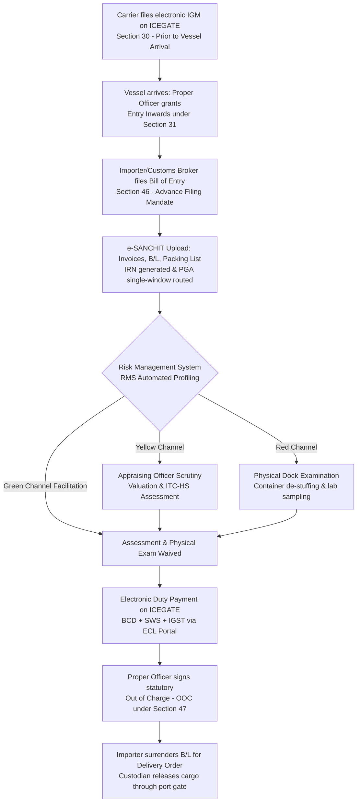
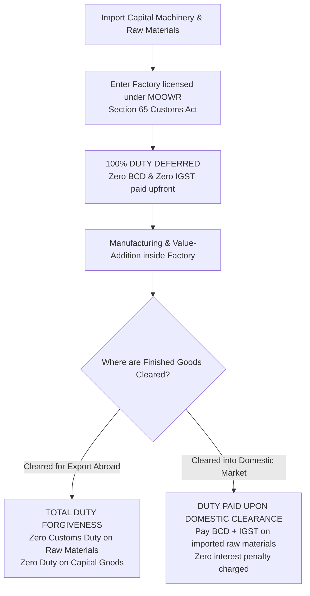
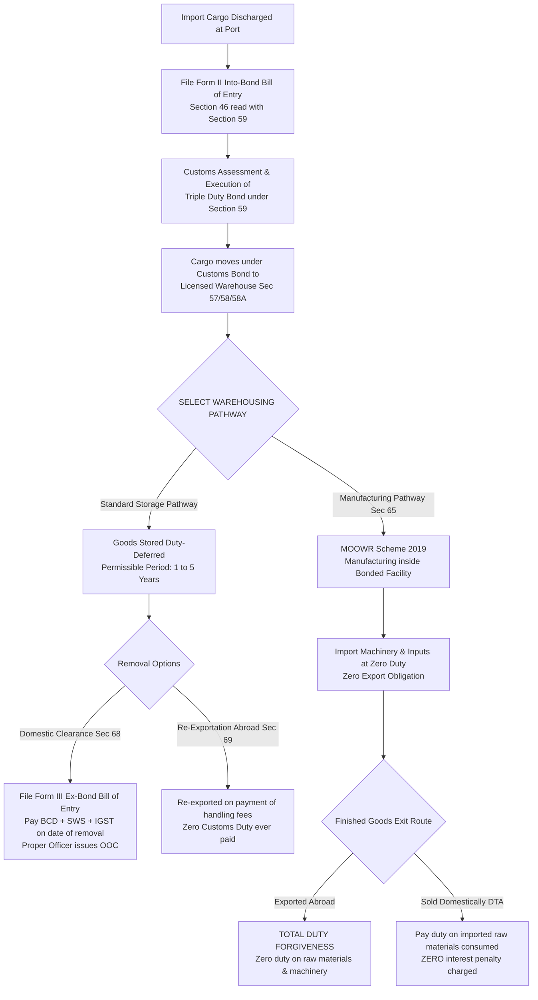

# Unit II: Topic 5 — Shipment of Export Cargo & Customs Clearance of Import Cargo
## Comprehensive Subjective Question Bank with Model Answers

---

### Section A: 2-Mark Questions (Short Definitions & Statutory Clearance Orders)

#### Q1. Define Let Export Order (LEO) under Section 51 of the Customs Act, 1962. (2 marks) | Likelihood: High | Type: Define
**Answer:**
A Let Export Order (LEO) is the statutory clearance order granted by the Proper Officer of Customs (Appraiser/Superintendent) under **Section 51 of the Customs Act, 1962**. It officially certifies that the export goods declared in the Shipping Bill have been assessed, verified, and physically examined (or facilitated via RMS), and legally permits the shipping line or airline to load the cargo on board the export vessel or aircraft.
* **Keywords to include for full marks:** Section 51 Customs Act 1962, Let Export Order (LEO), Proper Officer of Customs, loading permission on vessel, Shipping Bill clearance.
* **Examiner trap:** Confusing LEO with Out of Charge. **LEO is for Exports (Section 51)**; **Out of Charge (OOC) is for Imports (Section 47)**.
* **Memory trick:** LEO = **L**oading **E**xport **O**rder.
* **Marking scheme guide:** 1 mark for Section 51 citation; 1 mark for definition as official customs permission to load export cargo on board.

---

#### Q2. Define Out of Charge (OOC) under Section 47 of the Customs Act, 1962. (2 marks) | Likelihood: High | Type: Define
**Answer:**
An Out of Charge (OOC) order is the final statutory release order issued electronically by the Proper Officer of Customs under **Section 47 of the Customs Act, 1962**. It confirms that the imported goods declared in the Bill of Entry have been assessed, duties and taxes (BCD, IGST) have been fully paid, necessary PGA regulatory clearances (FSSAI, Plant Quarantine) have been obtained, and the custodian (port authority or CFS) is legally authorized to release the physical cargo to the importer.
* **Keywords to include for full marks:** Section 47 Customs Act 1962, Out of Charge (OOC), final release order, duty payment verified, custodian delivery authorization.
* **Examiner trap:** Thinking the Delivery Order (DO) replaces OOC. The DO is the *shipping line's* commercial release; the **OOC is the statutory customs release**. Both are required to exit port gates.
* **Memory trick:** OOC = **O**ut **O**f Customs **C**ustody.
* **Marking scheme guide:** 1 mark for Section 47 Customs Act citation; 1 mark for definition as final customs release order allowing physical cargo gate-out.

---

#### Q3. What is an Import General Manifest (IGM) under Section 30 of the Customs Act? (2 marks) | Likelihood: High | Type: Define
**Answer:**
An Import General Manifest (IGM) is a statutory electronic declaration delivered to Indian Customs under **Section 30 of the Customs Act, 1962** by the person-in-charge of an arriving vessel, aircraft, or vehicle (or shipping line agent). It lists all cargo, container numbers, descriptions, marks, and consignee details aboard the conveyance, and must be submitted electronically via ICEGATE **prior to the arrival of the vessel** to obtain "Entry Inwards" permission to unload.
* **Keywords to include for full marks:** Section 30 Customs Act 1962, IGM, pre-arrival filing, carrier cargo declaration, Entry Inwards, ICEGATE.
* **Examiner trap:** Believing the importer files the IGM. The IGM is filed strictly by the **carrier / shipping line**, not by the importer.
* **Memory trick:** IGM = **I**ncoming **G**oods **M**anifest filed by Carrier.
* **Marking scheme guide:** 1 mark for Section 30 citation and carrier filing obligation; 1 mark for pre-arrival electronic declaration listing all inward cargo.

---

#### Q4. Differentiate between Demurrage and Detention in container shipping. (2 marks) | Likelihood: High | Type: Define
**Answer:**
* **Demurrage:** A financial penalty levied for holding a container/cargo **inside the port/terminal/CFS premises** beyond the allowed free days (paid to the Port Authority / Terminal Operator);
* **Detention:** A financial penalty levied for holding the shipping line's **empty container equipment outside the port terminal** beyond the allowed free days (paid directly to the Shipping Line).
* **Keywords to include for full marks:** Demurrage inside port/CFS, Detention outside port, free days, Port Authority vs Shipping Line equipment penalty.
* **Examiner trap:** Using the terms interchangeably. Demurrage is *land storage delay inside the port*; Detention is *equipment holding delay outside the port*.
* **Memory trick:** Demurrage = Dock storage; Detention = Detaining the Box at the Factory.
* **Marking scheme guide:** 1 mark for Demurrage definition (inside port/terminal); 1 mark for Detention definition (outside port equipment holding).

---

#### Q5. What is the advance filing requirement for a Bill of Entry under Section 46 of the Customs Act? (2 marks) | Likelihood: Medium | Type: Define
**Answer:**
Under Section 46(3) of the Customs Act, 1962 (as amended), an importer must present the electronic Bill of Entry on ICEGATE **before the end of the day preceding the day** (including holidays) on which the vessel or aircraft carrying the goods arrives at the customs station. Filing after this statutory deadline attracts a mandatory late-filing fee (₹5,000 to ₹10,000 per day of delay).
* **Keywords to include for full marks:** Section 46(3) Customs Act, advance filing, end of the day preceding arrival, late-filing penalty, pre-arrival processing.
* **Examiner trap:** Quoting the old rule where importers had 30 days after vessel arrival to file. The current law mandates **pre-arrival advance filing before the day of arrival**.
* **Memory trick:** File Today, Vessel Lands Tomorrow $\rightarrow$ Avoid the Late Fee.
* **Marking scheme guide:** 1 mark for "before end of day preceding the day of arrival"; 1 mark for Section 46(3) citation and late-filing penalty reference.

---

#### Q6. What is a Customs Broker (CB) and which regulations govern their licensing in India? (2 marks) | Likelihood: Medium | Type: Define
**Answer:**
A Customs Broker (formerly known as a Custom House Agent or CHA) is a licensed professional or agency authorized under Section 146 of the Customs Act, 1962, read with the **Customs Brokers Licensing Regulations (CBLR, 2018)**, to act as an accredited agent for importers and exporters in transacting business relating to customs cargo entry, classification, valuation, and physical dock clearance.
* **Keywords to include for full marks:** Customs Broker, Section 146 Customs Act 1962, CBLR 2018, CHA, cargo clearance agent, classification and valuation.
* **Examiner trap:** Referring to them only as "CHA". In modern Indian customs terminology, they are legally designated as **Customs Brokers (CB)**.
* **Memory trick:** Customs Broker = Licensed Bridge between Trader and Port Customs.
* **Marking scheme guide:** 1 mark for Section 146 and CBLR 2018 citation; 1 mark for core function as accredited agent for cargo clearance.

---

### Section B: 5-Mark Questions (Clearance Mechanisms & Infrastructure)

#### Q7. Explain the operational working of the Risk Management System (RMS) in Indian Customs. (5 marks) | Likelihood: High | Type: Explain
**Answer:**
### Concept and Strategic Purpose
The **Risk Management System (RMS)** is an automated decision-support engine embedded within the Indian Customs EDI System (ICES). Introduced by the Central Board of Indirect Taxes and Customs (CBIC), its purpose is to balance **trade facilitation with regulatory enforcement** by replacing 100% manual document assessment and dock examination with intelligent, automated risk profiling.

```
                         [ RMS EVALUATION ENGINE ]
         Electronic Declaration Filed on ICEGATE (Shipping Bill / Bill of Entry)
                                     │
         Automated Profiling: IEC, HS Code, Valuation, Country of Origin, Compliance
                                     │
         ┌───────────────────────────┼───────────────────────────┐
         ▼                           ▼                           ▼
[ GREEN CHANNEL ]           [ YELLOW CHANNEL ]          [ RED CHANNEL ]
* Facilitated clearance     * Document assessment       * Detailed assessment
* Assessment waived           required by Appraiser       AND physical dock
* Physical exam waived      * Physical exam waived        examination/sampling
* Direct to Duty / LEO      * Direct to Duty / LEO      * Strict scrutiny
```

### The Three Output Channels
1. **Green Channel (Facilitated Clearance):**
   * Shipments flagged as low-risk bypass both customs appraisal and physical dock examination.
   * *For Imports:* The system directly generates the duty payment challan; once paid, the Proper Officer grants the **Out of Charge (OOC)** within minutes.
   * *For Exports:* Cargo proceeds directly to the docks for the **Let Export Order (LEO)** without inspection delays.
   * Approximately **70% to 80% of routine cargo** is cleared via the Green Channel under the *Turant Customs* initiative.
2. **Yellow Channel (Document Assessment Required):**
   * The electronic declaration is routed to the Customs Appraising Officer for scrutiny of valuation, classification, or exemption notifications.
   * Physical dock examination of the cargo is waived.
3. **Red Channel (Full Assessment & Dock Examination):**
   * High-risk or suspicious consignments (e.g., first-time importers, sensitive goods, intelligence alerts, valuation anomalies).
   * Requires comprehensive document scrutiny by the Appraiser **AND physical opening, examination, and sampling of cargo at the docks** by the Customs Preventive Officer.

* **Keywords to include for full marks:** Risk Management System (RMS), ICES, CBIC, Turant Customs, Green Channel, Yellow Channel, Red Channel, facilitated clearance, risk profiling parameters, Let Export Order, Out of Charge.
* **Examiner trap:** Thinking the customs officer decides whether a shipment is Green or Red. The **automated RMS software makes the channel selection** based on mathematical risk algorithms.
* **Memory trick:** Green = Go Fast; Yellow = Check Papers; Red = Open the Containers.
* **Marking scheme guide:** 1 mark for RMS concept and facilitation purpose; 3 marks for describing Green, Yellow, and Red channels; 1 mark for statistical share (70–80% facilitated) and Turant Customs.

---

#### Q8. Describe the step-by-step export cargo clearance procedure leading to the Let Export Order (LEO). (5 marks) | Likelihood: High | Type: Procedure
**Answer:**
### Statutory Framework
Customs clearance of export cargo is governed by **Section 50 and Section 51 of the Customs Act, 1962**.

```
[File Shipping Bill on ICEGATE] ───> [Port Carting Order] ───> [RMS Processing] ───> [Customs Examination] ───> [LEO Section 51]
```

### Chronological 5-Step Operational Procedure
1. **Filing of Electronic Shipping Bill (Section 50):**
   * The exporter or Customs Broker files the cargo declaration on ICEGATE, submitting commercial invoice, packing list, and GST LUT/tax details.
   * ICEGATE automatically validates the exporter’s IEC, port AD Code, and GSTIN, generating the electronic **Shipping Bill (SB)**.
2. **Port Gate-In & Carting Order:**
   * The container (factory-stuffed with RFID e-seal) or truck moves to the port terminal or Container Freight Station (CFS).
   * The Port Authority verifies the Shipping Bill and issues an electronic **Carting Order**, permitting cargo to enter the port transit sheds or container yard.
3. **RMS Automated Processing:**
   * The customs RMS evaluates cargo risk. If cleared under the **Green Channel**, assessment and examination are waived. If flagged under Yellow or Red channels, the file is routed for Appraiser scrutiny.
4. **Physical Examination at Docks:**
   * For cargo selected for examination, the Customs Preventive Officer at the dock inspects the container, checks marks and numbers against the packing list, verifies the RFID seal, and inspects cartons.
5. **Grant of Let Export Order (LEO) (Section 51):**
   * Once satisfied that the goods are lawful, properly valued, and comply with the Foreign Trade Policy, the Customs Officer signs the **Let Export Order (LEO)** on the system.
   * *Outcome:* The shipping line is legally authorized to load the container on board the vessel. The Chief Officer issues the **Mate's Receipt**, which is exchanged for the negotiable **Bill of Lading**.

* **Keywords to include for full marks:** Section 50 Shipping Bill, Port Carting Order, RMS Green Channel, Dock Preventive Officer examination, RFID e-seal, Section 51 Let Export Order (LEO), Mate's Receipt, Ocean Bill of Lading.
* **Examiner trap:** Omitting the Carting Order. The Carting Order is the essential port authority authorization allowing goods to physically cross the dock gates before customs inspection.
* **Memory trick:** **S**hipping Bill $\rightarrow$ **C**arting $\rightarrow$ **R**MS $\rightarrow$ **E**xamination $\rightarrow$ **L**EO (**SCREL Procedure**).
* **Marking scheme guide:** 1 mark for Section 50 filing; 1 mark for Carting Order and gate-in; 1 mark for RMS processing; 1 mark for dock physical examination; 1 mark for Section 51 LEO grant and Mate's Receipt.

---

#### Q9. Explain the bonded warehousing procedure for import cargo under Section 59 and Section 68 of the Customs Act (Into-Bond vs Ex-Bond). (5 marks) | Likelihood: High | Type: Explain / Procedure
**Answer:**
### The Concept of Duty Deferment
Under Chapter IX of the Customs Act, 1962, an importer who does not require immediate domestic clearance of imported goods can defer customs duty payment by storing the goods in a public or private **Bonded Customs Warehouse**.

```
[Import Cargo Arrives] ───> [File Form II Into-Bond BE] ───> [Execute Triple Duty Bond Sec 59] ───> [Goods Stored Duty-Free]
                                                                                                           │
[Release for Domestic Sale] <─── [Pay Duty & IGST under Sec 68] <─── [File Form III Ex-Bond BE] <──────────┘
```

### The Two-Stage Warehousing Procedure

#### Stage 1: Warehousing / Into-Bond Clearance (Section 59)
* **Filing Form II Bill of Entry (Into-Bond BE - Historically Yellow):** The importer declares that the goods are destined for warehousing, not immediate home consumption.
* **Assessment & Execution of Bond:** Customs assesses the duty liability. Under Section 59, the importer executes a **Bond binding themselves in a sum equal to thrice the amount of duty assessed (Triple Duty Bond)** with bank guarantee/security.
* **Storage Period:** Capital goods can remain warehoused for up to **5 years**; other commercial goods can remain for up to **1 year** (extendable by the Principal Commissioner). Zero customs duty is paid upon entry into the warehouse.

#### Stage 2: Ex-Bond Clearance for Home Consumption (Section 68)
* **Filing Form III Bill of Entry (Ex-Bond BE - Historically Green):** When the importer requires goods (in full or partial lots), they file an Ex-Bond Bill of Entry under Section 68.
* **Duty Payment:** Customs duty, Social Welfare Surcharge, and IGST are paid on the specific quantity being removed.
* **Critical Valuation Rule:** Duty is assessed at the **tariff rate and currency exchange rate prevailing on the date of filing the Ex-Bond Bill of Entry**, not the date of arrival.
* **Issuance of Out of Charge:** The officer grants OOC under Section 68, allowing goods to exit the warehouse.

* **Keywords to include for full marks:** Chapter IX Customs Act, Section 59 Bonded Warehousing, Form II Into-Bond BE, Triple Duty Bond, 1-year/5-year storage limits, Section 68 Ex-Bond BE, Form III, Out of Charge, duty rate on date of Ex-Bond filing.
* **Examiner trap:** Thinking duty is paid at the rate prevailing when goods first landed. Duty is levied at the **rate prevailing on the date the Ex-Bond Bill of Entry is filed under Section 68**.
* **Memory trick:** Form II puts it Into-Bond; Form III takes it Ex-Bond.
* **Marking scheme guide:** 1 mark for duty-deferment concept; 2 marks for Stage 1 Into-Bond (Section 59, Triple Duty Bond, Form II); 2 marks for Stage 2 Ex-Bond (Section 68, Form III, rate of duty on ex-bond date).

---

#### Q10. Distinguish between a Container Freight Station (CFS) and an Inland Container Depot (ICD). (5 marks) | Likelihood: High | Type: Differentiate
**Answer:**

| Parameter of Distinction | Container Freight Station (CFS) | Inland Container Depot (ICD) |
|---|---|---|
| **1. Geographical Location** | Located in **close proximity to a gateway maritime seaport** (normally within 10 to 50 km). | Located deep in the **hinterland / inland industrial centers** (e.g., Delhi, Ludhiana, Moradabad, Hyderabad). |
| **2. Autonomous Dry Port Status** | Functions as an **operational extension and cargo handling node** of the maritime port. | Functions as an **independent Dry Port** with its own distinct customs station code and multimodal railhead. |
| **3. Primary Operational Focus**| Stuffing, stripping, and consolidating **Less than Container Load (LCL)** cargo packages. | Handling both **Full Container Load (FCL)** and LCL cargo, with direct rail-flat connectivity to coastal ports. |
| **4. Customs Administration** | Operates under the direct administrative jurisdiction of the maritime Commissioner of Customs. | Operates under an independent Commissioner of Customs assigned to that inland dry port territory. |
| **5. Bonded Intermodal Transit**| Cargo transfers between port and CFS take place via bonded road trailers under local transit escort. | Containers move between ICD and seaports under **bond and bank guarantee via dedicated container trains (CONCOR)**. |
| **6. Multimodal Bill of Lading** | Shipping lines rarely issue an inland Combined Transport B/L showing CFS as the original place of receipt. | Shipping lines regularly issue a **Combined Transport / Multimodal Bill of Lading** naming the ICD as place of receipt. |

* **Keywords to include for full marks:** CFS vs ICD, Seaport proximity vs Hinterland dry port, LCL consolidation vs FCL/LCL railhead, Maritime Commissioner vs Inland Customs Commissioner, CONCOR container rail, Multimodal Transport Document.
* **Examiner trap:** Viewing a CFS as a dry port. An **ICD is an independent dry port**; a **CFS is a port-vicinity cargo consolidation shed**.
* **Memory trick:** CFS = Port Extension Shed; ICD = Inland Dry Port with Railway Tracks.
* **Marking scheme guide:** 0.5 marks per row (min 6 rows = 3 marks); 1 mark for geographical location contrast; 1 mark for independent dry port status and CONCOR rail connectivity.

---

#### Q11. Explain the Duty Calculation Formula for imported cargo in India (BCD, SWS, IGST). (5 marks) | Likelihood: High | Type: Explain / Numerical
**Answer:**
### The Statutory Sequence of Customs Duty Assessment
Customs duty calculation in India follows a strict mathematical compounding sequence under the **Customs Tariff Act, 1975** and **Section 14 of the Customs Act, 1962**:

```
Assessable Value (CIF in INR)
      │
      ▼  + Basic Customs Duty (BCD) [@ statutory tariff rate on Assessable Value]
Customs Duty Base
      │
      ▼  + Social Welfare Surcharge (SWS) [@ 10% OF THE CALCULATED BCD VALUE]
Sub-Total Value
      │
      ▼  + Integrated Goods and Services Tax (IGST) [@ GST rate on (Assessable Value + BCD + SWS)]
TOTAL IMPORT DUTY PAYABLE
```

### Step-by-Step Mathematical Calculation Formula:
1. **Assessable Value (AV):** The Transaction Value under Section 14 (CIF value converted into Indian Rupees using the official CBIC notified foreign exchange rate).
2. **Basic Customs Duty (BCD):**
   $$\text{BCD} = \text{Assessable Value} \times \text{BCD Rate (e.g., 10\%)}$$
3. **Social Welfare Surcharge (SWS):** Under the Finance Act 2018, SWS is levied at **10% on the aggregate BCD amount** (NOT on Assessable Value):
   $$\text{SWS} = 10\% \times \text{Calculated BCD}$$
4. **Integrated GST (IGST - Section 3(7) of Customs Tariff Act):** Levied on the composite value encompassing Assessable Value PLUS all customs duties:
   $$\text{IGST Base Value} = \text{Assessable Value} + \text{BCD} + \text{SWS}$$
   $$\text{IGST Amount} = \text{IGST Base Value} \times \text{Applicable GST Rate (e.g., 18\%)}$$
5. **Total Duty Payable:**
   $$\text{Total Duty} = \text{BCD} + \text{SWS} + \text{IGST}$$

* **Keywords to include for full marks:** Assessable Value Section 14, Basic Customs Duty (BCD), Social Welfare Surcharge (SWS) 10% of BCD, IGST Section 3(7) Customs Tariff Act, compounding tax base, CBIC notified exchange rate.
* **Examiner trap:** Calculating SWS as 10% of Assessable Value. SWS is **10% of the calculated BCD**, never on the Assessable Value.
* **Memory trick:** Duty = BCD on Cargo $\rightarrow$ SWS on BCD $\rightarrow$ IGST on Everything.
* **Marking scheme guide:** 1 mark for sequential concept; 3 marks for the 4-step mathematical formulas (AV, BCD, SWS, IGST); 1 mark for compounding base rule.

---

#### Q12. Explain the causes of container Demurrage and Detention and detail five operational mitigation strategies for an importer. (5 marks) | Likelihood: High | Type: Explain / Strategy
**Answer:**
### The Financial Drain of Port Storage and Equipment Penalties
* **Demurrage:** Levied by the port terminal/CFS for keeping loaded containers inside the terminal premises beyond allowed free time (typically **3 to 5 free days**).
* **Detention:** Levied by the shipping line for retaining their empty container equipment outside the port premises beyond allowed turnaround time (typically **7 to 14 free days**).

### Common Causes of Incurrence
1. Delays in receiving original negotiable Bills of Lading from overseas banks due to LC discrepancies;
2. Errors or misclassifications on the Bill of Entry triggering customs query audits and laboratory testing holds;
3. Delays in obtaining statutory No Objection Certificates (NOC) from partner agencies (FSSAI, Plant Quarantine);
4. Cash-flow shortages preventing timely electronic customs duty payments;
5. Transport trailer shortages or unloading delays at the importer's inland factory.

### Five Strategic Mitigation Measures for Importers
1. **Filing Advance Bill of Entry:** File the electronic Bill of Entry on ICEGATE prior to vessel arrival under Section 46 advance filing rules, ensuring assessment and RMS clearance are completed before the ship docks.
2. **Utilizing Direct Port Delivery (DPD):** Accredited importers register for DPD, allowing containers to be trucked directly from the quayside to the factory within 48 hours, bypassing CFS storage demurrage completely.
3. **Pre-Negotiating Extended Free Days:** Negotiate with the ocean carrier at the time of freight booking to grant **14 to 21 free days for detention and demurrage** in the freight contract before shipping.
4. **e-SANCHIT Document Upload:** Pre-upload all regulatory certificates and invoices onto e-SANCHIT to prevent customs documentation queries.
5. **Moving Cargo to Bonded Warehouse:** If clearance is blocked by commercial disputes, file a Form II Into-Bond Bill of Entry under Section 59 to transfer cargo into a public bonded warehouse, stopping port terminal demurrage accrual.

* **Keywords to include for full marks:** Demurrage, Detention, Free days, Direct Port Delivery (DPD), Advance Bill of Entry, Extended free days negotiation, e-SANCHIT, Section 59 Bonded warehouse transfer.
* **Examiner trap:** Suggesting the importer simply ignores the charges. Shipping lines hold liens on future cargo; demurrage must be mitigated through *procedural agility and pre-negotiated free time*.
* **Memory trick:** Advance Filing + DPD Gate-out = Zero Demurrage.
* **Marking scheme guide:** 1.5 marks for definitions and distinction; 1.5 marks for root causes; 2 marks for five operational mitigation strategies.

---

### Section C: 10-Mark Questions (Detailed Operational Clearance Answers)

#### Q13. Detail the complete statutory customs clearance procedure for Import Cargo in India under the Customs Act, 1962. (10 marks) | Likelihood: High | Type: Procedure
**Answer:**
### 1. Introduction & Statutory Foundation
Customs clearance of imported merchandise is governed by **Section 46 and Section 47 of the Customs Act, 1962**. Administered by the Central Board of Indirect Taxes and Customs (CBIC) via the Indian Customs EDI System (ICES) on ICEGATE, the clearance procedure ensures proper tariff classification, correct valuation under Section 14, collection of statutory customs duties and IGST, and enforcement of safety, health, and national security standards.

---

### 2. End-to-End Import Customs Clearance Flowchart



---

### 3. Chronological 6-Stage Operational Procedure

#### Stage 1: Pre-Arrival Carrier Formalities (Section 30 & 31)
* **Import General Manifest (IGM):** Before the vessel arrives at the Indian seaport, the shipping line delivers the electronic IGM via ICEGATE, declaring all cargo, containers, and consignees aboard.
* **Entry Inwards (Section 31):** Once the ship docks, the Customs Preventive Officer grants formal "Entry Inwards", permitting cargo discharge onto port quaysides.

#### Stage 2: Advance Filing of the Bill of Entry (Section 46)
* The importer or Customs Broker submits the electronic **Bill of Entry (BE)** on ICEGATE before the end of the day preceding the day of vessel arrival.
* Importers select:
  * *Form I (White):* For immediate Home Consumption;
  * *Form II (Yellow):* For Warehousing / Into-Bond; or
  * *Form III (Green):* For Ex-Bond clearance.
* **e-SANCHIT Digital Upload:** Supporting documents (Commercial Invoice, Packing List, Ocean Bill of Lading, Certificate of Origin) are uploaded as digitally signed PDFs, generating unique **Image Reference Numbers (IRNs)**.
* **SWIFT PGA Routing:** For food, chemicals, or agricultural goods, ICEGATE’s Single Window Interface routes the declaration to regulatory agencies (FSSAI, Plant Quarantine) for digital No Objection Certificates (NOC).

#### Stage 3: Risk Management System (RMS) Processing
* The automated RMS evaluates cargo risk:
  * *Green Channel:* Bypasses both assessment and dock examination, proceeding straight to duty payment.
  * *Yellow Channel:* Document assessment required by the Appraising Officer.
  * *Red Channel:* Requires document assessment AND physical dock examination.

#### Stage 4: Assessment & Physical Dock Examination
* **Valuation & Scrutiny:** The Appraiser verifies the 8-digit ITC(HS) code, transaction value under Section 14, and applicable exemption notifications.
* **Dock Examination:** Under the Red Channel, the Customs Dock Examiner cuts container seals, verifies cargo against the packing list, draws representative samples for chemical laboratory testing if needed, and enters the examination report into the ICES terminal.

#### Stage 5: Calculation and Electronic Duty Payment
* ICES generates the electronic duty payment challan:
  * Basic Customs Duty (BCD) on Assessable Value;
  * Social Welfare Surcharge (SWS @ 10% of BCD); and
  * Integrated GST (IGST on Assessable Value + BCD + SWS).
* The importer pays the duty electronically via ICEGATE’s Electronic Cash Ledger (ECL) on the same day to avoid interest charges.

#### Stage 6: Issuance of Out of Charge (OOC - Section 47) & Delivery
* Upon receipt of cleared duty funds and verification of all PGA NOCs, the Proper Officer signs the statutory **Out of Charge (OOC)** order under Section 47.
* The importer surrenders the original endorsed Ocean Bill of Lading to the shipping line, pays ocean freight and container security deposits, obtains the **Delivery Order (DO)**, presents both OOC and DO to the port/CFS custodian, and trucks the cargo out of port gates.

---

### 4. Conclusion
Indian import customs clearance has transformed into a streamlined, automated, and paperless digital pipeline via ICEGATE. By enforcing pre-arrival advance filing, paperless uploads via e-SANCHIT, automated risk filtering through RMS, and Single Window PGA integration, customs clearance dwell times have dropped from over 5 days to under 24 hours for facilitated consignments.

* **Keywords to include for full marks:** Section 46 Bill of Entry, Section 47 Out of Charge (OOC), Section 30 IGM, Section 31 Entry Inwards, ICEGATE, e-SANCHIT, IRN, Single Window SWIFT, PGAs, RMS Green Channel, Appraiser assessment, Dock examination, Electronic Cash Ledger, Delivery Order.
* **Examiner trap:** Confusing the roles of Customs and the Shipping Line at cargo release. Customs issues the **Out of Charge (OOC)**; the shipping line issues the **Delivery Order (DO)**. Both are required by the port custodian to release cargo.
* **Memory trick:** **I**GM $\rightarrow$ **B**ill of Entry $\rightarrow$ **S**ANCHIT $\rightarrow$ **R**MS $\rightarrow$ **P**ayment $\rightarrow$ **O**OC $\rightarrow$ **D**elivery (**IBS-RP-OD sequence**).
* **Marking scheme guide:** 2 marks for intro and statutory sections; 3 marks for master flowchart diagram; 4 marks for detailed stage-by-stage operational breakdown; 1 mark for conclusion.

---

#### Q14. Detail the role and operational mechanisms of Inland Container Depots (ICDs) and the Container Corporation of India (CONCOR) in multimodal logistics. (10 marks) | Likelihood: High | Type: Detail / Infrastructure
**Answer:**
### 1. Introduction: The Hinterland Challenge
India is a geographically vast nation where major manufacturing clusters (e.g., Ludhiana textiles, Moradabad brassware, Agra footwear, Bengaluru electronics) are located hundreds or thousands of kilometers away from coastal seaports like JNPT, Mundra, or Chennai. Transporting loose cargo over vast inland distances to coastal ports resulted in severe transit damage, theft, high road trucking costs, and administrative delays.

To resolve this, the Government of India established **Inland Container Depots (ICDs)**—popularly called **"Dry Ports"**—and created the **Container Corporation of India (CONCOR)** to provide intermodal rail connectivity.

---

### 2. Concept and Statutory Status of an Inland Container Depot (ICD)
* An ICD is an independent customs station established under **Section 7 of the Customs Act, 1962** in the hinterland.
* It operates as a full-fledged **Dry Port**, equipped with:
  * Dedicated container rail sidings;
  * Container storage yards and high-capacity gantry cranes;
  * Customs examination sheds and bonded transit warehouses; and
  * Independent customs offices headed by a Commissioner of Customs.
* *Legal Effect:* An exporter in Delhi or Ludhiana completes all customs export clearance formalities, physical examination, and obtains the **Let Export Order (LEO) locally at the ICD**, without needing to travel to a coastal seaport.

---

### 3. The Central Role of CONCOR in Multimodal Logistics

```
[EXPORTER'S FACTORY] ───> [LOCAL ICD (e.g., Tughlakabad - Delhi)]
                                    │
                                    ▼ (Customs Clearance & LEO Granted)
                          [CONTAINER SEALED WITH RFID SEAL]
                                    │
                                    ▼ (Loaded on CONCOR Rail Flat Cars)
                          [BONDED TRAIN TRANSIT UNDER CUSTOMS ESCORT]
                                    │
                                    ▼
                          [GATEWAY PORT (JNPT / Mundra)]
                                    │
                                    ▼ (Direct Loading onto Ocean Vessel)
```

Incorporated in 1988 under the Ministry of Railways, **CONCOR (Container Corporation of India Ltd.)** operates the largest network of dry ports and container rail terminals in India (over 60 ICDs/CFSs nationwide).
* **Bonded Rail Transit:** CONCOR operates dedicated high-speed container trains carrying export and import containers between inland ICDs and coastal maritime gateway ports.
* **Movement under Customs Bond:** Cargo moving by rail between an ICD and a coastal seaport moves under **Customs Bond and Bank Guarantee**. Because goods were cleared at the inland ICD, **they are not opened or inspected again at the maritime port**. The container moves straight from the rail flatcar to the ship’s crane for loading.
* **Combined Transport / Multimodal Bill of Lading:** Ocean shipping lines partner with CONCOR to issue a single **Multimodal Bill of Lading** naming the inland ICD as the original place of receipt (e.g., *"Place of Receipt: ICD Tughlakabad; Port of Loading: JNPT; Port of Discharge: Hamburg"*). The shipping line assumes legal liability for the entire rail-and-sea journey.

---

### 4. Strategic Economic Benefits of the ICD-CONCOR Architecture
1. **Lower Logistics Costs:** Rail transport of heavy containers via CONCOR is 30% to 40% cheaper per ton-kilometer than long-distance road trucking.
2. **Decongestion of Gateway Seaports:** Ports like JNPT operate purely as transit quays; cargo stuffing, customs appraisal, and bonded storage are handled inland.
3. **Regional Industrial Development:** Enables landlocked industrial states (Punjab, Haryana, Uttar Pradesh, Madhya Pradesh) to compete globally on equal footing with coastal states.
4. **Transit Safety:** Sealed containers moving on secured rail-flat cars eliminate highway hijacking, pilferage, and weather damage.

---

### 5. Conclusion
Inland Container Depots and CONCOR form the backbone of India’s multimodal logistics network. By bringing maritime port clearance directly to inland manufacturing clusters and connecting dry ports to coastal gateways through bonded container trains, the ICD-CONCOR system lowers logistics costs, enhances cargo security, and powers India's export growth.

* **Keywords to include for full marks:** Inland Container Depot (ICD), Dry Port, Section 7 Customs Act, CONCOR 1988, Multimodal logistics, Bonded rail transit, Customs bond and bank guarantee, Combined Transport Bill of Lading, ICD Tughlakabad, Decongestion of coastal ports, Rail flatcars.
* **Examiner trap:** Treating an ICD as an ordinary warehouse. An ICD is an **independent statutory dry port** with full customs authority, port codes, and railheads.
* **Memory trick:** ICD = Dry Port in the Hinterland; CONCOR = Steel Rails connecting Dry Port to Ocean.
* **Marking scheme guide:** 2 marks for hinterland logistics challenge; 3 marks for ICD concept, equipment, and statutory status; 3 marks for CONCOR bonded rail transit and Multimodal B/L; 2 marks for strategic economic benefits and conclusion.

---

#### Q15. Explain the operational working and commercial benefits of the MOOWR Scheme (Manufacturing and Other Operations in Warehouse). (10 marks) | Likelihood: High | Type: Explain / Policy
**Answer:**
### 1. Introduction: Transforming Warehousing into a Manufacturing Hub
Historically, customs bonded warehouses under Chapter IX of the Customs Act were used strictly to store imported finished goods to defer customs duty. In 2019, the Central Board of Indirect Taxes and Customs (CBIC) modernized regulations under Section 65 of the Customs Act, 1962, launching the revamped **MOOWR (Manufacturing and Other Operations in Warehouse Regulations, 2019)** scheme.

MOOWR transformed bonded warehouses into **duty-free industrial manufacturing hubs**, allowing manufacturers to import raw materials and capital machinery without paying basic customs duties or IGST until finished products leave the facility.

---

### 2. Comprehensive Operational Mechanics of the MOOWR Scheme



#### A. Duty-Deferred Capital Goods Imports
* A manufacturing unit approved under MOOWR can import brand-new or used **capital equipment, plant machinery, and spare parts at 100% duty deferment** (zero basic customs duty and zero IGST paid upfront).
* *The Export Advantage:* If the machinery is used to manufacture goods that are exported, **the customs duty on the machinery is permanently waived**.
* *No Depreciation Claws:* Unlike older schemes, there are no mandatory export obligations or minimum export performance quotas.

#### B. Duty-Deferred Raw Material Procurement
* Raw materials, components, and packaging can be imported into the MOOWR unit without paying customs duties or IGST upfront.
* The deferred duty liability remains dormant while materials are processed inside the facility.

#### C. Two Clearance Exit Routes
1. **If Finished Products are Exported Abroad:**
   * The customs duties on raw materials and components incorporated into the exported goods are **completely waived**.
   * No customs duty or IGST is ever paid.
2. **If Finished Products are Cleared for Domestic Home Consumption (DTA Sale):**
   * The manufacturer pays customs duty **only on the imported raw materials consumed** in producing that domestic batch (or on finished goods, whichever is legally applicable), plus applicable domestic GST.
   * *The Interest-Free Advantage:* **No interest is charged** on the deferred duty, regardless of how long the raw materials were stored inside the bonded factory.

---

### 3. Comparison of MOOWR with Traditional Export Promotion Schemes

| Feature / Dimension | MOOWR Scheme (Section 65) | Advance Authorization Scheme | Export Oriented Units (EOU) |
|---|---|---|---|
| **1. Export Obligation (EO)** | **Zero Export Obligation:** Sell 100% domestically or 100% to exports. | Mandatory **15% Value Addition in 18 months**. | Mandatory Net Foreign Exchange (NFE) positive over 5 years. |
| **2. Upfront Duty Relief** | Complete deferment of BCD and IGST on inputs and machinery. | Duty-free import of raw materials (machinery excluded). | Duty-free import of raw materials and capital machinery. |
| **3. Administrative Surveillance**| **Zero Customs Officer physical posting;** audited via digital records. | SION physical norms audits and DGFT redemption licensing. | Physical customs bonding, Development Commissioner oversight. |
| **4. Domestic Market Clearance** | Free domestic sales; pay raw material duty with **zero interest penalty**. | Incur punitive duty plus compound interest for unfulfilled EO. | Domestic sales capped; subject to permission and duties. |

---

### 4. Critical Commercial Impact for Indian Industry
* **Massive Working Capital Savings:** Eliminates upfront cash blockages on capital machinery imports, conserving millions in liquidity during initial factory construction.
* **Supply Chain Flexibility:** Eliminates the stress of fulfilling rigid export obligation deadlines during global recessions; manufacturers can pivot smoothly between domestic and export sales.
* **Investment Attraction:** Served as the primary fiscal incentive attracting global electronics giants (e.g., Apple contract manufacturers like Foxconn and Pegatron) to establish mega manufacturing facilities in India.

---

### 5. Conclusion
The MOOWR scheme represents a structural reform in Indian industrial and customs policy. By eliminating rigid export obligations, offering complete duty deferment on capital machinery, and permitting duty-free manufacturing under self-declared digital accounting, MOOWR combines the benefits of a Special Economic Zone (SEZ) with the operational freedom of the domestic tariff area.

* **Keywords to include for full marks:** MOOWR Scheme 2019, Section 65 Customs Act 1962, duty-deferred capital goods, zero export obligation, interest-free duty deferment, domestic clearance DTA, total duty forgiveness on exports, Advance Authorization comparison, EOU comparison, working capital liquidity.
* **Examiner trap:** Believing MOOWR requires a minimum percentage of exports. MOOWR has **zero export obligation**; a factory can sell 100% of its output domestically and still enjoy interest-free duty deferment on raw materials until domestic sale.
* **Memory trick:** MOOWR = **M**ake in India with **O**ut-of-pocket duty deferment **O**n **W**arehouse **R**esources.
* **Marking scheme guide:** 2 marks for intro and Section 65 genesis; 3 marks for master operational flowchart; 3 marks for detailed raw material and capital goods mechanics; 2 marks for comparative table and conclusion.

---

#### Q16. Detail the regulatory framework governing the licensing and operational obligations of Customs Brokers under CBLR, 2018. (10 marks) | Likelihood: High | Type: Detail / Regulatory
**Answer:**
### 1. Statutory Genesis & Regulatory Mandate
In international trade, cross-border shippers rarely interact directly with customs officers at port terminals. Instead, they operate through licensed intermediaries. Regulated under **Section 146 of the Customs Act, 1962**, and the **Customs Brokers Licensing Regulations, 2018 (CBLR 2018)**, a **Customs Broker (CB)** is a specialized professional licensed by the Principal Commissioner of Customs to act as an accredited agent for transacting cross-border clearance business.

---

### 2. Licensing Prerequisites and the Regulation 6 Examination
To obtain a permanent Customs Broker License (Form B), an applicant must satisfy rigorous statutory prerequisites:
1. **Educational & Professional Qualifications:** The applicant must hold a Master’s degree in Business, Commerce, or Law, or be a Chartered Accountant (CA), Cost Accountant (CMA), or Company Secretary (CS), or hold a specialized diploma in customs clearance.
2. **The Regulation 6 Written & Oral Examination:** The applicant must clear the national **Regulation 6 Examination** conducted by the National Academy of Customs, Indirect Taxes and Narcotics (NACIN), demonstrating expertise across:
   * Classification under the Customs Tariff Act, 1975;
   * Valuation rules under Section 14;
   * Foreign Trade Policy provisions and restrictions (SCOMET);
   * Electronic EDI filing workflows on ICEGATE and e-SANCHIT.
3. **Financial Solvency & Security:** The applicant must furnish a financial solvency certificate of **₹5 Lakhs** and deposit a security of **₹5 Lakhs** in the form of a bank guarantee or national savings certificate with the Commissioner of Customs.

---

### 3. Core Operational Obligations under Regulation 10 (CBLR 2018)
Regulation 10 establishes a strict code of statutory conduct for Customs Brokers:

```
                          [ STATUTORY DUTIES OF A CUSTOMS BROKER ]
         ┌───────────────────────────┼───────────────────────────┐
         ▼                           ▼                           ▼
  [ KYC Verification ]         [ True Advice to Client ]    [ Diligence on Documents ]
  * Verify identity of client  * Advise on law compliance   * Ensure accurate classification
  * Verify real address        * Refuse fraudulent filing     and genuine valuation
  * Verify valid IEC & GSTIN   * Report statutory breaches  * Maintain records for 5 years
```

1. **Mandatory KYC Verification (Regulation 10n):** The broker must verify the correct identity, registered business address, and financial standing of their client (importer/exporter) using reliable, independent source documents (Aadhaar, PAN, GSTIN, IEC, bank certificate). Failure to detect "fly-by-night" shell companies importing fraudulent goods makes the broker co-liable.
2. **Diligence in Information Transmission:** The broker must ensure that all declarations filed on ICEGATE accurately reflect the instructions and commercial invoices supplied by the client, without withholding regulatory facts.
3. **Advising Clients on Legal Compliance:** If a client proposes a transaction violating customs rules (e.g., misdeclaring an 8-digit ITC(HS) code to evade basic customs duty), the broker must advise the client of statutory provisions and, if the client persists, report the matter to customs authorities.
4. **Maintenance of Accounts (Regulation 10x):** Must maintain complete operational records, copy of all Bills of Entry, Shipping Bills, and accounts for a statutory period of **5 years**, producing them on demand for customs audit.

---

### 4. Disciplinary Proceedings, Penalties & Revocation (Regulations 14 to 18)
If a Customs Broker commits misconduct, facilitates fraudulent drawback claims, or neglects KYC obligations:
* **Suspension of License (Regulation 16):** The Commissioner may suspend the broker's license immediately pending inquiry in cases of serious fraud.
* **Formal Inquiry (Regulation 17):** An Assistant Commissioner is appointed as Inquiry Officer; the broker is served a formal notice of charges and granted a personal hearing.
* **Revocation and Financial Penalties (Regulation 14 & 18):** If charges are proven, the Commissioner may **permanently revoke the Customs Broker license**, forfeit their security deposit, and levy financial penalties up to **₹50,000** per contravention, without prejudice to criminal prosecution under Chapter XVI of the Customs Act.

---

### 5. Conclusion
Customs Brokers are the professional bridge of India's foreign trade clearance system. By enforcing strict licensing examinations under Regulation 6, mandating thorough KYC verifications, and holding brokers accountable under Regulation 10, the CBLR 2018 framework ensures that customs clearance remains fast and facilitated for legitimate traders while protecting national revenue and security.

* **Keywords to include for full marks:** Customs Broker, Section 146 Customs Act, CBLR 2018, Regulation 6 NACIN examination, ₹5 Lakhs solvency and security, Regulation 10 obligations, Mandatory KYC verification Regulation 10(n), Maintenance of records 5 years, Suspension Regulation 16, Revocation Regulation 14, ₹50,000 penalty.
* **Examiner trap:** Viewing the Customs Broker as merely a clerical typist. Emphasize that the broker has **independent statutory regulatory duties under Regulation 10 (including mandatory KYC)** and can be penalized if their client commits customs fraud.
* **Memory trick:** Section 146 makes the Broker; Regulation 10 governs their Honor; KYC failure revokes their License.
* **Marking scheme guide:** 2 marks for Section 146 and statutory mandate; 3 marks for Regulation 6 licensing prerequisites; 3 marks for Regulation 10 operational duties and KYC; 2 marks for disciplinary suspension, revocation, and conclusion.

---

### Section D: 15-Mark Comprehensive Questions (Master Cargo Clearance Analyses)

#### Q17. Provide an exhaustive comparative treatise on the Clearance of Export Cargo versus Clearance of Import Cargo in India. Analyze the statutory sections, electronic documentation, inspection channels, and operational handoffs leading to LEO and OOC. (15 marks) | Likelihood: High | Type: Comprehensive / Comparative
**Answer:**

```
========================================================================================
     EXHAUSTIVE COMPARATIVE TREATISE: EXPORT CLEARANCE VS IMPORT CLEARANCE
========================================================================================
```

### 1. Introduction: The Two Symmetrical Hemispheres of Customs Law
The international trade lifecycle comprises two symmetrical yet legally distinct border operations:
* **Export Cargo Clearance:** The outward movement of domestic merchandise leaving Indian customs territory to enter foreign commerce; and
* **Import Cargo Clearance:** The inward movement of foreign merchandise crossing Indian customs boundaries to enter domestic consumption or bonded storage.

Both workflows are governed by the **Customs Act, 1962**, administered by the Central Board of Indirect Taxes and Customs (CBIC) via the **Indian Customs EDI System (ICES) on ICEGATE**, supported by the **Risk Management System (RMS)**. However, because exports focus on trade facilitation and export incentives while imports focus on revenue collection and border health screening, their documentation, assessment paths, and statutory release orders diverge.

---

### 2. Comprehensive Master Comparative Matrix

| Comparative Dimension | Clearance of Export Cargo | Clearance of Import Cargo |
|---|---|---|
| **1. Primary Governing Section**| **Section 50 & Section 51** of the Customs Act, 1962. | **Section 46 & Section 47** of the Customs Act, 1962. |
| **2. Primary Clearance Document** | Electronic **Shipping Bill (SB)** filed on ICEGATE. | Electronic **Bill of Entry (BE)** filed on ICEGATE. |
| **3. Forms / Types of Declarations**| Drawback SB, Dutiable SB, Duty-Free SB, Export under LUT / IGST Refund SB. | Form I (Home Consumption), Form II (Warehousing/Into-Bond), Form III (Ex-Bond). |
| **4. Carrier Pre-Arrival Manifest** | **Export General Manifest (EGM)** filed under Section 41 upon vessel departure. | **Import General Manifest (IGM)** filed under Section 30 prior to vessel arrival. |
| **5. Core Regulatory Objective** | Verify export restrictions/SCOMET, confirm zero tax (LUT), disburse **Duty Drawback / RoDTEP**. | Assess tariff valuation (Sec 14), levy and collect **Basic Customs Duty, SWS, and IGST**. |
| **6. Partner Agency (PGA) Focus** | Quality control (EIC), organic standards (APEDA), dangerous cargo certification (IIP). | Sanitary/Health screening (FSSAI, Plant Quarantine, Animal Quarantine, Drugs CDSCO). |
| **7. Final Statutory Clearance Order**| **Let Export Order (LEO)** granted under Section 51. | **Out of Charge (OOC)** granted under Section 47. |
| **8. Operational Handoff Document** | Ocean carrier issues **Mate’s Receipt**, exchanged for negotiable **Ocean Bill of Lading**. | Ocean carrier issues **Delivery Order (DO)** upon surrender of original Bill of Lading. |
| **9. Central Bank (RBI) Ledger** | ICEGATE transmits data to **EDPMS** to monitor foreign exchange proceeds realization. | ICEGATE transmits data to **IDPMS** to reconcile outward foreign currency remittances. |
| **10. Physical Cargo Gate Movement** | Enters port via Port **Carting Order**; exits country loaded on board vessel. | Unloaded from vessel under **Entry Inwards (Sec 31)**; exits port gates via OOC + DO. |

---

### 3. Parallel Comparative Workflow Architecture

```mermaid
flowchart LR
    subgraph EXPORT CLEARANCE PIPELINE (Outward Flow)
        E1[1. File Shipping Bill Sec 50] --> E2[2. Port Carting Order Gate-In]
        E2 --> E3[3. RMS Automated Profiling]
        E3 --> E4[4. Dock Physical Examination]
        E4 --> E5[5. Let Export Order Sec 51]
        E5 --> E6[6. Mate's Receipt -> Bill of Lading]
        E6 --> E7[7. Auto push to RBI EDPMS]
    end

    subgraph IMPORT CLEARANCE PIPELINE (Inward Flow)
        I1[1. Carrier files IGM Sec 30] --> I2[2. Advance Bill of Entry Sec 46]
        I2 --> I3[3. RMS / SWIFT PGA Routing]
        I3 --> I4[4. Assessment & Duty Payment]
        I4 --> I5[5. Dock Examination / Sampling]
        I5 --> I6[6. Out of Charge Sec 47]
        I6 --> I7[7. Delivery Order -> Port Exit]
    end
```

---

### 4. Deep-Dive: Key Structural Divergences

#### A. Revenue Collection vs Fiscal Neutralization
* **In Import Clearance:** The primary objective is **fiscal revenue collection**. Customs officers act as revenue gatekeepers, auditing the Section 14 transaction value, scrutinizing freight additions, and collecting Basic Customs Duty, Social Welfare Surcharge, and IGST through the Electronic Cash Ledger before goods can leave port gates.
* **In Export Clearance:** The primary objective is **trade facilitation and fiscal neutralization**. Because India operates on the principle that "taxes must not be exported", customs processing focuses on validating the zero-rated export status (LUT verification) and auditing eligibility for post-export remissions (**RoDTEP, Duty Drawback**).

#### B. Single Window Interface (SWIFT) vs Export Quality Control (EIC)
* **On the Import Side:** Border clearance is integrated with **SWIFT**, linking six Participating Government Agencies (PGAs). Importers bringing in food, agricultural items, or chemicals must obtain digital No Objection Certificates (NOC) from **FSSAI or Plant Quarantine** before the Proper Officer can legally issue an Out of Charge.
* **On the Export Side:** Border clearance focuses on export standards. Consignments of food, fish, or basmati rice require pre-shipment health certificates issued by the **Export Inspection Agency (EIA)** or APEDA/MPEDA, which are verified by customs officers before granting the Let Export Order.

#### C. The Statutory Release Milestone: LEO vs OOC
* **The Let Export Order (LEO - Section 51):** The LEO does not release goods into domestic territory; it permits goods to **leave Indian territory**. It is the legal authorization directed to the ship's master to load the cargo on board. Once loaded, the master signs the **Mate’s Receipt**, which the exporter exchanges for the negotiable **Bill of Lading** to claim payment under a Letter of Credit.
* **The Out of Charge (OOC - Section 47):** The OOC is the legal authorization directed to the port or CFS custodian certifying that sovereign duties are fully settled and border controls satisfied, permitting the physical cargo to **enter domestic Indian commerce**.

---

### 5. Conclusion
The export and import clearance procedures represent the balanced twin engines of Indian international trade logistics. Symmetrical in their digital reliance on ICEGATE, e-SANCHIT, and the Risk Management System (RMS), they diverge to fulfill their statutory mandates: export clearance accelerates outward movement to drive economic growth and earn foreign currency (monitored via EDPMS), while import clearance collects fiscal revenue, enforces standards, and guards national borders (monitored via IDPMS).

* **Keywords to include for full marks:** Export vs Import clearance, Section 50 Shipping Bill, Section 51 Let Export Order (LEO), Section 46 Bill of Entry, Section 47 Out of Charge (OOC), Section 30 IGM, Section 41 EGM, Entry Inwards Section 31, ICEGATE, RMS Green Channel, SWIFT PGAs, FSSAI, EIC inspection, Duty Drawback vs BCD/IGST collection, Mate's Receipt, Delivery Order, EDPMS vs IDPMS.
* **Examiner trap:** Mixing up Section numbers. The absolute key to a 15-mark answer here is precision: **Export = Sections 50 & 51; Import = Sections 46 & 47**.
* **Memory trick:** Export = SB $\rightarrow$ LEO $\rightarrow$ Mate's Receipt; Import = BE $\rightarrow$ Duty $\rightarrow$ OOC $\rightarrow$ Delivery Order.
* **Marking scheme guide:** 2 marks for intro and statutory foundation; 6 marks for complete 10-parameter comparative master matrix; 3 marks for parallel workflow flowchart diagrams; 3 marks for deep-dive into structural divergences (Revenue vs Neutrality, SWIFT vs EIC, LEO vs OOC); 1 mark for conclusion.

---

#### Q18. Provide an exhaustive operational and legal treatise on the clearance of Import Cargo under the Bonded Warehousing provisions (Sections 57 to 68 of the Customs Act, 1962) and the MOOWR Scheme. (15 marks) | Likelihood: High | Type: Comprehensive / Analytical
**Answer:**

```
========================================================================================
     EXHAUSTIVE TREATISE: BONDED WAREHOUSING & THE MOOWR SCHEME UNDER CUSTOMS LAW
========================================================================================
```

### 1. Introduction: The Strategic Architecture of Chapter IX
Under standard customs clearance, an importer must pay full customs duties and IGST immediately upon cargo arrival under Section 47 (Home Consumption). However, global supply chains require inventory buffering, capital equipment installations, and manufacturing cycles where immediate duty payment would severely drain cash liquidity.

To support trade, **Chapter IX (Sections 57 to 68) of the Customs Act, 1962** establishes the statutory architecture of **Customs Bonded Warehousing**. It allows imported dutiable cargo to be stored, manipulated, or used in manufacturing under customs bond **without payment of customs duties**, deferring duty liability until the goods leave the warehouse.

---

### 2. Comprehensive Master Warehousing Architecture Flowchart



*Exam Hand-Drawing Guide (Under 2 Minutes):* Draw a central box `[Into-Bond Filing: Form II & Sec 59 Bond]` branching into two paths: Left Path = `[Standard Storage: Form III Ex-Bond or Re-Export Sec 69]`; Right Path = `[MOOWR Sec 65: Duty-free Manufacturing for Export or Domestic Sale]`.

---

### 3. Detailed Statutory Deconstruction of Chapter IX Provisions

#### A. Licensing of Warehouses (Sections 57, 58 & 58A)
The Principal Commissioner of Customs licenses three classes of bonded warehouses:
1. **Public Bonded Warehouses (Section 57):** Operated by public custodians (e.g., Central Warehousing Corporation - CWC, State Warehousing Corporations - SWC) where any commercial importer can store goods on payment of storage rent.
2. **Private Bonded Warehouses (Section 58):** Licensed to private corporate entities exclusively for storing their own imported goods.
3. **Special Warehouses (Section 58A):** Secure warehouses licensed for sensitive, high-duty commodities (e.g., gold, silver bullion, duty-free shop goods, aircraft spares) maintained under physical lock-and-key customs supervision.

#### B. The Into-Bond Clearance Process (Section 59)
* **Form II Bill of Entry:** The importer files an Into-Bond Bill of Entry on ICEGATE.
* **The Triple Duty Bond:** Under Section 59, the importer must execute a formal legal bond binding themselves in a sum equal to **thrice the amount of the assessed customs duty**, with such security or bank guarantee as prescribed.
* **Permissible Warehousing Periods (Section 61):**
  * *Capital Goods for 100% EOUs / MOOWR Units:* May remain warehoused until clearance without fixed time limits;
  * *Other Goods:* Can remain for **one year** (extendable by the Principal Commissioner for up to an additional year). If goods remain past the permitted period without extension, interest accrues under Section 61(2) on the deferred duty.

#### C. Removal from Warehouse: Ex-Bond Clearance vs Re-Export
1. **Clearance for Home Consumption (Section 68):**
   * The importer files a **Form III Ex-Bond Bill of Entry** on ICEGATE for the full lot or partial batches.
   * *Critical Valuation Doctrine (Section 15b):* Customs duty, SWS, and IGST are calculated at the **rate of duty and foreign exchange tariff value in force on the date of filing the Ex-Bond Bill of Entry**, not the date of arrival. Upon payment, the officer grants the Out of Charge (OOC).
2. **Re-Exportation Abroad (Section 69):**
   * If the importer resells the cargo to a foreign buyer, goods can be shipped directly out of the warehouse without paying customs duty, subject only to transit documentation.

---

### 4. The Manufacturing Paradigm: The MOOWR Scheme 2019 (Section 65)
The **Manufacturing and Other Operations in Warehouse Regulations, 2019 (MOOWR)** transformed Section 65 into a premier manufacturing incentive:
1. **Single Comprehensive License:** Combines private warehouse licensing (Section 58) with manufacturing permission (Section 65) under a single application to the Principal Commissioner.
2. **Uncapped Duty Deferment on Capital Equipment:** A manufacturer can import cutting-edge machinery at **zero upfront basic customs duty and zero IGST**, preserving working capital during plant setup.
3. **Absence of Export Obligations:** Unlike Advance Authorization or EOU schemes, MOOWR has **zero export obligations**. The manufacturer is completely free to sell 100% of finished production into the domestic market or export abroad.
4. **Domestic Clearance with Zero Interest:** If goods are sold domestically, the manufacturer pays duty strictly on the imported raw materials consumed, with **zero interest penalty** regardless of storage duration. If finished products are exported, the raw material and machinery duties are permanently waived.
5. **Dismantling Physical Customs Presence:** Eliminates physical customs officers stationed at factory gates; operations are managed through self-declared digital registers subject to periodic risk-based audits.

---

### 5. Conclusion
Chapter IX of the Customs Act, 1962 provides a versatile framework for trade facilitation. From basic inventory buffering under public warehouses (Section 57) to sophisticated duty-free manufacturing hubs under the MOOWR scheme (Section 65), the bonded warehousing framework preserves corporate cash liquidity, lowers financing costs, and transforms India into a competitive global manufacturing hub.

* **Keywords to include for full marks:** Chapter IX Customs Act 1962, Section 57 Public Warehouse, Section 58 Private Warehouse, Section 58A Special Warehouse, Section 59 Triple Duty Bond, Form II Into-Bond Bill of Entry, Section 61 storage limits, Section 68 Form III Ex-Bond Bill of Entry, Section 15(b) rate of duty on ex-bond date, Section 69 Re-export, Section 65 MOOWR Scheme 2019, Zero export obligation, Capital goods duty deferment, Digital self-audit.
* **Examiner trap:** Stating that goods in a bonded warehouse can remain indefinitely without permission. Standard commercial goods are capped at **one year under Section 61**, requiring formal extensions to avoid interest penalties.
* **Memory trick:** Form II Enters the Bond $\rightarrow$ Section 65 Manufactures in Bond $\rightarrow$ Form III Exits the Bond.
* **Marking scheme guide:** 2 marks for intro and Chapter IX objectives; 3 marks for master architecture flowchart; 4 marks for Sections 57 to 61 (licensing, Triple Duty Bond, storage periods); 4 marks for Ex-Bond clearance Sec 68 and MOOWR Scheme Sec 65; 2 marks for analytical benefits and conclusion.
