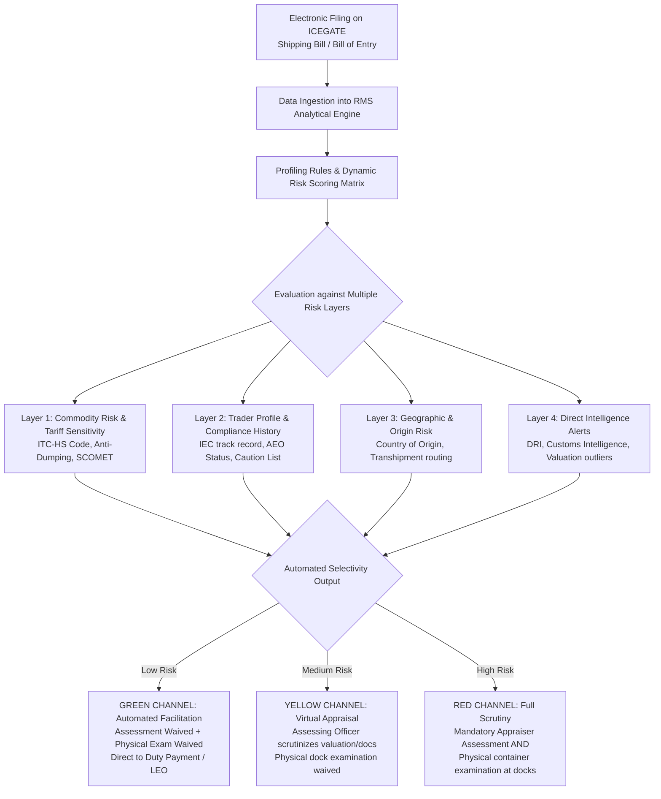
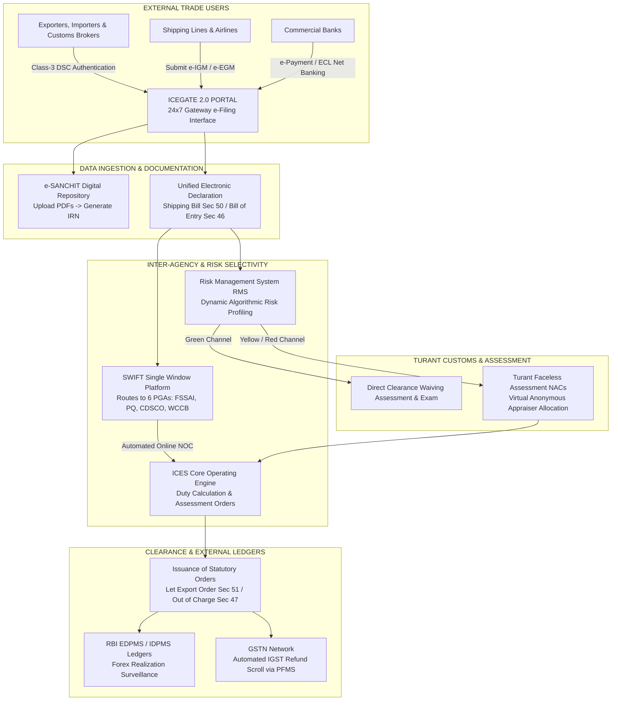

# Unit II: Topic 7 — EDI Related to Customs Clearance
## Comprehensive Subjective Question Bank with Model Answers

---

### Section A: 2-Mark Questions (Short Definitions & Core Digital Standards)

#### Q1. Define Electronic Data Interchange (EDI) in the context of international trade. (2 marks) | Likelihood: High | Type: Define
**Answer:**
Electronic Data Interchange (EDI) is the computer-to-computer electronic transmission of structured commercial and regulatory trade data between business enterprises and customs administrations using standardized message formats, without human intervention or paper documents. In foreign trade, EDI replaces traditional physical forms (invoices, bills of lading, customs declarations) with electronic messages governed by global standards like UN/EDIFACT.
* **Keywords to include for full marks:** Computer-to-computer transmission, structured trade data, standardized message formats, without human intervention, UN/EDIFACT.
* **Examiner trap:** Confusing EDI with standard email or PDF attachments. EDI is *structured data transmitted directly between databases*, not unformatted human text or generic emails.
* **Memory trick:** EDI = Computer talks to Computer in Standard Code.
* **Marking scheme guide:** 1 mark for computer-to-computer transmission of structured data without human intervention; 1 mark for standardized message formats (UN/EDIFACT).

---

#### Q2. What is UN/EDIFACT and which international body maintains it? (2 marks) | Likelihood: High | Type: Define
**Answer:**
UN/EDIFACT stands for the **United Nations Electronic Data Interchange for Administration, Commerce and Transport**. Developed and maintained under the auspices of the **United Nations Economic Commission for Europe (UN/ECE)** through the Centre for Trade Facilitation and Electronic Business (UN/CEFACT), it provides the international, universal syntax rules, data elements, segments, and standard electronic messages (e.g., CUSDEC for customs declarations, CUSCAR for cargo manifests) utilized globally in paperless cross-border trade.
* **Keywords to include for full marks:** UN/EDIFACT, UN/ECE, UN/CEFACT, standard electronic messages, CUSDEC, CUSCAR, universal syntax rules.
* **Examiner trap:** Thinking EDIFACT was developed by private software companies. It is an **official United Nations standard**.
* **Memory trick:** EDIFACT = **EDI** **F**or **A**dministration, **C**ommerce and **T**ransport.
* **Marking scheme guide:** 1 mark for full expansion and UN/ECE maintenance; 1 mark for standardized trade messages (CUSDEC/CUSCAR).

---

#### Q3. Differentiate between ICES and ICEGATE in Indian Customs. (2 marks) | Likelihood: High | Type: Define
**Answer:**
* **ICES (Indian Customs EDI System):** The internal core customs operational software and database engine used by customs officers to assess duties, process declarations, manage examination reports, and issue clearance orders (LEO/OOC);
* **ICEGATE (Indian Customs Electronic Gateway):** The external public web e-commerce portal and secure communication front-end connecting external trade users (importers, exporters, customs brokers, banks, shipping lines) to ICES for 24x7 online filing, digital document uploads (e-SANCHIT), and e-payments.
* **Keywords to include for full marks:** ICES internal processing engine, ICEGATE external web portal, customs officer interface vs external trade interface.
* **Examiner trap:** Using them as synonyms. ICES is the *internal engine*; ICEGATE is the *front-door gateway portal*.
* **Memory trick:** ICEGATE is the Gate to enter; ICES is the System inside.
* **Marking scheme guide:** 1 mark for defining ICES as internal customs operating database; 1 mark for defining ICEGATE as external electronic gateway portal.

---

#### Q4. What is a Class-3 Digital Signature Certificate (DSC) and its legal status in customs filing? (2 marks) | Likelihood: High | Type: Define
**Answer:**
A Class-3 Digital Signature Certificate (DSC) is a secure, encrypted digital cryptographic token issued by a Certifying Authority licensed by the Controller of Certifying Authorities (CCA) under the **Information Technology Act, 2000**. In customs operations on ICEGATE, a Class-3 DSC is legally mandatory to authenticate and sign electronic declarations (Shipping Bills, Bills of Entry, e-SANCHIT documents), providing statutory legal non-repudiation, tamper-proofing, and identity verification equivalent to physical wet signatures.
* **Keywords to include for full marks:** Class-3 DSC, Information Technology Act 2000, PKI cryptography, legal non-repudiation, tamper-proof, ICEGATE authentication.
* **Examiner trap:** Believing a scanned physical signature on a PDF is a digital signature. A digital signature is an *encrypted cryptographic token* governed by the IT Act.
* **Memory trick:** Class-3 DSC = Your Electronic Thumbprint under IT Law.
* **Marking scheme guide:** 1 mark for IT Act 2000 legal status; 1 mark for cryptographic authentication and mandatory ICEGATE filing role.

---

#### Q5. What is the Image Reference Number (IRN) generated by e-SANCHIT? (2 marks) | Likelihood: Medium | Type: Define
**Answer:**
An Image Reference Number (IRN) is a unique, system-generated alphanumeric tracking number allotted by the **e-SANCHIT** application on ICEGATE when an importer, exporter, or customs broker uploads a digitally signed PDF supporting document (commercial invoice, packing list, test certificate). By quoting the IRN in the electronic Bill of Entry or Shipping Bill, customs officers and participating agencies can retrieve and audit the authentic document directly from the digital repository.
* **Keywords to include for full marks:** Image Reference Number (IRN), e-SANCHIT, ICEGATE, digitally signed PDF, document repository, automated retrieval.
* **Examiner trap:** Thinking the IRN is the Shipping Bill number. The IRN is the *reference number for the uploaded supporting document* linked to the declaration.
* **Memory trick:** IRN = Digital Barcode for every uploaded PDF.
* **Marking scheme guide:** 1 mark for definition as e-SANCHIT document tracking number; 1 mark for its linkage to electronic customs declarations.

---

#### Q6. What is the "Turant Customs" initiative launched by CBIC? (2 marks) | Likelihood: High | Type: Define
**Answer:**
"Turant Customs" (Next-Generation Fast Customs) is a flagship digital reform program launched by the Central Board of Indirect Taxes and Customs (CBIC) to achieve **Faceless, Paperless, and Contactless customs clearance**. It introduced nation-wide **Faceless Assessment** (anonymously assigning declarations to specialized virtual Appraising Groups across India via automated algorithms), pre-arrival processing, e-SANCHIT uploads, and automated green-channel clearance via RMS to drastically slash port dwell times.
* **Keywords to include for full marks:** Turant Customs, CBIC, Faceless Assessment, Paperless, Contactless, anonymous assignment, port dwell time reduction.
* **Examiner trap:** Thinking Turant Customs is a private software app. It is the **official modernization framework of Indian Customs**.
* **Memory trick:** Turant = Instant, Faceless, Paperless Customs.
* **Marking scheme guide:** 1 mark for defining Turant Customs as CBIC reform for faceless/paperless clearance; 1 mark for core components (anonymous virtual assessment, dwell time reduction).

---

### Section B: 5-Mark Questions (Architecture & Institutional Portals)

#### Q7. Explain the architecture and services of the ICEGATE portal in Indian foreign trade. (5 marks) | Likelihood: High | Type: Explain
**Answer:**
### Concept and Institutional Role
The **Indian Customs Electronic Commerce/Electronic Data Interchange Gateway (ICEGATE)** (`icegate.gov.in`) is the national customs e-commerce portal operated by the Central Board of Indirect Taxes and Customs (CBIC). It serves as the primary digital interface connecting the international trade community—importers, exporters, customs brokers, shipping lines, airlines, partner government agencies, and commercial banks—with the internal Indian Customs EDI System (ICES).

```
[EXPORTERS / IMPORTERS / CUSTOMS BROKERS]
                       │
                       ▼ (Secure Internet Connection with Class-3 DSC)
               [ ICEGATE PORTAL ]
                       │
        ┌──────────────┼──────────────┐
        ▼              ▼              ▼
[ 24x7 e-Filing ] [ e-SANCHIT ]  [ Electronic Cash ]
  Shipping Bills    Paperless      Ledger (ECL)
  Bills of Entry    PDF Uploads    Duty Payment
                       │
                       ▼
    [ ICES Core Processing Engine & RMS ]
```

### Core Services Provided by ICEGATE
1. **24x7 Electronic Filing of Declarations:** Enables round-the-clock filing of statutory **Bills of Entry (imports)** and **Shipping Bills (exports)**, as well as electronic carrier manifests (IGM and EGM).
2. **e-SANCHIT (Paperless Document Repository):** Allows trade users to upload digitally signed supporting documents (invoices, certificates of origin, lab test reports) as PDFs, generating an Image Reference Number (IRN) to eliminate physical paperwork.
3. **Electronic Cash Ledger (ECL) & e-Payment:** Provides an integrated electronic wallet enabling importers to pay customs duties, IGST, and social welfare surcharges instantly via multi-bank net banking and NEFT/RTGS.
4. **Real-Time Consignment Tracking:** Traders can track the real-time status of their shipments (e.g., whether goods are undergoing assessment, pending duty payment, or cleared for Let Export Order).
5. **Regulatory Inter-Agency Messaging:** Automatically pushes and receives structured electronic messages between Customs, the Reserve Bank of India (**EDPMS/IDPMS**), Directorate General of Foreign Trade (**DGFT**), GSTN, and participating health/quarantine agencies.

* **Keywords to include for full marks:** ICEGATE, CBIC, ICES connection, 24x7 electronic filing, e-SANCHIT, IRN, Electronic Cash Ledger (ECL), real-time consignment tracking, EDPMS/IDPMS, DGFT-GSTN integration.
* **Examiner trap:** Describing ICEGATE as an informational website. ICEGATE is a **transactional EDI gateway executing statutory customs filings, duty payments, and inter-agency data exchanges**.
* **Memory trick:** ICEGATE = **F**ile declarations, **U**pload e-SANCHIT, **P**ay duties, **T**rack cargo (**FUPT services**).
* **Marking scheme guide:** 1 mark for institutional profile and ICES linkage; 3 marks for core services (e-Filing, e-SANCHIT, ECL e-Payment, Tracking); 1 mark for inter-agency data integration (EDPMS, GSTN).

---

#### Q8. Describe the structural components of the UN/EDIFACT standard in international trade. (5 marks) | Likelihood: Medium | Type: Describe
**Answer:**
### The Global Language of Electronic Commerce
The **UN/EDIFACT** (United Nations Electronic Data Interchange for Administration, Commerce and Transport) standard provides a global, platform-independent syntax and message vocabulary for cross-border electronic trade messaging.

### The Hierarchical Architecture of an EDIFACT Message
UN/EDIFACT structures trade data into a standardized hierarchical ladder:

```
[INTERCHANGE ENVELOPE (UNB ... UNZ)]
        │
        ▼
   [FUNCTIONAL GROUP (UNG ... UNE)]
        │
        ▼
      [TRANSACTION MESSAGE (UNH ... UNT)]  <-- Example: CUSDEC (Customs Declaration)
              │
              ▼
         [DATA SEGMENT]                    <-- Example: BGM (Beginning of Message)
                 │
                 ▼
            [DATA ELEMENT]                 <-- Basic data unit (e.g., Port Code, Invoice Value)
```

1. **Data Element:** The smallest atomic unit of information containing a single specific attribute (e.g., date, currency code, port code "INNSA1").
2. **Component Data Element:** Sub-elements grouped together within a composite data element (e.g., street address, city, and postal pin code forming an address).
3. **Data Segment:** A predefined functional sequence of logically related data elements representing a business concept (e.g., the **NAD segment** defines Name and Address; the **MOA segment** defines Monetary Amounts; the **DTM segment** defines Date and Time).
4. **Standard Message (Transaction Set):** A structured assembly of segments designed to convey a complete commercial or regulatory document. Prominent international customs messages include:
   * **CUSDEC (Customs Declaration):** Universal format for filing import and export customs declarations;
   * **CUSCAR (Customs Cargo Report):** Used by carriers to submit import/export general manifests (IGM/EGM);
   * **CUSTST (Customs Status):** Automated notification from customs granting clearance (LEO/OOC).
5. **Interchange Envelope:** Encloses all messages in a single transmission, framed by header segment **UNB** and trailer segment **UNZ**.

* **Keywords to include for full marks:** UN/EDIFACT, Data Element, Data Segment, Composite Data Element, CUSDEC, CUSCAR, CUSTST, Interchange Envelope UNB/UNZ, hierarchical structure, platform independence.
* **Examiner trap:** Confusing EDIFACT with XML or JSON. EDIFACT uses a specific, highly compact delimiter syntax (using colons, apostrophes, and plus signs) developed for bandwidth-constrained telecommunications.
* **Memory trick:** Elements form Segments $\rightarrow$ Segments form Messages $\rightarrow$ Messages sit in the Interchange Envelope.
* **Marking scheme guide:** 1 mark for UN/EDIFACT origin and universal role; 3 marks for structural ladder (Data Elements, Segments, Messages, Envelopes); 1 mark for specific customs messages (CUSDEC, CUSCAR).

---

#### Q9. Explain the role of the Single Window Interface for Facilitating Trade (SWIFT) and its integration with Participating Government Agencies (PGAs). (5 marks) | Likelihood: High | Type: Explain
**Answer:**
### The Multi-Agency Border Bottleneck
Traditionally, an Indian importer of food, pharmaceuticals, or agricultural goods faced significant delays: after obtaining customs clearance, they had to physically visit multiple independent government testing laboratories and regulatory agencies to obtain separate clearance certificates, tying up cargo at ports for days.

### The SWIFT Solution
In 2016, the CBIC implemented **SWIFT (Single Window Interface for Facilitating Trade)** under ICEGATE, creating a single digital touchpoint for all border clearance formalities:

```
[IMPORTER / CUSTOMS BROKER] ───> [Files Single Integrated Declaration on ICEGATE]
                                                  │
                 ┌────────────────────────────────┼────────────────────────────────┐
                 ▼                                ▼                                ▼
         [ FSSAI: Food ]                [ Plant Quarantine: PQ ]          [ CDSCO: Drugs ]
                 │                                │                                │
                 └────────────────────────────────┼────────────────────────────────┘
                                                  ▼
                 [ Automated Electronic No Objection Certificate (NOC) pushed to ICES ]
                                                  ▼
                 [ Customs Proper Officer grants Out of Charge (OOC) in Single Window ]
```

### Key Operational Features of SWIFT
1. **The Integrated Declaration:** Replaces multiple forms by collecting all required regulatory data in a single electronic filing. ICEGATE automatically parses the declaration and routes relevant subsets to the appropriate **Participating Government Agencies (PGAs)**:
   * *Food Safety and Standards Authority of India (FSSAI);*
   * *Plant Quarantine (PQ);*
   * *Animal Quarantine and Certification Services (AQCS);*
   * *Central Drugs Standard Control Organization (CDSCO);*
   * *Wildlife Crime Control Bureau (WCCB);*
   * *Textile Committee.*
2. **Automated Risk-Based Sampling:** SWIFT applies automated risk criteria; low-risk consignments bypass physical sampling, while higher-risk goods are directed for joint sampling.
3. **Paperless Online NOC:** PGA officers review test reports and transmit electronic **"No Objection Certificates" (NOC)** directly into the ICES database. The Customs Officer can grant Out of Charge (OOC) only when all required PGA NOCs are digitally recorded.

* **Keywords to include for full marks:** Single Window Interface for Facilitating Trade (SWIFT), CBIC, Integrated Declaration, Participating Government Agencies (PGAs), FSSAI, Plant Quarantine, CDSCO, automated electronic NOC, joint sampling, dwell time reduction.
* **Examiner trap:** Confusing SWIFT (Customs Single Window) with the SWIFT banking network. Keep the focus entirely on **Indian Customs port clearance and PGAs**.
* **Memory trick:** SWIFT = One Integrated Declaration $\rightarrow$ Six Regulatory Agencies $\rightarrow$ One Automatic Digital NOC.
* **Marking scheme guide:** 1 mark for explaining pre-reform multi-agency bottleneck; 2.5 marks for Integrated Declaration and listing the major PGAs; 1.5 marks for automated digital NOC transmission and OOC integration.

---

#### Q10. Explain the concept and operational workflow of "Faceless Assessment" under Turant Customs. (5 marks) | Likelihood: High | Type: Explain
**Answer:**
### The Concept of Faceless Assessment
Introduced under the flagship **Turant Customs** program by CBIC in 2020, **Faceless Assessment** (also known as Virtual Assessment) completely delinks the physical location of cargo entry from the administrative location of document assessment. A Bill of Entry filed for cargo landing at Nhava Sheva (JNPT) Mumbai may be electronically assigned to and assessed by a specialized customs officer sitting in Chennai or Delhi.

### Key Operational Architecture
1. **National Assessment Centres (NACs):** CBIC reorganized customs appraising into specialized national commodity clusters (e.g., Metals in Mumbai, Chemicals in Ahmedabad, Electronics in Bengaluru, Textiles in Chennai), ensuring deep technical domain expertise regardless of port of arrival.
2. **Automated Anonymized Routing:** The electronic Bill of Entry is filed on ICEGATE. The automated system assigns the declaration to an Appraising Officer anywhere in India based on workload balancing algorithms, **masking all names and identities of the importer and customs broker**.
3. **Paperless Electronic Query Management:** If the assessing officer requires clarification, queries are raised electronically on the ICEGATE portal; the importer uploads replies and documents via e-SANCHIT, eliminating in-person visits to custom houses.
4. **Dock Examination Delinked:** Physical dock examination (if mandated by RMS) is conducted independently by local dock preventive officers at the seaport, who upload examination reports directly into the terminal.

### Strategic Commercial Benefits
* **Elimination of Administrative Discretion:** Anonymity eliminates physical interface and prevents commercial coercion;
* **Uniform National Assessment:** Standardizes classification and valuation across all Indian ports, eliminating "port shopping" (where importers routed goods through ports perceived to have lenient customs officers);
* **Accelerated Dwell Times:** Optimized electronic workload distribution slashed average assessment turnaround times to under **4 hours**.

* **Keywords to include for full marks:** Faceless Assessment, Turant Customs, CBIC, National Assessment Centres (NAC), anonymized routing, delinking assessment from port, e-SANCHIT query resolution, elimination of port shopping, dwell time reduction.
* **Examiner trap:** Believing physical dock examination is also done remotely. Physical examination is conducted by *local dock officers*; only the *document appraisal/assessment is done virtually and anonymously*.
* **Memory trick:** Faceless = Your cargo is in Mumbai, your customs officer is in Chennai, and nobody sees each other's face.
* **Marking scheme guide:** 1.5 marks for conceptual definition and delinking principle; 2 marks for operational workflow (NACs, anonymous routing, e-SANCHIT queries); 1.5 marks for strategic benefits (uniformity, eliminating port shopping, speed).

---

#### Q11. Explain the operational mechanism and benefits of Direct Port Delivery (DPD) for import cargo. (5 marks) | Likelihood: Medium | Type: Explain
**Answer:**
### The Traditional Port Dwell Bottleneck
Under traditional import clearance, every container discharged from a vessel had to be trucked out of the congested port terminal to an off-dock Container Freight Station (CFS) for storage, unpacking, customs appraisal, and physical release, incurring 5 to 8 days of delay and heavy CFS handling, carting, and storage fees.

### The Direct Port Delivery (DPD) Breakthrough
Introduced by CBIC to accelerate trade logistics, **Direct Port Delivery (DPD)** allows accredited, low-risk importers to take physical delivery of import containers **directly from the seaport container terminal within 48 hours of discharge**, completely bypassing the intermediate CFS stage.

```
TRADITIONAL CFS ROUTE: [Ship Discharged] ───> [Trucked to CFS] ───> [CFS Dwell: 5-8 Days] ───> [Factory]
DPD FAST-TRACK ROUTE:  [Ship Discharged] ─────────────────────────> [Direct Port Gate-Out within 48 Hrs] ───> [Factory]
```

### Operational Prerequisites to Avail DPD
1. **Advance Bill of Entry:** The importer must file an advance electronic Bill of Entry on ICEGATE prior to vessel arrival;
2. **Accredited Importer Status:** The entity must hold **Authorized Economic Operator (AEO)** status or maintain a clean compliance record with substantial annual import volumes;
3. **Advance Duty Payment:** Customs duties must be cleared via the Electronic Cash Ledger prior to vessel berthing;
4. **Pre-Arranged Transport:** The importer must pre-position bonded container trailers at the port quayside to gate-out the container immediately upon discharge from the ship's crane.

### Tangible Commercial Benefits
* **Cost Reduction:** Eliminates intermediate CFS handling, de-stuffing, and ground-rent charges, saving approximately **₹10,000 to ₹20,000 per container**.
* **Dwell Time Slashed:** Container port dwell time drops from an average of **120 hours to under 48 hours**.
* **Inventory Velocity:** Delivers raw materials to manufacturing assembly lines with zero port storage delays.

* **Keywords to include for full marks:** Direct Port Delivery (DPD), CBIC, container terminal quayside, bypasses intermediate CFS, 48 hours gate-out, Advance Bill of Entry, AEO status, cost savings per container, dwell time reduction.
* **Examiner trap:** Thinking any first-time importer can use DPD. Importers must be *pre-registered and accredited (AEO or clean volume criteria)* and file advance declarations to qualify.
* **Memory trick:** DPD = Ship's Crane straight onto the Factory Truck.
* **Marking scheme guide:** 1 mark for traditional CFS bottleneck contrast; 2 marks for DPD concept and operational prerequisites; 2 marks for commercial benefits (cost and dwell time savings).

---

#### Q12. Detail the structure, authorization, and benefits of the Authorized Economic Operator (AEO) program in Indian Customs. (5 marks) | Likelihood: High | Type: Explain
**Answer:**
### International Genesis & Statutory Framework
Pioneered under the World Customs Organization (WCO) **SAFE Framework of Standards**, the **Authorized Economic Operator (AEO)** program is a flagship trade facilitation regime administered by Indian Customs under CBIC Circular No. 33/2016-Customs. It grants privileged, fast-track customs treatment to businesses that demonstrate high compliance, financial solvency, and secure supply-chain standards.

### The Three-Tier AEO Architecture for Importers/Exporters
1. **AEO-T1 (Basic Compliance):** Granted based purely on document verification of past compliance, financial solvency, and clean regulatory history (no physical site audits).
2. **AEO-T2 (Physical Security Validation):** Involves physical site audits by customs inspection teams verifying factory physical security, cargo tracking, container storage, and IT security.
3. **AEO-T3 (Highest Security Tier):** Bestowed on businesses that have maintained AEO-T2 status for at least two years and demonstrate exceptional, automated supply-chain security controls.
4. **AEO-LO (Logistics Operators):** Specialized tier for customs brokers, port terminal operators, warehouse custodians, and freight forwarders.

### Tangible Commercial & Regulatory Benefits
* **High-Priority Green Channel Facilitation:** Consignments are cleared on a fast-track basis via the RMS Green Channel with **near-zero physical dock examination**.
* **Bank Guarantee Exemptions:** Substantial or 100% exemption from submitting bank guarantees for customs duty deferment, warehousing bonds, or advance licenses.
* **Direct Port Delivery (DPD) & Direct Port Entry (DPE):** Priority quayside clearance, bypassing intermediate container freight stations.
* **Deferred Duty Payment:** Eligible to defer customs duty payments across 15-day payment cycles, optimizing cash-flow liquidity.
* **Global Mutual Recognition Agreements (MRAs):** Under bilateral MRAs signed between India and partner nations (e.g., India-USA, India-Korea, India-UAE), Indian AEO exporters enjoy expedited customs green-channel treatment at foreign import seaports.

* **Keywords to include for full marks:** Authorized Economic Operator (AEO), WCO SAFE Framework, CBIC Circular 33/2016, AEO-T1, AEO-T2, AEO-T3, AEO-LO, near-zero physical examination, bank guarantee exemptions, DPD/DPE, Deferred Duty Payment, Mutual Recognition Agreements (MRAs).
* **Examiner trap:** Forgetting to mention Mutual Recognition Agreements (MRAs). An AEO certificate benefits the exporter *both in India and at destination ports abroad* through MRAs.
* **Memory trick:** AEO = Your VIP Fast-Track Pass through Global Customs.
* **Marking scheme guide:** 1 mark for WCO SAFE framework genesis; 2 marks for describing the AEO tiers (T1, T2, T3, LO); 2 marks for tangible benefits (zero bank guarantees, DPD, deferred duty, MRAs).

---

### Section C: 10-Mark Questions (Detailed Systems & Policy Analyses)

#### Q13. Detail the technological architecture and operational working of the Risk Management System (RMS) in Indian Customs. Explain its impact on trade facilitation and revenue security. (10 marks) | Likelihood: High | Type: Detail / Systems
**Answer:**
### 1. Introduction: Balancing Facilitation with Enforcement
Historically, Indian Customs subjected virtually 100% of imported and exported consignments to intrusive administrative appraisal and physical dock examination. This manual model created severe port congestion, container dwell times exceeding 7 days, high logistics overheads, and administrative rent-seeking.

To align with modern World Customs Organization (WCO) standards, the Central Board of Indirect Taxes and Customs (CBIC) launched the **Risk Management System (RMS)**. RMS transformed customs clearance from 100% manual intervention to an **intelligent, automated, risk-based selectivity framework**, balancing trade facilitation for compliant traders with targeted enforcement against illicit shipments.

---

### 2. Comprehensive Architectural Engine of the RMS



---

### 3. Deconstruction of the Core Functional Components

#### A. The Multi-Layered Profiling Engine
The RMS automated analytical core evaluates every electronic declaration against thousands of dynamic risk rules across four operational dimensions:
1. **Commodity Sensitivity:** Scrutinizes the 8-digit ITC(HS) code. Goods with high basic customs duty rates, inverted duty structures, anti-dumping duties, or import restrictions (e.g., consumer electronics, chemicals, steel) trigger higher risk scores.
2. **Trader Track Record & Compliance:** Analyzes the historical profile of the Importer-Exporter Code (IEC). Accredited **Authorized Economic Operators (AEOs)** and established industrial manufacturers enjoy favorable profiling, while newly registered IECs or entities with past customs offenses trigger scrutiny.
3. **Valuation & Anomaly Detection:** Compares the declared unit price against historical transaction databases across all Indian ports. Significant downward deviations from the national average trigger valuation alerts under Section 14.
4. **Enforcement & Intelligence Alerts:** Integrates real-time intelligence alerts issued by the **Directorate of Revenue Intelligence (DRI)**, Central Economic Intelligence Bureau (CEIB), and international customs networks.

#### B. The Selective Channel Routing
* **Green Channel (Facilitated Clearance):** The electronic declaration bypasses human officer appraisal and dock inspection completely. For imports, the system automatically generates the duty payment challan; once paid, the Out of Charge (OOC) is granted. For exports, cargo moves straight to the Let Export Order (LEO). **Approximately 70% to 80% of routine cargo is cleared via the Green Channel**.
* **Yellow Channel (Appraisal Only):** Routed to the specialized National Assessment Centre (NAC) for document and valuation scrutiny by an Appraiser. Physical dock examination is waived.
* **Red Channel (Full Assessment & Examination):** High-risk cargo is subjected to both virtual appraisal and physical opening, container de-stuffing, and chemical laboratory testing at port transit sheds.

#### C. Post-Clearance Audit (PCA)
To balance rapid green-channel releases with revenue protection, RMS incorporates **Post-Clearance Audit (PCA)**. Instead of delaying cargo at the port, customs audits commercial accounts, bank remittances, and inventory ledgers at the importer's corporate premises months *after* delivery, recovering any discovered duty shortfalls along with statutory interest.

---

### 4. Impact on Trade Facilitation and Revenue Security

| Evaluation Metric | Pre-RMS Manual Regime | Post-RMS Automated Regime |
|---|---|---|
| **1. Average Port Dwell Time** | 5 to 8 calendar days across all ports. | Slashed to **under 24 hours** for facilitated cargo. |
| **2. Physical Dock Examination** | Near 100% of consignments opened at docks. | Limited to targeted **15% to 20%** of high-risk cargo. |
| **3. Administrative Transparency** | High physical interaction; vulnerable to delays. | Completely digital, objective, and paperless. |
| **4. Revenue Protection Efficacy** | Fragmented detection; officers buried in routine files. | High: Targeted enforcement focuses on high-risk evasion. |

---

### 5. Conclusion
The Risk Management System (RMS) is the analytical core of modern Indian customs administration. By replacing blanket physical inspection with data-driven risk profiling, RMS facilitates the seamless flow of 80% of compliant trade, reduces logistics dwell times, and optimizes enforcement resources, aligning Indian ports with the WTO Trade Facilitation Agreement.

* **Keywords to include for full marks:** Risk Management System (RMS), ICES, CBIC, Selectivity engine, Green Channel, Yellow Channel, Red Channel, Multi-layered profiling, 8-digit HS sensitivity, IEC compliance history, Valuation anomalies Section 14, DRI intelligence alerts, Post-Clearance Audit (PCA), Turant Customs, Dwell time reduction.
* **Examiner trap:** Saying RMS eliminates customs examination entirely. RMS *targets* examination: it eliminates examination for compliant traders while intensifying scrutiny on high-risk shipments.
* **Memory trick:** RMS = **R**ank the risk $\rightarrow$ **M**atch the data $\rightarrow$ **S**elect the channel (Green/Yellow/Red).
* **Marking scheme guide:** 2 marks for intro and manual vs automated context; 3 marks for master architecture flowchart diagram; 3 marks for profiling layers and channel mechanics; 2 marks for Post-Clearance Audit (PCA) and conclusion.

---

#### Q14. Critically evaluate the role of EDI in transforming Indian Customs: Analyze the benefits, operational limitations, and cybersecurity vulnerabilities of ICEGATE. (10 marks) | Likelihood: High | Type: Critically Evaluate / Technology
**Answer:**
### 1. Introduction: The Digital Metamorphosis
Over the past two decades, Indian Customs transformed from a paper-bound bureaucracy into an automated electronic trade administration. Anchored by the **Indian Customs Electronic Gateway (ICEGATE)** and **ICES**, electronic data interchange (EDI) replaced physical paper trails, wet stamps, and manual cash payments with automated digital workflows, supporting India’s international commitments under the **WTO Trade Facilitation Agreement (TFA)**.

---

### 2. Tangible Strategic Benefits Delivered by EDI

```
                          [ EDI TRANSFORMATION BENEFITS ]
         ┌───────────────────────────┼───────────────────────────┐
         ▼                           ▼                           ▼
[ Slashed Dwell Times ]      [ Fiscal Transparency ]      [ Seamless Inter-Agency Link ]
* 24x7 online e-filing       * Electronic Cash Ledger     * ICEGATE bridges DGFT,
* RMS Green Channel:           prevents cash handling       RBI EDPMS/IDPMS, and
  clearance in hours         * Faceless assessment          GSTN tax refund ledgers
```

1. **Dramatic Reduction in Port Dwell Times:** Pre-arrival advance filing of Bills of Entry, e-SANCHIT document uploads, and automated RMS green-channel clearance slashed cargo dwell times from over 6 days in 2014 to under 24–48 hours at premier ports like JNPT and Mundra.
2. **24x7 Paperless Clearance & Accessibility:** Traders file declarations, monitor consignment status, and upload digital documents 24 hours a day, 365 days a year from anywhere in the world, eliminating physical visits to custom houses.
3. **Elimination of Administrative Discretion:** **Faceless Assessment** randomly and anonymously routes declarations across National Assessment Centres, eliminating personal interface between traders and local officers, reducing opportunities for corruption and standardizing national tariff valuation.
4. **Fiscal Integrity & Automated Neutralization:** The Electronic Cash Ledger (ECL) prevents cash handling, while automated data integration between ICEGATE and GSTN enables **instantaneous electronic disbursement of IGST refunds and customs Duty Drawback** via PFMS directly into bank accounts.
5. **Real-Time Regulatory Surveillance:** Digital linkages push export data directly to RBI’s **EDPMS** and import declarations to **IDPMS**, closing foreign exchange realization loops and preventing trade-based money laundering.

---

### 3. Operational Limitations and Ground-Level Bottlenecks
Despite systemic advancements, the EDI ecosystem suffers from recurring operational friction:
1. **Server Downtimes and Gateway Timeouts:** ICEGATE servers experience technical outages, gateway slowdowns, and digital certificate validation timeouts, particularly during fiscal quarter-ends and annual budget tariff updates, stranding thousands of trucks at port terminal gates.
2. **The Concordance Mismatch Trap (Error Code SB005):** Minor alphanumeric mismatches between invoices, shipping bills, and GSTR-1 returns trigger digital validation freezes (e.g., Error Codes SB005, SB001), locking up millions of rupees in working capital tax refunds for months until resolved via manual officer-interface overrides.
3. **MSME Digital Divide:** Small artisan and rural exporters struggle with the technical complexities of Class-3 Digital Signatures, PKI token installations, Java configuration conflicts, and complex document schema updates on ICEGATE.

---

### 4. Cybersecurity Vulnerabilities & Risk Mitigation
As Indian trade becomes entirely digitized, the ICEGATE infrastructure faces significant cyber risks:
* **The Threat Matrix:** Critical trade infrastructure is vulnerable to distributed denial-of-service (DDoS) attacks, ransomware strikes on port terminal operating systems (as suffered by major global carriers like Maersk and JNPT terminals), and credential theft of corporate IEC logins.
* **Data Privacy & Counterfeiting:** The transmission of commercial trade invoices and banking records requires end-to-end cryptographic protection to prevent corporate espionage and fraudulent duty drawback claims.
* **Institutional Security Safeguards:**
  * Mandatory implementation of **Class-3 Public Key Infrastructure (PKI)** digital signature tokens under the Information Technology Act, 2000;
  * Migration to secure **Two-Factor Authentication (2FA)** using Aadhaar-linked OTP and mobile tokens for all ICEGATE user logins;
  * Continuous 24x7 threat monitoring by the Computer Emergency Response Team for Customs and Taxes (CERT-In).

---

### 5. Conclusion
Electronic Data Interchange through ICEGATE has revolutionized Indian customs administration, serving as a primary driver of trade facilitation, port modernization, and fiscal transparency. Realizing its full potential requires resolving technical gateway downtimes, simplifying digital interfaces for MSMEs, and reinforcing cybersecurity architecture to protect critical national trade infrastructure.

* **Keywords to include for full marks:** Electronic Data Interchange (EDI), ICEGATE, ICES, WTO Trade Facilitation Agreement, 24x7 e-filing, e-SANCHIT, Faceless Assessment, Electronic Cash Ledger, EDPMS/IDPMS, Server downtime, Concordance mismatch Error SB005, MSME digital divide, Cybersecurity, Class-3 PKI DSC, Two-Factor Authentication (2FA), CERT-In.
* **Examiner trap:** Writing a purely promotional essay praising computers. A "Critically Evaluate" question requires balanced analysis: **highlight the massive benefits, but critically detail server downtimes, error codes, and cybersecurity threats**.
* **Memory trick:** **B**enefits (Speed, Faceless, Refunds) vs **B**ottlenecks (Downtime, Error SB005) vs **B**oundaries (Cybersecurity).
* **Marking scheme guide:** 2 marks for intro and WTO TFA context; 3 marks for detailed strategic benefits; 2.5 marks for operational bottlenecks (downtimes, SB005, digital divide); 2.5 marks for cybersecurity vulnerabilities, 2FA safeguards, and conclusion.

---

### Section D: 15-Mark Comprehensive Questions (Master Digital Architecture Analyses)

#### Q15. Provide an exhaustive master treatise on the Digital Customs Ecosystem in India. Deconstruct ICEGATE, e-SANCHIT, SWIFT, RMS, and Turant Customs into a unified technological blueprint. (15 marks) | Likelihood: High | Type: Comprehensive / Systems
**Answer:**

```
========================================================================================
     EXHAUSTIVE TREATISE: THE DIGITAL CUSTOMS ARCHITECTURE OF INDIA
========================================================================================
```

### 1. Introduction & The Paradigm Shift
Cross-border trade administration has shifted from manual paper scrutiny to automated digital platforms. Administered by the Central Board of Indirect Taxes and Customs (CBIC) under the Department of Revenue, the Indian digital customs ecosystem is an interconnected IT network designed to execute **Faceless, Paperless, and Contactless international trade**.

This digital infrastructure unites five core technological components:
1. **ICEGATE:** The national electronic commerce and filing gateway;
2. **e-SANCHIT:** The digital paperless document repository;
3. **SWIFT:** The multi-agency Single Window Interface;
4. **RMS:** The analytical Risk Management System; and
5. **Turant Customs:** The overarching national faceless assessment framework.

---

### 2. Comprehensive Master Digital Customs Architecture Blueprint



*Exam Hand-Drawing Guide (Under 2 Minutes):* Draw 5 horizontal stacked blocks down the page: `[1. Access: ICEGATE / e-SANCHIT]` $\rightarrow$ `[2. Single Window: SWIFT & PGAs]` $\rightarrow$ `[3. Engine: RMS (Green/Yellow/Red)]` $\rightarrow$ `[4. Assessment: Turant Faceless NACs]` $\rightarrow$ `[5. External Output: LEO/OOC, EDPMS, GSTN]`.

---

### 3. Exhaustive Architectural Deconstruction of the Five Pillars

#### Pillar I: ICEGATE (Indian Customs Electronic Gateway)
* **Operational Scope:** The national e-commerce portal providing 24x7 secure broadband connectivity between external commercial entities and internal customs databases.
* **Core Functionalities:** Electronic filing of Bills of Entry, Shipping Bills, and manifest data (IGM/EGM); integrated **Electronic Cash Ledger (ECL)** for electronic duty settlement; electronic verification of Class-3 Digital Signatures; real-time tracking of container clearance status; and automated transmission of trade data to partner institutions (DGFT, RBI, GSTN).

#### Pillar II: e-SANCHIT (Paperless Document Repository)
* **Operational Scope:** *e-Storage and Computerized Handling of Indirect Tax documents* is the cloud document management repository of Indian Customs.
* **Operating Workflow:** Before filing an electronic declaration, the trader uploads required supporting documents (commercial invoices, packing lists, insurance policies, analysis certificates) as digitally signed PDFs.
* **The IRN Mechanism:** The system validates the document and generates a unique **Image Reference Number (IRN)**. The trader quotes the IRNs in their electronic declaration, allowing customs officers and PGA scientists to view authenticated original documents without paper submissions.

#### Pillar III: SWIFT (Single Window Interface for Facilitating Trade)
* **Operational Scope:** The national single window platform integrating Indian Customs with six **Participating Government Agencies (PGAs)**: FSSAI (food safety), Plant Quarantine, Animal Quarantine, Wildlife Crime Control Bureau, Central Drugs Standard Control Organization, and Textile Committee.
* **Operating Workflow:** The importer files a single **Integrated Declaration**. ICEGATE’s automated rules parse the data and route it to relevant PGAs. PGA officers review digital test reports and issue electronic **No Objection Certificates (NOC)** directly inside the ICES system, eliminating multi-agency paperwork.

#### Pillar IV: RMS (Risk Management System)
* **Operational Scope:** The intelligent automated analytical engine embedded in ICES that evaluates compliance risk across multiple parameters: commodity sensitivity, trader compliance track record (AEO status), valuation anomalies, and intelligence alerts.
* **Selectivity Routing:**
  * *Green Channel:* Bypasses human appraisal and dock inspection, directing the file straight to duty payment and statutory clearance (**70–80% of routine cargo**);
  * *Yellow Channel:* Scrutinized virtually by an Appraising Officer;
  * *Red Channel:* Requires comprehensive document appraisal AND physical dock examination/sampling.
* **Post-Clearance Audit (PCA):** Conducts automated transaction monitoring and corporate audits months after cargo release, recovering duty shortfalls without holding containers at ports.

#### Pillar V: Turant Customs & Faceless Assessment
* **Operational Scope:** The operational framework delinking physical cargo location from the administrative appraisal process.
* **National Assessment Centres (NACs):** Reorganized assessment into 11 virtual commodity clusters across India. Declarations are routed anonymously and evaluated by virtual Appraising Groups without personal contact, eliminating local administrative discretion and standardizing national tariff valuation.

---

### 4. Integration with External National Databases

```
┌───────────────────────────────┬────────────────────────────────────────────────────────────────────────┐
│ External Sovereign Database   │ Electronic Integration & Data Interchange Workflow                    │
├───────────────────────────────┼────────────────────────────────────────────────────────────────────────┤
│ **1. GSTN (GST Network)**     │ Direct API push of Shipping Bill data matches Table 6A of GSTR-1,      │
│                               │ triggering automated electronic cash disbursement of IGST refunds.     │
├───────────────────────────────┼────────────────────────────────────────────────────────────────────────┤
│ **2. RBI EDPMS & IDPMS**      │ ICEGATE pushes all LEO export bills to EDPMS and OOC import bills to   │
│                               │ IDPMS, automating foreign exchange reconciliation and caution-listing. │
├───────────────────────────────┼────────────────────────────────────────────────────────────────────────┤
│ **3. DGFT Portal**            │ Real-time validation of 10-digit PAN-linked IECs, electronic transfer │
│                               │ of e-BRC data, and paperless redemption of Advance Authorizations.     │
├───────────────────────────────┼────────────────────────────────────────────────────────────────────────┤
│ **4. PFMS (Finance Ministry)**│ Automatically routes customs duty drawback and IGST refund scrolls     │
│                               │ directly into exporters' core banking current accounts.                │
└───────────────────────────────┴────────────────────────────────────────────────────────────────────────┘
```

---

### 5. Conclusion
The digital customs architecture of India is an interconnected national infrastructure. By combining the communications gateway of ICEGATE, the paperless repository of e-SANCHIT, the inter-agency reach of SWIFT, the risk selectivity of RMS, and the virtual transparency of Turant Faceless Assessment, India has created a modern, automated trade administration that lowers logistics costs, accelerates cargo clearance, and secures national borders.

* **Keywords to include for full marks:** Digital Customs Ecosystem, ICEGATE 2.0, e-SANCHIT, Image Reference Number (IRN), SWIFT Single Window, Participating Government Agencies (PGAs), FSSAI, Plant Quarantine, Risk Management System (RMS), Green Channel, Post-Clearance Audit (PCA), Turant Customs, Faceless Assessment, National Assessment Centres (NAC), GSTN-ICEGATE integration, EDPMS/IDPMS, PFMS refund scroll.
* **Examiner trap:** Describing these systems in isolation. An outstanding 15-mark answer deconstructs each system and demonstrates how they **interconnect into an unbroken technological chain**.
* **Memory trick:** **I**CEGATE connects $\rightarrow$ **S**ANCHIT stores $\rightarrow$ **S**WIFT routes $\rightarrow$ **R**MS filters $\rightarrow$ **T**urant assesses (**ISSRT Architecture**).
* **Marking scheme guide:** 2 marks for intro and paradigm shift; 3 marks for master technological blueprint diagram; 5 marks for detailed analysis of the five pillars (ICEGATE, e-SANCHIT, SWIFT, RMS, Turant); 3 marks for external database integration matrix (GSTN, RBI, DGFT, PFMS); 2 marks for analytical synthesis and conclusion.
