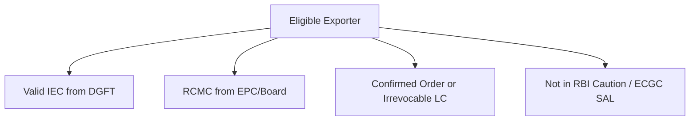
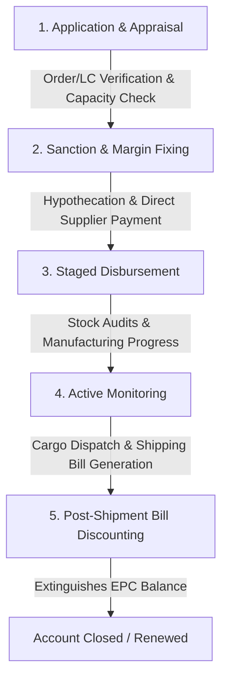
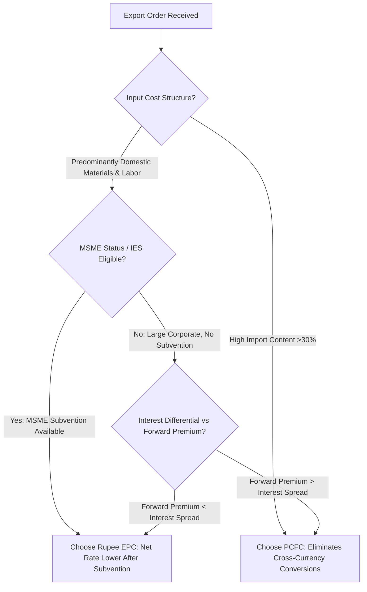
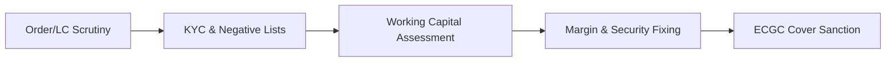
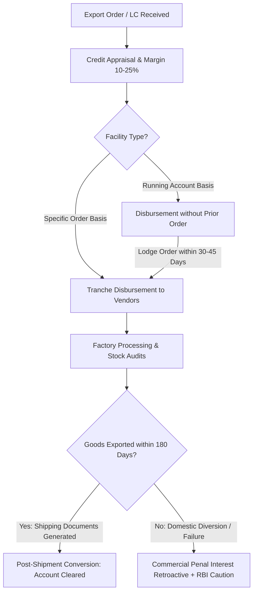
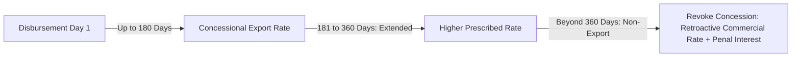
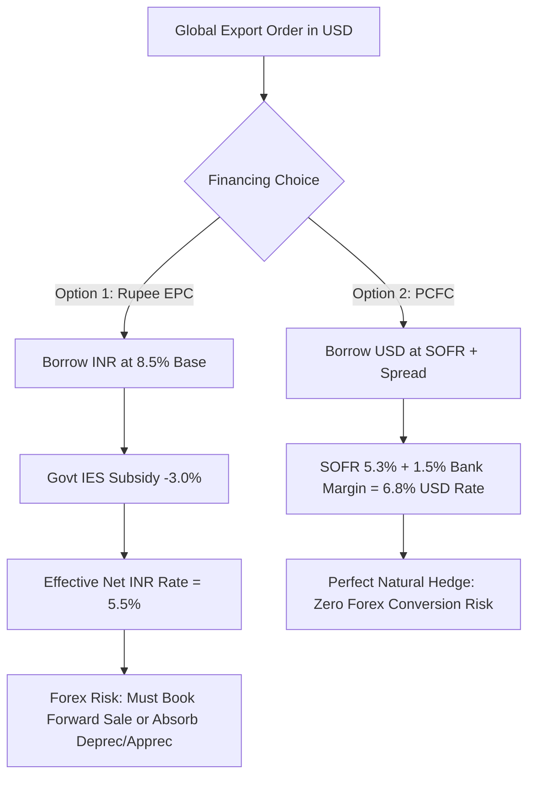

# Unit III: Pre-Shipment Finance (Export Credit)

This module delivers full-length university examination model answers covering pre-shipment export credit, packing credit in Indian Rupees (EPC) and Foreign Currency (PCFC), eligibility criteria, sanction and disbursement procedures, liquidation mechanisms, interest equalisation (subvention) schemes, and contrast with post-shipment credit.

---

## Section A: 2-Mark Questions (Short / Definitive)

### Q1. Define Pre-Shipment Export Credit (Packing Credit). (2 marks) | Likelihood: High | Type: Define
**Answer:**
Pre-shipment credit, commonly known as **Export Packing Credit (EPC)**, is any loan or advance granted by an Authorized Dealer (AD) bank to an eligible exporter for financing the purchase, processing, manufacturing, assembling, or packing of goods prior to shipment, against a confirmed export order or an irrevocable Letter of Credit.

- **Keywords to include for full marks:** Advance to eligible exporter, purchase/processing/manufacturing/packing, prior to shipment, confirmed export order / irrevocable LC.
- **Examiner trap:** Stating it is given after goods are boarded onto the vessel (that is post-shipment finance).
- **Memory trick:** **P-P-M-P** (Purchase, Process, Manufacture, Pack).
- **Marking scheme guide:** Definition (1 mark); Basis of grant (confirmed order/LC) (1 mark).

---

### Q2. What is PCFC and what is its primary currency advantage? (2 marks) | Likelihood: High | Type: Define
**Answer:**
**Pre-Shipment Credit in Foreign Currency (PCFC)** is packing credit disbursed to Indian exporters in globally convertible foreign currencies (USD, EUR, GBP, JPY) at internationally benchmarked interest rates (SOFR/EURIBOR plus spread), insulating the exporter from high domestic rupee interest rates and currency conversion costs.

- **Keywords to include for full marks:** Pre-shipment credit in foreign currency, globally convertible currencies, SOFR/EURIBOR reference rate, export production financing.
- **Examiner trap:** Confusing PCFC with post-shipment discounting; PCFC is disbursed *before* dispatch.
- **Memory trick:** **PCFC = Pre-shipment + Cheap Foreign Currency**.
- **Marking scheme guide:** Expansion and definition (1 mark); Interest/currency benefit (1 mark).

---

### Q3. State the primary mechanism by which an EPC advance is liquidated. (2 marks) | Likelihood: High | Type: Explain
**Answer:**
Under Reserve Bank of India (RBI) master directions, an EPC advance must be liquidated strictly out of the **proceeds of the resultant export bills** negotiated, purchased, or discounted under post-shipment finance facilities, or through export proceeds received in Nostro accounts. It cannot be cleared via domestic rupee business sales.

- **Keywords to include for full marks:** Liquidation out of export bills, negotiation/purchase/discounting, post-shipment credit, prohibition of domestic rupee clearance.
- **Examiner trap:** Claiming the borrower can deposit cash from domestic sales to repay packing credit.
- **Memory trick:** **Outward Export = Inward Liquidation**.
- **Marking scheme guide:** Primary mechanism (post-shipment bill proceeds) (1 mark); RBI rule compliance (1 mark).

---

### Q4. What is the Interest Equalisation Scheme (IES) in export finance? (2 marks) | Likelihood: Medium | Type: Define
**Answer:**
The **Interest Equalisation Scheme (IES)** (formerly Interest Subvention Scheme) is a Government of India subsidy administered via the RBI that offers an interest rate rebate (typically 2% to 3% for eligible MSME manufacturers and specific tariff lines) on pre- and post-shipment rupee export credit, directly credited to the exporter's bank account.

- **Keywords to include for full marks:** Interest rate subsidy, Government of India / RBI, MSME manufacturer exporters, rupee export credit.
- **Examiner trap:** Assuming IES is available on foreign currency credits like PCFC; it applies only to Rupee export credit.
- **Memory trick:** **IES = Interest Equaliser Subsidy**.
- **Marking scheme guide:** Scheme definition and administering agency (1 mark); Beneficiary/nature of rebate (1 mark).

---

### Q5. What is the normal sanction period permitted by RBI for Rupee Packing Credit? (2 marks) | Likelihood: Medium | Type: Fact / Rule
**Answer:**
The standard repayment period allowed by RBI for Rupee Packing Credit is up to **180 days** from the date of initial disbursement. Banks may grant an extension of up to a further **90 to 180 days** (maximum total 360 days) subject to genuine manufacturing cycles or shipping delays, beyond which commercial lending rates apply.

- **Keywords to include for full marks:** Up to 180 days standard, extension up to 90/180 days, genuine delay justification, commercial interest penalty.
- **Examiner trap:** Writing that packing credit has an open-ended or 3-year term loan validity.
- **Memory trick:** **180 Days Rule (Half a Year)**.
- **Marking scheme guide:** Standard tenure (180 days) (1 mark); Extended tenure condition (1 mark).

---

### Q6. Define Running Facility (Packing Credit on Running Account Basis). (2 marks) | Likelihood: High | Type: Define
**Answer:**
A **Running Facility** allows established, creditworthy exporters with continuous manufacturing operations to draw packing credit advances *prior* to lodging specific export orders or Letters of Credit, provided confirmed orders or LCs are produced within a stipulated time frame (normally 30 to 45 days) to regularize the draws.

- **Keywords to include for full marks:** Running account facility, creditworthy/regular exporters, advance draw without prior order, subsequent order submission (30-45 days).
- **Examiner trap:** Believing running facility waives the requirement of an export order entirely; the order must still be lodged later.
- **Memory trick:** **Run First, Lodge Later**.
- **Marking scheme guide:** Concept of running draw (1 mark); Regularisation requirement (1 mark).

---

## Section B: 5-Mark Questions (Structured Short Notes)

### Q7. Explain the eligibility criteria an exporter must satisfy to secure pre-shipment finance from an Indian bank. (5 marks) | Likelihood: High | Type: Explain
**Answer:**
**Introduction:**
Pre-shipment finance is a concessionary lending facility extended by Authorized Dealer (AD) banks under RBI Master Directions on Export Credit to support production cycles.

**Eligibility Conditions:**
1. **Regulatory Clearances:** The exporter must possess a valid 10-digit Importer Exporter Code (IEC) issued by DGFT, PAN-based registration, and an active RCMC from the relevant Export Promotion Council.
2. **Documentary Evidence of Export Intent:** The applicant must submit either a firm, non-cancellable export purchase order from an overseas buyer or an operative, irrevocable Letter of Credit opened in their favor.
3. **Clean Credit Record:** The firm and its directors must not appear on RBI's Caution List, DGFT's Denied Entity List (DEL), or ECGC's Specific Approval List (SAL / Defaulters List).
4. **Financial Viability & Credit Appraisal:** The bank assesses the exporter's technical capacity to execute the order, past delivery track record, and working capital limits.
5. **Credit Guarantee Coverage:** The advance must be covered under ECGC's Export Credit Insurance for Banks - Whole Turnover Packing Credit (ECIB-WTPC) policy.

- **Keywords to include for full marks:** IEC, RCMC, Irrevocable LC / Confirmed Order, RBI Caution List, ECGC SAL, Technical/financial capacity, ECIB-WTPC.
- **Examiner trap:** Omitting regulatory negative lists (RBI Caution List / ECGC SAL).
- **Memory trick:** **I-R-O-C-E** (IEC, RCMC, Order/LC, Clean list, ECGC cover).
- **Marking scheme guide:** Regulatory prerequisites (1.5 marks); Commercial evidence (1.5 marks); Credit standing & ECGC (2 marks).

---

### Q8. Outline the operational stages involved in the disbursement and monitoring of an Export Packing Credit advance. (5 marks) | Likelihood: High | Type: Procedure
**Answer:**
**Introduction:**
The disbursement of Export Packing Credit (EPC) follows a structured bank workflow designed to prevent fund diversion from export production.

**Operational Workflow:**
1. **Application & Order Lodgement:** The exporter submits the prescribed application form along with the original contract/LC, purchase budget, and inventory procurement schedule.
2. **Sanction and Margin Requirement:** The bank sanctions the credit limit, fixing a margin (typically 10% to 25% of FOB order value depending on the exporter's standing and commodity risk).
3. **Disbursement in Tranches:** EPC is not disbursed as a lump-sum cash withdrawal. Funds are released in stages directly to raw material suppliers via crossed cheques/RTGS or credited to an earmarked production account against supplier invoices.
4. **Physical Inspection & Hypothecation:** The bank inspects the factory inventory, hypothecates raw materials and work-in-progress, and mandates comprehensive fire/burglary insurance endorsed in the bank's favor.
5. **Periodic Progress Monitoring:** The exporter submits monthly stock statements, certified progress reports, and copies of statutory filings.

- **Indian Context Example:** A textile exporter in Tirupur receives an order for 20,000 cotton shirts ($100,000). The bank sanctions an EPC limit of ₹68,00,000 (after 20% margin), paying yarn spinners directly via RTGS.
- **Keywords to include for full marks:** Order lodgement, margin requirement (10-25%), tranche disbursement, direct supplier payment, hypothecation of stock, stock statements.
- **Examiner trap:** Writing that the bank hands over cash directly to the exporter.
- **Memory trick:** **A-M-D-H-M** (Apply, Margin, Disburse to supplier, Hypothecate, Monitor).
- **Marking scheme guide:** Application & order verification (1 mark); Margin & disbursement control (2 marks); Security & monitoring (2 marks).

---

### Q9. Discuss the mechanisms available for liquidating a Pre-Shipment Rupee Credit account. (5 marks) | Likelihood: High | Type: Procedure
**Answer:**
**Introduction:**
Under RBI statutory guidelines, pre-shipment export credit accounts cannot be settled via ordinary cash deposits or receipts from domestic turnover. Liquidation must demonstrate genuine export realization.

**Permitted Liquidation Modes:**
1. **Post-Shipment Export Bill Negotiation/Discounting (Primary Mode):** Upon loading cargo on board, the exporter presents export shipping documents (Commercial Invoice, Packing List, Bill of Lading, Bill of Exchange) to the bank. The bank discounts or purchases these post-shipment bills and credits the proceeds directly to extinguish the outstanding EPC balance.
2. **Inward Foreign Inward Remittance:** Direct receipt of foreign currency advance payment or sight collections through banking channels into the bank's Nostro account.
3. **Inter-Account Substitution:** Where an export order is cancelled due to reasons beyond the exporter's control, RBI allows transfer of the EPC liability to another valid export order for the same commodity, subject to bank satisfaction.
4. **Commercial Rate Adjustment (Default/Deviation):** If goods are not exported within the sanctioned tenure (max 360 days), the concessional export interest status is revoked retroactively, and the loan is converted into a standard domestic cash credit with penal interest rates from day one.

- **Keywords to include for full marks:** Post-shipment bill discounting, Bill of Lading presentation, inward remittance, Nostro account, order substitution, penal commercial interest.
- **Examiner trap:** Missing the consequence of non-export (retroactive loss of concessional interest).
- **Memory trick:** **B-I-S-P** (Bills, Inward remittance, Substitution, Penal interest).
- **Marking scheme guide:** Primary post-shipment mechanism (2 marks); Alternative permitted routes (1.5 marks); Default treatment (1.5 marks).

---

### Q10. What is Pre-Shipment Credit in Foreign Currency (PCFC)? Explain its eligibility and interest rate structure. (5 marks) | Likelihood: High | Type: Explain
**Answer:**
**Introduction:**
PCFC is a pre-shipment advance extended to Indian exporters in major freely convertible foreign currencies (USD, EUR, GBP, JPY) to procure imported/domestic raw materials at competitive global interest rates.

**Key Features of PCFC:**
1. **Source of Funds:** Banks fund PCFC through foreign currency lines such as Foreign Currency Non-Resident [Bank] (FCNR-B) deposits, Exchange Earned Foreign Currency (EEFC) accounts, or overseas lines of credit.
2. **Interest Benchmark:** Unlike Rupee credit governed by Indian bank benchmarks (MCLR/Repo-linked), PCFC interest is pegged to international benchmarks like **SOFR (Secured Overnight Financing Rate)** for USD or **EURIBOR** for Euros, plus an authorized margin (spread) permitted by RBI.
3. **Hedging Benefit:** Because the loan is disbursed in foreign currency and liquidated directly through incoming foreign currency export proceeds, the exporter enjoys a **natural currency hedge**, eliminating exchange rate conversion risk.
4. **Drawdown Tenure:** Granted for a maximum period of 180 days, extendable by another 180 days with prior bank approval.

- **Indian Example:** An electronics assembler in Noida imports semiconductors in USD; drawing PCFC in USD allows zero-cost import settlements and automatic loan clearance when export earnings arrive in USD.
- **Keywords to include for full marks:** Freely convertible currencies, FCNR-B funds, SOFR/EURIBOR, spread, natural hedge, 180-day tenure, import procurement.
- **Examiner trap:** Mentioning LIBOR without noting it has been discontinued and replaced globally by SOFR.
- **Memory trick:** **C-S-N-H** (Convertible currency, SOFR benchmark, Nostro funds, Natural Hedge).
- **Marking scheme guide:** Concept & funding sources (1.5 marks); Benchmark & rate mechanism (1.5 marks); Natural hedge & tenure (2 marks).

---

### Q11. Explain the operational working of the Interest Equalisation Scheme (IES) for Rupee Export Credit. (5 marks) | Likelihood: Medium | Type: Explain
**Answer:**
**Introduction:**
The Interest Equalisation Scheme (IES) is an export stimulus mechanism launched by the Ministry of Commerce & Industry and implemented via the RBI to level the financing playing field for Indian exporters facing higher domestic capital costs than their foreign competitors.

**Salient Operational Mechanics:**
1. **Eligible Categories:** The scheme primarily targets MSME manufacturer-exporters across all ITC(HS) product categories, as well as non-MSME manufacturers exporting products under specified high-labor tariff lines (e.g., handicrafts, leather, textiles, engineering goods).
2. **Equalisation Differential:** The government specifies a fixed percentage subvention (historically 3% for MSME manufacturers and 2% for specified non-MSME lines).
3. **Automatic Upfront Relief:** The commercial bank calculates interest at its benchmark rate minus the equalisation percentage. The bank passes this benefit directly to the borrower at the time of debiting interest.
4. **Reimbursement Workflow:** The lending bank files monthly consolidated claims with the RBI. Upon audit verification, RBI reimburses the subvention amount to the commercial bank from government budgetary allocations.

- **Keywords to include for full marks:** Ministry of Commerce, RBI implementation, MSME manufacturer-exporters, interest differential, upfront pass-through, bank reimbursement.
- **Examiner trap:** Stating merchant exporters receive equal subvention across all goods; merchant exporters typically face exclusions or lower benefits.
- **Memory trick:** **M-R-U-R** (MSME focus, Rate differential, Upfront relief, RBI reimbursement).
- **Marking scheme guide:** Objectives & institutional setup (1.5 marks); Coverage & percentages (1.5 marks); Upfront relief & reimbursement process (2 marks).

---

### Q12. Write a short note on Deemed Exports and the financing provisions applicable to them. (5 marks) | Likelihood: Medium | Type: Short Note
**Answer:**
**Introduction:**
Under Chapter 7 of the Foreign Trade Policy (FTP), **Deemed Exports** refer to transactions where goods supplied do not physically leave India, but payment is received in Indian Rupees or free foreign exchange, and the goods substitute direct imports or support strategic national projects.

**Key Categories of Deemed Exports:**
- Supplies to Export Oriented Units (EOUs), Software Technology Parks (STPIs), and Bio-Technology Parks (BTPs).
- Supplies against Advance Authorisations (AA) or Duty-Free Import Authorisations (DFIA).
- Supplies to projects funded by bilateral/multilateral agencies (e.g., World Bank, ADB) under international competitive bidding.
- Supplies to mega power projects, nuclear power plants, and defense establishments.

**Financing Provisions:**
1. **Pre-Shipment Finance Availability:** Domestic manufacturers supplying goods under deemed export contracts are entitled to pre-shipment rupee export credit from AD banks at concessional rates.
2. **Documentary Requirement:** Instead of a Bill of Lading, liquidation is accepted against an **Inland Letter of Credit**, Project Authority Certificate (PAC), and certified receipt of goods by the designated recipient project.
3. **Export Benefit Parity:** Eligible for Advance Authorisation for domestic inputs, deemed export drawback, and refund of terminal excise duty / IGST.

- **Keywords to include for full marks:** Chapter 7 FTP, goods remain in India, import substitution, supplies to EOUs/Advance Authorisations, Project Authority Certificate, inland LC liquidation.
- **Examiner trap:** Requiring an ocean Bill of Lading to liquidate deemed export credit.
- **Memory trick:** **D-E-E-M-E-D** (Domestic supply, Equivalent benefits, EOU supplies, Multilateral projects, Evidence by PAC).
- **Marking scheme guide:** Definition & legal basis (1.5 marks); Typical eligible supplies (1.5 marks); Credit appraisal & liquidation rules (2 marks).

---

## Section C: 10-Mark Questions (Detailed Analytical Answers)

### Q13. Discuss the entire lifecycle of an Export Packing Credit (EPC) advance from application and credit appraisal to disbursement, monitoring, and final liquidation. (10 marks) | Likelihood: High | Type: Procedure / Discuss
**Answer:**
**Introduction:**
Export Packing Credit (EPC) is the financial lifeblood of manufacturing exporters, providing working capital to bridge the gap between order confirmation and final cargo dispatch. Administered under strict RBI prudential and foreign exchange regulations, the EPC lifecycle encompasses five critical phases: appraisal, sanction, disbursement, monitoring, and post-shipment liquidation.

*(Exam 2-minute sketch guide: Draw five vertical rectangular stages linked with downward arrows, labeling key documents at each stage: LC $\to$ Sanction Letter $\to$ Vendor RTGS $\to$ Stock Audits $\to$ Bill Discounting).*

#### Phase 1: Credit Appraisal and Due Diligence
The exporter submits an EPC application supported by:
- An operative, irrevocable Letter of Credit or a verified, non-cancellable export contract specifying goods, quantities, unit prices, shipment deadlines, and destination.
- Regulatory proofs: DGFT Importer-Exporter Code (IEC), Registration-cum-Membership Certificate (RCMC) of the relevant Export Promotion Council, and GST registration.
- Statutory vetting: The bank validates that neither the overseas buyer nor the domestic applicant is flagged on RBI's Caution List, DGFT's Denied Entity List, or ECGC's Specific Approval List (SAL).
- Production feasibility: Technical assessment of the plant’s operating capacity, availability of raw materials, and historical fulfillment performance.

#### Phase 2: Sanction and Margin Determination
- **FOB Value Assessment:** Credit is calculated strictly on the Net Free on Board (FOB) value of the contract. Freight and insurance components are deducted unless the bank simultaneously sanctions post-shipment credit.
- **Margin Fixing:** The bank mandates a borrower contribution (margin) between 10% and 25%, depending on commodity price volatility and credit ratings.
- **Tenure Establishment:** Sanctioned for an initial term aligned with the manufacturing cycle, normally up to 180 days.

#### Phase 3: Staged Disbursement Mechanism
To ensure zero diversion of concessionary funds:
- The bank does not disburse EPC in cash or credit it unrestrictedly to the exporter’s general current account.
- Funds are released in tranches against verified proforma invoices directly to raw material vendors, utility boards, and packaging suppliers via non-cash banking channels (RTGS/NEFT).
- Wages and operational overheads are released against certified labor muster rolls.

#### Phase 4: Operational Monitoring and Risk Control
- **Hypothecation:** The bank takes a first floating charge over all raw materials, semi-finished goods, and finished inventory.
- **Collateral & Insurance:** Compulsory transit, fire, and burglary insurance with the bank’s hypothecation clause endorsed.
- **Stock Verifications:** Exporter files monthly stock statements. Bank inspecting officers conduct surprise physical stock verifications at factory warehouses.
- **ECGC Cover:** The bank secures its advances under ECGC’s Export Credit Insurance for Banks - Whole Turnover Packing Credit (ECIB-WTPC).

#### Phase 5: Liquidation via Post-Shipment Conversion
- Once manufacturing is complete, goods undergo customs clearance, obtaining the "Let Export" order and loading onto the vessel.
- The exporter receives the Mate's Receipt, Bill of Lading, Commercial Invoice, and Packing List.
- These full shipping document sets are presented to the sanctioning bank within 21 days of shipment.
- The bank converts the pre-shipment liability into post-shipment credit by purchasing or discounting the export bills.
- The proceeds of the post-shipment advance are credited directly to the EPC loan ledger, bringing the outstanding balance to zero.

**Conclusion:**
Strict adherence to the EPC lifecycle preserves the integrity of export finance, ensuring that concessional funds directly fuel industrial output while insulating banks through multi-tiered documentary and physical safeguards.

- **Keywords to include for full marks:** Appraisal, FOB contract value, margin (10-25%), tranche disbursement, hypothecation of stock, ECGC ECIB-WTPC, Let Export order, post-shipment conversion.
- **Examiner trap:** Failing to state that EPC is sanctioned on the FOB value, not the CIF value.
- **Memory trick:** **A-S-D-M-L** (Appraisal, Sanction, Disbursement, Monitoring, Liquidation).
- **Marking scheme guide:** Appraisal & regulatory vetting (2 marks); Sanction, FOB basis & margin (2 marks); Disbursement control (2 marks); Monitoring & security (2 marks); Liquidation process (2 marks).

---

### Q14. Critically compare Rupee Pre-Shipment Credit (EPC) with Pre-Shipment Credit in Foreign Currency (PCFC). Under what market conditions should an exporter choose one over the other? (10 marks) | Likelihood: High | Type: Compare / Evaluate
**Answer:**
**Introduction:**
Indian manufacturing exporters have the choice between two distinct pre-shipment working capital structures: Export Packing Credit in Indian Rupees (EPC) and Pre-Shipment Credit in Foreign Currency (PCFC). While both serve to finance procurement and production, they differ substantially in currency dynamics, funding mechanics, interest pricing, and hedging utility.

#### Structural and Operational Comparison

| Parameter | Rupee Export Packing Credit (EPC) | Pre-Shipment Credit in Foreign Currency (PCFC) |
| :--- | :--- | :--- |
| **Denomination Currency** | Indian Rupee (INR) | Convertible Foreign Currencies (USD, EUR, GBP, JPY) |
| **Funding Source of Bank** | Domestic rupee deposits / RBI refinance | FCNR-B deposits, EEFC balances, overseas lines |
| **Interest Rate Benchmark** | Linked to bank’s internal benchmark (MCLR/Repo) | Linked to global reference rates (**SOFR, EURIBOR**) |
| **Interest Subvention / IES** | Eligible for GOI Interest Equalisation Scheme (2-3%) | **Ineligible** for Interest Equalisation Scheme |
| **Foreign Exchange Risk** | Borne by exporter; requires forward booking | **Zero forex risk**; provides a perfect natural hedge |
| **Procurement Alignment** | Ideal for domestic raw materials and labor | Ideal for imported inputs and overseas raw materials |
| **Liquidation Source** | Rupee value of negotiated export bills | Direct credit of foreign currency bill proceeds |
| **Disbursement Instrument** | Direct RTGS/transfer to domestic suppliers | Foreign currency remittances or local conversion |

#### Strategic Decision Framework: When to Choose Which?

1. **Import Intensity of Production:**
   - When the export product relies heavily on imported capital components or raw materials (e.g., gems & jewellery, pharmaceuticals, petrochemicals, electronics), **PCFC is vastly superior**. It enables direct offshore payment to overseas suppliers without incurring cross-currency buying-selling bid-ask spreads.

2. **Impact of the Interest Equalisation Scheme (IES):**
   - For MSME manufacturer-exporters, the Government of India provides an interest subvention (typically 3%). If a bank’s domestic Rupee EPC rate is 8.5%, an MSME exporter gets it at an effective net rate of 5.5%. If global SOFR is 5.3% plus a 1.5% bank spread (total 6.8%), **Rupee EPC becomes cheaper than PCFC**.

3. **Forward Premium and Foreign Exchange Outlook:**
   - If the rupee is depreciating steadily against the US Dollar, an exporter borrowing in Rupee EPC can sell their expected foreign export receivables in the forward market, locking in a handsome **forward premium** (e.g., 2% to 3% annualized), which effectively lowers their net borrowing cost.
   - Conversely, when forward premia are depressed or volatile, **PCFC’s natural hedge** provides peace of mind by eliminating exchange volatility entirely.

**Conclusion:**
The optimal selection is not static. Exporters must conduct a dynamic breakeven analysis comparing the net effective Rupee interest rate (gross rate minus IES subvention minus forward premium) against the gross PCFC rate (SOFR plus bank spread).

- **Keywords to include for full marks:** Rupee EPC, PCFC, SOFR, EURIBOR, FCNR-B deposits, natural hedge, Interest Equalisation Scheme, forward premium, import intensity.
- **Examiner trap:** Claiming PCFC is always cheaper; high SOFR rates combined with domestic MSME subvention often make Rupee EPC more competitive.
- **Memory trick:** **I-I-F-H** (Import content, Interest subvention, Forward premium, Hedging requirements).
- **Marking scheme guide:** Comparative parameters table (4 marks); Operational mechanics of each (2 marks); Decision evaluation framework & criteria (4 marks).

---

### Q15. Detail the bank's credit appraisal process for sanctioning an export packing credit limit, including the assessment of export order validity, margin requirements, and risk mitigation tools. (10 marks) | Likelihood: Medium | Type: Procedure / Explain
**Answer:**
**Introduction:**
Sanctioning an export credit facility is an exercise in dual-risk assessment: evaluating the domestic manufacturer's technical and financial execution capacity alongside the overseas buyer's sovereign and commercial repayment risk. Authorized Dealer banks operate under strict RBI guidelines and internal credit policy standards.

#### Key Stages of the Credit Appraisal Architecture

#### 1. Scrutiny of the Underlying Export Contract or Letter of Credit
The bank examines the primary instrument of commitment:
- **Irrevocable Nature:** If an LC, it must be irrevocable and preferably confirmed by a prime international bank. Revocable or conditional LCs are rejected.
- **Expiry Dates vs. Manufacturing Cycle:** The latest shipment date and LC expiry date must comfortably accommodate procurement lead times, factory production cycles, inland transport, and customs clearance.
- **Incoterms and Pricing Basis:** Credit is assessed strictly on the Free on Board (FOB) price. If the contract is on CIF (Cost, Insurance, and Freight) terms, ocean freight and marine insurance quotes are deducted to isolate the domestic value-addition component.
- **Non-Standard Conditions:** Clauses requiring third-party buyer inspection certificates or ambiguous quality standards are flagged as operational risks.

#### 2. Regulatory Vetting and Credit Bureau Scrutiny
- **Regulatory Clearances:** Validation of active IEC code, RCMC issuance, and GST compliance.
- **Caution Lists:** Checking applicant names against RBI’s Caution List (firms with outstanding unrealized export bills over two years) and DGFT’s Denied Entity List (DEL).
- **Overseas Buyer Due Diligence:** The creditworthiness of the foreign buyer is checked through international credit rating agencies (Dun & Bradstreet) or via an ECGC Buyer Exposure Report.

#### 3. Working Capital Appraisal Methodology (Turnover & MPBF Methods)
- **Production Budget Analysis:** The bank scrutinizes the bill of materials (BOM), verifying standard costs for raw materials, power, processing, packaging, and direct overheads.
- **Operating Cycle Computation:** Calculating the exact duration of the cash-to-cash cycle: Raw Material Holding Period + Work-in-Progress Duration + Finished Goods Storage + Port Transit Days.
- **Fixing Credit Limits:** Sanctions are structured either as a transactional limit (for a single large contract) or a revolving revolving limit (for ongoing year-round business).

#### 4. Margin Determination
Banks mandate an equity stake (margin) to absorb price fluctuations and prevent over-leveraging:
- Standard commodities with stable prices (e.g., standard textiles, engineering fasteners): 10% to 15%.
- Perishables, agro-commodities, or volatile raw materials: 20% to 25%.
- The margin is provided from the exporter's own operational capital.

#### 5. Risk Mitigation and Security Architecture
- **Primary Security:** Exclusive first hypothecation charge over all inventories (raw materials, work-in-progress, finished packaged goods) procured or manufactured using the loan funds.
- **Collateral Security:** Equitable mortgage on industrial/commercial real estate or personal guarantees of promoter directors.
- **ECGC Credit Insurance:** Mandatory enrollment of the account under the bank's **Export Credit Insurance for Banks - Whole Turnover Packing Credit (ECIB-WTPC)**, shifting 90% of default risk to the export credit agency.

**Conclusion:**
Rigorous pre-sanction appraisal ensures that packing credit functions as self-liquidating, productive finance, minimizing Non-Performing Assets (NPAs) while expanding national exports.

- **Keywords to include for full marks:** Irrevocable LC, Net FOB value, RBI Caution List, DGFT DEL, Operating cycle, Bill of Materials, Margin (10-25%), First hypothecation charge, ECIB-WTPC.
- **Examiner trap:** Calculating the packing credit amount on the full CIF invoice value without deducting freight/insurance.
- **Memory trick:** **S-C-O-M-S** (Scrutiny of LC, Caution lists, Operating cycle, Margin, Security).
- **Marking scheme guide:** Contract/LC scrutiny & FOB valuation (2.5 marks); Regulatory & buyer due diligence (2.5 marks); Operating cycle & limit calculation (2.5 marks); Margins & security structures (2.5 marks).

---

### Q16. Contrast Pre-Shipment Finance with Post-Shipment Finance across objectives, documentation, risk levels, and liquidation mechanisms. (10 marks) | Likelihood: High | Type: Differentiate / Comprehensive
**Answer:**
**Introduction:**
Export finance in India is bifurcated into two mutually dependent phases: Pre-Shipment Finance (working capital to produce goods) and Post-Shipment Finance (liquidity to bridge the credit period granted to overseas buyers). Both are regulated under RBI guidelines but fulfill entirely distinct economic functions.

*(Exam 2-minute sketch guide: Draw a timeline split at the "Shipment / Bill of Lading" point, showing Pre-Shipment on the left and Post-Shipment on the right).*

#### Comprehensive Analytical Contrast

| Analytical Dimension | Pre-Shipment Finance (Packing Credit) | Post-Shipment Finance |
| :--- | :--- | :--- |
| **1. Primary Objective** | To finance the procurement of raw materials, processing, manufacturing, assembling, and packaging of export goods. | To provide immediate working capital liquidity to the exporter while waiting for the overseas buyer to pay on credit terms. |
| **2. Trigger Point** | Sanctioned upon receipt of a confirmed export order or an operative irrevocable Letter of Credit. | Sanctioned only **after** goods have been passed by customs and loaded on board the transport carrier. |
| **3. Core Documentation Required** | Purchase order / LC, bill of materials, stock statements, factory inventory inspection reports. | Commercial Invoice, Bill of Lading / Airway Bill, Shipping Bill (with Let Export Order), Bill of Exchange. |
| **4. Valuation Basis** | Sanctioned on the **Net FOB (Free on Board) value** of the order, excluding freight and insurance markups. | Sanctioned on the **full invoice value** (CIF, CFR, or FOB), matching the exact face value of the export bill. |
| **5. Dominant Risk Profile** | **Manufacturing & Operational Risk:** Factory strikes, production defects, raw material price spikes, failure to meet delivery deadlines. | **Commercial & Sovereign Transit Risk:** Buyer insolvency, repudiation of goods, delayed overseas remittance, foreign exchange controls. |
| **6. Security Held by Bank** | Floating hypothecation charge over factory inventory and raw materials; factory site mortgage. | Constructive pledge of goods via the negotiable original Bill of Lading endorsed in bank's favor; accepted Bill of Exchange. |
| **7. Liquidation Mechanism** | Liquidated strictly by converting into post-shipment bills or receiving foreign advance remittances. | Liquidated upon the overseas buyer honoring the bill and remitting funds into the bank's Nostro account. |
| **8. Institutional ECGC Policy** | ECIB-WTPC (Export Credit Insurance for Banks - Whole Turnover Packing Credit). | ECIB-WTPC (Whole Turnover Post-Shipment Credit) and exporter's own Shipment Comprehensive Risks Policy (SCRP). |

**Conclusion:**
Pre-shipment finance creates the physical export merchandise, while post-shipment finance sustains commercial liquidity during transit and credit tenures. Together, they form an integrated, self-liquidating continuum of trade credit.

- **Keywords to include for full marks:** Pre-shipment, Post-shipment, Net FOB vs full invoice value, Manufacturing risk vs Buyer insolvency risk, Bill of Lading, Let Export Order, Nostro liquidation.
- **Examiner trap:** Stating that post-shipment credit is secured by hypothecated factory raw materials.
- **Memory trick:** **O-T-D-V-R-S-L** (Objective, Trigger, Documents, Valuation, Risk, Security, Liquidation).
- **Marking scheme guide:** Conceptual definitions & timeline (2 marks); Tabular contrast across 6+ dimensions (5 marks); Risk & liquidation synthesis (3 marks).

---

## Section D: 15-Mark Questions (Comprehensive Masters)

### Q17. Provide an exhaustive analysis of Export Packing Credit (EPC). Detail the eligibility criteria, sanctioning methodologies, operational mechanics of running facilities, risks of non-compliance, and the complete procedure for handling defaults or unfulfilled export obligations under RBI rules. (15 marks) | Likelihood: High | Type: Comprehensive Analytical Master
**Answer:**
**Introduction:**
Export Packing Credit (EPC) represents the cornerstone of India’s trade promotion infrastructure. Regulated by the Reserve Bank of India under the Banking Regulation Act 1949 and Foreign Exchange Management Act (FEMA) 1999, it channels subsidized, short-term liquidity to domestic manufacturers. Because of its concessional interest status, RBI mandates stringent eligibility filters, purpose-bound disbursement controls, and severe punitive mechanisms for non-compliance or diverted advances.

*(Exam 2-minute sketch guide: Draw a central flowchart splitting into "Order-based" vs "Running facility", converging into "Production", followed by a decision diamond: "Export within 180 days?" leading to "Post-shipment clearance" or "Penal interest from day 1").*

---

#### 1. Eligibility Criteria for Availing Packing Credit
To prevent misuse of concessional trade lines, banks enforce rigid thresholds:
- **Statutory Identity:** Possession of an active Importer-Exporter Code (IEC) from DGFT and registration on the ICEGATE portal.
- **Export Promotion Council Registration:** Valid RCMC issued by the designated EPC (e.g., APEDA, CLE, EEPC) confirming the applicant is an authorized exporter of the product.
- **Underlying Commercial Commitment:** Production of a firm, irrevocable, non-cancellable export contract or an operative Letter of Credit.
- **Clean Negative-List Status:** Neither the borrower, partners, directors, nor overseas buyers can appear on:
  - RBI’s Caution List of defaulters.
  - DGFT’s Denied Entity List (DEL).
  - ECGC’s Specific Approval List (SAL).
- **Technical & Financial Standing:** Track record demonstrating manufacturing capability, adequate working capital cushion, and acceptable credit bureau (CIBIL/CRILC) ratings.

---

#### 2. Sanctioning Methodologies and Credit Assessment
- **Valuation on Net FOB:** Packing credit is sanctioned exclusively on the **Net FOB value** of the order. If the commercial order is priced on CIF or CFR terms, the bank strips out ocean/air freight and marine insurance charges.
- **Deduction of Advance Remittances:** Any unencumbered advance payment received from the foreign buyer must be deducted from the eligible loan base.
- **Margin Architecture:** The bank mandates a margin between 10% and 25%, calculated based on product perishability, price volatility, and customer creditworthiness.
- **Disbursement Discipline:** Banks enforce direct supplier payments via RTGS/NEFT against verified vendor invoices rather than open cash transfers.

---

#### 3. Operational Mechanics of Running Account Facilities
Recognizing that mass manufacturers of commodities (e.g., readymade garments, frozen sea foods, polished diamonds) operate continuous production lines before specific overseas orders are finalized, RBI permits the **Running Account Facility**:
- **Eligibility:** Available only to established exporters with an untarnished delivery and payment history spanning at least 2 to 3 years.
- **Advance Drawdown:** The exporter draws packing credit funds *prior* to lodging a specific export order or Letter of Credit.
- **Regularisation Timeframe:** The borrower is obligated to produce a valid export order or LC within a stipulated window (typically 30 to 45 days from drawdown).
- **FIFO Liquidation:** As export bills are materialized from different buyers, they liquidate the running account advances on a **First-In, First-Out (FIFO)** accounting basis.
- **Inventory Ring-Fencing:** Borrowers must submit fortnightly stock statements demonstrating adequate unencumbered inventory backing the drawn limit.

---

#### 4. Handling Non-Compliance, Delays, and Export Defaults
When an exporter fails to execute the export shipment within the sanctioned timeframe, the account enters default protocol governed by RBI Master Directions:

1. **Extension Framework:**
   - Normal permitted period: Up to **180 days**.
   - If shipment is delayed due to genuine circumstances (natural calamities, vessel delays, supplier disruptions), banks may extend the period by up to an additional **180 days** (total maximum 360 days), subject to an interest rate step-up.
2. **Cancellation and Domestic Diversion (Non-Export):**
   - If the exporter sells the manufactured goods in the **Domestic Tariff Area (DTA)** instead of exporting them:
     - The concessional export interest status is **revoked retroactively from Day 1**.
     - The advance is re-characterized as an unauthorized domestic commercial overdraft.
     - The bank debits commercial lending interest (MCLR plus spread, typically 14% to 18%) plus a **penal interest surcharge (usually 2% p.a.)** from the original disbursement date.
3. **Recovery and ECGC Claim Process:**
   - If the loan turns sticky, the bank initiates asset recovery under the **SARFAESI Act 2002**, taking possession of hypothecated factory plant and machinery.
   - The bank files a default claim under its **ECGC ECIB-WTPC** policy, recovering up to 90% of the net unrecovered principal from ECGC.
4. **Regulatory Blacklisting:**
   - The exporter’s name is submitted to the RBI for inclusion in the **RBI Caution List**, which alerts all commercial banks in India to freeze any further trade finance facilities.

**Conclusion:**
Export Packing Credit is a privileged, highly subsidized facility. While its running account variants provide immense agility to volume exporters, the punitive consequences of domestic diversion—retroactive commercial interest, SARFAESI attachment, and RBI caution-listing—safeguard the banking system against moral hazard.

- **Keywords to include for full marks:** Net FOB value, Running Account Facility, FIFO liquidation, 180-day tenure, 360-day limit, Retroactive commercial interest, Penal interest, SARFAESI Act, ECIB-WTPC, RBI Caution List.
- **Examiner trap:** Confusing genuine delayed export (which gets interest step-up) with domestic diversion (which loses export status retroactively from day one).
- **Memory trick:** **E-S-R-D-P** (Eligibility, Sanction, Running facility, Default, Penalties).
- **Marking scheme guide:** Eligibility and negative list vetting (3 marks); Sanctioning methodology & Net FOB rules (3 marks); Running account facility operational rules (3 marks); Default protocol & interest step-ups (3 marks); Legal recovery, SARFAESI & RBI caution listing (3 marks).

---

### Q18. Examine the role of Pre-Shipment Credit in Foreign Currency (PCFC) in insulating exporters against foreign exchange risk and domestic interest rate volatility. Develop a comprehensive risk-management and cost-benefit framework for an Indian exporter evaluating PCFC versus Rupee EPC. (15 marks) | Likelihood: High | Type: Analytical / Mathematical Framework
**Answer:**
**Introduction:**
In international trade finance, capital cost and foreign currency exposure represent the two most volatile variables determining an exporter’s operating margin. Pre-Shipment Credit in Foreign Currency (PCFC) was introduced by the RBI to provide Indian exporters access to international capital markets. By denominating both the borrowing liability and the ultimate sale realization in the same foreign currency, PCFC introduces a structural natural hedge, protecting the balance sheet from rupee fluctuations while escaping domestic interest rate premiums.

*(Exam 2-minute sketch guide: Draw a dual-branch tree comparing Rupee EPC vs PCFC, illustrating how Rupee EPC requires a forward contract while PCFC self-liquidates through incoming export proceeds).*

---

#### 1. Funding Mechanics and Architecture of PCFC
- **Bank Sourcing Lines:** Indian Authorized Dealer (AD) banks do not draw on domestic rupee reserves to fund PCFC. They mobilize funds through:
  - Foreign Currency Non-Resident (Bank) [FCNR-B] deposit pools.
  - Balances held in Exchange Earned Foreign Currency (EEFC) accounts.
  - Lines of Credit negotiated with correspondent international banks abroad.
- **Currency Baskets:** PCFC is disbursed in major freely convertible global currencies—primarily US Dollars (USD), Euros (EUR), Pounds Sterling (GBP), and Japanese Yen (JPY).
- **Benchmark Transition:** Following the global cessation of LIBOR (London Interbank Offered Rate), PCFC is benchmarked to modern risk-free reference rates, most notably **SOFR (Secured Overnight Financing Rate)** for USD and **EURIBOR** for Euro advances.

---

#### 2. The Mechanics of the "Natural Hedge"
Foreign exchange exposure arises when cash inflows and cash outflows are denominated in mismatched currencies.
- In **Rupee EPC**, the exporter borrows Indian Rupees (INR) to pay local suppliers, but receives payment in US Dollars (USD). If the Rupee appreciates sharply before the payment arrives, the USD proceeds yield fewer Rupees, destroying the exporter's profit margin unless protected by an expensive forward contract.
- In **PCFC**, the loan is disbursed in USD and held in an offshore/foreign-currency operational line. When the overseas importer remits the purchase amount in USD, the funds flow directly into the bank's Nostro account to extinguish the USD loan balance.
$$\text{Net Currency Exposure} = \text{USD Inflow (Export)} - \text{USD Outflow (PCFC Principal + Interest)} = \$0$$
This eliminates cross-currency conversion steps, transaction commissions, and exchange rate volatility.

---

#### 3. Mathematical Decision Framework: Rupee EPC vs. PCFC
An exporter must evaluate the **Total Cost of Credit (TCC)** across both alternatives.

$$\text{Net Cost of Rupee EPC} = R_{\text{INR}} - S_{\text{IES}} - P_{\text{Forward}}$$
Where:
- $R_{\text{INR}}$ = Bank's benchmark Rupee lending rate (e.g., Repo/MCLR + Spread = 9.0% p.a.).
- $S_{\text{IES}}$ = Interest Equalisation Scheme subvention (e.g., 3.0% for eligible MSMEs).
- $P_{\text{Forward}}$ = Annualized forward premium rate earned by selling future export receivables forward (e.g., 2.0% p.a.).
$$\text{Net Cost of Rupee EPC} = 9.0\% - 3.0\% - 2.0\% = 4.0\%\text{ p.a.}$$

$$\text{Net Cost of PCFC} = R_{\text{SOFR}} + M_{\text{Bank}}$$
Where:
- $R_{\text{SOFR}}$ = Secured Overnight Financing Rate (e.g., 5.3% p.a.).
- $M_{\text{Bank}}$ = Bank’s lending spread (e.g., 1.5% p.a.).
$$\text{Net Cost of PCFC} = 5.3\% + 1.5\% = 6.8\%\text{ p.a.}$$

**Decision Outcome in this scenario:** The MSME exporter should choose **Rupee EPC**, because the combination of government subvention and the forward premium makes domestic borrowing 280 basis points cheaper than global foreign currency borrowing.

---

#### 4. When PCFC is Structurally Superior
Despite the numerical example above, PCFC becomes the undisputed choice under specific operational conditions:
1. **High Import Content (Advance Authorisation / EOU):**
   - If 50% of the raw material inputs must be imported from abroad, borrowing in PCFC allows the bank to make direct foreign currency letters of credit payments to overseas vendors without paying INR-to-USD conversion spreads twice.
2. **Non-MSME Large Corporates:**
   - Large export houses ineligible for the 3% IES subvention face the full 9.0% Rupee rate. Here, PCFC at 6.8% provides significant cost savings.
3. **Depressed or Inverted Forward Premia:**
   - When the forward market yields zero or negative premia due to monetary liquidity interventions, the advantage of forward-hedged rupee borrowing vanishes.

---

#### 5. Operational Restrictions and Guidelines Under RBI Mandate
- **No Arbitrage Speculation:** Exporters cannot draw PCFC, convert it into Indian Rupees, and park the proceeds in high-yielding domestic fixed deposits. Funds must directly settle documented production expenses.
- **Maximum Tenure:** Standard limit of 180 days. A further 180-day extension is allowed only for long-lead capital goods manufacturing.
- **Liquidation Discipline:** PCFC must be liquidated out of foreign currency export bill proceeds. Settling a PCFC advance with domestic Rupee funds is strictly prohibited except under exceptional, pre-authorized circumstances involving an explicit interest-rate penalty.

**Conclusion:**
PCFC is an indispensable risk-management and financing instrument in the toolkit of globally integrated Indian exporters. By synthesizing competitive international benchmark rates with a built-in natural currency hedge, it insulates the exporter's balance sheet from exchange rate shocks and domestic monetary tightening cycles.

- **Keywords to include for full marks:** PCFC, Rupee EPC, SOFR, FCNR-B, Natural hedge, Forward premium, Interest Equalisation Scheme (IES), Net Cost Formula, Currency mismatch, High import content.
- **Examiner trap:** Presenting PCFC as automatically cheaper without computing the offsetting impact of IES subvention and forward premia.
- **Memory trick:** **F-I-N-A-L** (Funding sources, Interest formulas, Natural hedge, Arbitrage ban, Liquidation discipline).
- **Marking scheme guide:** PCFC architecture & SOFR transition (3 marks); Mechanics of natural hedge with diagram (3 marks); Mathematical decision model comparing net costs (4 marks); Scenario analysis (import content vs MSME subvention) (3 marks); RBI compliance & restrictions (2 marks).

---

## Section E: "Differentiate Between" Questions (Master Tables)

### Q19. Differentiate between Rupee Packing Credit (EPC) and Pre-Shipment Credit in Foreign Currency (PCFC). (5 marks) | Likelihood: High | Type: Differentiate
**Answer:**

| Parameter | Rupee Packing Credit (EPC) | Pre-Shipment Credit in Foreign Currency (PCFC) |
| :--- | :--- | :--- |
| **1. Denomination** | Indian Rupees (INR). | Freely convertible foreign currency (USD, EUR, GBP, JPY). |
| **2. Funding Source** | Bank's domestic deposits and RBI refinance lines. | FCNR-B deposits, EEFC balances, and foreign bank lines. |
| **3. Interest Rate Benchmark** | Bank's internal Rupee benchmark (MCLR / Repo-linked rate). | International risk-free benchmarks (**SOFR / EURIBOR**) plus spread. |
| **4. Interest Subvention** | Eligible for GOI Interest Equalisation Scheme (2% - 3%). | **Not eligible** for Government of India interest subvention. |
| **5. Currency Risk** | High; exporter bears risk or must purchase forward contracts. | **Zero**; provides a perfect built-in natural currency hedge. |
| **6. Ideal Usage** | Optimal for domestic sourcing and MSME subvention beneficiaries. | Optimal for import-intensive exports and non-subsidized corporates. |

- **Keywords to include for full marks:** INR vs Foreign Currency, FCNR-B, SOFR/EURIBOR, IES eligibility, Natural hedge, Domestic vs Import sourcing.
- **Examiner trap:** Writing that PCFC is funded by RBI printing foreign exchange.
- **Marking scheme guide:** 1 mark per well-differentiated point with analytical depth (up to 5 marks).

---

### Q20. Differentiate between Pre-Shipment Export Credit and Post-Shipment Export Credit. (5 marks) | Likelihood: High | Type: Differentiate
**Answer:**

| Feature | Pre-Shipment Export Credit (EPC) | Post-Shipment Export Credit |
| :--- | :--- | :--- |
| **1. Purpose** | Financing production, raw materials, processing, and packing. | Financing liquidity during the credit period granted to the buyer. |
| **2. Timing of Grant** | Granted **before** goods are shipped, against order/LC. | Granted **after** goods are passed by customs and loaded on board. |
| **3. Trigger Document** | Confirmed Export Order or Irrevocable Letter of Credit. | Bill of Lading / Airway Bill, Shipping Bill, and Bill of Exchange. |
| **4. Valuation Basis** | Sanctioned on **Net FOB value** (excluding freight/insurance). | Sanctioned on the **full invoice value** (CIF/CFR/FOB). |
| **5. Primary Risk** | Operational/manufacturing failure, factory delays, strikes. | Buyer default, insolvency, political/sovereign non-transfer risk. |
| **6. Liquidation** | Liquidated by conversion into post-shipment export bills. | Liquidated by realization of foreign buyer remittances. |

- **Keywords to include for full marks:** Production vs Liquidity, Before vs After shipment, Net FOB vs Full invoice value, Order vs Bill of Lading, Manufacturing risk vs Commercial payment risk.
- **Examiner trap:** Claiming pre-shipment is liquidated by cash deposits.
- **Marking scheme guide:** 1 mark per distinct comparative row (up to 5 marks).

---

### Q21. Differentiate between Order-Based Packing Credit and Running Account Packing Credit Facility. (5 marks) | Likelihood: Medium | Type: Differentiate
**Answer:**

| Criterion | Order-Based Packing Credit | Running Account Facility |
| :--- | :--- | :--- |
| **1. Order Prerequisite** | Requires a firm order or LC **before** funds are disbursed. | Funds disbursed **prior** to lodging specific export orders or LCs. |
| **2. Target Borrower** | Occasional, seasonal, or newly established exporters. | Established, creditworthy exporters with continuous manufacturing. |
| **3. Order Lodgement Window** | Submitted on Day 1 alongside credit application. | Must be submitted within **30 to 45 days** of fund drawdown. |
| **4. Liquidation Method** | Tied directly to the specific export bill of that order. | Liquidated on a **First-In, First-Out (FIFO)** basis across bills. |
| **5. Flexibility Level** | Rigid; each draw is strictly earmarked to one contract. | High; enables continuous bulk procurement and processing. |
| **6. Monitoring Intensity** | Bank verifies each individual contract and vendor invoice. | Bank monitors fortnightly aggregate stock and production reports. |

- **Keywords to include for full marks:** Prior order requirement, 30-45 day window, FIFO liquidation, Continuous manufacturing, Established track record.
- **Examiner trap:** Thinking running facility never requires an export order to be shown.
- **Marking scheme guide:** 1 mark per accurate comparative row (up to 5 marks).

---

## Section F: "Write Short Notes On" Questions

### Q22. Write a short note on the Export Credit Insurance for Banks - Whole Turnover Packing Credit (ECIB-WTPC). (5 marks) | Likelihood: High | Type: Short Note
**Answer:**
**Introduction:**
The ECIB-WTPC is a specialized institutional credit guarantee policy issued by the Export Credit Guarantee Corporation of India (ECGC) to commercial banks to protect them against losses arising from pre-shipment advances granted to exporters.

**Key Structural Elements:**
1. **Whole-Turnover Principle:** The bank agrees to insure its entire portfolio of pre-shipment advances across all branches, preventing adverse selection (insuring only risky borrowers). In return, ECGC offers reduced premium rates.
2. **Risks Covered:** Protects the bank against borrower insolvency or protracted default (failure of the exporter to repay the packing credit within 4 months of due date).
3. **Extent of Indemnity:** ECGC covers **up to 90%** of the net unrecovered principal and interest loss sustained by the bank.
4. **Impact on Exporters:** Because the bank's credit risk is largely underwritten by ECGC, banks offer lower margins (10-15%) and more competitive interest rates to Indian exporters.

- **Keywords to include for full marks:** ECGC, Whole-turnover principle, Protracted default (4 months), 90% indemnity, Bank protection, Concessional exporter margins.
- **Examiner trap:** Thinking ECIB is purchased by the exporter; it is issued to the bank.
- **Memory trick:** **W-P-90-B** (Whole turnover, Protracted default, 90% indemnity, Bank policy).
- **Marking scheme guide:** Concept & Whole-turnover principle (1.5 marks); Risks covered & 90% indemnity (2 marks); Operational benefits (1.5 marks).

---

### Q23. Write a short note on the Advance Payment Liquidation and Inter-Account Adjustments in Packing Credit. (5 marks) | Likelihood: Medium | Type: Short Note
**Answer:**
**Introduction:**
While the standard liquidation of packing credit occurs through the discounting of export bills, RBI provisions permit structured alternative adjustments under controlled foreign exchange guidelines.

**Key Adjustment Provisions:**
1. **Liquidation via Foreign Currency Advances:** If an overseas buyer remits an advance payment through banking channels before shipment, the bank applies these funds directly to clear the outstanding EPC balance, provided the goods are subsequently shipped to that buyer.
2. **Inter-Account Substitution (Order Substitution):**
   - If an export contract is cancelled due to unavoidable circumstances (e.g., buyer bankruptcy, import bans), the exporter may request the bank to transfer the EPC balance to another valid export order for the same or similar commodity.
   - The original repayment tenure is calculated from the initial disbursement date, not the substitution date.
3. **Cancellation and Domestic Transfer:** If the goods cannot be exported at all, the account must be closed immediately by debiting the exporter's domestic account at commercial lending rates plus penal charges, retroactively revoking all export interest concessions.

- **Keywords to include for full marks:** Foreign advance remittance, Inter-account substitution, Original tenure preservation, Order cancellation, Domestic transfer with penal rates.
- **Examiner trap:** Assuming order substitution resets the 180-day clock; the clock always runs from the initial draw.
- **Memory trick:** **A-S-C** (Advance payment, Substitution, Cancellation).
- **Marking scheme guide:** Advance payment adjustment (1.5 marks); Inter-account substitution rules (2 marks); Domestic adjustment on failure (1.5 marks).

---

## Section G: Application / Case Scenarios

### Q24. Case Scenario: Textile Exporter Choosing Between Rupee EPC and PCFC. (5 marks) | Likelihood: High | Type: Case / Application
**Scenario:**
M/s Surat Silks, an MSME manufacturer-exporter of synthetic fabrics, bags an export order worth USD 200,000 from a buyer in Germany. The manufacturing cycle is 90 days. The bank quotes:
- Rupee EPC at 8.75% p.a.
- The company is eligible for a 3% Interest Equalisation Scheme (IES) subvention.
- The 90-day USD/INR forward premium is yielding 2.25% p.a.
- PCFC is available at 3-month SOFR (5.25%) + Bank spread (1.50%) = 6.75% p.a.
Evaluate which financing option Surat Silks should select to minimize financing costs.

**Solution & Professional Advice:**
**Step 1: Calculate the Net Cost of Rupee EPC**
$$\text{Gross Rupee Interest Rate} = 8.75\%$$
$$\text{Less: IES Subvention} = -3.00\%$$
$$\text{Net Interest Rate Charged by Bank} = 5.75\%$$
$$\text{Less: Forward Premium Benefit} = -2.25\%$$
$$\text{Effective Net Cost of Rupee EPC} = 5.75\% - 2.25\% = 3.50\%\text{ p.a.}$$
*(Note: Surat Silks locks in the forward sale of USD 200,000, earning the 2.25% annualized forward premium, which reduces borrowing costs).*

**Step 2: Calculate the Cost of PCFC**
$$\text{3-Month SOFR} = 5.25\%$$
$$\text{Add: Bank Spread} = +1.50\%$$
$$\text{Net Cost of PCFC} = 6.75\%\text{ p.a.}$$

**Recommendation:**
Surat Silks should choose **Rupee Export Packing Credit (EPC)**. At an effective net cost of **3.50% p.a.**, it provides a **3.25% (325 basis points) cost advantage** over PCFC (6.75% p.a.). The combination of the government's 3% MSME subvention and forward premium gains makes domestic financing significantly more attractive than foreign currency borrowing.

- **Keywords to include for full marks:** Net cost comparison, IES 3% subvention, Forward premium deduction, 325 bps savings, Rupee EPC recommendation.
- **Examiner trap:** Forgetting to subtract the forward premium when computing the effective net rupee borrowing cost.
- **Marking scheme guide:** Rupee EPC net calculation (2 marks); PCFC calculation (1 mark); Comparative evaluation & final recommendation (2 marks).

---

### Q25. Case Scenario: Delay in Export Shipment and EPC Regularisation. (5 marks) | Likelihood: High | Type: Case / Application
**Scenario:**
ABC Engineering Ltd. availed a Rupee Packing Credit advance of ₹50,00,000 at a concessional interest rate of 7.5% p.a. for a tenure of 180 days to manufacture industrial valves for an order from Dubai. On Day 160, the Dubai importer requests a 60-day delay in shipment due to port congestion in the Middle East. ABC Engineering approaches its bank for an extension.
Explain the bank's regulatory response, the conditions for granting an extension, and the applicable interest rate structure.

**Solution & Regulatory Roadmap:**
1. **Regulatory Permissibility under RBI Rules:**
   - Under RBI Master Directions, banks are empowered to grant an extension beyond the initial 180 days, up to a maximum period of **360 days from the date of advance**, provided the delay is supported by genuine commercial reasons beyond the exporter's control.
2. **Required Documentary Evidence:**
   - ABC Engineering must submit written communication from the Dubai buyer requesting the delivery postponement.
   - An amended export contract or an amended Letter of Credit extending the shipment and validity dates.
   - A fresh stock audit statement confirming that the manufactured valves are intact in the factory warehouse, fully insured, and hypothecated to the bank.
3. **Applicable Interest Rate Structure:**
   - **Day 1 to Day 180:** Concessional export rate of 7.5% p.a.
   - **Day 181 to Day 240 (Extended Period):** The bank steps up the interest rate to the next prescribed slab (typically standard concessional export rate plus 2%, or the bank's base MCLR).
   - If goods are exported within the extended 60-day window (by Day 220), the advance is successfully liquidated via post-shipment bill discounting without default.
   - If ABC fails to ship by Day 360, the bank will revoke export status retroactively, debiting commercial rates (e.g., 14%) plus a 2% penal rate from Day 1.

- **Keywords to include for full marks:** RBI 360-day rule, buyer postponement proof, LC amendment, stock verification, stepped-up interest slab, post-shipment conversion.
- **Examiner trap:** Believing the bank must immediately cancel the loan and charge penal interest on Day 181; extensions up to 360 days are standard for genuine delays.
- **Marking scheme guide:** Regulatory rule on extensions (1.5 marks); Documentation conditions (1.5 marks); Interest rate treatment across periods (2 marks).

---

## Section H: Numerical and Procedural Problem

### Q26. Numerical Problem: Computation of Packing Credit Limit, Margin, and Interest Cost. (5 marks) | Likelihood: High | Type: Numerical
**Problem:**
An Indian garment exporter receives an export order for 10,000 cotton jackets on CIF Hamburg terms at **USD 30 per jacket**. The current exchange rate is **USD 1 = INR 83.00**.
The estimated cost breakdown includes:
- Ocean Freight: USD 2.00 per jacket
- Marine Insurance: USD 0.50 per jacket
The bank stipulates a **margin of 20%** on the Net FOB value and agrees to sanction Rupee Packing Credit at **8.0% p.a.** for a manufacturing duration of **90 days**.
Calculate:
1. The Total Net FOB value in INR.
2. The Maximum Packing Credit advance sanctioned by the bank.
3. The total interest payable by the exporter for the 90-day period.

**Solution:**
**Step 1: Calculate Net FOB Value per Jacket**
$$\text{CIF Price per Jacket} = \$30.00$$
$$\text{Less: Freight} = -\$2.00$$
$$\text{Less: Insurance} = -\$0.50$$
$$\text{Net FOB Value per Jacket} = \$30.00 - \$2.00 - \$0.50 = \$27.50$$

$$\text{Total FOB Value for 10,000 Jackets} = 10,000 \times \$27.50 = \$275,000$$
$$\text{Total FOB Value in INR} = \$275,000 \times 83.00 = \text{₹}2,28,25,000$$

**Step 2: Calculate Maximum Packing Credit Advance (after 20% Margin)**
$$\text{Bank Margin (20\%)} = 0.20 \times \text{₹}2,28,25,000 = \text{₹}45,65,000$$
$$\text{Maximum EPC Advance} = \text{₹}2,28,25,000 - \text{₹}45,65,000 = \text{₹}1,82,60,000\text{ (or 80\% of Net FOB)}$$

**Step 3: Calculate Interest Payable for 90 Days**
$$\text{Interest} = \frac{\text{Principal} \times \text{Rate} \times \text{Time}}{365}$$
$$\text{Interest} = \frac{1,82,60,000 \times 8.0 \times 90}{100 \times 365} = \frac{13,14,72,000}{365} = \text{₹}3,60,197.26$$

**Final Summary:**
1. Net FOB Value: **₹2,28,25,000**
2. Sanctioned EPC Advance: **₹1,82,60,000**
3. Total Interest for 90 Days: **₹3,60,197**

- **Keywords to include for full marks:** Net FOB conversion, CIF deductions, 20% margin, Principal 1.826 crore, 90-day interest computation.
- **Examiner trap:** Calculating the margin directly on the CIF value of $300,000.
- **Marking scheme guide:** FOB deduction & INR conversion (2 marks); Margin & advance computation (1.5 marks); Accurate interest formula & computation (1.5 marks).
