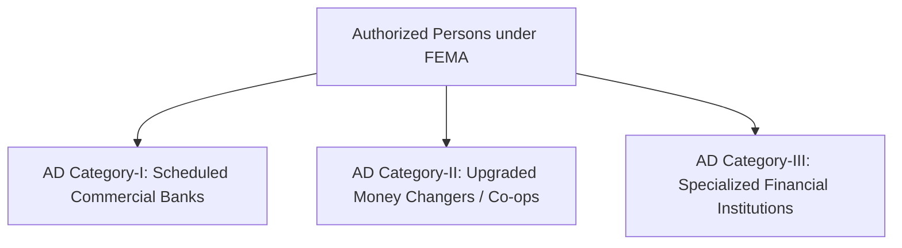
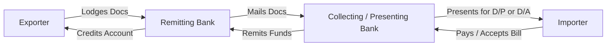
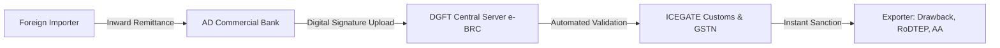
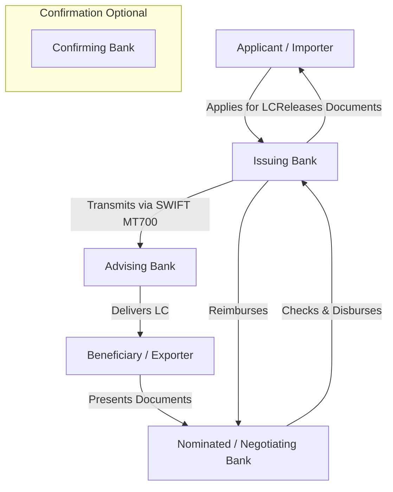
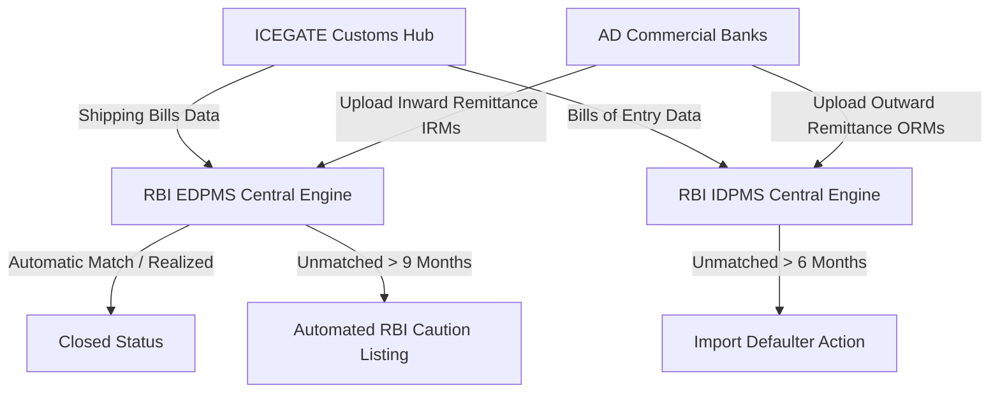
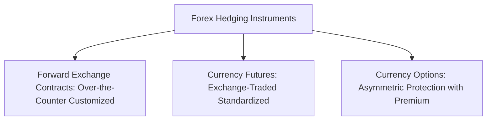
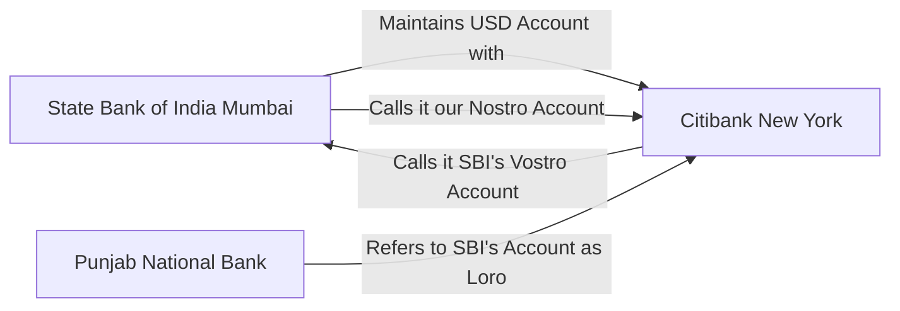
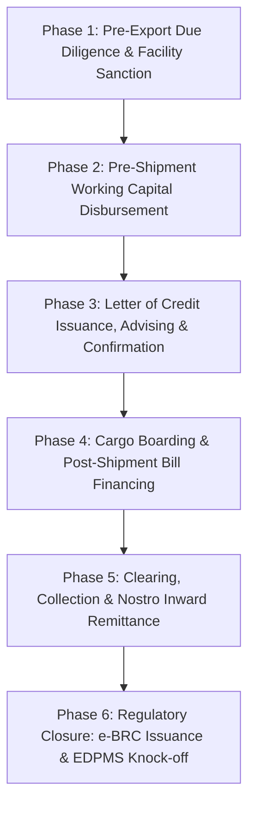
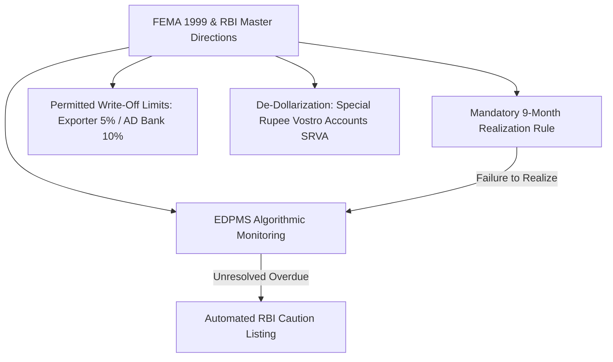
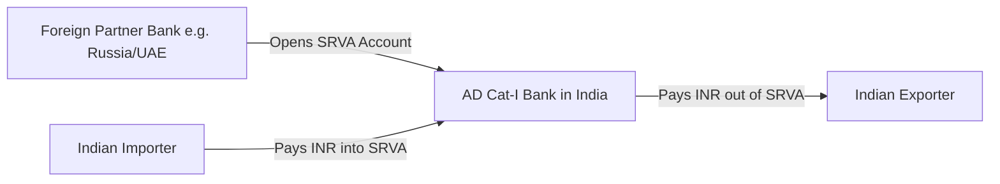

# Unit III: Role of Banks in an Export-Import Transaction

This module delivers full-length university examination model answers covering the multifaceted role of commercial banks in international trade, Authorized Dealer (AD) categorization under FEMA 1999, RBI regulatory oversight, Letter of Credit operational agency roles, documentary collections under URC 522, e-BRC issuance, trade monitoring systems (EDPMS/IDPMS), and foreign exchange hedging mechanisms.

---

## Section A: 2-Mark Questions (Short / Definitive)

### Q1. Define an Authorized Dealer (AD) under the Foreign Exchange Management Act (FEMA) 1999. (2 marks) | Likelihood: High | Type: Define
**Answer:**
Under Section 10(1) of FEMA 1999, an **Authorized Dealer (AD)** is any commercial bank, financial institution, or entity specially licensed by the Reserve Bank of India (RBI) to deal in foreign exchange and foreign securities, subject to statutory terms and central bank reporting regulations.

- **Keywords to include for full marks:** Section 10(1) FEMA 1999, RBI license, dealing in foreign exchange/securities, compliance with central bank directives.
- **Examiner trap:** Writing that any bank branch in India can deal in foreign exchange without an RBI AD license.
- **Memory trick:** **F-L-D-R** (FEMA Section 10, Licensed by RBI, Deals in forex, Reports to central bank).
- **Marking scheme guide:** Legal citation & licensing authority (1 mark); Scope of operations (1 mark).

---

### Q2. Distinguish between an Advising Bank and a Confirming Bank in a Letter of Credit. (2 marks) | Likelihood: High | Type: Differentiate
**Answer:**
An **Advising Bank** merely authenticates the apparent genuineness of the Letter of Credit and transmits it to the beneficiary without assuming any payment liability. In contrast, a **Confirming Bank** adds its own independent, legally binding financial commitment to pay the beneficiary upon presentation of compliant documents, even if the issuing bank defaults.

- **Keywords to include for full marks:** Advising bank (authenticates, zero payment liability), Confirming bank (independent payment undertaking, assumes issuing bank default risk).
- **Examiner trap:** Assuming an advising bank guarantees payment if the foreign buyer defaults.
- **Memory trick:** **Advising = Informs; Confirming = Underwrites**.
- **Marking scheme guide:** Function of Advising Bank (1 mark); Undertaking of Confirming Bank (1 mark).

---

### Q3. What is an e-BRC and what is its operational purpose? (2 marks) | Likelihood: High | Type: Define
**Answer:**
The **electronic Bank Realization Certificate (e-BRC)** is a digital certificate uploaded directly by an Authorized Dealer bank onto DGFT’s server, confirming that payment for an export shipment has been physically realized in foreign exchange into India, serving as statutory proof for claiming export incentives (RoDTEP, Duty Drawback, Advance Authorisation).

- **Keywords to include for full marks:** Electronic Bank Realization Certificate, AD bank digital upload, DGFT server integration, proof of forex realization, export incentives.
- **Examiner trap:** Confusing e-BRC with an import bill of entry; e-BRC is strictly for export realization.
- **Memory trick:** **e-BRC = Bank Receipt Certificate for DGFT**.
- **Marking scheme guide:** Definition & digital transmission (1 mark); Purpose (incentive claim proof) (1 mark).

---

### Q4. What is EDPMS in the Indian trade ecosystem? (2 marks) | Likelihood: High | Type: Define
**Answer:**
The **Export Data Processing and Monitoring System (EDPMS)** is an integrated web-based platform launched by the RBI that matches Customs export shipping bills (transmitted digitally via ICEGATE) with corresponding inward foreign exchange remittances reported by AD banks, tracking unrealized export receivables nationwide.

- **Keywords to include for full marks:** RBI monitoring platform, ICEGATE shipping bill data, AD bank inward remittances, tracking unrealized export proceeds.
- **Examiner trap:** Stating EDPMS tracks import bills (import tracking is done by IDPMS).
- **Memory trick:** **EDPMS = Export Data Pairing & Monitoring System**.
- **Marking scheme guide:** Expansion and agency (RBI) (1 mark); Core function of data reconciliation (1 mark).

---

### Q5. Define Nostro and Vostro accounts. (2 marks) | Likelihood: High | Type: Define
**Answer:**
A **Nostro Account** ("Our account with you") is an account maintained by a domestic bank (e.g., SBI Mumbai) in a foreign bank abroad in foreign currency (e.g., USD account with Citibank New York). A **Vostro Account** ("Your account with us") is an account maintained by a foreign bank with a domestic bank in domestic currency (INR).

- **Keywords to include for full marks:** Nostro ("ours with you", foreign currency abroad), Vostro ("yours with us", domestic currency locally).
- **Examiner trap:** Reversing the definitions of Nostro and Vostro.
- **Memory trick:** **Nostro = Ours abroad; Vostro = Yours here**.
- **Marking scheme guide:** Definition of Nostro with example (1 mark); Definition of Vostro with example (1 mark).

---

### Q6. What is the statutory time limit stipulated under FEMA for the realization of export proceeds? (2 marks) | Likelihood: High | Type: Rule / Fact
**Answer:**
Under RBI Foreign Exchange Management (Export of Goods and Services) Regulations, the full value of exported goods must be realized and repatriated to India through an Authorized Dealer bank within **nine (9) months** from the date of shipment. For goods exported to overseas warehouses, the period is extendable up to **fifteen (15) months**.

- **Keywords to include for full marks:** 9 months from date of shipment, repatriation via AD bank, 15 months for overseas warehouses, FEMA compliance.
- **Examiner trap:** Stating the limit is 180 days or 1 year; standard FEMA rule is 9 months.
- **Memory trick:** **9 Months Rule (FEMA Realization)**.
- **Marking scheme guide:** Standard time limit (9 months) (1 mark); Overseas warehouse exception or extension condition (1 mark).

---

## Section B: 5-Mark Questions (Structured Short Notes)

### Q7. Explain the classification of Authorized Persons under FEMA 1999 into Category-I, II, and III. (5 marks) | Likelihood: High | Type: Explain
**Answer:**
**Introduction:**
To balance capital account vigilance with trade facilitation, the Reserve Bank of India licenses Authorized Persons under Section 10(1) of FEMA 1999 across three distinct tiers based on operational scope and capital strength.

**Classification Structure:**
1. **Authorized Dealer Category-I (AD Cat-I):**
   - **Entities:** Scheduled Commercial Banks (Public, Private, and Foreign banks such as SBI, HDFC, Citibank), State Co-operative Banks.
   - **Scope:** Full-fledged foreign exchange operations across all **Current Account** (export/import financing, trade LCs, remittances) and **Capital Account** (external commercial borrowings, FDI, portfolio investments) transactions.
2. **Authorized Dealer Category-II (AD Cat-II):**
   - **Entities:** Upgraded Full-Fledged Money Changers (FFMCs), select urban co-operative banks, and travel agencies.
   - **Scope:** Specified non-trade related current account transactions (private visits, business travel, overseas education, medical treatment, gift remittances). They **cannot** handle commercial export/import trade finance.
3. **Authorized Dealer Category-III (AD Cat-III):**
   - **Entities:** Specialized financial institutions such as EXIM Bank, SIDBI, ECGC, and designated development agencies.
   - **Scope:** Specific foreign exchange transactions incidental to their core statutory mandates (e.g., cross-border lines of credit, buyer's credit, factoring).

- **Keywords to include for full marks:** Section 10(1) FEMA 1999, AD Category-I, Scheduled Commercial Banks, Current & Capital account, AD Category-II, Non-trade transactions, AD Category-III, EXIM Bank.
- **Examiner trap:** Stating that AD Category-II can issue commercial trade Letters of Credit.
- **Memory trick:** **I = All Trade & Capital; II = Travel & Personal; III = Specialized EXIM**.
- **Marking scheme guide:** AD Cat-I scope & entities (2 marks); AD Cat-II scope & limitations (1.5 marks); AD Cat-III scope (1.5 marks).

---

### Q8. Detail the operational role of banks under Documentary Collections governed by ICC URC 522. (5 marks) | Likelihood: High | Type: Procedure
**Answer:**
**Introduction:**
In documentary collection transactions, banks act as intermediary trusted agents handling financial and commercial documents strictly in accordance with ICC Uniform Rules for Collections (URC 522), without providing their own independent payment guarantee.

**Key Banking Roles and Responsibilities:**
1. **Remitting Bank (Exporter’s Bank):**
   - Receives the collection order, commercial invoice, transport documents (Bill of Lading), and financial bill of exchange from the exporter.
   - Transmits them to the foreign correspondent bank accompanied by precise collection instructions (specifying Documents against Payment - D/P or Documents against Acceptance - D/A).
2. **Collecting Bank (Overseas Correspondent Bank):**
   - Receives the documents from the remitting bank and executes the collection instructions in the buyer's country.
3. **Presenting Bank:**
   - The bank that actually presents the documents to the importer.
   - Under **D/P (Sight):** Releases original negotiable Bills of Lading *only* after full cash payment is received.
   - Under **D/A (Usance):** Releases negotiable documents upon the importer signing their formal acceptance on the Bill of Exchange, obligating payment on the maturity date.
4. **Duty of Care & Limitations under URC 522:**
   - Banks must verify that documents received match those listed in the collection schedule.
   - Banks bear **no liability** for the genuineness of documents, condition of goods, or failure of the drawee to pay.

- **Keywords to include for full marks:** URC 522, Remitting bank, Collecting bank, Presenting bank, D/P (Documents against Payment), D/A (Documents against Acceptance), No payment guarantee.
- **Examiner trap:** Assuming the collecting bank is legally forced to pay if the importer defaults under D/A terms.
- **Memory trick:** **R-C-P** (Remitting, Collecting, Presenting).
- **Marking scheme guide:** Conceptual basis & URC 522 (1 mark); Role of Remitting Bank (1.5 marks); Role of Collecting/Presenting Bank under D/P & D/A (2.5 marks).

---

### Q9. Explain the architecture and significance of the e-BRC system developed by DGFT. (5 marks) | Likelihood: High | Type: Explain
**Answer:**
**Introduction:**
The electronic Bank Realization Certificate (e-BRC) system, introduced by the Directorate General of Foreign Trade (DGFT), replaced physical paper realization certificates, creating an automated digital bridge between commercial banks, Customs, and foreign trade regulators.

**Architecture and Workflow:**
1. **Remittance Inflow:** When an overseas payment is credited to an exporter's account, the AD bank maps the transaction to the exporter's IEC and the specific Shipping Bill number.
2. **Digital Generation and Upload:** The AD bank generates an electronic record containing realization details (currency, realized amount, exchange rate, bank charges, and shipping bill reference), digitally signs it using an authorized class-3 token, and pushes it directly to DGFT’s central server via secure EDI.
3. **Automated Cross-Verification:** DGFT’s engine cross-checks the e-BRC against customs shipping bill records transmitted by ICEGATE.
4. **Significance to Trade:**
   - **Elimination of Fraud:** Eradicates forged paper BRCs and fictitious realization claims.
   - **Accelerated Export Incentives:** Exporters can link e-BRCs online to claim Duty Drawback, RoDTEP, RoSCTL, and fulfill Advance Authorisation export obligations without physical bank visits.
   - **GST Compliance:** Serves as conclusive proof of "Zero-Rated" export supply to claim IGST refunds from the GST portal.

- **Keywords to include for full marks:** DGFT digital system, AD bank upload, digital signature token, ICEGATE cross-matching, fraud elimination, export incentive realization, zero-rated GST proof.
- **Examiner trap:** Stating that the exporter manually fills and uploads the e-BRC; only the AD bank can upload it.
- **Memory trick:** **U-M-V-I** (Upload by bank, Match with ICEGATE, Verify online, Incentive claim).
- **Marking scheme guide:** Structural architecture & bank upload (2 marks); Workflow & EDI cross-verification (1.5 marks); Trade benefits and incentive linkages (1.5 marks).

---

### Q10. What is EDPMS? How does it help the Reserve Bank of India track unrealized export proceeds? (5 marks) | Likelihood: High | Type: Explain
**Answer:**
**Introduction:**
Launched in 2014 by the RBI, the **Export Data Processing and Monitoring System (EDPMS)** is an enterprise web-based information clearinghouse designed to track all export transactions from cargo dispatch to final currency realization.

**Operational Tracking Architecture:**
1. **Inward Data Feed from Customs (ICEGATE):**
   - The moment an exporter files a Shipping Bill and customs grants the "Let Export" order, ICEGATE electronically transmits the complete shipping record (FOB value, buyer details, destination, commodity) to RBI's EDPMS database.
2. **Inward Remittance Feed from AD Banks:**
   - As foreign remittances are credited, AD banks log the realization against the specific Shipping Bill number in EDPMS, generating an Inward Remittance Message (IRM).
3. **Automated Reconciliation Algorithm:**
   - EDPMS continuously reconciles shipping bills against IRMs. If the realized amount equals or exceeds the shipping bill value, the status is marked **"Closed"**.
4. **Monitoring of Unrealized Receivables (Caution-Listing):**
   - Under FEMA, if a shipping bill remains outstanding beyond **nine (9) months** without valid extension approval, the system flags the transaction as overdue.
   - EDPMS automatically triggers alerts to the AD bank. If non-realization persists without legitimate cause, the exporter is placed on the automated **RBI Caution List**, preventing access to further trade credit across all Indian banks.

- **Keywords to include for full marks:** RBI web platform, ICEGATE integration, Inward Remittance Message (IRM), automatic reconciliation, 9-month FEMA deadline, automated caution-listing.
- **Examiner trap:** Believing EDPMS is operated by DGFT; it is developed and operated by the RBI.
- **Memory trick:** **F-R-C-A** (Feed from customs, Remittance from bank, Close bill, Alert on default).
- **Marking scheme guide:** Institutional objective & data inputs (1.5 marks); Reconciliation mechanism (1.5 marks); 9-month FEMA rule & caution listing (2 marks).

---

### Q11. Explain how Forward Exchange Contracts are utilized by banks to hedge foreign currency risks for exporters. (5 marks) | Likelihood: High | Type: Explain
**Answer:**
**Introduction:**
A **Forward Exchange Contract** is a customized over-the-counter agreement entered into between an exporter and an Authorized Dealer bank to sell a specified amount of foreign currency at a predetermined exchange rate (Forward Rate) on a specified future date or during a specified future period.

**Mechanics of Forward Cover:**
1. **Determination of Forward Rate:**
   The forward rate is derived from the prevailing Spot Exchange Rate adjusted for the **Interest Rate Differential** between the two currencies:
   $$\text{Forward Rate} = \text{Spot Rate} \pm \text{Forward Premium / Discount}$$
   Because Indian interest rates have historically exceeded US dollar interest rates, foreign currencies normally trade at a **forward premium** against the Rupee.
2. **Elimination of Exchange Volatility:**
   - An exporter expecting USD 100,000 in 3 months enters into a forward contract at ₹83.50 per USD.
   - Even if the spot rate crashes to ₹81.00 due to sudden Rupee appreciation, the bank is legally bound to pay ₹83.50 per dollar.
3. **Booking Options:**
   - **Fixed Date Contract:** Delivery occurs on a single specified calendar date.
   - **Option Forward Contract:** Delivery can take place at any time within a specified window (e.g., between the 1st and 30th of a given month) to accommodate uncertain shipping schedules.

- **Keywords to include for full marks:** Forward Exchange Contract, Authorized Dealer bank, predetermined exchange rate, spot rate, forward premium, fixed vs option forward contract.
- **Examiner trap:** Confusing a forward option contract with an exchange-traded currency option; option forward simply means flexibility in delivery dates.
- **Memory trick:** **P-R-O-F** (Predetermined Rate, Over-the-counter, Forward premium, Fixed/option dates).
- **Marking scheme guide:** Definition & concept (1.5 marks); Mathematical pricing & premium mechanism (1.5 marks); Risk elimination & contract types (2 marks).

---

### Q12. Write a short note on the regulatory compliance checks performed by an AD bank before executing an import remittance. (5 marks) | Likelihood: Medium | Type: Short Note
**Answer:**
**Introduction:**
When executing an outward foreign exchange remittance for import settlements, Authorized Dealer banks act as gatekeepers under FEMA 1999 and the Customs Act 1962 to prevent capital flight and money laundering.

**Mandatory Pre-Remittance Due Diligence:**
1. **Documentary Scrutiny:**
   - Physical/electronic verification of the Commercial Invoice, Packing List, and Transport Document (Bill of Lading / Airway Bill).
   - Inward Bill of Entry (Exchange Control Copy) or electronic validation via IDPMS to confirm goods have actually arrived at an Indian port.
2. **IDPMS Verification:**
   - Checking the Import Data Processing and Monitoring System (IDPMS) to ensure the remittance is matched against an active, open Bill of Entry filed on ICEGATE.
3. **Trade Policy Compliance:**
   - Ensuring the imported goods do not fall under the "Prohibited" list of ITC(HS) classifications and that restricted items carry a valid DGFT import license.
4. **AML / FATF & Sanctions Screening:**
   - Screening the overseas supplier, beneficiary bank, vessel name, and port of origin against UN Sanctions, OFAC lists, and FATF high-risk jurisdictions.
5. **Form A2 and FEMA Declarations:**
   - Obtaining a signed Form A2 from the importer declaring the transaction purpose and statutory tax deduction compliance (TDS under Section 195 of the Income Tax Act).

- **Keywords to include for full marks:** FEMA 1999, Exchange Control copy, IDPMS verification, Prohibited goods check, OFAC/AML screening, Form A2, Section 195 TDS.
- **Examiner trap:** Believing advance import remittances can be made without any documentation; advance remittances require bank guarantees if exceeding specified thresholds.
- **Memory trick:** **D-I-T-A-F** (Documents, IDPMS, Trade policy, AML check, Form A2).
- **Marking scheme guide:** Document & IDPMS verification (2 marks); Trade policy & AML screening (1.5 marks); Form A2 & statutory tax declarations (1.5 marks).

---

## Section C: 10-Mark Questions (Detailed Analytical Answers)

### Q13. Detail the complete operational roles, rights, and legal liabilities of various intermediary banks participating in a documentary Letter of Credit transaction under UCP 600. (10 marks) | Likelihood: High | Type: Explain / Analytical
**Answer:**
**Introduction:**
A documentary Letter of Credit (LC) is a legally separate financial undertaking governed internationally by the International Chamber of Commerce (ICC) **Uniform Customs and Practice for Documentary Credits (UCP 600)**. Because cross-border transactions span different legal jurisdictions, the LC mechanism distributes operational responsibilities across a chain of specialized banking institutions.

*(Exam 2-minute sketch guide: Draw five boxes representing Buyer $\to$ Issuing Bank $\to$ Advising Bank $\to$ Confirming/Negotiating Bank $\to$ Exporter, showing the flow of the LC forward and documents backward).*

#### 1. Issuing Bank (Buyer’s Bank)
- **Role:** Opens the credit upon the application and credit appraisal of the importer.
- **Legal Commitment:** Under Article 7 of UCP 600, the issuing bank undertakes an **irrevocable, primary financial commitment** to honor a complying presentation of documents, independent of whether the buyer pays or becomes insolvent.
- **Document Examination:** Allowed a maximum of **five (5) banking days** following the day of presentation to examine documents and determine compliance.

#### 2. Advising Bank
- **Role:** Typically an authorized dealer bank located in the exporter’s country that receives the LC from the issuing bank via authenticated SWIFT (MT700).
- **Responsibilities under Article 9:**
  - Must verify the **apparent authenticity** of the credit (matching cryptographic SWIFT keys).
  - Transmits the operative LC to the beneficiary.
  - Assumes **zero financial liability** to pay or negotiate documents.

#### 3. Confirming Bank
- **Role:** An independent bank (often the advising bank or a premier global financial institution) that adds its confirmation to the LC at the request or authorization of the issuing bank.
- **Legal Commitment under Article 8:**
  - Assumes an irrevocable, primary payment obligation identical to that of the issuing bank.
  - If the exporter presents conforming documents, the confirming bank **must pay without recourse**, even if the issuing bank suffers sovereign default, foreign exchange collapse, or insolvency.

#### 4. Nominated Bank
- **Role:** The specific bank authorized in the LC text where the credit is available for payment, acceptance, or negotiation.
- **Operational Status:** Unless the nominated bank is also a confirming bank, nomination does not create a mandatory obligation to pay or discount the bills.

#### 5. Negotiating Bank
- **Role:** An authorized bank that purchases complying drafts and/or documents by advancing or agreeing to advance funds to the beneficiary prior to receiving reimbursement from the issuing bank.
- **Recourse Rights:** Negotiation by a non-confirming bank is **with recourse** to the beneficiary in the event that the issuing bank fails to honor the presentation.

#### 6. Reimbursing Bank
- **Role:** An intermediary third-party settlement bank designated by the issuing bank to honor reimbursement claims submitted by the negotiating or paying bank, usually settled through clearing channels (CHIPS/Fedwire in New York for USD credits).

**Conclusion:**
Under UCP 600, banks deal exclusively with documents and not with the underlying physical goods (Article 5). The separation of institutional roles protects both parties, transforming foreign commercial default risk into structured international bank commitments.

- **Keywords to include for full marks:** UCP 600, Issuing bank (Article 7), Advising bank (Article 9), Confirming bank (Article 8), Nominated bank, Negotiating bank, Complying presentation, 5 banking days rule, Independence principle.
- **Examiner trap:** Confusing an advising bank with a confirming bank; only the confirming bank assumes financial payment liability.
- **Memory trick:** **I-A-C-N-R** (Issuing, Advising, Confirming, Negotiating, Reimbursing).
- **Marking scheme guide:** Issuing bank role & Article 7 (2.5 marks); Advising & Confirming bank contrast (2.5 marks); Nominated & Negotiating bank mechanics (2.5 marks); Reimbursing bank & UCP 600 principles (2.5 marks).

---

### Q14. Critically evaluate the role of the Reserve Bank of India (RBI) and Authorized Dealer banks in enforcing exchange control regulations and trade monitoring through EDPMS and IDPMS. (10 marks) | Likelihood: High | Type: Critically Evaluate / Regulatory
**Answer:**
**Introduction:**
In developing economies, foreign exchange reserves represent a critical sovereign asset. In India, the Reserve Bank of India (RBI), operating through powers conferred by the Foreign Exchange Management Act (FEMA) 1999, regulates all cross-border trade transactions. Rather than maintaining direct contact with millions of traders, RBI delegates trade monitoring to Authorized Dealer (AD) Category-I banks, leveraging two automated data hubs: **EDPMS** (Export Data Processing and Monitoring System) and **IDPMS** (Import Data Processing and Monitoring System).

#### 1. Statutory Foundations under FEMA 1999
- Under Section 7 of FEMA, every exporter is legally required to declare the full value of goods exported and repatriate proceeds within statutory deadlines.
- Under Section 10 and 11, the RBI issues binding Master Directions to AD banks governing credit limits, realization verifications, and overseas trade remittances.

#### 2. Architecture and Working of EDPMS (Export Side)
- **Automated Data Capture:** Customs ICEGATE automatically transmits shipping bill particulars (exporter IEC, invoice value, port code) to the RBI’s central EDPMS platform.
- **Inward Remittance Matching:** When foreign payment arrives, the AD bank issues an **Inward Remittance Message (IRM)** tagging the specific shipping bill.
- **Algorithmic Knock-off:** EDPMS algorithmically reconciles the shipping bill against the IRM.
- **Enforcement of the 9-Month Rule:** If payment is not realized within 9 months, EDPMS flags the transaction. Exporters failing to obtain formal extensions face automated caution-listing, restricting future exports and credit access.

#### 3. Architecture and Working of IDPMS (Import Side)
- **Tracking Inward Cargo:** Customs transmits the Exchange Control copy of every Bill of Entry filed by importers to the IDPMS repository.
- **Outward Remittance Matching:** When an importer requests an outward wire transfer to pay an overseas supplier, the AD bank logs an Outward Remittance Message (ORM) in IDPMS.
- **Prevention of Capital Flight:** IDPMS ensures that Indian entities do not remit foreign exchange abroad without physically importing commensurate goods into India, effectively combating trade-based money laundering (TBML) and invoice padding.

#### 4. Critical Evaluation: Achievements vs. Operational Bottlenecks
- **Key Achievements:**
  - Eradicated manual, paper-heavy documentation (elimination of physical GR and SDF forms).
  - Plugged massive tax leakages and fraudulent GST/Duty Drawback claims.
  - Enabled automated generation of e-BRC certificates.
- **Operational Bottlenecks:**
  - **Reconciliation Mismatches:** Slight differences in bank handling charges or exchange fluctuations often prevent automated matching, leaving thousands of clean exporters unfairly flagged as overdue.
  - **Third-Party Payment Complications:** Modern international trade frequently involves tripartite supply chains, which rigid algorithmic matching systems struggle to resolve without cumbersome manual interventions.

**Conclusion:**
EDPMS and IDPMS represent a paradigm shift from retrospective paper inspections to real-time electronic oversight. While systemic data reconciliation frictions exist, the dual architecture has successfully protected India's macroeconomic stability and foreign currency reserves.

- **Keywords to include for full marks:** FEMA 1999, Section 7, AD Category-I banks, EDPMS, IDPMS, Inward Remittance Message (IRM), Outward Remittance Message (ORM), 9-month FEMA rule, Trade-Based Money Laundering (TBML).
- **Examiner trap:** Presenting EDPMS/IDPMS as software owned by commercial banks; they are central RBI platforms fed by banks and Customs.
- **Memory trick:** **S-R-A-C** (Shipping bill feed, Remittance match, Algorithmic knockoff, Caution listing).
- **Marking scheme guide:** Legal framework under FEMA (2 marks); EDPMS architecture & 9-month rule (2.5 marks); IDPMS architecture & capital flight prevention (2.5 marks); Critical evaluation of benefits & operational bottlenecks (3 marks).

---

### Q15. Explain the foreign exchange risk management tools provided by commercial banks to exporters and importers. Contrast Forward Contracts, Currency Futures, and Currency Options. (10 marks) | Likelihood: High | Type: Compare / Technical
**Answer:**
**Introduction:**
Because international trade contracts are denominated in foreign currencies while domestic costs are settled in local currency, exchange rate fluctuations directly impact corporate profit margins. Authorized Dealer commercial banks provide a suite of foreign exchange derivative instruments to allow trading entities to lock in certainty and hedge market risk.

#### 1. Forward Exchange Contracts (OTC Hedging)
- **Nature:** Direct bilateral contract between the trader and an AD bank to buy or sell foreign currency at a fixed forward rate on a designated future date.
- **Mechanism:** The forward rate is computed using the interest rate parity equation:
  $$\text{Forward Rate} = \text{Spot Rate} \times \left( \frac{1 + R_{\text{domestic}} \times \frac{t}{365}}{1 + R_{\text{foreign}} \times \frac{t}{365}} \right)$$
- **Benefits:** Completely eliminates downside risk; tailored to the exact currency amount and delivery date of the shipment.
- **Limitation:** Rigid obligation; the exporter cannot capitalize on favorable exchange rate movements.

#### 2. Currency Futures (Exchange-Traded Hedging)
- **Nature:** Standardized legal contracts traded on organized national exchanges (such as NSE and BSE in India) regulated by SEBI and RBI.
- **Mechanism:** Standardized lot sizes (e.g., $1,000 per USD contract) and standardized settlement cycles (last working day of the month). Requires upfront and daily mark-to-market (MTM) margin payments.
- **Benefits:** High liquidity, transparent real-time pricing, zero counterparty default risk due to exchange clearing house guarantees.
- **Limitation:** Lack of customization; odd trade amounts or mismatched settlement dates create basis risk.

#### 3. Currency Options (Asymmetric Hedging)
- **Nature:** Financial derivative contract giving the buyer the **right, but not the obligation**, to buy (Call Option) or sell (Put Option) foreign currency at a predetermined strike price on or before a specified expiry date.
- **Mechanism:** The trader pays an upfront, non-refundable cash **premium** to the bank.
- **Benefits:** Provides asymmetric protection. If the exchange rate moves against the trader, they exercise the option, capping their loss. If the rate moves favorably, they abandon the option, capturing uncapped upside profits.

#### Comparative Matrix of Foreign Exchange Hedging Tools

| Feature | Forward Contracts | Currency Futures | Currency Options |
| :--- | :--- | :--- | :--- |
| **Trading Marketplace** | Over-the-Counter (Bank-to-Client) | Organized Exchanges (NSE, BSE) | Over-the-Counter or Exchanges |
| **Contract Specifications** | Fully customized (amount, date) | Standardized lot sizes & expiries | Standardized or customized |
| **Cash Outlay at Inception** | Zero upfront premium; bank credit line | Initial & maintenance margins | Upfront cash premium payable |
| **Obligation vs. Right** | Binding legal obligation | Binding legal obligation | Exporter holds the right, no obligation |
| **Upside Participation** | Zero; locked at forward rate | Zero; locked at futures rate | **Full upside preserved** (net of premium) |
| **Counterparty Risk** | Credit risk of the contracting bank | Zero (guaranteed by clearinghouse) | Credit risk of option writer (bank) |

**Conclusion:**
Importers and exporters must balance the certainty of zero-premium forward contracts against the upside participation of currency options. For price-sensitive MSMEs executing standard transactions, forward contracts remain the most widely used hedging tool across Indian commercial banks.

- **Keywords to include for full marks:** Forward contract, Currency futures, Currency options, Interest rate parity, Mark-to-market (MTM), Call/Put option, Option premium, Asymmetric protection.
- **Examiner trap:** Claiming that forward contracts require payment of an upfront cash premium (only options require an upfront premium).
- **Memory trick:** **F-F-O** (Forwards = OTC obligation; Futures = Exchange obligation; Options = Right with premium).
- **Marking scheme guide:** Detailed mechanics of Forwards (2.5 marks); Detailed mechanics of Futures (2 marks); Detailed mechanics of Options (2.5 marks); Comparative matrix across key operational parameters (3 marks).

---

### Q16. Analyze the operational mechanics of Nostro, Vostro, and Loro accounts in facilitating international bank settlements and foreign exchange transactions. (10 marks) | Likelihood: Medium | Type: Technical / Explain
**Answer:**
**Introduction:**
Because domestic physical currencies cannot cross sovereign borders to settle inter-bank obligations, international trade relies on correspondent banking networks linked by specialized reciprocal bank accounts. These accounts—termed Nostro, Vostro, and Loro—form the plumbing of global cross-border payments handled via SWIFT messaging.

*(Exam 2-minute sketch guide: Draw two bank buildings in different countries, connecting them with directional arrows labeled Nostro and Vostro, with a third bank observing labeled Loro).*

#### 1. Nostro Account ("Our Account with You")
- **Definition:** An account maintained by a domestic bank in a foreign country, with a foreign correspondent bank, denominated in that foreign country's currency.
- **Operational Reality:** A USD-denominated account opened by State Bank of India (SBI), Mumbai, with Citibank in New York.
- **Functional Use:** When an Indian exporter receives payment in US Dollars, Citibank NY credits SBI's Nostro account in New York. SBI Mumbai then debits its internal Nostro ledger and credits equivalent Indian Rupees into the exporter's local account.

#### 2. Vostro Account ("Your Account with Us")
- **Definition:** An account maintained by a foreign bank with a domestic bank in the domestic country, denominated in the domestic country’s currency.
- **Operational Reality:** Citibank New York maintaining an Indian Rupee (INR) account with SBI in Mumbai.
- **Functional Use (Special Rupee Vostro Accounts - SRVA):** Under RBI's international trade settlement framework in Indian Rupees, foreign partner banks (e.g., from Russia, UAE) open SRVAs in India. Indian importers pay Rupees directly into these Vostro accounts, while Indian exporters are paid out of these balances, completely bypassing US Dollar settlement channels.

#### 3. Loro Account ("Their Account")
- **Definition:** An account referred to by a third-party bank when referencing the Nostro or Vostro relationship existing between two other banks.
- **Operational Reality:** If Punjab National Bank (PNB) instructs a US correspondent to transfer funds to SBI's account at Citibank NY, PNB refers to that account as a **Loro Account** ("their account with you").

#### Summary Comparison of Correspondent Accounts

| Feature | Nostro Account | Vostro Account | Loro Account |
| :--- | :--- | :--- | :--- |
| **Literal Meaning** | "Our account with you" | "Your account with us" | "Their account" |
| **Maintained By** | Domestic bank | Foreign correspondent bank | Referenced by a third-party bank |
| **Location & Currency** | Abroad, in Foreign Currency | Domestically, in Domestic Currency | Third-party reference point |
| **Primary Use** | Settlement of export receipts and import payments | Facilitating foreign bank operations and local currency settlements | Routing indirect inter-bank clearing messages |

**Conclusion:**
Nostro and Vostro accounts represent two perspectives of the exact same correspondent relationship. They eliminate the physical transit of cash across oceans, transforming global multi-billion-dollar trade transactions into simple electronic ledger debits and credits synchronized via secure SWIFT protocols.

- **Keywords to include for full marks:** Correspondent banking, Nostro ("ours with you"), Vostro ("yours with us"), Loro ("theirs"), SWIFT settlement, Special Rupee Vostro Accounts (SRVA), Ledger adjustment.
- **Examiner trap:** Writing that Nostro accounts are held in Indian Rupees inside India.
- **Memory trick:** **N-O (Nostro = Ours); V-Y (Vostro = Yours); L-T (Loro = Theirs)**.
- **Marking scheme guide:** Nostro account mechanics & example (3 marks); Vostro account mechanics & SRVA context (3 marks); Loro account definition (1.5 marks); Comparative synthesis table (2.5 marks).

---

## Section D: 15-Mark Questions (Comprehensive Masters)

### Q17. Provide an exhaustive analysis of the role of commercial banks across the entire lifecycle of an international trade transaction. Trace the bank's involvement from credit appraisal, pre-shipment advances, LC issuance and confirmation, handling documentary collections, to post-shipment discounting, e-BRC generation, and EDPMS/IDPMS reconciliation. (15 marks) | Likelihood: High | Type: Comprehensive Master
**Answer:**
**Introduction:**
In international commerce, commercial banks function not merely as financial intermediaries but as essential risk underwriters, documentary gatekeepers, and regulatory custodians. Spanning the entire lifecycle of an export-import transaction, an Authorized Dealer (AD) bank bridges the trust deficit between unknown trading counterparties separated by oceans, legal systems, and currencies. Regulated domestically by the RBI under FEMA 1999 and internationally by the ICC under UCP 600 and URC 522, the bank’s involvement transforms high-risk commercial exposures into structured, bank-guaranteed transactions.

*(Exam 2-minute sketch guide: Draw a vertical timeline detailing the 6 distinct operational phases of a trade transaction, labeling key bank operations at each milestone: Appraisal $\to$ EPC $\to$ LC $\to$ Post-shipment $\to$ Nostro $\to$ e-BRC).*

---

#### Phase 1: Pre-Export Due Diligence, KYC, and Credit Appraisal
Long before goods enter production, the bank establishes the operational framework:
- **Regulatory Vetting:** Verifies the firm’s Importer-Exporter Code (IEC), active RCMC membership with Export Promotion Councils, and GST registration.
- **Caution-List Vetting:** Conducts rigorous regulatory checks against the RBI Caution List, DGFT Denied Entity List (DEL), and ECGC Specific Approval List (SAL).
- **Sanctioning Credit Lines:** Evaluates the borrower’s technical and production capacity, sanctioning composite credit lines covering both Pre-Shipment Packing Credit (EPC) and Post-Shipment Bill Discounting limits.

---

#### Phase 2: Pre-Shipment Financing (Packing Credit)
- **Order Scrutiny:** Scrutinizes confirmed export orders or Letters of Credit, validating unit pricing, payment conditions, and shipping deadlines.
- **FOB Margin Sanction:** Grants Rupee EPC or Pre-Shipment Credit in Foreign Currency (PCFC) calculated strictly on the Net FOB contract value, applying a 10% to 25% margin.
- **Staged Disbursement:** Releases funds in tranches directly to verified raw material suppliers via RTGS/NEFT to prevent capital diversion.
- **Security Hypothecation:** Takes a primary hypothecation charge over factory inventories and enforces comprehensive transit/fire insurance endorsed in the bank's favor.

---

#### Phase 3: Letter of Credit Operations (UCP 600 Framework)
Depending on which party the bank represents, it assumes specialized contractual responsibilities:
- **As Issuing Bank (for Importer):** Conducts financial appraisal of the buyer, holds security margins, and transmits an operative, irrevocable LC via SWIFT (MT700) to the exporter's country, undertaking a primary, independent legal commitment to pay upon conforming presentation.
- **As Advising Bank (for Exporter):** Authenticates the cryptographic signature of the overseas credit and advises the authentic instrument to the seller without assuming payment liability.
- **As Confirming Bank:** Upon request, adds its own independent payment undertaking, guaranteeing payment to the exporter even if the issuing bank or buyer's nation undergoes insolvency or default.

---

#### Phase 4: Cargo Boarding and Post-Shipment Bill Financing
- Once cargo passes customs clearance and loads on board, the exporter lodges the full shipping document dossier with the bank: Commercial Invoice, Packing List, Marine Insurance Certificate, and original on-board negotiable Bills of Lading endorsed in the bank's favor.
- **Document Scrutiny:** Under Article 14 of UCP 600, bank document examiners verify strict documentary compliance within five (5) banking days.
- **Liquidation of Pre-Shipment Credit:** The bank purchases, discounts, or negotiates the post-shipment bills, immediately using the proceeds to wipe out the outstanding pre-shipment packing credit ledger.
- **Liquidity Release:** Any remaining balance is credited to the exporter's operational current account.

---

#### Phase 5: Collection and Nostro Account Realization
- **Handling Collections (URC 522):** If trade is on collection terms, the bank acts as Remitting Bank, transmitting original documents to the foreign collecting bank under Documents against Payment (D/P) or Documents against Acceptance (D/A) terms.
- **Nostro Credit:** When the foreign buyer or issuing bank settles the bill, funds flow into the Indian bank’s overseas Nostro account in New York (USD) or Frankfurt (EUR).
- **Currency Conversion:** The bank converts the foreign exchange at the agreed TT Buying Rate or applies it against a pre-booked Forward Exchange Contract.

---

#### Phase 6: Regulatory Closure, e-BRC Generation, and EDPMS/IDPMS Reconciliation
- **e-BRC Digital Upload:** The AD bank transmits the electronic Bank Realization Certificate (e-BRC) directly to the DGFT central server under class-3 digital signature, enabling the exporter to claim export incentives (RoDTEP, Duty Drawback).
- **EDPMS Reconciliation:** The bank generates an Inward Remittance Message (IRM) inside RBI’s EDPMS platform, matching inward remittances against the ICEGATE shipping bill record to mark the export transaction permanently as "Closed".
- **IDPMS Monitoring for Imports:** Similarly, for import transactions, the bank generates an Outward Remittance Message (ORM), linking the wire transfer against the Customs Bill of Entry.

**Conclusion:**
The modern commercial bank is the institutional cornerstone of global trade. By integrating financing, risk-mitigation guarantees under international ICC rules, and real-time statutory tracking via central bank portals, banks transform volatile cross-border transactions into predictable, legally secure commercial exchanges.

- **Keywords to include for full marks:** KYC vetting, Net FOB value, EPC liquidation, UCP 600, Article 14 (5 days), Confirming bank, Nostro account, e-BRC, EDPMS IRM, IDPMS ORM.
- **Examiner trap:** Describing only the financing aspect while ignoring the bank's regulatory and monitoring role under RBI/EDPMS.
- **Memory trick:** **A-P-L-P-N-R** (Appraisal, Packing credit, LC operations, Post-shipment finance, Nostro settlement, Regulatory e-BRC).
- **Marking scheme guide:** Pre-export appraisal & packing credit (3 marks); LC agency roles & UCP 600 compliance (3 marks); Post-shipment financing & pre-shipment liquidation (3 marks); Nostro/Vostro mechanics & foreign collection (3 marks); e-BRC upload & EDPMS/IDPMS regulatory closure (3 marks).

---

### Q18. Examine the regulatory framework governing cross-border trade transactions in India under FEMA 1999 and RBI Master Directions. Address realization timelines, caution-listing protocols, write-off permissions, and trade settlements in Indian Rupees through Special Rupee Vostro Accounts (SRVA). (15 marks) | Likelihood: High | Type: Regulatory / Exhaustive Policy Analysis
**Answer:**
**Introduction:**
Foreign exchange governance in India shifted decisively from the punitive, command-and-control regime of the Foreign Exchange Regulation Act (FERA) 1973 to the facilitating, market-oriented framework of the **Foreign Exchange Management Act (FEMA) 1999**. Administered by the Reserve Bank of India (RBI), FEMA balances the orderly development of the foreign exchange market with vigilant monitoring to prevent capital flight. Through comprehensive Master Directions on Export and Import of Goods and Services, the RBI empowers Authorized Dealer (AD) Category-I banks to monitor remittances, enforce strict realization timelines, manage bad debt write-offs, and facilitate local currency settlements through Special Rupee Vostro Accounts (SRVA).

*(Exam 2-minute sketch guide: Draw a four-corner compliance map covering: 1. Realization timeline (9 months), 2. EDPMS caution listing, 3. Permitted write-off thresholds, and 4. SRVA international rupee settlement flow).*

---

#### 1. Statutory Obligations and Realization Timelines
Under Section 7 of FEMA 1999 read with Foreign Exchange Management (Export of Goods and Services) Regulations:
- **Mandatory Declaration:** Every exporter must declare the full export value through an electronic Shipping Bill filed on ICEGATE.
- **Standard Realization Period:** Exporters must realize and repatriate the full value of export proceeds to India through an AD bank within **nine (9) months** from the date of shipment.
- **Overseas Warehouse Extension:** For goods consigned to designated overseas warehouses established with RBI approval, the realization window is extended up to **fifteen (15) months**.
- **Tenure Extension Powers:** AD banks are empowered to grant extensions of up to six (6) months at a time, provided the non-realization is due to reasons beyond the exporter's control (e.g., buyer insolvency, litigation) and the exporter has taken genuine recovery steps.

---

#### 2. The EDPMS Caution-Listing Framework
To maintain credit discipline without manual bureaucratic friction, the RBI introduced automated caution-listing:
- **Algorithmic Monitoring:** RBI’s EDPMS platform continuously monitors open Shipping Bills.
- **Trigger Conditions:** If a shipping bill remains outstanding beyond nine months without an approved extension, the system flags the exporter.
- **Automated Listing:** Exporters with outstanding receivables exceeding specified thresholds are placed on the **RBI Caution List**.
- **Punitive Impact:**
  - Caution-listed exporters cannot export goods without obtaining 100% advance payment or an irrevocable, confirmed Letter of Credit.
  - Commercial banks freeze all incremental export credit lines and notify DGFT.
  - The caution status is deactivated automatically only when the outstanding bills are fully settled or regularized via approved write-offs.

---

#### 3. Write-Off Provisions for Unrealized Export Bills
Recognizing that commercial default is an inherent reality of global trade, the RBI permits structured write-offs without penalty, subject to defined percentage thresholds:

| Category of Authority | Self Write-Off Limit | Conditions and Prerequisite Safeguards |
| :--- | :--- | :--- |
| **Self Write-Off by Exporter** | **Up to 5%** of total export proceeds realized during the preceding calendar year. | Exporter must not be on the Caution List; must possess valid proof of default (insolvency certificate, court order). |
| **Write-Off by Authorized Dealer Bank** | **Up to 10%** of total export proceeds realized during the preceding calendar year. | Bank must be satisfied that all recovery avenues, including ECGC claims and legal notices, have been fully exhausted. |

- **Mandatory Inclusions:** All write-off applications must be supported by an assessment that goods were genuinely exported, the overseas buyer is untraceable or bankrupt, and the settlement will not violate anti-money laundering provisions.

---

#### 4. International Trade Settlement in Indian Rupees (SRVA Framework)
In July 2022, the RBI issued circular RBI/2022-2023/90 allowing cross-border trade transactions to be invoiced, settled, and paid in Indian Rupees (INR), establishing the **Special Rupee Vostro Account (SRVA)** mechanism.

**Key Operational Mechanics of SRVA:**
1. **Account Opening:** A foreign correspondent bank approaches an Indian AD Category-I bank to open an SRVA. The Indian bank secures prior regulatory approval from the RBI.
2. **Invoicing and Settlement:** All export and import contracts between the two nations are denominated in Indian Rupees.
3. **Import Payment Flow:** An Indian importer buys goods from the foreign seller. The importer pays Indian Rupees into the foreign bank's SRVA maintained in India.
4. **Export Payment Flow:** When an Indian exporter ships goods to that foreign country, the Indian bank debits the foreign bank's SRVA and credits Indian Rupees directly to the Indian exporter's account.
5. **Investment of Surplus Balances:** Foreign banks can invest surplus Rupee balances held in their SRVAs in Indian Government Securities (G-Secs) and Treasury Bills, creating an attractive yield-bearing domestic asset.
6. **Strategic Significance:** This mechanism insulates Indian trade from Western sanctions, bypasses US Dollar SWIFT dependency, and represents the first major structural step toward the **internationalization of the Indian Rupee**.

**Conclusion:**
The FEMA regulatory architecture balances sovereign capital protection with trade expansion. While systems like EDPMS enforce strict realization accountability, modern initiatives like SRVA provide dynamic, de-dollarized settlement pathways, safeguarding Indian foreign trade against geopolitical shocks.

- **Keywords to include for full marks:** FEMA 1999, Section 7, 9-month realization deadline, 15 months warehouse, EDPMS caution listing, Self write-off (5%), AD bank write-off (10%), Special Rupee Vostro Account (SRVA), Internationalization of Rupee.
- **Examiner trap:** Assuming write-offs can be done arbitrarily; they are strictly capped at 5% (self) and 10% (bank) of the previous year's realized export turnover.
- **Memory trick:** **R-E-W-S** (Realization 9M, EDPMS caution, Write-off limits, SRVA settlement).
- **Marking scheme guide:** Realization timelines & extensions under FEMA (3 marks); EDPMS automated caution-listing & consequences (3 marks); Write-off thresholds and documentation (3 marks); SRVA architecture & operational flow (4 marks); Macroeconomic significance & de-dollarization (2 marks).

---

## Section E: "Differentiate Between" Questions (Master Tables)

### Q19. Differentiate between an Advising Bank and a Confirming Bank under UCP 600. (5 marks) | Likelihood: High | Type: Differentiate
**Answer:**

| Parameter | Advising Bank | Confirming Bank |
| :--- | :--- | :--- |
| **1. Primary Mandate** | Authenticates the apparent genuineness of the LC and advises it to the beneficiary. | Adds its own independent financial commitment to pay upon complying presentation. |
| **2. Legal Undertaking** | **Zero payment undertaking**; bears no legal obligation to pay the exporter. | **Irrevocable primary undertaking**; legally bound to pay even if issuing bank defaults. |
| **3. Risk Profile** | Takes no credit or sovereign risk of the foreign buyer or issuing bank. | Assumes the entire credit, political, and foreign exchange risk of the issuing bank. |
| **4. Fee Structure** | Charges a modest, fixed one-time advising fee. | Charges an ongoing percentage confirmation commission based on issuing country risk. |
| **5. Recourse Rights** | Acts only as an agent; no balance sheet exposure. | Pays **without recourse** to the beneficiary upon compliant documents. |
| **6. Governing Article** | Governed under **Article 9** of UCP 600. | Governed under **Article 8** of UCP 600. |

- **Keywords to include for full marks:** Article 9 vs Article 8, Zero liability vs Independent undertaking, Credit risk assumption, Without recourse, Confirmation commission.
- **Examiner trap:** Believing the advising bank must verify the creditworthiness of the foreign buyer.
- **Marking scheme guide:** 1 mark per distinct, well-contrasted row (up to 5 marks).

---

### Q20. Differentiate between EDPMS and IDPMS platforms of the Reserve Bank of India. (5 marks) | Likelihood: High | Type: Differentiate
**Answer:**

| Dimension | EDPMS (Export Monitoring) | IDPMS (Import Monitoring) |
| :--- | :--- | :--- |
| **1. Primary Objective** | To track and ensure realization of inward foreign exchange for exported goods. | To track and verify physical entry of imported goods against outward remittances. |
| **2. Customs Input Data** | Receives electronic **Shipping Bills** from ICEGATE upon "Let Export" order. | Receives electronic **Bills of Entry** from ICEGATE upon import arrival. |
| **3. Bank Settlement Feed** | AD banks upload **Inward Remittance Messages (IRM)** upon payment receipt. | AD banks upload **Outward Remittance Messages (ORM)** upon foreign transfer. |
| **4. Regulatory Deadline** | **Nine (9) months** from date of shipment for export proceeds repatriation. | **Six (6) months** standard for advance remittances without Bill of Entry matching. |
| **5. Primary Risk Targeted** | Prevention of unpaid export earnings and unrecorded offshore capital accumulation. | Prevention of capital flight, money laundering, and fictitious import remittances. |
| **6. Default Consequence** | Automated placement of exporter on the **RBI Caution List**. | Flagging of importer as an import defaulter, restricting future outward remittances. |

- **Keywords to include for full marks:** Shipping Bill vs Bill of Entry, Inward IRM vs Outward ORM, 9 months vs 6 months, Unrealized exports vs Capital flight, RBI Caution List.
- **Examiner trap:** Thinking EDPMS and IDPMS are accessible to foreign buyers; they are sovereign RBI platforms for Indian banks and Customs.
- **Marking scheme guide:** 1 mark per fully developed comparative row (up to 5 marks).

---

### Q21. Differentiate between Nostro, Vostro, and Loro Accounts. (5 marks) | Likelihood: High | Type: Differentiate
**Answer:**

| Parameter | Nostro Account | Vostro Account | Loro Account |
| :--- | :--- | :--- | :--- |
| **1. Literal Latin Meaning** | "Ours" ("Our account with you"). | "Yours" ("Your account with us"). | "Theirs" ("Their account"). |
| **2. Account Holder** | Maintained by a **domestic bank**. | Maintained by a **foreign bank**. | Referenced by a **third-party bank**. |
| **3. Account Location** | Maintained **abroad** with a foreign bank. | Maintained **domestically** with a local bank. | Maintained between two separate banks. |
| **4. Account Currency** | Denominated in **foreign currency** (e.g., USD, EUR). | Denominated in **domestic currency** (e.g., INR). | Currency of the underlying account. |
| **5. Illustrative Example** | SBI Mumbai holding a USD account with Citibank NY. | Citibank NY holding an INR account with SBI Mumbai. | PNB Mumbai referring to SBI's account at Citibank NY. |
| **6. Strategic Usage** | Crediting foreign export receipts and paying import bills. | Local clearing of funds and rupee trade settlement (SRVA). | Indirect cross-border clearing message routing. |

- **Keywords to include for full marks:** Ours vs Yours vs Theirs, Domestic bank abroad vs Foreign bank locally, Foreign currency vs Local currency, SRVA context.
- **Examiner trap:** Reversing the currencies (claiming Nostro is an INR account held abroad).
- **Marking scheme guide:** 1 mark per accurate comparative row (up to 5 marks).

---

## Section F: "Write Short Notes On" Questions

### Q22. Write a short note on Special Rupee Vostro Accounts (SRVA) and their role in trade internationalization. (5 marks) | Likelihood: High | Type: Short Note
**Answer:**
**Introduction:**
In July 2022, the RBI unveiled an innovative trade settlement mechanism permitting cross-border invoicing and settlement in Indian Rupees (INR) through Special Rupee Vostro Accounts (SRVA) opened by foreign banks in Indian Authorized Dealer Category-I banks.

**Operational Highlights:**
1. **Three-Tier Approval:** Requires explicit board approval of the partnering banks followed by prior regulatory clearance from the Reserve Bank of India.
2. **De-Dollarization of Trade:** Transactions bypass intermediate conversions into US Dollars or Euros, reducing bid-ask currency exchange losses.
3. **Surplus Investment Facility:** Foreign banks holding credit balances in SRVAs are permitted to invest funds in Indian Government Treasury Bills and G-Secs, earning interest income in India.
4. **Strategic Resilience:** Enabled uninterrupted bilateral trade between India and heavily sanctioned trade partners (e.g., Russian crude oil imports and Indian engineering exports) while establishing the groundwork for the global adoption of the Rupee.

- **Keywords to include for full marks:** July 2022 RBI circular, Special Rupee Vostro Accounts, Invoicing in INR, Bypassing US Dollar, Investment in G-Secs, Rupee internationalization.
- **Examiner trap:** Assuming SRVA can be opened without prior RBI approval; prior RBI sanction is mandatory.
- **Memory trick:** **S-R-V-A** (Special Rupee, Vostro ledger, Avoid US dollar, Approved by RBI).
- **Marking scheme guide:** Policy background & approval (1.5 marks); Settlement mechanics & surplus deployment (2 marks); Geopolitical & trade significance (1.5 marks).

---

### Q23. Write a short note on the Bill of Exchange (Draft) and its operational usage in trade finance. (5 marks) | Likelihood: Medium | Type: Short Note
**Answer:**
**Introduction:**
Defined under Section 5 of the Negotiable Instruments Act 1881, a **Bill of Exchange** (or Draft) is an unconditional written order signed by the drawer (exporter), directing the drawee (importer or issuing bank) to pay a specified sum of money to, or to the order of, a designated payee, either on demand (Sight Draft) or at a fixed future date (Usance Draft).

**Operational Usage in Trade:**
1. **Core Parties:**
   - **Drawer:** Exporter who creates the bill.
   - **Drawee:** Overseas buyer or LC issuing bank instructed to pay.
   - **Payee:** The beneficiary or negotiating bank entitled to receive payment.
2. **Sight vs. Usance Drafts:**
   - **Sight Draft (D/P):** Drawee must pay immediately upon presentation before receiving shipping documents.
   - **Usance Draft (D/A):** Drawee writes "Accepted" across the face of the bill, undertaking to pay on maturity (e.g., 90 days from B/L date), allowing immediate possession of documents.
3. **Discounting & Avalisation:** Exporters can immediately discount accepted usance bills with their AD bank to unlock working capital. In many jurisdictions, a foreign bank **avalises** (co-guarantees) the bill, removing importer default risk.

- **Keywords to include for full marks:** Section 5 Negotiable Instruments Act, Unconditional order, Drawer/Drawee/Payee, Sight draft vs Usance draft, D/P vs D/A, Bill discounting, Avalisation.
- **Examiner trap:** Confusing a promissory note with a bill of exchange; a bill of exchange is an order to pay, not a promise to pay.
- **Memory trick:** **D-D-P-S-U** (Drawer, Drawee, Payee, Sight, Usance).
- **Marking scheme guide:** Legal definition & parties (1.5 marks); Sight vs Usance mechanics (2 marks); Discounting & avalisation (1.5 marks).

---

## Section G: Application / Case Scenarios

### Q24. Case Scenario: Exporter Facing Discrepant LC Documents and Approaching Expiry. (5 marks) | Likelihood: High | Type: Case / Application
**Scenario:**
An Indian exporter in Pune tenders shipping documents valued at USD 150,000 to their negotiating bank under an irrevocable, unconfirmed LC issued by a bank in Turkey. The negotiating bank identifies two discrepancies:
1. The commercial invoice describes goods as "Pure Cotton Knitted T-Shirts", whereas the LC text reads "100% Cotton Knitted T-Shirts".
2. The Bill of Lading shows a shipment date two days past the "Latest Shipment Date" stipulated in the LC.
The LC expires in three days. What options are available to the exporter and the negotiating bank under UCP 600?

**Solution & Professional Analysis:**
**Evaluation of Discrepancies:**
- **Discrepancy 1 (Goods Description):** Under Article 18(c) of UCP 600, the description of goods in the commercial invoice **must correspond precisely** with that in the credit. While other documents may use general terms, the invoice wording must strictly match.
- **Discrepancy 2 (Late Shipment):** This is a **fatal discrepancy**. Transport documents showing a boarding date after the stipulated latest shipment date violate Article 14.

**Strategic Action Roadmap:**
1. **Rectification of Invoice:** The exporter can immediately reissue and resubmit an amended Commercial Invoice correcting the wording to "100% Cotton Knitted T-Shirts" within the remaining 3 days of LC validity.
2. **Handling Late Shipment (Fatal Discrepancy):**
   - The late shipment date on the Bill of Lading cannot be altered legally without committing maritime fraud.
   - **Option A (Urgent LC Amendment):** The exporter must immediately contact the Turkish buyer to instruct the issuing bank to cable an urgent amendment extending the Latest Shipment Date.
   - **Option B (Document Dispatch on Approval / Collection):** If an amendment cannot be issued in time, the negotiating bank can forward the documents to the Turkish issuing bank **on an approval basis** (or convert the transaction into a Documentary Collection under URC 522), requesting the issuing bank to seek a discrepancy waiver from the importer.
   - **Risk Warning:** Under Option B, the issuing bank’s independent payment guarantee is completely lost; the exporter is exposed to buyer non-payment risk.

- **Keywords to include for full marks:** Article 18(c) invoice description, Fatal discrepancy (late shipment), UCP 600, LC amendment, Documents on approval, URC 522 collection, Waiver of discrepancy.
- **Examiner trap:** Suggesting the exporter ask the shipping company to backdate the Bill of Lading (this is illegal fraud).
- **Marking scheme guide:** Analysis of both discrepancies under UCP 600 (2 marks); Action for invoice rectification (1 mark); Action for handling late shipment & associated risks (2 marks).

---

### Q25. Case Scenario: Importer Managing Currency Volatility via Forward Contract. (5 marks) | Likelihood: High | Type: Case / Application
**Scenario:**
M/s Bangalore Technologies imports specialized semiconductor testing machinery worth **USD 500,000** from Tokyo on 90-day credit terms. The current spot rate is **USD 1 = INR 83.20**. The finance director expects the US Dollar to strengthen significantly due to rising US interest rates and fears the Rupee could depreciate to ₹85.00 within 3 months. The bank offers a 90-day Forward Exchange Contract at **₹83.65**.
Evaluate whether Bangalore Technologies should book the forward contract and compute the financial outcome if the spot rate at maturity reaches ₹84.80.

**Solution & Financial Evaluation:**
**Step 1: Unhedged Exposure Analysis**
If Bangalore Technologies remains unhedged and the spot rate depreciates to ₹84.80:
$$\text{Total INR Outflow at Spot Rate} = \$500,000 \times 84.80 = \text{₹}4,24,00,000$$

**Step 2: Hedged Exposure Analysis (Forward Contract at ₹83.65)**
By booking the forward contract, Bangalore Technologies locks in the exchange rate:
$$\text{Total INR Outflow under Forward Contract} = \$500,000 \times 83.65 = \text{₹}4,18,25,000$$

**Step 3: Financial Net Impact**
$$\text{Net Financial Gain / Loss Avoided} = \text{₹}4,24,00,000 - \text{₹}4,18,25,000 = \text{₹}5,75,000$$

**Professional Recommendation:**
Bangalore Technologies should **book the forward exchange contract** at ₹83.65.
1. **Cost Certainty:** The importer locks in an exact capital budget of ₹4,18,25,000, eliminating balance sheet uncertainty.
2. **Direct Financial Savings:** By hedging, the company avoids a cash loss of **₹5,75,000** against the prevailing market rate of ₹84.80.
3. The forward premium paid (₹0.45 per dollar over spot) serves as a modest, calculated insurance premium against extreme foreign exchange volatility.

- **Keywords to include for full marks:** Forward contract booking, Spot rate vs Forward rate, Hedged outflow calculation, Unhedged exposure, Forex loss avoided (₹5,75,000), Budget certainty.
- **Examiner trap:** Comparing the forward rate to the spot rate on day 1 instead of comparing the forward rate to the spot rate at maturity.
- **Marking scheme guide:** Unhedged calculation (1.5 marks); Hedged forward calculation (1.5 marks); Variance analysis & strategic recommendation (2 marks).

---

## Section H: Procedural and Numerical Problem

### Q26. Procedural & Calculation Problem: Export Bill Discounting and Net Proceeds Realization. (5 marks) | Likelihood: High | Type: Numerical / Procedure
**Problem:**
An exporter presents a 90-day Usance Export Bill of Exchange for **USD 100,000** drawn under a confirmed Letter of Credit to an AD Category-I bank for discounting.
The commercial terms agreed are:
- Spot TT Buying Rate: **USD 1 = INR 83.00**
- Transit Period allowed by bank: **25 days** (as per FEDAI rules)
- Usance Period of the bill: **90 days**
- Discount / Interest Rate charged by bank: **8.5% p.a.** (based on a 365-day year)
- Bank handling & processing commission: **0.25% of gross invoice value**
Calculate:
1. Total number of days for which interest is charged.
2. Total interest deduction in INR.
3. Bank commission in INR.
4. Net Rupee proceeds credited to the exporter's account.

**Solution:**
**Step 1: Compute Total Financing Period (Days)**
Under FEDAI (Foreign Exchange Dealers' Association of India) rules, interest is charged for the usance tenure plus normal transit period:
$$\text{Total Days} = \text{Usance Period} + \text{Transit Period} = 90 + 25 = 115\text{ days}$$

**Step 2: Convert Bill Value to Indian Rupees**
$$\text{Gross Bill Value in INR} = \$100,000 \times 83.00 = \text{₹}83,00,000$$

**Step 3: Calculate Discount / Interest Amount**
$$\text{Interest} = \frac{\text{Principal} \times \text{Rate} \times \text{Days}}{100 \times 365}$$
$$\text{Interest} = \frac{83,00,000 \times 8.5 \times 115}{36,500} = \frac{8,11,32,500}{365} = \text{₹}2,22,280.82$$

**Step 4: Calculate Bank Handling Commission**
$$\text{Bank Commission (0.25\%)} = 0.0025 \times \text{₹}83,00,000 = \text{₹}20,750.00$$

**Step 5: Compute Net Proceeds Credited to Exporter**
$$\text{Total Bank Deductions} = \text{Interest} + \text{Commission} = \text{₹}2,22,280.82 + \text{₹}20,750.00 = \text{₹}2,43,030.82$$
$$\text{Net Rupee Proceeds} = \text{₹}83,00,000 - \text{₹}2,43,030.82 = \text{₹}80,56,969.18$$

**Final Summary:**
1. Financing Period: **115 days**
2. Discount / Interest: **₹2,22,281**
3. Bank Commission: **₹20,750**
4. Net Proceeds Credited: **₹80,56,969**

- **Keywords to include for full marks:** FEDAI transit period (25 days), Total 115 days, Gross INR 83,00,000, 8.5% interest formula, Net proceeds ₹80,56,969.
- **Examiner trap:** Forgetting to add the 25-day transit period to the 90-day usance period (charging interest for only 90 days).
- **Marking scheme guide:** Days computation including FEDAI transit (1 mark); Gross conversion (0.5 marks); Accurate interest computation (1.5 marks); Commission calculation (0.5 marks); Net proceeds result (1.5 marks).
