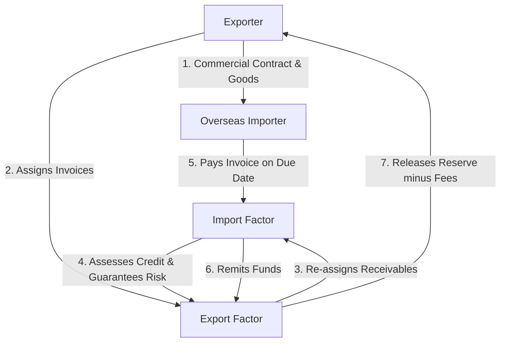
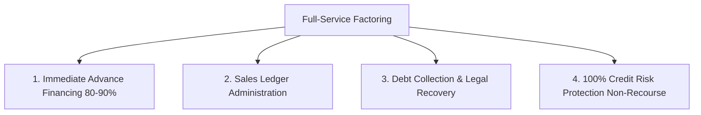
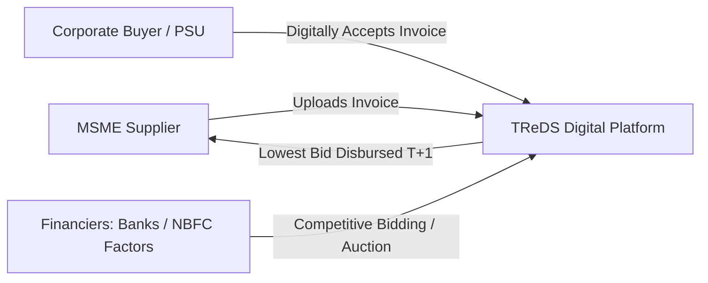
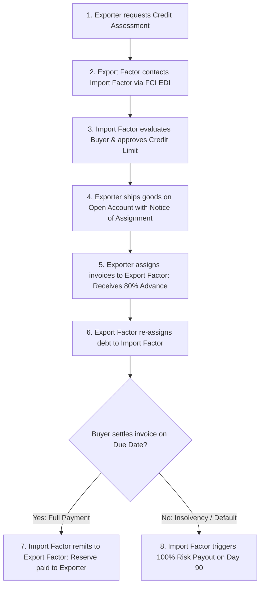
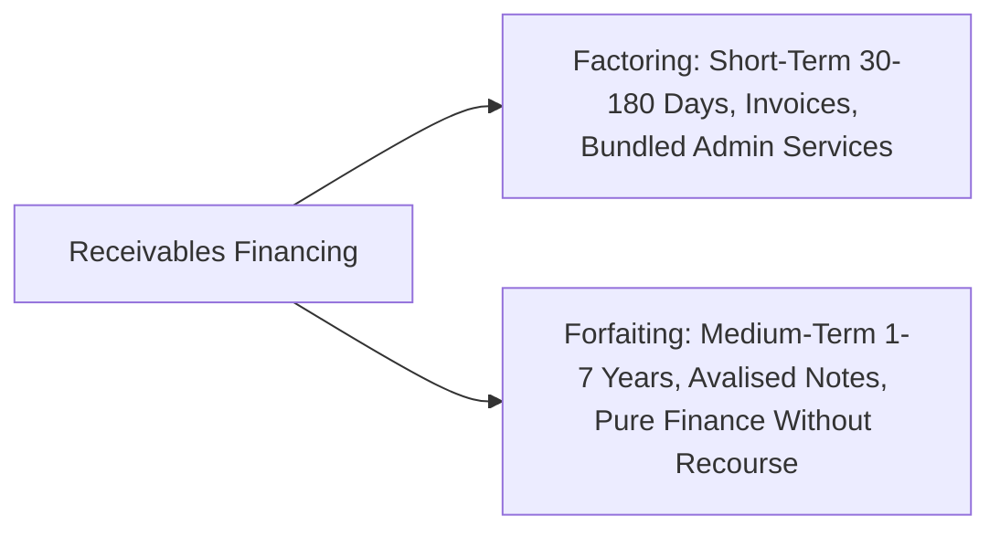
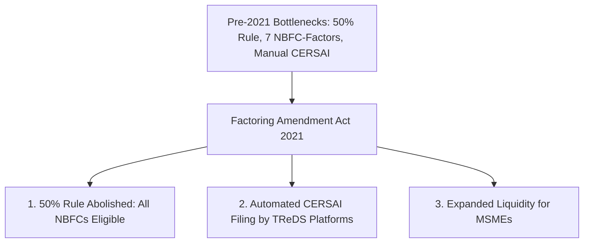
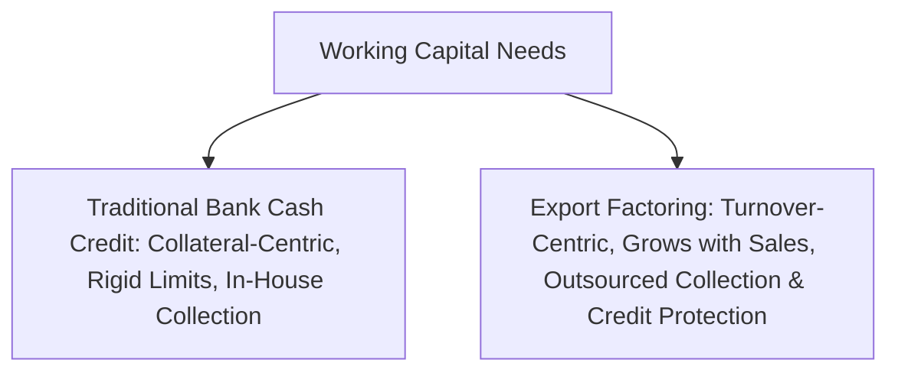
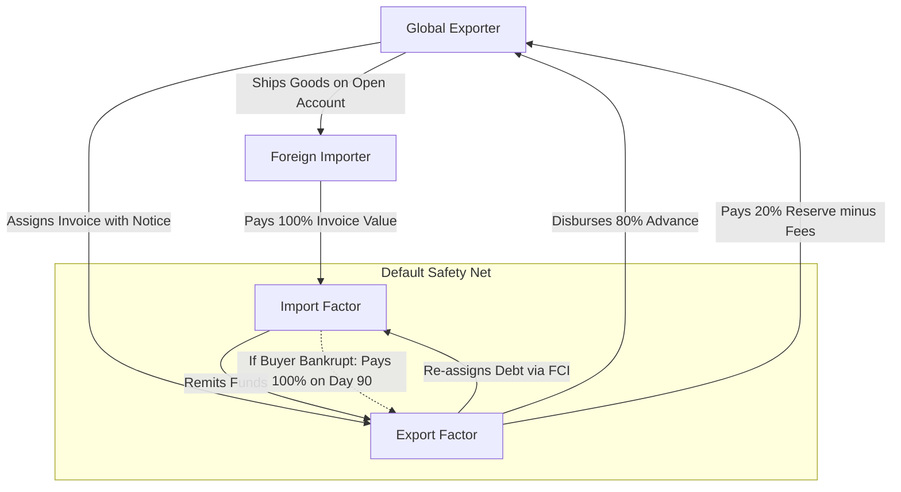
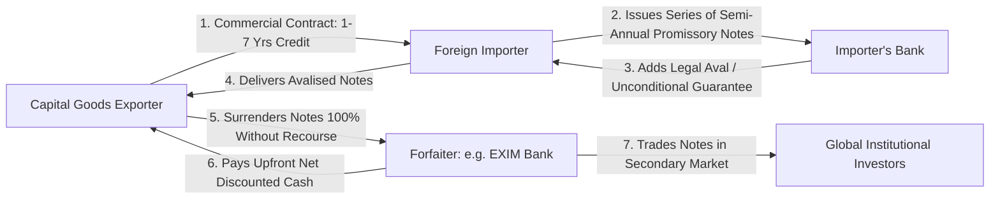

# Unit III: Factoring and Forfaiting in International Trade

This module delivers full-length university examination model answers covering the legal, financial, and operational architecture of international factoring, the two-factor mechanism under Factors Chain International (FCI), recourse vs. non-recourse factoring, factoring vs. forfaiting, the Factoring Regulation Act 2011 (with 2021 amendments), and trade receivables discount mechanisms (TReDS).

---

## Section A: 2-Mark Questions (Short / Definitive)

### Q1. Define International Factoring. (2 marks) | Likelihood: High | Type: Define
**Answer:**
**International Factoring** is a comprehensive financial arrangement whereby an export financing agency (Export Factor) purchases an exporter’s short-term cross-border open-account receivables, providing a suite of services comprising immediate working capital finance (up to 80-90% advance), sales ledger maintenance, debt collection, and credit protection against foreign buyer insolvency.

- **Keywords to include for full marks:** Open-account receivables, Export Factor, 80-90% advance finance, sales ledger administration, debt collection, credit protection.
- **Examiner trap:** Describing factoring as only a loan; it is an integrated financial and administrative package.
- **Memory trick:** **F-A-C-T** (Finance, Administration, Collection, Tenacity against bad debts).
- **Marking scheme guide:** Core definition of receivables purchase (1 mark); Four bundled services (1 mark).

---

### Q2. Identify the four core parties in an International Two-Factor System. (2 marks) | Likelihood: High | Type: Fact / List
**Answer:**
The four fundamental parties operating under the Factors Chain International (FCI) framework are:
1. **The Client (Exporter):** Sells goods and assigns receivables.
2. **The Debtor (Importer):** Purchases goods on credit and pays the invoices.
3. **The Export Factor:** Financial entity in the exporter's country providing finance and ledger handling.
4. **The Import Factor:** Financial entity in the buyer's country evaluating buyer credit, collecting funds, and guaranteeing 100% credit risk.

- **Keywords to include for full marks:** Client (Exporter), Debtor (Importer), Export Factor, Import Factor, Factors Chain International (FCI).
- **Examiner trap:** Naming "issuing bank" or "confirming bank"; those belong to Letter of Credit transactions.
- **Memory trick:** **C-D-E-I** (Client, Debtor, Export factor, Import factor).
- **Marking scheme guide:** Listing all four distinct parties accurately (2 marks).

---

### Q3. Distinguish between Recourse and Non-Recourse Factoring. (2 marks) | Likelihood: High | Type: Differentiate
**Answer:**
In **Recourse Factoring**, the factor does not assume credit risk; if the overseas buyer fails to pay due to financial insolvency, the factor recovers the advanced funds from the exporter. In **Non-Recourse Factoring**, the factor absorbs 100% of the credit risk; if the buyer goes bankrupt, the factor bears the loss and cannot demand repayment from the exporter.

- **Keywords to include for full marks:** Recourse (risk with exporter, factor recovers advance), Non-Recourse (factor absorbs 100% credit risk, no claim on exporter).
- **Examiner trap:** Thinking non-recourse covers commercial disputes; if the buyer rejects goods for defects, recourse re-applies even under non-recourse factoring.
- **Memory trick:** **No-Recourse = No-Recovery from exporter**.
- **Marking scheme guide:** Recourse definition (1 mark); Non-recourse definition & credit risk transfer (1 mark).

---

### Q4. Define Forfaiting in international trade finance. (2 marks) | Likelihood: High | Type: Define
**Answer:**
**Forfaiting** is the purchase of medium- to long-term export receivables (typically 1 to 7 years) evidenced by negotiable debt instruments (Bills of Exchange or Promissory Notes avalised or guaranteed by a bank) by a financial institution (the Forfaiter) on a **100% without-recourse** basis, discounting the entire face value upfront.

- **Keywords to include for full marks:** Medium-to-long term (1-7 years), negotiable instruments (Bills of Exchange/Promissory notes), avalised/bank guarantee, 100% without-recourse, upfront discounting.
- **Examiner trap:** Describing forfaiting for short-term 30-day consumer goods (it is designed for capital equipment).
- **Memory trick:** **Forfait = Surrender rights without recourse**.
- **Marking scheme guide:** Definition & tenure (1 mark); Without-recourse nature & instruments (1 mark).

---

### Q5. What is the primary objective of the Factoring Regulation (Amendment) Act 2021 in India? (2 marks) | Likelihood: Medium | Type: Law / Regulatory
**Answer:**
The **Factoring Regulation (Amendment) Act 2021** removed the restrictive "Principal Business" threshold (which required NBFCs to derive at least 50% of assets and income from factoring to register), thereby permitting **all eligible Non-Banking Financial Companies (NBFCs)** to undertake factoring business, exponentially broadening working capital access for MSMEs via the TReDS platform.

- **Keywords to include for full marks:** Factoring Amendment 2021, removal of 50% principal business threshold, all eligible NBFCs permitted, MSME liquidity, TReDS integration.
- **Examiner trap:** Stating the 2021 act banned NBFCs from factoring; it actually liberalized their entry.
- **Memory trick:** **2021 = Open Doors for All NBFCs**.
- **Marking scheme guide:** Removal of principal business condition (1 mark); Impact on MSMEs & TReDS (1 mark).

---

### Q6. What is a "Factoring Reserve" (Margin) and why is it retained? (2 marks) | Likelihood: Medium | Type: Define
**Answer:**
A **Factoring Reserve** (typically 10% to 20% of the invoice face value) is the portion of receivables withheld by the factor upon initial assignment and released only after the buyer settles the invoice, retained to absorb potential trade deductions such as cash discounts, volume rebates, short shipments, or quality dispute returns.

- **Keywords to include for full marks:** 10-20% withheld margin, invoice face value, retained against trade deductions, released upon final buyer settlement.
- **Examiner trap:** Confusing factoring reserve with interest; reserve is the exporter's own equity released upon full payment.
- **Memory trick:** **Reserve = Cushion against Deductions**.
- **Marking scheme guide:** Definition & percentage (1 mark); Protective purpose (1 mark).

---

## Section B: 5-Mark Questions (Structured Short Notes)

### Q7. Explain the operational mechanism of the International Two-Factor System under FCI rules. (5 marks) | Likelihood: High | Type: Procedure
**Answer:**
**Introduction:**
To bridge the geographic and legal divide between an exporter and a foreign buyer, the **Two-Factor System** links two affiliated factoring institutions under the uniform code of **Factors Chain International (FCI)**.

**Operational Workflow:**
1. **Credit Limit Request:** The exporter approaches the Export Factor in India, who requests the affiliated Import Factor in the buyer's nation to evaluate the buyer’s credit standing and approve a credit limit.
2. **Sales Contract & Notice of Assignment:** The exporter dispatches goods on open-account terms. Invoices carry a statutory **Notice of Assignment**, directing the importer to pay exclusively to the Import Factor.
3. **Receivables Assignment & Advance:** The exporter submits invoice copies to the Export Factor, who advances 80% of the value immediately.
4. **Collection & 100% Risk Underwriting:** The Import Factor monitors the sales ledger and collects payment. If the buyer becomes insolvent, the Import Factor pays 100% of the invoice value to the Export Factor within 90 days of the due date.
5. **Final Settlement:** Upon collecting proceeds, the Import Factor transfers funds to the Export Factor, who settles the remaining 20% reserve with the exporter after deducting service fees and discount charges.

- **Keywords to include for full marks:** Factors Chain International (FCI), Two-Factor system, Notice of Assignment, 80% advance, Import Factor credit guarantee, 90-day insolvency payout, Reserve release.
- **Examiner trap:** Missing the statutory "Notice of Assignment" printed on the commercial invoice.
- **Memory trick:** **L-A-A-C-S** (Limit approval, Assignment of invoice, Advance release, Collection, Settlement).
- **Marking scheme guide:** FCI framework & setup (1 mark); Step-by-step workflow stages (2.5 marks); Role of Import Factor as risk underwriter (1.5 marks).

---

### Q8. Discuss the key legal amendments introduced by the Factoring Regulation (Amendment) Act 2021 in India. (5 marks) | Likelihood: High | Type: Regulatory / Law
**Answer:**
**Introduction:**
Passed by the Indian Parliament in July 2021, the **Factoring Regulation (Amendment) Act 2021** revolutionized the domestic factoring ecosystem by amending the Factoring Regulation Act 2011 to ease credit bottlenecks for the Micro, Small, and Medium Enterprises (MSME) sector.

**Key Structural Amendments:**
1. **Liberalization of NBFC Participation:**
   - Under the 2011 Act, only NBFCs whose factoring business constituted at least 50% of total assets and 50% of gross income (NBFC-Factors) were permitted to undertake factoring.
   - The 2021 amendment **abolished this 50% threshold**, empowering the RBI to grant factoring licenses to all eligible Non-Banking Financial Companies (NBFCs), increasing participating entities from a handful to thousands.
2. **Integration with TReDS Platforms:**
   - Mandated that digital Trade Receivables Discounting System (TReDS) platforms automatically register charge assignments directly with the Central Registry of Securitisation Asset Reconstruction and Security Interest of India (**CERSAI**).
3. **Simplified Assignment Timelines:**
   - Slashed the regulatory registration timeframe for filing receivable charges with CERSAI from 30 days to a seamless, automated digital push conducted by TReDS operators, closing loopholes for double-financing fraud.

- **Keywords to include for full marks:** Factoring Regulation Amendment 2021, 50% principal business rule abolished, NBFC entry liberalization, TReDS platform, CERSAI automatic charge filing, anti-fraud mechanism.
- **Examiner trap:** Stating that the act eliminated RBI oversight; RBI continues to formulate prudential guidelines.
- **Memory trick:** **A-T-C** (Abolish 50% threshold, TReDS integration, CERSAI automated charge).
- **Marking scheme guide:** Historical constraint of 2011 Act (1.5 marks); Core 2021 amendments (2 marks); Impact on MSMEs & anti-fraud measures (1.5 marks).

---

### Q9. Explain the four core services bundled into a full-service factoring agreement. (5 marks) | Likelihood: High | Type: Explain
**Answer:**
**Introduction:**
Unlike traditional bank bill discounting, which focuses solely on asset financing, a **Full-Service Factoring (Old Line Factoring)** agreement provides an integrated portfolio of financial and managerial support services.

**The Four Bundled Functions:**
1. **Receivables Financing:** The factor provides immediate, off-balance-sheet cash advances (typically 80% to 90% of eligible invoice value) within 24 to 48 hours of invoice submission, converting illiquid trade credit into liquid working capital.
2. **Sales Ledger Administration:** The factor assumes the accounting burden of maintaining the client’s accounts receivable ledger, tracking invoice dispatch, recording customer receipts, sending periodic account statements, and reconciling balances.
3. **Credit Control and Debt Collection:** The factor employs specialized collection teams in the buyer's home country, sending friendly payment reminders, making telephonic calls, managing localized currency collections, and pursuing legal remedies when necessary.
4. **Credit Risk Underwriting (Credit Protection):** In non-recourse arrangements, the factor establishes pre-approved credit limits on each buyer. If an approved buyer undergoes legal insolvency or protracted payment default, the factor absorbs 100% of the bad debt loss.

- **Keywords to include for full marks:** Full-service factoring, 80-90% working capital advance, sales ledger maintenance, debt collection, credit risk underwriting, non-recourse protection.
- **Examiner trap:** Listing bank services like foreign exchange hedging; factoring covers receivables and ledger services.
- **Memory trick:** **F-A-C-P** (Finance, Administration, Collection, Protection).
- **Marking scheme guide:** 1.25 marks for each fully articulated service component (Total = 5 marks).

---

### Q10. What is Forfaiting? Explain how it operates in medium- and long-term export transactions. (5 marks) | Likelihood: High | Type: Explain
**Answer:**
**Introduction:**
Derived from the French term *à forfait* (to surrender a right), **Forfaiting** is a specialized trade finance technique used to finance the export of capital goods, heavy plant machinery, and turnkey infrastructure projects on medium- to long-term credit.

**Operational Mechanics:**
1. **Commercial Contract:** The exporter agrees to sell capital goods to an overseas buyer against extended deferred credit (e.g., semi-annual payments over 3 to 7 years).
2. **Negotiable Debt Instruments:** The importer issues a series of Promissory Notes or accepts a series of usance Bills of Exchange maturing at 6-month intervals.
3. **Avalisation / Bank Guarantee:** To make the paper marketable, the importer’s prominent local commercial bank writes an **Aval** (a formal irrevocable co-undertaking) or issues an independent unconditional Bank Guarantee directly on the notes.
4. **Non-Recourse Discounting:** The exporter surrenders these avalised instruments to a Forfaiter (e.g., EXIM Bank of India). The Forfaiter discounts the entire face value upfront and pays cash to the exporter on a **100% without-recourse basis**.
5. **Maturity Collection:** As each note matures, the Forfaiter presents it to the avalising guarantor bank for payment. If the buyer defaults, the Forfaiter claims against the guarantor bank, with zero claim on the exporter.

- **Keywords to include for full marks:** À forfait, Capital goods, 3 to 7 years tenure, Promissory Notes / Bills of Exchange, Avalisation, Without-recourse, EXIM Bank.
- **Examiner trap:** Forgetting to mention the "Aval" or bank guarantee; forfaiting requires an avalised instrument.
- **Memory trick:** **C-P-A-D-M** (Capital goods, Promissory notes, Aval, Discounting without recourse, Maturity).
- **Marking scheme guide:** Definition & capital goods context (1.5 marks); Role of negotiable instruments & Aval (1.5 marks); Without-recourse discounting mechanism (2 marks).

---

### Q11. Explain the cost structure of an International Factoring arrangement. (5 marks) | Likelihood: Medium | Type: Explain
**Answer:**
**Introduction:**
An exporter utilizing factoring incurs two distinct, transparent operational costs: a finance charge for the working capital borrowed and a service commission for the administrative and credit-protection services rendered.

**Cost Components:**
1. **Finance Cost (Discount Charge / Interest Rate):**
   - **Nature:** The cost of borrowing against the advanced funds (the 80% to 90% advance).
   - **Pricing Benchmark:** Calculated similarly to bank overdrafts, pegged to a reference benchmark (SOFR for USD, EURIBOR for EUR) plus an institutional risk spread (typically 1.5% to 3.0% p.a.).
   - **Tenure:** Charged strictly for the exact number of days from the date the advance is disbursed until the invoice is paid by the importer.
2. **Service Fee (Factoring Commission):**
   - **Nature:** A one-time administrative fee charged as a percentage of the gross invoice face value.
   - **Pricing Range:** Varies between **0.50% and 2.50%** of invoice value depending on buyer creditworthiness, importing country risk, annual turnover volume, and whether the arrangement is with recourse (lower fee) or non-recourse (higher fee).
   - **Coverage:** Compensates the factor for credit investigations, ledger administration, cross-border telecommunications, and 100% insolvency underwriting.

- **Keywords to include for full marks:** Finance charge (discount rate), SOFR/EURIBOR benchmark, daily interest calculation, Service commission (0.50% - 2.50%), gross invoice value, non-recourse premium.
- **Examiner trap:** Believing the service commission is charged on the advance amount; it is charged on the **gross invoice value**.
- **Memory trick:** **F-S** (Finance charge on advance; Service fee on gross).
- **Marking scheme guide:** Detailed breakdown of Finance Cost (2.5 marks); Detailed breakdown of Service Commission (2.5 marks).

---

### Q12. Write a short note on the Trade Receivables Discounting System (TReDS) in India. (5 marks) | Likelihood: High | Type: Short Note
**Answer:**
**Introduction:**
Set up under RBI guidelines pursuant to the Payment and Settlement Systems Act 2007, **TReDS** is an institutional digital auction mechanism designed to facilitate the discounting of trade receivables of MSME suppliers against corporate buyers, Public Sector Undertakings (PSUs), and government departments.

**Salient Operational Features:**
1. **Three-Party Ecosystem:** Connects MSME Sellers, Corporate/PSU Buyers, and Financiers (Banks and registered NBFC Factors) on a neutral, secure digital portal (e.g., RXIL, M1xchange, Invoicemart).
2. **Digital Factoring / Reverse Factoring:** The MSME uploads the invoice. Once digitally verified and accepted by the buyer, it converts into a standardized **Factoring Unit (FU)**.
3. **Competitive Transparent Bidding:** Multiple financial institutions bid their best discount rates. The MSME accepts the lowest bid, receiving cash within 24 hours (T+1).
4. **Without-Recourse to MSME:** Receivables are discounted without recourse to the MSME. On the maturity date, the financier recovers funds directly from the corporate buyer.
5. **Mandatory Onboarding:** The Government of India mandates all CPSEs and companies with a turnover exceeding ₹250 crore to onboard onto TReDS.

- **Keywords to include for full marks:** RBI initiative, TReDS, MSME receivables, Factoring Unit (FU), competitive reverse auction, without recourse, T+1 settlement, mandatory corporate onboarding.
- **Examiner trap:** Thinking TReDS is a bank; it is an electronic platform where banks and factors bid.
- **Memory trick:** **U-A-B-D** (Upload invoice, Accept by buyer, Bid by banks, Disburse T+1).
- **Marking scheme guide:** Institutional origin & purpose (1.5 marks); Workflow mechanics & bidding (2 marks); Regulatory mandate & MSME impact (1.5 marks).

---

## Section C: 10-Mark Questions (Detailed Analytical Answers)

### Q13. Detail the complete operational mechanics of an International Factoring transaction under the Factors Chain International (FCI) framework. Address credit evaluation, invoice assignment, advance disbursement, debt collection, and default settlement. (10 marks) | Likelihood: High | Type: Procedure / Exhaustive
**Answer:**
**Introduction:**
In international trade, open-account terms represent over 80% of global transactions. However, open account exposes exporters to significant risks: working capital lock-up and buyer non-payment. **International Factoring under the Factors Chain International (FCI) framework** addresses both challenges through a structured, cross-border institutional partnership between an **Export Factor** in the seller's country and an **Import Factor** in the buyer's country.

*(Exam 2-minute sketch guide: Draw a vertical sequence of 8 boxes showing the step-by-step path: Credit check $\to$ Shipment $\to$ Assignment $\to$ 80% Advance $\to$ Collection $\to$ Settlement/90-day Guarantee).*

#### 1. Preliminary Phase: Credit Evaluation and Limit Sanction
- The exporter submits the details of the prospective foreign buyer and projected sales volume to the domestic **Export Factor**.
- Using the standardized, encrypted communication network of Factors Chain International (**edifactoring.com**), the Export Factor transmits a credit assessment request to an affiliated **Import Factor** located in the buyer's country.
- The Import Factor investigates the buyer's financial records, local credit bureau scores, and payment track record.
- If satisfied, the Import Factor issues a formal **Credit Limit Approval**, undertaking a 100% credit guarantee on all invoices within that approved ceiling.

#### 2. Commercial Dispatch and Notice of Assignment
- The exporter manufactures and ships the merchandise under open-account credit terms (e.g., 60 or 90 days).
- The exporter generates the commercial invoice, which carries a legally binding **Notice of Assignment (Statutory Endorsement)** stating:
  > *"This invoice has been assigned to and is payable exclusively to [Name of Import Factor]. Payment to any other party will not constitute valid discharge."*
- Copies of the commercial invoice, packing list, and transport document (Bill of Lading) are delivered to the Export Factor.

#### 3. Invoice Assignment and Immediate Advance Disbursement
- The exporter executes a legal Deed of Assignment, transferring title to the receivables to the Export Factor.
- The Export Factor immediately disburses an **Advance Payment (typically 80% of the invoice face value)** into the exporter's operational bank account within 24 to 48 hours.
- The remaining 20% is credited to a **Factoring Margin Reserve Account** to safeguard against commercial disputes or trade deductions.

#### 4. Sales Ledger Administration and Cross-Border Collection
- The Export Factor re-assigns the invoices to the Import Factor.
- The Import Factor logs the transaction into its local ledger and monitors the credit timeline.
- As the maturity date approaches, the Import Factor conducts localized collection procedures, communicating in the buyer's native language and legal framework, collecting funds in local currency.

#### 5. Final Settlement or Credit Guarantee Payout
- **Scenario A (Normal Settlement):**
  - The buyer pays the full invoice amount to the Import Factor on the due date.
  - The Import Factor transfers funds electronically to the Export Factor.
  - The Export Factor deducts the initial 80% advance, its accrued financing interest charges, and the agreed service fee, immediately releasing the **net remaining balance (reserve)** to the exporter.
- **Scenario B (Buyer Insolvency / Default):**
  - If the buyer fails to pay due to financial bankruptcy or protracted default, the Import Factor's credit underwriting activates.
  - Under FCI rules, exactly **90 days after the invoice due date**, the Import Factor is legally obligated to remit 100% of the approved invoice face value to the Export Factor, completely protecting the exporter from bad debt losses.

**Conclusion:**
The FCI Two-Factor System converts high-risk cross-border open-account credit into secure transactions. By combining local credit expertise with international collection networks, it provides Indian exporters with working capital liquidity and total protection against foreign customer insolvency.

- **Keywords to include for full marks:** Factors Chain International (FCI), Two-Factor System, Notice of Assignment, 80% advance disbursement, Factoring Reserve (20%), Import Factor credit guarantee, 90-day insolvency payout rule, edifactoring.com.
- **Examiner trap:** Believing the Export Factor takes the foreign credit risk; the **Import Factor** provides the 100% credit guarantee under FCI rules.
- **Memory trick:** **E-I-A-C-S** (Evaluate, Invoicing with Notice, Advance disbursement, Collection, Settlement/Payout).
- **Marking scheme guide:** Credit evaluation & limit approval via FCI (2 marks); Invoicing, Notice of Assignment & 80% advance (2.5 marks); Collection mechanics & ledger administration (2 marks); Payout scenarios: Normal vs 90-day default rule (2.5 marks); Conclusion & diagrams (1 mark).

---

### Q14. Critically compare Factoring with Forfaiting across tenure, instruments, recourse, costs, secondary market tradability, and suitable commodity types. (10 marks) | Likelihood: High | Type: Compare / Comprehensive
**Answer:**
**Introduction:**
Both factoring and forfaiting are specialized receivables-financing techniques designed to accelerate cash flow by monetizing uncollected sales. However, they serve distinct market segments: factoring is optimized for short-term, recurrent consumer and industrial trade, while forfaiting is engineered to finance large-scale, long-term capital goods and turnkey infrastructure exports.

#### Detailed Comparative Analysis

| Analytical Parameter | Factoring | Forfaiting |
| :--- | :--- | :--- |
| **1. Nature of Underlying Goods** | Consumer products, textiles, chemicals, auto parts, recurrent industrial consumables. | Heavy capital machinery, aerospace equipment, power plants, turnkey projects. |
| **2. Credit Tenure** | **Short-term**; strictly 30 to 180 days (rarely up to 360 days). | **Medium to Long-term**; ranging from **1 year to 7 years**. |
| **3. Financial Instruments Used** | Book debts, sales ledgers, open-account trade invoices without bills. | Negotiable instruments: **Promissory Notes or Bills of Exchange**. |
| **4. Third-Party Credit Enhancement** | Relies on the Import Factor's credit assessment; no external bank guarantee. | **Mandatory Aval** (bank co-guarantee) or independent unconditional bank guarantee. |
| **5. Advance Financing Percentage** | **80% to 90%** advanced upfront; 10% to 20% retained as margin reserve. | **100% of discounted value** paid upfront; **zero margin reserve** retained. |
| **6. Recourse Architecture** | Can be **With Recourse** or **Without Recourse** (depending on contract). | **Strictly 100% Without Recourse** to the exporter under all circumstances. |
| **7. Bundling of Extra Services** | **Full service package:** sales ledger handling, debt collection, credit evaluation. | **Pure financial transaction:** no ledger maintenance or administrative collection services. |
| **8. Secondary Market Tradability** | **Non-tradable**; factoring debts are tailored bilateral relationships. | **Highly liquid secondary market**; avalised promissory notes are freely traded globally. |
| **9. Transactional Frequency** | Continuous, revolving turnover basis across ongoing client sales. | Individual, one-off large transactions evaluated on a case-by-case basis. |
| **10. Regulatory / Institutional Base** | Regulated in India by Factoring Regulation Act 2011; governed globally by FCI. | Promoted in India primarily by EXIM Bank; governed globally by ICC URF 800 rules. |

#### Strategic Trade Evaluation: When to Choose Which?
1. **Choose Factoring When:**
   - The exporter engages in regular, high-frequency shipments of standard manufactured products to multiple retail or wholesale distributors.
   - The exporter lacks a dedicated credit control and collections department and seeks to outsource sales ledger administration.
2. **Choose Forfaiting When:**
   - An Indian engineering exporter bids on an international tender for infrastructure or railway rolling stock where foreign buyers demand multi-year deferred credit terms.
   - The exporter cannot afford balance sheet debt exposure and requires immediate 100% without-recourse cash settlement against avalised bank notes.

**Conclusion:**
Factoring provides operational efficiency and short-term working capital for recurring trade, whereas forfaiting acts as an off-balance-sheet financing instrument that enables capital equipment manufacturers to compete globally on deferred credit terms.

- **Keywords to include for full marks:** Short-term vs Medium-to-long term, Book debts vs Promissory notes, Aval/Bank guarantee, 80-90% advance vs 100% discounting, Without recourse, Bundled services, Secondary market liquidity, EXIM Bank.
- **Examiner trap:** Stating that forfaiting includes sales ledger administration; forfaiting is strictly a discounting financing mechanism.
- **Memory trick:** **T-I-R-G-A** (Tenure, Instruments, Recourse, Guarantee/Aval, Administration).
- **Marking scheme guide:** Tabular comparison across 8+ distinct parameters (6 marks); Strategic selection criteria & trade contexts (3 marks); Conclusion & diagrams (1 mark).

---

### Q15. Examine the Factoring Regulation Act 2011 and trace the structural bottlenecks that hindered factoring in India prior to 2021. Critically analyze how the Factoring Regulation (Amendment) Act 2021 addresses these challenges. (10 marks) | Likelihood: High | Type: Legal / Regulatory Evaluation
**Answer:**
**Introduction:**
Factoring serves as a vital tool to unlock working capital trapped in unpaid supply chain receivables. While factoring has powered European and East Asian export competitiveness for decades, its growth in India remained severely constrained for years. The enactment of the **Factoring Regulation Act 2011** provided the initial statutory foundation, but embedded restrictive definitions that choked institutional participation. The **Factoring Regulation (Amendment) Act 2021** marked a historic turning point, dismantling regulatory barriers to integrate NBFCs and digital fintech platforms into trade financing.

#### 1. The Statutory Architecture of the Factoring Regulation Act 2011
- Enacted to define the legal rights of factors, streamline assignments, and protect financing agencies against debtor defaults.
- Mandated that every assignment of receivables must be registered with the Central Registry (**CERSAI**) to prevent fraudulent multiple assignments of the same bill.
- Recognized the legal validity of the "Notice of Assignment" served on debtors.

#### 2. Structural Bottlenecks under the 2011 Act
Despite its legislative intent, the 2011 Act contained fatal structural restrictions that suppressed the factoring market:
1. **The Restrictive "Principal Business" Test:**
   - Section 3 mandated that only companies whose factoring assets and factoring income constituted **at least 50% of their total assets and net income** could register as "NBFC-Factors".
   - Because standard NBFCs engage across diversified lending (vehicle loans, real estate, personal credit), almost all of India’s 9,000+ NBFCs were disqualified.
   - In practice, only **seven NBFC-Factors** operated in the entire country, creating an oligopoly with negligible credit delivery to MSMEs.
2. **Cumbersome CERSAI Registration Timelines:**
   - Factoring entities were given a loose 30-day window to register charges with CERSAI. This manual delay enabled unscrupulous borrowers to discount the same invoice across multiple banks simultaneously.
3. **Exclusion of TReDS Automated Integration:**
   - The 2011 Act had no provisions for digital clearing mechanisms, forcing manual paper documentation that negated the speed advantages of online invoice discounting.

#### 3. Transformative Interventions of the Amendment Act 2021
The 2021 Amendment eliminated these barriers through three structural reforms:
1. **Dismantling the 50% Asset/Income Barrier:**
   - The Act revoked the restrictive qualification test. The RBI was empowered to permit **any eligible Non-Banking Financial Company** to engage in factoring business, instantly injecting hundreds of tech-enabled lenders into the ecosystem.
2. **Automated TReDS-CERSAI Integration:**
   - The amendment allowed authorized TReDS platforms to directly push electronic charge registrations to the CERSAI registry on behalf of participating factors.
   - This eradicated double-financing fraud and cut transaction turnaround times from weeks to hours.
3. **Clarification of Assignment Rules:**
   - Refined legal definitions of "receivables", "assignment", and "debtor" to eliminate ambiguities in judicial recovery proceedings under the Commercial Courts Act.

**Conclusion:**
The 2021 Amendment modernized India's factoring framework. By transforming factoring from a restricted, oligopolistic lending niche into a dynamic, platform-driven marketplace, it expanded working capital access for millions of liquidity-starved MSME enterprises.

- **Keywords to include for full marks:** Factoring Regulation Act 2011, Amendment Act 2021, 50% Principal Business condition, NBFC-Factors, CERSAI automated registration, TReDS platform integration, Double financing fraud, MSME liquidity.
- **Examiner trap:** Failing to explain the specific "50% asset and 50% income" rule that crippled participation under the 2011 Act.
- **Memory trick:** **P-O-A-T** (Principal business rule, Oligopoly of 7 firms, Amendment 2021, TReDS integration).
- **Marking scheme guide:** Foundations & objectives of 2011 Act (2.5 marks); Detailed analysis of the three pre-2021 bottlenecks (3 marks); Specific interventions of 2021 Amendment (3.5 marks); Conclusion (1 mark).

---

### Q16. Compare the risk-mitigation, liquidity, and administrative benefits of Factoring with traditional Bank Cash Credit (Overdraft) facilities for an Indian exporter. (10 marks) | Likelihood: Medium | Type: Analytical / Evaluation
**Answer:**
**Introduction:**
Working capital is the operational fuel of manufacturing and merchant exporters. Traditionally, Indian enterprises have relied on bank Cash Credit (CC) or Overdraft (OD) lines secured against real estate collateral. However, as international trade expanded on open-account terms, **Factoring** emerged as a superior, flexible alternative that links financing directly to sales turnover rather than static physical assets.

#### Detailed Comparative Matrix

| Evaluation Dimension | Traditional Bank Cash Credit (CC) | Export Factoring Facility |
| :--- | :--- | :--- |
| **1. Primary Collateral Base** | **Rigid physical collateral:** factory land, residential property, personal director guarantees. | **The trade debt itself:** financing is sanctioned against the credit standing of overseas buyers. |
| **2. Flexibility & Limit Growth** | Fixed annual limit; scaling up requires pledging additional real estate assets. | **Elastic & self-expanding:** as export sales grow, factoring advance limits expand automatically. |
| **3. Balance Sheet Impact** | Reflected as a direct borrowing liability, elevating corporate debt-to-equity ratios. | Often structured as **off-balance-sheet financing** (true sale of assets), improving leverage ratios. |
| **4. Credit Risk Protection** | Zero protection; if foreign buyer defaults, bank debits exporter's account immediately. | **100% Credit Protection** under non-recourse terms against buyer insolvency. |
| **5. Sales Ledger Administration** | Exporter must maintain internal accounts receivable ledgers, billing, and statements. | **Completely outsourced:** factor manages ledger maintenance and accounting. |
| **6. Debt Collection Capabilities** | Bank plays zero role in collecting cross-border debts; exporter must chase overseas buyers. | **Specialized local collection:** Import Factor uses native language and local legal teams abroad. |
| **7. Credit Intelligence on Buyers** | Bank offers no buyer evaluation; exporter relies on untested market rumors. | Factor provides institutional, real-time credit ratings on overseas buyers via FCI networks. |

#### Strategic Trade Evaluation
1. **Collateral Conservation:**
   - Small and medium enterprises (MSMEs) with limited property holdings are routinely blocked from expanding bank cash credit lines. Factoring unlocks capital based on invoice quality rather than immovable assets.
2. **Operational Efficiency:**
   - By outsourcing collections and credit assessment to the factor, the exporter reduces administrative overhead, allowing management to focus on product design, manufacturing, and international marketing.

**Conclusion:**
While traditional bank credit remains cost-effective for pure domestic operational overheads, factoring offers an agile, multi-dimensional solution for expanding export operations, combining sales-linked liquidity with balance sheet protection and cross-border collection support.

- **Keywords to include for full marks:** Cash Credit (CC) vs Factoring, Immovable collateral vs Trade receivables, Elastic limits, Off-balance-sheet financing, Non-recourse credit protection, Outsourced sales ledger, FCI credit intelligence.
- **Examiner trap:** Claiming that bank cash credit includes credit risk protection; cash credit is always with 100% recourse to the borrower.
- **Memory trick:** **C-E-L-P-A** (Collateral, Elasticity, Leverage, Protection, Administration).
- **Marking scheme guide:** Conceptual definitions (1.5 marks); Tabular contrast across 7 dimensions (5.5 marks); Strategic evaluation for MSMEs (2 marks); Conclusion (1 mark).

---

## Section D: 15-Mark Questions (Comprehensive Masters)

### Q17. Provide an exhaustive analysis of the International Factoring Mechanism. Trace the historical evolution of factoring, detail the two-factor operational cycle under FCI, examine the legal implications of the Notice of Assignment, and contrast factoring with letters of credit and credit insurance as risk mitigation instruments. (15 marks) | Likelihood: High | Type: Comprehensive Master
**Answer:**
**Introduction:**
In modern international trade, over 80% of transactions occur on open-account credit terms rather than traditional documentary Letters of Credit. While open-account trading expands export sales, it shifts working capital burdens and foreign buyer credit risks onto the exporter. **International Factoring** solves this structural dilemma by providing working capital advances, professional sales ledger management, cross-border debt collections, and bad-debt underwriting. Standardized internationally by **Factors Chain International (FCI)**, factoring bridges the divide between open-account commercial freedom and banking safety.

*(Exam 2-minute sketch guide: Draw the full four-corner FCI architecture: Exporter $\leftrightarrow$ Importer at top, Export Factor $\leftrightarrow$ Import Factor at bottom, connecting with arrows for physical shipment, assignment, 80% advance, payment, and the 90-day guarantee safety net).*

---

#### 1. Historical Evolution of Factoring
- **Ancient Origins:** Factoring dates back to Roman times, where commercial agents (*factores*) managed agricultural estates and goods distribution on commission.
- **The Colonial Textile Era:** In the 18th and 19th centuries, British and European textile mills appointed factors in North America to receive consigned cloth, assess the credit of local merchants, and hold inventory. Over time, factors shifted from handling physical goods to purchasing the underlying trade debts.
- **The Modern Era & FCI:** In 1968, leading global factoring institutions established **Factors Chain International (FCI)** in Amsterdam. Today, FCI encompasses over 400 financial institutions across 90 countries, enforcing standardized legal codes (**General Rules for International Factoring - GRIF**) and secure electronic message transmission via **edifactoring.com**.

---

#### 2. The Complete Two-Factor Operational Cycle under FCI
The international factoring workflow operates across five distinct phases:
1. **Credit Limit Application:** The exporter approaches the domestic Export Factor with details of the overseas buyer. The Export Factor queries the affiliated Import Factor in the buyer's home country to assess the buyer's financial health and assign a credit limit.
2. **Sales Contract Execution:** Goods are dispatched under open account (e.g., 60 or 90 days credit).
3. **The Legal Notice of Assignment:** The invoice carries a mandatory legal notice informing the buyer that the debt has been assigned to the Import Factor and that payment to any other party will not discharge the debt.
4. **Advance Financing:** Upon receiving shipping documents and invoice copies, the Export Factor advances **80% to 90%** of the net invoice value to the exporter, holding a 10% to 20% margin reserve.
5. **Collection and Default Liquidation:**
   - The Import Factor manages the sales ledger, tracking maturity and collecting payments locally in the buyer's currency.
   - Upon collection, the Import Factor remits funds to the Export Factor, who releases the reserve to the exporter after deducting financing interest and service commissions.
   - **The 90-Day Insolvency Rule:** If the buyer defaults due to financial insolvency, the Import Factor is legally required to pay 100% of the approved invoice face value to the Export Factor exactly **90 days after the maturity date**.

---

#### 3. Legal Implications of the "Notice of Assignment"
The **Notice of Assignment** is the critical legal pivot of factoring:
- **Equitable to Legal Assignment:** Under the Transfer of Property Act 1882 (Section 130 in India) and common law principles, an assignment of an actionable claim is binding on the debtor only once formal written notice is served.
- **Discharge Protection:** Once the notice is served, the debtor cannot legally claim discharge by paying the original exporter. If the buyer mistakenly pays the exporter, the factor retains the legal right to demand payment from the debtor again.
- **Preservation of Equities:** The debtor retains the right to assert valid commercial counterclaims or set-offs (e.g., defective goods, short shipments) arising from that contract against the factor. To mitigate this risk, factors hold a **margin reserve**.

---

#### 4. Strategic Comparison: Factoring vs. Letter of Credit vs. Credit Insurance

| Parameter | International Factoring | Documentary Letter of Credit (LC) | Export Credit Insurance (ECGC) |
| :--- | :--- | :--- | :--- |
| **1. Commercial Attractiveness** | **Very High:** Buyer enjoys open account credit without blocking bank lines. | **Low:** Buyer's bank freezes credit limits and charges high LC issuance fees. | **High:** Goods shipped on open account or collection terms. |
| **2. Financing Integration** | **Direct & Immediate:** Provides 80-90% working capital advance upfront. | Indirect: Exporter must independently arrange bill discounting with banks. | **Zero financing:** Insurance provides only post-loss indemnification, not cash advances. |
| **3. Administrative Relief** | **Complete:** Factor handles sales ledger, tracking, and cross-border collections. | Minimal: Exporter must generate complex, discrepancy-free shipping documents. | **Zero:** Exporter maintains their own ledgers and conducts all debt recovery. |
| **4. Default Indemnity Level** | **100% of approved credit limit** paid by Import Factor on Day 90. | 100% paid by issuing bank, subject to strict documentary compliance. | **80% to 90%** of loss indemnified after extensive claims verification. |
| **5. Claim Settlement Speed** | **Fast:** Automatic settlement within **90 days** under FCI standardized rules. | Fast: 5 banking days upon presentation of conforming documents. | **Slow:** Claims processing often takes 6 to 12 months after default. |

**Conclusion:**
International Factoring provides an integrated solution for modern trade. While Letters of Credit remain essential for high-risk, one-off project exports, factoring offers the optimal combination of buyer-friendly open-account terms, immediate cash-flow liquidity, outsourced ledger administration, and comprehensive credit risk protection.

- **Keywords to include for full marks:** Factors Chain International (FCI), General Rules for International Factoring (GRIF), Notice of Assignment, Section 130 Transfer of Property Act, 80-90% advance, 90-day insolvency payout rule, Factoring vs LC vs ECGC, Off-balance-sheet financing.
- **Examiner trap:** Claiming credit insurance provides upfront cash advances; insurance pays only after an insured default occurs.
- **Memory trick:** **H-F-A-L-C** (History, FCI mechanics, Assignment notice, Legal framework, Comparative synthesis).
- **Marking scheme guide:** Historical evolution & FCI governance (3 marks); Complete two-factor cycle with diagram (4 marks); Legal implications of Notice of Assignment (3 marks); Detailed comparative matrix (Factoring vs LC vs ECGC) (4 marks); Strategic conclusion (1 mark).

---

### Q18. Examine Forfaiting as an off-balance-sheet trade financing instrument for capital goods exports. Detail the legal structure of the Aval, the roles of the primary and secondary forfaiting markets, and formulate a mathematical model for computing the net forfaiting proceeds. (15 marks) | Likelihood: High | Type: Technical / Mathematical Master
**Answer:**
**Introduction:**
Exporters of capital goods, heavy industrial equipment, and turnkey infrastructure projects face a unique competitive challenge: overseas buyers demand medium- to long-term financing (1 to 7 years) before committing to major investments. However, carrying multi-year trade receivables on an exporter’s balance sheet exhausts working capital credit lines and exposes the firm to long-term sovereign, currency, and counterparty default risks. **Forfaiting** solves this structural dilemma. Regulated internationally by the ICC under the **Uniform Rules for Forfaiting (URF 800)**, it provides an off-balance-sheet financing mechanism that converts deferred medium-term paper into immediate, non-recourse cash.

*(Exam 2-minute sketch guide: Draw a horizontal sequence: Exporter $\leftrightarrow$ Importer $\to$ Bank Aval $\to$ Notes to Forfaiter $\to$ Upfront Cash to Exporter $\to$ Secondary Market trading).*

---

#### 1. The Legal Structure and Architecture of the "Aval"
- **The Core Instrument:** Forfaiting is evidenced by negotiable debt instruments—either a series of Promissory Notes issued by the importer or Bills of Exchange drawn by the exporter and accepted by the importer, typically maturing at 6-month intervals over 3 to 7 years.
- **The Concept of the Aval:**
  - An **Aval** is a specialized endorsement derived from continental European civil law, written directly onto the face of the promissory note or bill of exchange with the words: *"Per Aval as guarantor for the maker/drawee"*, followed by the signature of a reputable commercial bank.
  - **Legal Effect of the Aval:**
    - The avalising bank assumes a **joint and several, primary, unconditional, and irrevocable guarantee** to pay the face value of the note at maturity.
    - The aval is completely independent of the underlying commercial contract; the bank cannot refuse payment by citing defective goods or contractual disputes.
    - If the country's legal system does not recognize the aval, the bank issues an independent, unconditional **Bank Guarantee**.

---

#### 2. Primary and Secondary Forfaiting Markets
- **Primary Forfaiting Market:**
  - The bilateral transaction between the exporter and the primary forfaiting institution (e.g., EXIM Bank of India, London forfaiting houses).
  - The Forfaiter issues a binding **Commitment Letter**, agreeing to discount the notes at a specified discount rate (pegged to SOFR plus a margin), charging a commitment fee during the delivery lead-time.
  - Upon receiving the avalised notes, the Forfaiter disburses cash to the exporter on a **100% without-recourse basis**.
- **Secondary Forfaiting Market:**
  - Unlike factoring book debts, avalised promissory notes are standardized, negotiable financial instruments.
  - Forfaiters frequently trade these instruments in the international secondary market in London, Zurich, or Singapore.
  - Global pension funds, private banks, and institutional investors purchase these notes to earn attractive fixed yields backed by top-tier emerging market bank guarantees.

---

#### 3. Mathematical Model for Computing Forfaiting Proceeds
Forfaiting discounts are calculated using two standard international conventions: **Discount to Yield (Straight Discount)** or **Discount on Face Value**.

#### Formulation: Straight Discount to Yield (Standard Banking Formula)
$$\text{Discount Amount } (D) = \frac{F \times R \times T}{360 \times 100}$$
$$\text{Net Proceeds Paid to Exporter } (P) = F - D$$

Where:
- $F$ = Aggregate Face Value of the Promissory Note.
- $R$ = Agreed Forfaiting Discount Rate (% p.a.), comprising Reference Rate (SOFR) + Bank Margin.
- $T$ = Total Number of Days to Maturity + **Days of Grace** (typically 3 to 7 days added for international clearing).
- $360$ = Standard international banking year convention (Money Market basis).

#### Comprehensive Multi-Tranche Numerical Application
An Indian engineering exporter ships CNC milling machinery worth **USD 600,000** to Brazil on 1-year deferred credit, payable in two equal semi-annual Promissory Notes of **USD 300,000 each**, avalised by Banco do Brasil.
- Agreed Forfaiting Discount Rate: **8.0% p.a.**
- Days of Grace: **5 days** per note.
- Note 1 matures in 180 days $\implies T_1 = 180 + 5 = 185\text{ days}$.
- Note 2 matures in 360 days $\implies T_2 = 360 + 5 = 365\text{ days}$.

**Calculation for Note 1 ($F_1 = \$300,000$):**
$$D_1 = \frac{300,000 \times 8.0 \times 185}{36,000} = \frac{44,400,000}{36,000} = \$12,333.33$$
$$P_1 = \$300,000 - \$12,333.33 = \$287,666.67$$

**Calculation for Note 2 ($F_2 = \$300,000$):**
$$D_2 = \frac{300,000 \times 8.0 \times 365}{36,000} = \frac{87,600,000}{36,000} = \$24,333.33$$
$$P_2 = \$300,000 - \$24,333.33 = \$275,666.67$$

**Total Upfront Cash Disbursed to Exporter:**
$$\text{Total Net Proceeds} = P_1 + P_2 = \$287,666.67 + \$275,666.67 = \$563,333.34$$
$$\text{Total Forfaiting Cost Incurred} = D_1 + D_2 = \$12,333.33 + \$24,333.33 = \$36,666.66$$

---

#### 4. Strategic Benefits to Exporters
1. **100% Without-Recourse Liquidity:** The exporter converts a risky 1-year deferred asset into instant cash, eliminating credit, interest-rate, and sovereign default risk.
2. **Off-Balance-Sheet Treatment:** The transaction is recognized as a completed asset sale, removing debt from the balance sheet and improving return on capital employed (ROCE).
3. **Competitive Edge:** The exporter can offer flexible credit terms to foreign buyers without straining its own working capital limits.

**Conclusion:**
Forfaiting transforms long-term deferred credit into immediate liquidity. By relying on negotiable instruments and bank avals, it shifts credit risk to institutional markets, enabling capital goods exporters to compete aggressively in global markets.

- **Keywords to include for full marks:** Forfaiting, URF 800, Promissory Notes, Aval, Primary vs Secondary forfaiting market, Discount to Yield formula, Days of Grace, Off-balance-sheet financing, 100% without-recourse, EXIM Bank.
- **Examiner trap:** Omitting "Days of Grace" in the discounting formula; international forfaiting always incorporates 3 to 7 clearing grace days.
- **Memory trick:** **A-P-M-D-S** (Aval, Primary market, Mathematical formula, Days of grace, Secondary liquidity).
- **Marking scheme guide:** Conceptual foundations & URF 800 (2.5 marks); Legal structure of the Aval (3 marks); Primary and secondary market mechanics (2.5 marks); Complete mathematical formulation & worked multi-tranche problem (5 marks); Strategic benefits & conclusion (2 marks).

---

## Section E: "Differentiate Between" Questions (Master Tables)

### Q19. Differentiate between Factoring and Forfaiting. (5 marks) | Likelihood: High | Type: Differentiate
**Answer:**

| Feature | Factoring | Forfaiting |
| :--- | :--- | :--- |
| **1. Credit Tenure** | Short-term (30 to 180 days, max 360 days). | Medium-to-long term (**1 year to 7 years**). |
| **2. Eligible Goods** | Consumer products, textiles, standard industrial items. | Heavy capital machinery, equipment, project exports. |
| **3. Financial Instrument** | Ordinary book debts, open-account trade invoices. | Negotiable instruments: **Promissory Notes / Bills of Exchange**. |
| **4. Bank Guarantee** | None required; uses factor’s credit evaluation. | **Mandatory Aval** or unconditional Bank Guarantee. |
| **5. Recourse Terms** | Available as **With Recourse** or **Without Recourse**. | **Strictly 100% Without Recourse** to the exporter. |
| **6. Bundled Services** | Bundles financing, ledger handling, and collections. | **Pure financial discounting**; no ledger or collection services. |

- **Keywords to include for full marks:** Short-term vs 1-7 years, Book debts vs Promissory notes, Aval requirement, With/without recourse vs strictly without recourse, Bundled services vs pure finance.
- **Examiner trap:** Writing that factoring can be done for a 5-year bridge loan.
- **Marking scheme guide:** 1 mark per distinct, well-developed comparative row (up to 5 marks).

---

### Q20. Differentiate between Recourse Factoring and Non-Recourse Factoring. (5 marks) | Likelihood: High | Type: Differentiate
**Answer:**

| Parameter | Recourse Factoring | Non-Recourse Factoring |
| :--- | :--- | :--- |
| **1. Bad Debt Credit Risk** | Retained fully by the **client (exporter)**. | Absorbed 100% by the **factor** (up to credit limit). |
| **2. Default Consequence** | Factor recovers the advanced funds from the exporter. | Factor absorbs the financial loss; no claim on exporter. |
| **3. Default Payout Timing** | Exporter must repay advance upon customer default. | Factor pays full invoice value on Day 90 under FCI. |
| **4. Service Fee Level** | Lower commission (e.g., 0.5% - 1.0% of invoice). | Higher commission (e.g., 1.5% - 2.5% of invoice). |
| **5. Buyer Credit Scrutiny** | Moderate; focus is primarily on exporter’s stability. | Rigorous; factor conducts deep financial vetting of buyer. |
| **6. Commercial Disputes** | Factor claims refund immediately on dispute. | **Recourse reverts to exporter** if buyer disputes quality. |

- **Keywords to include for full marks:** Credit risk retention, Factor absorbs loss, Day 90 payout, Commission pricing differential, Commercial dispute reversion.
- **Examiner trap:** Assuming non-recourse covers trade disputes; if goods are defective, recourse automatically reverts to the exporter.
- **Marking scheme guide:** 1 mark per accurate comparative row (up to 5 marks).

---

### Q21. Differentiate between Factoring and Traditional Bank Bill Discounting. (5 marks) | Likelihood: High | Type: Differentiate
**Answer:**

| Dimension | Factoring | Bank Bill Discounting |
| :--- | :--- | :--- |
| **1. Underlying Document** | Open-account trade invoices and book debts. | Formal **Bill of Exchange** or Promissory Note. |
| **2. Scope of Services** | Financing, ledger handling, collections, credit cover. | **Pure financing only**; no administrative or ledger services. |
| **3. Recourse Nature** | Available as With Recourse or **Without Recourse**. | Almost exclusively **With Recourse** to the borrower. |
| **4. Off-Balance-Sheet** | Yes; non-recourse functions as a true asset sale. | No; recorded as a borrowing liability on the balance sheet. |
| **5. Credit Underwriting** | Based on overseas buyer’s credit standing. | Based primarily on the borrower’s collateral and standing. |
| **6. Notice to Buyer** | Notice of Assignment clearly printed on invoices. | Typically unnotified to buyer unless accepted under LC. |

- **Keywords to include for full marks:** Open account vs Bill of Exchange, Bundled services vs pure finance, Without recourse option, Off-balance-sheet, Notice of Assignment.
- **Examiner trap:** Believing bank bill discounting manages the customer's sales ledger.
- **Marking scheme guide:** 1 mark per distinct comparative row (up to 5 marks).

---

## Section F: "Write Short Notes On" Questions

### Q22. Write a short note on the legal concept of the "Notice of Assignment" in Factoring. (5 marks) | Likelihood: High | Type: Short Note
**Answer:**
**Introduction:**
The **Notice of Assignment** is a formal, statutory notification endorsed on commercial invoices notifying the debtor (importer) that title to the receivables has been legally transferred from the creditor (exporter) to the financing factor.

**Legal and Operational Significance:**
1. **Statutory Transfer under Law:** Under Section 130 of the Transfer of Property Act 1882 (and the Factoring Regulation Act 2011), an actionable claim can be legally assigned only when executed in writing and perfected through formal notice to the debtor.
2. **Sole Legal Discharge:** The notice explicitly states: *"Payment must be made exclusively to [Factor Name] to constitute valid legal discharge of this debt."* If the buyer ignores this instruction and remits payment to the exporter, the factor retains the legal right to enforce payment from the buyer a second time.
3. **Preservation of Equities:** The notice freezes the buyer’s rights. The debtor can assert against the factor only those commercial defenses or counterclaims that existed prior to receiving the notice.

- **Keywords to include for full marks:** Notice of Assignment, Section 130 Transfer of Property Act, Factoring Regulation Act, Valid legal discharge, Actionable claim, Preservation of equities.
- **Examiner trap:** Thinking the notice is a separate document mailed later; it must be clearly printed on the commercial invoice.
- **Memory trick:** **N-O-T-I-C-E** (Notification, Open-account invoice, Transfer of debt, Invalidate direct pay, Claim equities, Enforceable by law).
- **Marking scheme guide:** Statutory basis & definition (1.5 marks); Legal discharge implications (2 marks); Equities & dispute boundaries (1.5 marks).

---

### Q23. Write a short note on Factors Chain International (FCI) and the GRIF framework. (5 marks) | Likelihood: Medium | Type: Short Note
**Answer:**
**Introduction:**
Founded in 1968 and headquartered in Amsterdam, **Factors Chain International (FCI)** is the global governing body for cross-border factoring, connecting over 400 financial institutions across 90 countries.

**Core Contributions to Trade:**
1. **General Rules for International Factoring (GRIF):**
   - FCI established the **GRIF**, a standardized international legal code that governs cross-border two-factor transactions, harmonizing rights, duties, and operational timelines across disparate legal jurisdictions.
2. **Edifactoring Communication Hub:**
   - Operates **edifactoring.com**, a secure, encrypted messaging clearinghouse facilitating credit limit requests, approvals, invoice assignments, and payment transfers between Export and Import Factors.
3. **Standardized Payout Rules:**
   - Mandates the **90-day insolvency payout rule**, requiring the Import Factor to indemnify 100% of approved receivables within 90 days of maturity if the buyer defaults.
4. **Dispute Resolution:** Provides structured, international arbitration mechanisms to settle cross-border factoring disputes without costly foreign litigation.

- **Keywords to include for full marks:** Factors Chain International, Amsterdam 1968, GRIF, edifactoring.com, 90-day insolvency rule, Cross-border arbitration, Import/Export factor network.
- **Examiner trap:** Confusing FCI with ICC; FCI is a specialized factoring association, though both collaborate closely.
- **Memory trick:** **G-E-90-A** (GRIF rules, Edifactoring portal, 90-day payout, Arbitration).
- **Marking scheme guide:** Institutional profile & origin (1.5 marks); GRIF legal rules & edifactoring platform (2 marks); Operational safety net & arbitration (1.5 marks).

---

## Section G: Application / Case Scenarios

### Q24. Case Scenario: Exporter Evaluating Factoring vs. Letter of Credit for European Expansion. (5 marks) | Likelihood: High | Type: Case / Application
**Scenario:**
M/s Pune Auto Components exports precision engine brackets to automotive assemblers in Germany. To scale up purchases from €100,000 to €500,000 monthly, the German buyers insist on switching from Letters of Credit (LC) to 60-day Open Account credit, stating that German banks charge high LC opening fees and block their credit lines. Pune Auto fears losing the business but cannot afford to bear buyer insolvency risk or wait 60 days for cash.
Evaluate the strategic options and formulate an actionable trade finance recommendation.

**Solution & Strategic Analysis:**
**Problem Diagnosis:**
- The German buyers refuse to open LCs due to balance sheet constraints and bank fees.
- Pune Auto Components faces two competing pressures: commercial demand for open-account terms and financial vulnerability to buyer default and working capital lockup.

**Strategic Recommendation: Adopt Non-Recourse Export Factoring under FCI**
1. **Immediate Liquidity (80% Advance):**
   - Pune Auto approaches an Indian Export Factor (e.g., SBI Global Factors). Upon shipment, Pune Auto receives an immediate **80% cash advance (€400,000)** within 24 hours, keeping manufacturing lines running without working capital bottlenecks.
2. **100% Credit Risk Underwriting:**
   - The German Import Factor evaluates the creditworthiness of the German buyers and approves a credit limit. Under non-recourse factoring, if a buyer goes bankrupt, the Import Factor pays 100% of the invoice face value on Day 90.
3. **Commercial Competitiveness:**
   - Pune Auto satisfies the German buyers by offering 60-day open-account credit without requiring costly LCs, securing the large €500,000 monthly contract.
4. **Outsourced European Collections:**
   - The German Import Factor manages the sales ledger and collections in Germany in German, eliminating cross-border administrative challenges.

**Conclusion:**
By implementing Non-Recourse Export Factoring, Pune Auto matches global commercial standards (open account), secures immediate working capital, and shifts 100% of default risk to the factoring network.

- **Keywords to include for full marks:** Open account pressure, Non-recourse export factoring, 80% advance liquidity (€400,000), 100% credit risk underwriting, Day 90 FCI payout, Commercial competitiveness.
- **Examiner trap:** Advising the exporter to reject the order or demand an LC; international trade requires adapting to buyer-friendly open-account terms using modern credit-protection tools.
- **Marking scheme guide:** Identification of trade dilemma (1.5 marks); Factoring mechanism as solution (2 marks); Specific operational & liquidity benefits (1.5 marks).

---

### Q25. Case Scenario: Managing a Commercial Dispute under Non-Recourse Factoring. (5 marks) | Likelihood: High | Type: Case / Application
**Scenario:**
An Indian garment exporter assigns an invoice of **USD 100,000** on 90-day terms to an Export Factor under a **Non-Recourse Factoring** agreement, receiving an 80% advance ($80,000). On Day 80, the overseas buyer notifies the Import Factor that 40% of the shipped garments are stained and unstitched, formally rejecting the shipment and refusing to pay. The exporter demands that the factor absorb the loss, claiming the facility is "Non-Recourse".
Analyze the legal position of the factor and the exporter under standard international factoring rules (GRIF).

**Solution & Legal Analysis:**
**The Legal Nature of "Non-Recourse":**
Under Article 14 of the General Rules for International Factoring (GRIF), non-recourse factoring protects the client **exclusively against buyer credit insolvency or financial default**. It explicitly **does not protect against commercial disputes, contractual non-performance, or defective merchandise**.

**Application to the Scenario:**
1. **Reversal of Risk (Reversion of Recourse):**
   - The buyer's non-payment is caused by alleged physical defects (stained and unstitched garments), not financial insolvency.
   - The moment a genuine commercial dispute is raised, the non-recourse protection is automatically suspended.
2. **The Factor’s Legal Rights:**
   - The Export Factor places the disputed amount into the "Dispute Register".
   - The exporter is given a contractual grace period (normally 30 to 60 days) to settle the dispute with the buyer.
   - If the exporter fails to resolve the dispute or replace the defective goods, the factor exercises **full right of recourse**, demanding that the exporter immediately refund the **USD 80,000 advance** plus accrued interest.
3. **Protection of Margin Reserve:**
   - The factor retains the 20% margin reserve ($20,000) to offset against any unrecovered losses or charges.

**Conclusion:**
Non-recourse factoring is a credit risk tool, not a warranty against poor manufacturing quality. The exporter remains solely responsible for commercial performance and must refund the advance if goods are rejected for cause.

- **Keywords to include for full marks:** GRIF Article 14, Insolvency vs Commercial dispute, Suspension of non-recourse, Reversion of recourse, Demand for advance refund ($80,000), Quality warranty liability.
- **Examiner trap:** Believing the factor must bear the loss; factors never absorb losses caused by defective products or exporter breach of contract.
- **Marking scheme guide:** Distinction between credit default and commercial dispute (2 marks); Reversion of recourse rules under GRIF (2 marks); Legal rights over advance and reserve (1 mark).

---

## Section H: Numerical and Procedural Problem

### Q26. Numerical Problem: Comprehensive Settlement of an International Factoring Transaction. (5 marks) | Likelihood: High | Type: Numerical
**Problem:**
An Indian textile exporter enters into a Non-Recourse International Factoring arrangement with an Export Factor for an invoice with a face value of **USD 200,000** on 90-day credit terms.
The commercial parameters agreed are:
- Advance Percentage: **80% of invoice face value**
- Factoring Reserve: **20% retained**
- Factoring Service Fee (Commission): **1.5% of gross invoice face value**
- Financing / Discount Rate: **8.0% p.a.** (charged on advance, based on a 360-day year)
The overseas buyer settles the invoice in full on the exact due date (**Day 90**).
Calculate:
1. The Advance Amount disbursed to the exporter on Day 1.
2. The Factoring Commission deducted.
3. The Financing / Interest Cost for the 90 days.
4. The Final Balance (Reserve) paid to the exporter upon settlement on Day 90.
5. The Total Cost of Factoring incurred by the exporter.

**Solution:**
**Step 1: Calculate Advance Disbursed on Day 1**
$$\text{Gross Invoice Face Value} = \$200,000$$
$$\text{Advance Disbursed (80\%)} = 0.80 \times \$200,000 = \$160,000$$
$$\text{Reserve Retained (20\%)} = 0.20 \times \$200,000 = \$40,000$$

**Step 2: Calculate Factoring Service Commission**
The commission is charged on the **gross invoice face value**:
$$\text{Factoring Commission (1.5\%)} = 0.015 \times \$200,000 = \$3,000$$

**Step 3: Calculate Financing / Interest Cost for 90 Days**
Interest is charged strictly on the **actual advance drawn ($160,000)** for 90 days:
$$\text{Interest} = \frac{\text{Advance Principal} \times \text{Rate} \times \text{Days}}{100 \times 360}$$
$$\text{Interest} = \frac{160,000 \times 8.0 \times 90}{100 \times 360} = \frac{115,200,000}{36,000} = \$3,200$$

**Step 4: Calculate Final Balance (Reserve) Paid to Exporter on Day 90**
Upon collecting $200,000 from the buyer, the factor releases the reserve after deducting the commission and interest:
$$\text{Final Balance Paid} = \text{Reserve Amount} - \text{Factoring Commission} - \text{Financing Cost}$$
$$\text{Final Balance Paid} = \$40,000 - \$3,000 - \$3,200 = \$33,800$$

*(Verification: Total Cash Received by Exporter = Initial Advance $160,000 + Final Balance $33,800 = $193,800. Difference = $200,000 - $193,800 = $6,200 total costs).*

**Step 5: Total Cost of Factoring**
$$\text{Total Cost} = \text{Commission} + \text{Interest} = \$3,000 + \$3,200 = \$6,200$$

**Final Summary:**
1. Advance Disbursed on Day 1: **$160,000**
2. Factoring Commission: **$3,000**
3. Financing Cost (90 Days): **$3,200**
4. Final Net Reserve Disbursed on Day 90: **$33,800**
5. Total Factoring Cost: **$6,200**

- **Keywords to include for full marks:** 80% advance ($160,000), 20% reserve ($40,000), Gross commission ($3,000), Interest on advance ($3,200), Net reserve ($33,800), Total deductions ($6,200).
- **Examiner trap:** Computing the 1.5% commission on the $160,000 advance instead of the $200,000 gross invoice value, or computing interest on the gross invoice instead of the advance.
- **Marking scheme guide:** Advance & reserve split (1 mark); Accurate commission computation on gross (1 mark); Accurate interest computation on advance (1.5 marks); Final reserve payout & total cost summary (1.5 marks).
