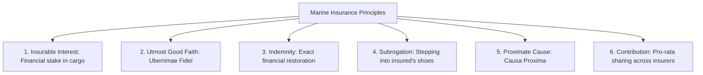
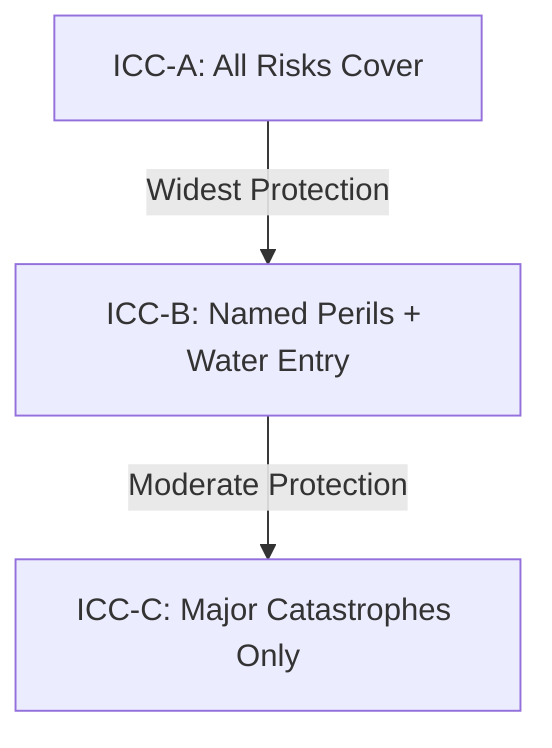
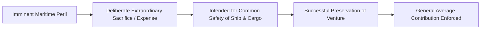
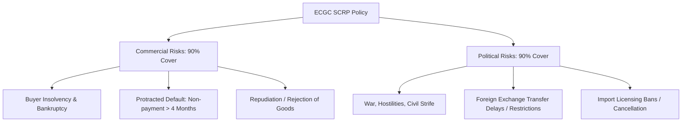
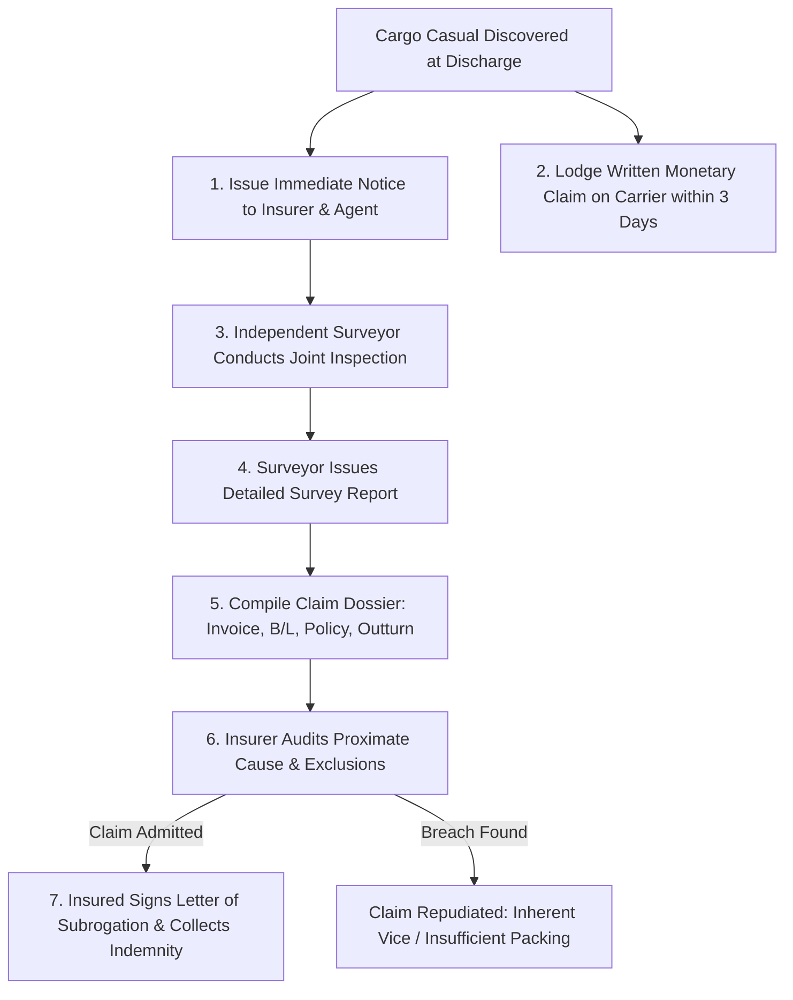
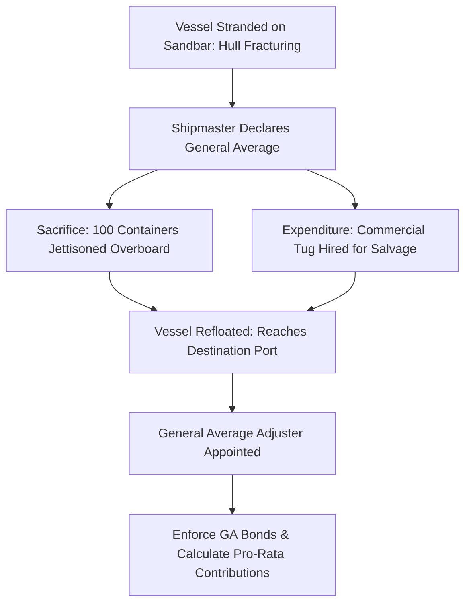
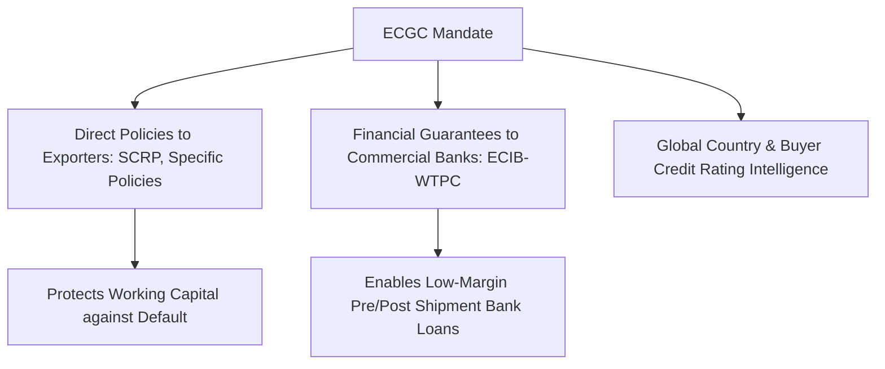
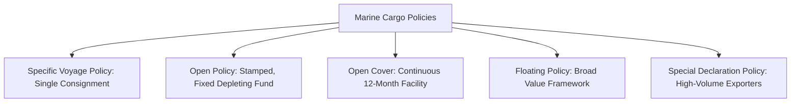
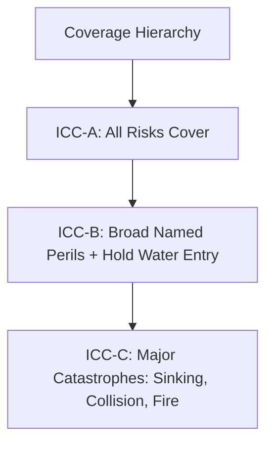
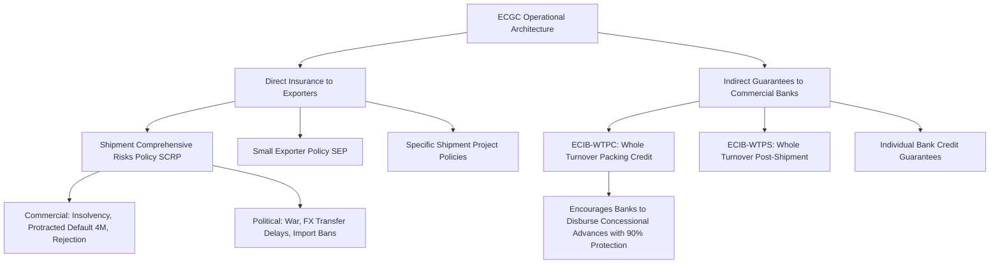

# Unit III: Marine and Export Credit Insurance

This module delivers full-length university examination model answers covering the fundamental principles of marine insurance under the Marine Insurance Act 1963, Institute Cargo Clauses (ICC-A, ICC-B, ICC-C), General Average vs. Particular Average (York-Antwerp Rules), claims procedures and documentation, and the complete institutional insurance framework of the Export Credit Guarantee Corporation of India (ECGC).

---

## Section A: 2-Mark Questions (Short / Definitive)

### Q1. Define the principle of "Uberrimae Fidei" (Utmost Good Faith) in marine insurance. (2 marks) | Likelihood: High | Type: Define
**Answer:**
Under Section 19 of the Marine Insurance Act 1963, **Uberrimae Fidei** mandates that both the insured and the insurer must disclose every material circumstance known to them prior to concluding the contract. A circumstance is material if it influences the judgment of a prudent underwriter in fixing the premium or determining whether to take the risk; non-disclosure renders the policy voidable.

- **Keywords to include for full marks:** Section 19 Marine Insurance Act 1963, Utmost Good Faith, material circumstance disclosure, prudent underwriter judgment, voidable contract.
- **Examiner trap:** Confusing ordinary commercial good faith with *utmost* good faith; in marine insurance, innocent non-disclosure of a material fact still voids the contract.
- **Memory trick:** **U-M-P-V** (Uberrimae fidei, Material circumstance, Prudent underwriter, Voidable).
- **Marking scheme guide:** Legal citation & definition (1 mark); Impact of non-disclosure (1 mark).

---

### Q2. Distinguish between General Average and Particular Average. (2 marks) | Likelihood: High | Type: Differentiate
**Answer:**
A **Particular Average** is an accidental, partial loss caused by an insured marine peril affecting only a specific cargo interest, borne entirely by that cargo owner/insurer. A **General Average** is an intentional, extraordinary sacrifice or expenditure prudently made to preserve the entire maritime adventure (ship, cargo, and freight) from imminent peril, shared proportionally among all surviving interests.

- **Keywords to include for full marks:** Particular Average (accidental, single owner loss), General Average (deliberate sacrifice, common safety, proportional contribution).
- **Examiner trap:** Thinking General Average is a broader insurance policy; it is a maritime legal principle of shared loss.
- **Memory trick:** **Particular = Private accident; General = Group sacrifice**.
- **Marking scheme guide:** Particular average definition (1 mark); General average definition & common sharing (1 mark).

---

### Q3. What is the scope of coverage provided under Institute Cargo Clause A (ICC-A)? (2 marks) | Likelihood: High | Type: Define / Scope
**Answer:**
**Institute Cargo Clause A (ICC-A)** is an "All Risks" insurance cover that indemnifies the insured against all risks of loss or damage to cargo during maritime transit, subject to standard statutory exclusions (such as willful misconduct of the insured, ordinary leakage/wear, improper packing, inherent vice, and unseaworthiness of the vessel).

- **Keywords to include for full marks:** All Risks cover, Institute Cargo Clauses, standard statutory exclusions (willful misconduct, inherent vice, improper packing).
- **Examiner trap:** Claiming ICC-A covers 100% of losses without any exclusions; war and strikes are excluded unless added via specific endorsements.
- **Memory trick:** **A = All Risks minus Statutory Exclusions**.
- **Marking scheme guide:** All Risks scope (1 mark); Mention of key exclusions (1 mark).

---

### Q4. Define the Principle of Subrogation in marine insurance. (2 marks) | Likelihood: High | Type: Define
**Answer:**
Under Section 79 of the Marine Insurance Act 1963, **Subrogation** is the equitable transfer of all legal rights and remedies of the insured against third-party wrongdoers (e.g., negligent shipping lines, port authorities) to the insurer upon full payment of an indemnity claim, preventing the insured from recovering twice for the same loss.

- **Keywords to include for full marks:** Section 79 Marine Insurance Act 1963, transfer of legal rights, third-party recovery, insurer subrogation, prevention of double recovery.
- **Examiner trap:** Confusing subrogation with assignment; subrogation applies *after* claim payment and cannot yield a profit to the insurer.
- **Memory trick:** **Subrogate = Substitute insurer for insured**.
- **Marking scheme guide:** Legal definition & mechanism (1 mark); Prevention of unjust enrichment/double recovery (1 mark).

---

### Q5. What is an Open Cover in export marine insurance? (2 marks) | Likelihood: Medium | Type: Define
**Answer:**
An **Open Cover** is a continuous, long-term unstamped memorandum of agreement (typically valid for 12 months) whereby the insurance company automatically covers all export shipments made by the exporter within agreed terms, rates, and transit limits, against which specific stamped insurance certificates are issued as individual shipments take place.

- **Keywords to include for full marks:** Continuous 12-month agreement, unstamped memorandum, automatic cover for all shipments, stamped certificates issued per shipment.
- **Examiner trap:** Confusing an Open Cover with an Open Policy; an open cover is unstamped and has no fixed aggregate sum insured.
- **Memory trick:** **Open Cover = Umbrella Agreement**.
- **Marking scheme guide:** Definition & 12-month validity (1 mark); Automatic declaration & certificate mechanism (1 mark).

---

### Q6. Name the core whole-turnover policy offered by ECGC to Indian exporters. (2 marks) | Likelihood: High | Type: Fact / List
**Answer:**
The flagship policy offered by ECGC is the **Shipment (Comprehensive Risks) Policy (SCRP)**, designed for standard exporters with an anticipated annual turnover of over ₹50 lakh, covering both commercial risks (buyer insolvency, default, rejection) and political risks (war, import bans, exchange transfer delays) on a whole-turnover basis.

- **Keywords to include for full marks:** ECGC, Shipment (Comprehensive Risks) Policy (SCRP), whole-turnover basis, commercial risks, political risks.
- **Examiner trap:** Referring to it as an asset insurance policy; ECGC covers credit and political non-payment risk.
- **Memory trick:** **S-C-R-P = Standard Comprehensive Risk Protection**.
- **Marking scheme guide:** Exact policy name (1 mark); Core coverage of commercial and political risks (1 mark).

---

## Section B: 5-Mark Questions (Structured Short Notes)

### Q7. Explain the six fundamental legal principles governing a contract of Marine Insurance under the Marine Insurance Act 1963. (5 marks) | Likelihood: High | Type: Explain
**Answer:**
**Introduction:**
A contract of marine insurance is a contract of indemnity governed in India by the **Marine Insurance Act 1963**. It is founded upon six cardinal legal doctrines.

**The Six Legal Doctrines:**
1. **Insurable Interest (Sec. 7-9):** The insured must stand in such a legal or equitable relation to the maritime adventure that they benefit from its preservation and suffer prejudice from its loss or damage. Must exist at the time of loss.
2. **Utmost Good Faith (Uberrimae Fidei, Sec. 19):** Complete, truthful disclosure of all material facts. Any misrepresentation or concealment renders the contract voidable at the insurer's option.
3. **Indemnity (Sec. 3):** The insurer guarantees to place the insured in the exact financial position they occupied prior to the casualty—no more, no less. Marine insurance is not a wagering contract.
4. **Subrogation (Sec. 79):** Once the insurer pays the full claim, they acquire all legal rights of action against third parties (carriers, stevedores) up to the claim amount.
5. **Causa Proxima (Proximate Cause, Sec. 55):** The insurer is liable only for losses proximately caused by an insured peril, evaluated by identifying the dominant, effective, and operative cause.
6. **Contribution (Sec. 80):** If an exporter takes multiple policies for the same cargo from different insurers, the insurers contribute rateably; the insured cannot collect duplicate claims.

- **Keywords to include for full marks:** Marine Insurance Act 1963, Insurable interest at time of loss, Uberrimae Fidei, Strict indemnity, Subrogation, Causa Proxima, Contribution.
- **Examiner trap:** Claiming insurable interest must exist when the policy is signed; under Section 8, it must exist **at the time of loss**.
- **Memory trick:** **I-U-I-S-P-C** (Interest, Utmost good faith, Indemnity, Subrogation, Proximate cause, Contribution).
- **Marking scheme guide:** 1 mark for each of the top 5 principles with statutory citations (Total = 5 marks).

---

### Q8. Compare the coverage and risk exclusions of Institute Cargo Clauses ICC (A), ICC (B), and ICC (C). (5 marks) | Likelihood: High | Type: Compare
**Answer:**
**Introduction:**
Drafted by the Institute of London Underwriters (now IUA) and Lloyd’s Underwriters, the **Institute Cargo Clauses (ICC)** represent the global standard for marine cargo insurance terms.

**Comparative Structure:**

| Parameter | ICC (A) | ICC (B) | ICC (C) |
| :--- | :--- | :--- | :--- |
| **Coverage Type** | **"All Risks"** (covers everything not specifically excluded). | **Named Perils** (covers only risks specifically listed in the text). | **Basic Named Perils** (covers catastrophic major casualties only). |
| **Major Marine Perils** | Fire, explosion, stranding, sinking, collision, capsizing. | Fire, explosion, stranding, sinking, collision, capsizing. | Fire, explosion, stranding, sinking, collision, capsizing. |
| **Natural Disasters** | Earthquake, volcanic eruption, lightning covered. | Earthquake, volcanic eruption, lightning covered. | **Excluded**. |
| **Water Damage** | Washing overboard, sea/river water entry covered. | Sea/river water entry into hold covered. | **Excluded**. |
| **Handling Damage** | Total loss of package dropped during loading/unloading. | Package dropped during loading/unloading covered. | **Excluded**. |
| **Theft, Pilferage, Non-Delivery** | **Fully Covered**. | **Excluded** (unless specifically endorsed). | **Excluded**. |
| **General Average** | Covered. | Covered. | Covered. |

**Universal Statutory Exclusions across A, B, and C:**
Willful misconduct of the insured, ordinary wear and tear/leakage, insufficient/unsuitable packing, inherent vice of the cargo, insolvency of vessel owners, and unseaworthiness of the ship.

- **Keywords to include for full marks:** ICC-A (All Risks), ICC-B (Named perils + water entry), ICC-C (Major catastrophes), Theft/pilferage coverage, General Average, Universal exclusions (inherent vice, improper packing).
- **Examiner trap:** Stating ICC-C covers rainwater damage; ICC-C excludes all water damage except general average jettison.
- **Memory trick:** **A = All; B = Broad named perils; C = Catastrophic only**.
- **Marking scheme guide:** Scope of ICC-A (1.5 marks); Scope of ICC-B (1.5 marks); Scope of ICC-C (1 mark); Universal exclusions (1 mark).

---

### Q9. Detail the conditions required to establish a valid General Average claim under the York-Antwerp Rules. (5 marks) | Likelihood: High | Type: Law / Technical
**Answer:**
**Introduction:**
**General Average** is an ancient maritime law principle codified globally under the **York-Antwerp Rules (YAR)**. It ensures that sacrifices made for the common survival of a maritime venture are shared equitably by all participating beneficiaries.

**Mandatory Legal Elements under York-Antwerp Rules:**
1. **Real and Imminent Common Peril:** The danger threatening the ship, cargo, and human life must be real, immediate, and substantial (e.g., vessel stranded on reef, engine room fire), not a vague apprehension.
2. **Intentional and Voluntary Act:** The act must be a deliberate, conscious decision of the Shipmaster (e.g., ordering cargo jettisoned or hiring emergency salvage tugs). Purely accidental damage is Particular Average.
3. **Extraordinary Sacrifice or Expenditure:** The action must exceed ordinary maritime operations (e.g., beaching a sinking ship, running engines past maximum capacity, paying commercial salvage awards).
4. **Purpose of Common Safety:** The sole objective must be the preservation of the joint property (ship, cargo, and freight). Sacrificing cargo to save only the ship does not qualify.
5. **Successful Preservation:** The venture must be successfully saved, at least in part. If the ship and all cargo sink despite the sacrifice, no General Average contribution can arise.

- **Keywords to include for full marks:** York-Antwerp Rules (YAR), General Average, Imminent common peril, Voluntary/intentional sacrifice, Shipmaster authority, Common safety, Proportional contribution.
- **Examiner trap:** Confusing General Average sacrifice with ordinary salvage or accidental loss.
- **Memory trick:** **P-V-E-S-S** (Peril, Voluntary, Extraordinary, Safety of all, Successful survival).
- **Marking scheme guide:** Legal foundation & YAR (1 mark); Five essential legal conditions (3 marks); Contrast with accidental loss (1 mark).

---

### Q10. Outline the step-by-step claims procedure for a cargo loss under an export marine insurance policy. (5 marks) | Likelihood: High | Type: Procedure
**Answer:**
**Introduction:**
To successfully recover an indemnity claim under a marine insurance policy, the exporter/importer must follow a structured procedure to preserve evidence and comply with statutory limitation periods.

**Step-by-Step Claims Procedure:**
1. **Immediate Notice of Loss:** The cargo receiver must issue written notice to the insurance company and their local settling agent immediately upon discovery of damage or non-delivery (normally within 7 to 14 days of discharge).
2. **Monetary Claim against Carrier (Preserving Subrogation):** To preserve subrogation rights, the consignee must formally lodge a written monetary claim against the shipping company, airline, or port custodian, holding them legally responsible.
3. **Appointment of Independent Surveyor:** The insurer appoints a licensed independent Marine Cargo Surveyor (e.g., Lloyd's Agent) to inspect damaged goods, verify the cause of loss, determine salvage value, and issue a formal **Survey Report**.
4. **Compilation of Claim Dossier:** The claimant lodges the formal claim supported by:
   - Original Insurance Policy / Certificate.
   - Negotiable Bill of Lading / Airway Bill.
   - Commercial Invoice and Packing List.
   - Survey Report and Stevedore / Port Outturn Report.
   - Copy of monetary claim on carrier and carrier’s reply.
5. **Subrogation and Discharge:** Upon claim admission, the insured signs a **Letter of Subrogation** and a Form of Discharge. The insurer remits the settlement proceeds and initiates recovery proceedings against the negligent carrier.

- **Keywords to include for full marks:** Notice of loss, monetary claim on carrier, independent marine surveyor, Survey Report, Port Outturn report, Letter of Subrogation, Form of Discharge.
- **Examiner trap:** Forgetting to lodge a claim against the carrier; failure to lodge a carrier claim breaches the duty to protect subrogation, voiding insurance cover.
- **Memory trick:** **N-C-S-D-S** (Notice, Carrier claim, Surveyor, Dossier, Subrogation).
- **Marking scheme guide:** Immediate notification & carrier claim (1.5 marks); Survey inspection & report (1.5 marks); Documentary dossier & Letter of Subrogation (2 marks).

---

### Q11. Explain the role and coverage of ECGC’s Shipment (Comprehensive Risks) Policy (SCRP). (5 marks) | Likelihood: High | Type: Explain
**Answer:**
**Introduction:**
The Export Credit Guarantee Corporation of India (ECGC) is a premier export credit agency (ECA) wholly owned by the Ministry of Commerce & Industry. The **Shipment (Comprehensive Risks) Policy (SCRP)** is its flagship product protecting exporters against foreign buyer defaults.

**Core Features and Coverage:**
1. **Commercial Risks Covered (Up to 90% Indemnity):**
   - Insolvency or legal bankruptcy of the overseas buyer.
   - **Protracted Default:** Failure of the buyer to pay for goods within four (4) months of due date.
   - Buyer’s unilateral refusal to accept delivery without valid cause.
2. **Political Risks Covered (Up to 90% Indemnity):**
   - War, revolution, civil insurrection, or hostilities in the buyer’s nation.
   - Government exchange controls or moratoria blocking foreign remittances.
   - Cancellation of previously valid import licenses or introduction of new trade embargoes.
   - Diversion of voyage resulting in unrecoverable additional handling costs.
3. **The Whole-Turnover Principle:** The exporter must insure their entire export turnover across all overseas markets for 12 months, preventing adverse selection (insuring only risky destinations).

- **Keywords to include for full marks:** ECGC, SCRP, Commercial risks, Political risks, Protracted default (4 months), 90% indemnity, Whole-turnover principle, Transfer moratoria.
- **Examiner trap:** Believing SCRP covers marine perils like sinking or cargo fire; ECGC covers credit and political risk, not physical transit loss.
- **Memory trick:** **C-P-W-90** (Commercial, Political, Whole-turnover, 90% indemnity).
- **Marking scheme guide:** Institutional identity & whole turnover principle (1.5 marks); Commercial risks detailed (1.5 marks); Political risks detailed & indemnity level (2 marks).

---

### Q12. Write a short note on the Difference between an Open Policy and an Open Cover in Marine Insurance. (5 marks) | Likelihood: Medium | Type: Short Note / Compare
**Answer:**
**Introduction:**
High-volume exporters utilize continuous insurance arrangements rather than negotiating individual specific policies for every container. The two dominant structures are the Open Policy and the Open Cover.

**Detailed Contrast:**
1. **Legal Status and Stamp Duty:**
   - An **Open Policy** is a stamped, legally enforceable contract of insurance issued for a definite aggregate sum insured.
   - An **Open Cover** is an unstamped, informal memorandum of agreement; it is not legally enforceable on its own until specific stamped certificates are issued for individual shipments.
2. **Sum Insured and Depletion:**
   - In an **Open Policy**, a fixed aggregate value (e.g., ₹10 crore) is insured upfront. With every shipment declared, the available balance depletes until the total sum insured is exhausted, requiring reinstatement.
   - In an **Open Cover**, there is **no aggregate limit**. It covers all shipments made during its validity period (usually 12 months), subject only to a "Limit per Bottom / Conveyance".
3. **Premium Payment:**
   - Open Policy premiums are paid upfront or in agreed installments against the aggregate limit.
   - Open Cover premiums are paid periodically (monthly) based on actual declarations filed.

- **Keywords to include for full marks:** Stamped contract vs unstamped memorandum, Aggregate sum insured vs no limit, Balance depletion, Limit per bottom, 12-month validity, Declaration certificates.
- **Examiner trap:** Using Open Policy and Open Cover interchangeably; Open Policy depletes a fixed fund, whereas Open Cover provides continuous coverage over time.
- **Memory trick:** **Policy = Stamped & Depleting; Cover = Unstamped & Continuous**.
- **Marking scheme guide:** Legal status & stamp duty (1.5 marks); Sum insured & depletion mechanics (2 marks); Premium & certificate workflow (1.5 marks).

---

## Section C: 10-Mark Questions (Detailed Analytical Answers)

### Q13. Detail the complete claims settlement procedure in marine cargo insurance, detailing the roles of the surveyor, carrier liability notices, the Letter of Subrogation, and the primary grounds for claim repudiation. (10 marks) | Likelihood: High | Type: Procedure / Exhaustive
**Answer:**
**Introduction:**
Marine cargo claims settlement is a rigorous legal and technical audit process governed by the Marine Insurance Act 1963, Hague-Visby/Carriage of Goods by Sea rules, and institutional policy terms. The claimant must establish three legal proofs: that the loss occurred within policy duration, that an insured peril was the proximate cause, and that the financial magnitude of the loss is verified by independent evidence.

*(Exam 2-minute sketch guide: Draw a vertical sequence from Notice $\to$ Carrier Claim $\to$ Surveyor Inspection $\to$ Survey Report $\to$ Dossier $\to$ Audit, branching into Settlement via Subrogation vs Repudiation).*

#### 1. Immediate Notice and Loss Preservation
- Upon noticing package damage, wet cartons, or broken seals at the dock, the consignee must endorse the damage on the delivery receipt (Port Outturn Report).
- Immediate written notice must be cabled to the underwriter's claims settling agent named on the insurance certificate.

#### 2. Preserving Carrier Liability (The Notice of Claim)
- Under the Carriage of Goods by Sea Act and maritime conventions, carrier liability is extinguished unless formal written notice is given within **three (3) days** of delivery.
- The cargo owner must issue a formal monetary claim letter holding the ocean carrier, freight forwarder, or airline legally responsible. Failure to take this step violates the insurance contract by compromising the insurer's subrogation rights, giving the insurer grounds to reject the claim.

#### 3. The Role of the Independent Marine Cargo Surveyor
- An independent surveyor (such as a licensed Lloyd’s Agent) conducts a joint survey with the carrier's representative.
- The surveyor performs:
  - Cause analysis: determining whether seawater, freshwater, rough handling, or temperature fluctuations caused the damage.
  - Extent of damage: segregating sound goods from damaged goods.
  - Salvage mitigation: assessing the commercial value of damaged goods and organizing salvage auctions to minimize net loss.
- The surveyor issues the definitive **Survey Report**, which serves as primary evidentiary proof for claim assessment.

#### 4. The Complete Claim Dossier
The claimant lodges the formal claim portfolio containing:
- Original Marine Insurance Certificate / Policy.
- Original Commercial Invoice and Packing List (establishing CIF valuation and package contents).
- Negotiable on-board Bill of Lading (establishing carrier custody and transit terms).
- Port Outturn Certificate or Container Damage Report.
- Independent Survey Report.
- Carrier liability claim letter and the carrier's written response.

#### 5. Legal Execution of the Letter of Subrogation
- Upon approving the indemnity amount, the insurer requires the claimant to sign a **Letter of Subrogation and Form of Discharge**.
- Under Section 79 of the Marine Insurance Act, this document formally assigns all rights of action against third-party carriers to the insurance company. The insurer then initiates legal recovery proceedings in maritime commercial courts against the negligent carrier in the insured's name.

#### 6. Primary Grounds for Claim Repudiation
Insurers repudiate claims when casualty audits reveal statutory or policy breaches:
- **Insufficient or Unsuitable Packing:** If goods are damaged due to flimsy cardboard or poor container stuffing, cover is voided under Statutory Exclusion 4.3.
- **Inherent Vice of the Cargo (Exclusion 4.4):** Deterioration caused by internal biological characteristics (e.g., spontaneous combustion of oily seeds, decay of fresh produce without external temperature breach).
- **Delay as Proximate Cause (Exclusion 4.5):** Loss of market value or decay caused by transit delays, even if the delay resulted from an insured peril.
- **Willful Misconduct of the Insured (Exclusion 4.1):** Fraudulent claims, intentional scuttling, or staged theft.
- **Unseaworthiness of the Vessel (Exclusion 5.1):** When the cargo owner knowingly charters an unseaworthy or unlicensed vessel.

**Conclusion:**
Claims settlement in marine insurance is a strict legal process. While compliant documentation and independent survey validation lead to prompt indemnity, any failure to protect carrier subrogation rights or breaches of packaging standards will result in claim repudiation.

- **Keywords to include for full marks:** Marine Insurance Act 1963, Port Outturn report, 3-day carrier claim notice, Marine Surveyor, Lloyd's Agent, Survey Report, Letter of Subrogation (Section 79), Insufficient packing exclusion, Inherent vice, Proximate cause.
- **Examiner trap:** Believing the surveyor decides whether the claim is paid; the surveyor only reports facts and quantum, while the insurance underwriter decides admissibility.
- **Memory trick:** **N-C-S-D-S-R** (Notice, Carrier claim, Survey, Dossier, Subrogation, Repudiation checks).
- **Marking scheme guide:** Notice & carrier liability protection (2 marks); Role of surveyor & salvage mitigation (2 marks); Document dossier requirements (2 marks); Subrogation legal mechanics (2 marks); Repudiation grounds under statutory exclusions (2 marks).

---

### Q14. Critically analyze the legal, procedural, and financial mechanics of General Average under the York-Antwerp Rules. Provide a detailed scenario and calculate the proportional contribution of the surviving maritime interests. (10 marks) | Likelihood: High | Type: Technical / Numerical / Law
**Answer:**
**Introduction:**
Codified globally under the **York-Antwerp Rules (YAR)**, **General Average (GA)** is an ancient maritime law principle based on community of interest: *"That which has been sacrificed for the benefit of all shall be made good by the contribution of all."* It operates independently of standard marine insurance policies, imposing a statutory obligation on all surviving property owners to share financial losses incurred during an extraordinary maritime emergency.

*(Exam 2-minute sketch guide: Draw a vessel in danger $\to$ Shipmaster GA declaration $\to$ Jettison & Salvage expense $\to$ Safe port arrival $\to$ Adjuster computes pro-rata contributions across Ship, Cargo, and Freight).*

#### 1. The Legal Framework: York-Antwerp Rules
- Governed by Rule A of the York-Antwerp Rules: A General Average act occurs when, and only when, any **extraordinary sacrifice or expenditure is intentionally and reasonably made or incurred for the common safety** for the purpose of preserving from peril the property involved in a common maritime adventure.
- **Rule of Fault:** Even if the peril arose from crew negligence, GA applies, though cargo owners may challenge payment if the carrier breached seaworthiness obligations under the contract of carriage.

#### 2. Procedural Enforcement at Destination Port
1. **Declaration of GA:** The Shipmaster declares General Average and informs the shipowner and average adjusters.
2. **Maritime Lien:** The shipowner holds a **possessory maritime lien** over all surviving cargo at the discharge port. Cargo cannot be released to consignees until they provide:
   - A signed **Average Bond** (undertaking to pay their final assessed contribution).
   - A **General Average Guarantee** signed by an authorized marine insurer (or a cash deposit if uninsured).
3. **The Role of the Average Adjuster:** Specialized legal and accounting professionals (Average Adjusters) assess the total loss, compute the total contributory value of all surviving interests, and determine each party's proportional assessment.

#### 3. General Average Mathematical Model
$$\text{General Average Loss Ratio } (GLR) = \frac{\text{Total General Average Sacrifices and Expenditures}}{\text{Total Contributory Value of All Surviving Property}}$$
$$\text{Individual Contribution} = \text{Contributory Value of Individual Interest} \times GLR$$

#### 4. Detailed Scenario and Proportional Contribution Calculation
**Scenario:**
A container ship with cargo runs aground in bad weather. To save the venture, the captain jettisons cargo valued at **$1,000,000** and pays **$500,000** in emergency commercial salvage fees.
- Total GA Losses = $\$1,000,000 + \$500,000 = \$1,500,000$.

The adjusted net arrived values of the surviving interests at destination are:
- Shipowner’s Vessel Value: **$18,000,000**
- Net Pending Ocean Freight: **$2,000,000**
- Cargo Interests (surviving cargo + made-good cargo): **$10,000,000**
  - Consignee X holds cargo valued at **$2,000,000** within that cargo pool.

**Step 1: Calculate Total Contributory Value**
$$\text{Total Contributory Value} = \text{Vessel} + \text{Freight} + \text{Cargo}$$
$$\text{Total Contributory Value} = \$18,000,000 + \$2,000,000 + \$10,000,000 = \$30,000,000$$

**Step 2: Calculate General Average Loss Ratio (GLR)**
$$GLR = \frac{\text{Total GA Loss}}{\text{Total Contributory Value}} = \frac{\$1,500,000}{\$30,000,000} = 0.05\text{ (or } 5.0\%)$$

**Step 3: Apportion Contributions Across All Interests**
1. **Shipowner’s Contribution:**
   $$\$18,000,000 \times 0.05 = \mathbf{\$900,000}$$
2. **Freight Owner’s Contribution:**
   $$\$2,000,000 \times 0.05 = \mathbf{\$100,000}$$
3. **Total Cargo Pool Contribution:**
   $$\$10,000,000 \times 0.05 = \mathbf{\$500,000}$$
   - **Specific Contribution of Consignee X:**
     $$\$2,000,000 \times 0.05 = \mathbf{\$100,000}$$

*(Verification: Total contributions collected = $\$900,000 + \$100,000 + \$500,000 = \$1,500,000$, balancing the General Average loss).*

**Conclusion:**
General Average distributes emergency sacrifices across all parties whose property was preserved. If Consignee X holds a marine policy with ICC (A, B, or C), their marine underwriter pays this $100,000 GA contribution. If uninsured, Consignee X must pay cash to release their containers.

- **Keywords to include for full marks:** York-Antwerp Rules, Rule A, Extraordinary sacrifice, Jettison, Common maritime adventure, Possessory maritime lien, Average Bond, Average Adjuster, Contributory values, Pro-rata loss ratio.
- **Examiner trap:** Omitting the net pending freight from the contributory value; freight is an independent maritime interest that must contribute to GA.
- **Memory trick:** **Y-A-R-L-C** (York Antwerp Rules, Average bond, Ratio calculation, Lien enforcement, Contribution paid).
- **Marking scheme guide:** Legal principles & YAR Rule A (2.5 marks); Port procedures, liens & Average Bonds (2.5 marks); Formula & contributory value architecture (2 marks); Worked numerical problem with accurate distribution (3 marks).

---

### Q15. Critically evaluate the Export Credit Guarantee Corporation of India (ECGC). Discuss its corporate mandate, underwriting philosophy, policy suite for exporters, and role in supporting export credit from commercial banks. (10 marks) | Likelihood: High | Type: Institutional / Evaluation
**Answer:**
**Introduction:**
Set up in 1957 as the Export Risks Insurance Corporation and rechristened in 1983, the **Export Credit Guarantee Corporation of India (ECGC Ltd.)** is a premier Export Credit Agency (ECA) wholly owned by the Government of India through the Ministry of Commerce & Industry. Functioning as a quasi-commercial institution, ECGC encourages Indian exports by offering non-market risk underwriting that private commercial insurers avoid: cross-border buyer insolvency and foreign political default.

#### 1. Underwriting Philosophy: The Whole-Turnover Principle
Unlike standard insurance where clients choose which assets to insure, ECGC operates primarily on the **Whole-Turnover Principle**:
- Exporters must insure their entire export turnover across all international markets under an annual policy.
- **Economic Rationale:** Prevents **adverse selection**, ensuring the corporation does not insure only risky, politically unstable destinations while losing out on stable, premium-generating markets.
- In return, ECGC offers reduced premium rates, broad coverage, and automated credit limit approvals.

#### 2. Policy Suite for Exporters
1. **Shipment (Comprehensive Risks) Policy (SCRP):**
   - Flagship policy for regular exporters with turnover exceeding ₹50 lakh.
   - Covers both commercial risks (insolvency, protracted default beyond 4 months, repudiation) and political risks (war, transfer delays, cancellation of import licenses) up to **90% indemnity**.
2. **Small Exporter Policy (SEP):**
   - Designed for new entrants and small exporters with annual turnover up to ₹50 lakh.
   - Features simplified reporting, monthly turnover declarations, and higher indemnity (**95% for commercial risks**).
3. **Specific Shipment Policies:**
   - Case-by-case insurance for large one-off capital goods contracts or turnkey infrastructure projects, tailored to long delivery cycles.

#### 3. Institutional Guarantees to Commercial Banks (ECIB Framework)
The true volume of ECGC's market impact is delivered through its **Export Credit Insurance for Banks (ECIB)**:
- **ECIB - Whole Turnover Packing Credit (ECIB-WTPC):** Insures banks against non-recovery of pre-shipment advances disbursed to exporters.
- **ECIB - Whole Turnover Post-Shipment (ECIB-WTPS):** Protects banks against default on discounted export bills.
- **Impact on Trade Finance:** Because ECGC indemnifies **up to 90%** of bank losses, commercial banks extend pre-shipment packing credit with lower collateral requirements and tighter lending spreads, expanding credit delivery to MSMEs.

#### 4. Critical Evaluation: Achievements vs. Exporter Grievances
- **Achievements:**
  - Expanded Indian trade into challenging emerging markets across Latin America, the CIS, and Sub-Saharan Africa.
  - Maintains credit files and financial ratings on over 100,000 overseas buyers, serving as a global commercial intelligence agency.
- **Operational Criticisms:**
  - **Protracted Claims Verification:** Processing claims for buyer defaults often takes 6 to 12 months, during which the exporter's working capital remains frozen.
  - **Strict Limit Adherence:** If an exporter ships even $1,000 above the approved buyer credit limit, ECGC can disclaim liability on the entire excess amount.

**Conclusion:**
ECGC is an essential pillar of India's export promotion architecture. By underwriting geopolitical and commercial credit risks that commercial insurers reject, it levels the playing field for Indian exporters, allowing them to compete on open-account credit terms worldwide.

- **Keywords to include for full marks:** ECGC Ltd., Ministry of Commerce, Whole-turnover principle, Adverse selection, SCRP, Small Exporter Policy, ECIB-WTPC, 90% indemnity, Protracted default (4 months), Buyer credit intelligence.
- **Examiner trap:** Stating that ECGC covers physical cargo damage during shipping; ECGC covers credit and sovereign default, while marine insurers cover physical cargo damage.
- **Memory trick:** **W-S-E-C-P** (Whole-turnover, SCRP policy, ECIB guarantees, Commercial intelligence, Political cover).
- **Marking scheme guide:** Corporate profile & Whole-turnover principle (2.5 marks); Direct exporter policy suite (2.5 marks); ECIB bank guarantees & credit enablement (2.5 marks); Critical evaluation & procedural bottlenecks (2.5 marks).

---

### Q16. Analyze the various types of marine insurance policies available to an international trader, detailing their structure, operational validity, and specific commercial applications. (10 marks) | Likelihood: Medium | Type: Classify / Explain
**Answer:**
**Introduction:**
Marine insurance policies are legal instruments designed to indemnify cargo owners, shipowners, and financiers against maritime perils. Because international logistics involves diverse transit modes, varied shipping frequencies, and complex financing arrangements, underwriters provide specialized policy variants under the Marine Insurance Act 1963.

#### 1. Specific Voyage Policy
- **Structure:** Covers an individual cargo consignment during a single, specific journey between named points of origin and destination (e.g., JNPT, Mumbai to Rotterdam).
- **Validity:** Terminates upon delivery of cargo at the designated destination warehouse or 60 days after discharge from the vessel (under the Institute Transit Clause).
- **Commercial Use:** Ideal for occasional, one-off exporters or for heavy, irregular project cargo shipments.

#### 2. Open Policy (Marine Cargo Open Policy)
- **Structure:** A stamped legal contract issued for a specified aggregate sum insured (e.g., ₹5 crore) covering multiple shipments over time.
- **Depletion Mechanism:** As the exporter ships cargo and submits declarations, the insured value is deducted from the aggregate policy sum. When the balance is exhausted, the policy must be renewed.
- **Commercial Use:** Suitable for domestic traders or medium-sized exporters with predictable annual shipping values.

#### 3. Open Cover
- **Structure:** An unstamped memorandum of agreement typically executed for a **12-month period**. It is not a policy in itself; instead, it promises that the underwriter will automatically insure all shipments made by the client within agreed terms, rates, and limits.
- **Certificate Issuance:** For every individual shipment, the exporter submits a declaration, and the insurer issues a stamped, legally binding **Marine Insurance Certificate** suitable for Letter of Credit negotiation.
- **Commercial Use:** The standard choice for large multinational manufacturers and regular export houses with high shipping volumes.

#### 4. Floating Policy
- **Structure:** A policy issued for a lump sum value without specifying vessel names. Shipments are declared as they occur, and the names of ships and bill of lading details are endorsed onto the policy later.
- **Commercial Use:** Used when goods are shipped through freight forwarders who consolidate consignments across unconfirmed vessels.

#### 5. Special Declaration Policy
- **Structure:** A customized open policy granted to large corporate exporters having a minimum guaranteed annual turnover (typically exceeding ₹10 crore).
- **Key Advantage:** Offers substantial premium discounts and allows quarterly reporting of turnover based on audited figures, simplifying documentation.

#### Comparative Operational Summary

| Policy Type | Stamp Duty Status | Value Limitation | Operational Flexibility | Target Exporter Category |
| :--- | :--- | :--- | :--- | :--- |
| **Specific Voyage** | Stamped per shipment | Exact consignment value | Low; requires fresh policy every shipment | Occasional or single-order exporters |
| **Open Policy** | Stamped upfront | Fixed aggregate sum (depletes) | Moderate; must be renewed on depletion | Medium-scale exporters |
| **Open Cover** | Unstamped agreement | **No aggregate limit** (limit per ship) | **Very High**; automatic cover for 12 months | High-frequency, large export houses |
| **Floating Policy** | Stamped upfront | Fixed aggregate limit | High; vessel declared post-shipment | Importers using freight consolidators |

**Conclusion:**
Choosing the correct marine insurance policy directly impacts both cost efficiency and risk protection. While specific voyage policies suit one-off shipments, high-volume exporters rely on Open Covers to ensure continuous, automated protection for every shipment leaving the warehouse.

- **Keywords to include for full marks:** Specific voyage policy, Open policy, Open cover, Floating policy, Special declaration policy, Marine Insurance Act 1963, Limit per bottom, Certificate of insurance, Depleting fund.
- **Examiner trap:** Claiming that an Open Cover is stamped; an Open Cover is unstamped, but individual insurance certificates issued under it are stamped.
- **Memory trick:** **S-O-O-F-S** (Specific, Open policy, Open cover, Floating, Special declaration).
- **Marking scheme guide:** Specific voyage policy details (2 marks); Open policy & depletion mechanics (2 marks); Open cover & certificate workflow (2.5 marks); Floating & special declaration policies (1.5 marks); Comparative matrix & conclusion (2 marks).

---

## Section D: 15-Mark Questions (Comprehensive Masters)

### Q17. Provide an exhaustive analysis of the Marine Cargo Insurance Framework. Detail the fundamental legal doctrines under the Marine Insurance Act 1963, trace the transit liability boundaries under the Institute Cargo Clauses (Transit Clause / Warehouse-to-Warehouse), analyze the exclusions across ICC (A, B, and C), and develop a practical risk-management matrix for an Indian manufacturing exporter. (15 marks) | Likelihood: High | Type: Comprehensive Master
**Answer:**
**Introduction:**
Marine cargo insurance is the contractual foundation that enables international physical trade. Because cargo moving across international waters passes outside sovereign jurisdictions and encounters maritime perils, maritime law has established a comprehensive insurance architecture over several centuries. In India, cargo insurance is codified under the **Marine Insurance Act 1963** (modeled on the English Marine Insurance Act 1906) and standardized globally through the **Institute Cargo Clauses (ICC)** established by the Institute of London Underwriters and Lloyd’s. Together, these frameworks distribute ocean-transit risks between cargo owners, vessel operators, and insurance syndicates.

*(Exam 2-minute sketch guide: Draw a five-stage horizontal transit line from origin factory $\to$ loading port $\to$ ocean voyage $\to$ discharge port $\to$ final destination warehouse, labeling the attachment and termination points of the Warehouse-to-Warehouse clause).*

---

#### 1. Core Legal Doctrines of the Marine Insurance Act 1963
A contract of marine insurance is legally defined under Section 3 as an agreement whereby the insurer undertakes to indemnify the assured against marine losses incidental to a marine adventure. It is governed by six fundamental legal principles:
1. **Insurable Interest (Sections 7–9):** The assured must hold a financial interest in the preservation of the venture. Crucially, under Section 8(1), **insurable interest must exist at the time of loss**, even if it did not exist when the insurance was contracted. This accommodates international trade where cargo is bought and sold while at sea on CIF terms.
2. **Utmost Good Faith (Uberrimae Fidei, Section 19):** Requires full disclosure of every material circumstance known to the assured before concluding the contract. A circumstance is material if it influences a prudent underwriter in setting premiums or accepting risk. Concealment renders the contract voidable.
3. **Principle of Indemnity:** A marine insurance policy provides strict financial restoration. It compensates actual financial loss (subject to agreed policy valuations) and cannot be exploited as a speculative or wagering instrument.
4. **Doctrine of Subrogation (Section 79):** Upon settling a total or partial loss, the insurer steps into the legal shoes of the assured, acquiring all legal rights and remedies against negligent third-party carriers or port operators, up to the settlement amount.
5. **Proximate Cause (Causa Proxima, Section 55):** The insurer is liable only for losses directly caused by an insured peril. The proximate cause is the dominant, efficient, and operative cause that sets the chain of events in motion.
6. **Contribution (Section 80):** In double insurance situations where multiple policies cover the same cargo, insurers contribute pro-rata based on their insured sums, preventing double recovery by the assured.

---

#### 2. Temporal Boundaries: The Warehouse-to-Warehouse Transit Clause
Under Clause 8 of the Institute Cargo Clauses (the **Transit Clause**), marine cargo insurance is not restricted to ocean transit alone; it provides door-to-door coverage:
- **Attachment of Risk:** Insurance attaches the moment the goods leave the factory warehouse named in the policy for the commencement of transit, covering inland road/rail transport to the seaport.
- **Continuous Coverage:** The policy remains in force during customary transhipment, port storage, and the primary ocean voyage.
- **Termination of Cover:** Under the Transit Clause, coverage automatically expires upon the occurrence of the earliest of the following milestones:
  1. Delivery of cargo into the consignee's or other final warehouse at the named destination.
  2. Delivery to any other warehouse used by the assured for storage other than in the ordinary course of transit or for allocation/distribution.
  3. The expiry of **60 days after completion of discharge overside of the goods from the overseas vessel at the final port of discharge** (30 days for airfreight under Institute Air Cargo Clauses).

---

#### 3. Scope of Cover and Exclusion Analysis: ICC (A), (B), and (C)

- **ICC (C):** Basic catastrophic cover. Protects against: fire/explosion, vessel stranding, sinking, capsizing, collision, discharge at port of distress, General Average jettison, and General Average sacrifice/salvage expenses.
- **ICC (B):** Covers all ICC (C) perils plus: earthquake, volcanic eruption, lightning, washing overboard, entry of sea, lake, or river water into the vessel hold or container, and total loss of any package lost overboard or dropped during loading/unloading.
- **ICC (A):** The comprehensive **"All Risks"** policy. Covers all risks of loss or damage to cargo except those specifically excluded in the text. Covers mysterious disappearance, pilferage, handling damage, rough handling, and rainwater damage.

#### The Universal Statutory Exclusions (Applicable to A, B, and C):
Under Clause 4 of all three sets of clauses, the insurer never covers:
1. **Willful Misconduct:** Loss attributable to the deliberate misconduct of the assured.
2. **Ordinary Leakage and Wear:** Ordinary loss in weight or volume, normal evaporation, or normal wear and tear.
3. **Insufficient or Unsuitable Packaging (Clause 4.3):** Damage caused by inadequate packing or improper container stuffing conducted by the assured.
4. **Inherent Vice (Clause 4.4):** Damage resulting from natural degradation or qualities inherent to the cargo (e.g., rust on ungreased metal, spontaneous combustion of damp seed cakes).
5. **Vessel Unseaworthiness (Clause 5):** When the cargo owner is aware that the vessel or container is unseaworthy at the time of loading.
6. **War and Strikes (Clauses 6 and 7):** Excluded across standard A, B, and C clauses; must be added back via specialized Institute War Clauses and Institute Strikes Clauses upon payment of an additional premium.

---

#### 4. Practical Risk-Management Matrix for an Indian Exporter

| Export Cargo Type | Inherent Risk Exposures | Recommended Marine Policy Structure | Critical Clauses & Underwriting Endorsements |
| :--- | :--- | :--- | :--- |
| **Precision Engineering Machinery** | Shock, drop damage, moisture, handling damage at ports. | **Open Cover with ICC (A) "All Risks"** | Add Institute War & Strikes Clauses; include electrical/mechanical derangement endorsement. |
| **Iron Ore / Bulk Minerals** | Bulk cargo shifting, structural vessel stress, moisture liquefaction. | **Specific Voyage Policy with ICC (C)** | Basic catastrophe cover sufficient; ensure strict IMO Solid Bulk Cargoes Code compliance. |
| **High-Fashion Readymade Garments** | Pilferage, seawater wetting, container sweat/mold, tear. | **Open Policy with ICC (A)** | Ensure coverage includes hook, oil, freshwater, and sweat damage; verify desiccant usage in packing. |
| **Frozen Seafood / Meat Products** | Refrigeration breakdown, thermal thawing, bacterial decay. | **Open Cover with Institute Frozen Food Clauses (A)** | 24-hour machinery breakdown clause; mandatory temperature data-logger verification. |

**Conclusion:**
Marine cargo insurance is an indispensable risk management instrument in international commerce. By combining comprehensive ICC (A) coverage with specialized endorsements and strict packaging controls, Indian manufacturing exporters protect their balance sheets and maintain seamless trade operations across global supply chains.

- **Keywords to include for full marks:** Marine Insurance Act 1963, Insurable interest at time of loss, Uberrimae Fidei, Warehouse-to-Warehouse clause (60 days rule), ICC-A (All risks), ICC-B, ICC-C, Inherent vice exclusion, Insufficient packing, Institute War and Strikes Clauses.
- **Examiner trap:** Stating that ICC-A automatically covers war and strikes; war, civil war, and labor strikes are excluded across all standard base clauses and require separate endorsements.
- **Memory trick:** **D-O-C-T-O-R** (Doctrines of law, Open cover, Clauses A/B/C, Transit clause 60 days, Overarching exclusions, Risk matrix).
- **Marking scheme guide:** Legal doctrines & statutory citations (3 marks); Warehouse-to-Warehouse transit boundaries (3 marks); Detailed comparative analysis of ICC A, B, and C (3 marks); Statutory exclusions analysis (3 marks); Practical risk management matrix for exporters (3 marks).

---

### Q18. Examine the institutional framework of Export Credit Insurance in India. Provide an exhaustive evaluation of ECGC Ltd., detailing its financial guarantees to commercial banks (ECIB), comprehensive risk policies for exporters (SCRP), claims settlement standards, and the macro-level impact on India’s foreign trade competitiveness. (15 marks) | Likelihood: High | Type: Comprehensive Policy Master
**Answer:**
**Introduction:**
In international commerce, exporting on deferred credit or open-account terms exposes domestic firms to risks that private commercial markets cannot efficiently underwrite: sovereign debt moratoria, foreign exchange embargoes, cross-border buyer bankruptcies, and overseas political conflicts. To address this market failure, modern trading nations rely on specialized, state-backed Export Credit Agencies (ECAs). In India, this role is performed by the **Export Credit Guarantee Corporation of India (ECGC Ltd.)**, established in 1957 and operating under the administrative oversight of the Ministry of Commerce & Industry. By insulating both manufacturing exporters and commercial lending banks against foreign commercial and political defaults, ECGC provides the structural safety net that powers India's international trade.

*(Exam 2-minute sketch guide: Draw a dual-branch tree: left branch showing direct policies to exporters [SCRP, SEP, Specific], right branch showing bank guarantees [ECIB-WTPC, ECIB-WTPS], converging into commercial/political risks and bank credit expansion).*

---

#### 1. Underwriting Philosophy: The Whole-Turnover Principle
At the heart of ECGC’s operational model lies the **Whole-Turnover Principle**:
- **The Adverse Selection Dilemma:** If exporters were permitted to insure only transactions with unrated buyers in politically volatile countries (e.g., war-torn or debt-distressed nations) while keeping shipments to AAA-rated European/US buyers uninsured, the credit insurer's risk pool would rapidly become insolvent.
- **The Statutory Solution:** Exporters taking out an annual policy must insure **their entire export turnover across all overseas markets** without exception.
- **The Mutual Trade Benefit:** In exchange for the exporter pooling their entire portfolio, ECGC provides lower premium rates (often under 0.5% of shipment value), higher indemnity percentages (**90% to 95%**), and automated credit limit sanctions for established global buyers.

---

#### 2. Detailed Structure of Direct Policies for Exporters
1. **Shipment (Comprehensive Risks) Policy (SCRP):**
   - The standard annual policy issued to established exporters with an anticipated export turnover exceeding ₹50 lakh.
   - **Commercial Risks Covered (90% Indemnity):**
     - **Insolvency of the Buyer:** Legal bankruptcy or liquidation of the foreign customer.
     - **Protracted Default:** Failure of the buyer to pay for accepted goods within **four (4) months** from the original due date.
     - **Buyer’s Repudiation / Non-Acceptance:** Refusal by the buyer to accept delivery without valid cause, provided there is no trade dispute over product quality.
   - **Political Risks Covered (90% Indemnity):**
     - Outbreak of war, revolution, or civil strife in the buyer's country.
     - Government-imposed foreign exchange restrictions or moratoria blocking outward currency remittances.
     - Sudden cancellation of valid import licenses or imposition of fresh import embargoes after shipment.
     - Additional handling, freight, or diversion charges arising from wartime maritime detours.
2. **Small Exporter Policy (SEP):**
   - Tailored specifically to MSME entrants with turnover under ₹50 lakh.
   - Provides **95% indemnity for commercial risks** and 100% for political risks, requiring only quarterly rather than monthly reporting.
3. **Specific Shipment Policies:**
   - Single-transaction policies tailored for capital equipment exports, turnkey engineering construction, or long-gestation supply contracts involving deferred credit over 1 to 5 years.

---

#### 3. Financial Guarantees to Commercial Banks (The ECIB Framework)
The true macroeconomic multiplier of ECGC is delivered through its **Export Credit Insurance for Banks (ECIB)**. Banks are risk-averse institutions; without external risk-sharing, they often restrict credit to small or uncollateralized exporters.
- **ECIB - Whole Turnover Packing Credit (ECIB-WTPC):**
  - The commercial bank insures its entire pre-shipment export credit portfolio across all branches.
  - Covers losses resulting from the exporter's failure to repay pre-shipment packing credit advances due to operational insolvency or manufacturing failure.
  - Indemnifies the bank for **up to 90%** of its net unrecovered loan balance.
- **ECIB - Whole Turnover Post-Shipment (ECIB-WTPS):**
  - Insures the bank against defaults on export bills purchased, negotiated, or discounted after shipment.
- **Catalytic Impact on Banking Liquidity:**
  - By shifting 90% of default risk to ECGC, the Reserve Bank of India permits commercial banks to treat these advances as guaranteed assets, resulting in lower capital adequacy weighting, reduced margin requirements (10% to 15%), and lower interest spreads for Indian exporters.

---

#### 4. Claims Procedure, Settlement Standards, and Exporter Obligations
To secure indemnity, the insured must adhere to strict contractual protocols:
1. **Adherence to Credit Limits:** Shipments must not exceed the specific buyer credit limit sanctioned by ECGC. Shipments made in excess of the approved ceiling are entirely at the exporter's own risk.
2. **Reporting Defaults:** The exporter must file a formal declaration of overdue bills within **30 days** of the due date.
3. **Exhaustion of Commercial Recovery:** The exporter must take all reasonable legal steps to recover the debt, including sending legal notices or appointing international debt recovery agencies.
4. **Waiting Period:** A statutory waiting period of **four (4) months** from the due date is observed before ECGC admits claims for protracted default, allowing time for potential commercial reconciliation.
5. **Recovery Sharing:** Any monies recovered after claim settlement are shared rateably between ECGC (90%) and the exporter (10%).

---

#### 5. Macro-Level Impact on India's Foreign Trade Competitiveness
- **Opening Frontier Markets:** Enabled Indian engineering, pharmaceutical, and textile exporters to penetrate high-risk, high-growth markets in Africa, Central Asia, and South America, which would be inaccessible under rigid cash-in-advance or LC requirements.
- **Global Commercial Intelligence:** ECGC maintains an underwriting database evaluating over 100,000 global buyers, sharing real-time credit ratings and country risk assessments with Indian exporters.
- **Counter-Cyclical Trade Stabilization:** During global financial shocks (e.g., the 2008 global financial crisis or emerging market sovereign debt crises), ECGC maintains credit lines when private credit markets freeze, preserving supply chain continuity.

**Conclusion:**
ECGC is an indispensable pillar of India's international trade architecture. By combining comprehensive whole-turnover protection for exporters with portfolio guarantees for lending banks, it balances commercial risk with export competitiveness, enabling Indian firms to compete on open-account credit terms worldwide.

- **Keywords to include for full marks:** ECGC Ltd., Ministry of Commerce, Whole-turnover principle, Adverse selection, SCRP, Small Exporter Policy, ECIB-WTPC, ECIB-WTPS, 90% indemnity, Protracted default (4 months), Buyer credit limits, Frontier market penetration.
- **Examiner trap:** Claiming ECGC covers ordinary marine transit damage or exchange rate fluctuations; ECGC explicitly covers cross-border credit default and political sovereign risk.
- **Memory trick:** **W-S-B-C-M** (Whole-turnover, SCRP exporter policy, Bank ECIB guarantees, Claims 4-month rule, Macroeconomic trade impact).
- **Marking scheme guide:** Corporate mandate & Whole-turnover principle (3 marks); Detailed analysis of exporter policies (SCRP & SEP) (3 marks); Bank guarantee architecture (ECIB-WTPC & WTPS) (3 marks); Claims protocols, credit limits & 4-month rule (3 marks); Macroeconomic impact on trade competitiveness (3 marks).

---

## Section E: "Differentiate Between" Questions (Master Tables)

### Q19. Differentiate between General Average and Particular Average. (5 marks) | Likelihood: High | Type: Differentiate
**Answer:**

| Parameter | General Average | Particular Average |
| :--- | :--- | :--- |
| **1. Nature of the Casualty** | **Deliberate, intentional sacrifice** or extraordinary expenditure. | **Accidental loss or partial damage** caused by an insured peril. |
| **2. Objective of the Action** | Undertaken for the **common safety** of the joint maritime venture. | Caused by an unexpected casualty (e.g., collision, fire, heavy weather). |
| **3. Distribution of Loss** | Shared **rateably by all surviving interests** (Ship, Cargo, Freight). | Borne **entirely by the specific owner** of that damaged property. |
| **4. Authority to Act** | Ordered exclusively by the **Shipmaster** during an emergency. | Occurs through fortuity or natural maritime forces. |
| **5. Illustrative Example** | Jettisoning 100 containers to refloat a grounded vessel. | Seawater flooding a cargo hold during a severe sea storm. |
| **6. Governing Rules** | Codified and adjusted under the **York-Antwerp Rules**. | Governed by the **Marine Insurance Act & policy terms (ICC)**. |

- **Keywords to include for full marks:** Intentional sacrifice vs accidental loss, Common safety vs private misfortune, Shared rateably vs single owner loss, Shipmaster authority, York-Antwerp Rules.
- **Examiner trap:** Thinking General Average is a type of insurance policy; it is a statutory maritime legal principle of shared loss.
- **Marking scheme guide:** 1 mark per distinct, well-developed comparative row (up to 5 marks).

---

### Q20. Differentiate between Marine Cargo Insurance and Export Credit Insurance (ECGC). (5 marks) | Likelihood: High | Type: Differentiate
**Answer:**

| Dimension | Marine Cargo Insurance | Export Credit Insurance (ECGC) |
| :--- | :--- | :--- |
| **1. Primary Risk Insured** | **Physical loss or damage** to goods during handling and transit. | **Financial credit default and sovereign non-payment** risks. |
| **2. Insured Perils** | Sinking, fire, collision, water damage, theft, pilferage, rough handling. | Buyer insolvency, protracted default (4 months), war, transfer moratoria. |
| **3. Governing Legal Base** | **Marine Insurance Act 1963** and Institute Cargo Clauses. | Specialized government charter under the **Ministry of Commerce**. |
| **4. Underwriting Entity** | Commercial General Insurance Companies (e.g., New India, ICICI Lombard). | State-backed Export Credit Agency (**ECGC Ltd.**). |
| **5. Claim Settlement Trigger** | Verification of physical damage via independent Marine Survey Report. | Verification of legal insolvency or passage of the 4-month waiting period. |
| **6. Standard Indemnity** | **100% of agreed insurable value** (normally CIF + 10%). | Typically **90% of invoice face value** (10% retained by exporter). |

- **Keywords to include for full marks:** Physical transit damage vs Credit default, Marine perils vs Buyer insolvency, Marine Insurance Act vs ECGC Charter, Marine Survey Report vs 4-month waiting period, CIF + 10% vs 90% indemnity.
- **Examiner trap:** Claiming ECGC compensates an exporter if the ship sinks; physical loss is covered exclusively by marine insurance.
- **Marking scheme guide:** 1 mark per distinct comparative row (up to 5 marks).

---

### Q21. Differentiate between Subrogation and Contribution in Marine Insurance. (5 marks) | Likelihood: High | Type: Differentiate
**Answer:**

| Parameter | Principle of Subrogation | Principle of Contribution |
| :--- | :--- | :--- |
| **1. Statutory Basis** | Governed under **Section 79** of Marine Insurance Act 1963. | Governed under **Section 80** of Marine Insurance Act 1963. |
| **2. Core Definition** | Insurer steps into the legal shoes of the insured against third parties. | Right of an insurer to demand proportionate sharing from co-insurers. |
| **3. Operational Context** | Involves **one insurer** pursuing a negligent carrier or third party. | Involves **multiple insurers** covering the same cargo (Double Insurance). |
| **4. Purpose** | Prevents the insured from collecting double recovery for the same loss. | Prevents the insured from claiming full indemnity from multiple insurers. |
| **5. Timing of Right** | Arises only **after** the insurer has settled the indemnity claim. | Operates during or after settlement across concurrent policies. |
| **6. Maximum Financial Cap** | Insurer can never recover more than the claim amount paid to insured. | Total recovery across all insurers cannot exceed the actual loss. |

- **Keywords to include for full marks:** Section 79 vs Section 80, Stepping into legal shoes vs Pro-rata sharing, Single insurer vs Double insurance, Prevention of double recovery, Claim settlement prerequisite.
- **Examiner trap:** Confusing subrogation with assignment; subrogation operates strictly up to the claim amount paid.
- **Marking scheme guide:** 1 mark per accurate comparative row (up to 5 marks).

---

## Section F: "Write Short Notes On" Questions

### Q22. Write a short note on the Principle of Insurable Interest in Marine Cargo Insurance. (5 marks) | Likelihood: High | Type: Short Note
**Answer:**
**Introduction:**
Defined under Sections 7 and 8 of the Marine Insurance Act 1963, **Insurable Interest** requires that the assured must have a financial or legal relationship to the insured property such that they benefit from its safe arrival and suffer direct financial loss from its damage or detention.

**Salient Legal Features:**
1. **Timing of Interest (Section 8):** Unlike life insurance (where interest must exist at inception) or fire insurance (where it must exist throughout), in marine cargo insurance, **insurable interest must exist at the time of loss**, even if it did not exist when the contract was made.
2. **"Lost or Not Lost" Clause:** Validates policies taken out on cargo already at sea, provided the assured was unaware of any prior casualty at the time of contracting.
3. **Incoterms Alignment:** Insurable interest transfers in direct accordance with the chosen Incoterm:
   - Under **FOB/FCA**, risk transfers when goods pass the ship's rail/carrier; insurable interest belongs to the **importer**.
   - Under **CIF/CIP**, the exporter procures the insurance policy for the benefit of the importer and transfers the policy via blank endorsement alongside the Bill of Lading.

- **Keywords to include for full marks:** Section 7 & 8 Marine Insurance Act 1963, Interest at time of loss, Financial prejudice, Lost or not lost clause, Incoterms risk transfer, Blank endorsement.
- **Examiner trap:** Assuming the exporter must hold insurable interest at the destination port under CIF terms; the risk passes to the buyer upon loading.
- **Memory trick:** **T-L-I-B** (Timing at loss, Lost or not lost, Incoterms link, Blank endorsement).
- **Marking scheme guide:** Definition & statutory basis (1.5 marks); Timing rule at time of loss (1.5 marks); Incoterms transfer alignment (2 marks).

---

### Q23. Write a short note on the Institute War and Strikes Clauses. (5 marks) | Likelihood: Medium | Type: Short Note
**Answer:**
**Introduction:**
Standard Institute Cargo Clauses ICC (A), (B), and (C) contain universal exclusion clauses (Clauses 6 and 7) that exclude all losses resulting from war, civil conflict, and labor unrest. To protect against these exposures, traders purchase specialized **Institute War Clauses (Cargo)** and **Institute Strikes Clauses (Cargo)**.

**Key Structural Elements:**
1. **Perils Covered under War Clauses:**
   - War, civil war, revolution, rebellion, insurrection, or civil strife.
   - Capture, seizure, arrest, restraint, or detainment arising from warlike operations.
   - Derelict mines, torpedoes, and abandoned weapons of war.
2. **The Waterborne Agreement (Crucial Temporal Limitation):**
   - Unlike standard marine insurance, which covers warehouse-to-warehouse transit, Institute War Clauses attach **only while the cargo is waterborne** (on board the ocean vessel). Cover ceases once the cargo is unloaded at the port of discharge, protecting underwriters against massive land-based military bombardments.
3. **Institute Strikes Clauses:**
   - Protects against physical damage caused by strikers, locked-out workers, individuals participating in labor disturbances, and terrorists acting from political or ideological motives. Coverage operates on a warehouse-to-warehouse basis.

- **Keywords to include for full marks:** Clauses 6 & 7 exclusion, Institute War Clauses, Institute Strikes Clauses, Waterborne Agreement, Warlike operations, Terrorist acts, Warehouse-to-warehouse for strikes.
- **Examiner trap:** Believing war insurance covers cargo on land; the Waterborne Agreement limits war cover strictly to ocean transit.
- **Memory trick:** **W-W-S-L** (War, Waterborne limitation, Strikes, Labor unrest).
- **Marking scheme guide:** Exclusions under base clauses (1.5 marks); War coverage & Waterborne Agreement (2 marks); Strikes & terrorism coverage (1.5 marks).

---

## Section G: Application / Case Scenarios

### Q24. Case Scenario: Seawater Damage and Determining Proximate Cause under ICC (B) vs ICC (C). (5 marks) | Likelihood: High | Type: Case / Application
**Scenario:**
An Indian engineering exporter ships high-precision CNC lathe components packed in wooden crates to Antwerp under **CIF terms**. During severe monsoon weather in the Arabian Sea, rough seas twist the vessel's hull, causing sea water to flood the cargo hold. The CNC components suffer extensive rust and corrosion damage valued at **$60,000**.
Evaluate whether the loss is payable if the exporter purchased:
1. An **ICC (C)** policy.
2. An **ICC (B)** policy.

**Solution & Technical Analysis:**
**Underlying Peril Analysis:**
The proximate cause of the loss is the entry of sea water into the vessel's cargo hold during a sea storm.

**1. Assessment under Institute Cargo Clause C (ICC-C):**
- ICC (C) is a restrictive named-perils policy designed for catastrophic total losses (vessel sinking, stranding, collision, fire, capsizing).
- Under Clause 1 of ICC (C), **the entry of sea, lake, or river water into the hold is NOT an insured peril**.
- The only water damage covered by ICC (C) is General Average jettison.
- **Conclusion under ICC (C):** The claim of $60,000 is **REPUDIATED (Not Payable)**.

**2. Assessment under Institute Cargo Clause B (ICC-B):**
- ICC (B) covers all perils listed in ICC (C), plus an expanded list of specific named perils under Clause 1.2.
- Clause 1.2.2 of ICC (B) explicitly includes: *"Entry of sea, lake or river water into vessel, craft, hold, conveyance, container, or place of storage."*
- Because the proximate cause is seawater entry through damaged hold covers, the damage falls squarely within the named perils of ICC (B).
- **Conclusion under ICC (B):** The claim of $60,000 is **ADMITTED and FULLY PAYABLE**.

- **Keywords to include for full marks:** Proximate cause, Seawater entry into hold, ICC-C exclusions, Named perils under ICC-B (Clause 1.2.2), Claim repudiated under C, Claim admitted under B.
- **Examiner trap:** Assuming severe weather automatically makes the claim payable under ICC (C); ICC (C) excludes all seawater damage.
- **Marking scheme guide:** Identification of proximate cause (1.5 marks); Detailed evaluation under ICC-C (1.5 marks); Detailed evaluation under ICC-B (2 marks).

---

### Q25. Case Scenario: Export Credit Default and Filing an ECGC Claim. (5 marks) | Likelihood: High | Type: Case / Application
**Scenario:**
M/s Ludhiana Hosiery ships woollen knitwear worth **USD 100,000** on 90-day open-account credit terms to an importer in Greece, holding an active ECGC Shipment (Comprehensive Risks) Policy with an approved buyer credit limit of **USD 80,000**. On the payment due date (August 1), the Greek buyer fails to remit funds. The exporter sends payment reminders, but on November 1, the buyer stops answering communications.
Explain the procedural roadmap for Ludhiana Hosiery under ECGC rules, determine the maximum claim indemnity payable, and explain how the unapproved excess shipment value is handled.

**Solution & Professional Roadmap:**
**Step 1: Statutory Default Reporting to ECGC**
- Under ECGC policy guidelines, the exporter must submit a formal **Declaration of Overdue Payments** within **30 days** from the original maturity date (by August 31).
- The exporter must demonstrate reasonable recovery efforts (lodging written demands and legal notices).

**Step 2: Observation of the 4-Month Waiting Period (Protracted Default)**
- Under the definition of Protracted Default, the Greek buyer has failed to pay for accepted goods within **four (4) months** from the original due date (August 1 to December 1).
- On December 1, Ludhiana Hosiery is legally entitled to file a formal Claim on the prescribed ECGC Claim Form.

**Step 3: Treatment of Approved Credit Limit vs. Excess Shipment Value**
- Total Shipment Value: **$100,000**
- Approved ECGC Buyer Credit Limit: **$80,000**
- Excess Unapproved Shipment Value: **$20,000**
- **ECGC Rule on Credit Ceilings:** ECGC accepts liability strictly up to the approved credit limit. The excess $20,000 is **completely at the exporter’s own risk**.

**Step 4: Computation of Maximum Indemnity Payable**
- Standard ECGC SCRP indemnity is **90%** of the approved loss:
$$\text{Eligible Loss for ECGC Settlement} = \$80,000$$
$$\text{Indemnity Paid by ECGC (90\%)} = 0.90 \times \$80,000 = \mathbf{\$72,000}$$
- **Exporter's Own Loss:**
$$\text{Loss Retained by Exporter} = (10\% \text{ of } \$80,000) + \$20,000 \text{ excess} = \$8,000 + \$20,000 = \mathbf{\$28,000}$$

**Conclusion:**
Ludhiana Hosiery recovers **$72,000** from ECGC after the 4-month waiting period, absorbing a net commercial loss of $28,000 due to shipping $20,000 above their approved credit limit.

- **Keywords to include for full marks:** ECGC SCRP, Declaration of overdue payments (30 days), Protracted default (4 months waiting period), Approved buyer limit ($80,000), 90% indemnity calculation ($72,000), Unapproved excess ($20,000) at exporter risk.
- **Examiner trap:** Applying the 90% indemnity to the full $100,000 invoice value; ECGC strictly caps coverage at the pre-approved credit limit of $80,000.
- **Marking scheme guide:** Procedural compliance & 4-month rule (1.5 marks); Legal treatment of excess over credit limit (1.5 marks); Mathematical indemnity computation (2 marks).

---

## Section H: Numerical and Procedural Problem

### Q26. Numerical Problem: Computation of Insurable Value, Premium, and General Average Contribution. (5 marks) | Likelihood: High | Type: Numerical
**Problem:**
An Indian spice exporter ships 20 metric tons of black pepper from Cochin to London on CIF terms.
The commercial terms are:
- FOB Value of Consignment: **USD 50,000**
- Ocean Freight: **USD 4,000**
- Marine Insurance Premium Rate: **0.50%**
Standard international practice (and UCP 600 Article 28) dictates that marine insurance is taken out on **CIF Value plus 10%** (110% of CIF value) to cover the buyer's anticipated profit.
During the voyage, the vessel encounters an emergency, and the average adjusters assess a **General Average contribution rate of 4.0%** on the CIF value of all surviving cargo.
Calculate:
1. The exact CIF Value of the consignment.
2. The Total Insurable Sum Insured (110% of CIF value).
3. The Marine Insurance Premium payable by the exporter in USD.
4. The General Average contribution payable by the marine underwriter on behalf of this consignment.

**Solution:**
**Step 1: Calculate the Exact CIF Value**
Under insurance mathematics, the CIF price is calculated by incorporating the premium rate ($r$) into the base cost:
$$\text{Cost + Freight (C&F)} = \text{FOB} + \text{Freight} = \$50,000 + \$4,000 = \$54,000$$

$$\text{CIF Formula} = \frac{\text{C\&F}}{1 - (1.10 \times \text{Premium Rate})}$$
Where Premium Rate $r = 0.50\% = 0.005$:
$$\text{Denominator} = 1 - (1.10 \times 0.005) = 1 - 0.0055 = 0.9945$$
$$\text{Exact CIF Value} = \frac{\$54,000}{0.9945} = \mathbf{\$54,298.64}$$

**Step 2: Calculate Total Insurable Sum Insured (110% of CIF)**
$$\text{Sum Insured} = 1.10 \times \text{CIF Value}$$
$$\text{Sum Insured} = 1.10 \times \$54,298.64 = \mathbf{\$59,728.50}$$

**Step 3: Calculate Marine Insurance Premium Payable**
$$\text{Insurance Premium} = \text{Sum Insured} \times \text{Premium Rate}$$
$$\text{Insurance Premium} = \$59,728.50 \times 0.005 = \mathbf{\$298.64}$$
*(Verification: $\text{CIF} = \text{C\&F} + \text{Insurance} = \$54,000 + \$298.64 = \$54,298.64$. The calculation balances exactly).*

**Step 4: Calculate General Average Contribution**
General average contributions are assessed on the arrived net sound value (the CIF value):
$$\text{General Average Rate} = 4.0\%$$
$$\text{General Average Contribution} = 0.04 \times \text{CIF Value}$$
$$\text{General Average Contribution} = 0.04 \times \$54,298.64 = \mathbf{\$2,171.95}$$

**Final Summary:**
1. Exact CIF Value: **$54,298.64**
2. Total Insurable Value (110%): **$59,728.50**
3. Marine Insurance Premium: **$298.64**
4. General Average Contribution: **$2,171.95** (reimbursed by the marine insurer).

- **Keywords to include for full marks:** CIF formula incorporation, 110% insurable value (UCP 600 Art 28), Exact CIF $54,298.64, Premium $298.64, General Average 4% assessment ($2,171.95).
- **Examiner trap:** Calculating the insurance premium simply as $0.5\% \times \$54,000$ (ignoring the 110% markup and the mathematical inclusion of premium in CIF).
- **Marking scheme guide:** Accurate CIF formula derivation (1.5 marks); 110% Sum insured computation (1 mark); Insurance premium calculation (1 mark); General Average contribution calculation (1.5 marks).
