# Unit III: Types of Risks in International Trade and Mitigation Strategies

This module delivers full-length university examination model answers covering the full spectrum of cross-border trade risks: commercial risks, political/sovereign risks, transit and maritime perils, foreign exchange risk, legal/regulatory risks, operational/supply chain risks, and documentation risks, alongside concrete mitigation toolkits.

---

## Section A: 2-Mark Questions (Short / Definitive)

### Q1. Define Commercial Risk in international trade. (2 marks) | Likelihood: High | Type: Define
**Answer:**
**Commercial Risk** refers to the probability of financial loss arising from the private counterparty’s inability or unwillingness to fulfill contractual obligations, primarily manifested through overseas buyer insolvency, protracted payment default, or unjustifiable repudiation and rejection of conforming goods.

- **Keywords to include for full marks:** Private counterparty failure, buyer insolvency, protracted default, repudiation/rejection of goods, commercial risk.
- **Examiner trap:** Confusing commercial risk with political risk; commercial risk stems from the buyer's private commercial circumstances, not state actions.
- **Memory trick:** **I-D-R** (Insolvency, Default, Repudiation).
- **Marking scheme guide:** Core definition (1 mark); Three primary manifestations (1 mark).

---

### Q2. What is Political (Sovereign) Risk in export transactions? (2 marks) | Likelihood: High | Type: Define
**Answer:**
**Political Risk** refers to losses triggered by sovereign actions, foreign governmental interventions, or geopolitical events in the buyer’s country—such as war, civil strife, sudden cancellation of import licenses, foreign exchange transfer moratoria, or nationalization—that prevent contract performance or remittance of payment.

- **Keywords to include for full marks:** Sovereign/state actions, geopolitical events, war/civil strife, transfer moratoria, import license cancellation.
- **Examiner trap:** Blaming buyer insolvency on political risk; buyer insolvency is a commercial risk.
- **Memory trick:** **W-E-I-N** (War, Exchange restrictions, Import bans, Nationalization).
- **Marking scheme guide:** Definition & sovereign origin (1 mark); Illustrative examples (1 mark).

---

### Q3. Distinguish between Transaction Exposure and Translation Exposure in foreign exchange risk. (2 marks) | Likelihood: High | Type: Differentiate
**Answer:**
**Transaction Exposure** is the direct cash-flow risk that exchange rate fluctuations will alter the home-currency value of pending cross-border contractual obligations (e.g., an unsettled $100,000 export receivable). **Translation Exposure** is an accounting/balance sheet risk arising when consolidating foreign-currency-denominated subsidiary financial statements into the parent company’s reporting currency.

- **Keywords to include for full marks:** Transaction exposure (cash-flow impact, pending contractual receivables/payables), Translation exposure (accounting/balance sheet consolidation).
- **Examiner trap:** Calling translation exposure a cash loss; translation exposure is an unrealized book accounting variance.
- **Memory trick:** **Transaction = Cash in Hand; Translation = Book in Ledger**.
- **Marking scheme guide:** Transaction exposure definition (1 mark); Translation exposure definition (1 mark).

---

### Q4. What is Inherent Vice in cargo transit risk? (2 marks) | Likelihood: Medium | Type: Define
**Answer:**
**Inherent Vice** refers to the natural tendency of certain goods to deteriorate, decay, spoil, or combust spontaneously due to their internal physical, biological, or chemical properties without any external fortuitous marine accident (e.g., spontaneous heating of moist soya meal, rust on ungreased metal). It is universally excluded from standard marine insurance.

- **Keywords to include for full marks:** Natural internal deterioration, biological/chemical properties, absence of external peril, universal marine exclusion.
- **Examiner trap:** Believing marine insurance covers cargo that rots on its own; inherent vice is excluded under statutory marine law.
- **Memory trick:** **Inherent = Born inside the cargo**.
- **Marking scheme guide:** Definition & physical characteristic (1 mark); Statutory exclusion status (1 mark).

---

### Q5. Define Documentation Risk in export trade. (2 marks) | Likelihood: High | Type: Define
**Answer:**
**Documentation Risk** refers to the danger of payment rejection, delivery delays, demurrage penalties, or loss of title to goods caused by clerical discrepancies, late presentation of documents, missing certificates, or non-compliance with Letter of Credit terms under ICC rules (UCP 600 / ISBP 745).

- **Keywords to include for full marks:** Clerical discrepancies, late presentation, non-compliance with UCP 600, payment rejection, demurrage charges.
- **Examiner trap:** Assuming documentation errors are harmless; under UCP 600, a minor typographic error can legally invalidate an issuing bank's payment obligation.
- **Memory trick:** **Strict Compliance = Zero Discrepancy**.
- **Marking scheme guide:** Definition & causes (1 mark); Operational consequences (payment refusal/demurrage) (1 mark).

---

### Q6. What is the difference between Demurrage and Detention in cargo operations? (2 marks) | Likelihood: High | Type: Differentiate
**Answer:**
**Demurrage** is the penalty fee charged by the carrier/port when a container or cargo remains inside the port terminal or container yard beyond the permitted free time. **Detention** is the fee charged when an empty or loaded container is held outside the port terminal by the trader beyond the allotted free days before returning it to the shipping line depot.

- **Keywords to include for full marks:** Demurrage (cargo inside terminal beyond free time), Detention (container held outside port beyond free days).
- **Examiner trap:** Reversing demurrage and detention; demurrage is inside the port, detention is outside the port.
- **Memory trick:** **Demurrage = Docked inside; Detention = Detained outside**.
- **Marking scheme guide:** Demurrage definition (1 mark); Detention definition (1 mark).

---

## Section B: 5-Mark Questions (Structured Short Notes)

### Q7. Explain Commercial Risks in export trade and state three specific tools to mitigate them. (5 marks) | Likelihood: High | Type: Explain / Mitigation
**Answer:**
**Introduction:**
Commercial risk is the inherent danger that a private overseas importer will default on their financial obligations due to business distress or opportunistic bad faith.

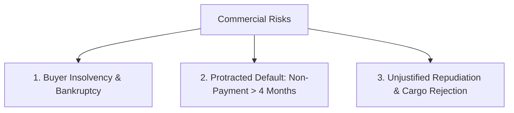

**Manifestations of Commercial Risk:**
1. **Insolvency:** The buyer enters formal bankruptcy or liquidation before paying for delivered cargo.
2. **Protracted Default:** The buyer accepts the cargo but persistently fails to remit funds across extended credit periods without raising valid commercial disputes.
3. **Repudiation / Rejection:** The buyer refuses to take delivery at the destination port due to falling domestic market prices or currency devaluations.

**Three Mitigation Tools:**
1. **Irrevocable, Confirmed Letter of Credit (LC):** Substitutes the foreign buyer’s credit risk with the primary, unconditional payment guarantee of a top-tier international confirming bank.
2. **ECGC Credit Insurance (SCRP Policy):** Provides up to 90% financial indemnity against buyer insolvency, protracted default, and non-acceptance.
3. **Non-Recourse International Factoring:** The Import Factor conducts buyer due diligence, assigns a credit limit, and guarantees 100% credit payout within 90 days of maturity if the buyer defaults.

- **Keywords to include for full marks:** Commercial risk, buyer insolvency, protracted default, repudiation, Confirmed Letter of Credit, ECGC SCRP policy, Non-Recourse Factoring under FCI.
- **Examiner trap:** Listing marine insurance as a commercial risk mitigation tool; marine insurance covers physical loss, not buyer non-payment.
- **Memory trick:** **I-D-R mitigated by L-E-F** (Insolvency, Default, Repudiation $\to$ LC, ECGC, Factoring).
- **Marking scheme guide:** Definition & 3 manifestations (2.5 marks); 3 specific mitigation tools (2.5 marks).

---

### Q8. Detail the key Political (Sovereign) Risks faced by Indian exporters and how ECGC provides protection against them. (5 marks) | Likelihood: High | Type: Explain
**Answer:**
**Introduction:**
Political risks arise from unilateral sovereign decisions, political instability, or macroeconomic collapses in the importing country that disrupt commercial trade flows.

**Key Political Risk Categories:**
1. **Foreign Exchange Transfer Moratoria:** The importing country’s central bank exhausts foreign currency reserves and imposes sudden exchange control restrictions, blocking local buyers from remitting US Dollars or Euros abroad.
2. **War, Revolution, and Civil Strife:** Outbreak of military hostilities, blockades, or domestic rebellions that destroy transport infrastructure or disrupt commercial banking systems.
3. **Import Licensing Restrictions / Embargoes:** Sudden government cancellation of previously valid import licenses or the imposition of sudden trade bans after cargo has sailed.
4. **Voyage Diversion Costs:** Interruption or rerouting of the voyage due to geopolitical conflict (e.g., Red Sea shipping attacks forcing detours around the Cape of Good Hope).

**Protection Provided by ECGC:**
- Under the **Shipment (Comprehensive Risks) Policy (SCRP)**, ECGC indemnifies Indian exporters for **up to 90%** of net realized losses resulting from all recognized political perils.
- ECGC maintains sovereign risk classifications, categorizing global markets into risk bands to guide exporters on safe credit exposure.

- **Keywords to include for full marks:** Sovereign actions, Transfer moratoria, Exchange control restrictions, War and civil strife, Import license cancellation, Red Sea voyage diversion, ECGC SCRP 90% indemnity.
- **Examiner trap:** Stating that commercial banks cover political risk; commercial banks discount bills with recourse unless backed by ECGC or confirming bank guarantees.
- **Memory trick:** **T-W-I-D** (Transfer restrictions, War, Import ban, Diversion costs).
- **Marking scheme guide:** Explanation of 4 distinct political risks (3 marks); Role of ECGC indemnity & country ratings (2 marks).

---

### Q9. Explain Foreign Exchange Risk in international trade and outline how forward contracts and currency options hedge this risk. (5 marks) | Likelihood: High | Type: Technical / Hedging
**Answer:**
**Introduction:**
Because cross-border contracts are typically denominated in foreign currencies (USD, EUR, GBP) while domestic production expenses are paid in Indian Rupees, exchange rate fluctuations directly impact corporate profit margins.

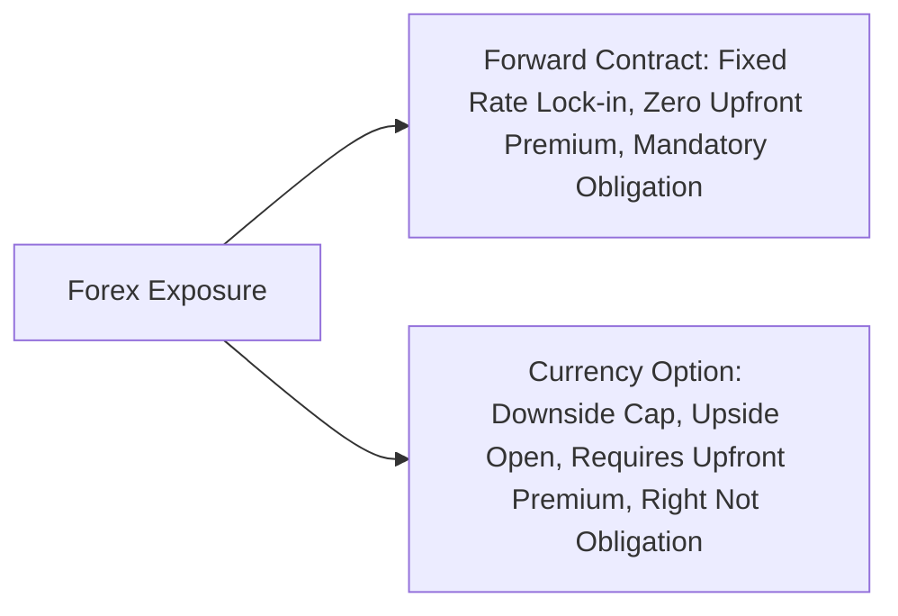

**Hedging Tools Provided by Banks:**
1. **Forward Exchange Contracts:**
   - **Mechanism:** The exporter contracts with an Authorized Dealer bank to sell a specified amount of foreign currency on a predetermined future date at a fixed **Forward Rate**.
   - **Protection:** Completely eliminates downside exchange volatility. Even if the Rupee appreciates sharply, the exporter receives the locked-in rate.
   - **Limitation:** Rigid obligation; the exporter cannot capitalize on favorable Rupee depreciation.
2. **Currency Options (Put Options for Exporters):**
   - **Mechanism:** The exporter purchases a **Currency Put Option** by paying an upfront, non-refundable cash premium to the bank, acquiring the **right, but not the obligation**, to sell foreign currency at a specified strike price.
   - **Protection:** Provides asymmetric protection. If the Rupee appreciates, the exporter exercises the option, capping their loss. If the Rupee depreciates, the exporter lets the option expire and sells dollars at the higher spot market rate.

- **Keywords to include for full marks:** Foreign exchange risk, Forward exchange contract, Forward rate lock-in, Currency put option, Asymmetric protection, Strike price, Option premium.
- **Examiner trap:** Claiming that forward contracts require payment of an upfront option premium; only options require a premium.
- **Memory trick:** **F-O** (Forwards = Obligation without premium; Options = Right with premium).
- **Marking scheme guide:** Concept of currency risk (1 mark); Forward contracts mechanics & pros/cons (2 marks); Currency options mechanics & asymmetry (2 marks).

---

### Q10. What is Cargo Transit Risk? Detail the physical perils encountered during maritime carriage and explain the role of Institute Cargo Clauses. (5 marks) | Likelihood: High | Type: Explain
**Answer:**
**Introduction:**
Cargo transit risk encompasses all physical perils, accidents, and environmental hazards that can damage, destroy, or delay merchandise as it moves through sea, air, rail, or road networks.

**Physical Maritime Perils:**
1. **Catastrophic Maritime Accidents:** Vessel sinking, stranding on reefs, capsizing in heavy weather, collision with other ships, and onboard cargo fire.
2. **Ocean Water Entry and Heavy Weather:** Heavy seas washing cargo overboard; seawater penetrating cargo holds through damaged hatch covers, causing corrosion and wetting.
3. **Port Handling and Stevedoring Casualties:** Rough crane handling, dropping of containers onto docks, container punctures, and forklift crushing during de-stuffing.
4. **Theft, Pilferage, and Non-Delivery:** Systematic cargo theft at container freight stations, seal tampering, and entire missing packages.

**Role of Institute Cargo Clauses (ICC):**
- Standardized by the International Underwriting Association (IUA) and Lloyd's, the **Institute Cargo Clauses** define the exact boundaries of marine cargo insurance:
  - **ICC (C):** Covers major catastrophes (sinking, fire, collision, General Average).
  - **ICC (B):** Adds natural disasters, sea/river water entry, and handling drop damage.
  - **ICC (A):** Comprehensive "All Risks" cover, protecting against theft, pilferage, and rough handling damage.

- **Keywords to include for full marks:** Transit risk, Sinking/stranding/collision, Seawater entry, Handling damage, Pilferage, Institute Cargo Clauses, ICC (A) All Risks.
- **Examiner trap:** Assuming standard transport carriers (shipping lines) provide full insurance; shipping lines operate under strict statutory liability limits (Hague-Visby Rules) and exclude act of God losses.
- **Memory trick:** **C-W-H-P** (Catastrophe, Water entry, Handling damage, Pilferage).
- **Marking scheme guide:** Physical perils categorized (2.5 marks); Role and structure of ICC A, B, and C (2.5 marks).

---

### Q11. Explain Legal and Regulatory Risks in export-import operations. (5 marks) | Likelihood: Medium | Type: Explain
**Answer:**
**Introduction:**
Legal and regulatory risks stem from operating across disparate sovereign jurisdictions governed by conflicting legal systems, fluctuating customs regulations, trade sanctions, and extraterritorial compliance mandates.

**Core Categories of Legal and Regulatory Risks:**
1. **Jurisdiction and Choice of Law Uncertainty:**
   - In the event of a contractual breach, pursuing an overseas buyer through foreign courts involves high legal costs, procedural delays, and unfamiliar local statutes.
   - **Mitigation:** Incorporating clear **International Commercial Arbitration clauses** (e.g., ICC International Court of Arbitration, SIAC) designating neutral seats.
2. **International Trade Sanctions and OFAC Compliance:**
   - Exposure to unilateral or multilateral economic sanctions (e.g., US Office of Foreign Assets Control - OFAC, UN Security Council). Shipping to a sanctioned entity results in frozen bank funds, asset seizures, and blacklisting.
3. **Tariff and Non-Tariff Regulatory Shocks:**
   - Sudden imposition of anti-dumping duties, safeguard tariffs, or stringent sanitary and phytosanitary (SPS) / Technical Barriers to Trade (TBT) standards by the importing government.
4. **Intellectual Property Rights (IPR) Infringement:**
   - Seizure of cargo at destination ports due to alleged patent, trademark, or copyright infringements under TRIPS-aligned national customs laws.

- **Keywords to include for full marks:** Legal risk, Jurisdiction uncertainty, ICC Arbitration, SIAC, OFAC trade sanctions, Anti-dumping duties, SPS/TBT non-tariff barriers, TRIPS IPR infringement.
- **Examiner trap:** Overlooking trade sanctions as a legal risk; non-compliance with sanctions leads to severe international banking freezes.
- **Memory trick:** **J-S-T-I** (Jurisdiction, Sanctions, Tariffs, Intellectual property).
- **Marking scheme guide:** 1.25 marks for each distinct legal risk dimension with mitigation context (Total = 5 marks).

---

### Q12. Write a short note on Operational and Supply Chain Risks in export execution. (5 marks) | Likelihood: Medium | Type: Short Note
**Answer:**
**Introduction:**
Operational and supply chain risks refer to breakdowns in the internal or external logistics infrastructure that prevent an exporter from delivering conforming goods within contractual deadlines.

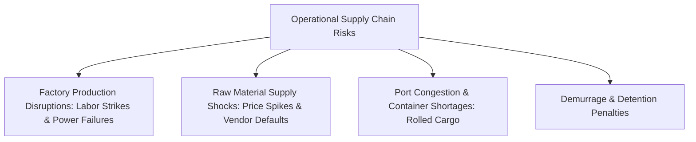

**Key Operational Vulnerabilities:**
1. **Production and Raw Material Disruptions:**
   - Domestic factory breakdowns, industrial strikes, power outages, or supplier defaults that cause manufacturing delays past the LC latest shipment date.
2. **Container Equipment Shortages:**
   - Inability to secure empty shipping containers (especially 40ft high-cube boxes) during global supply chain crunches, leading to missed vessel bookings.
3. **Port Congestion and Rolled Cargo:**
   - Seaports operating above capacity cause container vessels to bypass scheduled calls or bump loaded containers to subsequent voyages ("rolled cargo").
4. **Demurrage and Detention Accumulation:**
   - Delays in clearing customs or returning empty containers result in steep daily penalties levied by terminal operators and shipping lines.

- **Keywords to include for full marks:** Operational risk, Supply chain disruptions, Container shortages, Port congestion, Rolled cargo, Demurrage and detention, Missed LC shipment date.
- **Examiner trap:** Confusing operational risk with maritime transit risk; operational risk concerns logistics breakdowns, not physical ship casualties.
- **Memory trick:** **P-C-P-D** (Production delays, Container shortages, Port congestion, Demurrage).
- **Marking scheme guide:** Conceptual definition (1 mark); Detailed analysis of four operational vulnerabilities (4 marks).

---

## Section C: 10-Mark Questions (Detailed Analytical Answers)

### Q13. Provide a comprehensive taxonomy of all major risks encountered in international trade transactions. Formulate a structured Risk-Mitigation Matrix pairing each risk category with practical institutional, financial, and contractual safeguards. (10 marks) | Likelihood: High | Type: Taxonomy / Analytical Matrix
**Answer:**
**Introduction:**
International trade is inherently riskier than domestic commerce. Separated by vast physical distances, divergent legal systems, different currencies, and sovereign borders, cross-border transactions face a multi-dimensional risk matrix. A successful export strategy requires a structured framework that identifies, categorizes, and systematically mitigates each operational exposure.

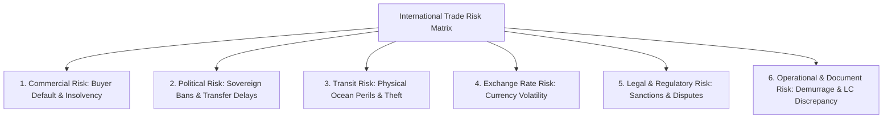
*(Exam 2-minute sketch guide: Draw a central hub labeled "Trade Risks" branching into six distinct quadrants: Commercial, Political, Transit, Forex, Legal, and Operational).*

#### Comprehensive Risk-Mitigation Matrix

| Risk Category | Inherent Risk Exposures | Primary Causative Factors | Institutional & Practical Mitigation Tools |
| :--- | :--- | :--- | :--- |
| **1. Commercial Risk** | Buyer insolvency, protracted payment default, repudiation and non-acceptance of cargo. | Buyer financial bankruptcy, market price collapses, opportunistic bad faith. | - **Irrevocable Confirmed Letter of Credit (UCP 600)**.<br>- **ECGC Shipment (Comprehensive Risks) Policy**.<br>- **Non-Recourse Factoring under FCI**.<br>- Credit vetting via Dun & Bradstreet. |
| **2. Political / Sovereign Risk** | Foreign exchange transfer moratoria, war, civil strife, import license bans, port blockades. | Geopolitical conflicts, sovereign debt crises, central bank dollar reserve shortages. | - **ECGC Sovereign Risk Cover (SCRP 90% indemnity)**.<br>- Letters of Credit confirmed by prime international banks located outside the buyer's region.<br>- Diversified overseas market portfolio. |
| **3. Cargo Transit Risk** | Vessel sinking, stranding, collision, fire, seawater wetting, container damage, pilferage. | Maritime casualties, severe weather, rough port handling, stowage collapse. | - **Marine Cargo Insurance under ICC (A) "All Risks"**.<br>- Institute War & Strikes endorsements.<br>- Export packaging adhering to IIP (Indian Institute of Packaging) standards. |
| **4. Foreign Exchange Risk** | Transaction exposure (loss of revenue due to currency appreciation), margin erosion. | Macroeconomic volatility, interest rate disparities, geopolitical shocks. | - **Forward Exchange Contracts** with AD banks.<br>- **Currency Options (Put Options)**.<br>- Pre-Shipment Credit in Foreign Currency (**PCFC**).<br>- Settlement in Indian Rupees via **SRVA**. |
| **5. Legal & Regulatory Risk** | Foreign litigation costs, trade sanctions (OFAC), anti-dumping duties, IPR infringement claims. | Conflicting legal codes, unilateral trade bans, non-tariff barrier enforcement. | - **International Arbitration Clause** (ICC Paris, SIAC).<br>- Incorporation of **Incoterms 2020** definitions.<br>- Rigorous screening against UN/OFAC Sanctions.<br>- Technical compliance with destination standards (CE, FDA). |
| **6. Operational & Document Risk** | Bank rejection of shipping documents, expired LCs, port demurrage, container rolled over. | Clerical typos, late vessel arrival, carrier congestion, missing phytosanitary permits. | - Strict adherence to **ISBP 745** checking standards.<br>- Buffer days in LC latest shipment dates.<br>- Real-time container tracking & experienced CHAs. |

**Conclusion:**
No international transaction is completely devoid of risk. However, by deploying a layered defense—combining confirmed payment instruments, export credit insurance, marine cargo coverage, and foreign exchange derivatives—an exporter can systematically transfer or eliminate exposures, preserving profit margins and corporate solvency.

- **Keywords to include for full marks:** Commercial risk, Political risk, Transit risk, Foreign exchange risk, Legal risk, Operational risk, Confirmed LC, ECGC SCRP, ICC (A), Forward contracts, ICC Arbitration, ISBP 745.
- **Examiner trap:** Presenting a narrative without a structured comparative matrix; university evaluators expect a clear tabular mapping pairing risks with specific mitigation instruments.
- **Memory trick:** **C-P-T-F-L-O** (Commercial, Political, Transit, Forex, Legal, Operational).
- **Marking scheme guide:** Introduction & risk taxonomy (2 marks); Detailed tabular matrix across all six risk dimensions (6 marks); Synthesis & strategic conclusion (2 marks).

---

### Q14. Critically analyze Foreign Exchange Exposure in export-import transactions. Contrast Transaction, Translation, and Economic exposures, and evaluate internal vs. external hedging techniques. (10 marks) | Likelihood: High | Type: Analytical / Technical
**Answer:**
**Introduction:**
In cross-border commerce, trade contracts are agreed at one point in time, while physical delivery and financial settlement occur weeks or months later. Because contracts are denominated in foreign currencies, exchange rate volatility introduces **Foreign Exchange Exposure**—the sensitivity of a firm's cash flows, asset values, and market competitiveness to currency movements.

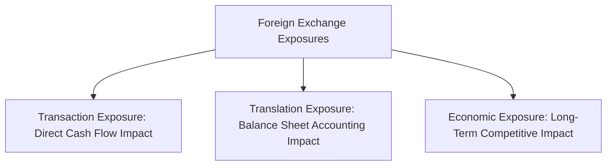

#### 1. The Three Dimensions of Foreign Exchange Exposure
1. **Transaction Exposure (Contractual Cash-Flow Risk):**
   - Arises from firm contractual obligations denominated in foreign currency (e.g., an outstanding export receivable of USD 500,000 due in 90 days).
   - If the Indian Rupee appreciates from ₹83 to ₹81 per USD, the exporter incurs a real cash loss of ₹10,00,000 upon conversion.
2. **Translation Exposure (Accounting / Balance Sheet Risk):**
   - Arises when a parent company consolidates the financial statements of its foreign subsidiaries into its home reporting currency.
   - It represents an **unrealized accounting variance** reported under balance sheet reserves (Foreign Currency Translation Reserve) rather than a direct operating cash outflow.
3. **Economic (Operating) Exposure (Strategic Competitiveness Risk):**
   - The impact of exchange rate fluctuations on a firm's long-term international market share, cost structure, and future operating cash flows.
   - For example, if the Japanese Yen depreciates significantly against the US Dollar while the Rupee remains strong, Japanese machine tool manufacturers become cheaper globally, eroding Indian exporters' market share even without direct contractual currency changes.

---

#### 2. Evaluation of Hedging Techniques: Internal vs. External

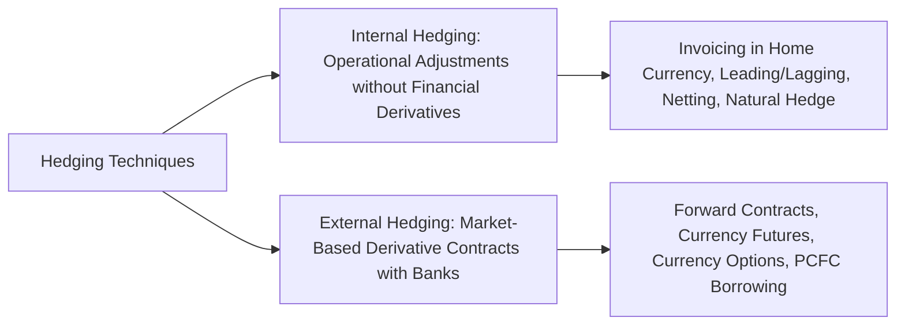

#### A. Internal Hedging Techniques (Operational / Contractual)
- **Invoicing in Domestic Currency:** Invoicing contracts directly in Indian Rupees transfers 100% of exchange risk to the foreign buyer (though this may reduce commercial competitiveness).
- **Leading and Lagging:** Accelerating (*leading*) or delaying (*lagging*) foreign currency payments or receipts based on expected currency movements.
- **Natural Hedging (Matching):** Matching foreign currency cash inflows with outflows in the same currency (e.g., funding USD raw material imports directly from USD export earnings).
- **Netting:** Centralizing cross-border inter-company payables and receivables across multinational subsidiaries, settling only the net balance.

#### B. External Hedging Techniques (Financial Derivatives & Bank Instruments)
- **Forward Exchange Contracts:** Bilateral OTC contracts locking in a guaranteed future exchange rate, completely eliminating cash-flow volatility at zero upfront fee.
- **Currency Options:** Purchasing Put Options provides an asymmetric hedge, setting a floor on the exchange rate while preserving 100% upside participation if the foreign currency strengthens.
- **Money Market Hedge (Pre-Shipment Credit in Foreign Currency - PCFC):** Borrowing in USD against future USD export receivables creates an automatic, self-liquidating natural hedge.

**Conclusion:**
While internal techniques are cost-effective and operationally non-disruptive, they are rarely sufficient on their own in competitive global markets. Leading exporters adopt a hybrid approach: maximizing natural operational hedges internally while covering remaining net cash-flow exposures through bank forward contracts and currency options.

- **Keywords to include for full marks:** Foreign exchange exposure, Transaction exposure, Translation exposure, Economic exposure, Internal hedging, Natural hedge, Netting, Leading and lagging, External hedging, Forward contracts, Currency options, PCFC.
- **Examiner trap:** Treating translation exposure as an immediate cash loss; translation is an accounting consolidation variance.
- **Memory trick:** **T-T-E & I-E** (Transaction, Translation, Economic; Internal, External).
- **Marking scheme guide:** Detailed contrast of Transaction, Translation, and Economic exposures (4.5 marks); Internal hedging techniques evaluated (2.5 marks); External derivative hedging tools evaluated (2 marks); Conclusion (1 mark).

---

### Q15. Examine Documentation Risk in export operations. Analyze the consequences of discrepant documents under UCP 600, common clerical errors, and the role of International Standard Banking Practice (ISBP 745). (10 marks) | Likelihood: High | Type: Technical / Procedure
**Answer:**
**Introduction:**
In international trade finance governed by documentary Letters of Credit, physical merchandise is secondary during financial settlement: **banks deal exclusively with documents and not with goods (UCP 600, Article 5)**. Consequently, **Documentation Risk**—the risk of clerical, technical, or temporal non-compliance in the shipping dossier—represents one of the most frequent causes of delayed payments, fee penalties, and loss of legal protection for exporters.

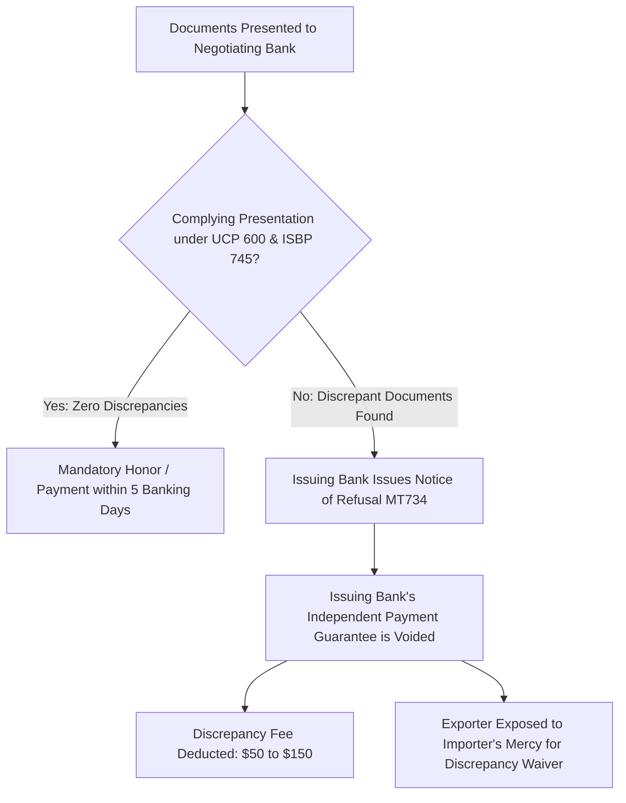
*(Exam 2-minute sketch guide: Draw a decision diamond: "Complying presentation?" leading left to "Guaranteed Bank Honor" and right to "Notice of Refusal $\to$ LC Protection Lost $\to$ Importer Waiver needed").*

#### 1. Common Documentary Errors and Discrepancies
Studies by the International Chamber of Commerce (ICC) indicate that over **50% of document presentations are rejected on first presentation** due to discrepancies:
1. **Late Shipment / Late Presentation:**
   - Transport documents showing a Bill of Lading on-board date past the LC's latest shipment date.
   - Documents presented past the 21-day presentation window allowed under UCP 600 Article 14(c).
2. **Inconsistent Descriptions of Goods (Article 18c):**
   - The commercial invoice must describe goods in precise correspondence with the LC text. Minor wording variations (e.g., "100% Cotton" vs. "Pure Cotton") constitute a fatal discrepancy.
3. **Mismatched Data across Documents (Article 14d):**
   - Data in one document contradicting data in another (e.g., weight on Packing List not matching weight on Bill of Lading).
4. **Missing Endorsements or Signatures:**
   - Bills of Lading lacking proper shipper endorsements or missing on-board notations signed by the carrier.
5. **Insurance Discrepancies (Article 28):**
   - Insurance certificate dated after the Bill of Lading date, denominated in a different currency, or covering less than the mandatory 110% CIF value.

#### 2. Legal Consequences of Discrepancies under UCP 600
- **Voiding of Bank Undertaking:** The moment a valid discrepancy is identified, the issuing bank’s independent, irrevocable legal commitment to pay is **extinguished**.
- **Issuing Bank's Notice of Refusal (Article 16):**
  - The issuing bank must issue a single, comprehensive Notice of Refusal via SWIFT (MT734) within a maximum of **five (5) banking days**, listing all identified discrepancies.
- **Exposure to Buyer Default:** The documents are held at the exporter's disposal or forwarded to the buyer on an "approval basis". The exporter is stripped of bank security and thrown onto the buyer's goodwill to obtain a **discrepancy waiver**.
- **Commercial Leverage Shift:** Buyers often exploit discrepancies during market downturns to negotiate price discounts or refuse delivery altogether.
- **Financial Penalties:** Banks charge **Discrepancy Handling Fees** (typically $75 to $150 per set) deducted directly from proceeds.

#### 3. The Harmonizing Role of ISBP 745
To curb excessive and trivial document rejections by hyper-technical bank examiners, the ICC published the **International Standard Banking Practice (ISBP 745)**:
- Clarifies that typographical errors that do not affect the meaning of a sentence do not constitute discrepancies (e.g., "machne" instead of "machine" in a packing list).
- Provides practical rules for interpreting shipping terms, acceptable abbreviations (e.g., "Ltd." for "Limited", "Co." for "Company"), mathematical rounding, and signatures.

**Conclusion:**
Documentation risk is an entirely self-inflicted vulnerability. Exporters must implement rigorous pre-presentation checklists aligned with UCP 600 and ISBP 745, ensuring that document examiners find zero discrepancies on presentation.

- **Keywords to include for full marks:** Documentation risk, UCP 600 Article 5, Article 14 (5 banking days), Article 18(c) goods description, Article 28 insurance, Notice of Refusal (MT734), Discrepancy fee, Loss of bank undertaking, ISBP 745.
- **Examiner trap:** Believing that minor misspellings on an invoice are acceptable under ISBP; the Commercial Invoice description must match the LC text precisely.
- **Memory trick:** **U-D-N-W-I** (UCP rules, Discrepancies common, Notice MT734, Waiver required, ISBP standard).
- **Marking scheme guide:** Introduction & UCP 600 Article 5 principle (2 marks); Detailed breakdown of 5 common discrepancies (3 marks); Legal consequences of rejection & Notice MT734 (3 marks); Mitigating role of ISBP 745 (2 marks).

---

### Q16. Detail the operational and logistical risks encountered in maritime transport, focusing on Port Congestion, Container Rollovers, Demurrage, and Detention. How can an exporter protect against them? (10 marks) | Likelihood: Medium | Type: Operational / Logistics
**Answer:**
**Introduction:**
Physical trade depends on the integrity of international logistics chains. Port terminal bottlenecks, shipping line vessel adjustments, and customs delays create operational risks that lead to significant financial penalties and customer dissatisfaction.

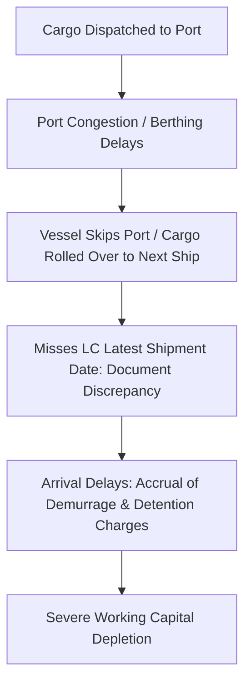

#### 1. Core Logistical Risks
1. **Port Congestion and Berthing Delays:**
   - When ports operate above handling capacity due to equipment breakdowns, labor actions, or adverse weather, vessels wait at outer anchorages for days or weeks.
   - Carriers respond by imposing **Port Congestion Surcharges (PCS)** or blank sailings (cancelling port calls).
2. **Container Rollovers:**
   - Shipping lines routinely overbook container vessels (by 10% to 20%) to compensate for cancellations.
   - If all booked cargo arrives at the gate, carriers bump containers to the next scheduled sailing (a "rollover"), causing shipments to miss contract deadlines.
3. **Demurrage Charges:**
   - Penalty fees assessed by the shipping line when a container remains inside the terminal or container yard beyond the allotted free days (typically 3 to 7 days).
4. **Detention Charges:**
   - Daily charges levied when the trader holds the carrier's equipment (the physical container) outside the port terminal beyond the agreed free time before returning it empty to the designated depot.

#### 2. Commercial and Contractual Repercussions
- **Breach of LC Shipment Deadlines:** A container rollover often pushes the on-board Bill of Lading date past the LC's latest shipment date, creating a fatal document discrepancy.
- **Supply Chain Disruption for Importer:** Factory production lines at destination stall, triggering contract penalty clauses.
- **Erosion of Profit Margins:** Accrued demurrage and detention charges can rapidly exceed the net profit of the transaction, sometimes exceeding the value of the cargo itself.

#### 3. Strategic Risk-Mitigation Roadmap for Exporters

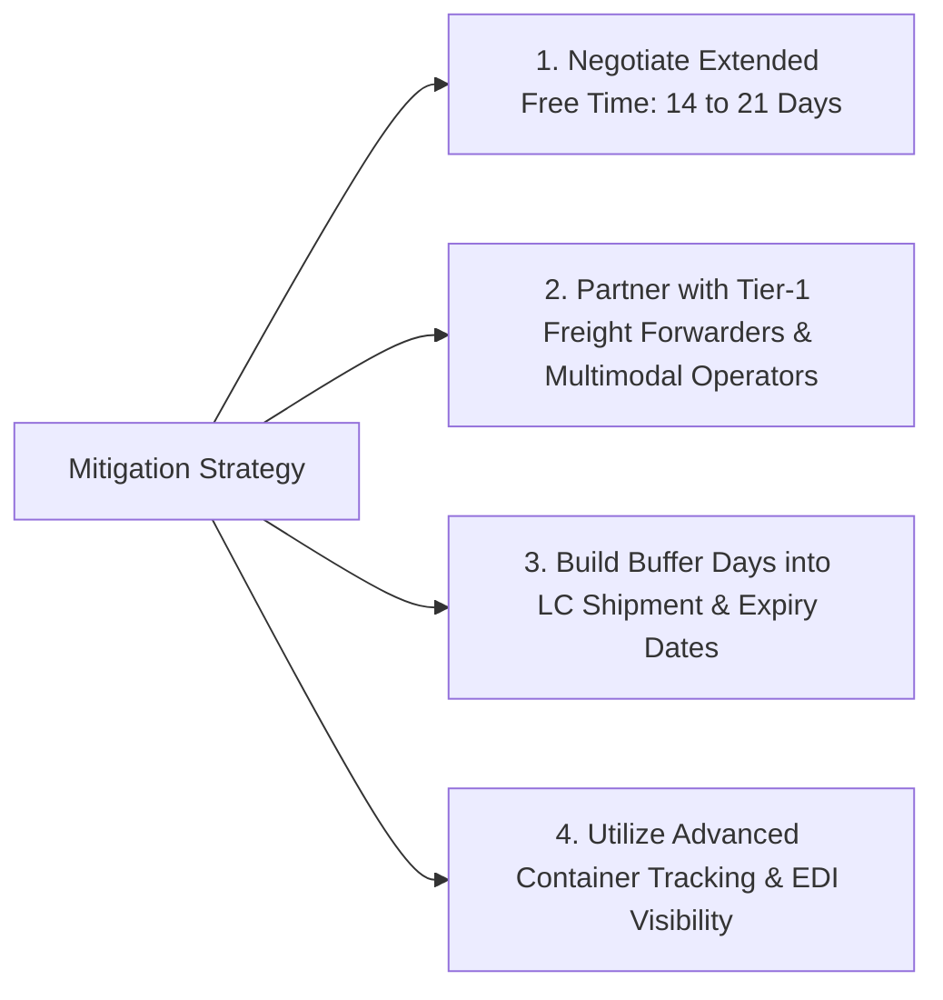

1. **Contractual Buffer Windows in Letters of Credit:**
   - Exporters should never accept an LC where the latest shipment date is tight against production completion. Always insist on a **15- to 21-day buffer** between cargo availability and the latest shipment date to absorb vessel delays.
2. **Negotiating Extended Free Days:**
   - Forward-looking exporters negotiate with shipping lines or freight forwarders for **14 to 21 days of combined demurrage/detention free time** at destination, providing a buffer against customs clearance delays.
3. **Working with Tier-1 Multimodal Logistics Operators:**
   - Large logistics aggregators hold contracted space commitments, minimizing container rollover risk compared to spot-market bookings.
4. **Deploying Real-Time IoT and EDI Tracking:**
   - Using digital tracking solutions to monitor gate-in, vessel berthing, and container discharge, enabling proactive coordination with customs brokers.

**Conclusion:**
Logistics risks cannot be entirely prevented, but their financial impact can be managed. By negotiating extended free-time allowances, incorporating operational buffer windows in contracts, and working with reliable freight forwarders, exporters can navigate global supply chain disruptions without incurring punitive demurrage costs.

- **Keywords to include for full marks:** Logistical risk, Port congestion surcharges, Container rollover, Demurrage (inside port), Detention (outside port), LC shipment deadlines, 14-21 free days negotiation, Buffer days, Multimodal logistics.
- **Examiner trap:** Using demurrage and detention as synonyms; demurrage occurs inside the port terminal, detention occurs outside the port terminal.
- **Memory trick:** **P-R-D-D-B** (Port congestion, Rollover, Demurrage, Detention, Buffer strategy).
- **Marking scheme guide:** Detailed breakdown of four logistics risks (4 marks); Contractual & financial repercussions (2.5 marks); Strategic mitigation roadmap (3.5 marks).

---

## Section D: 15-Mark Questions (Comprehensive Masters)

### Q17. Provide an exhaustive analysis of the Risk Architecture in International Trade. Detail the interconnections between Commercial, Political, Foreign Exchange, and Legal risks. Develop a comprehensive corporate Enterprise Risk Management (ERM) framework for an Indian export house, incorporating quantitative risk-assessment methodologies and institutional risk-transfer mechanisms. (15 marks) | Likelihood: High | Type: Comprehensive Master / Enterprise Strategy
**Answer:**
**Introduction:**
International trade operations are exposed to a complex matrix of interconnected risks. A single macroeconomic or geopolitical shock rarely impacts only one operational domain; rather, it triggers a cascading series of vulnerabilities across commercial, political, currency, and legal fronts. For instance, a sovereign foreign exchange crisis in an importing nation leads directly to central bank transfer moratoria (political risk), which induces local importer bankruptcy (commercial risk), traps receivables in depreciating local currency (foreign exchange risk), and forces contentious recovery litigation in foreign jurisdictions (legal risk). To navigate this interconnected landscape, modern export enterprises must transition from piecemeal protections to an integrated **Enterprise Risk Management (ERM)** framework.

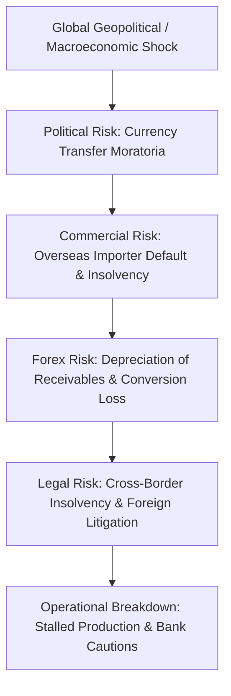
*(Exam 2-minute sketch guide: Draw a circular chain showing how Political Risk triggers Commercial Default $\to$ Forex Loss $\to$ Legal Disputes $\to$ Bank Cautions, illustrating the systemic domino effect).*

---

#### 1. The Interconnection of Trade Risk Domains
1. **The Political-to-Commercial Cascade:**
   - When a sovereign nation experiences a balance-of-payments crisis (e.g., Sri Lanka 2022, Egypt 2023), the central bank halts foreign currency sales to commercial banks.
   - Legitimate, solvent foreign importers find themselves physically unable to purchase US Dollars to honor matured trade drafts. Over months of currency starvation, these buyers suffer domestic insolvency, transforming a sovereign political risk into a commercial default.
2. **The Transit-to-Documentary-and-Financial Cascade:**
   - Geopolitical attacks on maritime chokepoints (e.g., Red Sea missile attacks) force ocean carriers to detour around the Cape of Good Hope, adding 14 to 20 days to transit times.
   - This delay causes transport documents to arrive after the Letter of Credit latest presentation date, triggering bank document rejections (documentation risk), unpaid bills, and port storage charges (demurrage).
3. **The Forex-to-Repudiation Cascade:**
   - Sudden devaluation of the buyer's domestic currency makes imported goods significantly more expensive in local terms.
   - Facing inventory write-downs, the overseas buyer repudiates the contract, refusing to accept the goods at the destination port (commercial repudiation driven by foreign exchange volatility).

---

#### 2. Quantitative Risk Assessment: The Probability-Impact Risk Matrix
An effective ERM framework begins by mapping cross-border exposures onto a **Probability-Impact Matrix**:

$$\text{Risk Severity Score (RSS)} = \text{Probability of Occurrence } (1-5) \times \text{Financial Impact Score } (1-5)$$

```
Financial Impact (Severity)
  5 | [High Transit Loss]       [Catastrophic Political Default]
  4 |                           [Buyer Insolvency]
  3 | [Demurrage Penalties]     [Currency Volatility]
  2 | [LC Minor Discrepancy]
  1 |
    +-----------------------------------------------------------
      1           2           3           4           5
                  Probability of Occurrence (Frequency)
```

- **Zone 1: Low Probability / High Impact (e.g., Sovereign War, Major Ship Sinking):**
  - Requires formal **Risk Transfer** via institutional insurance (ECGC political cover and Marine ICC-A policies).
- **Zone 2: High Probability / Moderate Impact (e.g., Currency Fluctuations, Port Demurrage):**
  - Requires **Risk Mitigation & Hedging** (Forward exchange contracts, negotiating extended free days).
- **Zone 3: High Probability / Low Impact (e.g., Minor Clerical Inconsistencies):**
  - Managed via **Internal Process Controls** (Double-check maker-checker documentation desks, adherence to ISBP 745).

---

#### 3. The Corporate Enterprise Risk Management (ERM) Architecture
An Indian export house should organize its ERM architecture across four operational pillars:

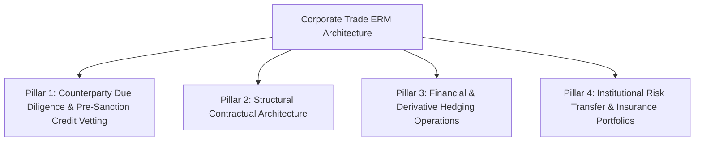

1. **Pillar 1: Counterparty Due Diligence & Vetting:**
   - Mandatory procurement of international credit reports (Dun & Bradstreet / Coface) on all new buyers.
   - Verification against RBI Caution Lists, DGFT Denied Entity Lists, and UN/OFAC Sanctions databases.
   - Establishing dynamic credit exposure ceilings tied to the buyer's net worth and transaction history.
2. **Pillar 2: Structural Contractual Architecture:**
   - Using unambiguous **Incoterms 2020** rules to define exact points of risk transfer.
   - Drafting robust **Force Majeure and Hardship clauses** addressing maritime detours, natural disasters, and regulatory interventions.
   - Incorporating neutral **International Commercial Arbitration clauses** (e.g., SIAC Singapore or ICC Paris rules) with defined seats and governing law to bypass national court backlogs.
3. **Pillar 3: Financial & Derivative Hedging Operations:**
   - Mandating that all open-account foreign currency receivables be covered by Forward Exchange Contracts or Currency Put Options to lock in baseline operating margins.
   - Utilizing Pre-Shipment Credit in Foreign Currency (**PCFC**) to establish natural hedges against imported input costs.
4. **Pillar 4: Institutional Risk Transfer Portfolios:**
   - Maintaining an active **ECGC Shipment (Comprehensive Risks) Policy** on a whole-turnover basis to underwrite commercial and political default risks up to 90%.
   - Procuring **Marine Cargo Open Covers under ICC (A) "All Risks"** with Institute War and Strikes endorsements, insuring cargo at 110% of CIF value.

**Conclusion:**
Risk is an inseparable reality of international business. By shifting from reactive crisis firefighting to a structured Enterprise Risk Management framework, an Indian export enterprise protects its balance sheet, secures bank financing, and pursues aggressive global expansion with confidence.

- **Keywords to include for full marks:** Enterprise Risk Management (ERM), Interconnected risk cascade, Political to commercial cascade, Probability-Impact Risk Matrix, Risk Transfer, Incoterms 2020, Force Majeure, ICC Arbitration, ECGC SCRP, ICC (A), Forward contracts, PCFC natural hedge.
- **Examiner trap:** Presenting risks in isolated silos without explaining how one risk triggers another (the systemic cascade).
- **Memory trick:** **C-A-S-C-A-D-E** (Commercial, Armed conflict, Sovereign moratoria, Currency swings, Arbitration clauses, Documentation, ERM framework).
- **Marking scheme guide:** Interconnection of trade risk domains & cascading effects (3.5 marks); Quantitative Probability-Impact Matrix & methodology (3 marks); Detailed 4-Pillar corporate ERM architecture (6 marks); Strategic conclusions & diagrams (2.5 marks).

---

### Q18. Examine Foreign Exchange Risk Management for an Indian Exporter under extreme currency volatility. Detail the theoretical foundations of exchange rate determination (Purchasing Power Parity and Interest Rate Parity), evaluate derivative hedging instruments, and calculate the financial outcomes of unhedged vs. hedged forward vs. currency option positions. (15 marks) | Likelihood: High | Type: Technical / Mathematical / Master
**Answer:**
**Introduction:**
In international finance, exchange rates are among the most volatile macroeconomic variables. An Indian exporter who prices an order assuming an exchange rate of ₹83.50 per USD can see their entire operational profit wiped out if the Rupee appreciates to ₹81.50 by the time payment arrives. Managing this currency risk requires a sound understanding of international parity theories and disciplined execution of foreign exchange hedging instruments.

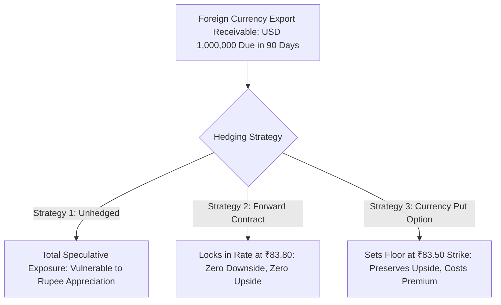
*(Exam 2-minute sketch guide: Draw a decision tree showing the three parallel strategies for a USD 1,000,000 receivable: Unhedged, Forward Contract, and Currency Put Option, leading to their distinct risk-return outcomes).*

---

#### 1. Theoretical Foundations of Exchange Rate Determination
1. **Purchasing Power Parity (PPP):**
   - Formulated by Gustav Cassel, PPP states that the exchange rate between two currencies should adjust to reflect changes in the price levels (inflation rates) of the two nations:
     $$\frac{S_1}{S_0} = \frac{1 + I_{\text{domestic}}}{1 + I_{\text{foreign}}}$$
   - Currencies of countries with higher inflation rates (e.g., India historically relative to the US) tend to depreciate over the long run to maintain purchasing power parity.
2. **Covered Interest Rate Parity (CIRP):**
   - CIRP links spot exchange rates, forward exchange rates, and nominal interest rate differentials:
     $$F = S \times \left( \frac{1 + R_{\text{domestic}} \times \frac{t}{365}}{1 + R_{\text{foreign}} \times \frac{t}{365}} \right)$$
   - When domestic interest rates exceed foreign interest rates ($R_{\text{INR}} > R_{\text{USD}}$), the foreign currency trades at a **forward premium** against the domestic currency, compensating for the interest differential and eliminating international arbitrage.

---

#### 2. Comparative Evaluation of Hedging Instruments

| Analytical Parameter | Forward Exchange Contract | Currency Futures Contract | Currency Put Option Contract |
| :--- | :--- | :--- | :--- |
| **Market Structure** | Over-the-Counter (OTC) with AD Bank | Traded on Exchanges (NSE, BSE) | OTC (Bank) or Exchange-Traded |
| **Contract Customization** | **Fully tailored** (exact amount & date) | Standardized lot sizes ($1,000) & dates | Standardized or customized |
| **Upfront Cash Premium** | **Zero upfront premium** | Initial and mark-to-market margins | **Upfront non-refundable cash premium** |
| **Legal Nature** | Binding obligation to deliver | Binding obligation to settle | **Right, but not the obligation**, to sell |
| **Protection Profile** | Completely eliminates downside risk | Completely eliminates downside risk | Completely eliminates downside risk |
| **Upside Participation** | **Zero**; locked at forward rate | **Zero**; locked at futures rate | **Full upside preserved** (net of premium) |

---

#### 3. Comprehensive Mathematical Case Study: Comparing Three Hedging Scenarios
**Scenario:**
An Indian textile exporter ships garments worth **USD 1,000,000** on 90-day credit terms.
- Current Spot Exchange Rate ($S_0$): **USD 1 = INR 83.20**
- 90-Day Forward Rate Offered by Bank ($F$): **INR 83.80** (trading at a 60-paise forward premium).
- 90-Day Currency Put Option: Strike Price ($K$) = **INR 83.50**, Upfront Option Premium ($P$) = **INR 0.50 per USD** (Total premium cash outlay = ₹5,00,000).

Evaluate the financial net proceeds in Indian Rupees across three possible spot market rates at maturity (Day 90):
- **Case 1 (Severe Rupee Appreciation):** Spot Rate moves to **INR 81.50**.
- **Case 2 (Stable Currency):** Spot Rate moves to **INR 83.50**.
- **Case 3 (Sharp Rupee Depreciation):** Spot Rate moves to **INR 85.50**.

---

#### Mathematical Computations across Strategies

#### Strategy 1: Unhedged Strategy (Pure Market Speculation)
$$\text{Net Proceeds} = \text{USD Amount} \times S_{90}$$
- **At ₹81.50:** $\$1,000,000 \times 81.50 = \mathbf{\text{₹}8,15,00,000}$
- **At ₹83.50:** $\$1,000,000 \times 83.50 = \mathbf{\text{₹}8,35,00,000}$
- **At ₹85.50:** $\$1,000,000 \times 85.50 = \mathbf{\text{₹}8,55,00,000}$

#### Strategy 2: Forward Exchange Contract (Locked at ₹83.80)
The exporter is legally bound to deliver at the agreed forward rate of ₹83.80 regardless of market movements:
$$\text{Net Proceeds} = \$1,000,000 \times 83.80 = \mathbf{\text{₹}8,38,00,000}\text{ across all scenarios}$$

#### Strategy 3: Currency Put Option (Strike = ₹83.50, Premium = ₹0.50)
$$\text{Net Effective Rate} = \max(\text{Strike Price}, \text{Spot Rate}) - \text{Option Premium}$$
- **At ₹81.50 (Rupee Appreciates):**
  - Exporter **exercises** the Put Option to sell at the strike price of ₹83.50.
  - Gross Proceeds = $\$1,000,000 \times 83.50 = \text{₹}8,35,00,000$
  - Less Option Premium = $\$1,000,000 \times 0.50 = -\text{₹}5,00,000$
  - **Net Proceeds:** $\text{₹}8,35,00,000 - \text{₹}5,00,000 = \mathbf{\text{₹}8,30,00,000}$
- **At ₹83.50 (Stable):**
  - Exporter exercises or sells at market rate of ₹83.50.
  - **Net Proceeds:** $(\$1,000,000 \times 83.50) - \text{₹}5,00,000 = \mathbf{\text{₹}8,30,00,000}$
- **At ₹85.50 (Rupee Depreciates):**
  - Exporter **abandons** the Put Option and sells at the spot market rate of ₹85.50.
  - Gross Proceeds = $\$1,000,000 \times 85.50 = \text{₹}8,55,00,000$
  - Less Option Premium = $-\text{₹}5,00,000$
  - **Net Proceeds:** $\text{₹}8,55,00,000 - \text{₹}5,00,000 = \mathbf{\text{₹}8,50,00,000}$

---

#### Comparative Synthesis and Performance Matrix

| Market Outcome at Maturity | Strategy 1: Unhedged | Strategy 2: Forward Contract | Strategy 3: Currency Put Option | Optimal Strategy |
| :--- | :--- | :--- | :--- | :--- |
| **Rupee Appreciates to ₹81.50** | ₹8,15,00,000 *(Severe Loss)* | **₹8,38,00,000** | ₹8,30,00,000 | **Forward Contract** (+₹23 Lakh vs Unhedged) |
| **Spot Remains at ₹83.50** | ₹8,35,00,000 | **₹8,38,00,000** | ₹8,30,00,000 | **Forward Contract** (+₹3 Lakh vs Unhedged) |
| **Rupee Depreciates to ₹85.50** | ₹8,55,00,000 *(Max Profit)* | ₹8,38,00,000 *(Opportunity Loss)* | **₹8,50,00,000** | **Option** (Participates in Upside) |

**Conclusion:**
- If the exporter prioritizes **absolute cash-flow certainty** with zero cash outlay, the **Forward Contract** is superior, delivering ₹8,38,00,000 in all scenarios and fully protecting against severe appreciation.
- If the exporter expects the foreign currency to strengthen and is willing to pay a known insurance premium (₹5,00,000) to participate in upside gains while maintaining a guaranteed floor (₹8,30,00,000), the **Currency Put Option** provides the optimal risk-return profile.

- **Keywords to include for full marks:** Foreign exchange exposure, Purchasing Power Parity (PPP), Covered Interest Rate Parity (CIRP), Forward premium, OTC forwards, Currency put options, Strike price, Option premium, Asymmetric payoff, Net proceeds model.
- **Examiner trap:** Forgetting to subtract the option premium when calculating net proceeds under the currency option strategy.
- **Memory trick:** **P-I-F-O-C** (Parity theories, Interest differential, Forward lock-in, Option asymmetry, Comparative matrix).
- **Marking scheme guide:** Theoretical foundations (PPP & CIRP formulas) (3.5 marks); Comparative evaluation of hedging tools table (3 marks); Complete mathematical formulation across all three scenarios (6 marks); Strategic synthesis & recommendation (2.5 marks).

---

## Section E: "Differentiate Between" Questions (Master Tables)

### Q19. Differentiate between Commercial Risk and Political Risk in export transactions. (5 marks) | Likelihood: High | Type: Differentiate
**Answer:**

| Parameter | Commercial Risk | Political (Sovereign) Risk |
| :--- | :--- | :--- |
| **1. Origin of Risk** | Arises from the **private counterparty (buyer)**. | Arises from **sovereign state actions or geopolitical events**. |
| **2. Primary Causes** | Buyer insolvency, bankruptcy, protracted default, rejection. | War, revolution, transfer moratoria, import bans, embargoes. |
| **3. Buyer Willingness** | Buyer is **unwilling or financially unable** to pay. | Buyer may be willing to pay, but is **blocked by government decree**. |
| **4. Mitigation Agency** | Private Factors, Confirming Banks, ECGC commercial cover. | Export Credit Agencies (**ECGC**), Multilateral agencies (MIGA). |
| **5. Core Mitigation Tool** | Confirmed LC, Non-Recourse Factoring, ECGC commercial policy. | ECGC political risk cover, offshore confirming bank guarantees. |
| **6. Exporter Assessment** | Assessed via Dun & Bradstreet credit rating reports. | Assessed via country risk classifications and sovereign ratings. |

- **Keywords to include for full marks:** Private buyer vs Sovereign state, Buyer insolvency vs Transfer moratoria, Willingness vs Blocked by decree, Factoring vs ECGC political cover, Credit ratings vs Country risk.
- **Examiner trap:** Categorizing import bans as commercial risk; any state regulatory ban is a political risk.
- **Marking scheme guide:** 1 mark per distinct, well-developed comparative row (up to 5 marks).

---

### Q20. Differentiate between Transaction Exposure, Translation Exposure, and Economic Exposure. (5 marks) | Likelihood: High | Type: Differentiate
**Answer:**

| Feature | Transaction Exposure | Translation Exposure | Economic Exposure |
| :--- | :--- | :--- | :--- |
| **1. Primary Nature** | **Contractual cash-flow** exposure. | **Accounting / Balance sheet** exposure. | **Strategic competitiveness** exposure. |
| **2. Time Horizon** | **Short-term** (duration of pending contract). | **Periodic** (at time of financial consolidation). | **Long-term** (multi-year operational horizon). |
| **3. Direct Cash Impact** | **Real, realized cash gain or loss** upon currency conversion. | **Unrealized accounting variance**; zero immediate cash impact. | Affects **future operating cash flows** and market valuation. |
| **4. Origin** | Unsettled export receivables or import payables. | Consolidation of foreign subsidiary balance sheets. | Shifts in relative international cost competitiveness. |
| **5. Hedging Method** | Forward contracts, currency futures, options. | Balance sheet asset-liability matching. | Diversifying production facilities and global sourcing. |
| **6. Financial Statement** | Reflected directly in the **Profit & Loss Account**. | Reflected in **Balance Sheet Reserves** (equity). | Reflected in long-term sales turnover and margins. |

- **Keywords to include for full marks:** Cash flow vs Accounting vs Competitiveness, Short-term vs Periodic vs Long-term, Realized cash loss vs Unrealized paper variance, P&L vs Balance sheet equity.
- **Examiner trap:** Stating that translation exposure requires booking a forward contract; forward contracts hedge transaction cash flows, not translation book entries.
- **Marking scheme guide:** 1 mark per distinct comparative row (up to 5 marks).

---

### Q21. Differentiate between Demurrage and Detention in cargo logistics. (5 marks) | Likelihood: High | Type: Differentiate
**Answer:**

| Criterion | Demurrage | Detention |
| :--- | :--- | :--- |
| **1. Location of Cargo** | Incurred while cargo/container is **inside the terminal/port**. | Incurred while container is **outside the terminal/port**. |
| **2. Core Cause** | Failure to clear and pick up container within port free time. | Failure to return empty container to depot within free time. |
| **3. Levying Authority** | Port terminal operators or shipping lines. | Exclusively by the **shipping line (equipment owner)**. |
| **4. Standard Free Time** | Typically **3 to 7 days** from vessel discharge. | Typically **7 to 14 days** from gate-out to empty return. |
| **5. Typical Operational Cause** | Customs clearance delays, missing documents, payment hold. | Transport breakdown, factory unloading delays, consignee storage. |
| **6. Mitigation Strategy** | Pre-arrival customs filing, digital e-Sanchit submissions. | Negotiating extended 21-day combined free-time packages. |

- **Keywords to include for full marks:** Inside port vs Outside port, Port free time vs Equipment return free time, Terminal/line vs Shipping line, Customs delays vs Unloading delays, Extended free-time package.
- **Examiner trap:** Believing demurrage applies to the truck driver; demurrage applies to container storage within the port terminal.
- **Marking scheme guide:** 1 mark per distinct comparative row (up to 5 marks).

---

## Section F: "Write Short Notes On" Questions

### Q22. Write a short note on Force Majeure and Hardship Clauses in international sales contracts. (5 marks) | Likelihood: High | Type: Short Note
**Answer:**
**Introduction:**
In cross-border contracts, external disruptions (natural disasters, geopolitical blockades, pandemics) can render performance physically impossible or economically ruinous. Parties protect themselves by incorporating structured **Force Majeure** and **Hardship** clauses, typically based on standard International Chamber of Commerce (ICC) models.

**Key Structural Elements:**
1. **Force Majeure Clause:**
   - **Legal Effect:** Excuses a party from performing contractual obligations without liability for damages when an unforeseeable, extraordinary event beyond the party's reasonable control makes performance **objectively impossible** (e.g., war, port destruction by tsunami, government export bans).
   - **Remedy:** Temporary suspension of performance during the event. If the impediment persists beyond an agreed threshold (e.g., 60 to 90 days), either party may terminate the contract without penalty.
2. **Hardship Clause:**
   - **Legal Effect:** Operates when performance remains physically possible, but fundamentally changes the economic equilibrium of the contract, making performance **excessively onerous** (e.g., a 400% surge in ocean freight due to a canal closure).
   - **Remedy:** Mandates good-faith renegotiation of contract prices and delivery terms to restore the original economic balance.

- **Keywords to include for full marks:** Force Majeure, Hardship clause, ICC model clauses, Objective impossibility, Temporary suspension, Contract termination, Excessively onerous, Mandatory renegotiation.
- **Examiner trap:** Using Force Majeure and Hardship interchangeably; Force Majeure excuses *impossible* performance, whereas Hardship addresses *economically ruinous* performance.
- **Memory trick:** **F-I & H-O** (Force Majeure = Impossible; Hardship = Onerous).
- **Marking scheme guide:** Force Majeure definition & legal remedies (2.5 marks); Hardship clause mechanics & renegotiation mandate (2.5 marks).

---

### Q23. Write a short note on International Commercial Arbitration as a dispute mitigation tool. (5 marks) | Likelihood: Medium | Type: Short Note
**Answer:**
**Introduction:**
When cross-border disputes arise, pursuing remedies in foreign national courts involves unfamiliar procedures, local bias, language barriers, and protracted appeals. **International Commercial Arbitration** provides a private, legally binding dispute-resolution alternative.

**Key Operational Advantages:**
1. **Neutrality and Forum Selection:** Parties designate a neutral institutional forum (e.g., ICC International Court of Arbitration, Singapore International Arbitration Centre - SIAC, London Court of International Arbitration - LCIA), a neutral physical seat, and the governing substantive law.
2. **Specialized Commercial Expertise:** Disputes are adjudicated by professional trade arbitrators with deep domain knowledge in maritime and commercial law rather than generalist judges.
3. **Confidentiality:** Proceedings and awards remain private, preserving commercial reputations and trade secrets.
4. **Global Enforceability (The New York Convention 1958):**
   - Under the **United Nations Convention on the Recognition and Enforcement of Foreign Arbitral Awards (New York Convention 1958)**, ratified by over 170 nations including India, an arbitral award is enforceable worldwide almost like a domestic court decree, bypassing foreign civil court litigation.

- **Keywords to include for full marks:** International Commercial Arbitration, ICC Paris, SIAC, LCIA, Neutrality, Domain expertise, Confidentiality, New York Convention 1958, Global enforceability.
- **Examiner trap:** Forgetting to mention the New York Convention 1958; this convention is the single most important legal treaty making international arbitration effective.
- **Memory trick:** **N-E-C-A** (Neutrality, Expertise, Confidentiality, Award enforceability via New York Convention).
- **Marking scheme guide:** Institutional profile & forum choice (1.5 marks); Core procedural benefits (1.5 marks); New York Convention 1958 & global enforcement (2 marks).

---

## Section G: Application / Case Scenarios

### Q24. Case Scenario: Red Sea Shipping Disruptions and Voyage Diversion Costs. (5 marks) | Likelihood: High | Type: Case / Application
**Scenario:**
An Indian automotive parts exporter in Chennai contracts to ship 10 containers to Felixstowe (UK) on **CIF terms** under an irrevocable Letter of Credit. Following missile attacks on commercial shipping in the Red Sea, the shipping line detours vessels around the Cape of Good Hope, adding 15 days to the voyage and slapping an emergency **"Contingency Transit Surcharge" of $1,500 per container**. Furthermore, the arrival delay threatens to exceed the LC expiry date.
Evaluate:
1. Which party (buyer or seller) bears the additional freight surcharge under CIF Incoterms 2020?
2. What immediate actions must the exporter take to manage the documentation and banking risks?

**Solution & Professional Analysis:**
**1. Allocation of the Surcharge under CIF Terms:**
- Under **Incoterms 2020 CIF (Cost, Insurance, and Freight)**, the seller’s risk transfers to the buyer **the moment goods are loaded on board the vessel at the port of loading**.
- While the seller is obligated to contract and pay for freight to the destination port, any extraordinary carrier surcharges or diversion costs arising from unforeseen perils *after* boarding are **for the buyer’s account**, unless the contract explicitly shifted voyage diversion risks to the seller.
- If the carrier bills the exporter directly under ocean carriage terms, the exporter must pay the carrier to release the negotiable Bill of Lading, but holds the contractual right to debit these charges to the UK buyer under the sales contract's Force Majeure / Surcharge provisions.

**2. Immediate Roadmap to Mitigate Documentation and Banking Risks:**
- **Urgent LC Amendment Request:**
  - Because the detour adds 15 days, the original "Latest Shipment Date" and "LC Expiry Date" will likely be breached.
  - The exporter must immediately contact the UK buyer to issue an urgent **SWIFT amendment** through the issuing bank, extending both the Latest Shipment Date and the LC Expiry Date by at least 30 days.
- **Bill of Lading Notation:** Ensure the carrier issues an on-board Bill of Lading showing the original loading date within permitted terms, even if the vessel's estimated arrival is delayed.
- **Insurance Verification:** Verify that the marine insurance policy includes the **Institute War Clauses** and that the underwriter is notified of the deviation, keeping the "Held Covered" clause active.

- **Keywords to include for full marks:** Incoterms 2020 CIF, Risk transfer upon loading, Buyer's account for post-loading transit surcharges, Urgent LC amendment, Extension of shipment/expiry dates, Held covered clause under marine insurance.
- **Examiner trap:** Assuming the seller must absorb all post-shipment voyage surcharges under CIF; risk passes upon loading, meaning unexpected transit costs fall on the buyer.
- **Marking scheme guide:** Legal analysis of freight surcharge liability under CIF (2.5 marks); Practical banking and LC amendment actions (2.5 marks).

---

### Q25. Case Scenario: Hedging Foreign Exchange Risk on a European Order. (5 marks) | Likelihood: High | Type: Case / Application
**Scenario:**
M/s Jaipur Handicrafts bags an export order worth **EUR 200,000** from a retail chain in France, payable on 90-day open-account credit terms.
Current financial indicators:
- Spot Rate: **EUR 1 = INR 90.00**
- 90-Day Forward Rate offered by AD Bank: **EUR 1 = INR 90.60**
- 90-Day Currency Put Option: Strike Price = **INR 90.20**, Option Premium = **₹0.40 per Euro**.
The exporter is nervous: the Eurozone is experiencing political uncertainty, and analysts predict the Euro could either drop to ₹88.00 or surge to ₹93.00.
Evaluate the financial outcomes of both hedging tools under both extreme market movements and advise Jaipur Handicrafts on the optimal choice.

**Solution & Financial Evaluation:**
**Step 1: Evaluation of the Forward Contract (Locked at ₹90.60)**
The forward contract guarantees a fixed exchange rate regardless of market movements:
$$\text{Guaranteed Cash Inflow} = €200,000 \times 90.60 = \mathbf{\text{₹}1,81,20,000}\text{ under both scenarios}$$

**Step 2: Evaluation of the Currency Put Option (Strike = ₹90.20, Premium = ₹0.40)**
$$\text{Upfront Cash Outlay for Premium} = €200,000 \times 0.40 = \text{₹}80,000$$

- **Scenario A (Euro Drops to ₹88.00):**
  - Exporter **exercises** the Put Option at the strike price of ₹90.20.
  - Gross Proceeds = $€200,000 \times 90.20 = \text{₹}1,80,40,000$
  - Less Option Premium = $-\text{₹}80,000$
  - **Net Proceeds:** $\text{₹}1,80,40,000 - \text{₹}80,000 = \mathbf{\text{₹}1,79,60,000}$
- **Scenario B (Euro Surges to ₹93.00):**
  - Exporter **abandons** the Put Option and sells Euros in the spot market at ₹93.00.
  - Gross Proceeds = $€200,000 \times 93.00 = \text{₹}1,86,00,000$
  - Less Option Premium = $-\text{₹}80,00,000 = -\text{₹}80,000$
  - **Net Proceeds:** $\text{₹}1,86,00,000 - \text{₹}80,000 = \mathbf{\text{₹}1,85,20,000}$

**Step 3: Comparative Analysis & Final Advice**

| Market Movement | Strategy 1: Forward Contract | Strategy 2: Currency Put Option | Performance Variance |
| :--- | :--- | :--- | :--- |
| **Euro Drops to ₹88.00** | **₹1,81,20,000** | ₹1,79,60,000 | Forward is better by **+₹1,60,000** |
| **Euro Surges to ₹93.00** | ₹1,81,20,000 | **₹1,85,20,000** | Option is better by **+₹4,00,000** |

**Professional Advice:**
- If Jaipur Handicrafts operates on tight manufacturing margins and cannot afford to spend ₹80,000 in upfront cash, it should choose the **Forward Contract**, locking in an attractive forward premium rate of ₹90.60.
- If the company can afford the ₹80,000 premium and wants to participate in the Euro's potential upside rally to ₹93.00 (which yields an extra ₹4,00,000 in net profit), it should purchase the **Currency Put Option**.

- **Keywords to include for full marks:** Forward contract lock-in (₹1,81,20,000), Currency put option, Exercise vs Abandon, Option premium deduction (₹80,000), Net proceeds comparison, Upside participation vs Certainty.
- **Examiner trap:** Forgetting to subtract the ₹80,000 upfront premium from both option payoff scenarios.
- **Marking scheme guide:** Forward contract calculation (1.5 marks); Option calculations across both scenarios (2 marks); Variance comparison and strategic recommendation (1.5 marks).

---

## Section H: Numerical and Procedural Problem

### Q26. Numerical Problem: Forward Rate Computation via Covered Interest Rate Parity (CIRP) and Net Hedged Proceeds. (5 marks) | Likelihood: High | Type: Numerical
**Problem:**
An Indian engineering exporter is scheduled to receive **USD 250,000** in **180 days** from an American buyer.
The financial market conditions are:
- Spot Rate ($S$): **USD 1 = INR 83.00**
- Indian Rupee Annual Interest Rate ($R_{\text{domestic}}$): **7.30% p.a.**
- US Dollar Annual Interest Rate ($R_{\text{foreign}}$): **5.30% p.a.**
- Year Convention: **365 days**
Calculate:
1. The Theoretical 180-day Forward Exchange Rate using the Covered Interest Rate Parity (CIRP) formula.
2. The Annualized Forward Premium percentage of the US Dollar.
3. The total Rupee proceeds the exporter locks in by booking this forward contract.

**Solution:**
**Step 1: Calculate the Theoretical Forward Exchange Rate**
Under Covered Interest Rate Parity (CIRP):
$$F = S \times \left( \frac{1 + R_{\text{domestic}} \times \frac{t}{365}}{1 + R_{\text{foreign}} \times \frac{t}{365}} \right)$$

Where:
- $S = 83.00$
- $R_{\text{domestic}} = 7.30\% = 0.073$
- $R_{\text{foreign}} = 5.30\% = 0.053$
- $t = 180\text{ days}$

$$\text{Domestic Interest Factor} = 1 + \left( 0.073 \times \frac{180}{365} \right) = 1 + 0.03600 = 1.03600$$
$$\text{Foreign Interest Factor} = 1 + \left( 0.053 \times \frac{180}{365} \right) = 1 + 0.026137 = 1.026137$$

$$F = 83.00 \times \left( \frac{1.03600}{1.026137} \right) = 83.00 \times 1.009612 = \mathbf{83.7978\text{ (or INR 83.80 per USD)}}$$

**Step 2: Calculate the Annualized Forward Premium (%)**
$$\text{Annualized Forward Premium} = \left( \frac{F - S}{S} \right) \times \left( \frac{365}{t} \right) \times 100$$
$$\text{Forward Margin} = 83.7978 - 83.00 = 0.7978$$
$$\text{Forward Premium \%} = \left( \frac{0.7978}{83.00} \right) \times \left( \frac{365}{180} \right) \times 100$$
$$\text{Forward Premium \%} = 0.009612 \times 2.02778 \times 100 = \mathbf{1.949\%\text{ p.a.} \approx 1.95\%\text{ p.a.}}$$
*(Note: As expected by CIRP, the forward premium roughly equals the interest differential: $7.30\% - 5.30\% = 2.00\%$).*

**Step 3: Calculate Total Net Rupee Proceeds**
$$\text{Total Proceeds Locked} = \text{USD Amount} \times \text{Forward Rate}$$
$$\text{Total Proceeds Locked} = \$250,000 \times 83.7978 = \mathbf{\text{₹}2,09,49,450}$$

**Final Summary:**
1. Theoretical 180-Day Forward Rate: **₹83.80 per USD**
2. Annualized Forward Premium: **1.95% p.a.**
3. Total Rupee Proceeds Locked: **₹2,09,49,450**

- **Keywords to include for full marks:** Covered Interest Rate Parity (CIRP) formula, Domestic vs Foreign interest factors, Theoretical forward rate ₹83.80, Annualized forward premium 1.95%, Total proceeds ₹2,09,49,450.
- **Examiner trap:** Reversing the interest rate numerator and denominator in the CIRP formula ($R_{\text{domestic}}$ must be in the numerator).
- **Marking scheme guide:** CIRP formula derivation & forward rate calculation (2 marks); Annualized forward premium calculation (1.5 marks); Total proceeds computation (1.5 marks).
