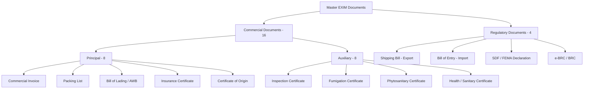

# Unit I: Institutional Framework & Documentation
## 2-Page Quick Revision Sheet ("Last 2 Hours" Exam Cram)

---

### 1. WTO Multilateral Institutional Framework

- **Genesis:** Established on **1 January 1995** via the **Marrakesh Agreement**, replacing GATT 1947 after the Uruguay Round (1986–1994). Headquarters: Geneva, Switzerland.
- **Three Core Legal Pillars:**
  1. **Most-Favoured-Nation (MFN - GATT Article I):** Equal treatment to all WTO trading partners. If you grant a tariff cut to one member, you must immediately and unconditionally extend it to all members. *(Exceptions: Regional Free Trade Agreements under Art. XXIV, GSP/preferential tariffs for developing nations).*
  2. **National Treatment (GATT Article III):** Imported goods, once they have cleared customs and paid border tariffs, must be treated no less favourably than domestically produced goods (applies to internal taxes, VAT/GST, and domestic regulations).
  3. **Tariff Binding (GATT Article II):** Countries agree on maximum tariff ceilings ("bound rates"). Applied rates can be lower, but cannot exceed bound rates without formal renegotiation/compensation.
- **Single Undertaking Principle:** *"Nothing is agreed until everything is agreed."* Members must accept the entire WTO agreement package; no cherry-picking (contrast with plurilateral GATT codes).
- **Major WTO Agreements:**
  - **GATS:** General Agreement on Trade in Services (4 Modes: 1-Cross border supply, 2-Consumption abroad, 3-Commercial presence, 4-Presence of natural persons).
  - **TRIPS:** Trade-Related Aspects of Intellectual Property Rights (Patents: 20 years, Copyrights, Trademarks, Geographical Indications).
  - **TRIMS:** Trade-Related Investment Measures (bans local content requirements and foreign exchange balancing).
  - **Agreement on Agriculture (AoA):**
    - *Green Box:* Non-trade-distorting government support (R&D, pest control, infrastructure) — unlimited.
    - *Blue Box:* Direct payments under production-limiting programs — permitted.
    - *Amber Box:* Trade-distorting support (MSP, input subsidies) — subject to *De Minimis* limits (10% of agricultural production value for developing nations like India, 5% for developed nations).
  - **Trade Facilitation Agreement (TFA - Bali 2013, in force 2017):** Expedited customs clearance, advance rulings, paperless trade, transit freedom.
- **Dispute Settlement Understanding (DSU):**
  - **Consultations:** 60 days mandatory bilateral talk period.
  - **Panel Establishment & Examination:** 6 to 9 months.
  - **Appellate Body:** 60 to 90 days (presently functionally paralyzed due to lack of quorum of members; dispute parties use interim arbitration).
  - **Negative / Reverse Consensus Rule:** A panel report or appellate ruling is **automatically adopted** unless *every single member* present in the Dispute Settlement Body (DSB) votes against it (meaning even the winning party must vote against its own victory to block it).

---

### 2. Export Promotion Agencies Ecosystem

| Body / Agency | Apex Ministry / Statute | Core Mandate & Functions | Key Statutory Document Issued |
|---|---|---|---|
| **DGFT** (Directorate General of Foreign Trade) | Ministry of Commerce & Industry / FT(D&R) Act 1992 | Apex trade administrator; formulates/executes Foreign Trade Policy (FTP); administers duty remission & license schemes. | **IEC** (Importer-Exporter Code); Advance Authorizations; EPCG Licenses. |
| **EPCs** (Export Promotion Councils - e.g., EEPC, AEPC) | Autonomous / Under Dept of Commerce | Sector-specific promotion; acts as bridge between trade and government; market intelligence, trade delegations abroad. | **RCMC** (Registration-cum-Membership Certificate) mandatory for FTP benefits. |
| **FIEO** (Federation of Indian Export Organisations) | Ministry of Commerce | Apex apex coordinating body for all export promotion councils, service exporters, and multi-product export houses. | RCMC for multi-product / merchant / service exporters. |
| **Commodity Boards** (Tea, Coffee, Spices, Rubber, Tobacco) | Statutory Acts / Ministry of Commerce | Production, domestic development, research, and export promotion of traditional agro-commodities. | RCMC & export registration for designated plantation crops. |
| **APEDA & MPEDA** | Ministry of Commerce | Agricultural & Processed Food Products (APEDA) and Marine Products (MPEDA) export infrastructure, standards, and global promotion. | Registration certificates, packhouse accreditation, health clearances. |
| **EXIM Bank of India** | EXIM Bank Act 1981 / Dept of Financial Services | Apex international trade financing institution; provides Lines of Credit (LoC) to foreign governments, buyer's credit, and project export finance. | Concessional export credit lines, overseas project finance guarantees. |
| **ECGC** (Export Credit Guarantee Corporation) | Ministry of Commerce | State export credit insurer; protects Indian exporters against foreign commercial/political credit defaults and provides bank credit guarantees. | Credit insurance policies (SCR), Packing Credit Guarantees to banks. |
| **EIC** (Export Inspection Council) | Export (QC&I) Act 1963 / Ministry of Commerce | Mandatory statutory pre-shipment quality inspection and certification for notified export products. | **Certificate of Inspection**; Certificate of Export Worthiness. |
| **IIP** (Indian Institute of Packaging) | Ministry of Commerce & Industry | Packaging research, testing of hazardous cargo packaging (UN certified containers), training, export packaging standards. | **UN Packaging Certificate** for hazardous cargo transport. |
| **DGCIS** (Directorate General of Commercial Intelligence & Statistics) | Ministry of Commerce (Kolkata) | Official statutory compiler, aggregator, and publisher of India's foreign trade statistics. | Monthly Foreign Trade Statistics Reports. |

---

### 3. Chronological 15-Step Export Execution Pipeline

1. **Entity Formation:** Proprietorship, Partnership, LLP, or Pvt Ltd registered with PAN.
2. **Bank Account & AD Code:** Current account with an Authorized Dealer (AD Category-I) Bank; 14-digit AD Code registration.
3. **Obtain IEC:** Online 10-digit PAN-based Importer-Exporter Code from DGFT (`dgft.gov.in`).
4. **Obtain RCMC:** Register with appropriate EPC/Commodity Board/FIEO to claim FTP benefits.
5. **Market Selection & Buyer Discovery:** Secondary research (DGCIS/ITC Trade Map) and direct buyer inquiry.
6. **Proforma Invoice & Quotation:** Formal pricing based on chosen Incoterm 2020 (FOB, CIF, CFR) with payment terms.
7. **Sales Contract Finalization:** Mutual agreement incorporating dispute resolution, CISG, and force majeure.
8. **Export Finance (Packing Credit):** Apply to AD bank with confirmed order/LC for pre-shipment working capital.
9. **Procurement & Manufacturing:** Sourcing raw materials under GST LUT (zero-rated) or Advance Authorization.
10. **Pre-Shipment Inspection:** Certification via EIA/EIC, Agmark, or buyer's designated agency (SGS).
11. **Marine Cargo Insurance:** Secure policy/certificate covering transit risk according to Incoterm (ICC A/B/C).
12. **Customs Clearance (Shipping Bill):** File Shipping Bill on ICEGATE -> Goods arrival at port/CFS -> Inspection -> **Let Export Order (LEO)**.
13. **Loading & Transport (Bill of Lading):** Cargo stuffed in vessel -> Carrier issues **Mate's Receipt** -> Exchanged for **Ocean Bill of Lading (B/L)** or **Air Waybill (AWB)**.
14. **Documentary Negotiation:** Submit complete document suite (Invoice, B/L, Insurance, COO) to AD bank for collection/LC payment.
15. **Realization of Proceeds:** Foreign exchange realized within **9 months**; bank generates **e-BRC** and closes entry on RBI's **EDPMS**; claim RoDTEP/Duty Drawback incentives.

---

### 4. Master Documentation Classification & Key Document Fields

#### Key Document Field Checklist
- **Commercial Invoice (ADS Format):** Exporter name/address, Consignee name/address, Invoice No. & Date, IEC, AD Code, Buyer Order No., Incoterm (e.g., CIF Hamburg, Incoterms 2020), Terms of Payment (e.g., 60-day Usance LC), Shipping details (Vessel/Flight, Port of Loading, Port of Discharge), Marks & Numbers, ITC(HS) 8-digit code, Description of goods, Quantity, Unit Price, Total FOB/CIF Value in Foreign Currency, Exporter's authorized signature.
- **Packing List:** Detailed breakdown of packages: Package No., Box dimensions (L x W x H), Net Weight, Gross Weight, Volume in CBM (Cubic Meters), Container Number, Seal Number. *(Mandatory: Total net weight must not exceed total gross weight).*
- **Ocean Bill of Lading (B/L):** Shipper, Consignee (*"To Order of..."* for negotiable B/L), Notify Party, Ocean Vessel/Voyage, Port of Loading, Port of Discharge, Number of original B/Ls issued (usually 3/3), Freight Paid/Freight Collect, Clean notation, Date of on-board endorsement, Master/Agent signature. *(3-fold nature: Receipt for goods, Document of Title, Evidence of carriage contract).*
- **Auxiliary Certificates:**
  - *Phytosanitary Certificate:* Issued by Directorate of Plant Protection, Quarantine & Storage; certifies plant/agro cargo is free from quarantine pests.
  - *Fumigation Certificate:* Issued by accredited pest management agencies; certifies chemical fumigation treatment (Methyl Bromide / Phosphine) of timber/packaging wood compliant with ISPM-15.
  - *Health/Veterinary Certificate:* Issued by Animal Quarantine authorities; mandatory for meat, dairy, and animal derivative exports.
  - *Certificate of Origin (Preferential vs Non-Preferential):* Non-preferential issued by Chambers of Commerce; Preferential (for FTA/PTA tariff concessions) issued digitally via DGFT Common Portal (`coo.dgft.gov.in`).
