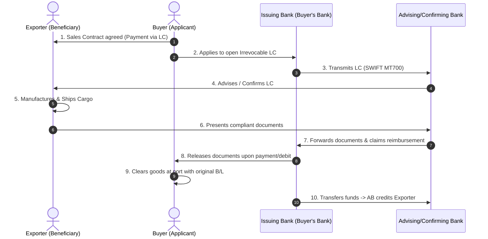

# Unit II: International Trade Operations
## 2-Page Quick Revision Sheet ("Last 2 Hours" Exam Cram)

---

### 1. Statutory & Regulatory Architecture

- **Foreign Trade (Development & Regulation) Act, 1992 (FT(D&R) Act):** Apex governing statute; repealed the old Import and Export (Control) Act, 1947. Empowers the Central Government to formulate and announce the **Foreign Trade Policy (FTP)** and appoint the **DGFT**. Grants power to prohibit, restrict, or regulate EXIM in public interest.
- **Foreign Trade Policy 2023 (Effective 1 April 2023):**
  - **Dynamic, Open-Ended Architecture:** No sunset 5-year end date; revised continuously through trade notices.
  - **Four Core Pillars:** (1) Incentive to Remission, (2) Export promotion through Collaboration (Districts as Export Hubs), (3) Ease of Doing Business (Process automation & reduced transaction costs), (4) Emerging Areas (E-commerce exports, SCOMET, Indian Rupee internationalization).
- **Categorization of Goods under ITC(HS):**
  - *Free:* Freely importable/exportable without any licensing or restriction.
  - *Restricted:* Requires an explicit license / authorization from DGFT.
  - *Prohibited:* Completely banned (e.g., wild animals, narcotic drugs, beef, counterfeit items).
  - *Canalised / State Trading Enterprises (STEs):* Can only be imported/exported through designated state agencies (e.g., MMTC, STC, Food Corporation of India for food grains, IOCL for petroleum).
- **Statutory Intersection:**
  - *Customs Act, 1962:* Controls physical movement at borders, valuation, classification, and tax assessment.
  - *FEMA, 1999:* Regulates foreign exchange realization and cross-border payments through Authorized Dealer banks.
  - *GST Regime (IGST Act 2017, Sec 16):* Exports are **Zero-Rated Supplies**. Two options: (a) Export under **Letter of Undertaking (LUT)** without paying IGST, or (b) Export on payment of IGST and claim automatic electronic refund via ICEGATE.
  - *SCOMET:* Special Chemicals, Organisms, Materials, Equipment and Technologies (Dual-use items subject to strict inter-ministerial licensing).

---

### 2. Export Sales Contract & Dispute Resolution

- **Legal Validity:** Formed when a valid **Offer** (Proforma Invoice / Quotation) is unconditionally **Accepted** with mutual consideration (Indian Contract Act, 1872 / CISG).
- **CISG (UN Convention on Contracts for the International Sale of Goods, 1980):** Uniform international sales law governing formation and rights/obligations. *(Note: India is not yet a formal signatory, but Indian exporters frequently encounter CISG choice-of-law clauses in contracts with European/US buyers).*
- **10 Essential Contract Clauses:**
  1. *Preamble & Parties:* Full legal identities and corporate addresses.
  2. *Description of Goods:* Technical specifications, grade, model, and ITC(HS) 8-digit code.
  3. *Quantity & Tolerances:* More or Less clause (e.g., +/- 5% at seller's option for bulk commodities).
  4. *Price & Incoterms 2020:* Explicitly stated currency and Incoterm (e.g., USD 25,000 CIF Rotterdam, Incoterms 2020).
  5. *Delivery / Shipment Schedule:* Precise shipment window and port of loading/discharge; partial shipments/transshipment permitted or prohibited.
  6. *Payment Terms:* Currency, method (LC, D/P, D/A, Advance), and credit period (e.g., 60 days from B/L date).
  7. *Inspection:* Designated pre-shipment agency (e.g., SGS/Bureau Veritas) whose certificate is final.
  8. *Force Majeure:* Relieves parties of liability if performance is prevented by unforeseen extraordinary events (war, earthquake, embargo, pandemic).
  9. *Governing Law & Jurisdiction:* Choice of governing legal system.
  10. *Arbitration Clause:* Institutional arbitration (e.g., ICC Paris, SIAC Singapore, ICA New Delhi); faster, confidential, and enforceable worldwide under the **New York Convention, 1958**.

---

### 3. International Payment Hierarchy & Letter of Credit (LC)

#### Payment Risk Hierarchy (Lowest to Highest Risk for Exporter)
1. **Advance Payment (100% Cash in Advance):** Exporter receives money before manufacturing/shipping. Zero credit risk for seller; maximum risk for buyer.
2. **Letter of Credit (LC / Documentary Credit):** Bank replaces buyer's creditworthiness. Governed by **ICC UCP 600**. Payment guaranteed upon presentation of strictly compliant documents.
3. **Documentary Collection - D/P (Documents Against Payment / Sight Collection):** Governed by **ICC URC 522**. Exporter sends documents to buyer's bank; bank releases title documents only when buyer pays in full.
4. **Documentary Collection - D/A (Documents Against Acceptance / Usance Collection):** Bank releases title documents to buyer upon buyer accepting a Bill of Exchange to pay on a future date (e.g., 60/90 days). Exporter faces default risk after buyer has taken goods.
5. **Open Account:** Exporter ships goods, transfers title documents directly to buyer, and awaits payment after agreed credit period (30–90 days). Maximum risk for exporter; lowest risk for buyer.
6. **Consignment Sale:** Exporter retains title while goods are placed in foreign agent's warehouse; paid only when goods are sold to end-users. Highest inventory/market risk.

#### The 10-Step Letter of Credit (LC) Cycle

#### Vital UCP 600 Rules
- **Article 4 (Autonomy of Credit):** The LC is completely separate from the underlying sales contract. Banks are concerned with documents alone, not goods.
- **Article 14 (Standard for Examination):** Banks have a maximum of **5 banking days** following receipt to examine documents and declare whether they comply or refuse them.
- **Article 34 (Disclaimer on Documents):** Banks assume no liability for the accuracy, falsification, legal validity, or description of goods in documents.

---

### 4. Incoterms 2020 Master Decision Matrix

*Created and published by the International Chamber of Commerce (ICC), Paris. Contains **11 Rules**.*

| Group | Incoterm 2020 Rule | Mode of Transport | Delivery / Risk Transfer Point | Freight Paid By | Marine Insurance By |
|:---:|---|---|---|---|---|
| **E** | **EXW** (Ex Works) | Any Mode | At seller's factory/warehouse (buyer loads vehicle). | Buyer | Buyer |
| **F** | **FCA** (Free Carrier) | Any Mode | At named place/carrier depot, loaded on buyer's transport. | Buyer | Buyer |
| **F** | **FAS** (Free Alongside Ship) | Sea / Inland Waterway | Alongside the vessel at named port of shipment. | Buyer | Buyer |
| **F** | **FOB** (Free On Board) | Sea / Inland Waterway | **On board the vessel** at named port of shipment. | Buyer | Buyer |
| **C** | **CPT** (Carriage Paid To) | Any Mode | Delivered to first carrier; risk transfers *at origin*. | **Seller** (to destination) | Buyer |
| **C** | **CIP** (Carriage & Insurance Paid) | Any Mode | Delivered to first carrier; risk transfers *at origin*. | **Seller** (to destination) | **Seller (ICC A - All Risks)** |
| **C** | **CFR** (Cost and Freight) | Sea / Inland Waterway | **On board the vessel**; risk transfers *at loading port*. | **Seller** (to destination port) | Buyer |
| **C** | **CIF** (Cost, Insurance & Freight) | Sea / Inland Waterway | **On board the vessel**; risk transfers *at loading port*. | **Seller** (to destination port) | **Seller (ICC C - Minimum)** |
| **D** | **DAP** (Delivered at Place) | Any Mode | At buyer's destination, ready for unloading (uncleaned). | Seller | Seller |
| **D** | **DPU** (Delivered at Place Unloaded) | Any Mode | At destination terminal, **unloaded by seller**. | Seller | Seller |
| **D** | **DDP** (Delivered Duty Paid) | Any Mode | At buyer's door, **all import duties/taxes paid by seller**. | Seller | Seller |

> [!IMPORTANT]
> **Key Differences in Incoterms 2020:**
> 1. **DPU replaced DAT (Delivered at Terminal):** Place of delivery can now be *any* location, not just a transport terminal.
> 2. **Divergent Insurance Levels in CIF vs CIP:** CIF requires minimum cover (**ICC C**); CIP requires maximum all-risk cover (**ICC A**).
> 3. **FCA with On-Board B/L:** Allows parties to agree that the buyer instructs the carrier to issue an On-Board Bill of Lading to the seller before transit for LC presentation.

---

### 5. Export Shipment & Import Customs Workflows

- **Export Logistics Pipeline:**
  1. *Booking & Stuffing:* Shipping space booked; container stuffed at factory or Container Freight Station (CFS) / Inland Container Depot (ICD).
  2. *Filing Shipping Bill:* Filed electronically on ICEGATE under Sec 50 of Customs Act.
  3. *Appraisal & Examination:* Customs appraiser verifies HS code and value; Customs officer physically inspects goods/container seal.
  4. *Let Export Order (LEO):* Customs gives official statutory permission to load goods onto vessel.
  5. *Loading & Mate's Receipt:* Port loading under supervision of ship's officer; Master/Chief Mate issues **Mate's Receipt**.
  6. *Issuance of Bill of Lading (B/L):* Shipping line exchanges Mate's Receipt for signed original Negotiable Ocean Bill of Lading.
- **Import Clearance Pipeline:**
  1. *Filing IGM:* Shipping line files **Import General Manifest (IGM)** prior to vessel arrival under Sec 30.
  2. *Filing Bill of Entry:* Importer/CHA files **Bill of Entry (B/E)** on ICEGATE under Sec 46 (White = Home Consumption, Yellow = Into-Bond/Warehousing, Green = Ex-Bond for home consumption).
  3. *Customs Assessment:* Valuation under Customs Valuation Rules, HS classification, and duty computation.
  4. *Duty Payment:* Electronic payment through ICEGATE / ECL (Electronic Cash Ledger).
  5. *Out of Charge (OOC):* Customs officer grants official statutory release order under Sec 47. Custodian releases goods.
- **Demurrage vs Detention:**
  - *Demurrage:* Storage penalty charged by the port/terminal custodian for cargo remaining inside port premises beyond free period (typically 3–5 days).
  - *Detention:* Equipment detention fee charged by the shipping line for retaining their empty container outside the port premises beyond the allowed free time (typically 7–14 days).

---

### 6. Central Excise Clearance & Post-GST Position

- **Traditional Central Excise Regime (Historical Syllabus Focus):**
  - *Rule 18 (Rebate):* Manufacturer pays central excise duty on finished export goods, exports under form **ARE-1** (Application for Removal of Excisable Goods for Export), gets customs endorsement, and claims refund (rebate) from Central Excise maritime commissioner.
  - *Rule 19 (Bond / LUT):* Goods manufactured and exported without payment of excise duty against execution of general bond (Form B-1) or Letter of Undertaking, accompanied by procurement form **CT-1** for duty-free raw material sourcing.
- **Modern Post-GST Position (Examiner-Safe Update):**
  - Central Excise is subsumed into GST for 99% of commodities (except 5 petroleum products and alcoholic liquor).
  - Governed by **Section 16 of the IGST Act, 2017** (Zero-Rated Supply).
  - Exporter files **LUT (Letter of Undertaking)** online on GST portal annually; exports with zero tax; accumulated Input Tax Credit (ITC) refunded via RFD-01.
  - Alternatively, exporter pays IGST; Shipping Bill itself functions as the refund application on ICEGATE, and refund is credited directly to bank account upon matching with GSTR-1.

---

### 7. Customs EDI, ICEGATE & RMS Architecture

- **ICES (Indian Customs EDI System):** The core automated processing engine operating at 250+ customs ports/airports/ICDs. Handles automated document assessment, duty calculation, and clearance tracking.
- **ICEGATE (Indian Customs Electronic Commerce/Data Interchange Gateway):** The national front-end web portal (`icegate.gov.in`) connecting trade entities (exporters, importers, CHAs, shipping lines, airlines, banks, custodian ports) to ICES.
- **RMS (Risk Management System):** Intelligent automated risk profiling engine. Eliminates routine manual examination:
  - *Green Channel (Facilitation):* High-compliance cargo (especially Authorized Economic Operators - AEOs) cleared automatically without assessment or physical examination (**Facilitation rate > 80%**).
  - *Targeted / Red Channel:* High-risk consignments selected for physical examination and appraiser assessment based on dynamic risk parameters.
- **SWIFT (Single Window Interface for Facilitating Trade):** Single common electronic window on ICEGATE integrating customs with 6 Partner Government Agencies (PGAs: FSSAI, Plant Quarantine, Animal Quarantine, Drug Controller, Wildlife Crime Control Bureau, Textile Committee). PGA NOCs obtained electronically without physical visits.
